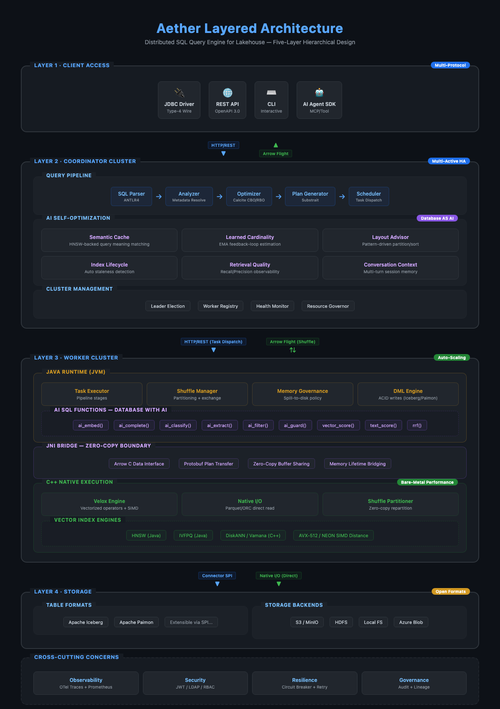
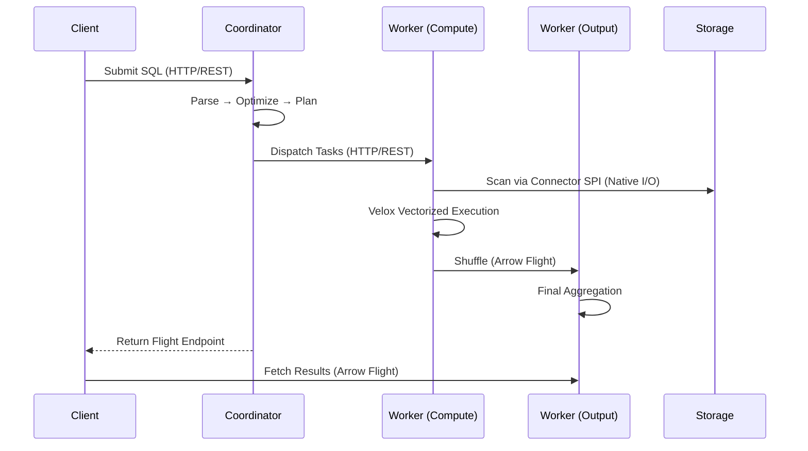

<p align="center">
  
</p>
<h1 align="center">Pangrova</h1>
<p align="center">
  <em>The Distributed SQL Query Engine Built for Lakehouse.</em>
</p>
<p align="center">
  <a href="LICENSE"></a>
  <a href="https://github.com/pangrova-project/pangrova/actions"></a>
  
  
  <a href="https://github.com/pangrova-project/pangrova/releases/latest"></a>
</p>

---

## What is Pangrova?

Pangrova is a next-generation **distributed SQL query engine** purpose-built for the lakehouse paradigm. It fuses the power of [Apache Calcite](https://calcite.apache.org/) cost-based optimization with [Meta Velox](https://velox-lib.io/) native vectorized execution, bridged by [Apache Arrow](https://arrow.apache.org/) zero-copy columnar transport.

The defining architectural bet is **read-write separation**: scan-heavy analytical workloads run in C++ at native speed, while full ACID transactional DML (MERGE INTO, INSERT, DELETE) runs in Java with deep integration into open table format SDKs — delivering both raw performance and correctness guarantees.

### Why Pangrova?

| Dimension | Pangrova's Approach |
|-----------|-------------------|
| **Performance** | C++ Velox vectorized execution + Arrow zero-copy JNI — no serialization overhead between Java and native |
| **SQL Completeness** | Full ANSI SQL + lakehouse extensions (time-travel, MERGE INTO, INSERT OVERWRITE, COMPACT, VACUUM) |
| **Open Formats** | First-class Apache Iceberg & Apache Paimon connectors via pluggable SPI |
| **Scalability** | Multi-active Coordinator cluster (no SPOF) + auto-scaling Worker pool |
| **Extensibility** | Trino-style Connector SPI — build your own connector without touching engine internals |
| **Observability** | OpenTelemetry tracing, Prometheus metrics, structured logging — production-ready from day one |
| **Enterprise Security** | JWT / LDAP / OAuth2 authentication, RBAC, column masking, row-level filtering |
| **AI-Native** | Vector search, hybrid retrieval, in-DB embeddings, LLM UDFs — AI is a SQL primitive, not an external service |

### Vision

> **Make lakehouse analytics as fast as a dedicated data warehouse, with AI built into every query — while keeping data in open formats and eliminating data silos.**

Pangrova aims to be the **unified analytical + AI interface** for modern data platforms — enabling organizations to query petabyte-scale data lakes with sub-second latency, run vector search and LLM inference in the same SQL statement, and achieve all of this with zero data duplication.

---

## Architecture

<p align="center">
  
</p>

### Data Flow



### Protocol Matrix

| Path | Protocol | Plane | Purpose |
|------|----------|-------|---------|
| Client → Coordinator | HTTP/REST | Control | Query submission, status, cancellation |
| Coordinator → Worker | HTTP/REST | Control | Task dispatch, health check |
| Worker ↔ Worker | Arrow Flight (gRPC) | Data | Shuffle exchange |
| Output Worker → Client | Arrow Flight (gRPC) | Data | Result streaming |
| Java ↔ C++ (JNI) | Protobuf + Arrow C Data Interface | Internal | Zero-copy cross-language bridge |

---

## AI-Native Capabilities

Pangrova treats AI as a **first-class citizen** — not an afterthought bolted onto a traditional query engine. Inspired by the approach of SingleStore, ClickHouse, and DuckDB's AI extensions, Pangrova integrates intelligence at both the **user-facing** and **self-optimizing** layers.

### Layer 1: Database WITH AI — AI as SQL Primitives

Use AI capabilities directly in SQL, no external pipelines needed:

```sql
-- In-database embedding generation
SELECT ai_embed('bge-m3', 'wireless headphones') AS embedding;

-- Vector similarity search with ANN acceleration (HNSW / IVFPQ)
SELECT id, vector_score(embedding, ai_embed('bge-m3', 'noise cancelling'))
FROM products
ORDER BY vector_score DESC
LIMIT 10;

-- Hybrid search: BM25 full-text + vector similarity with RRF fusion
SELECT id, rrf(text_score(description, 'headphones'), vector_score(embedding, ?)) AS score
FROM products
WHERE MATCH(description, 'headphones')
ORDER BY score DESC
LIMIT 10;

-- LLM invocation as a SQL function
SELECT ai_generate('gpt-4', 'Summarize: ' || content) FROM articles;
SELECT ai_classify('sentiment', review_text) FROM reviews;
```

| Capability | Description |
|-----------|-------------|
| **Vector Search** | HNSW, IVFPQ & DiskANN indexes, L2/Cosine/Inner Product distance, AVX512/NEON SIMD acceleration |
| **In-DB Embeddings** | `ai_embed(model, text)` — generate embeddings without leaving SQL |
| **Hybrid Search** | Unified `rrf()` / weighted fusion of BM25 text scores + vector similarity |
| **LLM Functions** | `ai_generate`, `ai_classify`, `ai_extract` — invoke external models as UDFs |
| **Full-Text Search** | Inverted index with BM25 scoring, `MATCH()` + `text_score()` |
| **Auto-Embedding DDL** | Declarative column-level embedding configuration |

### Layer 2: Database AS AI — Self-Optimizing Intelligence

The engine observes, learns, and optimizes itself — no DBA intervention required:

| Capability | What It Does |
|-----------|---------------|
| **Semantic Cache** | Cache results by query *meaning*, not exact SQL text — hit rate 3-5× higher |
| **Retrieval Quality Observability** | Continuously measure recall/precision of AI search results |
| **Vector Index Lifecycle** | Auto-detect staleness, recommend rebuild, advise optimal index type |
| **Learned Cardinality Estimation** | Replace histogram guesses with ML models trained on execution feedback |
| **Intelligent Data Layout Advisor** | Recommend partition/sort/compaction from observed query patterns |
| **Conversation-Aware Context** | Multi-turn session memory for AI agent interactions |

### Why This Matters

> Traditional databases treat AI as an external concern — embeddings are pre-computed elsewhere, vector search is a separate service, and the optimizer never learns from execution.
>
> Pangrova collapses this stack: **one engine, one SQL interface, one place where analytical queries and AI workloads co-execute** with shared memory, shared indexes, and shared optimization.

---

## Core Features

- **Native Vectorized Execution** — C++ Velox engine with Arrow columnar memory, achieving bare-metal throughput without JVM overhead
- **Read-Write Separation** — Scans in C++ for maximum read performance; DML in Java for full transactional correctness with Iceberg/Paimon SDKs
- **AI-Native SQL** — Vector search, hybrid retrieval, in-DB embeddings, LLM functions — all as first-class SQL operators
- **Adaptive Query Execution (AQE)** — Runtime partition coalescing, skew join handling, dynamic filtering based on live statistics
- **Lakehouse SQL Extensions** — Time-travel queries, MERGE INTO, INSERT OVERWRITE, COMPACT, VACUUM
- **Multi-Active HA** — No single point of failure; Coordinator cluster with leader election and warm Output Worker pool
- **Connector SPI** — Pluggable data source architecture (built-in Iceberg & Paimon; extensible to custom sources)
- **Streaming Ingestion** — CDC via Kafka, dynamic tables, continuous queries
- **Enterprise Security** — JWT/LDAP/OAuth2 authentication, fine-grained RBAC, column masking, row filtering
- **Full Observability** — OpenTelemetry distributed tracing, Prometheus metrics, structured key=value logging

---

## Tech Stack

| Layer | Technology |
|-------|-----------|
| SQL Parsing | ANTLR4 (custom grammar) |
| Query Optimization | Apache Calcite 1.36 |
| Plan Interchange | Substrait 0.23 |
| Native Execution | Meta Velox |
| Columnar Format | Apache Arrow 19.0 |
| Data Transport | Arrow Flight (gRPC 1.65) |
| Table Formats | Apache Iceberg 1.11, Apache Paimon 1.4 |
| Observability | OpenTelemetry 1.32, Micrometer 1.12 |
| Testing | JUnit 5, jqwik (property-based), TestContainers |

---

## Quick Start

### Prerequisites

| Requirement | Version | Notes |
|-------------|---------|-------|
| JDK | 17+ | `JAVA_HOME` must be set |
| Maven | 3.8+ | For building from source |
| Docker | 20+ | Required for integration tests (TestContainers) |

### Build from Source

```bash
git clone https://github.com/pangrova-project/pangrova.git
cd pangrova
mvn clean install -DskipTests
```

### Start in Development Mode

The fastest way to get started — runs Coordinator and Worker in a single JVM:

```bash
./bin/pangrova-standalone.sh
```

The engine is now listening on `http://localhost:8080`.

### Start a Distributed Cluster

```bash
# Terminal 1: Start Coordinator
./bin/pangrova-coordinator.sh

# Terminal 2: Start Worker (auto-registers with Coordinator)
./bin/pangrova-worker.sh
```

### Run Your First Query

```bash
./bin/pangrova-cli.sh --host localhost --port 8080
```

```sql
-- Verify the cluster is running
SELECT * FROM system.runtime.nodes;

-- Query your lakehouse
SELECT count(*), region
FROM iceberg.sales.orders
WHERE order_date >= TIMESTAMP '2024-01-01'
GROUP BY region
ORDER BY count(*) DESC;
```

### Stop All Processes

```bash
./bin/pangrova-stop.sh --all
```

---

## Documentation

| Document | Description |
|----------|-------------|
| [Architecture Overview](docs/architecture/01-overview.md) | System design, core principles, protocol mapping |
| [Distributed Architecture](docs/architecture/02-distributed-architecture.md) | Coordinator/Worker design, HA, scaling |
| [Query Execution](docs/architecture/03-query-execution.md) | End-to-end query lifecycle |
| [Native Layer](docs/architecture/05-native-layer.md) | Velox integration, JNI bridge, memory model |
| [Connector Design](docs/architecture/06-connector-design.md) | SPI contracts, connector development |
| [Configuration Reference](docs/develop/configuration/CONFIG.md) | All configuration options with defaults |
| [Developer Guide](docs/architecture/24-developer-guide.md) | Development setup, code standards, testing |

---

## Contributing

We welcome contributions of all kinds — bug reports, feature requests, documentation improvements, and code contributions.

### How to Contribute

1. **Report Issues** — Search [existing issues](https://github.com/pangrova-project/pangrova/issues) first, then file a new one with reproduction steps
2. **Submit PRs** — Fork → branch (`feature/xxx` or `fix/xxx`) → develop → `mvn clean install` → PR
3. **Follow Standards** — See [CONTRIBUTING.md](CONTRIBUTING.md) for code style, testing rules, and PR checklist

### Development Principles

- **No mock frameworks** — Use real implementations, TestContainers, and property-based testing (jqwik)
- **Constructor injection only** — No Spring DI, no `@Autowired`
- **Immutable by default** — Records, final fields, builders
- **Strict module boundaries** — SPI/protocol modules never depend on implementations

### Community

- [Code of Conduct](CODE_OF_CONDUCT.md) — Community standards
- [Security Policy](SECURITY.md) — Reporting vulnerabilities
- [Issue Templates](.github/ISSUE_TEMPLATE/) — Bug reports and feature requests

---

## Roadmap

- [ ] **RAG Pipeline Operator** — Native retrieve-augment-generate as a single SQL statement
- [ ] **Federated Query** — Cross-catalog joins with predicate pushdown
- [ ] **Materialized Views** — Automatic refresh, query rewriting
- [ ] **GPU Acceleration** — RAPIDS integration for AI inference and compute-intensive operations
- [ ] **Serverless Mode** — Auto-suspend/resume, pay-per-query deployment

---

## Acknowledgements

Pangrova stands on the shoulders of outstanding open-source projects:

- [Apache Calcite](https://calcite.apache.org/) — Query optimization framework
- [Meta Velox](https://velox-lib.io/) — Native vectorized execution library
- [Apache Arrow](https://arrow.apache.org/) — Columnar in-memory format and Flight RPC
- [Substrait](https://substrait.io/) — Cross-language plan specification
- [Apache Iceberg](https://iceberg.apache.org/) — Open table format for huge analytic datasets
- [Apache Paimon](https://paimon.apache.org/) — Streaming lakehouse table format

---

## License

Pangrova is licensed under the [Apache License 2.0](LICENSE).

```
Copyright 2024 The Pangrova Authors

Licensed under the Apache License, Version 2.0 (the "License");
you may not use this file except in compliance with the License.
You may obtain a copy of the License at

    http://www.apache.org/licenses/LICENSE-2.0

Unless required by applicable law or agreed to in writing, software
distributed under the License is distributed on an "AS IS" BASIS,
WITHOUT WARRANTIES OR CONDITIONS OF ANY KIND, either express or implied.
See the License for the specific language governing permissions and
limitations under the License.
```
