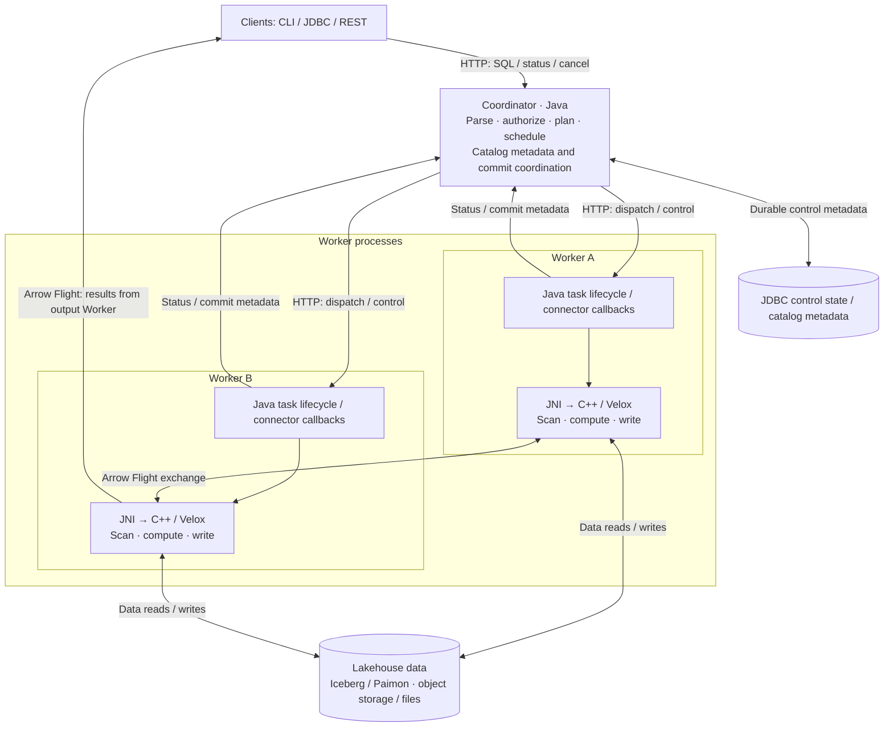

<p align="center">
  
</p>

<h1 align="center">Pangrova</h1>
<p align="center">Distributed SQL for open lakehouses.</p>
<p align="center">
  <a href="LICENSE"></a>
  <a href="https://github.com/pangrova/pangrova/actions/workflows/ci.yml"></a>
  
  
</p>

Pangrova is an open-source distributed SQL engine for lakehouse analytics and AI
retrieval. It combines Apache Calcite planning with C++20 / Velox execution,
Arrow Flight data exchange, and connectors for Apache Iceberg and Apache Paimon.

**Under active development.** Capabilities vary by execution path and connector;
production qualification is ongoing. See [current capability status](docs/getting-started/capability-status.md)
before evaluating a workload.

[Documentation](https://pangrova.github.io/pangrova/) ·
[Quickstart](docs/getting-started/quickstart.md) ·
[Roadmap](docs/getting-started/roadmap.md) ·
[Contributing](CONTRIBUTING.md)

## Architecture



The Coordinator owns planning and metadata publication. Workers execute relational
work through JNI, exchange data with each other, and stream query results directly
to clients. Connector callbacks support Worker writes; the Coordinator publishes
the final catalog commit from commit metadata. See the
[architecture overview](docs/architecture/overview.md) for detailed contracts.

## Quick start

Use JDK 17, Maven 3.9+, Python 3.10+, Gradle 8.14.4, and the native toolchain
listed in the [developer guide](docs/contributing/developer-guide.md).
A first native build compiles external dependencies and can take substantial time.

```bash
git clone https://github.com/pangrova/pangrova.git
cd pangrova
.pangrova/scripts/build-iceberg-sdk-candidate.sh
./pangrova-worker-native/bin/build-native.sh
mvn clean install -DskipTests
./bin/pangrova-standalone.sh
```

In another terminal:

```bash
./bin/pangrova-cli.sh --host localhost --port 8080
```

```sql
SELECT 1 + 1 AS result;
```

The build commands prepare the pinned Iceberg SDK and packaged native library;
they do not run the full test suite. Follow the [quickstart](docs/getting-started/quickstart.md)
for configuration, catalogs, and troubleshooting.

## Community

Use [issues](https://github.com/pangrova/pangrova/issues) for bugs and feature requests.
See [CONTRIBUTING.md](CONTRIBUTING.md), the [Code of Conduct](CODE_OF_CONDUCT.md),
and [security policy](SECURITY.md). Changes are tracked in [CHANGELOG.md](CHANGELOG.md).

## License

[Apache License 2.0](LICENSE). Third-party acknowledgements are in [NOTICE](NOTICE).
