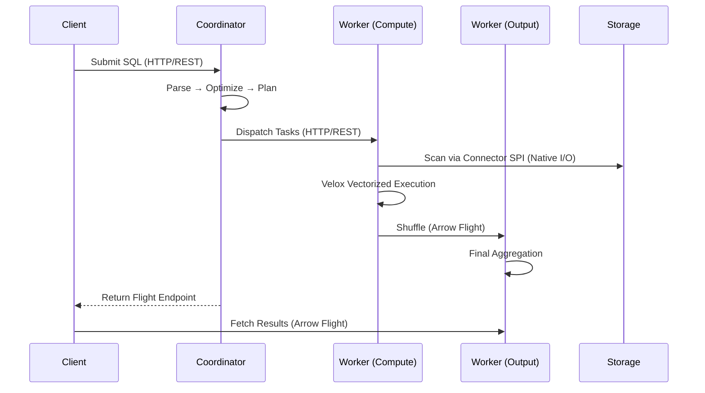

<p align="center">
  
</p>
<h1 align="center">Pangrova</h1>
<p align="center">
  <em>The Distributed SQL Query Engine Built for Lakehouse.</em>
</p>
<p align="center">
  <a href="LICENSE"></a>
  <a href="https://github.com/pangrova-project/pangrova/actions"></a>
  
  
  <a href="https://github.com/pangrova-project/pangrova/releases/latest"></a>
</p>

---

## What is Pangrova?

Pangrova is a next-generation **distributed SQL query engine** purpose-built for the lakehouse paradigm. It fuses the power of [Apache Calcite](https://calcite.apache.org/) cost-based optimization with [Meta Velox](https://velox-lib.io/) native vectorized execution, bridged by [Apache Arrow](https://arrow.apache.org/) zero-copy columnar transport.

The defining architectural boundary is between coordination and execution: Java owns SQL planning,
scheduling, metadata, and final catalog commits, while C++ owns vectorized, read-dependent execution.
Metadata-only writes remain in Java; distributed writes return commit fragments to the coordinator for
one connector-owned atomic commit.

> **Vision:** make lakehouse analytics as fast as a dedicated data warehouse, with AI built into every query — while keeping data in open formats and eliminating data silos.

### Why Pangrova?

| Dimension | Pangrova's Approach |
|-----------|-------------------|
| **Performance** | C++ Velox vectorized execution with explicit Protobuf/Arrow IPC boundaries across JNI |
| **SQL** | ANSI-style query support plus lakehouse extensions, with support documented per statement |
| **Open Formats** | First-class Apache Iceberg & Apache Paimon connectors via pluggable SPI |
| **Scalability** | Coordinator/Worker execution with HA and resource-management components |
| **Extensibility** | Trino-style Connector SPI — build your own connector without touching engine internals |
| **AI-Native** | Vector, full-text, embedding, and model-provider primitives with maturity called out in the reference docs |
| **Observability** | OpenTelemetry provider SPIs, metrics, tracing, and structured-logging components |
| **Security** | Pluggable authentication plus authorization, masking, row-filter, and audit components; see configuration docs for the verified runtime surface |

---

## Quick Start

### Prerequisites

| Requirement | Version | Notes |
|-------------|---------|-------|
| JDK | 17+ | `JAVA_HOME` must be set |
| Maven | 3.9+ | For building from source |
| Docker | 20+ | Required for integration tests (TestContainers) |
| CMake + Ninja | 3.20+ | Optional — only for building the C++ native execution library |

### Build from Source

```bash
git clone https://github.com/pangrova-project/pangrova.git
cd pangrova
./pangrova-worker-native/bin/setup-native-build-env.sh
./pangrova-worker-native/bin/build-native.sh
mvn clean install -DskipTests
```

Pangrova ships as an integrated Java/native engine. The native library must be built and packaged
before executing queries through a Worker. See the
[Developer Guide](docs/contributing/developer-guide.md)):

```bash
cmake --preset dev-release -S pangrova-worker-native
cmake --build pangrova-worker-native/build --parallel
```

### Start in Development Mode

The fastest way to get started — runs Coordinator and Worker in a single JVM:

```bash
./bin/pangrova-standalone.sh
```

The engine is now listening on `http://localhost:8080`.

### Start a Distributed Cluster

```bash
# Terminal 1: Start Coordinator
./bin/pangrova-coordinator.sh

# Terminal 2: Start Worker (auto-registers with Coordinator)
./bin/pangrova-worker.sh

# Optional: check cluster health
./bin/pangrova-cluster-status.sh
./bin/pangrova-health-check.sh
```

> All scripts run in the foreground by default. Add `--daemon` to run in the
> background (PID files are written to `logs/`). A unified entry point,
> `bin/pangrova.sh`, wraps `start`, `stop`, `status`, `health-check`, `cli`,
> `catalog`, and `rolling-upgrade` subcommands.

### Run Your First Query

```bash
./bin/pangrova-cli.sh --host localhost --port 8080
```

```sql
-- Verify the engine responds
SELECT 1 + 1 AS result;

-- Inspect registered catalogs
SHOW CATALOGS;

-- Query your lakehouse after registering a catalog; see docs/getting-started/quickstart.md
SELECT count(*), region
FROM local_iceberg.sales.orders
WHERE order_date >= TIMESTAMP '2024-01-01'
GROUP BY region
ORDER BY count(*) DESC;
```

You can also submit queries over REST:

```bash
curl -X POST http://localhost:8080/v1/query/submit \
  -H "Content-Type: application/json" \
  -d '{"query": "SELECT 1 + 1 AS result"}'
```

### Stop All Processes

```bash
./bin/pangrova-stop.sh --all
```

> `pangrova-stop.sh` stops processes started with `--daemon` (via PID files in
> `logs/`). Foreground processes are stopped with `Ctrl+C`.

---

## Architecture

<p align="center">
  
</p>

### Data Flow



### Protocol Matrix

| Path | Protocol | Plane | Purpose |
|------|----------|-------|---------|
| Client → Coordinator | HTTP/REST | Control | Query submission, status, cancellation |
| Coordinator → Worker | HTTP/REST | Control | Task dispatch, health check |
| Worker ↔ Worker | Arrow Flight (gRPC) | Data | Shuffle exchange |
| Output Worker → Client | Arrow Flight (gRPC) | Data | Result streaming |
| Java ↔ C++ (JNI) | Protobuf + Arrow C Data Interface | Internal | Zero-copy cross-language bridge |

---

## Core Features

- **Native Vectorized Execution** — C++ Velox execution with Arrow columnar data and an explicit JNI protocol
- **Coordinated Distributed Writes** — read-dependent transforms run on Workers; the Coordinator performs the final Iceberg/Paimon catalog commit
- **AI-Native Primitives** — Vector search, embedding, reranking, and model-provider building blocks with support levels documented per feature
- **Adaptive Query Execution (AQE)** — Runtime partition coalescing, skew join handling, dynamic filtering based on live statistics
- **Lakehouse SQL Extensions** — Time travel, DML, and maintenance syntax with current support documented in the SQL reference
- **Multi-Active HA** — No single point of failure; Coordinator cluster with leader election and warm Output Worker pool
- **Connector SPI** — Pluggable data source architecture (built-in Iceberg & Paimon; extensible to custom sources)
- **Streaming Ingestion** — CDC via Kafka, dynamic tables, continuous queries
- **Enterprise Security** — JWT/LDAP/OAuth2 authentication, fine-grained RBAC, column masking, row filtering
- **Full Observability** — OpenTelemetry distributed tracing and metrics (OTLP export), structured key=value logging

---

## AI-Native Capabilities

Pangrova treats AI as a **first-class citizen** — not an afterthought bolted onto a traditional query engine. Intelligence is integrated at both the **user-facing** and **self-optimizing** layers.

### Database WITH AI — AI as SQL Primitives

Use AI capabilities directly in SQL, no external pipelines needed:

```sql
-- In-database embedding generation
SELECT ai_embed('bge_m3', 'wireless headphones') AS embedding;

-- Vector similarity search with ANN acceleration (HNSW / IVFPQ / DiskANN)
SELECT id, l2_distance(embedding, ARRAY[0.5, 0.3, 0.2, 0.0]) AS dist
FROM products
ORDER BY l2_distance(embedding, ARRAY[0.5, 0.3, 0.2, 0.0]) ASC
LIMIT 10;

-- Hybrid search: BM25 full-text + vector similarity with RRF fusion
SELECT id, title FROM products
WHERE MATCH(description, 'headphones')
ORDER BY l2_distance(embedding, ARRAY[0.5, 0.3, 0.2, 0.0]) ASC
LIMIT 10
RERANK BY rrf(60);

-- LLM invocation as a SQL function
SELECT ai_complete('llama3', 'Summarize: ' || content) FROM articles;
```

| Capability | Description |
|-----------|-------------|
| **Vector Search** | HNSW, IVFPQ & DiskANN indexes, L2/Cosine/Inner Product distance, AVX-512/AVX2/NEON SIMD acceleration |
| **In-DB Embeddings** | `ai_embed(model, text)` — generate embeddings without leaving SQL |
| **Hybrid Search** | `MATCH()` full-text + vector ORDER BY, fused via `RERANK BY rrf(k)` / `linear_combination(...)` |
| **LLM Functions** | `ai_complete`, `ai_classify`, `ai_summarize`, `ai_extract`, `ai_filter`, `ai_guard`, `ai_predict`, `ai_translate` — invoke external models as UDFs |
| **Multimodal AI** | `ai_describe_image`, `ai_parse_document`, `ai_transcribe`, `ai_ocr` over FILE inputs |
| **Full-Text Search** | Inverted index with BM25 scoring via the `MATCH()` predicate |
| **Auto-Embedding DDL** | `GENERATED ALWAYS AS (ai_embed(...))` columns + `CREATE EMBEDDING MODEL` declarative configuration |

### Database AS AI — Self-Optimizing Intelligence

The engine observes, learns, and optimizes itself — no DBA intervention required:

| Capability | What It Does |
|-----------|---------------|
| **Semantic Cache** | Cache results by query *meaning*, not exact SQL text — hit rate 3-5× higher |
| **Cardinality Feedback Learning** | Collect actual row counts from execution to correct stale statistics |
| **Vector Index Lifecycle** | Auto-detect staleness, recommend rebuild, advise optimal index type |
| **Data Layout Advisor** | Recommend partition/sort/compaction from observed query patterns |
| **Retrieval Quality Observability** *(planned)* | Continuously measure recall/precision of AI search results |
| **Conversation-Aware Context** *(planned)* | Multi-turn session memory for AI agent interactions |

> Traditional databases treat AI as an external concern — embeddings are pre-computed elsewhere, vector search is a separate service, and the optimizer never learns from execution. Pangrova collapses this stack: **one engine, one SQL interface, one place where analytical queries and AI workloads co-execute** with shared memory, shared indexes, and shared optimization.

---

## Tech Stack

| Layer | Technology |
|-------|-----------|
| SQL Parsing | ANTLR4 (custom grammar) |
| Query Optimization | Apache Calcite |
| Plan Interchange | Substrait |
| Native Execution | Meta Velox |
| Columnar Format | Apache Arrow |
| Data Transport | Arrow Flight (gRPC) |
| Table Formats | Apache Iceberg, Apache Paimon |
| Coordination & Protocol | Apache ZooKeeper (Curator), Protobuf / gRPC |
| Observability | OpenTelemetry |
| Testing | JUnit 5, jqwik (property-based), TestContainers |

For exact dependency versions, see the root [pom.xml](pom.xml).

---

## Repository Layout

| Module | Responsibility |
|--------|----------------|
| `pangrova-parser` | ANTLR4-based SQL parsing |
| `pangrova-planner` | Calcite-based optimization & Substrait plan generation |
| `pangrova-coordinator` | Cluster coordination, query lifecycle, HA |
| `pangrova-worker` | Java-side task management, DML execution |
| `pangrova-worker-native` | C++20 Velox execution engine, JNI bridge, vector indexes |
| `pangrova-native-bundle` | Per-platform packaging of the native JNI library |
| `pangrova-spi` / `pangrova-connector` | Connector SPI and built-in Iceberg / Paimon connectors |
| `pangrova-shuffle` | Shuffle exchange core and Celeborn integration |
| `pangrova-metadata` / `pangrova-indexing` | Catalog management and index services |
| `pangrova-streaming` | CDC ingestion and continuous queries |
| `pangrova-security` / `pangrova-governance` | Authentication, RBAC, masking, lineage |
| `pangrova-resource` / `pangrova-resilience` | Resource management and fault tolerance |
| `pangrova-observability` / `pangrova-operations` | Metrics, tracing, and ops tooling |
| `pangrova-protocol` | Protobuf message and REST API contract definitions |
| `pangrova-transport` | Arrow IPC / Arrow Flight decoding for clients |
| `pangrova-common` / `pangrova-config` | Shared utilities and the typed YAML configuration framework |
| `pangrova-standalone` | Single-JVM Coordinator + Worker entry point for dev/test |
| `pangrova-client` | CLI, JDBC, and REST clients |
| `pangrova-testing` | E2E, benchmark, chaos, fuzz, and smoke test suites |

---

## Documentation

| Document | Description |
|----------|-------------|
| [Getting Started](docs/getting-started/quickstart.md) | Installation and first-query walkthrough |
| [SQL Reference](docs/sql-reference/queries.md) | Supported SQL syntax and lakehouse extensions |
| [Vector Search](docs/sql-reference/functions/vector-search.md) | ANN indexes, similarity search, hybrid retrieval |
| [AI Functions](docs/sql-reference/functions/ai-functions.md) | `ai_embed`, `ai_complete`, and related functions |
| [Connectors](docs/getting-started/connectors/iceberg.md) | Iceberg and Paimon setup |
| [Clients](docs/getting-started/clients/jdbc.md) | CLI, JDBC, and REST client usage |
| [Architecture Overview](docs/architecture/overview.md) | System design, core principles, protocol mapping |
| [Configuration Reference](docs/configuration/reference.md) | Verified YAML keys, system properties, and environment variables |
| [Developer Guide](docs/contributing/developer-guide.md) | Development setup, code standards, testing |

The architecture index lives in [docs/architecture/](docs/architecture/index.md).

---

## Contributing

We welcome contributions of all kinds — bug reports, feature requests, documentation improvements, and code contributions.

### How to Contribute

1. **Report Issues** — Search [existing issues](https://github.com/pangrova-project/pangrova/issues) first, then file a new one with reproduction steps
2. **Submit PRs** — Fork → branch (`feature/xxx` or `fix/xxx`) → develop → `mvn clean install` → PR
3. **Follow Standards** — See [CONTRIBUTING.md](CONTRIBUTING.md) for code style, testing rules, and PR checklist

### Development Principles

- **No mock frameworks** — Use real implementations, TestContainers, and property-based testing (jqwik)
- **Constructor injection only** — No Spring DI, no `@Autowired`
- **Immutable by default** — Records, final fields, builders
- **Strict module boundaries** — SPI/protocol modules never depend on implementations

### Community

- [Code of Conduct](CODE_OF_CONDUCT.md) — Community standards
- [Security Policy](SECURITY.md) — Reporting vulnerabilities
- [Issue Templates](.github/ISSUE_TEMPLATE/) — Bug reports and feature requests

---

## Roadmap

- [ ] **RAG Pipeline Operator** — Native retrieve-augment-generate as a single SQL statement
- [ ] **Federated Query** — Cross-catalog joins with predicate pushdown
- [ ] **Materialized Views** — Automatic refresh, query rewriting
- [ ] **Retrieval Quality Observability** — Recall/precision measurement for AI search (designed, see [AI-Native Architecture](docs/architecture/ai-native.md))
- [ ] **Conversation-Aware Context** — Multi-turn session memory for AI agents (designed, see [AI-Native Architecture](docs/architecture/ai-native.md))
- [ ] **GPU Acceleration** — RAPIDS integration for AI inference and compute-intensive operations
- [ ] **Serverless Mode** — Auto-suspend/resume, pay-per-query deployment

---

## Acknowledgements

Pangrova stands on the shoulders of outstanding open-source projects:

- [Apache Calcite](https://calcite.apache.org/) — Query optimization framework
- [Meta Velox](https://velox-lib.io/) — Native vectorized execution library
- [Apache Arrow](https://arrow.apache.org/) — Columnar in-memory format and Flight RPC
- [Substrait](https://substrait.io/) — Cross-language plan specification
- [Apache Iceberg](https://iceberg.apache.org/) — Open table format for huge analytic datasets
- [Apache Paimon](https://paimon.apache.org/) — Streaming lakehouse table format

---

## License

Pangrova is licensed under the [Apache License 2.0](LICENSE).
