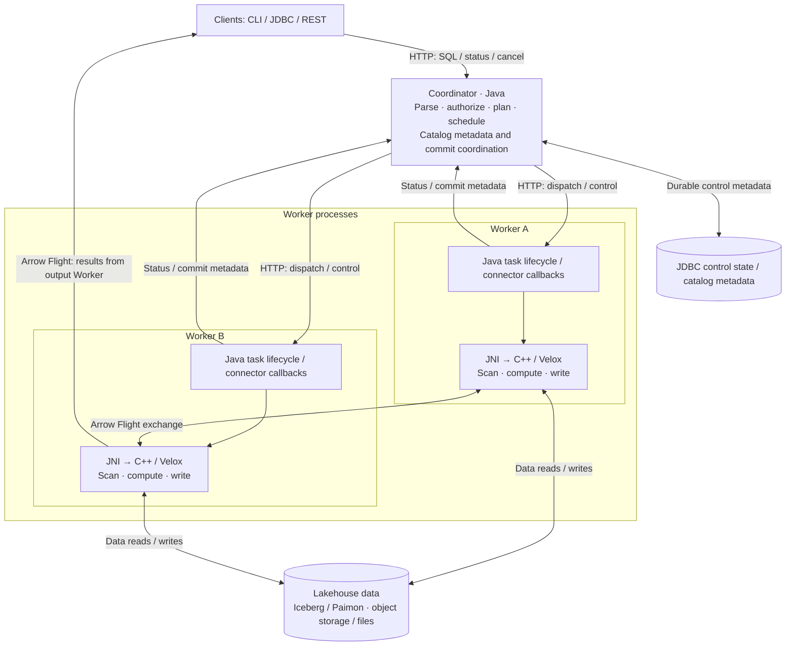

<p align="center">
  
</p>

<h1 align="center">Pangrova</h1>

<p align="center"><strong>Distributed SQL for open lakehouses.</strong></p>

<p align="center">
  <a href="LICENSE"></a>
  <a href="https://github.com/pangrova/pangrova/actions/workflows/ci.yml"></a>
  
  
</p>

Pangrova is an open-source distributed SQL engine for lakehouse analytics and AI
retrieval. It combines Apache Calcite planning with C++20 / Velox vectorized
execution, Arrow Flight data exchange, and connectors for Apache Iceberg and
Apache Paimon.

> **Status:** Under active development. Capabilities vary by execution path and
> connector, and production qualification is ongoing. Read the
> [current capability status](docs/getting-started/capability-status.md) before
> evaluating a workload.

## Highlights

- **Open lakehouse access** — query existing Iceberg and Paimon tables without
  migrating them into a proprietary warehouse.
- **Native execution** — Calcite plans the query; C++/Velox executes relational
  work; Arrow Flight carries columnar data and results.
- **Analytics and AI in one engine** — relational SQL, vector and full-text
  retrieval, and governed model invocation share one planning, execution, and
  governance path.
- **Correctness-first contracts** — table snapshots, index generations, model
  versions, tenant identity, and resource grants are bound into task admission
  and execution.
- **Extensible connectors** — a plugin Connector SPI with classloader isolation
  provides the extension point for additional table formats and data sources.
- **Familiar clients** — JDBC, REST, and CLI entry points for applications and
  data engineers.

Capability boundaries are documented per subsystem. The presence of syntax or an
SPI does not by itself establish end-to-end support.

## Architecture



The Coordinator owns planning, authorization, metadata, admission, scheduling,
and final catalog commit. Workers execute relational work through JNI, exchange
data with each other, and stream results from an Output Worker directly to
clients. Connector callbacks support Worker writes; the Coordinator publishes the
final catalog commit from commit metadata.

For the full execution model, see the
[architecture overview](docs/architecture/overview.md).

## Quick start

### Requirements

- JDK 17
- Maven 3.9+
- Python 3.10+
- Gradle 8.14.4 (used to build the pinned Iceberg SDK)
- CMake, Ninja, and a C++20 compiler
- Linux (x86_64/aarch64) or macOS (aarch64)
- Docker (container-based tests)

### Build and run

```bash
git clone https://github.com/pangrova/pangrova.git
cd pangrova

# Build the pinned Iceberg SDK, then the Native library and Java modules.
.pangrova/scripts/build-iceberg-sdk-candidate.sh
./pangrova-worker-native/bin/build-native.sh
mvn clean package -DskipTests

# Start a standalone Coordinator + Worker.
./bin/pangrova-standalone.sh
```

In another terminal, connect with the CLI:

```bash
./bin/pangrova-cli.sh --host localhost --port 8080
```

```sql
SELECT 1 + 1 AS result;
```

The first native build compiles external dependencies and can take substantial
time. See the [quickstart](docs/getting-started/quickstart.md) for configuration,
catalogs, and troubleshooting.

## Documentation

| Start here | What it covers |
|---|---|
| [Current capability status](docs/getting-started/capability-status.md) | Implemented paths, default wiring gaps, and qualification limits |
| [Quickstart](docs/getting-started/quickstart.md) | Build, standalone launch, first query, and troubleshooting |
| [Architecture overview](docs/architecture/overview.md) | Component ownership, execution boundaries, and protocol mapping |
| [SQL reference](docs/sql-reference/index.md) | Supported syntax, execution constraints, and connector requirements |
| [Configuration](docs/configuration/index.md) | Typed configuration model and key reference |
| [Deployment](docs/deployment/planning.md) | Docker, Helm/Kubernetes, distributed deployment, and production checklist |
| [Operations](docs/operations/index.md) | Day-2 operations, game days, and runbooks |
| [Roadmap](docs/getting-started/roadmap.md) | Development priorities and open items |
| [Developer guide](docs/contributing/developer-guide.md) | Local setup, module development, and connector development |

Documentation source lives in [`docs/`](docs/); the Docusaurus site sources are in
[`website/`](website/).

## Contributing

Use [issues](https://github.com/pangrova/pangrova/issues) for bugs and feature
requests. Read [CONTRIBUTING.md](CONTRIBUTING.md) for the development workflow,
and [AGENTS.md](AGENTS.md) for repository policy. The canonical rules live in
[`.pangrova/rules/`](.pangrova/rules/).

## License

[Apache License 2.0](LICENSE). Third-party acknowledgements are in [NOTICE](NOTICE).
