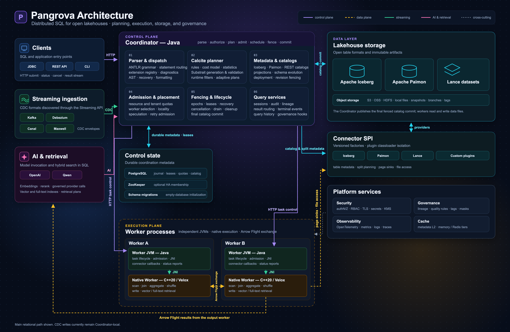

<p align="center">
  
</p>

<h1 align="center">Pangrova</h1>

<p align="center"><strong>Distributed SQL for open lakehouses.</strong></p>

<p align="center">
  <a href="LICENSE"></a>
  <a href="https://github.com/pangrova-io/pangrova/actions/workflows/ci.yml"></a>
  
  
</p>

Pangrova is an open-source distributed SQL engine for Apache Iceberg and Apache
Paimon lakehouses. It uses Calcite for SQL planning, Velox for native
execution, and Arrow Flight for data exchange. Vector and full-text retrieval
are available on specific execution paths; see the capability notes below.

**Try it:** [Start Pangrova](#quick-start), then run the
[three-row Iceberg example](docs/getting-started/quickstart.md#end-to-end-example-query-iceberg-data).
The [SQL fixture](examples/iceberg-smoke.sql) creates a local events table and
aggregates it to two clicks and one purchase.

> **Status:** Under active development. Capabilities vary by execution path and
> connector, and production qualification is ongoing. Read the
> [current capability status](docs/getting-started/capability-status.md) before
> evaluating a workload.

## Highlights

- **Open lakehouse access** — query existing Iceberg and Paimon tables, and managed
  Lance datasets, without migrating them into a proprietary warehouse.
- **Native execution** — Calcite plans the query; C++/Velox executes relational
  work; Arrow Flight carries columnar data and results.
- **Analytics and AI in one engine** — relational SQL, vector and full-text
  retrieval, and governed model invocation share one planning, execution, and
  governance path.
- **Correctness-first contracts** — table snapshots, index generations, model
  versions, tenant identity, and resource grants are bound into task admission
  and execution.
- **Extensible connectors** — a plugin Connector SPI with classloader isolation
  provides the extension point for additional table formats and data sources.
- **Familiar clients** — JDBC, REST, and CLI entry points for applications and
  data engineers.

Capability boundaries are documented per subsystem. The presence of syntax or an
SPI does not by itself establish end-to-end support.

## Architecture

<p align="center">
  
</p>

The Coordinator owns parsing, authorization, planning, admission, scheduling, and
final catalog commit. Workers execute relational work through JNI, exchange data
with each other over Arrow Flight, and stream results from an Output Worker
directly to clients. Connector callbacks support Worker writes; the Coordinator
publishes the final fenced catalog commit from returned commit metadata.

For the full execution model, see the
[architecture overview](docs/architecture/overview.md).

## Quick start

### Requirements

| Requirement | Version / notes |
|---|---|
| JDK | 17 |
| Maven | 3.9+ |
| Python | 3.10+ (contract generation) |
| Gradle | 8.14.4 (builds the pinned Iceberg SDK) |
| Native toolchain | CMake, Ninja, and a C++20 compiler |
| Operating system | Linux (x86_64/aarch64) or macOS (aarch64) |
| Docker | Required for container-based tests |

### Build from source

```bash
git clone https://github.com/pangrova-io/pangrova.git
cd pangrova

# Build the pinned Iceberg SDK, then the Native library and Java modules.
.pangrova/scripts/build-iceberg-sdk-candidate.sh
./pangrova-worker-native/bin/build-native.sh
mvn clean package -DskipTests
```

The first native build compiles external dependencies and can take substantial
time.

### Run a standalone instance

Standalone mode runs the Coordinator and a Worker in one JVM:

```bash
bin/pangrova-standalone.sh
```

The Coordinator listens on port `8080` by default. Verify it in another terminal:

```bash
bin/pangrova-health-check.sh localhost:8080
```

### Run your first query

```bash
bin/pangrova-cli.sh --host localhost --port 8080
```

```sql
SELECT 1 + 1 AS result;
```

Next, try the [Iceberg sample query](docs/getting-started/quickstart.md#end-to-end-example-query-iceberg-data)
on that standalone instance. The [quickstart](docs/getting-started/quickstart.md)
also covers [Docker setup](docs/getting-started/quickstart.md#docker-quick-start),
catalogs, daemon mode, and troubleshooting.

## Documentation

| Start here | What it covers |
|---|---|
| [Current capability status](docs/getting-started/capability-status.md) | Implemented paths, default wiring gaps, and qualification limits |
| [Quickstart](docs/getting-started/quickstart.md) | Build, standalone launch, first query, and troubleshooting |
| [Architecture overview](docs/architecture/overview.md) | Component ownership, execution boundaries, and protocol mapping |
| [SQL reference](docs/sql-reference/index.md) | Supported syntax, execution constraints, and connector requirements |
| [Configuration](docs/configuration/index.md) | Typed configuration model and key reference |
| [Deployment](docs/deployment/planning.md) | Docker, Helm/Kubernetes, distributed deployment, and production checklist |
| [Operations](docs/operations/index.md) | Day-2 operations, game days, and runbooks |
| [Roadmap](docs/getting-started/roadmap.md) | Development priorities and open items |
| [Developer guide](docs/contributing/developer-guide.md) | Local setup, module development, and connector development |

Documentation source lives in [`docs/`](docs/); the Docusaurus site sources are in
[`website/`](website/). The official website is published at
[https://pangrova-io.github.io/pangrova/](https://pangrova-io.github.io/pangrova/).

## Repository layout

| Area | Source roots |
|---|---|
| Protocols and shared types | `pangrova-protocol`, `pangrova-types`, `pangrova-batch`, `pangrova-common` |
| Parsing and planning | `pangrova-parser`, `pangrova-planner` |
| Coordination and metadata | `pangrova-coordination`, `pangrova-metadata`, `pangrova-cache` |
| Execution | `pangrova-worker`, `pangrova-worker-native`, `pangrova-shuffle`, `pangrova-transport` |
| Connectors | `pangrova-connector` (API, runtime, and Iceberg/Paimon/Lance providers) |
| Services | `pangrova-security`, `pangrova-governance`, `pangrova-scheduler`, `pangrova-streaming`, `pangrova-indexing`, `pangrova-observability` |
| Server and clients | `pangrova-server`, `pangrova-client`, `pangrova-standalone` |
| Validation | `pangrova-testing` and module-local test sources |

## Development

Use JDK 17 and Maven 3.9+. The closest check is the owning module suite:

```bash
mvn -q -pl <module> -am test
```

For a full reactor compile and the broader validation matrix, see the
[developer guide](docs/contributing/developer-guide.md) and the
[repository rules](.pangrova/rules/). Native, protocol, JNI, and execution-path
changes require the Java and native integration chain.

Never edit generated protocol sources. Read [AGENTS.md](AGENTS.md) for repository
policy and [CONTRIBUTING.md](CONTRIBUTING.md) for the contribution workflow.

## License

[Apache License 2.0](LICENSE). Third-party acknowledgements are in [NOTICE](NOTICE).
