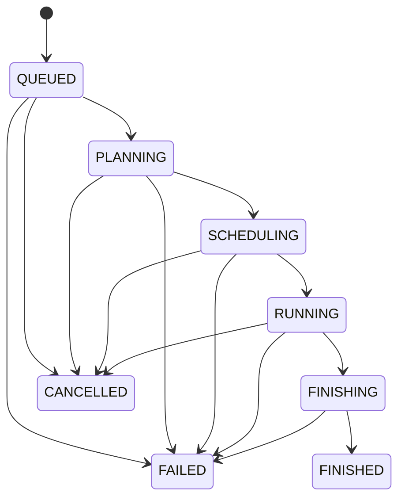

# Pangrova — Distributed Architecture

Cluster membership snapshots, process identities and lease values live in
`pangrova-coordination-api`. Their persistence ports now live in the dedicated
`pangrova-persistence-coordination-api`: `.api.membership`, `.api.lease` and
`.api.admission`, with the real quorum extension in `.api.provider` in the same
artifact. PostgreSQL and process-local Memory implementations are separate
`pangrova-persistence-coordination-postgresql` and `pangrova-persistence-coordination-memory`
artifacts. Core receives these contracts explicitly; it cannot select a Memory backend.

`CoordinatorLeaseBootstrap` in Server discovers CoordinationProviderFactory registrations and selects the configured ID or alias.
JDBC is the default. Each factory returns the lease and registry for a single authority.
The Server rejects duplicate names and incompatible factory versions before opening a provider. The optional ZooKeeper provider consumes the narrow
persistence API and Coordination values alongside its quorum SDK. The shared
DataSource belongs to Server; PostgreSQL operations close borrowed connections,
not the pool. The quorum provider owns its shared client close hook.

Canonical schema initialization owns the admission reservation tables (V106).
Creating a PostgreSQL reservation provider validates existing authority, never
creates a parallel schema or resets active reservations. Test-only Memory admission
slots remain in Testing Kit and are not advertised as a production provider.

Coordination backend failures now propagate through the shared API error contract and the HA
registry adapter. ZooKeeper errors do not become missing membership/lease or successful updates;
CAS exhaustion and invalid payloads also fail explicitly. A lost mutation acknowledgement may
mean the write committed and requires authoritative confirmation. HA startup failures roll back
local scheduling; demotion precedes remote release, and close attempts all cleanup stages while
preserving failures. Singleton maintenance uses its separate lease lifecycle.

Query persistence has separate PostgreSQL and process-local Memory artifacts under
`pangrova-persistence-query-*`. HA receives its anchor store explicitly and cannot replace
that backend when binding the process authority. Task completion also requires an explicit
write journal; Core cannot create an implicit Memory fallback. PostgreSQL write journal
construction checks the canonical schema and performs no DDL. Memory provides no restart
or multi-process durability.

> **Accuracy scope.** This is a living architecture document. Content explicitly marked
> draft, proposed, planned, phase, target, or remaining work is design intent rather
> than implemented support. For current behavior, code wiring and end-to-end tests
> take precedence.

Worker withdrawal now uses the exact registered process. The internal authenticated
`DELETE /v1/workers/{workerId}` request requires `Content-Type: application/json` and
this body, using the values from that Worker's original registration:

```json
{
  "admission_domain_id": "00000000-0000-0000-0000-000000000001",
  "incarnation_id": "00000000-0000-0000-0000-000000000002"
}
```

Missing identity is rejected. An already absent or replaced incarnation can be
acknowledged as deregistered without removing the replacement. The real Worker
registration client retains its attempted identity and sends this body after its
existing task-owner shutdown sequence. The persistence port requires an atomic
identity comparison; it has no unconditional logical-ID delete overload. The
backend-neutral `WorkerRegistrationIdentity` value belongs to Coordination API;
the `WorkerRegistry` port belongs to the dedicated Coordination Persistence API.

Within one Coordinator, heartbeat, health evaluation and repeated registration of
the same incarnation preserve DECOMMISSIONING. A removal decision using an old
WorkerInfo snapshot cannot erase a newer local observation; the backend separately
checks process identity. This is registration fencing, **not proof of safe physical
scale-down**: persistent decommission/admission state and authoritative execution/output/reader
inventory and drain are still pending.

Heartbeat POST now requires `worker_execution_identity` with those same admission-domain and
incarnation values. The registry atomically updates only that exact process; failure does not
publish local metrics or tenant usage first. Missing registration yields `409/re-register`;
another process owning the logical ID yields `409/fenced`. Automatic repair/retries use the
separate authenticated `POST /v1/workers/refresh` endpoint, which inserts absence or refreshes
that same identity, never replaces another process. The first registration attempt still uses
`/v1/workers/register`; globally ordered initial admission is remaining work.

A production Worker receiving `fenced` permanently closes new task reservation/publication and
stops automatic heartbeat repair. Existing execution, status, cancellation, output release and
shutdown keep their actual resource owners. Draining rejects canonical task submissions with
503. This nonblocking admission seal is not a physical drain receipt or shutdown permit;
readiness/admission integration and temporary-network-degradation policy remain separate work.

> **Summary.** The Coordinator–Worker topology, multi-active high availability and leader election, worker registration and health checking, and shuffle durability.

Worker registration in `JdbcWorkerRegistry` uses one transaction for its
update-then-insert operation. SQL, runtime, and Error failures roll back before
the connection is closed, and rollback failures remain suppressed on the
original cause. Failure cleanup does not restore auto-commit. The existing
unique-key retry rule remains unchanged, so a failed registration cannot become
a committed replacement of the prior Worker identity merely through cleanup.

## 1. Coordinator High-Availability Architecture

### 1.1 Multi-Active Architecture Design

```
┌─────────────────────────────────────────────────────────────────────────────┐
│                        Coordinator Cluster (Multi-Active)                    │
├─────────────────────────────────────────────────────────────────────────────┤
│                                                                              │
│  ┌─────────────────┐  ┌─────────────────┐  ┌─────────────────┐             │
│  │  Coordinator-1  │  │  Coordinator-2  │  │  Coordinator-3  │             │
│  │  (Active)       │  │  (Active)       │  │  (Active)       │             │
│  │                 │  │                 │  │                 │             │
│  │ ┌─────────────┐ │  │ ┌─────────────┐ │  │ ┌─────────────┐ │             │
│  │ │Query Handler│ │  │ │Query Handler│ │  │ │Query Handler│ │             │
│  │ │SQL Parser   │ │  │ │SQL Parser   │ │  │ │SQL Parser   │ │             │
│  │ │Optimizer    │ │  │ │Optimizer    │ │  │ │Optimizer    │ │             │
│  │ │Scheduler    │ │  │ │Scheduler    │ │  │ │Scheduler    │ │             │
│  │ └─────────────┘ │  │ └─────────────┘ │  │ └─────────────┘ │             │
│  └────────┬────────┘  └────────┬────────┘  └────────┬────────┘             │
│           │                    │                    │                       │
│           └────────────────────┼────────────────────┘                       │
│                                │                                            │
│  ┌─────────────────────────────┴─────────────────────────────┐             │
│  │                    Shared State Layer                      │             │
│  │                                                            │             │
│  │  ┌──────────────────┐  ┌──────────────────┐               │             │
│  │  │    ZooKeeper     │  │   Redis Cluster  │               │             │
│  │  │                  │  │                  │               │             │
│  │  │ • Leader Election│  │ • Session Cache  │               │             │
│  │  │ • Config Sync    │  │ • Metadata Cache │               │             │
│  │  │ • Distributed    │  │ • Query Plan     │               │             │
│  │  │   Lock           │  │   Cache          │               │             │
│  │  └──────────────────┘  └──────────────────┘               │             │
│  │                                                            │             │
│  │  ┌──────────────────────────────────────────────────────┐ │             │
│  │  │                PostgreSQL Cluster                      │ │             │
│  │  │ • Query State Persistence                             │ │             │
│  │  │ • Task Assignment History                             │ │             │
│  │  │ • Audit Logs                                          │ │             │
│  │  └──────────────────────────────────────────────────────┘ │             │
│  └───────────────────────────────────────────────────────────┘             │
│                                                                              │
└─────────────────────────────────────────────────────────────────────────────┘
```

> **Topology note.** The diagram shows the optional ZooKeeper/Redis topology. The
> default bootstrap uses a JDBC lease in the metadata database (`pangrova_meta`);
> Redis is an optional cache, not a consistency authority.

### 1.2 Coordinator Core Components

```java
public class PangrovaCoordinator implements Lifecycle {

    private final CoordinatorConfig config;
    private final QueryManager queryManager;
    private final WorkerManager workerManager;
    private final MetadataService metadataService;
    private final SchedulerService schedulerService;
    private final HACoordinationService haService;

    private final HttpServer httpServer;

    @Override
    public void start() {
        haService.start();
        haService.registerAsCandidate();
        metadataService.initialize();
        workerManager.startDiscovery();
        httpServer.start();
    }
}
```

### 1.3 Query Lifecycle Management

`org.pangrova.query.lifecycle.QueryStateMachine` is the single owner of in-process
query state. `QueryManager` currently remains in Coordination Core and coordinates
admission, dispatch and lifecycle collaborators; that remaining migration is not complete.



`FINISHED`, `FAILED` and `CANCELLED` are terminal. Cancellation cannot interrupt
`FINISHING` publication through a nonexistent transition. The state owner reserves
transitions under its monitor, runs durable recording and fencing callbacks outside
that monitor, then publishes state and notifies listeners. Failed recording does not
publish a terminal state. The actual issued Connector authority and operation scope
are bound to that state owner; an ID lookup cannot replace the original scope.

Logical termination is separate from physical completion. `QueryTerminalCleanup`
records terminal facts and publishes logical effects before cancellation/drain/cleanup.
A failed physical release retains the query and its retry obligation. Task and operation
exit notifications enqueue retry work and do not run journal I/O on the exit thread.
`QueryRetentionScheduler` removes history only after both terminal publication and
physical completion and while no completion is pending. Its executors and registry
are borrowed from the process/query owners; stopping schedules does not close them.

Readiness futures are observer-owned copies. Completing or cancelling a returned wait
cannot manufacture an endpoint, dispatch a write or cancel another observer. Native
write completion held for control-plane publication remains distinct from final query
completion. These guarantees are covered by Query Core tests and actual Coordinator,
journal and Native ownership tests; a class move alone is not execution evidence.

### 1.4 Current Module Ownership

```text
pangrova-query/
├── pangrova-query/           # State/session/event contracts and cleanup ports
└── pangrova-query/
    └── org.pangrova.query/
        ├── lifecycle/          # QueryStateMachine, QueryTerminalCleanup, timeout
        ├── retention/          # QueryRetentionScheduler, reader-pin renewal
        ├── stage/              # StageStateMachine
        └── audit/, event/, profiling/, task/
pangrova-server/pangrova-server-coordinator/
└── org.pangrova.server.coordinator/  # Process bootstrap and endpoints
pangrova-coordination/pangrova-coordination-control/
└── org.pangrova.coordinator/
    ├── query/                  # Remaining QueryManager/admission/dispatch integration
    ├── worker/                 # Current worker discovery and membership integration
    └── ...                     # Further domain extraction remains in progress
```

Query Core depends on the Connector contract to manage the issued query scope; it
has no Coordinator, Worker, Planner, Connector Runtime or persistence-provider dependency.
Core lifecycle implementation classes are internal engine collaborators, not additional
public API/SPI artifacts. Final target structure and outstanding work are tracked in the
[modularization ADR](domain-modularization-adr.md) and its implementation ledger.

---

## 2. Worker Architecture Design

### 2.1 Worker Internal Architecture

```
┌─────────────────────────────────────────────────────────────────────────────┐
│                              Worker Node                                     │
├─────────────────────────────────────────────────────────────────────────────┤
│  ┌───────────────────────────────────────────────────────────────────────┐  │
│  │                         Java Layer (JVM)                               │  │
│  │  ┌─────────────────┐  ┌─────────────────┐  ┌─────────────────┐       │  │
│  │  │  HTTP Server    │  │  Task Manager   │  │ Memory Manager  │       │  │
│  │  │  (Control)      │  │ • Task Queue    │  │ • Pool Mgmt     │       │  │
│  │  │ • Task Submit   │  │ • Task Executor │  │ • Spill Control │       │  │
│  │  │ • Status/Cancel │  │ • Progress Track│  │ • GC Tuning     │       │  │
│  │  └─────────────────┘  └─────────────────┘  └─────────────────┘       │  │
│  │  ┌─────────────────┐  ┌─────────────────┐  ┌─────────────────┐       │  │
│  │  │ Arrow Flight    │  │ Connector Mgr   │  │ Metrics Export  │       │  │
│  │  │ (Data Plane)    │  │ • Plugin Load   │  │ • Prometheus    │       │  │
│  │  │ • Shuffle/Result│  │ • ClassLoader   │  │ • OpenTelemetry │       │  │
│  │  └─────────────────┘  └─────────────────┘  └─────────────────┘       │  │
│  └───────────────────────────────┬───────────────────────────────────────┘  │
│                                  │                                           │
│                    JNI Runtime (Arrow C Data Interface)                       │
│                                  │                                           │
│  ┌───────────────────────────────┴───────────────────────────────────────┐  │
│  │                         C++ Layer (Velox)                              │  │
│  │  ┌─────────────────┐  ┌─────────────────┐  ┌─────────────────┐       │  │
│  │  │  Velox Engine   │  │   Native I/O    │  │Shuffle Partitioner│     │  │
│  │  │ • Plan Execute  │  │ • Parquet Read  │  │ • Partition     │       │  │
│  │  │ • Vectorized    │  │ • ORC Read      │  │ • Serialize     │       │  │
│  │  │ • SIMD Optimize │  │ • S3/HDFS       │  │ • In-Memory Only│       │  │
│  │  └─────────────────┘  └─────────────────┘  └─────────────────┘       │  │
│  │  ┌─────────────────┐  ┌─────────────────┐  ┌─────────────────┐       │  │
│  │  │  Memory Pool    │  │   Spill Mgr     │  │ Expression Eval │       │  │
│  │  │ • Arrow Buffer  │  │ • NVMe SSD      │  │ • Codegen       │       │  │
│  │  │ • Shared Mem    │  │ • Arrow IPC     │  │ • SIMD          │       │  │
│  │  └─────────────────┘  └─────────────────┘  └─────────────────┘       │  │
│  └───────────────────────────────────────────────────────────────────────┘  │
└─────────────────────────────────────────────────────────────────────────────┘
```

### 2.2 Read/Write Separation Design

```
┌─────────────────────────────────────────────────────────────────────────────┐
│                           Read/Write Separation                              │
├─────────────────────────────────────────────────────────────────────────────┤
│  ┌─────────────────────────────────────────────────────────────────────┐   │
│  │                      READ PATH (C++ Velox)                           │   │
│  │  Substrait Plan → Plan Parser → Velox Plan → Executor                │   │
│  │       ↓                                                              │   │
│  │  Native I/O (Parquet/ORC) ← Data Source Connector ← Split Info       │   │
│  │       ↓                                                              │   │
│  │  Velox serialized pages → Native Flight → Native ExchangeSource      │   │
│  │                                                                      │   │
│  │  Characteristics: vectorization and SIMD; shuffle is serialized       │   │
│  └─────────────────────────────────────────────────────────────────────┘   │
│                                                                              │
│  ┌─────────────────────────────────────────────────────────────────────┐   │
│  │                      WRITE PATH (Java)                               │   │
│  │  Write Request → Transaction Manager → Data Writer → Committer       │   │
│  │       ↓                                                              │   │
│  │  Iceberg/Paimon SDK → Manifest Writer → Metadata Update              │   │
│  │                                                                      │   │
│  │  Characteristics: full transaction support, ACID, upstream-compatible │   │
│  │                                                                      │   │
│  │  Transaction boundary:                                               │   │
│  │  ┌─ ACID BEGIN ──────────────────────────────────────────────────┐  │   │
│  │  │ 1. Begin Transaction (Coordinator)                            │  │   │
│  │  │ 2. Write Data Files (Worker Native write path, parallel)        │  │   │
│  │  │ 3. Report Write Results (Workers → Coordinator)               │  │   │
│  │  │ 4. Commit Transaction (Coordinator, atomic operation)          │  │   │
│  │  └─ ACID END ────────────────────────────────────────────────────┘  │   │
│  └─────────────────────────────────────────────────────────────────────┘   │
└─────────────────────────────────────────────────────────────────────────────┘
```

Note: On the write path, the Worker-side Java write path flushes data files through the connector page sink and produces statistics; the Coordinator only handles transaction orchestration and metadata commit, and does not write data files directly.

### 2.3 Worker Module Structure

```text
pangrova-worker/
└── src/main/java/org/pangrova/worker/
    ├── bootstrap/        # config/, phase/, lifecycle/, ownership/, registration/
    ├── http/             # WorkerHttpServer
    ├── execution/        # TaskExecutor and task execution
    ├── task/             # task tracking and completion
    ├── memory/           # NativeMemoryCoordinator, NativeSpillController
    ├── exchange/         # shuffle/exchange integration
    ├── split/            # split fetching and delivery
    ├── result/           # result publication
    └── ...               # cache, copy, file, heartbeat, resource, transport

pangrova-worker/
└── src/main/java/org/pangrova/worker/jni/
    # NativeRuntime, NativeLibraryLoader and JNI command entry points

pangrova-worker-native/
├── CMakeLists.txt
├── src/
│   ├── jni/              # Runtime entry points and JVM reference ownership
│   ├── command/          # Command dispatch, task binding, handles and Flight services
│   ├── capabilities/     # capability catalog, function registry, artifact retrieval
│   ├── engine/           # Velox execution, shuffle/Flight, memory, write, delete
│   ├── indexing/         # index pruning, BM25 and retrieval fusion
│   ├── lance/            # Lance batch reader/writer
│   ├── udf/              # Native UDF registry and JVM callbacks
│   └── vector/           # distance functions and ANN indexes
└── test/                 # Native tests
```

### 2.4 Worker Startup Sequence

Symmetric to the Coordinator startup sequence (§1.2 `PangrovaCoordinator.start()`), the Worker startup sequence defines the complete initialization flow from process launch to being ready to accept Tasks.

```java
public class PangrovaWorker implements Lifecycle {

    private final WorkerConfig config;
    private final NativeRuntime nativeBridge;
    private final ResourceManager resourceManager;   // pangrova-worker resource module; see 11 §3
    private WorkerCatalogRuntime catalogs;
    private final TaskManager taskManager;
    private final HttpServer httpServer;
    private final FlightServer flightServer;
    private final ServiceRegistry serviceRegistry;
    private final MetricsExporter metricsExporter;

    @Override
    public void start() {
        catalogs = WorkerCatalogRuntime.discover(config.coordinatorUrl(), config.internalAuthSecret(),
                getClass().getClassLoader(), config.pluginDirectory());

        // Phase 1: Native Engine Initialization
        nativeBridge.loadLibrary();                  // 1. JNI System.loadLibrary("pangrova_native")
        nativeBridge.initializeVelox(config);         // 2. Velox engine init (thread pools, memory pools)
        // Note: initializeVelox() is a Java wrapper that internally calls
        // NativeRuntime.nativeInit(configJson) — see native-execution.md §5.3
        // for the JNI interface definition.

        // Phase 2: Java Layer Initialization
        resourceManager.initialize(config);           // 3. Memory pools (JVM Heap + Off-Heap + Native budget)
        taskManager.initialize();                     // 5. Task queue + executor threads

        // Phase 3: Network Services
        flightServer.start();                         // 6. Arrow Flight server (Data Plane, Shuffle + Result)
        httpServer.start();                           // 7. HTTP server (Control Plane, Task submit/status/cancel)
        metricsExporter.start();                      // 8. Prometheus + OpenTelemetry exporters

        // Phase 4: Cluster Registration
        serviceRegistry.register();                   // 9. ZooKeeper ephemeral node (§3.3)
        serviceRegistry.startHeartbeat();             // 10. Periodic heartbeat with resource feedback (§5.2)
    }

    @Override
    public void stop() {
        // Reverse order: deregister first, then drain, then shutdown
        serviceRegistry.deregister();                 // 1. Remove ZK ephemeral node (stop receiving new tasks)
        taskManager.drainAndWait(config.getShutdownGracePeriod()); // 2. Wait for running tasks to complete
        httpServer.stop();                            // 3. Stop control plane
        flightServer.stop();                          // 4. Stop data plane
        metricsExporter.stop();                       // 5. Flush final metrics
        catalogs.close();                             // Close connectors and their plugin loaders after drain
        nativeBridge.shutdown();                      // 7. Release native memory pools, destroy Velox engine
        resourceManager.shutdown();                   // 8. Final memory cleanup
    }
}
```

**Startup Sequence Diagram**

```
PangrovaWorker.start()
    ├── Open the Worker catalog inventory from bundled factories and configured plugin JARs
    │
    ├── Phase 1: Native Engine ──────────────────────────────────────────────
    │   ├── loadLibrary()              ← JNI: System.loadLibrary("pangrova_native")
    │   │                                 Failure → abort startup (fail-fast)
    │   └── initializeVelox()          ← Create Velox MemoryPool, IO ThreadPool,
    │                                     Compute ThreadPool, SpillManager
    │                                     Internally calls NativeRuntime.nativeInit(configJson)
    │                                     (see native-execution.md §5.3)
    │                                     Failure → abort startup (fail-fast)


    │
    ├── Phase 2: Java Layer ─────────────────────────────────────────────────
    │   ├── resourceManager.initialize() ← Set Native memory limit (resource-management.md §2)
    │   │                                 Register JVM GC listener
    │   └── taskManager.initialize()   ← Create Task queue, Pull Loop threads
    │
    ├── Phase 3: Network Services ───────────────────────────────────────────
    │   ├── flightServer.start()       ← Bind Data Plane port (default 8082)
    │   │                                 Now able to accept Shuffle/Result connections
    │   ├── httpServer.start()         ← Bind Control Plane port (default 8080)
    │   │                                 Now able to accept Task submissions
    │   └── metricsExporter.start()    ← Prometheus /metrics endpoint ready
    │
    └── Phase 4: Cluster Registration ──────────────────────────────────────
        ├── serviceRegistry.register() ← ZK creates /pangrova/workers/{workerId}
        │                                 ephemeral node (§3.3)
        │                                 Coordinator discovers this Worker via Watch
        └── startHeartbeat()           ← Report resource status every 10s (§5.2)
                                          Includes memory_pressure, running_task_count,
                                          available_memory_bytes, cpu_usage
```

**Startup Sequence Constraints**

| Constraint | Description | Rationale |
|------|------|------|
| Native must be initialized before the Java layer | `nativeBridge.loadLibrary()` is the first step | The Java `ResourceManager` needs to know the Native memory pool capacity |
| Network must start before Registration | Register with ZK only after the Flight + HTTP ports are ready | Prevents the Coordinator from sending Tasks after discovering a Worker whose ports are not yet ready |
| Registration is the last step | ZK registration means "ready to accept work" | Ensures a Worker is only exposed after it is fully ready |
| Any Phase 1/2 failure → fail-fast | Do not register with ZK; exit the process | Prevents a half-initialized Worker from joining the cluster |

**Coordination with Coordinator Startup**

```
Timeline →

ZooKeeper          Coordinator                    Worker
    │                  │                             │
    │  ZK Ready        │                             │
    ├─────────────────►│                             │
    │                  │ start()                     │
    │                  │ ├── haService.start()       │
    │                  │ ├── metadataService.init()  │
    │                  │ ├── workerManager.          │
    │                  │ │   startDiscovery()        │
    │                  │ │   (Watch /pangrova/workers) │
    │                  │ └── httpServer.start()      │
    │                  │                             │
    │                  │                             │ start()
    │                  │                             │ ├── Phase 1-3 (internal init)
    │                  │                             │ └── Phase 4: register()
    │                  │                             │     → ZK: create ephemeral node
    │                  │  CHILD_ADDED event           │
    │                  │◄─────────────────────────────┤
    │                  │                             │
    │                  │ Coordinator discovers Worker │
    │                  │ Adds to scheduling candidates│
    │                  │                             │
    │                  │ Waiting for first Heartbeat  │
    │                  │◄──────────────── heartbeat ──┤
    │                  │                             │
    │                  │ Worker state = ACTIVE        │
    │                  │ Can schedule Task            │
    │                  │                             │
```

> **Cross-Reference**: For Native engine initialization details see [native-execution.md](./native-execution.md); for memory pool initialization see [resource-management.md §2](./resource-management.md); for Connector plugin loading see [connectors.md §2.3](./connectors.md); for heartbeat resource feedback see [§5.2](#52-scheduling-resource-closed-loop).

---

## 3. High Availability Design

### 3.1 Overall HA Architecture

```
┌─────────────────────────────────────────────────────────────────────────────────┐
│                           High Availability Architecture                         │
├─────────────────────────────────────────────────────────────────────────────────┤
│  ┌─────────────────────────────────────────────────────────────────────────┐   │
│  │                         Client Layer                                     │   │
│  │  ┌─────────────┐                                                        │   │
│  │  │ Load        │  • Health check • Failover • Session affinity (optional)│   │
│  │  │ Balancer    │                                                        │   │
│  │  └──────┬──────┘                                                        │   │
│  └─────────┼────────────────────────────────────────────────────────────────┘   │
│            ▼                                                                     │
│  ┌─────────────────────────────────────────────────────────────────────────┐   │
│  │                    Coordinator Cluster (Multi-Active)                    │   │
│  │  ┌─────────────┐  ┌─────────────┐  ┌─────────────┐                     │   │
│  │  │Coordinator-1│  │Coordinator-2│  │Coordinator-3│                     │   │
│  │  │   (Active)  │  │   (Active)  │  │   (Active)  │                     │   │
│  │  └──────┬──────┘  └──────┬──────┘  └──────┬──────┘                     │   │
│  │         └────────────────┼────────────────┘                             │   │
│  │  ┌───────────────────────┴───────────────────────────────────────────┐ │   │
│  │  │                    Shared State Layer                              │ │   │
│  │  │  ┌──────────────────┐  ┌──────────────────┐  ┌──────────────────┐  │ │   │
│  │  │  │     ZooKeeper    │  │      Redis       │  │   PostgreSQL     │  │ │   │
│  │  │  │• Leader election │  │• Metadata cache  │  │• Query state     │  │ │   │
│  │  │  │• Distributed lock│  │• Session state   │  │• Audit logs      │  │ │   │
│  │  │  └──────────────────┘  └──────────────────┘  └──────────────────┘  │ │   │
│  │  └────────────────────────────────────────────────────────────────────┘ │   │
│  └──────────────────────────────────────────────────────────────────────────┘   │
│            ▼                                                                     │
│  ┌─────────────────────────────────────────────────────────────────────────┐   │
│  │                    Worker Cluster (Auto-Scaling)                         │   │
│  │  ┌─────────────┐  ┌─────────────┐  ┌─────────────┐  ┌─────────────┐   │   │
│  │  │  Worker-1   │  │  Worker-2   │  │  Worker-3   │  │  Worker-N   │   │   │
│  │  └──────┬──────┘  └──────┬──────┘  └──────┬──────┘  └──────┬──────┘   │   │
│  │         └────────────────┴────────────────┴────────────────┘          │   │
│  │                          ┌────────▼────────┐                          │   │
│  │                          │ Service Registry│                          │   │
│  │                          │ (ZooKeeper)     │                          │   │
│  │                          │ • Ephemeral Node│                          │   │
│  │                          │ • Health check  │                          │   │
│  │                          │ • Discovery     │                          │   │
│  │                          └─────────────────┘                          │   │
│  └──────────────────────────────────────────────────────────────────────────┘   │
└─────────────────────────────────────────────────────────────────────────────────┘
```

### 3.2 Query Ownership Management

> The Curator-based example below illustrates the optional ZooKeeper
> coordination backend. The default deployment persists leases and
> ownership-relevant state in the metadata PostgreSQL authority.

```java
/**
 * Query ownership management
 */
public class QueryOwnershipManager {

    private final CuratorFramework curator;
    private final String coordinatorId;
    private final QueryStateStore stateStore;

    /**
     * Acquire query ownership
     */
    public boolean acquireOwnership(QueryId queryId) {
        String path = "/pangrova/queries/" + queryId + "/owner";
        try {
            curator.create()
                .withMode(CreateMode.EPHEMERAL)
                .forPath(path, coordinatorId.getBytes());
            return true;
        } catch (KeeperException.NodeExistsException e) {
            return false;
        }
    }

    /**
     * Watch for orphan queries (owner has crashed)
     *
     * [DEF-020 fix] Use TreeCache instead of PathChildrenCache to detect
     * deletion of the ephemeral `/owner` child node.  PathChildrenCache on
     * `/pangrova/queries` only sees {queryId}-level changes, but the ephemeral
     * node created by acquireOwnership() lives at
     * `/pangrova/queries/{queryId}/owner`.  When a Coordinator's ZK session
     * expires, ZK deletes the `/owner` ephemeral node — not the persistent
     * `{queryId}` node — so PathChildrenCache CHILD_REMOVED never fires.
     * TreeCache watches the full subtree and correctly detects `/owner`
     * removal.
     */
    public void watchOrphanQueries(Consumer<QueryId> handler) {
        TreeCache cache = TreeCache.newBuilder(curator, "/pangrova/queries")
            .setCacheData(true)
            .setMaxDepth(2)   // /pangrova/queries/{queryId}/owner
            .build();

        cache.getListenable().addListener((client, event) -> {
            if (event.getType() == TreeCacheEvent.Type.NODE_REMOVED) {
                String removedPath = event.getData().getPath();
                // Only react to /owner node removal (session expiry)
                if (removedPath.endsWith("/owner")) {
                    String queryIdStr = removedPath.split("/")[3]; // /pangrova/queries/{queryId}/owner
                    QueryId queryId = QueryId.valueOf(queryIdStr);
                    if (acquireOwnership(queryId)) {
                        handler.accept(queryId);
                    }
                }
            }
        });
        cache.start();
    }
}
```

### 3.3 Worker Service Registration

```java
/**
 * Worker service registration (ZooKeeper)
 */
public class WorkerServiceRegistry {

    private final CuratorFramework curator;
    private final WorkerInfo workerInfo;

    private static final long SESSION_TIMEOUT_MS = 30000;
    private static final long HEARTBEAT_INTERVAL_SECONDS = 10;

    public void register() throws Exception {
        // 1. Create an Ephemeral Node (auto-deleted when the session disconnects)
        String path = "/pangrova/workers/" + workerInfo.getId();
        String value = objectMapper.writeValueAsString(workerInfo);

        curator.create()
            .creatingParentsIfNeeded()
            .withMode(CreateMode.EPHEMERAL)
            .forPath(path, value.getBytes(StandardCharsets.UTF_8));

        // 2. Start heartbeat (periodically update Worker state)
        startHeartbeat();
    }

    private void startHeartbeat() {
        scheduler.scheduleAtFixedRate(() -> {
            try {
                String path = "/pangrova/workers/" + workerInfo.getId();
                String value = objectMapper.writeValueAsString(workerInfo);
                curator.setData().forPath(path, value.getBytes(StandardCharsets.UTF_8));
            } catch (Exception e) {
                log.error("Heartbeat failed", e);
                tryReregister();
            }
        }, 0, HEARTBEAT_INTERVAL_SECONDS, TimeUnit.SECONDS);
    }
}
```


> **Detection Timing**: Heartbeat timeout (20s = 2× interval, see §5.2.3) is the Coordinator's fast detection mechanism — marks Worker as SUSPECT and stops scheduling. ZK session expiry (30s) is the final failure confirmation — ephemeral node deletion triggers Task rescheduling. The two mechanisms are complementary: heartbeat provides fast response, ZK provides eventual consistency guarantee.

### 3.4 Shared State Responsibility Matrix

| Component | Responsibilities | Consistency Requirement | Failure Impact |
|------|------|-----------|----------|
| ZooKeeper | Leader election, distributed lock, service registry (ephemeral node), config sync, catalog change notification (Watch) | Strong consistency (ZAB protocol) | Cluster unavailable (quorum required) |
| Redis | Metadata cache, session cache, query plan cache, query result cache (L2), cross-Coordinator event broadcast (Pub/Sub), data cache (remote tier) | Eventually consistent (may be lost) | Performance degradation + potential stale security cache (bounded by TTL) |
| PostgreSQL | Query state persistence, audit logs (security + resource), DDL job state, tenant/quota data, **catalog metadata** ([07 §3.1](./metadata.md)), **security policies** (RBAC/RLS/column masks, [12 §3-5](./security.md)), **Shuffle Location Registry** (via `query_checkpoints.shuffle_locations`, eventually consistent — async persist) | Strong consistency (transactional) | **Unavailable**: new query state cannot persist, Coordinator failover degrades to query re-execution, authorization blocked, catalog registry read-only (from cache). **Data loss (disaster)**: audit logs and historical query state unrecoverable, Shuffle data requires recomputation. |


**Key design decisions**:
- The metadata PostgreSQL authority is the default consistency source for leases, Worker registration, query state, and durable journals. ZooKeeper is an optional coordination backend for leader election and locks; it is not required by the default bootstrap.
- Redis is optional and used only for caching; it stores no consistency-critical state. When Redis is unavailable, functionality is unaffected and only performance degrades.
- Worker registration is persisted in the metadata authority. The optional ZooKeeper backend uses an ephemeral node; a Worker crash removes that node and triggers the same registration-loss handling.


**Redis Consistency Refinement**: The "lossy" semantics for Redis apply to cached data only — cache misses result in re-computation, not data loss. However, cache *invalidation* operations (especially security-policy-triggered invalidations from [05 §3.3](./query-optimization.md)) must be treated as best-effort with a safety fallback: all Redis cache entries carry a mandatory TTL upper bound (default: 1 hour). On Redis restart, all Query Result Cache entries are purged (Redis configured with `save ""` to disable RDB persistence for cache databases). This ensures that stale cache entries from a previous security policy epoch cannot survive a Redis restart, preventing cross-security-boundary data leakage.

### 3.5 Multi-Active Semantics

The Pangrova Coordinator cluster uses a **Full Multi-Active** model: all Coordinators accept both read and write requests simultaneously, with no primary/secondary distinction. Clients can route requests to any Coordinator via a Load Balancer.

#### 3.5.1 Multi-Active Definition

| Operation Type | Requires Leader | Note |
|----------|------------|------|
| Query reception and execution (SELECT/INSERT/UPDATE/DELETE) | No | Any Coordinator receives and is responsible end-to-end |
| DDL operations (CREATE/ALTER/DROP TABLE) | Yes | Leader coordinates to avoid concurrent DDL conflicts |
| Cluster config change (SET GLOBAL) | Yes | Leader broadcasts config to all nodes |
| Query ownership migration | No | Auto-detected via ZooKeeper ephemeral node, no Leader involvement needed |

**Relationship with Leader Election**: Leader Election (see 3.1 HA architecture) is used only for DDL coordination and cluster config broadcast. The Leader is not a traffic entry point and does not take on additional query load. When the Leader crashes, the remaining Coordinators automatically elect a new Leader; during this period DDL operations are temporarily unavailable, but read/write queries are unaffected.


**DDL Request Routing Strategy**: When a client sends a DDL request to a non-Leader Coordinator via the Load Balancer, the non-Leader transparently forwards the request to the current Leader. The forwarding is invisible to the client. If the Leader is unavailable (e.g., during leader election), the non-Leader returns `SERVICE_UNAVAILABLE` (HTTP 503) with a `Retry-After` header. The client should retry after the specified interval. During leader election (timeout: 30s, aligned with ZK session timeout), all DDL operations return `LEADER_NOT_AVAILABLE` error code. In-flight DDL operations that were submitted but not yet committed are recovered by the new Leader from the PostgreSQL DDL job state table (`ddl_jobs`).

#### 3.5.2 Query Ownership Migration Flow

When a Coordinator crashes, the in-flight queries it owns must be taken over by other Coordinators. The migration flow is auto-detected via ZooKeeper ephemeral nodes and requires no Leader coordination.

```
┌─────────────────────────────────────────────────────────────────────────────────┐
│                     Query Ownership Migration Flow                               │
├─────────────────────────────────────────────────────────────────────────────────┤
│                                                                                  │
│  Normal operation:                                                              │
│  Coordinator-A creates ephemeral node: /pangrova/queries/{queryId}/owner          │
│                                                                                  │
│  Failure detection:                                                              │
│  Coordinator-A crashes → ZK session expires → ephemeral node auto-deleted      │
│                                                                                  │
│  Competitive takeover:                                                           │
│  ┌─────────────────┐  ┌─────────────────┐  ┌─────────────────┐                 │
│  │ Coordinator-B   │  │ Coordinator-C   │  │ Coordinator-D   │                 │
│  │ TreeCache        │  │ TreeCache        │  │ TreeCache        │                │
│  │ watches /owner   │  │ watches /owner   │  │ watches /owner   │                 │
│  │ node-deleted evt│  │ node-deleted evt│  │ node-deleted evt│                 │
│  │       │         │  │       │         │  │       │         │                 │
│  │       ▼         │  │       ▼         │  │       ▼         │                 │
│  │ acquireOwnership│  │ acquireOwnership│  │ acquireOwnership│                 │
│  │   (create ephemeral│  │   (create ephemeral│  │   (create ephemeral│                │
│  │    node race)   │  │    node race)   │  │    node race)   │                 │
│  │       │         │  │       │         │  │       │         │                 │
│  │    ✓ success    │  │    ✗ failure   │  │    ✗ failure   │                 │
│  └─────────────────┘  └─────────────────┘  └─────────────────┘                 │
│                                                                                  │
│  State recovery (Coordinator-B):                                                 │
│  1. Load QueryCheckpoint from PostgreSQL (query state, Stage progress, Task assignment) │
│  2. Check whether the Worker hosting each Task is alive (via ZK service registry) │
│  3. Alive Worker → continue monitoring Task execution                           │
│  4. Crashed Worker → reschedule unfinished Splits to other Workers              │
│  5. Restore Shuffle location info; downstream Stage continues consuming         │
│                                                                                  │
└─────────────────────────────────────────────────────────────────────────────────┘
```

**Detailed migration steps**:

| Step | Action | Component | Note |
|------|------|------|------|
| 1 | Failure detection | ZooKeeper | Coordinator-A session expires, ephemeral node `/pangrova/queries/{queryId}/owner` auto-deleted |
| 2 | Event notification | ZooKeeper → TreeCache | All alive Coordinators receive NODE_REMOVED event (watching `/owner` child-node deletion)  |
| 3 | Competitive acquisition | Coordinator-B/C/D | Call `acquireOwnership()` to create a new ephemeral node; ZK guarantees only one succeeds |
| 4 | State loading | Coordinator-B (winner) | Load query execution state from the PostgreSQL `query_checkpoints` table |
| 5 | Task recovery | Coordinator-B | Check Worker liveness, reschedule unfinished Splits of failed Tasks |

**In-Flight Query Handling**:
- **QUEUED/PLANNING state queries**: re-executed from scratch after takeover (low cost)
- **SCHEDULING/RUNNING state queries**: recovered from PostgreSQL checkpoint, only unfinished Splits are rescheduled
- **Completed but not-yet-returned queries**: the client reconnects and fetches results from the new Coordinator (results cached in Redis). **Note**: Since Redis is configured as lossy cache (§3.4), if Redis is unavailable or the cached result has been evicted, the completed query result is unrecoverable and the client must re-submit the query. §3.4 failure impact for Redis is updated accordingly.


**Zombie Query Fencing**: When a Coordinator recovers from a false-death scenario (e.g., GC pause or network partition causing ZK session expiry), it must not continue operating on queries whose ownership has been migrated. The fencing mechanism works as follows:

1. Each ownership migration increments an `ownership_epoch` counter in PostgreSQL (`query_checkpoints.ownership_epoch`).
2. The new owner Coordinator includes the current epoch in all instructions sent to Workers.
3. Workers reject any instruction with an epoch lower than the last seen epoch for that query, returning `STALE_EPOCH` error.
4. A Coordinator that detects its ZK session has expired must immediately stop all local query processing and discard local query state. It re-registers with ZK and can only accept new queries after re-registration.

---

## 4. Task Fault Tolerance

### 4.1 Task Retry Strategy

```
┌─────────────────────────────────────────────────────────────────────────────────┐
│                           Task Fault Tolerance                                   │
├─────────────────────────────────────────────────────────────────────────────────┤
│  Task Failure Scenarios:                                                         │
│  1. Worker crash → Detection: ZooKeeper Ephemeral Node deleted → reschedule all tasks on that Worker │
│  2. Task execution failure → Detection: Worker reports failure → decide whether to retry per the retry policy │
│  3. Network partition → Detection: heartbeat timeout → mark Worker as SUSPECT, wait for recovery or reschedule after timeout │
│  4. Data-skew timeout → Detection: execution time exceeds threshold → speculative execution (Speculative Execution, see [§8](#8-speculative-execution-opt-003))    │

├─────────────────────────────────────────────────────────────────────────────────┤
│  Retry Policy:                                                                   │
│  ┌─────────────────────────────────────────────────────────────────────────┐   │
│  │  Retryable errors: Worker crash, network timeout, transient I/O error, OOM │   │
│  │  Non-retryable errors: syntax error, permission error, data-format error, user cancel │   │
│  │  Retry parameters: maxRetries=3, retryBackoff=1s/2s/4s, retryTimeout=5min │   │
│  └─────────────────────────────────────────────────────────────────────────┘   │
└─────────────────────────────────────────────────────────────────────────────────┘
```

### 4.2 Split-Level Retry

```
┌─────────────────────────────────────────────────────────────────────────────────┐
│                         Split-Level Retry Design                                 │
├─────────────────────────────────────────────────────────────────────────────────┤
│                                                                                  │
│  Problem: Task-level retry is too coarse-grained; one Split failure causes the entire Task to rerun │
│  Solution: support Split-level retry; completed Split results can be reused           │
│                                                                                  │
│  Task internal state:                                                            │
│  ┌─────────────────────────────────────────────────────────────────────────┐   │
│  │  Task-1 (10 Splits)                                                      │   │
│  │  ┌───────┐ ┌───────┐ ┌───────┐ ┌───────┐ ┌───────┐                     │   │
│  │  │Split-1│ │Split-2│ │Split-3│ │Split-4│ │Split-5│                     │   │
│  │  │  ✓    │ │  ✓    │ │  ✗    │ │  ◐    │ │  ○    │  ...                │   │
│  │  │DONE   │ │DONE   │ │FAILED │ │RUNNING│ │PENDING│                     │   │
│  │  └───────┘ └───────┘ └───────┘ └───────┘ └───────┘                     │   │
│  │                         │                                                │   │
│  │                         ▼ Retry Split-3 only                            │   │
│  │                    ┌───────┐                                            │   │
│  │                    │Split-3│ → schedule to another Worker              │   │
│  │                    │RETRY  │                                            │   │
│  │                    └───────┘                                            │   │
│  └─────────────────────────────────────────────────────────────────────────┘   │
│                                                                                  │
│  Split state machine:                                                            │
│  PENDING → RUNNING → DONE                                                       │
│              ↓                                                                   │
│           FAILED → RETRY → RUNNING → DONE                                       │
│              ↓                                                                   │
│           ABANDONED (retry count exceeded)                                      │
│                                                                                  │
└─────────────────────────────────────────────────────────────────────────────────┘
```

```java
/**
 * Split-level retry management
 */
public class SplitRetryManager {

    private final Map<SplitId, SplitState> splitStates = new ConcurrentHashMap<>();
    private final int maxSplitRetries = 3;

    public void handleSplitFailure(TaskId taskId, SplitId splitId, Throwable error) {
        SplitState state = splitStates.get(splitId);

        if (!isRetryable(error) || state.getRetryCount() >= maxSplitRetries) {
            state.setState(SplitStatus.ABANDONED);
            // Fail entire task only if split is abandoned
            failTask(taskId, splitId, error);
            return;
        }

        // Retry only this split
        state.incrementRetryCount();
        state.setState(SplitStatus.RETRY);

        // Schedule to different worker (avoid same failure)
        WorkerId failedWorker = state.getLastWorker();
        WorkerId newWorker = selectWorkerExcluding(failedWorker);

        scheduleSplit(taskId, splitId, newWorker);
    }

    /** Check if all splits are done */
    public boolean isTaskComplete(TaskId taskId) {
        return splitStates.values().stream()
            .filter(s -> s.getTaskId().equals(taskId))
            .allMatch(s -> s.getStatus() == SplitStatus.DONE);
    }
}
```

### 4.3 Shuffle Buffering and Recovery Boundary

The current direct shuffle path is Native: a producer's Velox callback
partitions and serializes pages into `SerializedShuffleQueue`; Native
`FlightShuffleServer` serves each partition by signed ticket; the downstream
Native `PangrovaExchangeSource` pulls it through Flight DoGet. Java carries
task placement, identity, and lifecycle metadata, not data batches.

`ShuffleBufferStore` bounds resident pages and may spill to an unlinked local
temporary file while the producer process is alive. That spill is not a durable
cross-Worker checkpoint. Successful producers flush buffered partitions and
commit clean EOF before reporting `FINISHED`; failed or cancelled producers
abort the stream, and consumers reject incomplete input. If a Worker is lost,
the Coordinator must retry the affected stage from its source snapshot rather
than silently returning partial results. This section does not claim S3-backed
shuffle recovery or a Java shuffle-persistence manager implementation.

### 4.4 Query Checkpoint

```
┌─────────────────────────────────────────────────────────────────────────────────┐
│                         Query Checkpoint Design                                  │
├─────────────────────────────────────────────────────────────────────────────────┤
│                                                                                  │
│  Problem: after Coordinator failover, Running query state may be lost            │
│  Solution: periodically Checkpoint query execution progress to durable storage   │
│                                                                                  │
│  Checkpoint contents:                                                            │
│  ┌─────────────────────────────────────────────────────────────────────────┐   │
│  │  QueryCheckpoint {                                                       │   │
│  │    queryId, state, startTime,                                           │   │
│  │    stages: [{stageId, state, completedSplits, totalSplits}],            │   │
│  │    tasks: [{taskId, workerId, state, splitStates}],                     │   │
│  │    shuffleLocations: [{stageId, partitionId, workerId, path}]           │   │
│  │  }                                                                       │   │
│  └─────────────────────────────────────────────────────────────────────────┘   │
│                                                                                  │
│  Checkpoint strategy:                                                            │
│  • Trigger timing: Stage completion, Task state change, periodic (30s)           │
│  • Storage location: PostgreSQL (query_checkpoints table)                        │
│  • Retention policy: kept for 1 hour after query completion, for auditing        │
│                                                                                  │
│  Failure recovery flow:                                                          │
│  1. New Coordinator starts, loads Checkpoints of unfinished queries              │
│  2. Check whether the Worker hosting each Task is alive                          │
│  3. Alive → keep monitoring; down → reschedule unfinished Splits                 │
│  4. Restore Shuffle location info; downstream Stage can keep consuming           │
│                                                                                  │
└─────────────────────────────────────────────────────────────────────────────────┘
```

---

## 5. Resource Management

### 5.1 Resource Queue & Scheduling

```
┌─────────────────────────────────────────────────────────────────────────────────┐
│                         Resource Queue & Scheduling                              │
├─────────────────────────────────────────────────────────────────────────────────┤
│                                                                                  │
│  Problem: no priority control on contention; large queries may starve small ones │
│  Solution: introduce resource queues + fair scheduler                            │
│                                                                                  │
│  Resource queue hierarchy:                                                       │
│  ┌─────────────────────────────────────────────────────────────────────────┐   │
│  │                         Root Queue (100%)                                │   │
│  │  ┌─────────────────────────────────────────────────────────────────┐   │   │
│  │  │  ┌───────────────┐  ┌───────────────┐  ┌───────────────┐       │   │   │
│  │  │  │  Production   │  │  Development  │  │    System     │       │   │   │
│  │  │  │    (60%)      │  │    (30%)      │  │    (10%)      │       │   │   │
│  │  │  │               │  │               │  │               │       │   │   │
│  │  │  │ ┌───┐ ┌───┐  │  │ ┌───┐ ┌───┐  │  │ ┌───────────┐ │       │   │   │
│  │  │  │ │ETL│ │BI │  │  │ │Ad │ │Test│  │  │ │  Admin    │ │       │   │   │
│  │  │  │ │40%│ │20%│  │  │ │hoc│ │   │  │  │ │  Queries  │ │       │   │   │
│  │  │  │ └───┘ └───┘  │  │ └───┘ └───┘  │  │ └───────────┘ │       │   │   │
│  │  │  └───────────────┘  └───────────────┘  └───────────────┘       │   │   │
│  │  └─────────────────────────────────────────────────────────────────┘   │   │
│  └─────────────────────────────────────────────────────────────────────────┘   │
│                                                                                  │
│  Scheduling strategy:                                                            │
│  • Fair Scheduling: fair in-queue allocation; small queries not starved          │
│  • Preemption: high-priority queues can preempt low-priority queues              │
│  • Elasticity: idle queue resources can be borrowed by other queues              │
│                                                                                  │
└─────────────────────────────────────────────────────────────────────────────────┘
```

```java
/**
 * Resource queue configuration
 */
public class ResourceQueue {
    private final String name;
    private final double capacityPercent;      // Guaranteed capacity
    private final double maxCapacityPercent;   // Max borrowable capacity
    private final int maxConcurrentQueries;
    private final Duration queryTimeout;
    private final List<ResourceQueue> children;

    /** Match query to queue by user/source/tags */
    public static ResourceQueue matchQueue(QueryContext context) {
        // 1. Check the request's explicit queue hint
        // 2. Match by user group
        // 3. Match by query source (jdbc/cli/bi-tool)
        // 4. Default queue
    }
}

/**
 * Fair scheduler
 */
public class FairScheduler {

    public WorkerResources allocate(QueryId queryId, ResourceRequest request) {
        ResourceQueue queue = getQueueForQuery(queryId);

        // 1. Check queue has available capacity
        if (!queue.hasCapacity(request)) {
            // Try borrow from parent/sibling queues
            if (!tryBorrowCapacity(queue, request)) {
                // Queue query, wait for resources
                return queueAndWait(queryId, request);
            }
        }

        // 2. Allocate from available workers
        return allocateFromWorkers(request);
    }
}
```

### 5.2 Scheduling-Resource Closed Loop

The Coordinator scheduler makes scheduling decisions based on the real-time resource feedback reported via Worker heartbeats, forming a scheduling–resource closed loop that prevents over-scheduling onto high-pressure Workers.

#### 5.2.1 Scheduling Rules by Memory Pressure

| Worker Memory Pressure | Scheduling Decision | Rationale |
|------------------------|---------------------|-----------|
| `CRITICAL` (>95% usage) | **Do not schedule any new tasks** | Worker is near OOM; new tasks would cause cascading failures |
| `HIGH` (85-95% usage) | **Only schedule small-memory tasks** (estimated < 1GB) | Reserve headroom for spill and memory fluctuation of running tasks |


**Task Memory Estimation Heuristics** (used for HIGH-pressure scheduling decisions):

| Method | Description | Accuracy |
|--------|-------------|----------|
| Split-size static estimate | `splitDataSize × expansionFactor` (default factor: 3× for Parquet, 5× for ORC due to decompression + columnar→row expansion) | Low — ignores operator type |
| Historical statistics | Average peak memory of same query pattern (matched by plan signature hash) from `query_stats` table | Medium — requires history |
| Plan-based rule estimate | Hash Join > Sort Merge Join > Broadcast Join; aggregation with high-cardinality GROUP BY adds 2× multiplier | Medium — heuristic |

The Scheduler applies these methods in priority order: historical → plan-based → split-size fallback. If no estimate is available, the task is conservatively treated as "large" and not scheduled to HIGH-pressure Workers.
| `MEDIUM` (70-85% usage) | Normal scheduling | Spill mechanism already active; can absorb new load |
| `NONE` (<50% usage) | Normal scheduling | Ample resources |
| `LOW` (50-70% usage) | Normal scheduling | Ample resources (monitoring active) |


#### 5.2.2 Scheduling Decision Flow

```
Coordinator Scheduler receives a new Task:
    │
    ▼
Iterate the candidate Worker list (obtained from the ZooKeeper Service Registry)
    │
    ├─ Worker state = SUSPECT / DEAD → skip
    │
    ├─ Worker memory_pressure = CRITICAL → skip
    │
    ├─ Worker memory_pressure = HIGH
    │       │
    │       ├─ Task estimated memory < 1GB → allow scheduling
    │       └─ Task estimated memory >= 1GB → skip
    │
    ├─ Worker memory_pressure = MEDIUM / NONE / LOW → allow scheduling
    │  (NONE and LOW have identical scheduling behavior; see [06 §3](./resource-management.md) for canonical enum)
    │
    ▼
From the allowed Workers, select the best Worker by the Fair Scheduling strategy
(considering running_task_count, available_memory_bytes, cpu_usage)
```

#### 5.2.3 Feedback Latency Tolerance

| Parameter | Value |
|-----------|-------|
| Heartbeat interval | 10s |
| Max state staleness | 20s |
| SUSPECT threshold | No heartbeat for >20s |

The Coordinator tolerates at most **20 seconds** of Worker state staleness. This means that after a Worker enters `CRITICAL`, the Coordinator stops scheduling new tasks to it within at most 20 seconds. A Worker from which no heartbeat has been received for more than 20 seconds is marked `SUSPECT` and no longer participates in scheduling.

> **Cross-Reference:** For Worker heartbeat resource-feedback field definitions (`MemoryPressureLevel`, `HeartbeatRequest` extensions) and the complete feedback latency budget, see [`resource-management.md` Section 12: Worker Heartbeat Resource Feedback](resource-management.md).


### 5.3 Unified Memory Management


```
┌─────────────────────────────────────────────────────────────────────────────────┐
│                         Unified Memory Management                                │
├─────────────────────────────────────────────────────────────────────────────────┤
│                                                                                  │
│  Problem: Native and JVM memory are split; the two sides cannot coordinate       │
│  Solution: unified memory budget; Native memory placed under JVM control         │
│                                                                                  │
│  Worker memory layout (authoritative definition: 06 §2 / §12.4):                 │
│  ┌─────────────────────────────────────────────────────────────────────────┐   │
│  │                    Worker Total Memory: 64 GB                            │   │
│  │  ┌─────────────────────────────────────────────────────────────────┐   │   │
│  │  │  Reserved: 4 GB                                                   │   │   │
│  │  │  • JVM Heap, Metadata Cache, System Overhead                    │   │   │
│  │  └─────────────────────────────────────────────────────────────────┘   │   │
│  │  ┌─────────────────────────────────────────────────────────────────┐   │   │
│  │  │  Root Memory Arbitrator: 60 GB (Java manages budget)            │   │   │
│  │  │  ┌───────────────────────────────────────────────────────────┐ │   │   │
│  │  │  │  Query Pools: 50 GB (dynamic, split across queries)        │ │   │   │
│  │  │  │  ┌─────────┐ ┌─────────┐ ┌─────────┐                      │ │   │   │
│  │  │  │  │ Task-1  │ │ Task-2  │ │ Task-3  │                      │ │   │   │
│  │  │  │  └─────────┘ └─────────┘ └─────────┘                      │ │   │   │
│  │  │  └───────────────────────────────────────────────────────────┘ │   │   │
│  │  │  ┌───────────────────────────────────────────────────────────┐ │   │   │
│  │  │  │  System Pool: 10 GB (reserved)                             │ │   │   │
│  │  │  └───────────────────────────────────────────────────────────┘ │   │   │
│  │  └─────────────────────────────────────────────────────────────────┘   │   │
│  └─────────────────────────────────────────────────────────────────────────┘   │
│                                                                                  │
│  Coordination mechanism:                                                         │
│  1. Java layer sets the memory limit via TaskRequest.resource_limit at Task start│
│  2. Native-layer Velox MemoryArbitrator arbitrates and Spills within the limit   │
│  3. The Java layer polls memory usage via nativeGetTaskStats()                   │
│                                                                                  │
└─────────────────────────────────────────────────────────────────────────────────┘
```


> **Authoritative class hierarchy**: Worker memory management is implemented by `ResourceManager` + `MemoryArbitrator` defined in [resource-management.md §3-4](./resource-management.md). There is no separate `MemoryManager` class — the Worker startup sequence (§2.4) calls `ResourceManager` directly for budget allocation and spill coordination. See 06 §4 for `MemoryArbitrator.requestMemory()`, `triggerSpill()`, and the complete arbitration algorithm.

---

## 6. Service Discovery & Communication

### 6.1 Control Plane (HTTP/REST)

Workers register with ZooKeeper, and the Coordinator watches for Worker changes, enabling automatic discovery and health checking.

### 6.2 Data Plane (Arrow Flight)

```java
public class PangrovaFlightProducer extends NoOpFlightProducer {

    private final ExchangeManager exchangeManager;

    @Override
    public void getStream(CallContext context, Ticket ticket,
                          ServerStreamListener listener) {
        FlightTicket flightTicket = FlightTicket.parseFrom(ticket.getBytes());

        ExchangeSource source = exchangeManager.getSource(
            flightTicket.getQueryId(),
            flightTicket.getTaskId(),
            flightTicket.getOutputPartition());

        try (VectorSchemaRoot root = source.getSchema()) {
            listener.start(root);
            while (source.hasNext()) {
                ArrowRecordBatch batch = source.next();
                root.clear();
                loadBatch(root, batch);
                listener.putNext();
            }
            listener.completed();
        }
    }
}
```


---


## 7. Observability Integration

This section defines the metrics and tracing integration points for the distributed architecture layer. For the full observability design, see [observability.md](./observability.md).

### 7.1 Metrics

The following metrics from [14 §3](./observability.md) are emitted by the distributed architecture components:

| Metric | Source Component | Description |
|--------|-----------------|-------------|
| `pangrova.coordinator.workers.active` | WorkerManager | Active Worker count |
| `pangrova.coordinator.scheduling.latency` | TaskScheduler | Task scheduling latency |
| `pangrova.coordinator.tasks.scheduled` | TaskScheduler | Total tasks scheduled |
| `pangrova.worker.tasks.received` | TaskManager | Tasks received by Worker |
| `pangrova.worker.tasks.completed` | TaskManager | Tasks completed |
| `pangrova.worker.tasks.failed` | TaskManager | Tasks failed |
| `pangrova.worker.memory.used` | ResourceMonitor | Current memory usage |

### 7.2 Tracing Spans

From the span hierarchy defined in [14 §8.2](./observability.md):

- `task.submit` — Coordinator dispatches task to Worker (CLIENT span)
- `task.execute` — Worker executes task (SERVER span)

### 7.3 Log Events

- Worker registration/deregistration events (INFO)
- Leader election transitions (WARN on failover)
- Heartbeat timeout events (WARN)
- Task retry events with retry count and reason (INFO)

See [14 §7](./observability.md) for structured logging format.


## 8. Speculative Execution (OPT-003)


Speculative execution detects straggler tasks and races duplicate copies on healthy Workers to bound tail latency. This addresses slow Workers caused by disk degradation, network jitter, or noisy neighbors — scenarios not covered by the crash-based fault tolerance in §4.

### 8.1 Architecture

```
┌──────────────────────────────────────────────────────┐
│                   Coordinator                         │
│                                                       │
│  ┌─────────────────┐    ┌──────────────────────────┐ │
│  │ TaskDuration     │───▶│ StragglerDetector        │ │
│  │ Tracker          │    │ (median × multiplier)    │ │
│  │ (per-stage stats)│    └───────────┬──────────────┘ │
│  └─────────────────┘                │                 │
│                                     ▼                 │
│                          ┌──────────────────────────┐ │
│                          │ SpeculativeTaskLauncher   │ │
│                          │ (launch duplicate on      │ │
│                          │  different Worker)        │ │
│                          └───────────┬──────────────┘ │
│                                     ▼                 │
│                          ┌──────────────────────────┐ │
│                          │ DuplicateTaskResolver     │ │
│                          │ (first-to-finish wins,    │ │
│                          │  cancel loser, dedup      │ │
│                          │  shuffle output)          │ │
│                          └──────────────────────────┘ │
└──────────────────────────────────────────────────────┘
```

### 8.2 Pseudocode

**Straggler Detection**:

```pseudocode
class StragglerDetector:
    config:
        multiplier = 1.5
        minCompletedFraction = 0.75
        minTaskDuration = 10s
        maxSpeculativeTasks = 0.1 × totalTasks

    function detectStragglers(stage):
        completed = stage.getCompletedTasks()
        running = stage.getRunningTasks()
        if completed.size < stage.totalTasks * minCompletedFraction:
            return []
        medianDuration = median(completed.map(t => t.duration))
        threshold = medianDuration * multiplier
        return running.filter(t =>
            t.runningTime > threshold
            AND t.runningTime > minTaskDuration
            AND NOT t.hasSpeculativeCopy
            AND stage.speculativeCount < maxSpeculativeTasks)
```

**Duplicate Task Management**:

```pseudocode
class DuplicateTaskResolver:
    function onTaskComplete(task):
        if task.isSpeculative:
            original = getTask(task.originalTaskId)
            if original.isRunning: cancelTask(original); useResult(task)
            else: discardResult(task)
        else:
            specCopy = getSpeculativeCopy(task)
            if specCopy != null AND specCopy.isRunning: cancelTask(specCopy)
            useResult(task)
```

**Shuffle Output Deduplication**:

```pseudocode
class ShuffleOutputDedup:
    function registerShuffleOutput(taskId, partitionId, location):
        key = (stage, partitionId)
        if shuffleRegistry.putIfAbsent(key, location) != null:
            log.info("Duplicate shuffle output for {}, keeping first", key)
```

### 8.3 Trade-offs

| Aspect | Current | With Speculative Execution |
|--------|---------|---------------------------|
| Tail latency | Unbounded by slow Workers; 60s+ penalty | Detected in seconds; bounded by healthy Worker speed |
| Resource overhead | None | Up to 10% extra tasks (configurable cap) |
| Complexity | Simple | Medium — duplicate management + shuffle dedup |
| Correctness | N/A | Shuffle dedup ensures exactly-once downstream semantics |

### 8.4 Migration Path

1. **Phase 1**: Add per-task duration reporting in Worker heartbeat. Coordinator computes per-stage median. Metrics only (`pangrova.speculation.stragglers_detected`).
2. **Phase 2**: Implement `StragglerDetector` + alerting. Log detected stragglers.
3. **Phase 3**: Implement `SpeculativeTaskLauncher` + `DuplicateTaskResolver`. Enable for scan-only stages first.
4. **Phase 4**: Implement `ShuffleOutputDedup` for shuffle-producing stages. Full support.


## 9. Data Locality-Aware Scheduling (OPT-008)


Enhances the scheduler to consider cache state when assigning splits to Workers, maximizing cache hit rates and reducing S3 I/O.

### 9.1 Architecture

```
┌──────────────────────────────────────────────────────────────┐
│  CacheAffinityScheduler (Coordinator)                         │
│                                                               │
│  ConsistentHashRing ──┐                                       │
│  (split → Worker       │──▶ SoftAffinitySelector              │
│   default affinity)    │    (prefer cached Worker,            │
│                        │     fallback to least-loaded)        │
│  WorkerCacheRegistry ──┘                                      │
│  (bloom filter of cached files from heartbeat)                │
└──────────────────────────────────────────────────────────────┘
```

### 9.2 Pseudocode

**Consistent Hashing**:

```pseudocode
class ConsistentHashRing:
    virtualNodes = 150 per Worker
    function getPreferredWorker(split):
        splitHash = murmurHash(split.fileId + ":" + split.offset)
        return ring.ceilingEntry(splitHash).value
```

**Soft-Affinity Scoring**:

```pseudocode
class SoftAffinitySelector:
    localityWeight = 0.6, loadWeight = 0.4

    function selectWorker(split, candidates):
        for worker in candidates:
            localityScore = worker.cacheBloom.mightContain(split.fileId) ? 1.0
                          : consistentHash.rank(split, worker) based 0.8/0.6/0.4
            loadScore = 1.0 - normalize(worker.runningTasks)
            totalScore = localityWeight * localityScore + loadWeight * loadScore
        return maxScore worker
```

**Cache Metadata Reporting** (in Worker heartbeat, ~1-2KB overhead):

```pseudocode
class WorkerCacheReporter:
    function buildCacheReport():
        bloom = BloomFilter(cacheManager.fileCount, fpp=0.01)
        for entry in cacheManager.entries: bloom.add(entry.fileId)
        return CacheReport(bloom, totalCachedBytes, recentHitRate)
```

### 9.3 Trade-offs

| Aspect | Current | With Locality-Aware Scheduling |
|--------|---------|-------------------------------|
| Cache hit rate | ~30% (random) | ~80%+ (locality-aware) |
| Scan latency | S3 fetch per split | 3-5x reduction for cached data |
| Scheduling latency | Minimal | +~0.1ms per task (bloom filter + scoring) |
| Load balance | Optimal | Slightly less balanced; configurable weights + max imbalance cap (1.5x) |

### 9.4 Migration Path

1. **Phase 1**: Implement `ConsistentHashRing`. Pure hash-based affinity, no cache reporting.
2. **Phase 2**: Add `CacheReport` to Worker heartbeat. Build `WorkerCacheRegistry`. Log metrics.
3. **Phase 3**: Implement `SoftAffinitySelector` with configurable weights. Enable by default.
4. **Phase 4**: Auto-tune weights based on observed cache hit rates.

---


## 10. Worker Performance Scoring & Graceful Degradation (OPT-013)

**Implementation status (module refactoring):** the diagrams and pseudocode below
describe the broader design, not a completed capability inventory. Actual placement
uses Scheduler Core eligibility checks. The Coordinator selects the factory named by
`coordinator.query.placement-provider` from Java services registered under
`org.pangrova.scheduler.api.placement.WorkerSelectionStrategyFactory`. Missing IDs,
duplicate IDs and incompatible factory API versions fail startup. The default
`load-balanced` implementation ranks the current
memory-pressure and CPU snapshot, with concurrent rotation of ties. Disk/network
latencies are not supplied on this path, and scoring thresholds do not currently
drive blacklisting. The old FairShareStrategy (retired) and common-factor score multiplier
have been removed: multiplying every candidate by the same share did not provide
tenant fairness. The optional Java `WeightedFairScheduler` still has its own queue
and lifecycle; its existence is not proof that distributed query execution uses
weighted CPU allocation. Those integrations remain unimplemented.

Failed-task retries use `coordinator.worker.max-retry`. The query stage owns the
budget for each original task and its replacements. The launcher looks up the
original query and an alternative worker before requesting a slot through
`TaskRetryAdmission`. The DAG records the replacement's route before submission
and refunds the reservation if dispatch fails. A speculative duplicate follows a
separate path controlled by `coordinator.speculation.enabled`. The experimental
`SchedulerControlLoop` and `RetryBudget` contracts have isolated tests only.

This section introduces a composite Worker Performance Score and a weighted fair CPU scheduler, replacing the current binary health model (alive/dead) with multi-dimensional performance awareness.

### 10.1 Architecture

```
┌─────────────────────────────────────────────────────────────────┐
│              Worker Performance Scoring                          │
│                                                                  │
│  Worker Heartbeat (enhanced)                                     │
│    ├─ memory_pressure (existing)                                 │
│    ├─ cpu_utilization (new)                                      │
│    ├─ p99_disk_latency_ms (new)                                  │
│    └─ p99_network_latency_ms (new)                               │
│              │                                                   │
│              ▼                                                   │
│  ┌──────────────────────────┐                                    │
│  │ WorkerPerformanceScorer  │                                    │
│  │  memory  × 0.3           │                                    │
│  │  cpu     × 0.3           │     Score > 0.4 → normal           │
│  │  io      × 0.2           │──▶  Score 0.2–0.4 → deprioritize  │
│  │  network × 0.2           │     Score < 0.2 → blacklist        │
│  └──────────────────────────┘                                    │
│              │                                                   │
│              ▼                                                   │
│  Coordinator StageScheduler                                      │
│    → prefer high-score Workers for task assignment               │
│                                                                  │
│  Worker-side: WeightedFairScheduler                              │
│    interactive (weight 3.0) > batch (1.0) > background (0.5)    │
└─────────────────────────────────────────────────────────────────┘
```

**Problem**: Worker health is binary (alive/dead based on heartbeat). A Worker with degraded NVMe SSD (10× slower reads) or noisy neighbor (CPU throttled) continues receiving tasks at the same rate as healthy Workers. No CPU fairness exists between interactive and batch queries.

### 10.2 Pseudocode

**Composite Performance Score**:

```pseudocode
class WorkerPerformanceScorer:
    memoryWeight = 0.3
    cpuWeight = 0.3
    ioWeight = 0.2
    networkWeight = 0.2
    slowThreshold = 0.4       // below → deprioritize
    blacklistThreshold = 0.2  // below → blacklist

    function computeScore(worker: WorkerStats):
        memoryScore = 1.0 - worker.memoryPressureRatio
        cpuScore = 1.0 - worker.cpuUtilization
        ioScore = normalizeLatency(worker.p99DiskLatency)
        networkScore = normalizeLatency(worker.p99NetworkLatency)

        return memoryWeight * memoryScore
             + cpuWeight * cpuScore
             + ioWeight * ioScore
             + networkWeight * networkScore

    function normalizeLatency(latencyMs: double):
        // Sigmoid: 1.0 = fast (1ms), 0.0 = degraded (50ms)
        return 1.0 / (1.0 + exp((latencyMs - 10.0) / 5.0))
```

**Enhanced Worker Heartbeat**:

```pseudocode
message WorkerHeartbeat:
    // Existing fields
    MemoryPressure memory_pressure
    int32 running_tasks
    int64 available_memory_bytes
    // New performance metrics
    double cpu_utilization          // 0.0–1.0
    double p99_disk_latency_ms      // from iostat / io_uring
    double p99_network_latency_ms   // from recent shuffle RTT
    map<int64, int64> task_durations // taskId → running duration
```

**Weighted Fair CPU Scheduler (Worker-side)**:

```pseudocode
class WeightedFairScheduler:
    queues:
        interactive: PriorityQueue  // weight 3.0
        batch: PriorityQueue        // weight 1.0
        background: PriorityQueue   // weight 0.5

    function submitTask(task: Task):
        queues[task.queueType].add(task)

    function schedule():
        totalWeight = sum(q.weight * q.nonEmpty for q in queues)
        for queue in queues:
            if queue.nonEmpty:
                share = queue.weight / totalWeight
                cpuTimeSlice = SCHEDULING_INTERVAL * share
                runTasksForDuration(queue, cpuTimeSlice)
```

### 10.3 Trade-offs

| Aspect | Current (Binary Health) | With Performance Scoring |
|--------|------------------------|--------------------------|
| Performance | Slow Workers receive equal task load | Slow Workers deprioritized; interactive queries get priority CPU |
| Complexity | Simple binary health + memory pressure | Medium — multi-dimensional scoring, enhanced heartbeat |
| Risk | None | Low — scoring degrades gracefully if metrics unavailable |
| Heartbeat overhead | Minimal | +~100 bytes per heartbeat (new metrics fields) |

### 10.4 Migration Path

| Phase | Scope | Description |
|-------|-------|-------------|
| 1 | Enhanced Heartbeat | Add CPU, disk latency, network latency to Worker heartbeat. Coordinator logs scores without acting. |
| 2 | Performance-Aware Scheduling | Coordinator uses composite score to deprioritize slow Workers. Blacklist below threshold. |
| 3 | Weighted Fair CPU Scheduler | Replace basic thread pool with weighted fair scheduler on Worker side. |
| 4 | NUMA Awareness | Allocate native memory from local NUMA node. Pin pipeline threads to NUMA-local cores. |

> **Cross-reference**: Performance scoring enables better speculation decisions in Speculative Execution (§8 OPT-003). The enhanced heartbeat adds rack ID needed by Topology-Aware Costing (OPT-011 in [05 §11](./query-optimization.md)). Resource queue configuration is defined in §5.
