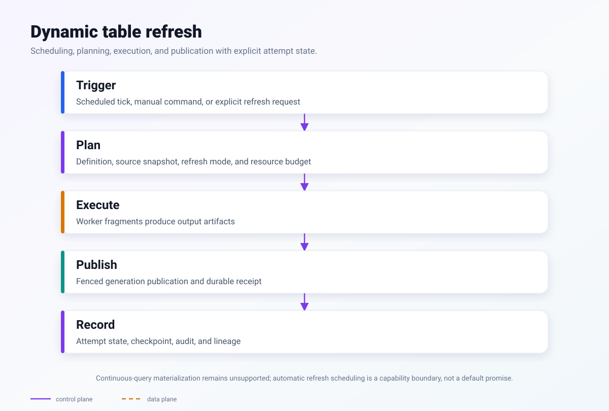
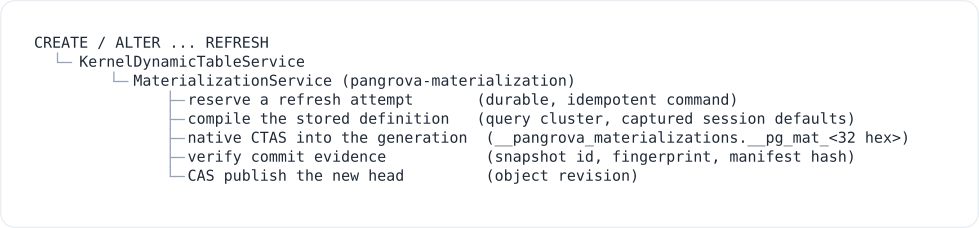

# Dynamic Table refresh

This document describes the implemented Dynamic Table refresh behavior. The
shared kernel, object model, publication protocol, dependency graph, and query
rewrite are documented in
[Query optimization §2](query-optimization.md#2-materialized-view); this page
only restates the Dynamic Table-specific SQL and scheduling surface.

## Production path





Every statement goes through the kernel; no DDL or refresh path writes a
physical generation directly, and no coordinator process holds the published
state in memory. Queries and `SHOW` / `DESCRIBE` read only the published head.
Direct SQL access to the internal namespace is rejected during authorization;
`SHOW SCHEMAS` omits the internal schema, and `SHOW TABLES` / `DESCRIBE` on the
internal schema or a generation fail closed.

The kernel executes its own CTAS and incremental append as trusted internal
work. Trust is a typed coordinator-session fact, never a client property: the
session converter strips the reserved property before it sets it, and only the
kernel's execution engine marks the session. Trusted work may name a physical
generation, but still passes tenant membership and every non-reserved access
check; client SQL that names an internal generation is rejected. Statements
dispatched as a parsed AST (DML and CTAS) are rewritten against the durable
publication head by `DynamicTableAstRewriter`, the same substitution the SQL
text path applies, and the plan carries the physical-to-logical mapping so
authorization checks the logical object and write bookkeeping never records a
generation as a client write source.

## SQL surface

```sql
CREATE DYNAMIC TABLE iceberg.sales.orders_rollup
TARGET_LAG = 'PT5M' REFRESH_MODE = SNAPSHOT AS
SELECT product_category, SUM(amount) AS total_amount
FROM iceberg.sales.orders
GROUP BY product_category;

-- Manual refresh: omit TARGET_LAG entirely.
CREATE DYNAMIC TABLE iceberg.sales.orders_rollup_live
AS SELECT * FROM iceberg.sales.orders;

ALTER DYNAMIC TABLE iceberg.sales.orders_rollup REFRESH;
ALTER DYNAMIC TABLE iceberg.sales.orders_rollup SUSPEND;
ALTER DYNAMIC TABLE iceberg.sales.orders_rollup RESUME;
ALTER DYNAMIC TABLE iceberg.sales.orders_rollup SET TARGET_LAG = 'PT15M';
ALTER DYNAMIC TABLE iceberg.sales.orders_rollup REDEFINE AS SELECT ...;

SHOW DYNAMIC TABLES;
DESCRIBE DYNAMIC TABLE iceberg.sales.orders_rollup;

DROP DYNAMIC TABLE iceberg.sales.orders_rollup CASCADE;
```

- Omitting `TARGET_LAG` is the manual-refresh form: it creates a `DISABLED`
  schedule and refresh happens only through `ALTER ... REFRESH`. An explicit
  `TARGET_LAG = 'PT0S'` is rejected because a zero lag is ambiguous between
  "always fresh" and "never scheduled".
- A positive target lag creates an `ACTIVE` durable schedule. The
  leader-elected coordinator claims due schedules with a fenced lease and
  targets freshness from the last successful publication, with bounded
  backoff and suspension after repeated failures.
- `REFRESH_MODE = SNAPSHOT` selects full recomputation.
- `REFRESH_MODE = AUTO` persists incremental mode. It never degrades to full
  behind the user's back: creation or refresh fails closed unless a registered
  incremental strategy applies to the definition. Append-only and partition
  replacement are registered; partition replacement requires a partition-aligned
  definition and a connector-proven change set. Affected-key and CDC strategies
  are not registered and are rejected rather than approximated.
- `REFRESH_MODE = CDC`, `WAREHOUSE`, and `WITH` properties are rejected.
- For scheduled tables, `SUSPEND` pauses scheduling and hides the object from new SQL lookups.
  The current generation remains available to already admitted readers
  with pins. `RESUME` makes the object visible again using the same definition
  and generation.
- `DROP` is restrictive while a live materialization depends on the object.
  `CASCADE` drops transitive dependents first, deepest dependent first, and is
  refused without `CASCADE` when dependents exist.

## Refresh guarantees

- The definition revision, its captured session defaults, and the definer
  identity are immutable; a later refresh re-plans the stored definition under
  the same authority.
- An attempt belongs to one query execution. A retry with the same command
  identity reconciles the reserved attempt instead of launching native work
  again, and a settled attempt returns its original commit evidence.
- A failed or cancelled build never advances the published head. The candidate
  generation is retained because a timed-out native writer may still commit;
  only a fenced, task-drained collector may remove it.
- Publication requires a committed Iceberg snapshot. The CAS compares tenant,
  fully qualified name, incarnation, and revision, so a stale attempt cannot
  overwrite a newer head.
- Reader pins are leased through the query lifecycle. Published generations
  remain readable after replacement or logical drop until GC proves them
  unpinned and task-drained.
- A materialization definition never rewrites recursively through another
  published materialization; dependency revisions form an acyclic graph
  enforced at write time.

## Operational notes

`SHOW` and `DESCRIBE` report the published revision, refresh strategy, schedule
state, target lag, and published generation. The maintenance tick is
leader-gated and runs schedule claims, attempt reconciliation, source-pin
sweeping, and GC in that order. Recovery and GC rely on durable attempt and
commit evidence rather than process-local state, so a coordinator restart
resumes from the published head.
The reconciliation scan reads each attempt together with its persisted commit
evidence. Attempts without evidence remain eligible for reconciliation; an
expired execution lease does not discard evidence already recorded by a writer.

Validation that needs a real catalog and native workers runs through the
Docker-based end-to-end suite in CI; unit and JDBC integration tests cover the
kernel state machine, repository, dependency graph, migrations, and planner
rewrite in isolation.


## Refresh strategy provider lifecycle

The Coordinator installs materialization SQL handlers through `MaterializationDdlRegistration`.
Query-serving Coordinators bind the shared execution authority before assembling the
statement dispatcher. They install Dynamic Table, Materialized View, and Continuous
Query handlers before opening the HTTP listener. Scheduled refresh, recovery, and
garbage collection start after coordination starts and remain scoped to the control leader.

During registration its class loader discovers `org.pangrova.materialization.api.refresh.RefreshStrategyFactory`
services. A provider JAR lists one public factory per algorithm in
`META-INF/services/org.pangrova.materialization.api.refresh.RefreshStrategyFactory`.
Each factory supplies its API version, persisted `RefreshKind` and a thread-safe, resource-free strategy.
A registry validates versions and unique kinds before constructing strategies, checks each product against
the declared kind and strategy ID, and shares it across its SQL handlers. FULL is required to create
the initial generation. The bundled provider also implements APPEND_ONLY and PARTITION_REPLACE.
AFFECTED_KEY and CDC currently have persisted kind identifiers only.

A pinned incremental strategy must be installed and supported by the planned definition. For automatic
incremental refresh the kernel tries partition replacement before append-only, independently of provider
discovery order. Proof validation still runs against the selected generation and actual source interval.
Only the kernel owns pins, attempt state and publication.
