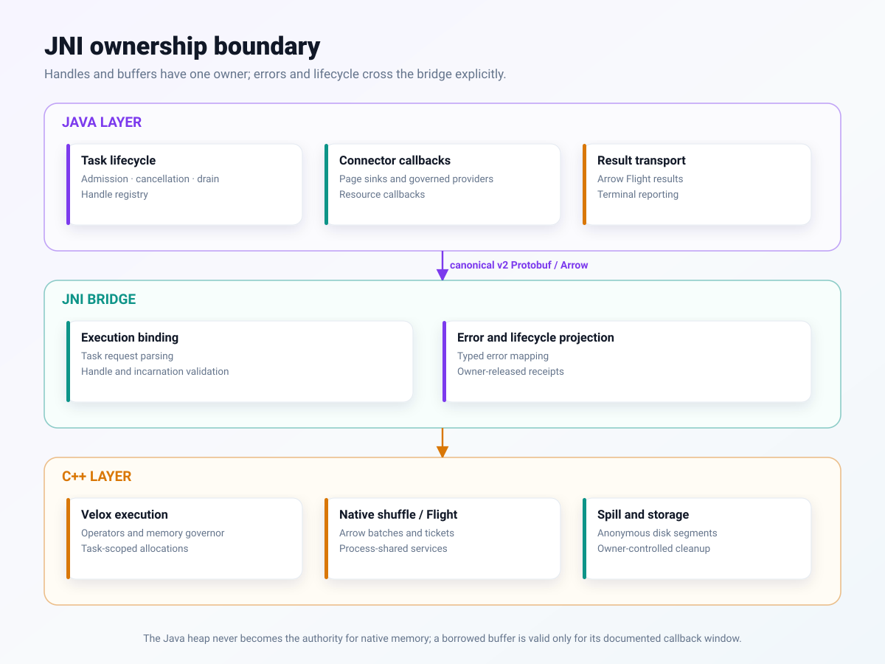
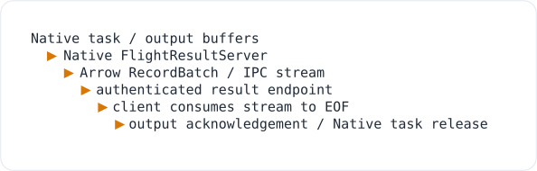
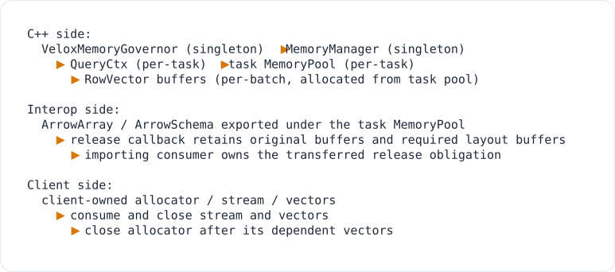

# JNI Runtime

> **Accuracy scope.** This is a living architecture document. Content explicitly marked
> draft, proposed, planned, phase, target, or remaining work is design intent rather
> than implemented support. For current behavior, code wiring and end-to-end tests
> take precedence.

## 1. Protocol Boundary Contract

### 1.1 One canonical source

`pangrova-protocol/src/main/proto` is the only source tree for every
Pangrova-owned message that crosses a process or JVM/Native boundary. Maven and
CMake invoke their own generators, but both generators consume the same files.
Build-system differences do not justify mirrored schemas.

The only supported execution protocol is `pangrova.protocol.v2`. Its descriptor
is rooted at
`pangrova-protocol/src/main/proto/pangrova/protocol/v2/protocol_manifest.proto` and
`.../protocol/v2/runtime.proto`. Startup compares a deterministic,
dependency-complete `google.protobuf.FileDescriptorSet` and its SHA-256. The Worker fails closed
before accepting tasks when the Java and Native descriptor sets differ.

Organizational proto files are allowed inside the v2 package, but they remain
one generated protocol and one descriptor set. Vector, text, multimodal,
embedding, retrieval, index and export semantics use the generic typed plan,
`OperatorBinding`, `CapabilityDescriptor`, `DataSplit` and artifact contracts;
they must not introduce feature-specific task envelopes or a second proto tree.

### 1.2 Boundary Contract

The single serialization boundary between Java and Native is the JNI bridge in `pangrova-worker`:

**Critical rule:** the byte stream produced by generated Java classes must be
parsed by C++ classes generated from the exact same canonical descriptor. There
is no v1 fallback, version negotiation, dual parser or compatibility shim.
Manual cross-file alignment is not an accepted mechanism.

### 1.3 Messages That Cross the JNI Boundary

| Message family | Direction | Contract |
|---|---|---|
| `TaskRequest`, splits, resource/write/shuffle config | Java → Native | Canonical generated descriptor and protocol epoch |
| `RuntimeInitConfig` | Java → Native | Canonical runtime, memory, cache, spill, filesystem and mutual-TLS configuration |
| `RuntimeCommand` and typed command payloads | Java → Native | Canonical generated descriptor; unknown command fails |
| Task-status responses, command responses, metrics/cache/capabilities | Native → Java | Canonical generated descriptor; negative response is not success |

REST DTOs that never cross JNI are Java contracts. Native implementation-only
structures that never cross JNI are C++ contracts. Neither may duplicate a
cross-runtime wire message.

### 1.4 Canonical v2 `TaskRequest`

The canonical proto is the authority for field numbers. Both Java and C++
generate these fields from the same source:

| Field # | Name | Type | Notes |
|---------|------|------|-------|
| 1 | `protocol` | ProtocolVersion | Exact protocol identity; mismatch fails before execution |
| 2 | `attempt` | TaskAttemptId | Query/job, stage, partition, epoch, attempt and fencing identity |
| 3 | `task_kind` | TaskKind | Read, write, shuffle, background build/validate/export |
| 4 | `security` | SecurityContext | Tenant, principal, roles and policy-context hash |
| 5 | `substrait_plan` | bytes | Serialized Substrait plan |
| 6 | `substrait_plan_checksum` | Checksum | Integrity-bound plan digest |
| 7 | `splits` | repeated DataSplit | Snapshot-pinned generic inputs |
| 8 | `operator_bindings` | repeated OperatorBinding | Version-exact model/index/artifact capabilities |
| 9 | `resource_grant` | StageResourceGrant | Bounded Native and provider resources |
| 10 | `deadline_epoch_ms` | uint64 | Absolute execution deadline |
| 11 | `trace_context` | TraceContext | Cross-runtime trace identity |
| 12 | `budget_reservation_id` | string | Governed budget reservation |
| 13 | `execution_options` | TaskExecutionOptions | Session, write, shuffle and direct-result options |
| 14 | `exchange_inputs` | repeated ExchangeInputBinding | Signed remote data-plane sources |
| 15 | `initial_runtime_filters` | repeated RuntimeFilterBinding | Typed initial filters |

The initial task binding and the decoded Native runtime command pass their
typed runtime-filter predicates to the same Velox converter. The converter
binds each admitted predicate to its assigned scan before row filtering.

### 1.5 `DataSplit` Field Alignment

| Field # | Name | Type | Notes |
|---------|------|------|-------|
| 1 | `split_id` | string | Stable split identity |
| 2 | `connector_id` | string | Connector capability identity |
| 3 | `source_id` | string | Stable logical source identity |
| 4 | `source_snapshot` | string | Immutable source snapshot/version |
| 5 | `data_object_id` | string | Source-owned object identity |
| 6 | `opaque_location` | string | Worker-resolved data location |
| 7 | `start_offset` | uint64 | Bounded range start |
| 8 | `length` | uint64 | Bounded range length |
| 9 | `partition_values` | repeated PartitionValue | Typed partition pruning metadata |
| 11 | `catalog` | CatalogExecutionBinding | Exact catalog deployment for Native manifest partitions |
| 12 | `file_detail` | FileSplitDetail | Typed format-specific scan metadata |

### 1.6 Task kinds and terminal states

`TaskKind` contains read, write, shuffle read/write and background
build/validate/export. `TaskAttemptId` and execution-owner fencing apply to all
of them; background AI infrastructure does not bypass the distributed task
contract. Task status is returned through the canonical v2 result/runtime
messages and unknown enum values fail closed.

---

## 2. Memory Ownership Model

### 2.1 Result Data Flow

Java schedules and issues JNI control commands; `NativeRuntime` has no
`nativeGetNextBatch` row-pull API. The Coordinator does not relay result batches.
The output consumer is part of task completion: an admitted endpoint is not a
terminal success report, and unconsumed output must be cancelled and drained.
The result-server start command carries its listener `bind_host` separately from
the Worker endpoint advertised to clients. Worker bootstrap uses `worker.host`
for the listener (`0.0.0.0` by default) and `worker.advertised-host` for the
endpoint when configured. A test Worker can bind to `127.0.0.1` so an unrelated
IPv4 service cannot receive its Flight traffic through an IPv6-only listener.

### 2.2 Memory Ownership Hierarchy

### 2.3 Arrow C Data Interface Ownership Rules

- Velox Vector is the task-local representation; Arrow is the interop and wire
  contract. Their string and nested layouts are not generally identical.
- Compatible flat buffers may be shared. In the pinned Velox implementation,
  ordinary string export allocates offsets and copies string bytes; array/map
  export constructs Arrow offsets. Flattening constant/dictionary encodings can
  also allocate. These are not zero-copy operations.
- `ColumnarDataExporter` currently flattens dictionaries and constants before
  export. `FlightResultServer` preserves dictionaries by default but flattens
  constants. Do not infer one boundary's copy behavior from another.
- Arrow release callbacks retain the buffers required by the exported array.
  Consumers must respect ownership transfer and release exactly once; the task
  MemoryPool must outlive outstanding exports.
- Boundary copy bytes, allocation, serialization CPU and dictionary retention
  still require measurements. The presence of a C Data interface is not a
  measured zero-copy guarantee. See the [Velox vector layouts](https://facebookincubator.github.io/velox/develop/vectors.html)
  and [Arrow C Data ownership contract](https://arrow.apache.org/docs/format/CDataInterface.html).

### 2.4 Protobuf Usage Assessment

Protobuf carries task creation, commands and status. Arrow IPC/Flight carries
columnar data and has serialization, framing and transport costs; TLS and network
transmission are not physically zero-copy. The architecture target is one typed
Arrow data-plane contract, with necessary conversions measured rather than
claimed absent. Existing private shuffle page payloads and row-shaped JVM AI/write
upcalls remain tracked migration gaps; the four-layer execution boundary is defined
in §3.8.

---

## 3. Known Issues and Fixes

### 3.1 Plan-pool Lifetime Corruption

**Root cause:** Plan-conversion vectors retained buffers owned by memory pools that
were destroyed before the plan tree. Destruction later reached Velox
`NonPODAlignedBuffer::freeToPool()` with a dead pool.

**Fix:** `VeloxTaskRunner` retains `plan_pool_holders_`, declared before the plan and
task members so reverse member destruction releases the plan before its pools.

### 3.2 ExecutorHandleMap Race Condition

**Root cause**: `nativeReleaseExecutor` calls `release()` then `remove(handle)`. Concurrent `nativeGetNextBatch` may access released executor.

**Fix**: Remove handle from map BEFORE calling `release()`.

### 3.3 Pool Access After Task Completion

**Root cause**: After `PlanExecutionDriver::executeVeloxPlan()` completes, `veloxTaskRunner()` returns nullptr. Unconsumed RowVectors in OutputQueue still reference the valid task pool.

**Fix**: Use `row_vector->pool()` instead of `runner->veloxTask()->pool()`.

### 3.4 Library Load Crash — jemalloc Symbol Collision (RC1, fixed)

**Root cause**: Homebrew jemalloc without prefix replaces global malloc. Protobuf static initializers call `free()` before jemalloc initialization.

**Fix**: Skip jemalloc linkage in CMakeLists.txt; use `-undefined dynamic_lookup` on macOS.

### 3.5 Library Load Crash — Protobuf Version Conflict (RC2, fixed)

**Root cause**: System protoc v33+ generates code incompatible with Velox-bundled protobuf 3.21.x.

**Fix**: Prefer bundled protoc from `_deps/protobuf-build/protoc`.

### 3.6 Library Load Crash — gflags Dual Registration (RC3, fixed)

**Root cause**: Static + dynamic libgflags simultaneously causes flag re-registration crash.

**Fix**: Filter out `libgflags*.a`; link only `libgflags.dylib`.

### 3.7 NativeLibraryLoader Safety

- One loading strategy: extract the canonical classpath Native resource and
  load that exact file; no `java.library.path` fallback or dependency pre-loading.
- Local builds first stage the library with `package-native-lib.sh`, then Maven
  copies the resource. Deployment uses the matching Native bundle classifier.
- Before loading, compare every same-name classpath resource with the extracted
  bytes. Conflicting bundles fail regardless of classpath order; identical
  duplicates are accepted. Availability and successful library loading do not
  prove every JNI declaration or execution path is compatible.

### Native write operation identity

The C++ write sink maps SQL INSERT/APPEND, UPDATE/MERGE/OVERWRITE and DELETE
to operation codes 0, 1 and 2 respectively. JNI resolves
`org.pangrova.worker.enums.DmlOperation.fromNativeCode(int)` and passes the
result to the task-bound `WriteDescriptor` constructor. Unknown codes fail
before the connector opens a sink. Java declaration order does not affect the
mapping. Connector writes bind to the output handle allocated for the task.

### 3.8 Canonical four-layer execution boundary

The single-path kernel decision assigns one responsibility to each layer:

| Layer | Owns | Prohibited |
|---|---|---|
| Calcite | Dialect parser, validation, type inference, relational optimization; internal SqlNode/RexNode/RelNode | A second SQL parser or a coordinator-side relational interpreter |
| Substrait | The only optimizer-to-Native IR; type/function semantics, extension relations, split boundaries | JSON/session-private plans, feature-specific protobuf, switching IR after failure |
| Velox | Task-local operators, expressions, vector encoding, memory pools, spill, async I/O, cancellation | A second execution engine, pre-execution retrieval materialization, rebuilding a plan because an encoding is unsupported |
| Arrow | The only data interoperability/network contract; in-process C Data, cross-process typed IPC/Flight | Hiding another business page encoding inside Flight binary columns, or a scalar/batch fallback for the same function |

Each layer keeps its native internal layout; the goal is to eliminate redundant
copies and record required copies per boundary, not to force identical internal
structures. Calcite RelNode and Velox PlanNode are framework trees, not a second
wire IR. Unsupported encodings fail during recursive planning/admission rather than
re-executing the task.

---

## 4. Evolution Rules

1. **Ownership:** edit only the canonical source. Never add a Worker/Native mirror
   or hand-edit generated sources.
2. **Changing the contract:** update the canonical source, both generated
   runtimes, descriptor golden, parser tests and capability epoch atomically.
3. **Removing fields:** reserve field numbers and names. Never reuse them.
4. **Deployment:** Pangrova supports one execution protocol epoch per cluster.
   Drain or fence old Workers before admitting the new epoch; do not negotiate or
   silently downgrade individual tasks.
5. **Adding enum values:** generated consumers must reject unsupported semantic
   values rather than treating `UNKNOWN` as success.
6. **Typed semantics:** semantic plan changes use typed Substrait extensions;
   JSON/session-property encodings are not protocol evolution.
7. **Rollout:** schedule only a homogeneous protocol/capability epoch and reject
   any mismatch before partial execution.

### Validation Tests

- canonical descriptor-diff gate: proves the checked-in descriptor matches the
  canonical source set and forbids Pangrova-owned Native mirror protos;
- `CanonicalProtocolDescriptorsTest`: proves deterministic dependency closure and
  descriptor hash;
- Native capability tests: compare the generated complete descriptor and SHA;
- golden enum/message tests: prevent incompatible field or enum drift;
- packaged JNI tests: prove symbols, class names, and request/response parsing
  against the shipped library rather than a component-only build.
