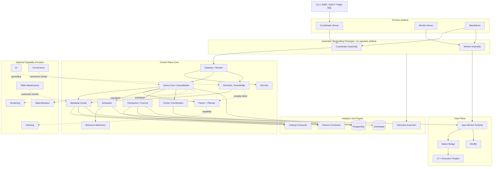

# Pangrova 长期模块化架构蓝图

> 2026-11-01：目标架构由 [领域模块化 ADR](domain-modularization-adr.md) 替代。统一领域 API/SPI 制品，保留 Core，Provider/Persistence/Server 分离。下文旧模块名记录实施现状或历史约束；与 ADR 冲突的合并 owner、中央 SPI 目标不再适用。

> **Status: Target architecture.** 模块名、ports、events 和迁移批次是长期目标，
> 不是当前仓库已经实现的类型或兼容承诺。

> 当前执行状态、实际模块/包盘点和剩余迁移请参见[项目目录与内部包重构执行计划](../internal/project-restructure-execution-plan.md)。本文中的起点数量和迁移批次属于历史蓝图，不构成当前完成证明。

> **2026-11-01 Generation 归并修订：** 共享值契约归 `pangrova-spi` 的 `generation` 能力包，job/execution/exchange/publication 存储端口与显式 `transaction.jdbc` 协作端口归 Persistence API，实际 PostgreSQL 后端归 Persistence JDBC。旧 transaction-spi/store-postgresql 制品删除。Generation core 保留规范编码、纯图构造与发布路由，不依赖 Security 或 Persistence 实现；JDBC 后端单向使用这些共用编码。Catalog export 和当前 tenant/table authority 的领域判断仍由调用方负责；相关领域 SQL 后端继续迁移。迁移与测试不代表全项目完成。

> **2026-10-31 Query 边界修订：** 原“Query API/Core 全部合一”的物理目标已由执行计划第 18 节替代。`pangrova-query-api` 独占 `org.pangrova.query.api`；`pangrova-query` 拥有 `.core/.store/.adapter`。这使 File、Governance 和后续 Artifact 消费执行契约时不依赖 Query 运行时，也允许 Query 运行时单向依赖 Artifact。下文历史模块总数不是限制新增这一真实契约制品的理由。

## 执行结论

Pangrova 当前最需要解决的不是 Maven module 数量不足，而是**业务边界、依赖边界、持久化边界和运行时边界没有对齐**。现有根 POM 已有 24 个直接 reactor entry、全仓 33 个 code-bearing/packaging 叶子，但最大的几个 Java 模块仍然承担了过多领域职责：

- `pangrova-coordinator`：555 个主代码文件、约 7.0 万行；
- `pangrova-spi`：415 个主代码文件，其中约 358 个顶层公开类型；
- `pangrova-worker`：243 个主代码文件、约 3.5 万行；
- `pangrova-metadata-core`：222 个主代码文件、约 2.47 万行，同时拥有 35 个跨越多个领域的数据库 migration。

整个工作区约有 2,776 个 Java 主代码文件、28.1 万行 Java 主代码，以及 362 个 C++ 头文件/源文件、约 8.7 万行 C++。在这个体量下，继续依赖“Coordinator 是集成中心”“SPI 什么都能放”“metadata 负责所有需要数据库的状态”会持续放大认知成本、故障半径和发布风险。

推荐的长期形态是一个**模块化分布式引擎**：

```text
部署层仍保持简单：Coordinator + Worker + Standalone

代码层严格分为：
Shared Primitives（逻辑层，无物理 aggregator）
  → Domain API / Extension SPI / Wire Protocol
  → Domain Core
  → Infrastructure Adapter / Optional Capability
  → Runtime Composition

状态层严格执行：一个 durable record 只有一个领域 owner
```

这意味着：

1. 不新增大量微服务；先把 Coordinator 建成可验证的 modular monolith。
2. 撤销通用型 `pangrova-spi`，改为小型、按消费者稳定性设计的 API/SPI 制品。
3. 将 `pangrova-coordinator` 缩减为网络入口和 composition root；Query、Scheduler 成为独立 owner artifact，Transaction 合入 Query，集群 Coordination 留在 Coordinator 内部，避免把每个逻辑子域机械拆成 Maven module。
4. 将 `pangrova-worker` 拆成 Java task runtime、native bridge 和可选能力 runtime，C++ 内部改成多个 CMake target，最终仍打包一个共享库。
5. 按已经定义的元数据中心方案重构 `pangrova-metadata-core`，并把 query journal、index、streaming、artifact、dynamic table、tenant quota 等状态迁回各自领域。
6. 每个 owner artifact 必须拥有明确的 API、状态、事件、依赖和测试边界；内部子域优先用 package、migration location 和架构测试隔离，只有目录结构没有意义。

历史蓝图曾选定 **24 个 root reactor entry、36 个叶子 Maven module、2 个主要引擎进程、1 个可选基础设施进程**；当前物理模块以执行计划和 manifest 为准，Query API 的独立制品已修订这一数量。其中 7 个 root entry 是无代码的产品 family aggregator，17 个是直接 root leaf；33 个叶子属于生产/客户端/打包制品，3 个属于测试制品。`type`、通用 event envelope 和 resilience primitive 合入 `pangrova-common`；Metadata、Semantic、Security、Index、Streaming、Materialization、Governance 等在该历史方案中分别使用一个 owner artifact，在内部以 package/migration 隔离 API、Core、Store 和子域。只有 Observability、Worker、Shuffle、Connector、AI、Client、Testing 因存在真实独立交付物而保留 aggregator。模块数量由事实所有权、发布、依赖冲突、插件、进程和 JNI 边界驱动，不代表要部署 36 个服务；Shuffle Service 是按部署模式启用的基础设施，不是第三个查询引擎角色。

## 研究范围与证据边界

本方案以当前 Pangrova 工作区为事实基础，检查了：

- 根 `pom.xml` 与所有子模块 POM；
- Java 主代码和测试代码规模、包分布与内部 import；
- `pangrova-worker-native` 的 C++ 目录和 CMake target；
- Coordinator bootstrap、query execution、worker runtime、SPI、metadata migration；
- `.pangrova/rules/architecture.md` 和当前模块依赖检查；
- 已有 metadata、query execution、resource、security、streaming、indexing 等设计文档。

外部对照只采用官方文档、原始论文和上游项目源码。外部资料说明业界事实；Pangrova 的目标模块、命名、迁移顺序和规模阈值属于结合当前代码作出的架构判断。

## 现有模块设计的结构性问题

### Module 数量和职责清晰度不相关

根 POM 已声明 24 个直接 reactor entry，`client`、`connector`、`shuffle`、`testing` 下还有子模块。因此当前问题不是“单体项目没有拆分”，而是拆分维度不稳定：

- 有些 module 按技术实现拆分，例如 `protocol`、`transport`；
- 有些按运行进程拆分，例如 `coordinator`、`worker`；
- 有些按横切能力拆分，例如 `security`、`observability`；
- 有些按业务领域拆分，例如 `streaming`、`indexing`；
- 但大量代码又重新聚集到 Coordinator、SPI 和 metadata。

一个有效模块必须回答五个问题：

| 问题 | 必须有唯一答案 |
|---|---|
| 它拥有哪类业务事实？ | 例如 query lifecycle、catalog identity、index generation |
| 谁可以调用它？ | 明确 consumer 与入口 API |
| 它允许依赖谁？ | 可执行的 dependency allowlist |
| 它发布什么事件？ | 领域事件和版本语义 |
| 它如何测试和迁移？ | 独立单测、contract test、migration owner |

当前多个模块只能回答“这里放了一组相关 class”，不能回答上述问题。

### `pangrova-spi` 已成为第二个 common

当前 SPI 的一级领域分布包括：

| 领域 | 主代码文件数 |
|---|---:|
| connector | 134 |
| index | 73 |
| execution | 55 |
| resource | 33 |
| AI | 25 |
| coordination | 21 |
| observability | 17 |
| streaming | 16 |
| security | 16 |
| function | 9 |
| transport/cache/storage 等 | 22 |

SPI 同时表达 connector 扩展、内部 query execution、协调存储、资源调度、AI、索引和可观测性。这些接口的消费者、兼容周期和实现方式完全不同，却被迫共享一个 artifact 和版本。

这会造成三类后果：

1. 任一领域增加类型都扩大所有 Connector 的编译表面；
2. 内部实现细节容易被误认为长期稳定的插件契约；
3. protocol、worker、coordinator 和 feature module 通过 SPI 类型发生隐式耦合。

Trino 的 SPI 主要面向插件扩展，并通过 `ServiceLoader` 和独立 classloader 加载插件；插件将 SPI 作为 `provided` 依赖，从而把插件依赖与引擎依赖隔离。[^trino-spi] Pangrova 可以借鉴这种隔离纪律，但不应复制一个持续扩张的单体 SPI。

### `pangrova-coordinator` 是业务实现集合，不只是协调器

Coordinator 当前一级包的主要分布为：

| 包 | 文件数 | 实际职责 |
|---|---:|---|
| query | 240 | query state、planning orchestration、stage/task dispatch、DDL/DML |
| dynamictable | 56 | 动态表定义、刷新、增量计算、锁与恢复 |
| index | 42 | 索引 DDL、build、pruning、generation、GC |
| http | 38 | REST/JDBC/catalog REST/Web UI |
| bootstrap | 35 | 全系统依赖装配 |
| ai | 35 | model、training data、vector routing、feature |
| scheduler | 17 | worker/task 调度 |
| coordination | 12 | HA、ownership、lease |
| worker | 11 | worker registry/client |
| streaming | 11 | CDC 和 streaming orchestration |
| metadata | 11 | metadata bridge、schema、stats |
| clustering | 10 | recluster DDL、job、scheduler |

`coordinator` 直接 import `spi`、`metadata`、`parser`、`protocol`、`planner`、`shuffle`、`security`、`governance`、`streaming`、`indexing`、`resource`、`operations`、`worker` 和 connectors。作为最终 composition root，广泛依赖可以接受；但当前它同时实现了这些领域的大量业务逻辑，所以任何功能都会变成 Coordinator 变更。

Trino 的 Coordinator 确实负责 SQL parsing、planning 和 worker 协调，Worker 负责 task execution 和数据处理。[^trino-concepts] 但这描述的是进程角色，不代表所有控制面代码必须属于一个代码 module。Flink 的 JobManager 也是一个协调进程，但内部明确区分 REST/应用提交的 Dispatcher、资源分配的 ResourceManager、逐作业执行的 JobMaster。[^flink-architecture]

Pangrova 应采用同样的原则：**运行时可以同进程，代码和状态必须分领域**。

### `pangrova-metadata-core` 实际上是共享数据库模块

该模块同时包含 catalog/schema/service/cache，也包含 index、artifact、dynamic table、coordination、streaming、MV、tenant、semantic/evaluation、governance 和 checkpoint。当前 35 个 Flyway migration（版本跨度 V1–V35）全部位于 metadata，其中包括：

- catalog/schema/table projection；
- query/task journal、coordinator/worker registry、execution anchor；
- write commit journal；
- index descriptor、generation 和 artifact build；
- CDC registration、commit state；
- dynamic table、checkpoint；
- embedding model；
- Semantic View version/publication 与 AI evaluation dataset/run/release gate（V26 同 migration 混合所有权）；
- governance audit、query audit、tenant；
- object dependency。

数据库共享不等于 schema ownership 共享。当前结构导致 metadata 发布或迁移可以影响查询恢复、索引、流式和 AI。

详细的元数据目标模型、对象身份、TableBinding、Catalog Store V2、outbox 和迁移清单已经在 [metadata-center-redesign.md](metadata-center-redesign.md) 中定义。本方案将其作为完整模块架构中的 `metadata` bounded context。

### `pangrova-worker` 混合基础执行与可选 AI 能力

Worker 当前主要包含：

- task、execution、exchange、shuffle、result；
- JNI、native write、memory 和 buffer；
- HTTP/heartbeat/bootstrap；
- 61 个 AI 相关 class，占主代码接近三成。

AI provider registry、模型调用、blob、governance 和函数实现与基础 task runtime 有不同的依赖、故障和安全模型。它们可以部署在同一个 Worker 进程，但不应属于 Worker kernel。

### Planner 已经承担多个 feature 的编译时集成

Planner 有 254 个主代码文件、约 2.7 万行，除核心 Calcite planning 外，还包含：

- Substrait 转换；
- cost/statistics/rule/validation；
- adaptive/runtime filter；
- MV、index、artifact、lineage；
- security rewrite；
- vector、embedding、rerank；
- stability、throttle、incremental planning。

这些能力并非都应该变成独立 planner module。正确边界是：核心 planning pipeline 保持集中；可选 feature 通过 rule/provider 注册；Substrait 作为 Java/native ABI 单独成制品；security rewrite 属于查询关键路径，保留显式 adapter，而 governance lineage 只消费 planning event。

### 当前依赖测试没有覆盖最危险的模块

`ModuleDependencyPropertyTest` 为 common、SPI、protocol、connectors、cross-cutting、worker 等模块设置 allowlist，但 Coordinator、Planner、Parser、Metadata 没有进入完整的约束集合。测试注释仍描述“18 modules post-consolidation”，而根 POM 已有 24 个直接 reactor entry、全仓 33 个叶子。

这意味着：

- 最大依赖 hub 可以持续增加直接依赖；
- 文档中的 allowed dependencies 和测试中的规则可能漂移；
- package-to-module 映射是手工维护的第二份事实源；
- POM 依赖、Java import 和数据库 ownership 没有一个统一 gate。

目标必须从“检查少数红线”升级为“生成并校验完整模块 DAG”。

## 业界架构模式与适用性

### Snowflake：共享 hard-state 底座与明确的 query ownership

Snowflake 将系统分为存储、Virtual Warehouse 和 Cloud Services。Cloud Services 负责 authentication、metadata、query parsing/optimization 和 transaction，计算层独立扩缩。[^snowflake-paper]

Snowflake 使用 FoundationDB 存放高频、小事务的控制面 hard state，并在其上建立 object mapping、schema evolution 和 metadata versioning。官方资料列举的状态不仅有 catalog object，也有 session、transaction、lock queue 和 statement execution record。[^snowflake-fdb]

这并不支持“所有状态放在 metadata module”这一结论。正确解读是：

- 共享事务底座可以承载多个领域状态；
- 领域仍需要独立 object model、service 和 ownership；
- 无状态服务通过 durable state 恢复；
- 状态修改必须具备结构化 fencing，而不是依赖代码约定。

Snowflake 2026 年公开的 Execution Anchor 进一步说明这一点：每个 query 在任一时刻只能由一个 Global Services instance 提交持久状态，anchor guard 在每次事务提交时验证 ownership，并通过分阶段 dry-run 再 enforcement 上线。[^snowflake-anchor]

Pangrova 的直接应用是：

- query ownership 和 write commit fencing 属于 `query/transaction/coordination`，不是 metadata；
- 多个领域可以继续使用同一 PostgreSQL 集群；
- 每个 schema/migration 仍有唯一 owner；
- fencing 要在 repository transaction 中强制，而不是只在 Coordinator service 入口检查。

### Trino：Coordinator/Worker、Connector 能力和插件隔离

Trino 的官方架构把服务分为 Coordinator 和 Worker；Coordinator 解析、规划和协调，Worker 执行 task 并处理数据。[^trino-concepts] Connector 则通过 metadata、split manager、page source/record set provider 等分离能力向引擎提供服务。[^trino-connectors]

Trino 源码本身也区分 `trino-spi`、`trino-main`、`trino-server`、`trino-server-core`、`trino-server-main`、parser、grammar、client 和大量 plugin module。[^trino-modules]

适合 Pangrova 的部分：

- Coordinator 与 Worker 保持不同进程角色；
- connector metadata、split、read、write 不能聚合成不透明 service locator；
- Connector SDK 依赖通过 classloader 隔离；
- runtime server/composition 与 core engine 分开；
- public client protocol 与 internal execution protocol 分开。

不应直接复制的部分：Trino 的 `ConnectorMetadata` 已承载大量 DDL、DML、pushdown 和统计方法。Pangrova 已经出现 486 行的同类接口，应继续按 capability 拆分，而不是以“业界也有大接口”为理由维持现状。

### Iceberg 与 Paimon：API、Core、Format 和 Engine Adapter 分层

Iceberg 官方模块明确区分 `iceberg-api`、`iceberg-common`、`iceberg-core`、Parquet/ORC、AWS/Hive adapter，以及 Spark/Flink runtime 包。[^iceberg-modules] Paimon 根工程也区分 `paimon-api`、`paimon-common`、`paimon-core`、format/filesystem、Flink/Spark、service、bundle 和可选 vector/full-text 能力。[^paimon-modules]

该模式适用于 Pangrova 的两个层面：

1. Java domain API 不依赖 Iceberg/Paimon SDK；SDK 类型留在 Connector adapter。
2. 核心执行不直接依赖 index、AI、streaming 等可选 feature；通过小型 capability API 注册。

### Flink：同一协调进程内部仍按生命周期分域

Flink 把 JobManager 内部职责拆分为 Dispatcher、ResourceManager 和每个 JobGraph 的 JobMaster；TaskManager 负责实际 task、buffer 和 exchange。[^flink-architecture]

这给 Pangrova 的启示不是引入 Flink runtime，而是建立清晰的 QueryMaster：

- Gateway 接收 query；
- Query service 创建 durable query record；
- 每个 active query 由 QueryMaster/state machine 管理；
- Scheduler 只接收可调度 execution graph；
- Resource Control 只负责 admission、quota、pool 和 placement constraints；
- Worker Runtime 只执行 TaskDescriptor。

### OpenTelemetry：横切 API 与 SDK/Exporter 分开

OpenTelemetry 规范要求 API 与 SDK 作为独立 artifact；被插桩的 library 只依赖 API，最终 application 决定是否装配 SDK 和 exporter。协议相关 exporter 也与通用 SDK 逻辑分离。[^otel-design]

Pangrova 的 `spi.observability` 和 `pangrova-observability` 应采用这一方式：所有领域依赖 `observability-api`，只有 Coordinator/Worker server 依赖 SDK 与 exporter。No-op 实现放在 API 或最小 bridge 中，业务模块不能 import Micrometer/OpenTelemetry SDK。

### Arrow Flight 与 Velox：控制描述和数据传输解耦

Arrow Flight 使用 Protobuf/gRPC 传递 descriptor、ticket 和 endpoint，并以 Arrow record batch 传输数据。`FlightInfo` 可以将客户端直接指向一个或多个数据端点，metadata server 不必转发所有数据。[^arrow-flight]

Velox 则把 type、vector、expression、operators、I/O connector、network serialization 和 resource management 定义为可组合组件，本身不负责 SQL parser 或 optimizer。[^velox-components]

这支持 Pangrova 保持如下边界：

- Java Planner 输出 versioned execution plan；
- internal protocol 只传 immutable wire model；
- JNI bridge 只做生命周期和序列化转换；
- native executor 不回调 Coordinator 解析 catalog 名称；
- result data 可以从 output Worker 直接通过 Flight 返回；
- C++ 最终可链接成一个 `.so`，但内部必须由多个 target 维护依赖方向。

## 设计原则

### 原则一：按事实所有权拆分，不按工具拆分

`JDBC`、`cache`、`service`、`util`、`store` 不能成为顶层领域。技术 adapter 属于使用它的领域，但“有独立 package”不自动意味着“有独立 Maven artifact”。例如 Metadata 的 JDBC 实现位于 `pangrova-metadata-core` 的 `org.pangrova.metadata.store.jdbc`，只有出现第二实现、独立发布或真实依赖隔离需求时才拆 artifact。

### 原则二：进程边界不等于代码边界

第一阶段仍只有：

- Coordinator server；
- Worker server；
- Standalone composition。

Metadata、Query、Scheduler、Security 等 owner module 可以在 Coordinator 同 JVM 运行。模块化先解决依赖、测试和状态所有权；逻辑 API/Core/Store 可以是同一 artifact 内受 ArchUnit 保护的 package。只有出现独立扩缩、独立 SLA、故障隔离、依赖冲突或独立发布需求时才增加物理 artifact/远程部署形态。

### 原则三：API、SPI、Protocol 是三种不同契约

| 契约 | 定义 | 典型消费者 | 稳定性 |
|---|---|---|---|
| Domain API | owner artifact 内对其它领域导出的 `*.api` package | Planner、Query、Scheduler | 仓库内兼容，受 manifest/架构测试保护 |
| Extension SPI | 第三方或可选插件实现的 host contract | Iceberg/Paimon、shuffle、function | 强兼容、最小表面、能力协商 |
| Wire Protocol | 跨进程或 JNI 传输的不可变消息 | Coordinator、Worker、Client、C++ | N/N-1 兼容、字段演进规则 |

不能再使用一个 `pangrova-spi` 同时承担三者。

### 原则四：依赖只能向内，装配只能在最外层

统一方向：

```text
Runtime App
    → Infrastructure / Feature Adapter package
      → Domain Core package
        → Exported Domain API / Extension SPI
          → Shared Primitives
```

Domain Core 不能 import server、JDBC、ZooKeeper、Iceberg、Paimon、Micrometer、Jersey 或 Worker internals。实现选择由 Coordinator/Worker bootstrap 注入。

### 原则五：同步调用只用于 query-critical correctness

适合同步调用：

- authentication/authorization；
- object resolution 和 query metadata binding；
- planning statistics；
- admission；
- split planning；
- task dispatch；
- fenced commit。

适合事件异步消费：

- lineage；
- quality；
- index refresh；
- historical inventory；
- usage aggregation；
- recommendation；
- audit export。

Governance、indexing 或 AI 不应反向成为 Metadata Core 的同步依赖。

### 原则六：可选能力通过 capability 注册，不进入核心依赖图

Index、AI、streaming、materialization、clustering 和 alternate shuffle 是可选 capability。它们可以向 Planner、Query 或 Worker 注册 provider，但 core 不 import 其实现。

### 原则七：模块拆分必须降低故障半径

如果拆出一个 module 后仍共享：

- 同一个巨大接口；
- 同一批无 owner migration；
- 相互调用内部 class；
- 一起 bootstrap、一起失败；
- 一起发布所有 transitive dependency；

那么拆分只有目录价值，没有架构价值。

## 行业顶尖水平的可验证标准

“高内聚、低耦合、扩展性强”必须转化为可以在设计评审和 CI 中判定的规则。Pangrova 的目标不是目录看起来整齐，而是让一个功能变化只影响拥有该事实的少数模块，并且让错误依赖在合并前失败。

### 高内聚的判定

一个 module 只有同时满足以下条件才算高内聚：

1. **单一业务词汇**：模块中的 public 类型属于同一个 bounded context。
2. **单一变化原因**：模块不会因为互不相关的产品需求一起变化。
3. **单一状态 owner**：它修改的 durable record 都属于同一领域生命周期。
4. **单一入口集合**：public use case 数量有限，调用者不需要了解内部子系统。
5. **单一一致性边界**：同一 aggregate 的 invariant 在一个 transaction/state machine 中完成。
6. **独立验证**：core 单测不启动 HTTP、JDBC、ZooKeeper、Connector SDK 或 native library。

每个 module 的 README/descriptor 必须回答：

```text
Domain vocabulary:
Owned facts:
Owned mutations:
Published events:
Consumed ports/events:
Forbidden responsibilities:
Primary consumers:
Failure and retry semantics:
```

如果一个 module 无法写出“Forbidden responsibilities”，通常说明边界仍然过宽。

### 低耦合的四个维度

低耦合不只等于 Maven 没有 cycle。必须同时控制四类耦合：

| 耦合维度 | 典型问题 | 目标控制 |
|---|---|---|
| Compile-time coupling | import 实现类、SDK 类型泄漏、巨型 SPI | 分层 DAG、API/SPI、forbidden import |
| Runtime coupling | 深层同步调用链、隐式 callback、级联超时 | QueryMaster 编排、端口超时、调用深度预算 |
| Data coupling | 多模块写同一表、共享可变对象、双重事实源 | 唯一 owner、ID/version、outbox/projection |
| Change coupling | 一个需求修改十几个 module、协议和实现一起发布 | stable contract、adapter、co-change 指标 |

#### Compile-time coupling 不变量

- module cycle 必须为 0；
- domain core 不依赖另一个领域的 implementation/adapter；
- coordinator/worker/test 之外 direct internal dependency 不超过 8；Standalone 只能依赖 Coordinator/Worker 明确导出的 embedding package；
- third-party SDK 类型不得出现在 Pangrova public API、SPI 或 wire protocol；
- Connector SPI 只依赖 `common` 中的稳定 type package，不依赖 Metadata implementation；
- Connector 只返回 provider-native opaque identity，Metadata Core 负责将其绑定到 Pangrova ObjectId；
- Coordinator 不依赖 Worker implementation；
- optional capability 不得成为 common/control/worker core 的反向依赖；
- package-private/internal package 不允许跨 module import。

#### Runtime coupling 不变量

- request 主路径由 Query Core/QueryMaster 负责编排，不允许 A → B → C → D 的隐式领域调用链；
- 单个 domain service 最多同步调用两个外部领域 port，更多调用必须回到 orchestrator；
- 所有 remote/connector port 声明 timeout、idempotency 和 retry safety；
- synchronous callback 禁止跨越 transaction boundary；
- event consumer 不得在处理同一事件时同步回调 producer 修改原 aggregate；
- optional capability 超时只能降级自身，不能悬挂基础 query state machine；
- authentication、metadata binding、admission、commit 等 correctness step 不允许 silent fallback。

#### Data coupling 不变量

- 一张表、一个 topic payload、一个 aggregate 只有一个 schema owner；
- 跨领域只传 stable ID、immutable descriptor 和 version token；
- 不共享可变 entity 或 repository；
- 不跨 schema 执行 UPDATE/DELETE；
- projection 可以重复构建，不能成为原 aggregate 的反向事实源；
- cache 永远不是 authority，cache key 必须包含影响语义的 version；
- dual-write 只能存在于有截止时间和 diff metric 的迁移阶段。

#### Change coupling 不变量

- 新增 Connector 不修改 Metadata/Planner/Worker Core；
- 新增 index 类型不修改 Query/Metadata Core；
- 新增 AI provider 不修改 Worker Runtime；
- 新增 metadata store backend 不修改 Metadata API/Core package；
- 修改 public client API 不要求 Connector 重编译；
- 修改 internal execution protocol 不要求第三方 Connector 重编译；
- 修改 governance projection 不阻断 query planning；
- 关闭 optional capability 后基础引擎仍能编译、启动和执行核心 SQL。

### 稳定性分区

所有公开 package 必须归入四个稳定等级之一：

| 等级 | Annotation/manifest | 使用者 | 变更规则 |
|---|---|---|---|
| Public SPI | `@PublicSpi` | 第三方 Connector/extension | 语义版本、兼容检查、先 deprecate 后删除 |
| Stable API | `@StableApi` | Pangrova 跨领域调用 | 仓库内向后兼容，breaking change 必须 ADR |
| Experimental | `@Experimental` | 受控试用 | capability negotiation、明确 owner/expiry |
| Internal | `@Internal` | 本 module | 禁止跨 module import，无兼容承诺 |

CI 使用 Revapi 或 japicmp 对 Public SPI/Stable API 做 binary/source compatibility 检查。`@Experimental` 必须填写 tracking issue、owner、引入版本和最晚 review 版本；到期只能晋升、修改版本或删除，不能永久停留。

### 扩展模型

Pangrova 只保留六类正式扩展点，避免任何 interface 都被称为 SPI：

| 扩展点 | Host contract | 加载位置 | 典型实现 |
|---|---|---|---|
| Connector | connector-spi | Coordinator，必要能力在 Worker | Iceberg、Paimon |
| Planner extension | planner-core extension port | Coordinator | index、AI、materialization rules |
| Worker capability | execution protocol + worker runtime port | Worker | AI invocation、Java index runtime |
| Shuffle provider | shuffle-core | Coordinator/Worker | production-wired external providers、local/test |
| Security provider | `security.api` provider port | Coordinator | JWT/OIDC、policy backend |
| Observability exporter | observability SDK exporter port | Runtime app | OTLP、Prometheus、logging |

每个插件提供显式 descriptor：

```java
public record PluginDescriptor(
        String pluginId,
        SemanticVersion pluginVersion,
        VersionRange engineApiRange,
        Set<CapabilityDescriptor> capabilities,
        Set<String> requiredRuntimeFeatures,
        String buildDigest) {}
```

加载过程固定为：

```text
discover
  → verify descriptor/signature
  → create isolated classloader
  → validate engine API range
  → negotiate capabilities
  → run startup contract checks
  → publish immutable capability inventory
  → activate
```

不允许：

- 用 class presence 猜测能力；
- 用几十个默认 no-op 方法表达 unsupported；
- 插件直接访问 Coordinator singleton；
- 插件自行注册数据库 migration 到其它领域；
- 插件把 Iceberg/Paimon/SDK object 放入 protocol；
- 未协商版本就反序列化 opaque payload。

### Capability 设计规则

Capability 必须是窄接口，而不是第二个巨型 SPI：

```java
public interface ConnectorMetadataProvider {
    ProviderTableBinding resolve(ConnectorRequestContext context, ProviderObjectName name);
    ProviderTableDescriptor describe(ConnectorRequestContext context, ProviderTableBinding table);
}

public interface ConnectorSplitProvider {
    ConnectorSplitSource planSplits(
            ConnectorRequestContext context,
            ProviderTableBinding table,
            SplitConstraint constraint);
}

public interface ConnectorCommitter {
    CommitResult commit(CommitRequest request);
    CommitStatus status(OperationId operationId);
}
```

规则：

- 一个 capability 接口不超过 7 个方法；
- capability 是否可用由 descriptor 明示；
- read/write/DDL/maintenance 的权限和 failure semantics 分开；
- method 不返回 null，不以 `UnsupportedOperationException` 表示正常能力缺失；
- opaque token 带 provider type、encoding version 和 digest；
- capability 变更独立版本化，不强迫所有插件同时实现新能力。

### Orchestrator 与 Choreography 的边界

顶尖架构不是一律同步，也不是一律事件化：

| 场景 | 模式 | 原因 |
|---|---|---|
| query submit → bind → plan → admit → schedule | QueryMaster orchestration | 顺序、错误和取消必须显式 |
| distributed write prepare/commit | Transaction orchestration | exactly-once visibility/fencing |
| authentication/authorization | synchronous port | correctness-critical |
| metadata mutation | synchronous transaction + outbox | 返回前必须确认 authority |
| index refresh、lineage、inventory | event choreography | 可延迟、可重放、避免主路径耦合 |
| dynamic table refresh | Materialization orchestration，底层调用 Query API | 有独立生命周期和恢复 |
| maintenance | job orchestration + connector capability | 长任务、可取消、可恢复 |

事件不是隐藏依赖的工具。事件 schema 也必须有 owner、version、compatibility 和消费清单。

### 扩展性验证场景

设计评审必须用下列变化场景验证，而不是只看静态类图：

| 变化 | 允许修改的模块 | 不应修改 |
|---|---|---|
| 新增 Delta/Hudi Connector | 新 connector module、distribution config、connector contract tests | Metadata/Planner/Worker 内部实现 package |
| 新增 metadata RocksDB adapter | 先新增 `metadata.store.rocksdb` package；满足拆分阈值后再独立 artifact | `metadata.api/core`、`query.core` |
| 将 Metadata 远程服务化 | 新 metadata-client/server adapters、app wiring | Query/Coordinator binding adapter；Planner 仍只接收不可变 binding value |
| 新增 shuffle provider | 新 shuffle adapter、app wiring | `query.core`、Worker task state machine |
| 新增 index 类型 | Index API package extension、control/runtime/native capability | Metadata/Query core package |
| 新增 AI provider | 新 ai-worker provider plugin、descriptor | Worker runtime、execution core |
| 新增 OIDC provider | security provider adapter、config | query/planner/metadata core |
| 新增 lineage backend | governance exporter/projection adapter | query execution 主路径 |
| 新增 Worker protocol 字段 | execution、两端 mapper、compat tests | Connector plugin |
| 新增 REST API 版本 | client-core protocol package、Coordinator endpoint、client | execution、native、Connector |

如果实际 PR 超出允许修改集合，必须说明是场景定义不完整还是模块边界失败。

### 架构适应度函数

以下检查必须自动化，而不是只靠 reviewer 记忆：

| Fitness function | Gate |
|---|---|
| 完整 module DAG | 每个生产 module 登记、cycle=0 |
| Aggregator purity | family POM 仅含 parent/coordinates/packaging/modules/name，不声明业务依赖、plugin execution 或 profile |
| Reactor identity | 重复 GAV=0；同一 artifact 同时承担 code-bearing 与 aggregator role=0 |
| Family cohesion | 同一 family 的叶子必须共享 bounded-context owner 或交付产品线；`contracts/control-plane/data-plane/extensions/assemblies/apps/capabilities/adapters` umbrella=0 |
| App terminality | app-to-app 和 domain-to-app dependency=0；Server/Standalone 只依赖 Assembly façade |
| Package ownership | 一个生产 package prefix 只有一个 owner |
| Forbidden import | Core 不导入 adapter/app/SDK/internal package |
| Public surface | 未标注稳定等级的 public type=0 |
| API compatibility | Public SPI/Stable API breaking change=0 或有批准 ADR |
| Dependency budget | 非 assembly/test direct internal deps ≤8；app direct dependency 只能是对应 assembly |
| SDK leakage | API/SPI/protocol 中 Iceberg/Paimon/Calcite/JDBC/OTel SDK 类型=0 |
| Protocol compatibility | Coordinator/Worker/Java/C++ N/N-1 golden tests 全通过 |
| Connector isolation | 每个 Connector 独立 classloader，冲突测试通过 |
| Optional capability isolation | exclusion-profile 能构建并运行 core SQL |
| Durable ownership | migration/table owner 缺失或重复=0 |
| Cross-schema mutation | 非 owner repository 的写 SQL=0 |
| Event ownership | event schema producer/版本/consumer 清单完整 |
| Wiring reachability | 每个 SPI/capability 有实现，每个实现可达 |
| Dead contract | 无调用 public port、orphan proto、orphan config=0 |
| State-machine property | query/write/refresh 的非法状态迁移=0 |
| Fault injection | owner loss、late report、duplicate event、unknown commit 可收敛 |
| Co-change monitoring | 每月输出跨 module co-change 热图和异常 fan-out |
| Performance budget | query planning/dispatch/JNI/metadata p95/p99 不越基线预算 |

### 架构评分门槛

每个新领域或重大拆分在 ADR 中按 100 分评分：

| 维度 | 分值 | 满分条件 |
|---|---:|---|
| Cohesion | 20 | 单一 vocabulary/owner/lifecycle/change reason |
| Compile-time decoupling | 15 | 分层 DAG、无实现泄漏、依赖预算内 |
| Runtime decoupling | 15 | 显式 orchestration、timeout/retry/cancel 清晰 |
| Data ownership | 15 | authority/version/transaction/event 唯一且可恢复 |
| Extensibility | 15 | 至少两个替换/新增场景无需改 core |
| Compatibility | 10 | API/SPI/protocol 版本策略和 contract tests 完整 |
| Operability | 10 | metrics、trace、audit、failure injection、rollback 完整 |

进入生产迁移阶段的门槛是 90 分，且 Cohesion、Data ownership、Compatibility 任一项不得低于该项满分的 80%。评分不是替代评审，而是确保所有团队用同一组问题评审。

## 目标总体架构



图中的虚线表示可选 capability 或异步连接，不允许变成核心模块的强实现依赖。

## Metadata 之上的智能语义、关系图谱与本体架构

### 最终判断：新增一个 `pangrova-semantic`，不把三层继续嵌入 Metadata

Metadata 是 Pangrova 的**技术事实核心**，但不是所有“关于数据的信息”的物理收容所。语义模型、业务关系图谱和本体共享同一组业务概念、版本、发布事务、校验规则与查询编译生命周期，应该形成一个新的 root leaf：`pangrova-semantic`。三者当前不拆成三个 Maven artifact，而在同一个 owner artifact 内按 package 和 migration location 强隔离：

```text
pangrova-metadata-core（技术事实）
  └── ObjectId / schema / table version / snapshot binding / statistics pointer

pangrova-semantic（业务含义）
  ├── semantic model / entity / dimension / fact / metric
  ├── business concept / terminology / taxonomy
  ├── relationship graph / join path / knowledge assertion
  ├── ontology / constraint / bounded inference
  ├── physical-object binding / validation / deterministic compiler
  └── immutable publication / change event / JDBC store

pangrova-ai-control（智能使用）
  └── retrieval / grounding / prompt-model version / evaluation / action approval
```

这个拆分同时避免两种错误：一是继续让 Metadata 吞并所有语义、图谱、AI 状态，重新长成共享数据库模块；二是为了名词对称立即创建 `semantic-model`、`knowledge-graph`、`ontology` 三个相互循环的小 JAR。只有图数据库 adapter、外部 reasoner 或公共 ontology SDK 形成独立发布/重量依赖边界时，才把**具体 adapter**晋升为新 artifact，不能先创建一个无 owner 的 `pangrova-graph`。

当前代码已经证明这是现实边界而不是远期设想：`pangrova-metadata-core` 内已有 `metadata.semantic`、`metadata.evaluation` 和 V26 semantic/evaluation 混合 migration；Coordinator 内已有 Semantic View service/validator/SQL task。现有定义仍以 `definition_json` 为中心，validator 只检查 `logicalTables` 与若干数组外形，没有建立 typed entity、join cardinality、metric grain、fan-out safety、ontology constraint、source-version pin 或 AI grounding contract。因此目标不是移动现有八个 class，而是以 typed domain model 重建，再通过兼容入口迁移 SQL DDL。

### 业界标准对照与 Pangrova 取舍

| 业界模型 | 可复用的核心 | 不能机械复制 | Pangrova 决策 |
|---|---|---|---|
| Snowflake Semantic Views | logical table、relationship、fact、metric、dimension；语义对象可直接查询，也可给 Cortex Agent 提供规则化业务含义[^snowflake-semantic] | Snowflake 把 Semantic View 归类为数据库 metadata，不代表 Pangrova 要让 Metadata Java artifact 拥有其业务模型 | 语义对象是 catalog 可发现对象，但 durable authority 属于 Semantic；Metadata 只分配/解析其 ObjectId 和 namespace binding |
| Snowflake 建模实践 | 按业务域建模、显式关系、可信描述、metric/filter、verified query；AI 不应猜未声明 join[^snowflake-semantic-practices] | 不能把 verified query 当作缺失模型的补丁，也不能允许 LLM 直接决定 join | Semantic 编译器确定 join/聚合；gold question/query 进入 AI evaluation/grounding 数据集 |
| dbt Semantic Layer / MetricFlow | entity 作为 join key 与图节点；dimension 绑定 entity；动态寻找合法 join；simple/derived/ratio/cumulative/conversion metric[^dbt-semantic][^dbt-metricflow] | dbt YAML 与仓库构建生命周期不等于在线 SQL engine 的事务、权限和 snapshot 语义 | 采用 entity/metric/grain/join-path 模型，但发布时绑定 Pangrova Metadata VersionToken 与 PolicyVersion |
| Microsoft Fabric Ontology（Preview） | entity type、property、relationship、data binding 形成共享业务语言，供人和 agent grounding/跨域 reasoning[^fabric-ontology] | Preview 产品不能作为兼容标准；Graph、Ontology、Semantic Model 是产品项划分，不应照抄 artifact 数量 | 借鉴“定义—数据绑定—图—Agent”链路；Pangrova 内部模型自有且版本化，外部格式只是 adapter |
| W3C SKOS / OWL 2 / SHACL | SKOS 表达 preferred/alternate label、broader/narrower/related；OWL 2 表达 class/property/individual 与形式语义；SHACL 表达 RDF graph constraint[^skos][^owl2][^shacl] | 全量 OWL DL 推理和开放世界语义不适合进入 SQL query-critical path；SHACL 1.2 目前仍是 Working Draft | 内部使用受限 typed model；RDF/SKOS/OWL/SHACL 作为 import/export/validation profile，默认只启用可证明有界的推理 |
| OpenLineage | Dataset/Job/Run + versioned facet，区分 design-time metadata 与 runtime observation[^openlineage] | lineage observation graph 不是业务知识图谱，也不是 Metadata dependency authority | Governance 拥有 lineage projection；Semantic 只引用稳定 Dataset/ObjectId，并可导出语义 facet，双方不互写状态 |

Snowflake 文档把 Semantic View 称为 metadata，是**逻辑分类**；本文的 Metadata/Semantic 是**代码与状态所有权**。两者不矛盾：统一发现面可以同时展示 technical metadata 和 business semantics，但写路径、migration、版本和失败域必须分开。

### 四层模型及唯一事实源

| 层 | 唯一回答的问题 | 权威对象 | 明确不负责 |
|---|---|---|---|
| Metadata | “物理/逻辑数据对象现在是什么版本？” | ObjectId、FieldId、SchemaVersion、TableBinding、VersionToken、statistics envelope | KPI 含义、同义词、本体、agent prompt、lineage 推断 |
| Semantic | “这个对象在业务上表示什么，如何被安全组合与计算？” | Concept、Entity、Dimension、Fact、Metric、Relationship、Ontology、SemanticBinding、PublishedSemanticSnapshot | 物理 snapshot commit、query journal、模型调用、审批执行 |
| Governance | “谁负责、是否合规、数据如何流动、质量是否达标？” | steward、classification、policy workflow、lineage observation、quality assertion、audit | 复制 Concept/Metric 定义、成为查询规划器、保存 LLM prompt |
| AI Control | “针对一个用户意图，使用哪些已授权事实和工具，结果是否可发布/执行？” | GroundingSnapshot、RetrievalTrace、Prompt/ModelVersion、EvaluationRun、ActionPlan/Approval | 创造未发布业务定义、绕过 Security、直接修改 Metadata/Semantic store |

语义层可以被称为“元数据之上的核心层”，但依赖方向必须固定为 `AI/Governance/Materialization → Semantic API → Metadata API`。Metadata Core 不得 import Semantic；Semantic 不得 import AI、Governance 或 Coordinator。需要治理审批时，由 Semantic 定义 consumer-owned `PublicationPolicy` port，在 Coordinator assembly 中接 Governance adapter，避免 `semantic ↔ governance` 环。

### `pangrova-semantic` 内部能力与分包

```text
org.pangrova.semantic
├── api
│   ├── concept          # ConceptId、Term、Label、Definition、Locale
│   ├── model            # SemanticModelId、Entity、Dimension、Fact、Filter
│   ├── metric           # Metric、Measure、Aggregation、TimeGrain、Unit
│   ├── relationship     # Relationship、Cardinality、JoinPath、FanoutPolicy
│   ├── ontology         # OntologyId、Class、Property、Constraint、AxiomRef
│   ├── binding          # SemanticBinding、Metadata ObjectId/FieldId/VersionToken
│   ├── query            # SemanticQueryIntent、ResolvedSemanticPlan、explanation
│   └── event            # producer-owned published/deprecated/binding-changed events
├── core
│   ├── concept          # terminology、taxonomy、localization、synonym policy
│   ├── model            # entity/dimension/fact/filter invariants
│   ├── metric           # metric dependency DAG、grain、unit/aggregation checking
│   ├── relationship     # join graph、cardinality、path ambiguity/fan-out detection
│   ├── ontology         # namespace/import、bounded inference、consistency
│   ├── mapping          # concept/entity/metric 到 Metadata ID 的版本化映射
│   ├── validation       # structural/semantic/security/publication validation
│   ├── compiler         # intent → deterministic relational/SQL AST request
│   └── publication      # immutable version、CAS active pointer、lifecycle
├── projection
│   ├── metadata         # Metadata event read model；可重建，不反写 Metadata
│   └── lineage          # Governance lineage read port/projection；非 authority
├── adapter
│   ├── rdf              # RDF/JSON-LD/Turtle import/export
│   ├── skos             # vocabulary/taxonomy profile
│   ├── owl              # supported OWL profile import/export
│   └── shacl            # constraint import/export/validation
└── store
    └── jdbc             # semantic-owned migrations/repositories/outbox
```

只 export `org.pangrova.semantic.api..`。`core`、`projection`、`adapter`、`store` 均为 internal；RDF4J/Jena/reasoner/graph-driver 等第三方依赖必须 non-transitive。若引入图数据库，其 adapter 保存的是可重建 projection；Semantic 的版本与发布指针仍以 transactional store 为 authority，绝不能让图索引成为双写事实源。

### 完整领域模型与发布生命周期

| 能力 | 必备字段/不变量 | 关键校验 |
|---|---|---|
| Concept/Term | stable ID、namespace、preferred/alternate label、locale、definition、owner、status | 同 namespace+locale preferred label 唯一；alias 不得产生歧义；废弃必须给 replacement |
| Taxonomy/Ontology | class、property、domain/range、broader/narrower/related、equivalent、constraint、import pin | import 必须 pin version；禁止未声明循环/不支持公理；推理结果带 rule/version/provenance |
| Entity | stable ID、business key、grain、source binding、valid-time/system-time | key/grain 可证明；绑定到 ObjectId/FieldId 而非字符串列名；nullable key 显式策略 |
| Dimension | categorical/time、entity scope、expression、hierarchy、granularity | time grain 完整；层级无非法环；表达式类型稳定 |
| Fact/Measure | row-grain expression、type、unit、semi-additive behavior | 不跨越不兼容 grain；unit 可组合；敏感字段策略保留 |
| Metric | aggregation、inputs、filter、time dimension、metric type、format | dependency DAG 无环；aggregation/fan-out 安全；ratio 除零、distinct、semi-additive 明确 |
| Relationship | endpoints、join keys、cardinality、optionality、direction、validity、bridge/fanout policy | key type/版本兼容；多路径歧义拒绝；many-to-many 必须有 bridge 或显式策略 |
| SemanticBinding | semantic version、ObjectId/FieldId、Metadata VersionToken range、transform、provenance | publish 时目标存在且已授权；schema evolution compatibility；失效可追踪 |
| Verified Example | natural-language intent、semantic intent、gold relational/SQL result、dataset snapshot | 只辅助检索/评测；不得覆盖 typed model 或安全规则 |

所有定义遵循不可变版本与显式状态机：

```text
DRAFT → VALIDATED → PUBLISHED → DEPRECATED → RETIRED
          │             │
          └─ REJECTED   └─ 新版本替换，不原地修改
```

发布事务必须 CAS `publication_epoch`，同时固定 definition hash、source Metadata versions、ontology imports、policy version、validator/compiler version 和 provenance。`PUBLISHED` 才能进入 AI grounding 或 production semantic query；DRAFT/REJECTED 不进入默认索引。Metadata schema change 只发出影响事件，Semantic 执行 compatibility analysis 并将绑定标记为 `VALID/STALE/BROKEN`，不能静默重绑同名列。

Semantic View 同时需要 Metadata namespace identity 和 Semantic definition，但不能因此建立跨 owner 表外键或双写事务。创建/删除使用可恢复 operation protocol：

```text
CREATE
  1. Metadata.reserveName(operationId, ObjectKind.SEMANTIC_VIEW) → PENDING binding
  2. Semantic.createDraft(operationId, ObjectId, definition) → immutable version
  3. Semantic.validate + publish(CAS publicationEpoch)
  4. Metadata.activateBinding(operationId, ObjectId, ownerRef)

DROP
  1. Metadata.markDropping(operationId, expectedGeneration)
  2. Semantic.retire/tombstone(operationId, expectedPublicationEpoch)
  3. Metadata.tombstoneBinding(operationId)
```

每一步以相同 `operationId` 幂等，Coordinator 只编排、不持久化业务事实；reconciler 可根据 outbox 补完中断步骤。`PENDING/DROPPING` 不进入普通 SHOW、AI retrieval 或 query resolution。发布 source binding 仍在查询时重新执行权限与 policy-version 校验，不能因为创建者曾有权限就把数据永久授权给所有使用者。

### “图谱”必须拆成四种图，不建通用 Graph 中心

| 图 | Authority owner | 写入来源 | 用途 | 禁止事项 |
|---|---|---|---|---|
| Metadata dependency graph | Metadata | DDL、view/function/table binding | rename/drop/cascade 与 correctness | 不保存业务 `Customer places Order`、lineage observation 或 embedding edge |
| Semantic knowledge/relationship graph | Semantic | published concepts/models/ontology/bindings | join path、business navigation、reasoning、AI grounding | 不推断物理 current snapshot，不接管治理审批 |
| Data lineage graph | Governance | Planner/Query/Streaming/Materialization/OpenLineage event | impact、provenance、审计、质量传播 | 不作为 SQL join authority；runtime observation 不反写 semantic definition |
| Retrieval/index graph | Indexing/AI projection | Semantic/Metadata/Governance events | BM25/vector/hybrid/graph retrieval | 可随时重建；不得成为权限、定义或发布事实源 |

Planner 内的 relational DAG 是一次查询的临时编译产物，执行协议内的 stage/task DAG 是调度产物，也不属于上述任何 durable graph。它们可发布 lineage event，但不得同步写 Governance 或 Semantic store。

### 本体标准与推理边界

Pangrova 内部模型以 SQL/湖仓可执行性为第一约束，不直接把 RDF triple 或 OWL class 暴露给 Planner、Query、Execution API。标准支持分三档：

1. **基础互操作**：RDF 1.2/JSON-LD/Turtle 序列化，SKOS label、broader/narrower/related，SHACL-like cardinality/type/domain/range validation。
2. **受限推理**：subClass/subProperty、inverse、equivalent、transitive closure 等经过 allowlist 的确定性规则；发布时预计算或缓存，结果携带 ontology/rule engine version 与 proof/provenance。
3. **隔离扩展**：完整 OWL profile reasoner、SPARQL endpoint、图数据库，通过 adapter/异步 projection 提供；不得让不可预测推理进入 query p99 或改变已发布 metric 的含义。

默认采用 closed-world publication validation：缺少必需 binding/constraint 即失败；外部 OWL/RDF import 的 open-world 语义不能削弱 Pangrova 的发布门槛。任何推理都有 tenant、namespace、depth、node/edge、CPU/time budget，超限返回显式 `INFERENCE_LIMIT_EXCEEDED`，不能静默截断。

### AI 操作的可信链路

```text
User Question / Action Intent
  → Authentication + tenant/session context
  → policy-filtered hybrid retrieval
       [published semantic snapshot + metadata + lineage + verified examples]
  → immutable GroundingSnapshot
       [semantic/model/ontology/metadata/policy/index/prompt/model versions]
  → LLM proposes SemanticQueryIntent or ActionIntent
  → deterministic Semantic Compiler
       [metric + dimension + time grain + join path + filter + explanation]
  → Security re-authorization and policy injection
  → Planner validation / cost / admission
  → Query execution or governed action workflow
  → citations + provenance + audit + evaluation feedback
```

LLM 输出不是执行授权。只读问题必须先转换为 typed `SemanticQueryIntent`，由 Semantic Compiler 唯一决定 metric 展开、join path、聚合与 SQL/relational request；Planner 再按普通 SQL 规则校验。写操作、DDL、治理变更和运维动作必须转换为 action registry 中的 typed command，具备 explicit privilege、idempotency key、expected version、dry-run、risk class 和审批策略；高风险动作默认 human approval。AI Worker 只负责 provider invocation/function execution，不保存 Concept/Ontology/Metric authority。

`GroundingSnapshot` 至少包含：tenant/principal、question hash、retrieved object IDs、Semantic/Ontology/Metadata/Policy versions、index generation、model/provider/prompt version、tool schema version、time budget、citations 与 retrieval trace。这样答案、SQL 和动作才能重放、比较、评测与审计；不能只保存最终 prompt 或 SQL。

### AI 安全、租户隔离与不可信内容边界

- 检索前先按 tenant、principal、semantic object privilege、source-object privilege 和 classification 过滤；不能先召回未授权内容再让 LLM “忽略”。Vector/graph index 必须带 policy/tenant partition 或 post-filter proof，并以 Security 的 PolicyVersion 进入 cache key。
- Semantic description、synonym、verified example、table comment、lineage attribute 和外部 RDF/OWL 文本都是**不可信数据**，不得拼接为 system/developer instruction。AI Control 必须结构化区分 instructions、evidence 和 tool output，并记录来源。
- Prompt/tool/model provider 获得最小化上下文；secret、masked column、row-filtered value 和跨租户 neighbor 不得进入 prompt。远程 provider 的 data residency、retention、logging 与 egress policy 由 Security/AI policy 显式决定。
- Tool schema 与 Action Registry 都必须版本化、签名/校验、allowlist；模型不能动态发明 tool name、SQL privilege 或 arbitrary URL。外部内容只能作为参数，经 SSRF、path、MIME、size 与 malware policy 校验。
- 读查询也必须在执行前重新授权 underlying ObjectId/FieldId；RLS/masking 在 Planner/Execution 正常安全链路注入，Semantic 层不能通过预聚合、join 或 citation 泄露受限数据。
- 所有缓存按 tenant/principal-or-policy-equivalence/PolicyVersion/SemanticVersion/MetadataVersion 隔离；权限撤销和 semantic deprecation 通过事件主动失效，TTL 只能作为兜底。
- feedback、conversation、retrieval trace 和 grounding snapshot 本身可能含敏感信息，归 AI Control 的受治理 durable state，执行 retention、redaction、encryption、audit 和删除策略。

### 36 个叶子与智能语义能力的完整覆盖

| # | Module | 对 Semantic/Graph/Ontology/AI 的职责 | 明确禁止 |
|---:|---|---|---|
| 1 | common | stable ID/event envelope/error/time primitives | Concept/Metric/Graph node 等领域对象 |
| 2 | config | semantic/AI typed config、budget 与 feature activation | 业务定义和运行时 registry |
| 3 | observability-api | grounding/compiler/retrieval/inference 指标与 trace contract | provider SDK、业务审计事实 |
| 4 | observability-sdk | trace/exporter/profiler wiring | 语义判断和 prompt 内容 authority |
| 5 | execution | 已 lower 的普通 relational/capability wire message | ontology、metric、prompt、reasoner 类型 |
| 6 | planner | 接收 resolved semantic plan，做 SQL/relational validation、CBO 与 lineage event | 自己解释同义词、选 metric 或拥有 ontology |
| 7 | metadata | ObjectId/FieldId/schema/version/binding 与技术依赖图 | semantic view、term、metric、ontology、evaluation run |
| 8 | query | 以通用 immutable provenance reference 记录 grounding/semantic version hash | 依赖 semantic 类型、semantic definition/store、LLM orchestration |
| 9 | scheduler | AI/semantic query admission、resource budget、queue/quota | 模型选择、语义路由、prompt |
| 10 | security | 语义对象授权、row/mask policy、delegation/action privilege 与 PolicyVersion | 复制语义模型或把 prompt 当权限 |
| 11 | worker | 执行已验证 plan，传播 provenance/capability context | 解析 ontology、调用 provider、重做语义编译 |
| 12 | worker-native-bridge | 只映射 lowered execution descriptor | Java semantic/ontology object 穿越 JNI |
| 13 | native-bundle | 打包 native runtime | 任意业务语义状态 |
| 14 | shuffle-core | 传播 query/tenant/security execution context | 语义对象或 graph store |
| 15 | shuffle-service | 受控传输与恢复 | semantic/AI 业务逻辑 |
| 16 | connector-spi | 暴露稳定 Object/Field identity、schema/stats/capability | Semantic/OWL 类型进入公共 Connector SPI |
| 17 | connector-runtime | 隔离并装载 provider | semantic definition 或 retrieval index |
| 18 | connector-iceberg | 保真映射 Iceberg ID/snapshot/schema/version | 业务 metric/ontology |
| 19 | connector-paimon | 保真映射 Paimon ID/snapshot/schema/version | 业务 metric/ontology |
| 20 | indexing | 构建 BM25/vector/graph retrieval projection，记录 generation | 成为 semantic/permission authority |
| 21 | streaming | 发出 versioned stream/schema/lineage event，支持流式 metric 输入 | 持有通用 ontology 或 AI prompt |
| 22 | materialization | 消费 published metric/model，规划语义 aggregate/materialized view | 修改 metric 定义或 semantic publication pointer |
| 23 | table | 根据 semantic workload signal 建议 maintenance | 理解/保存 ontology、决定 KPI |
| 24 | semantic | Concept/Model/Metric/Relationship/Ontology/Binding/Compiler/Publication 的唯一 owner | provider invocation、query journal、lineage observation authority |
| 25 | ai-control | grounding/retrieval orchestration、prompt/model registry、evaluation、release gate、action approval | 绕过 Semantic Compiler/Security，拥有 metric/ontology authority |
| 26 | ai-worker | provider invocation、embedding/rerank/inference/function runtime | 持久 semantic state、审批或策略决定 |
| 27 | governance | steward/classification/approval、lineage/quality/audit；消费 semantic events | 再造 glossary/term ID、同步反写 Semantic store |
| 28 | operations | semantic/index/reasoner 的 backup、upgrade、repair、diagnostics action | 越权修改定义或绕过 owner API |
| 29 | coordinator | 装配 Semantic、Governance、AI、Security adapter 和 SQL endpoint | 承载 semantic service/core/store 实现 |
| 30 | standalone | 复用相同 embedding API 组合全部能力 | 建第二套 in-memory semantic authority |
| 31 | client-core | semantic catalog/query/action/public DTO 与 version negotiation | 暴露 internal core/store/RDF library type |
| 32 | client-jdbc | Semantic View INFORMATION_SCHEMA/JDBC metadata 与结果呈现 | client-side metric 编译 |
| 33 | client-cli | author/validate/publish/explain/query 命令与审批交互 | 绕过服务端校验/授权 |
| 34 | testkit | semantic fixtures、connector identity、ontology/AI contract harness | 生产依赖 |
| 35 | integration-tests | version/schema drift、security、grounding、action、recovery E2E/chaos | 用 mock 代替关键跨域链路验收 |
| 36 | benchmark | semantic compile、graph traversal、retrieval、token、query latency regression | 只测 LLM 主观答案、不测确定性部分 |

### 数据归属与迁移纠正

当前 V26 必须按所有权拆迁，而不是继续在原 migration 上追加表：

| 当前状态 | 目标 owner/location | 迁移要求 |
|---|---|---|
| `semantic_view_versions` / `semantic_view_active_versions` | Semantic，`db/semantic/migration` | backfill typed model/version；保留 definition hash；authority flip 后 Metadata 只留 object binding/projection |
| `evaluation_dataset_versions` / `evaluation_runs` / `evaluation_metrics` / `evaluation_release_decisions` | AI Control，`db/ai/evaluation/migration` | pin Semantic/Metadata/Policy/Model/Prompt/Index version；支持 baseline 和 release gate |
| `metadata.semantic.*` | `semantic.api/core/store.jdbc` | 旧 repository façade 临时委托；禁止机械改 package 后保留 JSON-only model |
| `coordinator.semantic.*` 与 semantic SQL tasks | Semantic use case + Coordinator endpoint adapter | validator/compiler/use case 迁入 Semantic；Coordinator 只做 AST/wire/session mapping 与装配 |
| Governance glossary/term | Semantic Concept/Taxonomy authority + Governance steward workflow | 分配唯一 ConceptId；去重双写；治理只保存审批、owner、classification 和 audit projection |

迁移期间以 `SemanticDefinitionImported`、`SemanticVersionPublished`、`SemanticBindingInvalidated` 事件重建 Indexing/Governance/AI read model。禁止 Metadata、Semantic、Governance 三方 dual-write 同一业务定义；必要的 dual-write 仅存在于旧/新 Semantic store 之间，且必须有 hash/row-count/semantic-diff 指标与删除日期。

### 智能语义层验收门槛

- Metadata 对 `org.pangrova.semantic..`、`org.pangrova.ai..`、`org.pangrova.governance..` import 为 0；
- Semantic 对 AI/Governance/Coordinator/Planner implementation import 为 0；
- Semantic Core 不依赖 RDF/OWL/graph vendor SDK；adapter-only 依赖不传递；
- 所有 published metric/entity/relation/ontology import 均不可变、可重放且绑定稳定 ObjectId/FieldId/version；
- metric dependency、ontology import 和 package/module graph cycle 均为 0；允许 taxonomy/knowledge relation cycle 时必须由关系类型显式声明；
- ambiguous join、unsafe fan-out、grain/unit mismatch、broken source binding、unauthorized source 任一出现都拒绝发布；
- AI 生成的每个 SQL/action 都能追溯 GroundingSnapshot、Semantic/Metadata/Policy/Model/Prompt/Index versions 与引用；
- LLM 不能绕过 Semantic Compiler、Planner、Security、Scheduler 或 action approval；
- semantic compiler 在不调用 LLM 的情况下 deterministic replay 一致率 100%；
- graph/retrieval index 删除后可从 authoritative event 重建；重建期间 correctness 不得回退为猜测；
- 语义编译、bounded inference、retrieval 分别有 p50/p95/p99、cache hit、ambiguity/rejection、staleness 和 token budget SLO；
- schema rename/drop/type evolution、ontology import drift、publication race、event duplicate/out-of-order、stale index、provider timeout 均有故障注入测试。

## 最终物理拆分结果

### “不该嵌在其它模块”的四维审计

这里的“嵌在”不能只看文件夹。必须同时检查四种关系：

| 维度 | 错误信号 | 正确约束 |
|---|---|---|
| 目录/聚合 | 为了缩短 root POM，把无共同 owner 的领域塞进同一个 umbrella | family 只聚合同一 bounded context 或同一交付产品线 |
| Maven parent | 子模块继承 family 的依赖、插件或版本，导致隐式耦合 | 所有叶子统一继承 root build parent/BOM；family POM 只写 `<modules>` |
| 编译依赖 | 目录看似独立，但生产代码依赖 sibling implementation 或 app | 跨领域只依赖 API/SPI/event；app 不被 app 依赖 |
| 发布/所有权 | 把每个逻辑层都拆成 artifact，普通变更需要联动多个 GAV | API/Core/Store 先在同一 owner artifact 内按 package 隔离；只在真实发布/依赖边界出现时物理拆分 |

第二轮审计对原 10-family 方案作以下纠正：

| 原归属 | 问题 | 最终处理 |
|---|---|---|
| `contracts` | Metadata/Query/Security API 与各自实现分离，是按技术层而非 owner 聚合 | 撤销 umbrella；内部 Domain API 回到 owner artifact 的 `.api` package |
| `event-api` | 通用 envelope/发布 port 很小，领域事件又必须由生产者拥有；单独成 JAR 会制造无 owner 的事件中心 | 取消 `pangrova-event-api`；通用 primitive 合入 `pangrova-common.event`，领域 payload 留在各 owner 的 `.api.<capability>.event` |
| `control-plane` | 同时装入 Metadata、Query、Scheduler、Resource、Transaction、Coordination、Security | 撤销 umbrella；Metadata/Query/Scheduler/Security 保持 owner module，Transaction 合入 Query，Resource 合入 Scheduler，Coordination 合入 Coordinator |
| `capabilities` | Index、Streaming、Materialization、AI、Governance、Maintenance 没有共同状态 owner | 撤销 umbrella；单交付物 bounded context 使用 root leaf，只有 AI 因 control/Worker 两种运行时保留 family |
| `apps/observability-sdk` | SDK 是 runtime adapter，不是可执行程序 | 与 `observability-api` 组成独立 Observability family |
| `data-plane` | Worker kernel、Shuffle provider 与 packaging 被部署平面名称横向绑在一起 | 撤销 umbrella；Worker 与 Shuffle 分别成为产品 family |
| `assemblies` / `apps` | Coordinator/Worker 的 assembly 与 launcher 被机械拆成多个低价值 artifact | 撤销两个 umbrella；assembly/server 作为各自产品 artifact 的内部 package，Standalone 只用其 embedding API |
| `extensions` | 当前 loader 只有 Connector classloader/manager，名称却承诺任意扩展 | 重命名 `pangrova-connector`；`extension-runtime` 收窄为 `connector-runtime` |
| `apps/platform-operations` | diagnostics 与 upgrade/scaling/DR 风险不同，但同进程、同 owner、同发布节奏 | 保留一个 `pangrova-operations` artifact，以授权、资源预算和 package 边界隔离 |
| 单体 `governance` | classification、lineage、quality、audit 有不同内部状态模型 | 保留一个 `pangrova-governance` artifact，以 catalog/lineage/quality/audit package 和独立 migration location 隔离 |
| `testkit.connector` 在生产插件侧 | 测试契约不是生产插件 | 归 Testing family，只允许 test scope |
| `standalone -> server apps` | app-to-app 依赖使 launcher 成为复用入口 | Coordinator/Worker artifact 导出窄 `embedding` package；Standalone 禁止 import `server/main` |
| `client-core.protocol` 与 Client 分离 | protocol 与 REST client 同版本、同消费者、同发布节奏 | 合并为 `pangrova-client-core`；JDBC、CLI 因接口/分发形态独立 |

这个调整不是根据名称猜测。当前代码提供了直接证据：

| 当前 artifact | 主代码文件/依赖证据 | 说明 |
|---|---:|---|
| `pangrova-indexing` | 63 个主代码 Java 文件，包含 build/lifecycle/storage/多种 engine | 已是完整 Index bounded context，不是通用 capability 的一个 package |
| `pangrova-streaming` | 86 个 Java 文件，包含 CDC/commit/watermark/writer/maintenance | 有独立状态机和恢复语义，但只有一个交付物，因此保留为 root leaf，不创建 family |
| `pangrova-governance` | 56 个 Java 文件，存在 classification/lineage/quality/audit 四组职责 | 需要内部 package/migration owner，不足以证明必须拆四个 artifact |
| `pangrova-operations` | 52 个 Java 文件；diagnostics 与变更操作同属运维产品 | 需要授权和资源预算隔离，但 Maven JAR 本身不是安全边界，保留一个 artifact |
| `pangrova-observability` | 63 个 Java 文件，并直接引入 OTel SDK/exporter | API 与重量级 SDK 必须分 artifact，但由同一 Observability family 管理 |
| `pangrova-standalone` | 1 个 launcher class，却编译依赖 Coordinator 和 Worker app | 不再为 assembly 单建 artifact；改为依赖两者窄 embedding package |
| `coordinator.plugin` | 仅有 Connector handle factory、classloader、PluginManager | 没有证据支持通用 extension host，必须按 Connector 真实职责命名 |

创建 family aggregator 必须同时满足：至少有两个**确实需要独立发布/依赖隔离**的叶子 artifact、共享同一 product-line owner、具有共同 contract test/release policy。只有逻辑 package、没有独立物理边界时直接使用单一 root leaf；不能为了 API/Core/Store 或 Assembly/Server 对称而建 aggregator。所有叶子 POM 继承统一 root build parent/BOM；family POM 仅承担 reactor aggregation。

`type`、`common.event`、`resilience` 既没有独立消费者群、独立发布节奏，也不需要重量级依赖隔离，因此合入 `pangrova-common` 的 `type/event/resilience` package；`config` 因配置解析依赖和运行时生命周期继续独立。`pangrova-foundation` 不存在，Shared Primitives 仅是逻辑层标签。

以下嵌套经审计应保留：

- Parser、Planner Core、Substrait mapper 合并为一个 Planner artifact；
- Metadata、Query、Security 的 API/Core/JDBC Store 是同一 artifact 内的纵向 package；
- Query 同时拥有 query transaction；Scheduler 同时拥有 resource/admission；Coordinator 同时拥有 coordination；
- Worker Runtime、Worker Resource、Assembly/Server 合并；Native Bridge 与 Native Bundle 因 JNI/打包边界继续独立；
- Shuffle Core/Service 同属 Shuffle product family，Worker 只依赖其公开 contract；
- Connector SPI、Connector Runtime、Iceberg/Paimon plugin 同属 Connector ecosystem，但 plugin 只以 `provided` 使用 SPI；
- JDBC/ZooKeeper adapter 位于 owner artifact 的内部 adapter package，不另建通用 `adapters` 或单实现 artifact；
- `pangrova-worker-native` 是 CMake project，不嵌进 Java Maven module；Java 侧只通过 protocol/JNI bridge 连接。

#### 物理 artifact 合并清单

原 69 叶方案中可以合并的层次全部回收到 owner artifact；目标减少 33 个叶子（约 48%）。下表是最终合并账本，左侧名称只表示旧方案中的物理制品设想，不要求先创建再删除：

| 合并后的 artifact | 吸收的旧物理拆分设想 | 合并后的强制内部边界 |
|---|---|---|
| `pangrova-common` | type、event-api、resilience primitives | `.type/.event/.resilience`；事件 payload 仍归生产者 API |
| `pangrova-planner` | parser、planner-core、Substrait mapper | `.parser → .core → .substrait`，framework adapter 不反向污染 parser/domain |
| `pangrova-metadata-core` | metadata-api、metadata-core、metadata-store-jdbc | `.api → .core → .store.jdbc`；只 export `.api` |
| `pangrova-semantic` | semantic-model、knowledge-graph、ontology、semantic-store 等机械拆分设想 | `.api → .core/.projection → .adapter/.store.jdbc`；三类能力共享一个发布事务，只 export `.api` |
| `pangrova-query-api` / `pangrova-query` | API 是独立低层契约；运行时拥有 query-core、query-store-jdbc、transaction-core/store | `.core/.store/.adapter → .api`；API 不反向消费实现；Query/Transaction migration location 分离 |
| `pangrova-scheduler` | scheduler-core、resource/admission-control | `.placement/.resource`；控制面资源与 Worker 本机资源严格分开 |
| `pangrova-security` | security-api、security-core、security-store | `.api → .core → .store.jdbc`；quota 归 Scheduler Resource |
| `pangrova-worker/pangrova-worker-core` | worker-runtime、worker-resource、worker-assembly、worker-server | `.runtime/.resource/.assembly/.embedding/.server`；Native Bridge 与 Bundle 仍为真实边界 |
| `pangrova-indexing/pangrova-indexing-core` | index-api、index-control、index-runtime/store | `.api/.control/.runtime/.store.jdbc`；关闭能力不影响基础 SQL |
| `pangrova-streaming` | streaming-api、streaming-control、streaming-store | `.api/.control/.store.jdbc`；CDC/checkpoint migration 独占 |
| `pangrova-materialization` / `pangrova-materialization-store-jdbc` | materialization-api、control、store | kernel `.api/.domain/.usecase/.port/.extension`；JDBC repository 独立 artifact 的 `.store.jdbc`；不接管基础 Metadata authority |
| `pangrova-governance` | governance-api、catalog、lineage projection、data quality | `.api/.catalog/.lineage/.quality/.audit`；各自 migration owner，不同步阻塞查询主链 |
| `pangrova-operations` | operations-core、diagnostics | `.core/.diagnostics`；以授权和资源预算隔离副作用 |
| `pangrova-coordination/pangrova-coordination-core` | coordination-core、ZooKeeper adapter、assembly、server | `.coordination/.assembly/.embedding/.server`；领域实现迁出，app 内单向依赖 |
| `pangrova-client-core` | public protocol、REST/Flight client | `.protocol/.transport`；JDBC 与 CLI 仍是独立发布/分发物 |
| `pangrova-testing-kit` | test-common、Connector contract testkit | `.fixture/.connector/.architecture`；仅 test scope |
| `pangrova-testing-integration-tests` | e2e、smoke、chaos、fuzzer | 用 tag/profile 选择 suite，不再按测试标签建 artifact |

特别地，仓库中**不得创建** `pangrova-event-api/` 目录或同名 GAV。`org.pangrova.common.event` 只允许承载 `EventEnvelope`、`EventId`、`OccurredAt`、schema/version 标识和最小发布 port；`QueryCompleted`、`TableVersionCommitted`、`PolicyChanged` 等 payload 必须分别留在 Query、Metadata、Security 等生产者 owner 内，避免形成新的通用事件垃圾场。

#### 第三轮反证审核：36 个叶子成立的前置条件

再次从依赖传播、运行时装配、状态所有权和变更证据反向审核后，最终新增且只新增 `pangrova-semantic` 一个物理叶子，**不再为 Graph/Ontology 创建同级叶子**，但 36 不是无条件结论。Iceberg/Paimon 将真正公共 API、Core、格式和运行时适配器拆成 artifact，是因为存在外部消费者、独立兼容和依赖冲突；Pangrova 的 Metadata/Semantic/Query/Security API 当前是仓库内部、同版本发布的契约，可以先留在 owner artifact。若下面任一门槛不能满足，就必须只拆出造成问题的 API 或 adapter，而不是恢复整套机械对称目录：

| 严重度 | 反证问题 | 审核结论与必须执行的门槛 |
|---|---|---|
| P0 | 合并 Metadata API/Core/JDBC Store 后，Planner/Query 可能传递获得 Hikari、Flyway、JDBC、Curator 或 provider SDK | adapter-only 第三方依赖必须 `optional`/runtime，由 Coordinator assembly 显式提供；增加 `api-minimal-classpath` 测试，证明只带 Common/Config/Observability API 时可加载全部 exported API；失败则优先拆 `metadata-store-jdbc` adapter |
| P0 | 合并 Security API/Core/Store 后，Planner/Query 可能传递获得 KMS、JWT implementation、JDBC driver | exported Security API 的 `jdeps` 闭包只能包含 JDK、Common 和允许的 annotations；KMS/JWT/JDBC adapter 依赖不得传递；失败则拆具体 provider/store adapter，不先拆空壳 Core |
| P0 | Common 当前 POM 仍直接携带 Jetty、Jackson 和 YAML 相关依赖，继续合入 type/event/resilience 会放大依赖污染 | 目标 `pangrova-common` 仅允许 JDK、annotation 和必要 logging façade；Jetty 迁入 app server，Jackson 迁入所属 serde/wire adapter，YAML 只留 Config；Common dependency convergence 测试必须单独执行 |
| P0 | package exports 目前只是规划，`.pangrova/modules.yaml` 尚未落地；同一 JAR 内的 `public` Core/Store 仍可被任意消费者引用 | owner artifact 合并必须与 manifest + ArchUnit default-deny 同一里程碑交付；在 gate 生效前不得宣称完成模块合并 |
| P0 | `ai-worker` 依赖完整 Worker app artifact 会形成 capability → process implementation 反向依赖 | 只允许 `provided`/friend 方式引用窄 `worker.runtime.spi`；不得 import `.assembly/.server/.resource`。若第二种 Worker capability 也需要该 port，立即提升为独立 `worker-spi`，这是兼容边界而非目录对称 |
| P1 | `common.event` 可能再次长成 broker、schema registry、outbox 和 payload 总仓库 | Common 只留无 payload 知识的 envelope/identity/version；serializer、broker offset、retry、outbox repository 和 subscription runtime 均归生产者或 app adapter |
| P1 | Metadata 当前 35 个 migration 跨越 catalog、query audit、CDC、index/artifact、Semantic、AI evaluation、coordination 与 write commit | 每个 record 先登记目标 owner 和新 Flyway location，再迁代码；共享数据库不等于共享 migration owner |
| P1 | Semantic 同时覆盖模型、图谱、本体，可能重新长成大包 | 三者必须共享 ConceptId、publication/version 与 binding 才可同 artifact；package DAG、migration 子域、LOC/依赖预算分别验收；若独立 reasoner/graph backend 形成重量依赖或进程边界，只拆 adapter/runtime，不拆第二套 authority |
| P1 | 仓库可用 Git 历史仅 7 个提交，无法可靠计算模块 co-change | 本轮不把 co-change 当拆并证据；从现在开始在 CI 月报积累至少 90 天/100 个有效提交，再用 Jaccard/co-change fan-out 调整物理边界 |

合并后的 owner artifact 只有同时通过以下四项才算成立：

1. exported API 在最小 classpath 上完成 compile/link/load contract test；
2. adapter/provider/framework dependency 不向普通消费者传递；
3. API/Core/Store/Assembly package graph 无反向边和 cycle；
4. 独立 migration、事件、表和运行时失败都能定位到唯一 owner。

因此本轮没有重新创建 `metadata-api`、`security-api`、`query-api` 或 `event-api`。这不是否认行业 API/Core 分层，而是把“逻辑分层”和“物理发布单元”分开：先用 package + executable gate 获得边界，只有真实兼容或依赖隔离证据出现时再晋升为 artifact。

### 最终数量和部署关系

最终形态必须区分 reactor 组织、编译 artifact 和部署进程：

| 对象 | 最终数量 | 说明 |
|---|---:|---|
| Root reactor entry | 24 | 7 个无代码 product aggregator + 17 个 root-level 独立叶子 |
| 叶子 Maven module | 36 | 33 个生产/客户端/打包制品，3 个测试制品 |
| C++ 内部 library target | 8 | 最终链接进一个 native shared library |
| 主要引擎进程 | 2 | Coordinator、Worker |
| 可选基础设施进程 | 1 | Shuffle Service；仅 remote/external shuffle 部署启用 |
| 本地组合进程 | 1 | Standalone，同时装配 Coordinator 与 Worker |

因此“36 个 module”仍不等于 36 个服务。默认部署是：

```text
pangrova-coordinator distribution
  └── 在一个 JVM 中装配 control-plane、SQL、metadata、capability controllers

pangrova-worker distribution
  └── 在一个 JVM 中装配 worker runtime、shuffle client、native bridge、optional runtimes

pangrova-shuffle-service distribution（可选）
  └── 独立承载 remote shuffle transport、durable spool、checksum、auth 与 recovery

pangrova-standalone distribution
  └── 在一个 JVM 中复用 Coordinator/Worker embedding API，不依赖其 server/main package
```

### 最终目录树

根 `pom.xml` 最终直接聚合 24 个 entry。只对确有多个独立交付物的 Observability、Worker、Shuffle、Connector、AI、Client、Testing 保留 aggregator；不能为了 API/Core/Store 对称再造假层级。目录树固定如下：

```text
pangrova/
├── pom.xml
├── pangrova-common/                             # 1, root leaf
├── pangrova-config/                             # 2, root leaf
├── pangrova-observability/                      # aggregator, no code
│   ├── pangrova-observability-api/              # 3
│   ├── pangrova-observability-sdk/              # 4
│   └── pangrova-observability-core/             # runtime and legacy persistence
├── pangrova-execution/                          # 5, root leaf
├── pangrova-planner/                            # 6, root leaf; parser + optimizer + Substrait
├── pangrova-metadata/                           # 7, root leaf; api + core + JDBC store
├── pangrova-query-api/                          # Query 契约；执行期修订新增的真实 API 叶子
├── pangrova-query/                              # 8, runtime leaf; core + store + transaction
├── pangrova-scheduler/                          # 9, root leaf; scheduling + resource/admission
├── pangrova-security/                           # 10, root leaf; api + core + JDBC store
├── pangrova-worker/                             # aggregator, no code
│   ├── pangrova-worker-core/                    # 11, runtime + resource + assembly + server
│   ├── pangrova-worker-native-bridge/           # 12
│   └── pangrova-native-bundle/                  # 13
├── pangrova-shuffle/                            # aggregator, no code
│   ├── pangrova-shuffle-core/                   # 14
│   └── pangrova-shuffle-service/                # 15
├── pangrova-connector/                          # aggregator, no code
│   ├── pangrova-connector-spi/                  # 16
│   ├── pangrova-connector-runtime/              # 17
│   ├── pangrova-connector-iceberg/              # 18
│   └── pangrova-connector-paimon/               # 19
├── pangrova-indexing/                           # aggregator, no code
│   ├── pangrova-indexing-api/
│   └── pangrova-indexing-core/
├── pangrova-streaming/                          # 21, root leaf
├── pangrova-materialization/                    # aggregator, no code
│   ├── pangrova-materialization-core/
│   └── pangrova-materialization-store-jdbc/
├── pangrova-table/                              # 23, root leaf
├── pangrova-semantic/                           # 24, root leaf; semantic + graph + ontology
├── pangrova-ai/                                 # aggregator, no code
│   ├── pangrova-ai-control/                     # 25, API + control
│   └── pangrova-ai-worker/                      # 26, optional Worker runtime
├── pangrova-governance/                         # 27, root leaf
├── pangrova-operations/                         # 28, root leaf
├── pangrova-coordination/                       # aggregator, no code
│   ├── pangrova-coordination-core/              # coordination + assembly + server
│   └── pangrova-coordination-zookeeper/
├── pangrova-standalone/                         # 30, root leaf
├── pangrova-client/                             # independent aggregator, no code
│   ├── pangrova-client-core/                    # 31, protocol + REST client
│   ├── pangrova-client-jdbc/                    # 32
│   └── pangrova-client-cli/                     # 33
└── pangrova-testing/                            # independent aggregator, no code
    ├── pangrova-testing-kit/                        # 34, common + connector contracts
    ├── pangrova-testing-integration-tests/              # 35, e2e + smoke + chaos + fuzzer
    └── pangrova-testing-benchmark/              # 36

pangrova-worker-native/                          # CMake project, not a Maven leaf
├── common
├── protocol
├── memory
├── io
├── exchange
├── execution
├── capabilities
└── bridge
```

#### 同名目录与 artifact 的约束

所有聚合器统一使用基名（`pangrova-observability`、`pangrova-materialization`、`pangrova-indexing`、`pangrova-worker`、`pangrova-coordination`、`pangrova-testing`），其内部叶子统一使用 `<基名>-XX`，例如 `pangrova-observability-api`、`pangrova-observability-sdk`、`pangrova-observability-core`、`pangrova-worker-core`、`pangrova-worker-native-bridge`、`pangrova-coordination-core`、`pangrova-testing-kit`。聚合器自身为 `packaging=pom`，不再使用 `-parent` 后缀；主实现叶子使用 `-core`，不与聚合器坐标冲突。`pangrova-governance`、`pangrova-metadata-core` 等保持 code-bearing root leaf。

> **2026-10-30 implementation note.** 当前 reactor 已按同一 aggregator 模式收拢
> `pangrova-coordinator`/`pangrova-coordination-zookeeper` 到 `pangrova-coordination/`
>（叶子重命名为 `pangrova-coordination-core`），
> `pangrova-indexing`/`-api` 到 `pangrova-indexing/`（主实现为 `pangrova-indexing-core`），
> `pangrova-materialization`/`-store-jdbc` 到 `pangrova-materialization/`
>（主实现为 `pangrova-materialization-core`），
> `pangrova-observability*` 到 `pangrova-observability/`（主实现为 `pangrova-observability-core`），
> AI 三模块到 `pangrova-ai/`，Worker 两模块到 `pangrova-worker/`
>（主实现为 `pangrova-worker-core`），Testing 子模块统一为 `pangrova-testing-*`。
> 所有聚合器均去掉 `-parent` 后缀，叶子 artifactId/GAV 随目录同步更新。当前根 reactor
> 为 30 个直接 entry，生成 baseline 记录 12 个 aggregator/bom 与 47 个叶子 artifact；
> 上述目录树与 24/36 的数量仍是长期目标，可能与当前 reactor 清单不同。

### 为什么是 36 个，而不是 69 个

必须独立成物理 Maven module 的情况：

- 被第三方插件依赖的 SPI；
- 供第三方实现、需要独立兼容承诺的 API/SPI；
- 跨进程/JNI 的 wire protocol；
- 需要隔离重量级 SDK 的 adapter；
- 独立进程或独立分发物；
- 可插拔 Connector、可选 Worker AI runtime；
- Java/native 边界。

以下不再作为物理拆分理由：只有一个 JDBC/ZooKeeper 实现、只供 owner 使用的 Domain API、同版本发布的 API/Core/Store、同进程同发布节奏的 Assembly/Server，以及仅由 CI profile 区分的测试类型。

不单独建物理 module、只在领域内部用 package 隔离的情况：

- 只有一个实现且没有替换需求的 policy；
- 只被本领域 core 使用的 repository port；
- 可选领域内的 JDBC repository 实现；
- 小型 mapper、serializer、cache；
- 单个 feature 内的 planner adapter。

所有 owner module 仍以 package 和独立 Flyway location 保持 API/Core/Store、catalog/lineage/quality 等逻辑边界。只有第二实现、独立发布、依赖冲突、显著构建收益或远程化已经通过 ADR 时，才从 package 晋升为新 artifact。

### 短 artifact 名称的职责护栏

简短名称只改善制品可读性，不扩大职责。四个 module 必须执行以下硬边界：

| Artifact | 唯一职责 | 明确禁止 | 推荐 package root |
|---|---|---|---|
| `pangrova-execution` | Coordinator–Worker、Worker–Worker、Java–C++ 内部 wire contract 与兼容映射 | execution engine、task runtime、scheduler、Connector implementation、client DTO | `org.pangrova.execution.protocol` |
| `pangrova-scheduler` | execution graph 到 stage/task placement、retry/speculation/split assignment，以及 Coordinator 侧 admission/queue/pool/quota/capacity | query durable state、SQL/Metadata name resolution、Worker 本机 memory/spill/thread、RPC implementation | `org.pangrova.scheduler`，内部用 `.placement` 与 `.resource` 分包 |
| `pangrova-table` | clustering、compaction、snapshot expiration、orphan cleanup 的 policy/job/state | catalog/schema authority、DDL、write commit、materialization refresh、Connector SDK model | `org.pangrova.table.maintenance` |
| `pangrova-semantic` | business concept/model/metric/relationship/ontology/binding/compiler/publication | physical catalog authority、lineage observation、retrieval index authority、prompt/model invocation、query execution | `org.pangrova.semantic`，只 export `.api` |

`.pangrova/modules.yaml` 和 ArchUnit 必须按上述 package/forbidden responsibility 校验。禁止以后因为 artifact 名称较宽，把 `execution runtime`、通用资源工具或任意 table 逻辑继续放入这些 module。

### 36 个叶子模块职责和允许依赖

下表的“允许依赖”只列 Pangrova 内部直接依赖；第三方依赖还要受 module manifest 约束。Coordinator、Worker、集成测试允许高 fan-out；其它 module 超过依赖预算必须通过 ADR。

#### Shared primitives、observability、protocol 与 control plane（1–10）

| # | Module | 类型 | 唯一职责 | 允许的内部依赖 |
|---:|---|---|---|---|
| 1 | common | shared primitive | utility、logical type、事件信封、timeout/backoff/circuit primitive | 无 |
| 2 | config | shared runtime | typed config、validation、source precedence | common |
| 3 | observability-api | API | metric/trace/log façade 与 no-op | common |
| 4 | observability-sdk | adapter | OTel/Micrometer SDK、exporter、logging/profiling | common、config、observability-api |
| 5 | execution | protocol | Coordinator–Worker、Worker–Worker、Java–C++ wire messages | common |
| 6 | planner | core+adapter | parser、validation、CBO、physical planning、Substrait mapping | common、metadata（仅 `.api.binding` value）、security、connector-spi、execution、observability-api |
| 7 | metadata | owner module | exported API、catalog/object/binding core、DDL、JDBC repository/outbox | common、config、connector-spi、observability-api |
| 8 | query | owner module | exported query API、QueryMaster、journal/result、write transaction/fencing/recovery、通用 provenance ref | common、config、metadata、security、connector-spi、observability-api |
| 9 | scheduler | owner module | placement/retry/speculation，以及 admission/queue/pool/quota/capacity | common、config、query、execution、security、observability-api |
| 10 | security | owner module | exported identity/policy API、authn/authz、RLS/mask、JDBC store | common、config、observability-api |

上述 owner module 必须在单 artifact 内保持 `.api → .core → .store.jdbc` 的依赖方向。其它 artifact 只能 import其 manifest `exports` 中的 `.api` package；合并物理制品不等于开放实现包。Query 内部的 `.transaction`、Scheduler 内部的 `.resource` 仍是独立事实 owner 和 migration location。

合并 owner artifact 的“允许依赖”不代表全部可以传递给消费者。Hikari/Flyway/JDBC、Curator、KMS/JWT implementation、provider/table-format SDK 等 adapter-only 依赖必须标为 `optional` 或由 Coordinator/Worker assembly 以 runtime scope 显式提供；exported `.api` package 的最小 classpath test 是保留单 artifact 的硬门槛。

#### Worker、Shuffle 与 Connector（11–19）

| # | Module | 类型 | 唯一职责 | 允许的内部依赖 |
|---:|---|---|---|---|
| 11 | worker | app+runtime | task runtime、本机 resource、assembly/embedding、server/distribution | common、config、execution、connector-spi、worker-native-bridge、shuffle-core、observability-api |
| 12 | worker-native-bridge | adapter | JNI declaration/handle、proto/Arrow conversion、native exception mapping | common、execution、native-bundle |
| 13 | native-bundle | packaging | native shared library 打包与 classifier | 无生产 Java 依赖 |
| 14 | shuffle-core | SPI/core | exchange descriptor、partition、client、shuffle lifecycle | common、execution、observability-api |
| 15 | shuffle-service | infrastructure app | remote transport、durable spool、checksum、auth、recovery/server lifecycle | common、config、execution、shuffle-core、observability-api |
| 16 | connector-spi | Public SPI | catalog/metadata/split/read/write/stats/maintenance capability | common |
| 17 | connector-runtime | adapter | Connector discovery、isolated classloader、version/capability lifecycle | common、config、connector-spi、observability-api |
| 18 | connector-iceberg | plugin | Iceberg adapter | common、connector-spi、observability-api |
| 19 | connector-paimon | plugin | Paimon adapter | common、connector-spi、observability-api |

Connector 不直接依赖 `execution`。Connector handle 到 wire message 的映射由 Coordinator/Worker 边界 adapter 完成，避免插件随内部 protocol 变化重编译。

#### Independent capabilities、semantic、governance 与 operations（20–28）

| # | Module | 类型 | 唯一职责 | 允许的内部依赖 |
|---:|---|---|---|---|
| 20 | indexing | capability | exported API、DDL/build/publish/GC/store、Java codec/eval runtime、semantic retrieval projection | common、config、metadata、semantic、query、connector-spi、observability-api |
| 21 | streaming | capability | exported API、CDC/offset/checkpoint/watermark/writer/recovery/store | common、config、metadata、query、connector-spi、observability-api |
| 22 | materialization | capability | exported API、Dynamic Table/MV graph/schedule/refresh/recovery/store、published metric aggregate | common、config、metadata、semantic、query、streaming、observability-api |
| 23 | table | capability | clustering、compaction、expiration、orphan cleanup job/store | common、config、metadata、connector-spi、observability-api |
| 24 | semantic | domain owner | exported concept/model/metric/relationship/ontology/query API、binding/compiler/publication/JDBC store | common、config、metadata（仅 `.api`）、security（仅 `.api`）、observability-api |
| 25 | ai-control | capability | grounding/retrieval orchestration、model/prompt registry、evaluation/release gate、action policy/store | common、config、semantic、metadata、query、indexing、security、observability-api |
| 26 | ai-worker | optional runtime | provider invocation、blob、embedding/rerank/inference/function execution | common、config、ai-control、execution、observability-api；worker 仅 `provided` friend port |
| 27 | governance | capability | steward/classification/approval + lineage projection + quality/audit | common、config、semantic、metadata、query、security、observability-api |
| 28 | operations | operations product | upgrade/scaling/DR journal，以及授权/脱敏/限流后的 diagnostics | common、config、execution、security、observability-api |

这些 artifact 内部仍按 `.api/.control/.runtime/.store.jdbc` 或 `catalog/lineage/quality/diagnostics` 分包并拥有独立 migration owner。Maven 合并不允许互写数据库表，也不允许基础 Query/Metadata/Worker 反向依赖可选 capability 实现。

#### Coordinator、Standalone、Client 与 Testing（29–36）

| # | Module | 类型 | 唯一职责 | 允许的内部依赖 |
|---:|---|---|---|---|
| 29 | coordinator | app+composition | coordination/lease/ZooKeeper、all control-plane wiring、endpoint、server/distribution、embedding API | 所有 Coordinator 所需实现；禁止领域 module 反向依赖 |
| 30 | standalone | app | 同 JVM 组合 Coordinator/Worker embedding API | coordinator、worker；禁止 import其 `server/main` package |
| 31 | client-core | public client | public protocol DTO/version/error + REST/Flight transport client | common |
| 32 | client-jdbc | public client | JDBC driver、metadata/result mapping | common、client-core |
| 33 | client-cli | distribution | CLI shell、formatting、session | common、client-core、client-jdbc |
| 34 | testkit | test API | fixture/fake/property helper + Connector/Semantic/Ontology contract suite | public APIs、connector-spi；test scope |
| 35 | integration-tests | test | e2e/smoke/chaos/fuzzer，以 Maven profile/tag 选择 | 所有生产 module；test scope |
| 36 | benchmark | test/perf | planner/execution/memory/metadata/semantic/retrieval regression | selected core/runtime、testkit；test scope |

Coordinator 和 Worker 只向 Standalone friend-export `embedding` façade；不重新拆 Assembly/Server artifact。Testing family 只能被 test scope、CI profile 或 benchmark launcher 使用。

### 最终依赖骨架

```text
common
├── config
├── observability-api
├── execution
├── client-core
└── connector-spi

planner ──> metadata.api.binding values + security.api decision + connector-spi + execution
metadata ──> connector-spi
query ──> metadata.api + security.api + connector-spi
scheduler ──> query.api + execution

semantic ──> metadata.api + security.api
ai-control ──> semantic.api + indexing.api + query.api
governance ──> semantic.api + metadata.api + query.api events

coordinator wiring:
  QueryPlanningPort        ──adapter──> planner
  SchedulingPort          ──adapter──> scheduler
  TransactionPort         ──adapter──> query.transaction
  CommitFencePort         ──adapter──> coordinator.coordination

worker ──> execution + connector-spi + shuffle-core + native-bridge
ai-worker ──provided/friend──> worker.runtime.spi
standalone ──friend──> coordinator.embedding + worker.embedding
```

除 Coordinator、Worker、Integration Tests 以外，任何 module 的 direct internal dependency 超过 8 个都必须通过 ADR 说明。任何 cycle 都禁止以 `optional`、reflection 或 test scope 绕过。

### 统一 Java 分包规范

#### 业界规则如何落到 Pangrova

本规范不是按个人偏好整理目录，而是把 Java 语言边界和成熟数据系统的制品边界组合起来：

| 依据 | 可验证事实 | Pangrova 决策 |
|---|---|---|
| Java Language Specification | 包名层次本身没有访问语义，父包对子包没有额外可见性；模块只对显式 export 的 package 开放[^jls-packages] | 一个叶子独占一个领域 root；同 artifact 内仍以 `.api/.core/.store` 和 ArchUnit 建立逻辑可见性 |
| JLS 命名与 package 文档 | 反向域名形成唯一前缀，模块名应与主要导出 package 对应；包层次不自动提供访问隔离[^jls-names] | 统一使用 `org.pangrova`；artifact 对应 principal root；按最新要求删除 `package-info.java`，归属/导出由 manifest 校验，语义约束写入 docs |
| Iceberg / Paimon | 按真正公共 API、引擎集成、service/bundle 与重依赖边界选择性拆 artifact[^iceberg-modules][^paimon-modules] | 学习边界依据，不机械照抄 API/Core 每层一 JAR；Pangrova 内部 Domain API 默认是 owner artifact 的 exported package |
| Trino | 插件只依赖窄 SPI，并以独立 classloader 隔离依赖[^trino-spi] | Connector plugin 只能面向 `connector-spi`，不得 import Coordinator、Metadata Core 或 execution implementation |
| Spring Modulith | 只有声明的 API/named interface 可被外部模块使用，internal package 禁止外部依赖[^spring-modulith] | 在未全面启用 JPMS 前，由 manifest + ArchUnit 实现 default-deny exports/friend exports |
| ArchUnit | 能校验 package dependency、layer、slice cycle 和 package containment[^archunit] | package 规则必须作为 CI fitness function，不依赖 code review 记忆 |

#### 八条不可破坏的规则

1. **一个叶子一个或多个独占 root，root 之间不得相等或互为前缀。** `pangrova-metadata-core` 独占 `org.pangrova.metadata` 全树；任何第二个 artifact 都不能再声明其子包。
2. **多叶子 product family 的空根包不放 class。** `worker`、`shuffle`、`connector`、`observability`、`ai`、`client`、`testing` 的 sibling leaf 必须各自拥有不重叠 root；单 owner artifact 可以拥有自己的领域根包。
3. **跨 module 默认不可见。** 普通消费者只能 import `exports`；Standalone 等指定消费者只能 import `friendExports`。同 artifact 的 `.core/.store` 也通过 ArchUnit 禁止从非 owner package 反向穿透。Java 的 `public` 不等于架构 API。
4. **跨 bounded context 只走登记过的 shared primitive、API/SPI/protocol/event。** 禁止 import 其它领域的 `.core`、`.internal`、`.store`、`.bootstrap`、`.endpoint`、`.server`；同 family adapter 也只能使用明确的 friend port。
5. **包先表达业务能力，再表达技术角色。** 使用 `query.core.lifecycle.policy`、`metadata.store.jdbc.catalog`，不使用会持续膨胀的 `query.service`、`metadata.model`、`security.store`。
6. **技术名只出现在边界末端。** `connector.iceberg`、`store.jdbc`、`coordination.zookeeper`、`planner.substrait` 合法；框架名不得泄漏到 domain/API。
7. **package root 与 artifact 主语同构。** `pangrova-query-api` 独占 `org.pangrova.query.api`，`pangrova-query` 拥有不重叠的 `.core/.store/.adapter`；`pangrova-worker-native-bridge` 对应 `org.pangrova.worker.nativebridge`。`.api/.core/.store` 默认是逻辑分区；只有真实独立消费、交付或依赖反转要求才建立物理制品，不为目录对称拆分。
8. **禁止 split package。** main/test 输出、shaded JAR、plugin bundle 和 generated source 都要检查；同一 fully-qualified package 不能由两个运行时 artifact 提供。

#### 36 个叶子的 package ownership

下表是完整映射；同一单元格用斜杠列出的 artifact 与右侧 package root 按顺序一一对应，任何分组都不表示 family root 所有权。Packaging-only artifact 不声明 Java package。

| 叶子 artifact | 独占 package root / 规则 |
|---|---|
| `common` | `org.pangrova.common`；内部含 `.type/.event/.resilience` |
| `config` | `org.pangrova.config` |
| `observability-api`、`observability-sdk` | `org.pangrova.observability.api`、`org.pangrova.observability.sdk` |
| `execution` | `org.pangrova.execution.protocol` |
| `planner` | `org.pangrova.planner`；内部含 `.parser/.core/.substrait` |
| `metadata` | `org.pangrova.metadata`；只 export `.api` |
| `query-api` | `org.pangrova.query.api`；执行身份、journal/lineage、audit/recovery 契约 |
| `query` | `org.pangrova.query.audit`、`.profiling`、`.assembly`；共享契约归 SPI，存储端口和后端归 Persistence |
| `scheduler` | `org.pangrova.scheduler`；内部含 `.placement/.resource` |
| `security` | `org.pangrova.security`；只 export `.api` |
| `worker` | `org.pangrova.worker.runtime`、`.worker.resource`、`.worker.assembly`、`.worker.server`、`.worker.embedding`；仅 `.worker.runtime.spi` 可 friend-export 给可选 runtime，不得在 `org.pangrova.worker` 根包放类 |
| `worker-native-bridge` | `org.pangrova.worker.nativebridge` |
| `native-bundle` | 无生产 Java package；只含 classifier/native resources |
| `shuffle-core` | 两个显式 root：`org.pangrova.shuffle.api`（export）与 `org.pangrova.shuffle.core`（internal/friend）；不得拥有 `org.pangrova.shuffle` |
| `shuffle-service` | `org.pangrova.shuffle.service` |
| `connector-spi/runtime/iceberg/paimon` | `org.pangrova.connector.spi`、`org.pangrova.connector.runtime`、`org.pangrova.connector.iceberg`、`org.pangrova.connector.paimon` |
| `indexing`、`streaming`、`materialization`、`table` | `org.pangrova.indexing`、`org.pangrova.streaming`、`org.pangrova.materialization`、`org.pangrova.table` |
| `semantic` | `org.pangrova.semantic`；只 export `.api`，内部含 `.core/.projection/.adapter/.store.jdbc` |
| `ai-control`、`ai-worker` | `org.pangrova.ai.control`（并 export `.api`）、`org.pangrova.ai.worker` |
| `governance`、`operations` | `org.pangrova.governance`、`org.pangrova.operations` |
| `coordinator` | `org.pangrova.coordinator`；只 friend-export `.embedding` 给 Standalone |
| `standalone` | `org.pangrova.standalone` |
| `client-core/jdbc/cli` | Core 拥有 `org.pangrova.client.api`、`.error`、`.protocol`、`.session`；JDBC/CLI 分别拥有 `org.pangrova.client.jdbc`、`org.pangrova.client.cli` |
| `testkit/integration-tests/benchmark` | `org.pangrova.testing.testkit`、`org.pangrova.testing.integration`、`org.pangrova.testing.benchmark` |

一旦要从单 owner artifact 拆出第二个 sibling，必须先通过 ADR 收窄双方 package root 并完成 import 迁移；禁止直接让新 artifact 接管现有 root 的子包。

#### 当前仓库审计结果与直接纠正

本轮对 4,382 个 `org.pangrova` Java package declaration（2,776 个 main、1,606 个 test）和全部 Maven 叶子做了静态扫描。当前没有 `module-info.java`，也没有发现跨叶子的完全相同 package declaration；但“没有 exact split package”不等于边界正确，仍存在以下结构性问题：

| 严重度 | 当前问题 | 风险 | 目标纠正 |
|---|---|---|---|
| P0 | 原 69 叶子规划把内部 API/Core/Store 机械提升为独立 artifact | GAV、POM、发布和迁移成本大于隔离收益 | 合并为 owner artifact，使用 `.api/.core/.store.jdbc` package + exports/ArchUnit 隔离 |
| P0 | `pangrova-common` 当前 POM 仍包含 Jetty、Jackson、SnakeYAML，主代码也直接引用 Jetty/Jackson | 所有高 fan-in 消费者被迫获得 server/serde 技术依赖，Common 会重新成为基础设施垃圾场 | Jetty 迁 app server、Jackson 迁所属 serde/wire adapter、YAML 只留 Config；Common 建禁止依赖 gate |
| P0 | `pangrova-metadata-core` 当前包含 Hikari/Flyway/Curator/JDBC，`pangrova-security` 包含 KMS/JWT implementation；目标又让 Planner/Query 依赖其 exported API | 合并 artifact 后产生传递依赖污染，API/Core/Store 的 package 隔离名存实亡 | adapter-only dependency non-transitive + exported API minimal-classpath test；失败时只拆具体 store/provider adapter |
| P0 | `shuffle-core` 有 31 个类直接位于 `org.pangrova.shuffle`，Service 类型散落在 `shuffle.checksum/deployment/security/server/transport` | Core 与 Service 的 prefix ownership 模糊，服务实现看似属于公共 contract | Core 迁入 `.shuffle.api`/`.shuffle.core`，Service 整体迁入 `.shuffle.service`；调度策略迁入 Scheduler |
| P0 | Coordinator 直接 import `metadata.store.*`，Metadata/Security 互相穿透 store，Coordinator/Worker import `operations.bootstrap.*` | 运行时装配、持久化实现和领域逻辑形成反向依赖 | 以 API + consumer-owned port 替换；Store/Bootstrap 跨 owner import 清零 |
| P1 | Metadata 仍有 `metadata.model`、`metadata.service`、`metadata.store` 等横向大包；Security 也有 `security.store`/`security.*.model` | 按技术层堆放多领域事实，继续形成新的 mini-monolith | 按 catalog/binding/snapshot/policy/tenant 等能力迁入 API/Core/JDBC Store，再在能力末端标注 role |
| P1 | `pangrova-testing-kit` 直接拥有 `org.pangrova.testing` | 与其它测试形态的 root 前缀重叠 | 合并公共 fixture/Connector contracts 为 `testkit`，root 收窄到 `org.pangrova.testing.testkit` |
| P1 | package 可见性只靠约定，所有 classpath `public` 类型都可被任意 module import | 内部类型会逐步事实公开，重构成本持续上升 | 先用 manifest + ArchUnit default-deny；每个 JAR 固定 `Automatic-Module-Name`，依赖闭包成熟后再逐步引入 JPMS descriptor |
| P2 | 存在 `common.util` 等弱语义包 | 无 owner 的便利代码会被高 fan-in 固化 | 迁入明确能力包；确属无业务语义且稳定的 primitive 才保留在 Common |

这是一份 target architecture 文档，本轮直接修正规范、映射和迁移账本，不在同一变更中批量移动数千个 Java 文件。物理迁包必须按“先引入 API/port → 切调用者 → 搬实现 → 删除旧包”的批次执行，禁止通过兼容转发 class 或复制类型制造双 owner。

#### exports、friend exports 与 JPMS readiness

每个 code-bearing leaf 必须在 `.pangrova/modules.yaml` 声明：

- `packageRoots`：该 leaf 独占且递归拥有的 root；
- `exports`：任何合法依赖者可用的 package pattern，默认空；
- `friendExports`：仅列出的组合消费者可用，例如 Standalone 使用 Coordinator/Worker `embedding`；
- `allowedImports`：source leaf 对每个 target leaf 可 import 的精确 package pattern；artifact 依赖存在不代表可使用目标全部 exports；
- `forbiddenImports`：即使 Maven 传递依赖可见也禁止引用的 package；
- `automaticModuleName`：稳定且全局唯一，通常与主 root 相同。

普通领域 owner artifact 只 export `.api.<capability>..`；SPI 只 export `.spi.<capability>..`；wire contract 只 export `.protocol..`。同 artifact 的 Core/domain/store 也默认不 export，ArchUnit 必须阻止其它领域 package 穿透。`internal` 只是命名提示，CI 才是实际边界。

暂不要求一次性给 36 个叶子加入 `module-info.java`。第三方 automatic module、反射框架、ServiceLoader、JNI 和 shaded plugin 在全面 JPMS 化前必须逐项验证；现在先消除 split package、固定 `Automatic-Module-Name` 并收紧 exports。

### 每类模块的内部目录模板

物理 artifact 合并后更需要防止内部再次混乱。单 owner module 使用固定模板：

```text
<owner-artifact>/
├── org.pangrova.<domain>.api
    ├── <capability>/     # catalog、snapshot、lifecycle、policy 等业务词
    │   ├── id/           # stable identifiers
    │   ├── event/        # producer-owned immutable event payload
    │   └── usecase/      # small stable use-case ports where necessary

├── org.pangrova.<domain>.core
    ├── <capability>/     # capability-first，禁止横向大包
    │   ├── domain/       # aggregate, state machine, invariant
    │   ├── application/  # use-case orchestration
    │   ├── port/         # consumer-owned infrastructure ports
    │   ├── policy/       # pure decision logic
    │   └── event/        # outbox preparation/domain events
    └── internal/         # never exported or imported by another module

├── org.pangrova.<domain>.store.jdbc
│   ├── <aggregate>/      # package 先表达拥有的 aggregate
│   │   ├── repository/
│   │   └── mapping/
│   └── transaction/      # shared JDBC transaction primitive only
├── org.pangrova.<domain>.assembly
│   ├── wiring/
│   ├── http|jdbc|grpc/
│   └── lifecycle/
└── src/main/resources/db/<domain>/migration/

进程型 owner 额外包含：
org.pangrova.<app>.server
    ├── main/            # process entry only；最多薄 launcher
    ├── config/          # process args/environment mapping
    └── distribution/    # packaging metadata

standalone launcher/
└── org.pangrova.standalone
    └── main/            # 只复用两个 embedding façade，不 import server/main
```

可选 capability artifact 内部使用：

```text
org.pangrova.<capability>.control
├── <usecase>/domain/
├── <usecase>/application/
├── <usecase>/port/
├── planner/             # PlannerExtension implementation
├── store/jdbc/          # 只能被本 control module 使用
└── system/              # contributed system views
```

禁止出现新的横向 `service`、`manager`、`util`、`impl`、`model`、`store` 大包。`model` 只可作为明确 capability 下的局部值对象分组；`store.jdbc` 只可作为已登记 adapter root；类名可以使用 Service/Manager，但必须处于明确领域和能力之内。跨 module 只能 import manifest `exports` 或 `friendExports`，禁止 import 对方的 `internal/store/bootstrap/endpoint/server`。

## 目标 Artifact 与内部 package 责任说明

以下同时说明物理 artifact 和其内部逻辑 package。Metadata、Query、Security、Indexing、Streaming、Materialization、Governance、Operations 是单一 owner artifact；API/Core/Store 或子域标题仅表示 package，不表示 Maven module。

### Shared Primitives（逻辑层，无 aggregator）

#### `pangrova-common` artifact

保留，但只允许：

- 无业务含义的 collections/concurrency/time/string utilities；
- 通用异常基类和 annotation；
- lifecycle primitive；
- `common.type` 中的稳定 logical type/field identity；
- `common.event` 中的通用事件信封与发布 port；
- `common.resilience` 中无领域策略的 timeout/backoff/circuit primitive；
- test-free 的轻量基础设施抽象。

禁止放入：QueryId、TableId、ConnectorSession、ResourcePool、IndexDescriptor、tenant、protocol DTO、JDBC helper。

#### `org.pangrova.common.type`

从 SPI 中抽出稳定的引擎类型系统：

- logical SQL types；
- nested/parameterized type descriptor；
- field identity；
- Java/native type compatibility identifiers。

`Page`、`Block`、Arrow vector、row batch 等运行时数据容器不属于 Common，分别留在 Connector SPI、Execution 或 Client boundary。Arrow、Calcite、Iceberg、Paimon 类型均通过 adapter 转换，不能成为该 package 的 public signature。

#### `pangrova-config`

保留 schema、validation、source precedence 和 typed config loader。业务模块拥有自己的 config record；Config module 不拥有所有 config key，也不实例化业务服务。

#### `org.pangrova.common.event`

只定义：

- `EventEnvelope`；
- `EventId/AggregateId/AggregateVersion`；
- correlation/causation/tenant/occurredAt/schemaVersion；
- publisher/subscriber 最小 port。

具体 payload 属于发布者的 domain API。它不是通用消息总线实现，也不拥有 payload registry、serializer、broker client/offset、schema registry client、outbox repository、retry policy 或 subscription runtime。

#### `pangrova-observability-api`

只定义 tracing、metrics、structured event 的小型 façade 和 no-op 行为。业务 module 只依赖它；SDK、Micrometer、OpenTelemetry exporter 位于独立 Observability family 的 SDK artifact。

#### `org.pangrova.common.resilience`

只提供 timeout、backoff、retry executor、circuit primitive 和错误分类辅助。某次 metadata mutation、query retry、write commit 是否可重试由各领域决定，不能由通用 primitive 隐式决定。

### Public Contract packages（按 owner 归属）

“API/SPI/Protocol 都很稳定”不是把它们放进同一个 `contracts` parent 的理由。它们分别由 Extension、Metadata、Security、Query、Execution Protocol、Client 产品线拥有，只共享兼容性和依赖红线。

#### `pangrova-connector-spi`

取代通用 `pangrova-spi` 中的 connector 部分。建议拆成 capability package，但第一阶段保持一个 artifact：

```text
connector.catalog
connector.metadata
connector.split
connector.read
connector.write
connector.statistics
connector.maintenance
connector.security
connector.system
```

每个 capability 独立接口；`Connector` 只返回可用 capability，不再提供一个万能 `ConnectorMetadata`。

该 artifact 只能依赖 `common`，其中只使用稳定的 `common.type`。Provider object/snapshot identity 在 connector-spi 内部定义为 opaque provider identity；Pangrova ObjectId 和 MetadataVersionToken 不进入插件契约。Connector 实现用 `provided` scope，并由独立 classloader 加载。

#### `org.pangrova.metadata.api`

拥有：CatalogId/ObjectId、NamespacePath、TableDescriptor、SchemaDescriptor、MetadataVersionToken、TableBinding、MetadataGateway 的小型子接口。

不拥有：Connector SDK 类型、JDBC、cache 实现、query lifecycle。

#### `org.pangrova.security.api`

拥有 Principal、Identity、AuthorizationRequest/Decision、PolicyVersion、CredentialReference。它不包含 JWT/JDBC/KMS 实现。

#### `org.pangrova.query.api`

拥有 QueryId、QueryAttemptId、QueryState、SessionContext、QueryOwnershipToken、ExecutionGraph/Stage/Task 的领域级不可变标识和 query service ports。

这里不放 Protobuf generated message，也不放 Worker task implementation。

#### `pangrova-execution`

由当前 `pangrova-protocol` 拆出内部 wire contract：

- Coordinator ↔ Worker；
- Worker ↔ Worker exchange control；
- Java ↔ C++ JNI control payload；
- version/capability negotiation；
- generated Protobuf。

Protocol 只能依赖 common 中的 wire-safe model，不能 import Connector runtime interface、Planner class 或 feature implementation。

#### `org.pangrova.client.protocol`

拥有 REST/JDBC/Flight SQL 对外请求响应、错误码和 public compatibility。当前 `protocol.rest.*` 与内部 TaskRequest 分开，避免客户端发布被内部执行字段牵动。

### SQL Compilation

#### `org.pangrova.planner.parser`

保留 parser、AST、SQL dialect 和 formatter。目标是只依赖 common/type，不依赖 Planner、Metadata 或 Coordinator。

AST 按语法结构表达，不直接持有 Connector handle 或 JDBC service。

#### `org.pangrova.planner.core`

从当前 Planner 保留：

- validation and semantic analysis；
- Calcite relational conversion；
- optimizer pipeline；
- cost/statistics contract；
- physical property/distribution；
- adaptive planning contract；
- query plan cache key；
- rule registration。

Query/Coordinator 的 binding adapter 在调用 Planner 前取得 `QueryMetadataSnapshot`，并把不可变 `TableBinding`/version value 作为 `PlanningContext` 输入。Planner 只能 import `org.pangrova.metadata.api.binding` value，禁止调用 `MetadataGateway`、按名称重新解析 current object 或持有 metadata repository；安全侧同样只接收已版本化 policy decision。可选 rule/provider 通过 capability registry 注入。

#### `org.pangrova.planner.substrait`

独立拥有：

- physical plan → Substrait；
- extension URI/function anchor；
- type/function compatibility；
- protocol version mapping；
- Java/native golden tests。

它是 Java/native ABI adapter，变化必须运行完整 JNI/protocol chain。

#### Planner feature bridge

MV、index、vector、AI、streaming incremental 等只在各 capability owner 中提供 `PlannerExtension`，由 Coordinator composition 注册。Planner Core 定义 extension port，但不 import feature implementation。

Security rewrite 是 query correctness 的必要组成，可以保留 `planner-security-adapter` package；它只能依赖 `security.api`，不能依赖 `security.core`。

### Control Plane owner artifacts（内部按 package 隔离）

Control Plane 是部署和运行视角，不是代码 parent。Metadata、Query、Scheduler、Security 是独立 owner artifact；Transaction 是 Query 内部子域，Resource 是 Scheduler 内部子域，Coordination 是 Coordinator 内部子域。每个子域仍拥有明确的 package、状态和 migration owner。

#### `org.pangrova.metadata`

按照统一元数据中心蓝图，拥有 catalog control plane、object identity、resolution、query binding、DDL metadata mutation、versioned statistics、cache protocol、outbox 和 system metadata view。

#### `org.pangrova.metadata.store.jdbc`

拥有 metadata V2 Flyway location、repository、PostgreSQL CAS/outbox 实现。Metadata Core 通过 ports 使用它。

#### `org.pangrova.query`

从 Coordinator 迁出 `query` 的领域逻辑：

- submit/prepare/start/cancel/finish；
- QueryMaster/state machine；
- QueryAttempt；
- stage dependency 和 recovery decision；
- result registration；
- query history 与 audit event 产生；
- query-level metadata snapshot 引用。

Query Core 不发送 HTTP，不直接创建 Worker client，不执行 JDBC，不加载 Connector class。

#### `org.pangrova.persistence.query.postgresql`

Query PostgreSQL 实现归 `pangrova-persistence-query-postgresql`：`coordination` 保存执行锚点并
校验借用事务的所有权，`state` 保存 query/task journal，`lineage` 管理 outbox，`event` 保存
完成事件和 split profile，`transaction` 管理写提交日志和隔离记录。
契约归统一的 `pangrova-persistence-query-api`；借用连接的协作契约归 JDBC API。
Server 显式选择后端，Core 不创建或替换后端。Metadata 的既有跨域事务装配仍待迁入 workflow。

Schema 只归 `pangrova-schema-migrations`；write journal 构造器验证必需列，不自行建表。
新项目沿用空库初始化，不新增历史数据迁移。非持久部署的写隔离内存后端也必须按
`(queryId, commitFingerprint)` 保存每个确切意图，重复记录保留第一次决策。

#### `org.pangrova.persistence.query.memory`

`pangrova-persistence-query-memory` 拥有现有执行锚点、状态日志、写提交日志、隔离记录和
有界审计缓存，按 `coordination/state/transaction/audit` 组织。每个实例拥有自己的状态；
无可变全局 journal/cache。单个进程的装配入口显式共享同一实例。Memory 不提供跨进程排他、
重启恢复或 durable downstream publication，COPY 不可用。

Coordination Memory 已独立归 `pangrova-persistence-coordination-memory`。剩余通用
Table 已独立为 `pangrova-persistence-table-api`、`pangrova-persistence-table-postgresql` 和
`pangrova-persistence-table-memory`；通用 `pangrova-persistence-memory` 制品已删除。

#### `org.pangrova.scheduler.placement`

从 Coordinator 迁出：

- execution graph → stage/task scheduling；
- placement；
- retry/speculation scheduling；
- split assignment；
- worker selection；
- shuffle-aware scheduling。

它只消费 `WorkerInventory`、`ResourceGrant`、`TaskDescriptor` 和 execution graph，不拥有 query SQL 或 table catalog。

#### `org.pangrova.scheduler.resource`

拥有 Coordinator 侧：

- tenant/workload admission；
- resource pool；
- queue/fairness；
- quota usage；
- concurrency limit；
- cluster capacity model。

当前 security 的 tenant quota 应迁入这里。Security 只提供 identity/tenant/policy，Resource Control 决定资源授权。

Worker 侧 memory arbitration/spill 不属于该 module，位于 Data Plane Runtime。

#### `org.pangrova.query.transaction`

拥有所有具有外部副作用的写事务协调：

- operationId/writeId；
- begin/prepare/commit/abort/unknown；
- distributed fragment aggregation；
- idempotency；
- write fencing；
- orphan cleanup request；
- connector commit capability negotiation。

`write_commit_journal` 和 recovery 属于该领域，不属于 metadata。DDL 对 catalog object 的修改由 Metadata Core 负责；数据文件与 table snapshot commit 由 Transaction Core 协调 Connector 完成，然后发布 `TableVersionCommitted`。

#### `org.pangrova.query.transaction.store.jdbc`

拥有 write operation、commit attempt、fence、recovery queue 的 migration。Repository API 必须使非法状态迁移无法提交。

#### `org.pangrova.coordinator.coordination`

拥有：

- coordinator/node identity；
- worker registry abstraction；
- leader election；
- query ownership/anchor；
- lease/fence；
- terminal node declaration；
- failover claim protocol。

它不拥有 query business state；只提供 ownership 和 liveness primitive。

#### `org.pangrova.coordinator.coordination.zookeeper`

提供 ZooKeeper/Curator adapter。若保留 JDBC fallback，应放入独立 `coordination.jdbc` package，不与 Metadata Store 共用 repository；只有第二实现需要独立发布时再拆 artifact。

#### `org.pangrova.security` 与 `org.pangrova.security.store.jdbc`

Security Core 拥有 authentication、authorization、role/grant、row filter、column mask、secret reference resolution 和 session security context。Credential material 不进入 QueryMetadataSnapshot 或 protocol 日志。

Security Store 拥有 user/role/grant/policy/secret reference/tenant identity 的 migration。Quota、query audit 和 governance quality 不属于该 schema。

### Data Plane Runtime

#### `org.pangrova.worker.runtime`

从当前 Worker 保留：

- task admission/lifecycle；
- TaskDescriptor validation；
- execution attempt；
- exchange/result endpoint；
- heartbeat/capability report；
- worker-local cache；
- runtime resource manager；
- Java-side page sink/source only where routing requires。

它依赖 execution protocol 和 capability API，不依赖 Coordinator implementation。

#### `pangrova-worker-native-bridge`

独立拥有 Java JNI declaration、native handle lifecycle、protobuf serialization、Arrow C Data/IPC boundary 和 exception mapping。

JNI bridge 不拥有 query scheduling、catalog resolution、AI provider selection 或 write commit decision。

#### `org.pangrova.worker.resource`

拥有 worker-local memory pool、arbitration、spill、buffer、thread/slot admission 和 resource telemetry。它接受 Coordinator 发出的 resource grant，但独立处理本机压力。

#### `pangrova-shuffle-core` 与 `pangrova-shuffle-service`

保留当前已经落地的 `shuffle-core`/`shuffle-service` 父子结构，不再把实现锁定为 Celeborn 专用 adapter。Core 只定义 `org.pangrova.shuffle.api` 下的公开 contract，以及 `org.pangrova.shuffle.core` 下的 engine-side orchestration；Service 独占 `org.pangrova.shuffle.service`，封装 remote transport、durable spool、checksum、auth、recovery 和进程 lifecycle。`AdaptiveRepartitionTrigger` 等 stage placement 决策迁入 `pangrova-scheduler`；本地文件 spool 实现迁入 `shuffle.core.adapter.local`，不得留在 API package。必须补齐 Coordinator control plane、Worker data plane、attempt fencing、commit 和真实 E2E；不要把调度或 Worker 内部 registry 放回 Shuffle Core。

#### `pangrova-native-bundle`

继续只负责打包已构建 native artifact，不编译 Java business logic，不引入 Connector SDK。

### Connector Product Family

#### `pangrova-connector-runtime`

从 Coordinator plugin 包迁出：

- Connector discovery；
- isolated classloader；
- Connector SPI version/capability compatibility；
- Connector lifecycle；
- duplicate Connector/provider validation；
- Connector dependency allowlist。

该 module 不定义 Connector SPI，也不承诺加载任意 engine extension。Planner extension、Security provider、Observability exporter 由各自 owner/family 定义并在 Coordinator/Worker Assembly 显式装配；只有确实需要独立 classloader 和第三方发布兼容的 Connector 进入这里。

Coordinator Assembly 使用它加载 catalog/metadata/split/commit capability，Worker Assembly 使用它加载 read/write/runtime capability；两端共享同一 `ConnectorDescriptor` 和 SPI compatibility check，但各自只激活本进程需要的 capability，禁止通过远程调用把 Connector implementation object 跨进程传递。

#### `pangrova-connector-iceberg` / `pangrova-connector-paimon`

继续独立，内部建议按以下 package 组织：

```text
catalog
metadata
split
read
write
statistics
maintenance
system
mapping
```

格式 SDK 类型到此为止。输出给 Metadata、Planner、Protocol 的都是 Pangrova contract。每个 Connector 需要 capability manifest，并必须通过 Testing family 提供的 connector contract test kit。

### Independent Capability Domains

本节各能力没有共同 durable state，因此不再存在物理 `pangrova-capabilities`。Indexing、Streaming、Materialization、Table、Semantic、Governance 各自是单 owner artifact；AI 仅因存在可选 Worker runtime 而保留两叶产品 family。

#### `org.pangrova.indexing.api`

拥有 IndexId、IndexDefinition、IndexGeneration、ArtifactId、Availability 和 planner/runtime capability contract。

#### `org.pangrova.indexing.control`

吸收当前散落在 metadata、Coordinator 和 indexing 中的：

- index DDL；
- build planning/dispatch；
- generation publication；
- consistency check；
- GC/rebuild/recovery；
- artifact mapping；
- index descriptor store/migration。

#### `org.pangrova.indexing.runtime`

保留确实需要 Java 执行的 index codec、build/eval engine。Native index/search 仍在 C++ target；两侧只共享 protocol/schema，不共享实现 class。

#### `org.pangrova.streaming.api` / `org.pangrova.streaming.control`

Streaming Control 拥有 CDC source registration、offset/checkpoint、watermark、streaming write state、recovery 和 maintenance policy。当前 metadata 中的 CDC migration 迁入其 store adapter。

Streaming query 编译通过 PlannerExtension；batch Query Core 不反向依赖 Streaming Core。

#### `org.pangrova.materialization.api` / `org.pangrova.materialization.control`

新建独立领域，吸收：

- dynamic table definition；
- refresh graph；
- incremental feasibility；
- refresh schedule/lock/epoch；
- materialized view refresh orchestration；
- refresh state/recovery。

它消费 TableVersionCommitted/SchemaChanged，调用 Query Service 执行 refresh，不进入 Query Core 内部。

#### `pangrova-table`

当前控制、维护、统计与策略绑定编排保留在本叶子。共享表身份、版本、维护事实和策略端口位于 `org.pangrova.spi.table.<capability>`；四类存储端口与存储异常位于 `org.pangrova.persistence.table.api.<capability>`；JDBC、内存实现分别位于 Persistence JDBC、Memory。业务模块只依赖 SPI/API，由 Metadata/Coordinator 组合根显式选择后端。

吸收 clustering/recluster、compaction、snapshot expiration、orphan cleanup 调度。Connector 提供 maintenance capability，Table Maintenance 决定 policy、schedule、job 和 observability。

#### `pangrova-semantic`

Semantic 是 Metadata 上层的业务知识 owner，拥有 Concept/Term、Semantic Model、Entity、Dimension、Fact、Metric、Relationship、Ontology、Constraint、Metadata Binding、deterministic compiler 和 immutable publication。它以 Metadata 的稳定 ObjectId/FieldId/VersionToken 绑定物理对象，但 Metadata 不知道任何 Metric/Ontology 类型。

Semantic View、Knowledge Graph 与 Ontology 在同一 artifact 内分别位于 `.core.model/.core.relationship/.core.ontology`，共享 ConceptId、版本、发布事务和 store；这保证高内聚，也避免三套 ID/发布指针相互引用。RDF/SKOS/OWL/SHACL 与图数据库只存在于 `.adapter`，不能进入 exported API。完整边界、AI grounding 和迁移策略见“Metadata 之上的智能语义、关系图谱与本体架构”。

#### `pangrova-ai-control` / `pangrova-ai-worker`

AI API 拥有 model/function/provider/action descriptor；AI Control 拥有 model/prompt registry、grounding/retrieval orchestration、evaluation dataset/run/release gate、training data job、feature transform、budget 与 approval policy；AI Worker 提供 provider invocation、blob、embedding/rerank/inference 和 worker function execution。AI Control 必须消费 published Semantic snapshot，不能自己定义 Metric、Concept、Relationship 或 Ontology。

Planner 只通过 AI planner extension 注册 embedding/rerank/vector rule；基础 Worker Runtime 不直接依赖 provider SDK，也不 compile-depend `ai-worker` implementation。AI Worker 只能以 `provided`/friend 方式使用 `worker.runtime.spi`，由 distribution profile 或外置插件 classpath 激活；若该 host port 出现第二个独立 provider family 或需要外部兼容承诺，则再晋升为 `pangrova-worker-spi` artifact。

### Governance owner artifact

#### `org.pangrova.governance.api`

只定义 ClassificationId、Tag、Stewardship、Approval、LineageQuery、QualityRuleId、QualityRunId、QualityResult 以及治理事件 contract，不放 JDBC、OpenLineage transport、scheduler 或 alert channel。`Term/Concept/Taxonomy` 的定义与 ID 归 Semantic，Governance 只通过 Semantic API 引用，禁止建立第二套 glossary authority。

#### `org.pangrova.governance.catalog`

拥有 classification、catalog/column tag、steward/approval workflow、tag propagation policy 和治理审计配置/记录。它通过 ObjectId/ColumnId 引用 Metadata，通过 ConceptId 引用 Semantic，不复制当前 table/schema 或 glossary/concept 事实；Security 可以消费已版本化的 classification decision，但不能读取 Governance 内部 store。

#### `org.pangrova.governance.lineage`

消费 QueryPlanned/QueryCompleted/TableVersionCommitted/SchemaChanged，构建可重放 lineage graph，并提供 query/export adapter。OpenLineage HTTP transport 只在此 module；它不阻断 query planning/execution，也不回写 Query aggregate。

#### `org.pangrova.governance.quality`

拥有 quality rule、schedule、run、result、alert 与 recovery。质量检查调用 Query API，不直接访问 Query Core；若写入必须被阻断，只通过版本化 `CommitPolicy` port 注入 Transaction Assembly，Transaction Core 不依赖该实现。

四个 Governance package 分区分别拥有 migration location。classification、lineage、quality 不能共享 repository 或互写表，治理审计也不能替代 Security audit、Query history 或领域 outbox。

### Worker、Coordinator 与 Standalone Product Boundaries

#### Worker/Coordinator `assembly` 与 `embedding` packages

Assembly 是 Coordinator/Worker artifact 内的可复用 composition package，负责依赖装配、feature registration、endpoint adapter factory、生命周期组合和 typed config assembly。它们允许高 fan-out，但不得暴露通用 service locator，也不得被任何领域 module 依赖。

Coordinator/Worker 的 `server` package 只依赖同 artifact 的 assembly；Standalone 通过 friend-export 的 `embedding` façade 组合两者，不 import 两个 `server/main` package。

#### Worker/Coordinator `server` packages

两个 Server package 都是薄进程 launcher，只拥有 `main`、进程参数、signal、exit code 和 distribution packaging。Server package 目标规模小于 20 个 main class，不实现任何领域 state machine。

#### `pangrova-standalone`

Standalone 是 root-level 单一 launcher。它在同 JVM 启动两个 embedding façade，使用与分布式部署相同的 core 和 protocol，只替换 transport/coordination adapter；禁止 import Coordinator/Worker 的 `server/main`。

#### `pangrova-observability-sdk`

吸收当前 metrics/tracing/logging/profiling 和 exporter，与 `observability-api` 共同组成独立 Observability family，供 Assembly 装配。它不是 app。Security audit、query history 和 governance audit 是领域事件，不应全部实现为 Observability 自己的业务表。

### Operations owner artifact

#### `org.pangrova.operations.core`

从当前 `pangrova-operations` 保留 rolling upgrade、cluster scaling、DR/failover 和 recovery playbook，统一使用 operation ID、状态机、fencing、审计事件和 operation journal。它通过 control-plane API/Client Protocol 调用系统，不 import Coordinator/Worker implementation。

#### `org.pangrova.operations.diagnostics`

承担 thread dump、heap dump、JFR、config snapshot 和 health bundle 的采集、授权、脱敏、大小/时长限制。它与 Operations Core 同 artifact，但通过 package dependency、授权和资源预算保持只读，不具有 upgrade、scale、failover、DDL 或任意领域表写权限。

原 `operations.bootstrap`、readiness、graceful degradation 迁入对应 Coordinator/Worker Assembly；`operations.ddl` 迁入 Metadata，读数据的 DML/commit 迁入 Query/Transaction。这样 Operations 不再成为所有“运维相关代码”的收容所。

### Client

Client 必须是根级独立 family，而不是 Coordinator/Worker runtime family 的子目录：

- `client-core` 同时拥有 public protocol 与 REST/Flight transport；
- `client-jdbc` 在 client-core 之上实现 JDBC contract；
- `client-cli` 只负责交互、session 和展示；
- Client 采用独立兼容测试和发布版本；
- Client 不加载 server bootstrap、Connector、Planner 或 execution protocol。

`client-core.protocol` 是唯一可被服务端 endpoint 引用的 Client package；服务端不能引用 `client-core.transport`、JDBC 或 CLI。

客户端可以与 Server 同仓库、同 BOM 发布，但其依赖图和兼容承诺必须独立。这样 Server 内部重构不会把 Coordinator/Worker transitive dependency 带给客户端，也允许客户端单独发布修复版本。

### Testing

Testing 同样是根级独立 family：

- `testkit` 合并 fixture/fake/property/architecture helper 与 Connector contract suite；
- `integration-tests` 通过 JUnit tag/Maven profile 运行 e2e、smoke、chaos、fuzzer；
- `benchmark` 独立守护性能预算，避免进入普通测试生命周期。

Testing family POM 只聚合子模块；共享测试版本由 root dependencyManagement 管理，测试 plugin/profile 在 root build policy 或具体测试叶子中声明。Testing 不进入任何生产 distribution。测试 module 可以高 fan-out，生产 module 绝不允许反向依赖 Testing。

#### `pangrova-testing-kit`

它提供可复用的 Connector contract suite，覆盖：

- schema/type round trip；
- stable field identity；
- snapshot/version binding；
- split reproducibility；
- retry/idempotent commit；
- timeout/unknown commit；
- capability correctness；
- classloader isolation。

该 module 的 contract API 可以由 Connector 测试代码依赖，但绝不能进入 Connector 的 main compile/runtime classpath；具体 Iceberg/Paimon fixture 仍留在各自 Connector 的测试源码中。

#### Client 与 Testing 的共同规则

Client family 保留 core/JDBC/CLI 三叶结构；JDBC/CLI 依赖 client-core，不能依赖 internal execution protocol。

Testing family 收敛为 testkit/integration-tests/benchmark 三叶；architecture、contract、compatibility 是 testkit package 或 test suite，不再各建 artifact。

## 当前模块到目标模块的迁移矩阵

| 当前模块 | 长期处理 | 目标归属 |
|---|---|---|
| common | 保留并收紧 | root-level shared primitive |
| config | 保留 | root-level shared primitive |
| spi | 最终撤销 | connector-spi、各 owner 的 `.api` package、common.type、execution |
| shuffle | 保留父子模块并独立成产品 family | Shuffle contract/core + 可选独立 Shuffle Service |
| parser | 合入 planner | `pangrova-planner` 的 `.parser` package |
| planner | 保留一个 artifact，feature bridge 外移 | `.parser/.core/.substrait` packages |
| protocol | 拆 external/internal | client-core protocol package、execution |
| observability | 拆 API/SDK | 独立 Observability family |
| resilience | 合入 common | `org.pangrova.common.resilience`；领域 retry policy 回各 domain |
| operations | 保留一个 artifact，迁出 bootstrap/DDL | `.core/.diagnostics` packages |
| resource | 按控制面/数据面归并 | scheduler.resource、worker.resource |
| coordinator | 抽出领域逻辑但保留 artifact | coordination/assembly/server/embedding 留在 Coordinator |
| worker | 保留 kernel artifact；JNI 与 AI runtime 独立 | worker + native-bridge/native-bundle + ai-worker |
| metadata | 保留一个纯粹 owner artifact并迁出杂项 | `.api/.core/.store.jdbc` packages |
| metadata/coordinator 中的 semantic | 新建独立 owner artifact | `pangrova-semantic` 的 `.api/.core/.projection/.adapter/.store.jdbc` packages |
| connector | 与 SPI/runtime 形成 Connector 产品线 | connector family |
| standalone | 保留 root launcher，收窄组合依赖 | 只依赖 coordinator/worker embedding façade |
| security | 保留一个 artifact，quota 迁出 | `.api/.core/.store.jdbc` + scheduler.resource |
| streaming | 保留一个 artifact | `.api/.control/.store.jdbc` packages |
| governance | 保留一个 artifact，按事实 owner 分包 | `.api/.catalog/.lineage/.quality` packages |
| indexing | 保留一个 artifact | `.api/.control/.runtime/.store.jdbc` packages |
| transport | 撤销模糊顶层 module | client/execution transport adapters |
| client | 合并 protocol + REST，保留 JDBC/CLI | client-core/client-jdbc/client-cli |
| testing | 合并相同执行生命周期 | testkit/integration-tests/benchmark |
| native-bundle | 保留 packaging only | Worker family packaging |
| worker-native | 多 CMake target、单最终 `.so` | Worker native runtime |

## 现有代码逐包搬迁账本

### 搬迁动作定义

| 动作 | 含义 | 要求 |
|---|---|---|
| MOVE | 职责正确，主要是改变 module/package | 先让调用者只依赖新 API，再移动实现 |
| SPLIT | 一个 package 同时有多个职责 | 按 class/use case 拆往多个目标，禁止整体复制 |
| REWRITE | 数据模型、状态机或接口语义错误 | 新实现 shadow/dual-run，不能只改包名 |
| ADAPTER | 仅保留在 app/infrastructure 边界 | 不允许包含领域决策 |
| DELETE | 重复、旧 façade、默认 no-op 或错误抽象 | 所有调用和状态迁移后删除 |

### `pangrova-spi` 搬迁

| 当前 package | 目标 module/package | 动作 | 说明 |
|---|---|---|---|
| `spi.annotation` | common/annotation | MOVE | 只保留架构/稳定性 annotation |
| `spi.connector.*` | connector-spi | SPLIT | 按 catalog/metadata/split/read/write/stats/maintenance 能力拆分 |
| `spi.connector.data.type.*` | type | REWRITE | 建完整 parameterized/nested logical type，不保留 format SDK 类型 |
| `spi.connector.data.block.*` | type 或 worker.runtime | SPLIT | 跨边界最小 block contract 进 type，执行实现进 worker |
| `spi.connector.base` | connector-spi | REWRITE | 只保留 factory/context/capability，不保留万能 service locator |
| `spi.connector.classloader` | connector-runtime | MOVE | classloader 是 Connector 加载实现，不是 SPI 数据模型 |
| `spi.connector.metadata.*` | metadata.api + connector-spi | SPLIT | 引擎对象模型进 metadata.api，provider capability 进 connector-spi |
| `spi.connector.index/clustering` | connector-spi | SPLIT | 作为可选 connector capability，不拥有 index job |
| `spi.execution.*` | query.api + execution + worker.runtime | SPLIT | domain identity、wire DTO、runtime implementation 分离 |
| `spi.execution.scheduling` | query.api + scheduler | SPLIT | scheduling input/decision 与算法实现分开 |
| `spi.execution.eventlistener` | query.api/common.event | REWRITE | 变成版本化领域事件，不保留任意 listener 回调 |
| `spi.execution.udf` | connector-spi 或 ai.control.api | SPLIT | 普通 function extension 与 AI function 分开 |
| `spi.coordination.*` | coordinator.coordination | REWRITE | ownership/lease/fence 建明确 CAS 状态机 |
| `spi.coordination.inmemory` | testkit | MOVE | production fallback 不放 SPI；仅用于测试/standalone adapter |
| `spi.resource.*` | resource + worker.resource | SPLIT | admission/pool/quota 与本机 memory/spill 分开 |
| `spi.security.*` | security.api | REWRITE | identity/request/decision/version；实现移出 |
| `spi.streaming.*` | streaming.api | REWRITE | source/checkpoint/watermark control contract |
| `spi.index.*` | indexing.api + indexing.runtime | SPLIT | descriptor/identity 与 evaluator/runtime 分开 |
| `spi.indexing.*` | indexing.api | REWRITE | feature contract 合并，删除重复命名空间 |
| `spi.ai.*` | ai.control.api | REWRITE | model/provider/function descriptor；调用实现不进 API |
| `spi.function.*` | connector-spi + ai.control.api | SPLIT | 通用函数和 AI 函数分别归域 |
| `spi.observability.*` | observability-api | REWRITE | 收敛为小型 façade，不暴露 SDK 类型 |
| `spi.resilience.*` | resilience | MOVE | 只保留 primitive，领域 retry policy 不迁入 |
| `spi.transport.*` | execution/client-core.protocol | SPLIT | 依据内部/外部 wire 边界拆分 |
| `spi.cache.*` | 各消费领域内部 | DELETE/SPLIT | 删除通用 cache SPI；cache policy 由 metadata/query/index 等 owner 定义 |
| `spi.storage.*` | connector-spi 或领域 store port | SPLIT | 外部 storage capability 与领域 repository 不能混为一谈 |

迁移完成条件：生产代码对 `org.pangrova.spi` 的 import 为 0，`pangrova-spi` artifact 从 root reactor 删除。

### `pangrova-coordinator` 搬迁

| 当前 package | 目标 module | 动作 | 说明 |
|---|---|---|---|
| `coordinator.query` | query.core | SPLIT/REWRITE | QueryMaster、attempt、state machine；HTTP/session adapter 不随迁 |
| `coordinator.query.execution` | query.core | SPLIT | query execution orchestration 留 Query Core，placement/dispatch 下沉 Scheduler |
| `coordinator.query.execution.dispatch*` | scheduler | REWRITE | DAG/stage/task dispatch 变为纯 scheduling state machine |
| `coordinator.query.execution.split` | scheduler | REWRITE | 只消费已绑定 TableBinding 和 Connector split capability |
| `coordinator.query.task` | query.core + scheduler | SPLIT | durable task state 属于 Query，dispatch/placement 属于 Scheduler |
| `coordinator.query.statement.ddl` | metadata.core + coordinator.server | SPLIT | DDL use case 进 Metadata，SQL response mapping 留 server adapter |
| `coordinator.query.statement.dml` | query.transaction + query.core | SPLIT/REWRITE | 读依赖 orchestration 归 Query，commit lifecycle 归 Transaction |
| `coordinator.scheduler` | scheduler | REWRITE | 合并 dispatch/speculation/worker selection，移除 Connector 直接解析 |
| `coordinator.speculation` | scheduler | MOVE | 作为 scheduling policy，不拥有 query durable state |
| `coordinator.task` | query.core | MOVE/REWRITE | tracker 服从 QueryMaster single-writer |
| `coordinator.coordination` | coordinator.coordination/zookeeper | SPLIT | contract/state machine 与 ZooKeeper adapter 分开 |
| `coordinator.worker` | coordinator.coordination + scheduler + coordinator.assembly | SPLIT | inventory 归 coordination，selection 归 scheduler，RPC client 是 adapter |
| `coordinator.metadata` | coordinator.assembly | ADAPTER | 只做 Metadata API/Planner/Connector wiring；领域逻辑回 metadata.core |
| `coordinator.bootstrap*` | coordinator.assembly | REWRITE | 收敛为 composition module；每个领域只暴露一个 wiring entry |
| `coordinator.http*` | coordinator.assembly | ADAPTER | request/response/auth context；resource class 不含业务判断 |
| `coordinator.columnar` | coordinator.assembly | ADAPTER | Flight/result protocol adapter，不拥有 query state |
| `coordinator.result` | query.core + coordinator.assembly | SPLIT | result identity/registration 归 Query，网络 streaming 留 assembly adapter |
| `coordinator.plugin` | connector-runtime | MOVE/REWRITE | Connector classloader、capability manifest、version negotiation |
| `coordinator.index*` | indexing.control | REWRITE | DDL/build/generation/GC/recovery 统一到 Index Control |
| `coordinator.artifact` | indexing.control | MOVE/REWRITE | artifact 是 index generation 的一部分，不再独立漂移 |
| `coordinator.dynamictable*` | materialization.control | REWRITE | definition/refresh/lock/recovery 全部归 Materialization |
| `coordinator.clustering*` | table | REWRITE | recluster job、schedule、status 统一维护域 |
| `coordinator.streaming*` | streaming.control | SPLIT | CDC/streaming orchestration 归 Streaming；query adapter 走 port |
| `coordinator.ai.embedding` | ai.control | MOVE/REWRITE | registry/store/version 属于 AI Control |
| `coordinator.ai.training` | ai.control | SPLIT | job/control 进 AI Control，实际 scan 通过 Query API |
| `coordinator.ai.vector/index/layout/feature` | ai.control + indexing.control | SPLIT | 模型/feature 决策归 AI，index generation 归 Index |
| `coordinator.semantic` | semantic.core + coordinator.assembly | SPLIT/REWRITE | validator/compiler/use case 归 Semantic；AST/session/endpoint mapping 留 Assembly |
| `coordinator.query.execution.dispatch.task.semantic` | semantic API + coordinator.assembly | SPLIT | SQL task 是 endpoint adapter，不得拥有 semantic 规则或 store |
| `coordinator.cache` | 对应 owner | DELETE/SPLIT | metadata cache、query cache、index cache 分别归域 |
| `coordinator.storage` | query.transaction 或 connector adapter | SPLIT | 依据是否为 write lifecycle 或外部 storage capability 判定 |
| `coordinator.transport` | coordinator.assembly | ADAPTER | 只保留 RPC client/server mapping |
| `PangrovaCoordinator*` | coordinator.assembly + coordinator.server | SPLIT | assembly 负责 create/start/stop/readiness，server 只保留 main/signal |

迁移完成条件：`pangrova-coordinator` 中 query/scheduler/capability 实现迁尽；`coordinator.server` 小于 20 个主代码 class，领域状态机不在 assembly/server package。

### `pangrova-metadata-core` 搬迁

| 当前 package | 目标 module | 动作 | 说明 |
|---|---|---|---|
| `metadata.catalog` | metadata.core | REWRITE | stable CatalogId、generation、CAS、mount mode |
| `metadata.model` | metadata.api | REWRITE | Descriptor/ID/version，不复制 format-native current truth |
| `metadata.schema` | metadata.core + metadata.api | SPLIT | schema use case 与 immutable descriptor 分开 |
| `metadata.service` | metadata.core | REWRITE/DELETE | 大 MetadataService 拆为小 use-case ports，旧 façade 最终删除 |
| `metadata.store` | metadata.store.jdbc | REWRITE | normalized V2 schema、CAS、tombstone、outbox |
| `metadata.adapter` | metadata.core 或 coordinator.server | SPLIT | domain mapper 进 core，runtime integration 进 app |
| `metadata.cache` | metadata.core | REWRITE | version-keyed cache，删除 timestamp poller |
| `metadata.event` | metadata.core/store-jdbc | REWRITE | transactional outbox 和 aggregate version |
| `metadata.sync` | metadata.core | REWRITE | mark-sweep、per-object retry、cursor/version |
| `metadata.exception` | metadata.api/core | SPLIT | public error code 与内部 exception 分开 |
| `metadata.index` | indexing.control | REWRITE | descriptor/generation/store/GC 不属于 metadata |
| `metadata.artifact` | artifact（通用构建）/ indexing（索引专属）/ 领域 publication adapter | REWRITE | 以执行计划第 16–19 节为准：共享 build/fence 不取得 AI、生成列或索引写入权威；Query API 与 codec 前置已切换，Artifact 物理模块待迁 |
| `metadata.dynamictable` | materialization.control | REWRITE | definition/state/store 迁出 |
| `metadata.mv` | materialization.control | SPLIT | refresh 状态迁出；table/view identity 仍引用 metadata ObjectId |
| `metadata.streaming` | streaming.control | REWRITE | CDC registration/commit state/checkpoint 迁出 |
| `metadata.coordination` | coordinator.coordination 或 query/transaction store | SPLIT/REWRITE | 按 record owner 分解，不整体搬迁 |
| `metadata.checkpoint` | streaming.control 或 query.core | SPLIT | 必须按 checkpoint 对象语义判定 owner |
| `metadata.tenant` | security.core/resource | SPLIT | tenant identity 归 Security，quota 归 Resource |
| `metadata.governance`/`tag` | governance + metadata.core | SPLIT | tag binding identity 可在 Metadata，评估/质量在 Governance |
| `metadata.dependency` | metadata.core/materialization/governance | SPLIT | 通用 object relation 进 Metadata；refresh/lineage projection 各归域 |
| `metadata.semantic` | semantic.api/core/store.jdbc | REWRITE | Semantic View 版本、发布与 typed model 迁出；Metadata 只保留 ObjectId/name binding |
| `metadata.evaluation` | ai.control.evaluation/store.jdbc | REWRITE | 数据集、run、metric、release gate 属于 AI 生命周期，不是 catalog metadata |
| `metadata.serde` | 各目标 module 内部 | DELETE/SPLIT | serializer 与所属模型同 module，不保留通用 metadata serde |

迁移完成条件沿用 [metadata-center-redesign.md](metadata-center-redesign.md) 的 authority、query binding 和 Catalog Store V2 验收门槛。

### `pangrova-worker` 搬迁

| 当前 package | 目标 module | 动作 | 说明 |
|---|---|---|---|
| `worker.task*` | worker.runtime | REWRITE | TaskAttempt state machine、validation、lifecycle |
| `worker.execution*` | worker.runtime | MOVE/SPLIT | Java orchestration；native execution 通过 bridge port |
| `worker.jni*` | worker-native-bridge | REWRITE | JNI declaration/handle/conversion/exception 唯一入口 |
| `worker.memory*` | worker.resource | MOVE/REWRITE | 与 native memory governor 建明确协议 |
| `worker.buffer*` | worker.resource | MOVE | 本机内存和 spill ownership |
| `worker.exchange*` | worker.runtime + shuffle-core | SPLIT | task exchange orchestration 与 shuffle provider 分开 |
| `worker.shuffle*` | shuffle-core + worker.runtime | SPLIT | contract/runtime wiring 分开；外部 provider 必须完整接通后另建 adapter |
| `worker.result*` | worker.runtime | MOVE | result endpoint/registration 遵守 execution protocol |
| `worker.heartbeat*` | worker.runtime | MOVE/REWRITE | 只发布 inventory/capability/resource snapshot |
| `worker.http*` | worker.server | ADAPTER | task/health endpoints，不含 task 状态决策 |
| `worker.bootstrap*` | worker.server | REWRITE | composition root |
| `worker.transport*` | worker.server + execution | SPLIT | wire contract 与实现分开；Coordinator 不再依赖 worker artifact |
| `worker.ai*` | ai-worker | REWRITE | provider invocation、budget、blob、function runtime 迁出 kernel |
| `worker.cache*` | worker.runtime 或 capability runtime | SPLIT | 按缓存对象 owner 迁移 |
| `worker.clustering` | table/worker.runtime adapter | SPLIT | maintenance task 类型归维护域，执行 adapter 在 Worker |
| `worker.split` | worker.runtime | MOVE | 只消费 versioned split/task descriptor |

迁移完成条件：`pangrova-worker` 中 AI/provider 实现迁尽；Coordinator 对任何 Worker implementation import 为 0，worker 内部 runtime/resource/assembly/server 依赖方向通过 ArchUnit。

### Planner、Protocol 和跨切模块搬迁

| 当前来源 | 目标 | 动作 | 说明 |
|---|---|---|---|
| `planner.substrait` | planner-substrait | MOVE/REWRITE | 成为 Java/native ABI 唯一 mapper |
| `planner.cost/stats/rule/optimization/validation` | planner-core | MOVE | 核心 planning pipeline |
| `planner.adaptive/runtimefilter/stability/throttle` | planner-core | MOVE/SPLIT | 通用 policy 留 core，runtime observer 走 Query API |
| `planner.cache` | planner-core | REWRITE | key 必含 metadata/policy/capability version |
| `planner.mv/incremental` | materialization.control 提供的 planner extension | SPLIT | core 只保留 extension port |
| `planner.index/artifact/vector` | indexing.api/control planner extension | SPLIT | 不让 planner-core 依赖 index implementation |
| `planner.embedding/rerank` | ai.control planner extension | SPLIT | AI 可关闭 |
| `planner.lineage` | governance event consumer | DELETE/REWRITE | Planner 发布 QueryPlanned，不同步写 lineage |
| `planner.security` | planner-core security adapter | REWRITE | 只依赖 security.api/policy version |
| `protocol.rest.*` | client-core.protocol + coordinator.assembly | SPLIT | public DTO 与 endpoint 实现分开 |
| `protocol` task/batch/index messages | execution | REWRITE | feature message 通过 capability/version 演进 |
| `transport` | client modules + coordinator/worker assembly | DELETE/SPLIT | 删除模糊顶层 artifact |
| `observability` interfaces/noop | observability-api | MOVE/REWRITE | 业务只看到 API |
| `observability` metrics/tracing/exporter | observability-sdk | MOVE | 只在 app 装配 |
| `resource.memory/spill/guard` | worker.resource | SPLIT | worker-local runtime |
| `resource.tenant/scheduler` | resource | SPLIT | admission/quota/pool |
| `security.authn/authz/mask/rowfilter/secret` | security.core | MOVE/REWRITE | policy version 和 credential boundary |
| `security.store` | security.store.jdbc | MOVE/REWRITE | 独立 migration owner |
| `security.tenant.model/resolver` | security.core | MOVE | tenant identity |
| `security.tenant.quota/pool` | resource | SPLIT | 资源策略不属于认证授权 |
| `streaming.*` | streaming.api/control | SPLIT/REWRITE | contract 与 CDC/watermark/store implementation 分开 |
| `indexing.engine/serde/eval` | indexing.runtime | MOVE/SPLIT | Java runtime |
| `indexing.build/lifecycle/storage/config` | indexing.control | REWRITE | build/state/store 统一 |
| `governance.classification/audit` | governance.api + governance.catalog | SPLIT/REWRITE | 分类事实与治理审计配置归 Catalog |
| `governance.classification.TagBasedSecurityPolicy` | coordinator.assembly security adapter | MOVE/REWRITE | 连接 Governance decision 与 Security port，不放进任一领域 Core |
| `governance.lineage` | governance.api + governance.lineage | SPLIT/REWRITE | 事件驱动 projection，不被 Metadata/Query 同步依赖 |
| `governance.quality` | governance.api + governance.quality | SPLIT/REWRITE | rule/run/result/schedule/alert 独立 owner |
| `governance.quality.GovernanceStatementHandler` | governance.quality + coordinator.assembly | SPLIT | use case 归 Quality，SQL/wire mapping 归 Assembly endpoint adapter |
| `operations.upgrade/scaling/dr/recovery` | operations.core | MOVE/REWRITE | 统一 operation state machine、fence、journal |
| `operations.diagnostics` | diagnostics | MOVE/REWRITE | 只读、授权、脱敏、资源预算 |
| `operations.bootstrap/degradation` | coordinator/worker assembly | SPLIT | lifecycle/readiness 回运行产品装配层 |
| `operations.config` | config + coordinator/worker assembly | SPLIT | 通用 reload primitive 进 Config，具体 reload policy 归消费 runtime |
| `operations.ddl` | metadata.core | MOVE/REWRITE | DDL 不属于集群运维 |
| `operations.OperationsMetrics` | observability-api + 各 owner | DELETE/SPLIT | 指标由事实 owner 发出，不保留通用 operations metrics 聚合器 |
| `shuffle.*` | shuffle-core + shuffle-service + scheduler | SPLIT/REWRITE | contract/core/service 分离；placement policy 归 Scheduler，并完成真实 E2E |

### C++ 逐目录搬迁

| 当前目录 | CMake target | 动作 |
|---|---|---|
| `compat/`、`capability/` | native-common | MOVE |
| protobuf/Arrow control mapper | native-protocol | SPLIT |
| `memory/`、`velox/memory/` | native-memory | MOVE/REWRITE |
| `split/`、`delete/`、`merge/`、`variant/`、`lance/` | native-io | MOVE/SPLIT |
| `shuffle/`、`result/`、`velox/exchange/` | native-exchange | SPLIT |
| `executor/`、`velox/plan/runner/runtime/connector`、`write/` | native-execution | SPLIT |
| `index/`、`vector/`、`text/`、`retrieval/`、`artifact/` | native-capabilities | SPLIT |
| `udf/` | native-capabilities 或独立 native-udf object target | SPLIT |
| `jni/` | native-bridge | REWRITE；唯一 JNI include/export target |

物理目录可以在 target 稳定后再调整；第一步先在现有目录上建立多个 `add_library(... OBJECT/STATIC)` 和依赖 gate，避免 C++ 文件移动与 build graph 重构同时发生。

### 旧 artifact 的最终处置

| 旧 artifact | 最终状态 | 删除前置条件 |
|---|---|---|
| pangrova-spi | 删除 | 所有 contract/API/protocol import 清零 |
| pangrova-coordinator | 保留并收敛 | query/scheduler/capability 逻辑迁尽；只含 coordination/assembly/server/embedding packages |
| pangrova-worker | 保留并收敛 | AI provider 迁出；runtime/resource/assembly/server 留在一个 artifact；Coordinator 不 import其实现 |
| pangrova-metadata-core | 保留并纯化 | 杂项状态迁出；`.api/.core/.store.jdbc` 内聚，V2 authority 切换 |
| pangrova-semantic | 新建单一 owner artifact | Metadata/Coordinator semantic 迁入；typed model、binding、compiler、publication 成为唯一 authority；Graph/Ontology 不再单建 artifact |
| pangrova-planner | 合入 parser 并保留 | `.parser/.core/.substrait` 内聚，feature implementation 迁出 |
| pangrova-protocol | 替换为 client/execution protocol | N/N-1 compatibility 通过 |
| pangrova-observability | 替换为 API/SDK | 所有业务 import SDK 清零 |
| pangrova-scheduler | 原坐标保留，合并 placement 与 control-plane resource/admission | quota 与 Worker 本机 memory ownership 分开，旧 package/import 清零 |
| pangrova-security | 保留并纯化 | quota 迁出；`.api/.core/.store.jdbc` 内聚 |
| pangrova-operations | 保留一个 artifact | bootstrap/degradation/DDL 迁出；`.core/.diagnostics` 依赖和权限隔离 |
| pangrova-transport | 删除 | transport 实现回到对应 client/server adapter |
| pangrova-indexing | 保留一个 artifact | Coordinator/Metadata index 包迁入；内部 API/control/runtime 分包 |
| pangrova-streaming | 保留一个 artifact | CDC store 和 query adapter 以 package 分离 |
| pangrova-governance | 保留一个 artifact | Metadata 反向依赖清零；catalog/lineage/quality migration owner 分离 |
| pangrova-connector | 保留 aggregator 名称并重建子模块 | connector-spi/runtime/Iceberg/Paimon 完成迁移，旧 parent 无隐式依赖 |

## 数据和 Migration 所有权

### 唯一所有权矩阵

| Durable state | 唯一 owner | 允许消费者 |
|---|---|---|
| catalog/namespace/object/name binding | metadata | query、planner、security、features |
| schema/table binding/statistics projection | metadata | planner、query、system views |
| query/attempt/stage lifecycle | query | gateway、operations、observability |
| task journal/result registration | query | scheduler、worker client |
| execution anchor/node death/lease | coordinator.coordination | query、query.transaction、maintenance |
| worker inventory/capability | coordinator.coordination | scheduler、operations |
| resource pool/admission/quota usage | scheduler.resource | gateway、scheduler.placement |
| write operation/fence/commit attempt | query.transaction | query.core、maintenance |
| user/role/grant/policy/secret ref | security | gateway、metadata binding、planner |
| index definition/generation/artifact | indexing.control | planner、worker runtime |
| stream registration/offset/checkpoint | streaming | materialization、operations |
| dynamic table/refresh epoch | materialization | planner、operations |
| maintenance job | table | operations、connector adapter |
| concept/term/taxonomy/ontology version | semantic | AI grounding、governance、information views |
| semantic model/entity/dimension/fact/metric/relationship version and publication | semantic | AI control、planner adapter、materialization、clients |
| semantic-to-metadata binding/validation report | semantic | metadata impact adapter、governance、operations |
| model/provider/prompt/training job | AI control | AI worker、planner extension |
| grounding snapshot/evaluation dataset/run/metric/release decision | AI control | audit、operations、AI release workflow |
| classification/tag/steward/approval/audit config | governance.catalog | information views、security policy adapter |
| lineage graph projection/export cursor | governance.lineage | information views、governance client |
| quality rule/run/result/alert state | governance.quality | information views、commit policy adapter |
| cluster operation/journal/fence | operations.core | admin client、observability |
| telemetry export buffer | observability SDK | Coordinator/Worker Assembly |

### 数据库可以共享，Flyway location 必须分开

第一阶段可以继续使用一个 PostgreSQL database，但每个领域拥有独立 schema history 或明确 location：

```text
db/metadata/migration
db/query/migration
db/transaction/migration
db/security/migration
db/index/migration
db/streaming/migration
db/materialization/migration
db/semantic/migration
db/governance/catalog/migration
db/lineage/migration
db/data-quality/migration
db/operations/migration
db/ai/control/migration
db/ai/evaluation/migration
```

推荐使用独立 PostgreSQL schema 或至少独立 Flyway history table。禁止：

- repository constructor 执行 `CREATE TABLE IF NOT EXISTS`；
- 一个领域的 migration `ALTER` 另一个领域的表；
- 通过外键强绑定两个高变更领域；
- 直接跨 schema 更新；
- 把数据库顺序自增 ID 当成跨事务 commit order。

跨领域关系使用稳定 ID 和事件 projection。只有强一致 use case 经拥有者 API 完成。

## API、事件和协议规范

### Domain API 规则

- 每个 API interface 建议不超过 7 个 use-case 方法；
- value object immutable；
- stable ID 与 display name 分离；
- 读操作显式表达 consistency/version；
- mutation 必须带 operationId、expectedVersion 和 principal；
- 禁止暴露 `Map<String, Object>` 作为核心模型；
- opaque provider token 必须带 provider/type/version；
- API 不返回 infrastructure exception。

### Extension SPI 规则

- capability negotiation 优于默认 no-op；
- unsupported 在启动或规划时显式返回，不到执行中途才失败；
- Connector/Plugin 只能看到 host contract，不能 import Coordinator/Worker；
- 所有 plugin 在独立 classloader；
- 外部依赖 shade/relocate 或由 plugin 自带；
- SPI compatibility 至少由 N/N-1 contract test 验证；
- Experimental method 必须有 capability version 和退出策略。

### Wire Protocol 规则

- Proto 是 source of truth，禁止手改生成代码；
- 字段只追加、保留删除 field number；
- enum 必须有 UNKNOWN；
- sender/receiver 协商 min/max protocol version 和 capability；
- TaskDescriptor 包含完整、不可变、已授权的 table binding；
- Worker 不按名称重新解析 current table；
- QueryId、AttemptId、StageId、TaskId、OperationId 语义独立；
- Java/native golden corpus 覆盖每个 message 和 type；
- Client protocol 与 execution protocol 分开发布。

### Event 规则

- producer 是 schema owner；
- payload 有 schemaVersion；
- 同一 aggregate 用 aggregateVersion 排序；
- consumer 以 eventId 幂等；
- outbox 与领域 mutation 同事务；
- event broker offset 不是领域版本；
- 不通过事件模拟必须同步完成的 authorization 或 commit。

## Coordinator 目标运行模型

```text
Request Adapter
  → Session/Auth Context
  → QueryService.submit()
      → MetadataBinder.bind()
      → Planner.compile()
      → ResourceAdmission.acquire()
      → QueryMaster.start()
          → Scheduler.schedule()
          → WorkerClient.dispatch()
          → QueryMaster.consumeTaskEvents()
          → TransactionCoordinator.commit()  [write only]
      → ResultRegistry.publish()
```

必须满足：

- QueryMaster 是 query state 的唯一 writer；
- Scheduler 不修改 query durable record，只返回 scheduling decision/event；
- WorkerManager 不决定 SQL retry 语义；
- Metadata 不保存 task state；
- Transaction 不重新解析 table name；
- HTTP endpoint 不直接调用 Connector；
- feature domain 通过 port/event 参与，不访问 QueryManager internals。

## Worker 与 Native 目标结构

### Java Worker

```text
worker.server
  ├── task-runtime
  ├── execution handler
  ├── native-bridge
  ├── worker.resource
  ├── exchange/result
  ├── shuffle adapter
  ├── telemetry SDK
  └── optional capability runtimes
```

### C++ CMake target

当前所有业务源文件主要汇入一个 `pangrova_native_objects` object library。建议逐步形成：

```text
pangrova_native_common
  ├── types / status / capability / compat

pangrova_native_memory
  └── depends: common, Velox memory APIs

pangrova_native_protocol
  └── depends: common, protobuf, Arrow C data

pangrova_native_io
  ├── split / delete / merge / variant / lance
  └── depends: common, memory, Velox connector APIs

pangrova_native_exchange
  ├── shuffle / result
  └── depends: common, memory, Arrow Flight

pangrova_native_execution
  ├── velox plan / executor / write
  └── depends: protocol, memory, io, exchange, Velox exec

pangrova_native_capabilities
  ├── index / vector / text / retrieval / artifact / udf
  └── depends: common, memory, execution extension API, type/vector API

pangrova_native_bridge
  ├── jni command / registry / exported symbols
  └── depends: protocol, execution, optional capabilities

libpangrova_native.so
  └── links the targets above
```

规则：

- JNI headers 只能在 bridge target；
- execution/io/index 不 include JNI；
- `memory` 不依赖 executor；
- index/AI capability 可以编译开关控制，但 protocol capability 保持可协商；
- target 的 PUBLIC/PRIVATE include 和 link dependency 由 CMake gate 检查；
- 单元测试按 target 链接，最终再做 shared library/JNI integration test。

保持单一 `.so` 可以降低部署复杂度；拆 CMake target 则降低重新编译、链接和错误依赖的范围。

## 部署边界演进

### 阶段一：模块化单体 Coordinator

```text
Coordinator JVM
  = gateway + query + metadata + planner + scheduler
  + transaction + coordination + security
  + optional capability controllers

Worker JVM + native shared library
```

所有 core 通过 in-process port 调用。该阶段不增加网络跳数，是默认推荐形态。

### 阶段二：可替换远程 adapter

只有以下条件满足时，某领域才考虑独立服务：

- 需要独立扩缩或不同资源形态；
- 需要独立可用性/故障隔离；
- 多个产品共同消费；
- 发布节奏确实独立；
- API 已经稳定且可远程化；
- 网络延迟和部分失败语义被明确建模。

最可能的候选：

1. Metadata/Catalog Gateway；
2. Streaming/Materialization controller；
3. AI provider gateway；
4. Governance inventory/lineage service。

Query、Scheduler、Transaction 在很长时间内应保持同 Coordinator 进程，避免把 query-critical state machine 变成分布式微服务链。

### 阶段三：控制面 cell 化

当单集群规模证明需要时，可按 tenant/warehouse/catalog cell 划分 Coordinator control plane。Metadata identity 和 policy 可全局，query/scheduler/transaction state 按 cell 隔离。该阶段需要量化容量证据，不应在当前重构中预建复杂分布式服务。

## 构建与架构治理

### 单一模块清单

建立机器可读 `.pangrova/modules.yaml`，作为以下内容的唯一事实源：

当前策略位于 `.pangrova/modules.yaml` 的 `artifacts` 节；源码与 POM 事实由 `.pangrova/module-baseline.yaml` 单独记录，不复制另一份可漂移的完整矩阵。Query API 当前条目的关键边界为：

```yaml
artifacts:
  pangrova-query-api:
    path: pangrova-query-api
    moduleName: org.pangrova.query.api
    packageRoots: [org.pangrova.query.api]
    exports: [org.pangrova.query.api]
    allowedImports: [pangrova-common, pangrova-observability-api, pangrova-protocol]
    forbiddenImports: [pangrova-query, pangrova-metadata-core, pangrova-coordination-core, pangrova-worker-core, pangrova-planner, pangrova-security]
    providers: {}
```

Query 运行时拥有不重叠的 `.core/.store/.adapter`，依赖 Query API；API 不反向依赖运行时。其余 allow-list 与 friend export 以 manifest 当前内容为准。

由它生成或校验：

- Maven reactor/module presence；
- unique GAV、aggregator/leaf role 与 family child ownership；
- exclusive package-root ownership、source allowedImports、target exports/friend exports；
- `Automatic-Module-Name` uniqueness 与 package-level ArchUnit allowlist；
- POM internal dependency graph；
- forbidden third-party framework；
- migration location ownership；
- CODEOWNERS/document table。

不再手工维护规则文档、测试 Map 和 POM 三份不同清单。

### CI gates

每个 PR 至少检查：

1. 所有生产 module 都在 manifest 中；
2. GAV 无重复，aggregator POM 无 source/业务依赖/plugin execution/profile；
3. family child 具有同一 owner/product line，one-child/generic umbrella 数量为 0；
4. module graph 无 cycle；
5. 每个 package declaration 必须落入所属 leaf 的 `packageRoots`，root 之间不得相等或互为前缀；
6. Java import 必须同时满足 POM dependency、source `allowedImports` 与 target package `exports/friendExports`；Planner 对 Metadata 只能使用 `.api.binding` value；
7. 多叶子 family root、default package、跨 artifact split package 数量为 0；检查 main/test/generated/shaded/plugin runtime classpath；
8. 不保留空 Java package 或 `package-info.java`；归属与导出由 manifest 定义，每个 code-bearing JAR 都有唯一 `Automatic-Module-Name`；
9. 新增横向 `service/manager/util/impl/model/store` package 数量为 0，历史基线只能下降；
10. 只有 Coordinator、Worker、Integration Tests 允许高 fan-out；Standalone 只能使用两个 embedding friend export；
11. Exported API/SPI package 不得依赖同 artifact 的 Core/Store package；
12. 每个 merged owner 的 exported API 必须在声明的最小 classpath 上 compile/link/load；adapter-only dependency 必须 non-transitive；
13. Common 的禁止依赖（HTTP server、Jackson/YAML、JDBC/Flyway、Curator、cloud/provider/table-format SDK）数量为 0；
14. protocol 无 connector SDK/Calcite/runtime type；
15. migration 只有一个 owner；
16. 新 public API 有 Javadoc、compatibility label 和 contract test；
17. SPI implementation 可发现且全部被 wiring test 覆盖；
18. JNI declaration/proto/export symbol/handler 保持全链连通；
19. `org.pangrova.(*)..` family slice 与每个 Core capability slice 均无 cycle。

### 依赖和规模预算

建议将阈值作为 review signal，超限需 ADR，而不是盲目硬切：

| 指标 | 建议阈值 |
|---|---:|
| API/SPI artifact 主代码 | ≤ 10,000 LOC |
| Domain Core 主代码 | ≤ 25,000 LOC |
| Runtime composition 主代码 | ≤ 10,000 LOC |
| 普通 class | 500 行 warning，800 行需拆分或豁免 |
| Domain Core 直接内部依赖 | ≤ 8 |
| API/SPI 外部 implementation dependency | 0 |
| exported API 最小 classpath link/load failure | 0 |
| adapter-only dependency 向 API consumer 传递 | 0 |
| Common 禁止的 framework/SDK dependency | 0 |
| module cycle | 0 |
| exact/prefix package owner overlap | 0 |
| undeclared cross-module package import | 0 |
| multi-leaf family root class | 0 |
| 空 Java package / package-info 源文件 / 缺少 Automatic-Module-Name | 0 |
| 无 owner migration | 0 |
| Coordinator 对 Worker implementation import | 0 |
| Connector 对 Coordinator/Worker import | 0 |

当前 Coordinator 有 32 个超过 400 行的主代码 class，其中 DAG dispatch、query scheduling、query manager 等超过 700 行，应随领域迁移拆为 state machine、policy、port 和 adapter，而不是只移动原文件。

## 分阶段迁移路线

### Wave 0：冻结与基线（2–4 周）

- 批准本蓝图与 metadata 蓝图 ADR；
- 冻结 `pangrova-spi`、`pangrova-coordinator`、`pangrova-metadata-core` 新增一级包；
- 生成当前 POM/import/package/migration dependency graph；
- 建立 `.pangrova/modules.yaml`；
- 把所有现有 module 纳入依赖 gate；
- 建 Common 禁止依赖 gate，并记录 Jetty/Jackson/YAML 的迁出清单；
- 为每个计划合并的 owner artifact 建 exported API minimal-classpath 基线；
- 冻结多叶子 family root 和新的横向 `service/model/store/util/impl` package；
- 为现有违规建立只降不升的 package baseline，并给每项登记目标 owner；
- 记录 query/write/recovery/streaming/index build 行为基线；
- 标注所有数据库表 owner。

验收：没有新增未登记依赖；当前违规形成有 owner、有 deadline 的 baseline，不要求一次清零。

### Wave 1：契约解耦（1–3 个月）

- 先从 Common 迁出 Jetty/Jackson/YAML，再在 `common` 内建立 `type/event/resilience` package；只新建 `observability-api` artifact；
- 从 SPI 抽出 Metadata/Security/Query 的 exported API package，以及独立 connector-spi；
- 拆 client-core.protocol 和 execution；
- 建 Connector capability 接口和 testkit；
- 新增 adapter，旧接口委托新接口；
- 禁止新代码依赖 legacy SPI package。

验收：Iceberg/Paimon 只依赖 connector-spi 和允许的 common API，不依赖 Metadata implementation 或 `execution`；业务 core 不依赖通用 SPI 新类型；Metadata/Security/Query exported API 在最小 classpath 上可 compile/link/load，adapter-only dependency 不传递。

### Wave 2：状态所有权和 Metadata 重构（2–6 个月）

- 实施 Metadata Center V2；
- 建 metadata/query/transaction/security/index/streaming 独立 migration location；
- 新建稳定 ObjectId、VersionToken、QueryMetadataSnapshot；
- 建 transactional outbox；
- 迁出 query/coordination/write/index/CDC/Semantic/AI migration；V26 中 Semantic 与 Evaluation 必须拆到不同 owner；
- 先 dual-read/dual-write 校验，再切 authority，最后删旧表。

验收：Metadata module 不依赖 governance/security implementation/Connector SDK；每个 durable record 有唯一 owner。

### Wave 3：抽空 Coordinator（4–9 个月）

按风险从低到高迁移：

1. Coordinator 内的 coordination package；
2. Scheduler 内的 resource package；
3. Scheduler placement core；
4. Query 内的 transaction package；
5. Query core/QueryMaster；
6. HTTP/JDBC/Flight adapter；
7. Coordinator bootstrap 最小化。

每一步使用旧 façade 兼容调用者，并做 shadow state/decision comparison。不要一次移动全部 555 个 class。

验收：Coordinator artifact 只保留 coordination、adapter、assembly、embedding、server；Query/Scheduler 内部子域可独立单测，不启动 HTTP/Connector/JDBC 实现。

### Wave 4：可选能力归域（6–12 个月）

- Indexing artifact 内按 API/control/runtime package 合并散落实现；
- Dynamic Table/MV 创建 Materialization domain；
- clustering/compaction/orphan cleanup 进入 Table Maintenance；
- Streaming 在单 artifact 内拆 API/control/store package；
- 新建 Semantic owner artifact，先迁 Semantic View，再建立 Concept/Metric/Relationship/Ontology typed model 与 compiler；
- AI 拆 control/worker/planner extension；
- AI evaluation 表从 Metadata 迁入 AI Control；Governance 在单 artifact 内拆 Catalog、Lineage、Quality package/migration owner，并引用 Semantic ConceptId；
- Connector loader 迁入 connector-runtime，不建立通用 extension host。

验收：关闭任一可选 capability 后，基础 SELECT/DDL/DML、query recovery 和 Worker 执行仍可构建运行。

### Wave 5：Worker 与 Native 内部分层（8–15 个月）

- 在 Worker artifact 内整理 Runtime/Resource/Assembly/Server package，仅 Native Bridge 独立；
- AI runtime 从 Worker kernel 迁出；
- C++ 创建分层 target；
- 为每个 target 建 unit tests；
- 保持最终单 `.so` 和现有 deployment compatibility；
- 收紧 JNI exported surface。

验收：JNI target 是唯一 include JNI header 的业务 target；核心 native execution 不依赖 index/AI 实现；全链 E2E 与性能无回退。

### Wave 6：清理旧兼容层（12–18 个月）

- 删除 legacy `pangrova-spi`；
- 删除旧 MetadataService/ConnectorMetadata 巨型入口；
- 删除旧 migration owner 和 dual-write；
- 删除 Coordinator 内迁移完成的包；
- 更新 `.pangrova/rules/architecture.md` 为生成模块表；
- 评估 Metadata/Semantic/Streaming/AI 是否真的需要独立部署；默认仍保持 Coordinator 内模块化单体。

验收：legacy dependency 数量为 0；所有 compatibility adapter 有删除记录；新模块图成为 CI 强制事实。

### 可执行的拆分里程碑

Wave 描述时间范围，下面的里程碑描述真正的代码落地顺序。每个里程碑必须独立可合并、可回滚，不允许同时打开多个互相依赖的大搬迁分支。

| 顺序 | 新建/调整 artifact/package | 从哪里拆 | 当期兼容方式 | 完成和删除条件 |
|---:|---|---|---|---|
| M0 | 24 个 root reactor entry、7 个 product aggregator、36 个叶子、modules manifest | root POM/rules | 旧模块仍全部参与 reactor | module/package DAG gate 生效；family POM 只有 modules |
| M1 | common.type/event/resilience、config、observability-api | common、SPI types、observability | 旧 SPI type mapper | exported common package 无实现依赖；类型 round-trip 通过 |
| M2 | metadata/security/query 的 `.api` package | SPI、metadata model、security SPI、execution SPI | legacy API façade 委托新 ports | API package 不依赖同 artifact core/store；公开模型稳定 |
| M3 | client/execution protocol | protocol、transport、SPI execution DTO | 双版本 codec、receiver-first rollout | N/N-1 与 Java/C++ golden test 通过 |
| M4 | connector-spi、connector-runtime、Testing 下的 testkit.connector | SPI connector、Coordinator plugin | legacy Connector adapter | Iceberg/Paimon contract test 全通过，独立 classloader 生效；无通用 extension-runtime |
| M5 | metadata.core/store.jdbc packages | metadata catalog/model/schema/service/store | 旧 MetadataService 委托 MetadataGateway，V1/V2 dual read | authority 切到 V2；旧 mirror/cache/poller 无调用 |
| M6 | security.core/store.jdbc packages | security、metadata tenant/governance 部分 | 旧 SecurityManager adapter | policy version 进入 query/cache；旧 security store 无写入 |
| M7 | coordinator.coordination/zookeeper packages | SPI coordination、metadata coordination、Coordinator coordination | in-memory/JDBC legacy adapter；anchor 先 dry-run | owner/fence enforcement 开启；旧 registry/lease 删除 |
| M8 | query.transaction/store.jdbc packages | Coordinator DML/write、metadata write journal | dual journal + shadow state comparison | operationId 幂等、UNKNOWN recovery、fence chaos test 通过 |
| M9 | scheduler.resource / worker.resource packages | 旧 resource、security quota、worker memory/buffer | legacy ResourceManager façade | admission 与本机 memory 无反向依赖；旧实现清零 |
| M10 | scheduler | Coordinator scheduler/dispatch/speculation/split | legacy scheduler façade + shadow decision | scheduling decision diff 为 0；不再解析 SQL/table name |
| M11 | query.core/store.jdbc packages | Coordinator query/task/result | QueryManager façade；新 QueryMaster shadow state | query single-writer、retry/recovery/late report chaos test 通过 |
| M12 | planner.parser/core/substrait packages | parser、planner | 旧入口临时委托 | feature implementation 迁出；protocol/JNI chain 通过 |
| M13 | coordinator coordination/assembly/embedding/server packages | Coordinator http/bootstrap/metadata adapter | 同 artifact 内逐包迁移 | server main class <20；领域逻辑已迁出 |
| M14 | worker runtime/resource/assembly/server + 独立 native-bridge/native-bundle；Standalone rewiring | worker task/jni/http/bootstrap | 旧入口委托；Standalone 切 embedding | Coordinator 对 Worker implementation import 为 0；Standalone 不 import server/main |
| M15 | indexing API/control/runtime packages | metadata index/artifact、Coordinator index、indexing | old index façade + descriptor backfill | generation/build/store 唯一 owner；关闭能力不影响基础 SQL |
| M16 | streaming API/control/store packages | streaming、metadata CDC、Coordinator streaming | dual offset/checkpoint comparison | CDC commit state 唯一 owner；恢复测试通过 |
| M17 | materialization/table | dynamic table、MV、clustering、maintenance | old DDL façade + job-state backfill | refresh/maintenance state 独立，Metadata 无对应表 |
| M18 | semantic API/core/store.jdbc + SQL endpoint adapter | metadata.semantic、coordinator.semantic、V26 semantic tables | 旧 SQL/service façade + typed import/backfill + shadow validation | Semantic authority 切换；JSON-only validator、Metadata semantic store 和 Coordinator core 实现删除 |
| M19 | AI control/worker/evaluation；Governance catalog/lineage/quality packages | SPI/Coordinator/Worker/Planner/metadata AI/evaluation 与治理代码 | feature flag、event projection/backfill | Evaluation 表归 AI；Concept/Term 归 Semantic；AI 可独立关闭，治理不在 query-critical 同步链 |
| M20 | operations.core/diagnostics packages | operations upgrade/scaling/DR/recovery/diagnostics | legacy Operations façade | diagnostics 无变更权限；bootstrap/degradation/DDL 迁出 |
| M21 | C++ 8 target | worker-native 单 object target | 先只改变 link target，不移动目录 | include/link DAG 通过；单 `.so` ABI 和性能无回退 |
| M22 | legacy cleanup | SPI、transport、旧 package/表 | 无 | legacy import、dual write、compat adapter、旧表均为 0 |

单个里程碑内部的标准顺序固定为：

```text
1. 创建目标 package；只有满足物理拆分条件时才创建 module
2. 定义最小 API/port，不移动实现
3. 让旧实现实现新 port
4. 调用者切到新 port
5. 移动或重写实现与测试
6. 迁移 durable state（如有）
7. shadow/dual-run 验证
8. 切换 authority
9. 删除旧调用、旧状态和 adapter
10. 收紧 allowlist，防止回流
```

禁止在第 2 步定义一个与旧巨型接口完全同构的新接口；否则只是更换 artifactId，没有完成职责拆分。

## 迁移安全策略

### 使用 Strangler，而不是批量搬包

每个领域采用：

```text
新 API
  → 新 Core
    → 旧实现 Adapter（初期）
    → 新实现/Store（完成）
```

调用者先迁入新 API，再替换实现。只把旧 class 移到新 module 会把旧耦合完整复制过去。

### 状态迁移四阶段

1. Backfill：新 schema 从旧事实源填充；
2. Dual write：同 operationId 写两侧，比较结果；
3. Authority flip：读切新，旧侧保持只读回滚窗口；
4. Retirement：验证 retention 后删除旧写路径和表。

所有 dual write 必须有差异指标，不能无限期存在。

### Query path 迁移

- shadow planner/scheduler decision 不影响执行；
- query ownership guard 先 dry-run，再 reject；
- protocol 字段先 receiver tolerant，再 sender produce；
- N/N-1 Coordinator/Worker compatibility；
- feature flag 可按 query/tenant/cluster 回滚；
- recovery、timeout、duplicate event、late task report 必须故障注入。

Snowflake Execution Anchor 的 dry-run → 分阶段 enforcement → feature-flag rollback 方式尤其适合 query ownership 和 transaction fencing。[^snowflake-anchor]

## 验收体系

### 架构验收

- module graph cycle 为 0；
- 所有 module 都有 owner/allowed dependency；
- 通用 SPI 被完全替换；
- Coordinator 和 Worker 只在 composition 层依赖 feature implementation；
- Metadata 不再拥有其它领域的表；
- Connector SDK 不越过 connector module；
- Client protocol 与 execution protocol 完全分离。

### 正确性验收

- 一个 query 同时最多一个 durable owner；
- 同一 write operation 最多一次对外可见 commit；
- query retry 不改变已绑定 table version；
- old Coordinator/late worker report 无法提交新状态；
- event 至少一次投递不会造成重复副作用；
- Connector snapshot/schema/field identity round trip 无损；
- security policy version 进入 planning/cache identity；
- optional feature 不改变基础 SQL 正确性。

### 运行验收

| 指标 | 目标 |
|---|---:|
| Architecture dependency violation | 0 |
| Unowned migration/table | 0 |
| Query dual-owner/fence violation | 0 |
| Duplicate visible write commit | 0 |
| Event projection permanent gap | 0 |
| N/N-1 protocol compatibility failure | 0 |
| Plugin classloader dependency collision | 0 |
| Metadata binding version mismatch | 0 |

性能 SLO 应以当前基线为准。模块化不得给常规 query path 增加无必要 RPC；核心 in-process API 的 p99 开销应接近调用前基线，新的 remote deployment 必须单独通过 latency budget ADR。

## 不建议采取的方案

### 不建议立即微服务化

把 Metadata、Scheduler、Transaction、Security 全部远程化会引入：

- 网络延迟；
- 部分失败；
- 分布式 tracing 和重试语义；
- 跨服务版本兼容；
- 更多部署和 on-call 单元。

当前首要问题是代码和状态边界，不是进程不足。

### 不建议创建更多通用模块

禁止新增：

- `pangrova-core`；
- `pangrova-service`；
- `pangrova-manager`；
- `pangrova-store`；
- `pangrova-utils-2`；
- `pangrova-control-plane-common`。

这些名称没有事实所有权，最终会再次成为收容所。

### 不建议让 Protocol 复用任意领域对象

Wire DTO 与内存 domain object 生命周期不同。显式 mapper 看似重复，却能隔离兼容性。Protocol 直接 import SPI/Planner/Connector type 会把内部 refactor 变成集群滚动升级风险。

### 不建议以源文件数量机械拆分

Parser 169 个主代码文件但职责相对集中；Operations 52 个主代码文件却名称与职责不一致。模块规模是风险信号，不是唯一拆分依据。

### 不建议把所有横切能力塞进请求主路径

Lineage、quality、recommendation、historical inventory 和大部分 audit export 应通过事件完成。同步主路径只保留安全、元数据版本、资源 admission 和 commit correctness。

## 优先执行的二十二项工作

1. 通过 ADR 确认“2 个主要引擎进程 + 1 个可选 Shuffle Service、24 个 root reactor entry、36 个叶子 module、领域状态唯一 owner”。
2. 建 `.pangrova/modules.yaml` 并生成完整依赖 DAG。
3. 把 Coordinator/Planner/Metadata/Parser 纳入依赖 gate。
4. 冻结 legacy SPI 新增类型。
5. 先从 `pangrova-common` 迁出 Jetty/Jackson/YAML，再建立稳定的 `type/event/resilience` package 和禁止依赖 gate。
6. 将 Observability 拆成 API/SDK 两个真实依赖边界。
7. 在 Metadata/Semantic/Security/Query owner artifact 中建立受控 exported `.api` package、non-transitive adapter dependency 和 minimal-classpath contract test。
8. 建 `connector-spi` capability 模型与 testkit。
9. 合并 client protocol/REST 为 client-core，并与 execution protocol 隔离。
10. 实施 Metadata Center V2 和 query binding。
11. 标注当前 35 个 Metadata migration（V1–V35 版本跨度）中每张表的目标 owner。
12. 建 query/transaction/coordination 独立 package 和 Flyway location，不机械新建 store module。
13. 将 query ownership guard 迁入 repository transaction。
14. 将 write commit journal 迁入 Transaction domain。
15. 抽 Scheduler Core，不再直接解析 SQL/metadata name。
16. 建 QueryMaster state machine，逐步替换 QueryManager 巨型逻辑。
17. 合并散落的 index/artifact lifecycle 到 Indexing 内部 Control package。
18. 新建 Materialization 和 Table Maintenance domain。
19. 新建 `pangrova-semantic`，迁出 Metadata/Coordinator Semantic View，并建立 typed Concept/Metric/Relationship/Ontology/Binding/Compiler/Publication。
20. 将 V26 evaluation durable state 迁入 AI Control，建立 GroundingSnapshot、evaluation/release gate 与 governed action contract。
21. 将 AI runtime 从 Worker kernel 抽离。
22. 将 C++ 单 object target 拆成依赖可见的内部 targets。

## 最终目标状态

完成重构后，Pangrova 应具有以下可解释性：

- 看到一个业务事实，能够立即知道唯一 owner module；
- 看到一个接口，能够判断它是 domain API、extension SPI 还是 wire protocol；
- 看到一个数据库表，能够找到唯一 migration 和 repository；
- 看到一个 Connector 类型，能够保证它不会泄漏出 connector module；
- 看到一个 QueryId，能够追踪唯一 QueryMaster、attempt、owner 和 fence；
- 看到一个 C++ component，能够从 CMake target 判断合法依赖；
- 看到一个 Concept/Metric/Relationship/Ontology，能够找到唯一 Semantic version、binding、publication、proof 与 owner；
- 看到一个 AI 生成的 SQL/action，能够重放其 GroundingSnapshot、确定性编译、安全决定与审批链；
- 关闭 Index/AI/Streaming/Materialization 后，基础 SQL 引擎仍然完整；
- Coordinator 和 Worker 的 bootstrap 只负责装配，不再成为业务逻辑实现位置。

最重要的架构变化不是“从 24 个模块变成更多模块”，而是建立稳定的方向：**事实归领域、契约按用途、实现放外层、装配在应用、状态有唯一 owner、跨领域以版本化 API 或事件连接**。这套规则能同时容纳当前 Iceberg/Paimon 湖仓查询、Java/C++ 混合执行，以及未来 streaming、index、AI 和独立 metadata service 的演进，而不再依赖新的巨型中心模块。

## Sources

[^jls-packages]: Oracle, [Java Language Specification, Chapter 7: Packages and Modules](https://docs.oracle.com/javase/specs/jls/se24/html/jls-7.html). 用于“包层次没有额外访问语义”、module exports、qualified friends 与 `package-info.java` 事实。
[^jls-names]: Oracle, [Java Language Specification, Chapter 6: Names](https://docs.oracle.com/javase/specs/jls/se24/html/jls-6.html). 用于反向域名唯一前缀和 module name 对应主要导出 package 的命名事实。
[^spring-modulith]: Spring, [“Spring Modulith Fundamentals”](https://docs.spring.io/spring-modulith/reference/fundamentals.html). 用于 application module API、internal package 和 named interface 的显式可见性模型。
[^archunit]: ArchUnit, [“User Guide”](https://www.archunit.org/userguide/html/000_Index.html). 用于 package dependency、layer、package containment 与 slice cycle 的可执行架构规则。
[^snowflake-paper]: Benoit Dageville et al., Snowflake, [“The Snowflake Elastic Data Warehouse,” SIGMOD 2016](https://www.snowflake.com/wp-content/uploads/2019/06/Snowflake_SIGMOD.pdf). 用于 Snowflake storage/compute/cloud services 分层、query services 和事务元数据事实。
[^snowflake-fdb]: Ashish Motivala, Snowflake, [“How FoundationDB Powers Snowflake Metadata Forward,” 2018](https://www.snowflake.com/en/blog/how-foundationdb-powers-snowflake-metadata-forward/). 用于控制面 OLTP 状态、object mapping、schema evolution、metadata versioning 和 watch 事实。
[^snowflake-anchor]: Yu Zhang and Kirutthika Raja, Snowflake, [“Strengthening Snowflake’s Distributed Query Lifecycle with Execution Anchors,” 2026](https://www.snowflake.com/en/blog/engineering/snowflake-distributed-query-execution-anchors/). 用于 query single-owner、transaction guard、crash recovery 和 phased enforcement 事实。
[^trino-concepts]: Trino Documentation, [“Trino Concepts — Architecture”](https://trino.io/docs/current/overview/concepts.html). 用于 Coordinator、Worker、stage/task/split 和 Connector 进程角色事实。
[^trino-spi]: Trino Documentation, [“SPI Overview”](https://trino.io/docs/current/develop/spi-overview.html). 用于 plugin SPI、ServiceLoader、provided dependency 和 classloader isolation 事实。
[^trino-connectors]: Trino Documentation, [“Connectors”](https://trino.io/docs/current/develop/connectors.html). 用于 metadata、split manager、page source/page sink 和 pushdown capability 的职责事实。
[^trino-modules]: Trino Project, [root `pom.xml`](https://github.com/trinodb/trino/blob/master/pom.xml). 用于 SPI、main、server、server-core、server-main、parser、client 和 plugin 的工程模块事实。
[^flink-architecture]: Apache Flink Documentation, [“Flink Architecture”](https://nightlies.apache.org/flink/flink-docs-stable/docs/concepts/flink-architecture/). 用于 Dispatcher、ResourceManager、JobMaster、TaskManager 和 task slot 的职责事实。
[^iceberg-modules]: Apache Iceberg, [“API — Modules”](https://github.com/apache/iceberg/blob/main/docs/docs/api.md). 用于 api/common/core/format/cloud/catalog/engine adapter 分层事实。
[^paimon-modules]: Apache Paimon, [root `pom.xml`](https://github.com/apache/paimon/blob/master/pom.xml). 用于 api/common/core/format/filesystem/engine/service/bundle/可选能力模块事实。
[^otel-design]: OpenTelemetry Specification, [“Client Design Principles”](https://opentelemetry.io/docs/specs/otel/library-guidelines/). 用于 API/SDK 独立 artifact、library 只依赖 API、exporter adapter 分离事实。
[^arrow-flight]: Apache Arrow, [“Arrow Flight RPC”](https://arrow.apache.org/docs/format/Flight.html). 用于 descriptor、ticket、endpoint、Protobuf/gRPC control 与 Arrow data stream 分离事实。
[^velox-components]: Velox Project, [“Velox”](https://github.com/facebookincubator/velox). 用于 type/vector/expression/operator/I/O/network/resource 组件化和“执行已优化 plan、不负责 SQL parser/optimizer”事实。
[^snowflake-semantic]: Snowflake Documentation, [“Overview of semantic views”](https://docs.snowflake.com/en/user-guide/views-semantic/overview). 用于 Semantic View 是 schema-level object、logical table/relationship/fact/metric/dimension，以及 SQL/Cortex Agent 消费方式的事实。
[^snowflake-semantic-practices]: Snowflake Documentation, [“Best practices for modeling semantic views”](https://docs.snowflake.com/en/user-guide/views-semantic/best-practices-modeling). 用于按业务域建模、显式关系、metric/filter、description、verified query 和生产建模约束。
[^dbt-semantic]: dbt Developer Hub, [“Semantic models”](https://docs.getdbt.com/docs/build/semantic-models). 用于 entity/join key、dimension/entity binding、aggregation time dimension 和动态 join 的事实。
[^dbt-metricflow]: dbt Developer Hub, [“About MetricFlow”](https://docs.getdbt.com/docs/build/about-metricflow). 用于 simple、conversion、cumulative、derived、ratio metric 的能力分类。
[^fabric-ontology]: Microsoft Learn, [“What is ontology (preview)?”](https://learn.microsoft.com/en-us/fabric/iq/ontology/overview). 用于 entity type/property/relationship/data binding、ontology graph 与 AI agent grounding 的公开 Preview 模型；本文不把 Preview 行为作为兼容承诺。
[^skos]: W3C Recommendation, [“SKOS Simple Knowledge Organization System Reference”](https://www.w3.org/TR/skos-reference/). 用于 concept label、broader/narrower/related 与 direct/transitive hierarchy 的标准语义。
[^owl2]: W3C Recommendation, [“OWL 2 Web Ontology Language Document Overview (Second Edition)”](https://www.w3.org/TR/owl2-overview/). 用于 ontology class/property/individual、RDF exchange、formal semantics 与 profile 的标准事实。
[^shacl]: W3C Working Draft, [“SHACL 1.2 Core”](https://www.w3.org/TR/shacl12-core/). 用于 RDF graph shape/constraint/validation 模型；由于当前状态是 Working Draft，只作为 adapter profile 方向，不作为 Pangrova 稳定 public contract。
[^openlineage]: OpenLineage, [“Object Model”](https://openlineage.io/docs/next/spec/object-model/) 与 [“Facets & Extensibility”](https://openlineage.io/docs/spec/facets/). 用于 Dataset/Job/Run、design/runtime event 和 versioned/custom facet 的边界事实。
