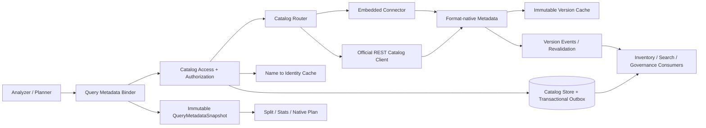

# Pangrova 元数据架构深度分析与目标方案

> **Status: Target architecture.** 本文以审计快照为依据提出目标模型；文中的
> proposed types 和迁移步骤不是当前生产 API。

## 执行摘要

Pangrova 已经具备一个现代湖仓查询引擎所需的大部分“零件”：Connector 隔离、不可变句柄、查询生命周期回调、表格式快照、分层缓存、Flyway、分布式写入 WAL、系统表与索引元数据。当前主要问题并非功能缺失，而是**这些能力尚未收敛成一套可证明的一致性模型**。

结论可以概括为五点：

1. `pangrova-metadata` 已成为控制面状态的聚合模块。当前工作区中该模块有 170 个 Java 源文件，覆盖 catalog、缓存和 schema，也覆盖索引、构建任务、查询/写入协调、流式 offset、动态表、租户、质量规则等。它同时是“元数据 API”“数据库 schema 所有者”“同步器”和多个业务域的持久化层，已经超出单一模块可维护的边界。
2. 查询时元数据一致性目前没有闭环。主查询路径绕开 `CatalogRegistry`，拆分规划所用 `ConnectorSession` 不携带 `queryId`；Iceberg/Paimon 连接器的快照固定恰好依赖 `queryId`。即使生命周期先注册成功，也无法保证实际 split 与统计读取使用同一表版本。
3. 通用元数据模型是有损投影。`TableMetadata` 缺少稳定 table ID、版本 token、schema/spec/sort ID、字段 ID 历史、ref、主键和 bucket/merge 语义；建表路径还会丢掉列类型。它不适合作为 Iceberg/Paimon 表元数据的权威副本。
4. 写入 WAL 解决了“先记意图再提交”的顺序问题，但没有建立格式原生的幂等证明。恢复逻辑依赖“重复执行必须幂等”的契约，连接器却没有把 WAL 的 idempotency key 可靠写入 Iceberg snapshot summary 或 Paimon 的提交身份；提交超时后存在“实际已成功、协调器未知”的窗口。
5. 缓存失效和增量同步都依赖易丢事件的时间戳/本地水位。正确目标应是“不可变版本缓存 + 事务 outbox/原生版本复验”，同步副本只服务搜索、治理和离线盘点，不应成为查询正确性的权威来源。

建议目标不是在 Pangrova 内重新实现一套 Iceberg/Paimon 元数据树，而是采用四层结构：

- **Catalog 控制面**：catalog 定义、路由、租户授权、能力协商、secret 引用和 generation；
- **格式原生元数据面**：Iceberg/Paimon SDK 与远端 REST Catalog 仍是表状态的权威来源；
- **查询绑定面**：在分析/规划阶段一次性形成每张表的不可变 `TableBinding`，显式携带稳定对象身份、ref、版本 token、schema ID 和 scan token；
- **派生库存与运维面**：搜索、血缘、治理、索引、流式状态、构建任务分别拥有自己的 store，通过可靠事件订阅表版本变化。

优先级上，前 4 周必须先修一致性和写入恢复，再做模块拆分。只做包重命名或把更多字段塞进 `TableMetadata`，会扩大双重事实源，不能解决根因。

## 范围与方法

本报告基于 2026-09-13 的工作区状态和提交 `025fa6f`，分析包含尚未提交的工作区改动。因此所有行号和数量是该时点快照，合并前应重新运行架构审计。

分析范围包括：

- `pangrova-metadata` 的 API、模型、catalog registry、JDBC store、缓存、同步、迁移和协调状态；
- Coordinator 的解析、规划、split 获取、查询生命周期和分布式提交路径；
- Iceberg 1.11.0 与 Paimon 1.4.1 连接器实现；
- Apache Iceberg/Paimon 官方规范、REST Catalog、快照保留与并发提交模型；
- Apache Gravitino 与 Project Nessie 作为联邦元数据和跨表事务的参考，而非直接照搬对象模型。

本文把内容区分为：

- **事实**：来自当前代码或上游官方规范；
- **推断**：从多个事实导出的风险判断；
- **建议**：Pangrova 的目标设计，不代表上游项目的强制要求。

## 当前架构画像

### 模块职责已经失焦

`pangrova-metadata` 的一级包分布中，`index` 22 个类、`artifact` 16 个、`dynamictable` 12 个、`coordination` 9 个、`streaming` 8 个，而真正的 `catalog`、`cache`、`service`、`store`、`sync` 只占其中一部分。V1 数据库迁移同时创建 catalog/table mirror、query/task journal、worker/coordinator registry、lease、index、dynamic table、stream state、cache invalidation、quality 和 tenant 表。

这会带来三类耦合：

- 元数据模块发布或迁移时，查询 HA、索引构建、流式摄取等无关域被迫一起升级；
- 数据库 schema 缺乏唯一业务所有者，同一张表既由 Flyway 创建，又由运行时代码 `CREATE TABLE IF NOT EXISTS`；
- `pangrova-metadata/pom.xml` 直接依赖 Iceberg API/Core，虽然 Java 代码没有使用这些类，仍破坏了仓库“格式 SDK 只存在于各 connector”的边界。

这不是要求立刻拆 Maven module。第一步应先建立包级所有权和 API 边界；完成行为迁移后再物理拆分，避免一次大爆炸式重构。

### “统一服务”不是主执行入口

`CatalogRegistry` 有 13 个操作，混合 catalog CRUD、表 DDL、查询生命周期和治理 tag；`DefaultMetadataService` 498 行，承担双缓存、事件、schema change 和 metrics。与此同时，Coordinator 主代码中有 35 个文件、53 处直接调用 `CatalogHandle.getMetadata(...)`，解析、统计、split、DDL/DML、视图、系统表、索引和流式任务都可绕过该服务。

这导致同一逻辑出现两套路径：

- `DefaultMetadataService.beginQuery/cleanupQuery` 遍历所有 catalog；
- 实际查询路径由 `ConnectorQueryScope`/`QueryOwnershipTracker` 独立调用连接器生命周期；
- `CatalogRegistry` 自己的缓存、事件和租户上下文不必然覆盖 Coordinator 的直接路径。

因此目标不应是强迫所有高频调用经过一个“大服务”。应把入口按职责拆成小接口，再由 Coordinator 只依赖一个 facade：名称解析与授权、查询表绑定、DDL、运维各有明确端口。

### 查询快照固定未贯穿到 split

当前最严重的读一致性问题是上下文断裂：

1. `StatementConnectorSession` 的属性恒为 `Map.of()`，用户恒为 `system`；
2. `SplitFetcher` 使用该 session 解析 handle 并调用 split manager，同时传入 `ConnectorTransactionHandle.EMPTY`；
3. Iceberg split manager 从 `session.properties["queryId"]` 获取查询 ID，并据此读取/写入快照 pin；
4. Paimon 的 pin 逻辑也使用相同属性；其代码注释已明确说明 SPI 未把 queryId 传播到连接器；
5. `DefaultConnectorSession.fromSessionContext` 还显式排除了 `tenantId`、`securityToken` 和 `queryId`，只在生命周期专用 session 中加入 queryId。

直接后果是：生命周期“begin”与真正的表解析、统计和 split 读取没有共享同一个查询上下文。Iceberg 还有一个二次问题：pin manager 已支持 `(queryId, schema, table)` 复合键，但 split/statistics 仍调用 query 级 API；一个多表查询可能把第一张表的 snapshot ID 套到第二张表。Paimon 则从模型上就是“每 catalog 每 query 一个 snapshot”，同样不适用于多表。

此外，当前所谓 pin 只是 JVM 内的 ID 映射，并不会阻止外部维护任务过期相应快照。Iceberg 官方通过 branch/tag retention 保护被引用的快照；Paimon 官方明确警告过短保留会让批查询找不到文件，并为流式消费提供 consumer ID 防止快照过期。[^iceberg-branch] [^paimon-retention] [^paimon-consumer]

**目标语义应明确为：**单次查询内，对每张表提供 repeatable metadata/read；不同 catalog 之间默认不承诺同一物理时刻的全局快照。只有 catalog 显式提供跨表事务/一致 ref 时，才能升级保证。

### 通用表模型存在不可恢复的信息丢失

当前 `TableMetadata` 的身份是可变的 `catalog/schema/table` 三元组，列模型没有 field ID。与官方格式相比：

- Iceberg 元数据含 table UUID、metadata file/version、current schema ID、全部 schema、partition spec ID/历史、sort order、snapshot/sequence/ref 等；表状态由新 metadata file 和原子指针交换形成线性版本。[^iceberg-spec]
- Paimon schema 文件保留 field ID、schema version、partition keys、primary keys、options；snapshot 含 UUID、schema ID、多个 manifest list、index manifest、commit user/identifier/kind 等。[^paimon-schema] [^paimon-snapshot]

Pangrova SPI 的 `ConnectorTableMetadata.Column` 已经有可选 field ID 和参数化类型，但 `DefaultMetadataService` 转换为内部 `ColumnMetadata` 时丢失稳定字段身份。更严重的是，`createTable` 只把列名送入兼容构造器，`typedColumns` 为空，列类型无法可靠传给 connector。

JDBC mirror 也存在表示冲突：`columns` 列实际序列化了完整 `TableMetadata`，同时又独立写入 `partition_spec`、`sort_order` 和 `properties`；读取时只反序列化 `columns` 中的整对象，单独列并未成为权威数据。这会让 payload 演进、局部更新、校验和迁移都非常脆弱。

结论是：通用模型只能是**有版本的查询投影**，不能作为格式原生元数据的权威复制品。格式特有信息应保留在 connector 内的 opaque token 或 typed capability extension 中。

### Connector SPI 通过默认方法隐藏能力边界

`ConnectorMetadata` 486 行，继承 6 个接口后仍有约 36 个声明方法，覆盖 schema evolution、refs、索引、clustering、system table、procedure、view、列授权等。大量默认方法返回空集合、空 Optional、no-op 或抛 `UnsupportedOperationException`。

这有两个风险：

- Planner 只能通过“调用看看”或实现类知识判断能力，难以在规划前给出稳定、可测试的 capability negotiation；
- 某些默认行为可能从“未实现”退化成“执行当前版本”。例如通用 table handle 的 time-travel 默认若返回自身，就可能让不支持的连接器悄悄读取最新数据。

目标 SPI 应采用显式能力对象，不再继续向大接口添加兼容默认方法。每个接口保持小而完整，能力缺失在规划期失败。

### Catalog registry 缺少版本化控制面语义

Catalog descriptor 包含 `allowedTenants`，但 `listCatalogs/getCatalog` 与 `DefaultMetadataService` 没有按 session tenant 过滤或拒绝；该字段当前主要被持久化。Catalog properties 是任意字符串 map，也没有 secret reference 边界，容易让长期凭据进入数据库、日志或诊断接口。

注册流程是本地 `containsKey` 后 upsert descriptor，再加载 handle；重复注册会静默成功。取消注册先从本地 map 移除并 shutdown，再删除持久化记录；后者失败会造成节点本地与共享 store 分歧。registry 有 leader-election 时的 reconcile，但 catalog 定义没有稳定 UUID、generation、CAS version 或连续事件流。

建议把名称与身份分离：`catalog_id` 永久稳定，名称可变；每次配置变化递增 `generation`。Coordinator 的所有 handle/cache key 都绑定 generation，旧 generation 不再接受新查询。

### 缓存与失效不是基于版本的

当前至少存在 `DefaultMetadataService.resolvedTableCache`、`TieredMetadataCache`、Calcite lazy schema 本地 cache、federated catalog cache、连接器 manifest/split/index cache。`resolvedTableCache` 只按表名键控，不含 catalog generation、tenant/principal、ref 或 query-bound version。

JDBC invalidation poller 使用 `(updated_at - overlap)` 查询，然后用全局 `lastProcessedId` 去重。若较小 ID 的事务较晚提交，后续虽然可能被 overlap 重新查询，却会因 `id <= lastProcessedId` 被跳过；“时间戳覆盖 + 全局 ID”并不能同时保证不丢乱序提交。失效写入还与元数据变更不在同一事务，失败只告警。

正确方向不是再加一个更长 TTL，而是：

- 名称到稳定身份的短 TTL pointer cache；
- 以 `(catalog generation, table ID, ref, version token)` 为键的不可变元数据 cache，可长 TTL/内容寻址；
- catalog/DDL 本地变更与 outbox 同事务提交；
- 外部格式变化通过原生版本 token/ETag 复验，通知只负责加速，不承担正确性；
- 授权后的过滤结果若缓存，必须包含 policy version 与 principal scope，否则只缓存未过滤元数据并在每次访问时授权。

### 增量同步可能永久越过失败变更

当前 `FederatedCatalog.getChangesSince(Instant)` 只有时间戳，没有 opaque cursor、事件 ID、source epoch、before/after version 或 rename 语义。`MetadataSyncService` 对每条失败只累加 error，随后仍记录本次 `sync_time`；下一次从 `MAX(sync_time)` 开始，失败项可能被永久跳过。

其它问题包括：

- incremental 重试失败后自动 full sync，掩盖变更流缺口；
- full sync 只 upsert 枚举到的对象，不做 mark-and-sweep，不能删除源端已消失对象；
- 10% 随机 drift 抽样不能成为正确性机制；
- push DELETE 仍走“读取并保存单表”的路径，删除语义不完整；
- invalidation 失败仅告警，副本和 cache 可以继续分叉。

应把该服务重新定义为 `MetadataInventoryIndexer`：它是最终一致的搜索/治理库存，不是查询事实源。增量协议使用 source 提供的 opaque cursor；一批对象变更和 consumer cursor 在同一事务提交，任一失败不前移 cursor。全量校对采用带 enumeration epoch 的分页 mark-and-sweep。

### 写入恢复尚无格式原生幂等闭环

当前写路径的优点是先 durable `PENDING`，再调用 connector commit，最后标记 `COMMITTED`。但闭环有四个缺口：

1. WAL 的主键和恢复身份都是 `queryId`，没有独立 `operationId`，`idempotency_key` 也没有唯一约束；
2. `markCommitted` 只按 queryId 更新，不校验旧状态、owner 或 fencing token；
3. 成功后立即 purge，失去短期 dedup 证据；普通 query failure 路径还会 purge pending intent；
4. recovery session 不携带 WAL idempotency key，只是重建 handle 并再次调用 `finishDistributedWrite`。

Iceberg connector 中已有 `IdempotentCommitController` 和 `CommitStatusVerifier`，但生产代码没有引用。实际 commit timeout 只让等待方超时，异步 commit 仍可能继续成功；“只看到 snapshot 向前移动”也不能证明是本操作而非并发写入。Paimon 分布式 finisher 直接 `newCommit().commit(messages)`，没有把稳定 operation identity 映射到 Paimon snapshot 的 `commitUser/commitIdentifier`。Paimon 官方 snapshot 规范明确将二者用于流式恢复。[^paimon-snapshot]

目标是一个可查询结果的写操作状态机：

```text
PREPARING -> READY -> COMMITTING -> COMMITTED
     |          |          |
     v          v          v
  ABORTING --> ABORTED    UNKNOWN
```

`UNKNOWN` 不是失败，也不能自动重放或删除。连接器必须返回 `COMMITTED / NOT_COMMITTED / CONFLICT / UNKNOWN`，并实现格式原生的 `checkCommitStatus(operationId)`：

- Iceberg：把 operation token 写入 snapshot summary，或使用服务端声明支持并持久化的 REST idempotency key；恢复时按 token 查 snapshot，不能仅检查 current snapshot 是否变化；
- Paimon：把稳定 operation ID 映射为支持恢复的 commit identity，并按本项目使用的 Paimon API 版本完成适配验证；
- 两者都必须携带 expected base version、fragment checksum、write mode、稳定 table ID 和 fencing token。

Iceberg REST Catalog 官方协议提供 change-based commit、服务端冲突消解、可选 idempotency key、多表 commit 和短期凭据下发，是 Pangrova 远程 catalog 的优先集成协议。[^iceberg-rest] [^iceberg-rest-protocol]

## 业界模式与可借鉴边界

### Iceberg：不可变元数据树 + 乐观并发

Iceberg 的核心不是“snapshot ID 字段”，而是四个组合原则：

1. 表状态由不可变 metadata file 表达；
2. snapshot 通过 manifest list/manifest 指向文件集合，慢变 manifest 可复用；
3. schema、partition spec 和 sort order 都具有稳定 ID 与历史版本；
4. 新 metadata file 通过基于旧版本的原子交换提交，冲突时重新验证 requirements。

对 Pangrova 的启示是：engine 不应把表状态摊平成一个会就地覆盖的 name-keyed JSON；应持有稳定身份和版本 token，把完整格式树留给 connector/catalog。缓存不可变版本，而不是缓存“表名当前值”后依赖广播失效。

### Paimon：连续快照 + schema/manifest/LSM 语义

Paimon 不只是另一种 snapshot 表。它把主键表、bucket、merge engine、changelog、compaction 与 streaming recovery 放进元数据语义。snapshot ID 连续，snapshot 文件显式记录 schema、base/delta/changelog manifests、index manifest、commit identity 和统计。并发写入先独立准备文件，再针对最新 snapshot 验证并原子发布；具体原子机制取决于 REST catalog、文件系统原子操作或共享锁。[^paimon-concurrency] [^paimon-manifest]

对 Pangrova 的启示是：不能用一套只面向 append-only Iceberg 的扁平模型“统一”Paimon。统一层应只描述跨格式稳定概念：对象身份、版本、schema field identity、ref/read selection、capabilities；主键、bucket、merge/changelog 等通过 typed extension 暴露给 planner。

### REST Catalog：把协议稳定性置于实现类稳定性之上

Iceberg 和 Paimon 都在向 REST Catalog 模式发展：catalog service 负责认证、后端适配和可选操作，计算引擎通过标准协议发现表并直接访问数据/元数据文件；服务端能力决定可用特性。[^iceberg-rest] [^paimon-rest]

Pangrova 因此应区分两类 connector：

- 嵌入式 SDK catalog：由 connector 直接使用 SDK；
- 远程 protocol catalog：优先遵循格式官方 REST 协议，不再为每个厂商编写 Pangrova 私有 adapter。

Pangrova 自己的 catalog REST API 可以用于 engine 管理面，但不应假装等同于 Iceberg/Paimon 官方协议；需要明确 profile、版本和 capability negotiation。

Iceberg REST 的标准提交是服务端对 `requirements` 校验后应用 `updates`，不是客户端比较 `metadata-location` 后替换指针；加载表时可选的 ETag 只用于 `If-None-Match` 缓存复验，不能推断提交支持 `If-Match` 声明栅栏。[^iceberg-rest-protocol] 当前固定的 Iceberg 1.11.0 `UpdateRequirement` 可以断言表 UUID、ref snapshot 和当前 schema/spec/sort-order ID，却不能原子断言 Pangrova 依赖的任意生成列表达式、向量维度等属性或表位置。

Gravitino Iceberg REST 1.2.0 的真实建表和空表读取已通过，但 INSERT 被现有完整元数据 CAS 校验安全拒绝；服务端虽返回 `metadata-location`，未返回 ETag，且即使返回加载缓存 ETag 也不等于提交条件。要开放 REST 写入，须由服务端在同一提交事务中提供并声明覆盖这些字段的 opaque 版本/声明栅栏，再以并发 ALTER、属性/位置变化、删除重建、超时重试和数据 append 竞争测试验证；在此之前保持写入拒绝，允许已验收的建表与空表读取。[^iceberg-rest-protocol]

### Gravitino 与 Nessie：适用在不同层次

Gravitino 的价值在“metalake/catalog/provider”联邦、统一 REST/SDK、治理与多类型资产管理；它适合参考 Pangrova 的 catalog 控制面和库存治理，而不是替代格式原生快照模型。[^gravitino]

Nessie 的价值在 versioned catalog/ref 与跨表 commit。它说明跨表一致性应由 catalog 级能力提供，而不是 Coordinator 对多个独立表 commit 进行隐式循环。Pangrova 应把多表原子性建模为可选 capability；没有服务端保证时明确拒绝，而不是以补偿逻辑伪装事务。[^nessie]

## 差距矩阵

| 维度 | Pangrova 当前 | Iceberg/Paimon 标准模式 | 目标 |
|---|---|---|---|
| 权威源 | connector 与 JDBC mirror 边界模糊 | catalog/格式元数据是权威源 | connector/catalog 权威；库存仅派生 |
| 对象身份 | 名称三元组 | table UUID/稳定目录身份、field ID | stable catalog/table/field ID，名称可变 |
| 版本 | 多种 `long`/`String` snapshot 接口 | metadata version、snapshot、schema/spec ID | opaque `TableVersionToken` + typed attributes |
| 查询隔离 | 生命周期与 split session 断裂 | scan 明确绑定 snapshot | 每表不可变 `TableBinding` 全链路传播 |
| 多表查询 | query 级 snapshot map | 每表独立 snapshot；catalog 可提供一致 ref | key 至少含 query/catalog/table/ref |
| schema 演进 | 内部模型丢 field ID/历史 | stable field ID、schema history | 保留 field ID、nullability、nested type、schema ID |
| 分区/排序 | string map/list | spec/order ID 与历史 | typed transforms + stable IDs |
| Paimon 语义 | 投影中丢 options/主键语义 | PK、bucket、merge、changelog、index | capability extension，不强行扁平化 |
| 并发写 | WAL + “connector 应幂等” | OCC + 原子发布 + 冲突验证 | expected base + operation token + outcome verification |
| 超时恢复 | 可能盲重放 | 按提交身份/requirements 判断 | `checkCommitStatus`，UNKNOWN 隔离 |
| 缓存 | name + TTL + 广播失效 | 不可变版本、metadata location/版本校验 | pointer cache + immutable version cache |
| 增量同步 | 时间戳、失败仍前移 | version/cursor/快照历史 | opaque cursor，同事务 apply + checkpoint |
| 权限 | allowedTenants 未闭环 | REST auth/credential vending/capability | tenant/principal 授权先于解析，secret ref |
| 多表事务 | 无真实事务 handle | 可选 REST multi-table/Nessie commit | 只在 capability 支持时暴露 |

## 目标架构



### 四个平面

#### 1. Catalog 控制面

职责仅包括 catalog 定义、启停状态、provider/profile、路由、租户/主体授权、secret reference、capability 与 generation。它不保存完整 Iceberg/Paimon table metadata。

推荐核心记录：

```text
CatalogDefinition(
  catalogId, name, provider, protocolProfile,
  generation, state, nonSecretProperties, secretRef,
  tenantPolicyRef, capabilities, version, createdAt, updatedAt
)
```

写操作使用 `expectedVersion` CAS。create/update/drop 与 `catalog_outbox` 同事务，消费者按 event ID 幂等处理。名称删除后保留 tombstone/代际，避免旧 cache 和在途查询误绑定新同名 catalog。

#### 2. 格式原生元数据面

Connector 内部保有 Iceberg/Paimon SDK 类型。跨模块只输出：

```text
ResolvedTableDescriptor(
  tableId, qualifiedName, catalogGeneration,
  versionToken, ref, schemaDescriptor,
  partitioningDescriptor, orderingDescriptor,
  capabilities, formatExtensions
)
```

`versionToken` 是 opaque、可序列化、可比较相等但不假设数值连续的 token。Iceberg 可映射 metadata location/version + snapshot/ref；Paimon 可映射 snapshot UUID/ID + schema ID。索引层当前已经倾向使用字符串 snapshot token，应把这一原则统一到 SPI。

#### 3. 查询绑定面

在 logical planning 结束前完成一次 table binding：

```text
MetadataReadContext(
  queryId, tenantId, principal, catalogGeneration,
  requestedRefOrTimeTravel, consistencyMode, traceContext
)

TableBinding(
  tableId, qualifiedName, versionToken, ref,
  schemaId, scanToken, authorizationDecisionVersion,
  retentionLease
)
```

后续统计、优化、split、worker/native plan 都只消费 `TableBinding`，禁止重新以名称解析“当前表”。同一查询第二次访问同一 `(catalogId, tableId, ref)` 必须得到相同 binding。

普通批查询可以通过明确的最低 retention SLA 保护；预计超过安全窗口的查询才申请格式原生 retention lease：Iceberg 临时 ref/tag 或受控保留，Paimon 使用适合读取模式的 consumer/tag 能力。仅把 snapshot ID 放进本地 map 不算 retention lease。

#### 4. 派生库存与运维面

以下状态应从 `pangrova-metadata` 逐步迁出：

- query/task journal、execution anchor、worker/coordinator registry、lease → coordination/HA 所有；
- index descriptor、generation、artifact build job/page/output → indexing/artifact 所有；
- ingestion registration、offset、watermark → streaming 所有；
- dynamic/materialized table refresh state → 对应 feature 所有；
- tenant membership/quota → tenancy/security 所有；
- quality rule/result/tag → governance 所有。

它们可以共享 PostgreSQL 实例，但 migration location、repository API、表前缀和 SLO 必须由业务域独立拥有。

## SPI 重构方案

建议用显式组合替代继续扩张 `ConnectorMetadata`：

```text
ConnectorCatalog
  ├─ NamespaceReader              # list/get namespace
  ├─ TableResolver                # name -> stable identity/current version
  ├─ TableMetadataReader          # version -> immutable descriptor
  ├─ TableDdl                     # create/drop/rename/evolve
  ├─ VersionedTable               # ref/time travel/diff/retention
  ├─ DistributedWriteCommitter    # prepare/commit/check/abort
  ├─ MaintenanceOperations        # compact/expire/rewrite/analyze
  ├─ ViewMetadata
  └─ SystemTableProvider
```

每个接口保持少量强语义方法，不提供“为了兼容”而静默返回空值的默认实现。Connector 在启动时返回版本化 `CatalogCapabilities`；Planner 在产生计划前验证 capability。现有 SPI 可以先作为 adapter 保留一轮发布，但新旧路径不可长期双写。

统一版本相关接口，淘汰当前 `long snapshot`、`String snapshot token`、query-level pin 等多套概念：

```text
TableVersionToken { opaqueValue, optionalSnapshotId, optionalSequence, schemaId, ref }
```

其中只有 `opaqueValue` 参与跨模块持久化；其它字段用于诊断和 planner 能力判断，不作为通用比较规则。

## 数据库与事件模型

建议 catalog core 只保留以下核心表：

| 表 | 关键字段/约束 | 用途 |
|---|---|---|
| `catalog_definition` | UUID PK、name unique、generation、row_version、secret_ref、`TIMESTAMPTZ` | catalog 控制面事实源 |
| `catalog_name_history` | catalog_id、old/new name、generation | rename/tombstone 与审计 |
| `catalog_outbox` | event_id、aggregate_id、aggregate_version、type、payload_version、payload、published_at | 同事务可靠通知 |
| `consumer_offset` | consumer_id、source、opaque_cursor/event_id、lease/fence | 可恢复消费进度 |
| `metadata_inventory` | stable object ID、catalog generation、name、version token、payload version、observed/deleted at | 搜索/治理派生投影 |
| `write_operation` | operation_id、idempotency_key unique、table_id、base_version、state、owner/fence、outcome | 写入恢复事实源 |
| `write_fragment` | operation_id、ordinal、checksum、payload/ref、size | 有界、可校验的提交片段 |

约束原则：

- 时间统一为 UTC `TIMESTAMPTZ` 或 epoch，禁止混用 app clock 与无时区数据库时间；
- JSON payload 必须带 schema version、格式和 checksum；
- 大 fragment 使用压缩二进制或对象引用，设置总大小/数量上限，避免逗号拼接 Base64 文本；
- 所有状态转移使用 `WHERE state=? AND fencing_token=?`；更新 0 行是明确的 stale-owner 错误；
- Flyway 是唯一 DDL owner，生产 repository 构造函数不建表；已发布 migration 永不修改，缺号可以保留但必须有 migration ledger/CI checksum 审计。

当前 V1 已吸收了 V17/V18 等后续结构，同时运行时代码仍自建表。若这些 migration 已进入任何共享环境，不能直接改回 V1；应以新的修复 migration 收敛。只有确认从未发布、全环境可重建时才允许一次受控 baseline squash。

## 缓存与同步详细方案

### 两级对象、一个所有者

1. `NameResolutionCache`：`(tenant scope, catalogId, generation, namespace, name) -> tableId/currentPointer`，短 TTL，支持 negative cache；
2. `VersionedMetadataCache`：`(catalogId, generation, tableId, ref, versionToken) -> immutable descriptor`，长 TTL/重量上限/单飞加载；
3. Calcite schema 不再保存独立“当前表”副本，只保存 generation-aware 的 resolver；
4. connector manifest cache 仍由 connector 拥有，但输入必须是 query-bound version；
5. 只有不可变、已授权的 pinned version 可以在上游暂时不可用时安全复用；名称解析、权限和 current pointer 失败必须 fail closed。

### 可靠变更传播

- Pangrova 自身 catalog/DDL：数据库事务中同时更新事实表和 outbox；
- REST catalog：使用 ETag/version token、服务端 idempotency/capability；若有官方 change feed，保存 opaque cursor；
- 文件系统 catalog：通知仅作加速，读 current pointer 时仍需版本复验；
- 每个 consumer 独立 offset，事件可重复、apply 幂等、顺序按 aggregate version 校验；
- lag、poison event、cursor age、reconcile drift 均暴露系统表和指标。

### 全量 reconcile

全量盘点分批执行：创建 enumeration epoch，分页列出对象并 upsert `last_seen_epoch`，完整成功后才 mark-sweep 未出现对象。任何分页失败都不做删除。rename 优先按 stable object ID 识别；源端无稳定 ID 时只能降级为 delete+add，并明确影响 lineage/index continuity。

## 安全与多租户

目标顺序必须是：认证主体 → catalog 可见性 → namespace/table 授权 → 版本绑定 → cache。不能先从全局 name cache 返回 handle 再补授权。

建议：

- `allowedTenants` 升级为版本化 policy reference，或至少在 `CatalogAccess` 统一执行；
- `MetadataReadContext` 携带不可伪造的 principal/tenant 对象，而不是任意 connector property；
- connector 只接收必要的派生凭证和 query ID，不传播长期 security token；
- catalog properties 禁止出现明文 secret，统一引用 secret manager 条目；
- 优先利用 REST Catalog 的 table-scoped 临时凭据/remote signing；
- cache 中若含 storage credential，生命周期不得超过 credential，且不进入序列化 handle、日志和 worker plan。

## 实施路线图

### Phase 0：一致性止血（0–4 周）

| 工作项 | 验收标准 |
|---|---|
| 查询上下文贯通 | queryId、tenant/principal、catalog generation 从解析传到 stats/split；无 `system + Map.of()` 主路径 |
| 每表版本绑定 | 多表查询 pin key 包含 catalog/table/ref；并发 commit 下 stats、split、scan 使用相同 token |
| 建表类型修复 | typed columns、field ID/nullability/nested type 按能力无损到 connector；缺失能力直接失败 |
| 写入 UNKNOWN 语义 | timeout/crash 不盲重放、不 purge；operationId 独立于 queryId |
| 格式原生提交身份 | Iceberg snapshot 可按 token 查证；Paimon commit identity 可按版本支持方式恢复 |
| 同步水位安全 | 任一变更失败不前移 cursor；DELETE 正确落库存；full reconcile 可发现删除 |
| 失效不丢事件 | catalog 变更与 outbox 原子；移除 timestamp+global ID 的错误组合 |
| 租户闭环 | list/get/resolve/DDL 全部走同一授权层；跨租户 cache 测试通过 |

### Phase 1：模型与 SPI 收敛（1–3 个月）

- 引入 stable catalog/table ID、generation、opaque version token、field ID/schema ID；
- 建立 `MetadataReadContext`、`TableBinding` 和 query snapshot；
- 按能力拆分 Connector SPI，生成 connector capability matrix；
- Coordinator 的 53 处直接 metadata 调用迁移到分类 facade；
- 删除 metadata 模块的 Iceberg 依赖，清理有损 mirror/重复 cache；
- 把 Flyway 确立为唯一 schema owner，补齐 PostgreSQL/H2 migration compatibility gate。

### Phase 2：控制面与业务域拆分（3–6 个月）

- catalog store/outbox/inventory 正式分层；
- query coordination、index/artifact、streaming、tenant/governance 迁出 metadata 所有权；
- 接入 Iceberg/Paimon 官方 REST Catalog profile 和 capability negotiation；
- 实现 native retention lease、版本系统表、inventory lag/commit recovery 可观测性；
- 全量/增量 inventory 达到百万表分页与背压目标。

### Phase 3：高级能力（6–12 个月）

- 仅在 catalog capability 支持时提供多表原子 commit；
- 可选 server-side planning、credential vending、remote signing；
- versioned catalog/ref 工作流与审计；
- metadata 搜索、血缘、治理统一消费 versioned events，不再抓取 mutable mirror。

## P0/P1/P2 Backlog

### P0：发布前必须解决

1. `StatementConnectorSession` 替换为显式 query read context；修复 Iceberg/Paimon 多表 snapshot binding。
2. 禁止 snapshot 过期后静默回退 current snapshot；返回确定错误或续租。
3. 修复 `createTable` 丢 typed columns；Paimon handle schema 序列化保留完整类型、nullability、description，或不再自制有损 RowType JSON。
4. 将 WAL idempotency key 传进 connector commit；接通或删除当前未使用的 Iceberg 幂等组件。
5. `write_operation` 增加 UNKNOWN/CONFLICT、CAS 状态转移、fencing 和 dedup retention。
6. 同步只在整批成功并原子落库后前移 cursor；移除随机 drift 作为正确性依赖。
7. 修复 invalidation 乱序丢事件；DDL/outbox 同事务。
8. `allowedTenants` 在 catalog list/get/resolve/DDL 统一执行，缓存 key 隔离 policy scope。

### P1：架构债务

1. 拆分 ConnectorMetadata/MetadataService；建立 capabilities。
2. stable object ID + catalog generation + version token 数据模型。
3. 合并重叠 cache，Calcite schema generation-aware。
4. inventory 与 query authoritative read 解耦。
5. Flyway 单一 DDL owner、不可变 migration、方言集成测试。
6. catalog register/update/drop 使用 CAS、tombstone 和 outbox。
7. secret reference 与短期 storage credential。

### P2：规模与生态

1. 官方 REST Catalog 兼容测试与协议版本矩阵。
2. 可选跨表事务、versioned refs。
3. server-side scan planning/metadata compression。
4. inventory 分片、分页、CDC/事件背压和灾难恢复。
5. 面向用户的 metadata/system tables 与 SLO dashboard。

## 测试与可证明性

现有单元测试、属性测试、架构审计和 connector system table 测试是良好基础。下一阶段测试应从“方法调用正确”升级为“失败注入下不变量成立”。

必须补齐的场景：

- 查询绑定 snapshot 后并发 append/overwrite/schema evolution，stats、split、worker scan 仍一致；
- 同一查询 join 两张 Iceberg/Paimon 表，snapshot ID 不串表；
- snapshot 在长查询中达到 expiration 阈值，不静默切换版本；
- catalog commit 成功但响应超时、进程在 WAL 各状态间 crash，恢复后恰好一次可观察；
- concurrent writer 推进 current snapshot，不能被误判为本 operation 已提交；
- invalidation 小 ID 晚提交、节点离线超过 overlap、重复/乱序事件均不丢；
- sync 一批中间项失败，cursor 不前移；full reconcile 中途失败不误删；
- rename 保持 stable table identity，index/lineage/policy 引用连续；
- 两个 tenant 同名表/不同权限不会通过 cache 泄漏；
- migration 从每个已发布版本升级到最新，checksum 不变，PostgreSQL 实测通过。

建议建立以下 SLO/指标：

- catalog resolve p50/p95/p99，按 cache hit/miss 与 provider 分解；
- query binding version mismatch = 0；
- outbox/inventory consumer lag 与最老未处理事件年龄；
- write operation UNKNOWN 数、停留时长和人工处置时间；
- metadata cache stale detection、forced revalidation、authorization denial；
- snapshot retention lease 数、失败数、泄漏数；
- schema migration version/checksum 和节点 generation 分布。

## 关键架构决策

建议用 ADR 固化以下决定：

1. **格式 catalog 是表元数据权威源；Pangrova inventory 是派生投影。**
2. **查询一致性按每表版本绑定；跨 catalog 默认无全局快照。**
3. **所有版本标识跨 SPI 使用 opaque token；数值 snapshot 只是可选属性。**
4. **写入超时可以是 UNKNOWN；系统不得以重试掩盖不确定结果。**
5. **多表原子性必须由 catalog capability 保证。**
6. **缓存不可变版本；通知用于加速，不作为唯一正确性机制。**
7. **每个业务域拥有自己的 schema migration；Flyway 是唯一 DDL owner。**
8. **安全判定先于名称解析和 cache 返回；明文 secret 不属于 metadata model。**

## 不建议采用的方案

- 不建议把 Iceberg/Paimon 的全部字段继续加入一个巨大 `TableMetadata`；这会制造脆弱的最低公分母和双重事实源。
- 不建议用更短 TTL 修复一致性；TTL 只能限制错误持续时间，不能证明查询内一致。
- 不建议以 full sync 作为所有增量错误的自动 fallback；它会掩盖 cursor/协议缺陷，并且当前 full sync 还不具备删除校对。
- 不建议用全局分布式锁串行化所有表写入；上游格式已经采用 OCC，应保留并发并做精确冲突验证。
- 不建议一次性搬迁 170 个类；先修 P0 语义、建立端口，再按业务所有权迁移。
- 不建议在 catalog 不支持时模拟跨表 ACID；应向用户暴露明确能力和限制。

## 代码证据索引

| 发现 | 代码位置 |
|---|---|
| metadata 模块直接依赖 Iceberg | `pangrova-metadata/pom.xml:36-44` |
| MetadataService 混合 13 个操作 | `pangrova-metadata/.../service/MetadataService.java:14-109` |
| name-only resolved cache | `pangrova-metadata/.../service/DefaultMetadataService.java:212-225` |
| createTable 丢 typed columns | `pangrova-metadata/.../service/DefaultMetadataService.java:228-237` |
| session 显式不传播 queryId/tenant | `pangrova-metadata/.../service/DefaultConnectorSession.java:9-12,27-71` |
| split session 属性恒为空 | `pangrova-coordinator/.../statement/StatementConnectorSession.java:11-35` |
| split 使用 EMPTY transaction | `pangrova-coordinator/.../split/SplitFetcher.java:236-260,296` |
| Iceberg 使用 query-level snapshot API | `pangrova-connector/.../iceberg/IcebergSplitManager.java:241-286` |
| Paimon 每 query 只有一个 snapshot | `pangrova-connector/.../paimon/PaimonSnapshotPins.java:23-77` |
| Paimon 注释承认 queryId 未传播 | `pangrova-connector/.../paimon/PaimonSplitManager.java:110-121` |
| 内部表/列模型无 stable IDs | `pangrova-metadata/.../model/TableMetadata.java:12-21`; `ColumnMetadata.java:10-15` |
| SPI 列已有 field ID，但兼容构造器丢类型 | `pangrova-spi/.../ConnectorTableMetadata.java:22-75` |
| JDBC `columns` 存整对象 | `pangrova-metadata/.../store/JdbcMetadataStore.java:193-203,228-235` |
| ConnectorMetadata 过宽且默认 no-op | `pangrova-spi/.../metadata/ConnectorMetadata.java:22-25,79-148,282-483` |
| 增量失败仍记录新 sync time | `pangrova-metadata/.../sync/MetadataSyncService.java:127-138,370-379` |
| incremental 自动 fallback full | `pangrova-metadata/.../sync/MetadataSyncService.java:90-113` |
| invalidation 双水位可能跳过晚提交小 ID | `pangrova-metadata/.../cache/JdbcInvalidationPoller.java:88-111,245-268,283-295` |
| catalog register/drop 无 generation/CAS | `pangrova-metadata/.../catalog/CatalogRegistry.java:90-153` |
| Iceberg 超时后异步 commit 仍可能运行 | `pangrova-connector/.../iceberg/IcebergWriteCommitter.java:250-268` |
| Iceberg 幂等组件仅测试引用 | `pangrova-connector/.../iceberg/IdempotentCommitController.java`; `CommitStatusVerifier.java` |
| Paimon commit 未接 operation identity | `pangrova-connector/.../paimon/PaimonDistributedWriteFinisher.java:131-160` |
| WAL 成功即 purge / failure 也可 purge | `pangrova-coordinator/.../task/TaskStatusReceiver.java:571-635,663-682` |
| WAL 更新不校验状态/fence | `pangrova-metadata/.../coordination/JdbcWriteCommitJournal.java:69-91,111-158` |
| Paimon handle 自制 RowType JSON 有损 | `pangrova-connector/.../paimon/handle/PaimonTableHandleFactory.java:177-229` |
| Paimon 对外 table properties 为空 | `pangrova-connector/.../paimon/PaimonMetadata.java:117-125` |

## Sources

[^iceberg-spec]: Apache Iceberg, [Table Specification](https://iceberg.apache.org/spec/). 官方格式规范；用于 table metadata、stable IDs、snapshots、manifests、OCC 与 retention 事实。
[^iceberg-rest]: Apache Iceberg, [REST Catalog Specification](https://iceberg.apache.org/rest-catalog-spec/). 官方 REST Catalog 说明；用于 change-based commit、服务端能力、缓存和安全事实。
[^iceberg-rest-protocol]: Apache Iceberg, [REST Catalog Protocol](https://iceberg.apache.org/docs/nightly/rest-protocol/). 官方协议文档；用于可选多表提交、idempotency key 与 credential vending 事实。
[^iceberg-branch]: Apache Iceberg, [Branching and Tagging](https://iceberg.apache.org/docs/latest/branching/). 官方文档；用于 snapshot ref 与 retention 事实。
[^paimon-schema]: Apache Paimon, [Schema Specification](https://paimon.apache.org/docs/master/concepts/spec/schema/). 官方规范；用于 field ID、schema history、PK/partition/options 事实。
[^paimon-snapshot]: Apache Paimon, [Snapshot Specification](https://paimon.apache.org/docs/master/concepts/spec/snapshot/). 官方规范；用于 snapshot、manifest references、commitUser/commitIdentifier 事实。
[^paimon-manifest]: Apache Paimon, [Manifest Specification](https://paimon.apache.org/docs/master/concepts/spec/manifest/). 官方规范；用于 manifest list、file add/delete、schema/stats 事实。
[^paimon-concurrency]: Apache Paimon, [Concurrency Control](https://paimon.apache.org/docs/master/concepts/concurrency-control/). 官方文档；用于 OCC、冲突验证和原子发布方式事实。
[^paimon-retention]: Apache Paimon, [Manage Snapshots](https://paimon.apache.org/docs/master/maintenance/manage-snapshots/). 官方文档；用于 snapshot expiration 与长查询风险事实。
[^paimon-consumer]: Apache Paimon, [Consumer ID](https://paimon.apache.org/docs/master/flink/consumer-id/). 官方文档；用于消费进度和 snapshot 保护事实。
[^paimon-rest]: Apache Paimon, [REST Catalog](https://paimon.apache.org/docs/master/concepts/rest/). 官方文档；用于远程 catalog、能力协商和临时凭据事实。
[^gravitino]: Apache Gravitino, [Official Documentation](https://gravitino.apache.org/docs/next/). 官方文档；用于 metalake、联邦 catalog、统一 REST/SDK 和治理参考。
[^nessie]: Project Nessie, [Transactions](https://projectnessie.org/guides/transactions/). 官方文档；用于 versioned catalog 与跨表 commit 参考。
