# Pangrova — Metadata Management

Federation factory providers implement `org.pangrova.metadata.api.catalog.FederatedCatalogFactory` from `pangrova-metadata-api` and register that exact service name. The Server installs `pangrova-metadata-catalog`, which validates factory IDs at startup and converts the selected catalog to a metadata handle. No production Federation backend ships in the repository. Examples using external federation providers require separately installed implementations.


> **Accuracy scope.** This is a living architecture document. Content explicitly marked
> draft, proposed, planned, phase, target, or remaining work is design intent rather
> than implemented support. For current behavior, code wiring and end-to-end tests
> take precedence.

> **Summary.** Unified metadata ownership, catalog federation, tiered metadata caching, and schema evolution.

The generic object-dependency component separates contracts and values in
`metadata.api.relation`, ordering and policy orchestration in
`metadata.relation`, a memory fixture in the Metadata Catalog test sources,
and PostgreSQL persistence in `persistence.catalog.postgresql.dependency`. Both providers use iterative postorder traversal:
for an acyclic graph, every dependent precedes every reachable parent, including
shortcut edges and shared descendants. Revisited nodes are skipped; cyclic input
terminates without duplication but cannot have a topological order. Cascade
failure leaves the failed and unprocessed objects' edges intact.

Graph identity is the natural `(catalog, schema, name)` key, shared by both
providers and traversal through the internal `ObjectDependencyKey`. `ObjectRef`
remains a four-field value; its record equality still includes kind. Kinds are
edge descriptions rather than current-catalog authority: rewriting an existing
edge refreshes that edge's descriptions without rewriting other edges. Lookups,
removal, cycle deduplication and self-edge rejection ignore kind. Traversal returns
the first discovered description for each natural object. Both providers snapshot
and validate all parents before mutation, so a null entry cannot leave a partial
addition or replacement in memory. PostgreSQL write rollback and connection
ownership remain unchanged.

JDBC additions and replacements of the same child's complete parent set take a
PostgreSQL transaction advisory lock before any edge deletion. The lock key uses
the resolved graph table OID and the three name segments, so isolated schemas and
different children do not share a global graph lock. This prevents concurrent
DELETE/INSERT from failing a duplicate recording or combining two replacements.
It does not turn transitive graph reads or connector DDL into one serializable
transaction; those remain separate integration boundaries.

Dependency writes return an immutable complete parent snapshot acquired under the
same memory lock or inside the JDBC transaction before commit. The service uses
that result for both single-edge and batch notifications, so it neither mistakes
an input delta for the complete graph nor performs a second read after commit.
A failed JDBC snapshot read rolls back the write and emits no success callback.
Notifications remain synchronous and best-effort, not a durable outbox: concurrent
operations can supersede the snapshot or deliver callbacks in a different order.
Each successfully deleted cascade dependent is cleaned up and notified immediately;
a later failed drop does not erase earlier success notifications. The parent's
aggregate cascade list is context, not a request to emit those children again.
WARN reports prospective orphaning but preserves all edges until the connector's
successful drop is confirmed through `onObjectDropped`.

The optional lineage adapter carries the operation and datasets in both START
and COMPLETE events. Its per-object callback does not replay aggregate cascade
context. This describes explicitly registered component consumers; it does not
register the graph or adapter as a new SQL lifecycle authority.

This component is not the current SQL dependency authority. DROP TABLE goes
through Table Control and the connector, DROP VIEW delegates to the connector,
and materialization DROP uses its own tenant-scoped repository and authorization.
The generic graph's V9 key lacks tenant and incarnation dimensions. Its service
and optional lineage adapter are not registered by production bootstrap; query
lineage uses its durable outbox. Future integration requires an explicit identity,
authority and atomicity design. Historical V9 schema and checksums remain intact.

Generation stores now consume `GenerationTransactionAuthority` from
`persistence.jdbc.api.generation`. This is explicitly a caller-owned JDBC transaction port,
not a data-source container or an authorization snapshot. The real
`PostgresGenerationTransactionAuthority` adapter retains the current tenant and
table-policy checks and delegates model validation through Security's
`persistence.jdbc.api.security.model.CurrentModelAuthority` on that same connection. The process
root constructs AI Control's `persistence.ai.postgresql.embedding.JdbcCurrentModelAuthority`
with the real `JdbcCurrentDirectRoleReader`, then explicitly passes it to
`new GenerationStores(modelAuthority)` and the managed-source and generated-write
consumers. The instance factory supplies that adapter to build, stage, exchange,
publication and generated-submission stores; it has no static current-authority
singleton, default model provider or mutable global injection point.
AI Control's catalog-export adapter receives `GenerationJobSubmissionTransactions`
explicitly from `ai.control.assembly.AiInfrastructureStores`, whose caller supplies
the real job store with its injected authority. AI Control no longer imports Metadata runtime or its test-jar;
cross-domain authority tests belong to Testing Integration. Its build insertion and catalog association remain on
one connection; an authority failure rolls back the whole export transaction.
The existing authority gate, execution-owner fence and job/descriptor lock order
remain unchanged. `GenerationExecutionTransactionFence` exposes the same owner
checks to consumers without requiring the concrete JDBC implementation.
`GenerationTransactionInputs` supplies dispatch, dependency and page reads on that
same connection. The real JDBC reader implements the port directly and retains
auto-commit reads, exact tenant/job scope and corrupt-input rejection. Authority
and publication consumers receive it explicitly; SQL-reader construction remains
in assembly. The common publication output validator still owns SQL in Metadata
and is a separate migration step.

The model provider observes the exact incarnation, configuration version,
deployment version and signature, and rechecks direct invocation roles before
validating a deferred receipt. It never opens, commits, rolls back or closes the
caller connection. Empty `requireCurrent` snapshots perform no model check;
empty `observe` still requires the transaction gate and current direct roles.
Both stage-graph and definition snapshots are validated. Managed-source writes
retain gate → execution fence → intent lock → authority ordering, and query-only
Coordinators keep plain-table write receipt capture active. Model-role cleanup
and SQL triggers are separate ownership concerns; this provider migration does
not change them or the optional Indexing activation path.

Immutable dispatch/dependency/page/split reads are owned by
`generation.store.postgresql.query.PostgresGenerationQueries`. They retain the caller's
connection and do not begin, commit or close its transaction. The canonical historical SQL sequence is now owned by the resource-only
`pangrova-schema-migrations` artifact, consumed by Metadata as a runtime dependency.
Its `db/migration` location, filenames, versions and bytes are unchanged;
`META-INF/pangrova/schema-migrations.tsv` records their original hashes.
Metadata retains bootstrap execution and cross-domain composition. `PostgresCurrentGenerationAuthority`
still has a private constructor and is resolved through current authority plus the
real backend execution anchor. It rejects a port result for a different tenant or
job before constructing that context.

Execution-anchor locking is owned by Query's
`query.api.coordination.jdbc.ExecutionTransactionFence`, implemented by
`query.store.jdbc.anchor.JdbcExecutionTransactionFence`. It takes the caller's
connection and the issued execution/owner/incarnation/token tuple, returns the
actual database anchor, and never creates, commits, rolls back or closes a
transaction. It checks expiry using a separate database-clock statement after
the anchor row lock. Absent/replaced/expired ownership is a typed rejection;
SQL failures and corrupt rows are not stale-owner results.

A first execution-anchor acquisition takes the transaction-scoped acquisition
lock and writes an initial row with database time. Once the insert owns the
row, a separate write samples the time after any insert wait and returns the
exact persisted lease. Each write samples its clock within the statement.

Generation owns exact durable route reads/writes and publication-owner lookup in
`generation.store.postgresql.execution`. Its injected fence verifies the route, delegates
anchor authority to Query, and exposes `GenerationExecutionOwnerLostException` to
consumers without leaking a Metadata implementation type. Metadata composition
wires this real fence into build, stage, exchange and publication stores.
Managed-source publication and File's COPY-source read admission also receive the
Query transaction port explicitly; neither calls a static anchor-store helper.
The former File-owned duplicate anchor-fence interface has been removed.
Foreground query authorization reads effective roles and their grants in one
PostgreSQL statement. The read includes direct assignments and mapped groups.
The same subject supplies table privilege checks and row and column policy
evaluation for the compilation.
Server Coordinator composes a `PostgresTableControlWriteAuthority` with the same
identity-bound row and mask projection used for foreground policy reads. Query and
Generation receive the `TableControlWriteAuthority` port. The PostgreSQL workflow
checks current direct roles, grants and policies under the publication lock on the
caller's connection. The caller owns commit, rollback and close. Generation checks
the tenant, then the table, then the required model snapshots on that connection.

Generic job/page/stage state, revocation and exchange writers now live in
`generation.store.postgresql.job` and `generation.store.postgresql.exchange`. Execution context
resolution lives in `generation.store.postgresql.execution` and receives Security's
`persistence.jdbc.api.security.policy.CurrentDirectRoleReader`; the real JDBC provider reads current
direct roles on the same connection after current authorization and execution
fencing. It never owns the caller's transaction or substitutes IdP groups.

Publication candidate selection uses `persistence.jdbc.api.generation.GenerationPublicationCandidates`,
implemented by Metadata's shared-database projection. The SQL filters live owners
before sorting/limiting candidates and reads persisted publication ownership without
acquiring an anchor lock after the job lock. This read projection is not an execution
ownership authority. Generic storage failures use `GenerationStorageException` while
retaining the existing persistence error code, original cause and rollback failures.

Domain publication, generated-value submission and cross-domain composition
remain in Metadata pending their owner migration. Current model authority is already
implemented by AI Control through the Security-owned transaction port. Historical SQL resources have their
separate schema-migrations owner; their location does not make Metadata the writer
for every domain table.
Stage/exchange consumers now depend on `persistence.generation.api` contracts and their
immutable records rather than nested JDBC implementation types. The JDBC providers
retain fresh checks and the same transaction-scoped preparation callbacks. Their
private current-authority context implements a read-only view; that view is not an
authorization credential and is never accepted as a JDBC authorization input.

Generation storage contracts and PostgreSQL implementations now belong to
`pangrova-persistence-generation-api` and
`pangrova-persistence-generation-postgresql`; the five same-connection participant
interfaces belong to `pangrova-persistence-jdbc-api`. Generation Core owns canonical
encoding, graph construction and publication routing, with no JDBC dependency.
The private `PostgresCurrentGenerationAuthority` is issued only by fresh provider
resolution; its `CurrentGenerationAuthority` view is not an authorization input.
This split does not complete domain publication and process-assembly migration.
Metadata still composes real providers, and its `GenerationStores.builds()` return
type currently exposes `PostgresGenerationJobStore`. Indexing/AI publication
writers and the shared publication-output SQL validator remain separate work.
Dynamic Table/Materialized View lifecycle ownership stays in `pangrova-materialization`.

## 1. Design Background and Goals

### 1.1 Problem Domain

Pangrova's current metadata management is scattered across multiple components:
- `ConnectorMetadata` ([connectors.md §1.2](./connectors.md)) handles Connector-level metadata operations
- `FederatedCatalog` (this doc [§3.8](#38-federatedcatalog-spi--external-catalog-federation-interface)) handles external catalog federation

These components have evolved independently and lack a unified metadata management layer, which leads to:
1. Catalog registration/discovery/lifecycle-management logic is scattered throughout the Coordinator startup flow
2. Metadata cache policy lacks a unified integration point with security policy ([security.md](./security.md)) and multi-tenancy isolation ([multi-tenancy.md](./multi-tenancy.md))
3. Federated Catalog synchronization, version management, and Schema Evolution have no unified abstraction
4. Dynamic Catalog registration/unloading (runtime `CREATE CATALOG` / `DROP CATALOG`) is not supported

### 1.2 Design Goals

| Goal | Description |
|------|------|
| Unified entry | All metadata operations go through the single `MetadataService` entry point, replacing scattered Managers |
| Catalog lifecycle | Supports Catalog registration, discovery, health checks, and dynamic load/unload |
| Multi-source federation | Uniformly adapts HMS, AWS Glue, Iceberg REST Catalog, and built-in Catalogs |
| Metadata cache | Tiered cache (local + Redis) with invalidation coordinated with security policy |
| Tenant isolation | Catalog visibility is bound to tenants; metadata operations are governed by RBAC |
| Schema Evolution | Unified schema change management with consistent compatibility checks across Connectors |
| Observability | End-to-end tracing of metadata operations; metrics such as cache hit rate and sync latency are exposed |

### 1.3 Design References

We follow Apache Gravitino's Catalog Federation approach, with the following simplifications:
- Gravitino is a standalone metadata management service (a separate process); Pangrova embeds metadata management inside the Coordinator process
- Gravitino supports cross-engine (Spark/Trino/Flink) metadata sharing; Pangrova serves only its own query engine
- Gravitino has a standalone REST API and UI; Pangrova is managed via SQL DDL and internal APIs
- Retain Gravitino's core abstraction: the four-level Metalake → Catalog → Schema → Table namespace

### 1.4 Relationship to the Existing Architecture

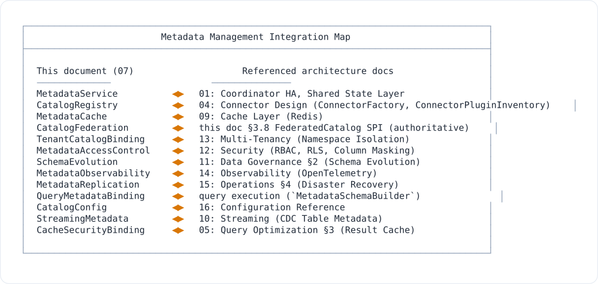

---

## 2. Core Architecture

### 2.1 Overall Architecture

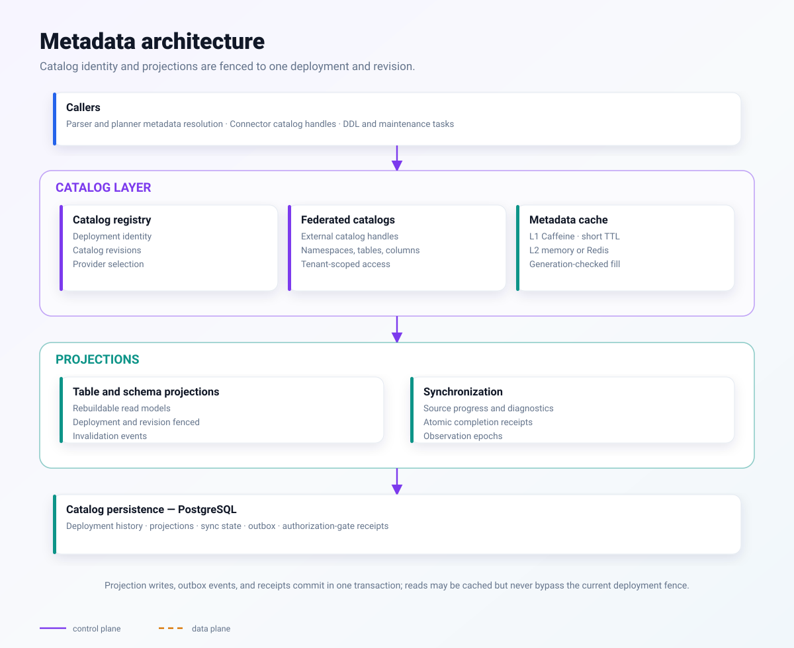

### 2.2 Namespace Model

Following Gravitino's four-level namespace, Pangrova simplifies to three levels (dropping Metalake, since Pangrova is single-engine):

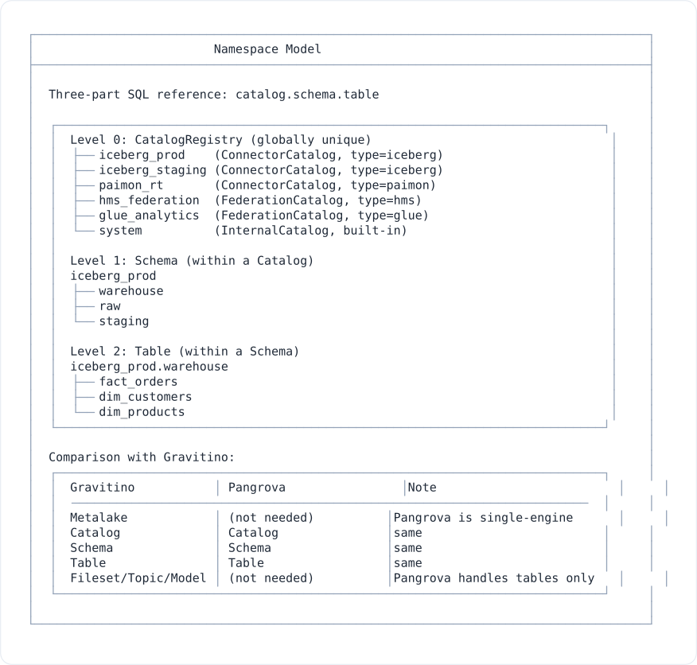

### 2.3 Catalog Type System

```java
/**
 * Catalog type enum
 */
public enum CatalogType {
    INTERNAL,       // built-in Catalog (system, information_schema)
    CONNECTOR,      // Connector-backed Catalog (iceberg, paimon)
    FEDERATION      // external Metastore federation (hms, glue, rest)
}

/**
 * Catalog descriptor — the unified Catalog metadata model
 *
 * Key distinction (see the domain-modularization ADR):
 * - Pangrova Catalog: three-part SQL table-name routing (catalog.schema.table)
 * - Iceberg Catalog: Iceberg table metadata management (org.apache.iceberg.catalog.Catalog)
 * The Pangrova Catalog is the routing layer; the Iceberg Catalog is the storage layer.
 */
public class CatalogDescriptor {
    private final String name;                    // Catalog name (SQL reference name)
    private final CatalogType type;               // Catalog type
    private final String provider;                // provider (iceberg, paimon, hms, glue)
    private final CatalogState state;             // lifecycle state
    private final Map<String, String> properties; // configuration properties
    private final String comment;                 // description
    private final AuditInfo auditInfo;            // audit info (creator, timestamp)

    // tenant binding (see multi-tenancy.md)
    private final Set<String> allowedTenants;     // list of visible tenants; empty = globally visible
}

/**
 * Catalog lifecycle state
 */
public enum CatalogState {
    CREATING,       // creating (loading Connector, validating connection)
    ACTIVE,         // running normally
    DEGRADED,       // degraded (external Metastore unreachable; using cache)
    SUSPENDED,      // suspended (manually paused by an administrator)
    DROPPING        // dropping (cleaning up resources)
}
```

---

## 3. Core Component Design

### 3.0 SessionContext → ConnectorSession Conversion


`SessionContext` is the engine-level session object carrying identity, tenant, and query
properties. `ConnectorSession` (defined in [connectors.md §1.2](./connectors.md))
is the Connector SPI session object passed to all `ConnectorMetadata` methods. The
`toConnectorSession()` method bridges these two layers.

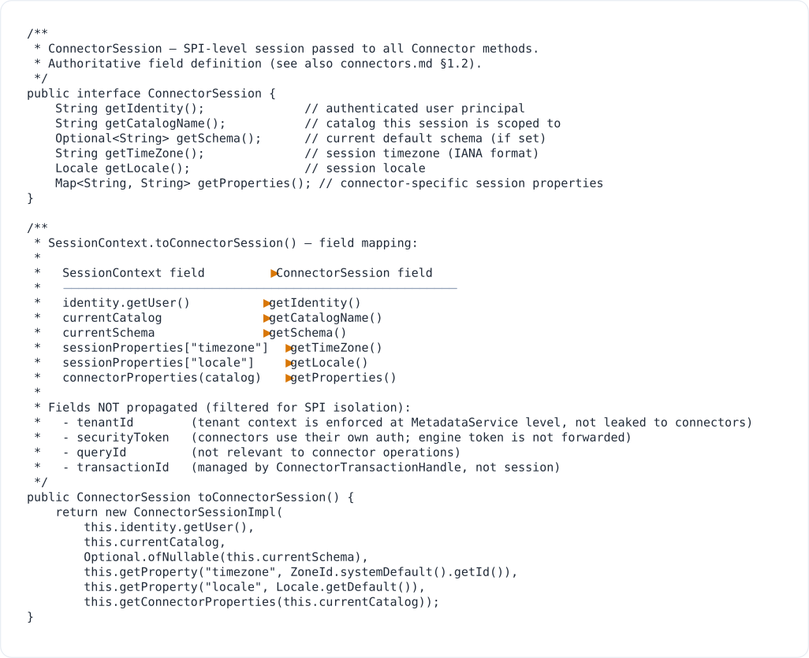

### 3.1 MetadataService — Unified Entry Point


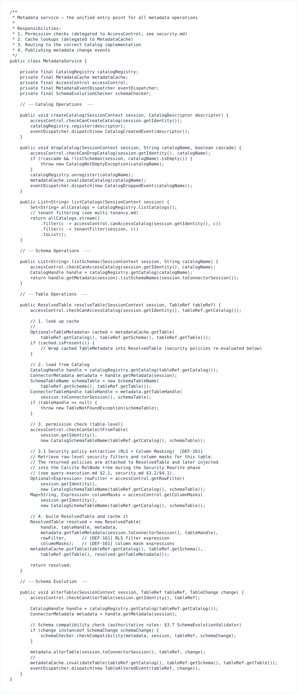

### 3.2 CatalogRegistry — Catalog Registration and Lifecycle

A drop compares the catalog name, incarnation and revision of the local handle in
the PostgreSQL delete. Only a matching row produces a catalog invalidation in the
same transaction. Registration compensates a handle creation failure only after
the database acknowledged the save, using that same compare-and-delete operation.
An unconfirmed save leaves durable state for reconciliation. Reconciliation
replaces a local handle when the stored incarnation or revision changes.


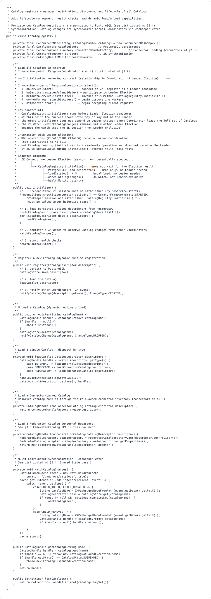

### 3.3 CatalogHandle — Catalog Abstraction Handle

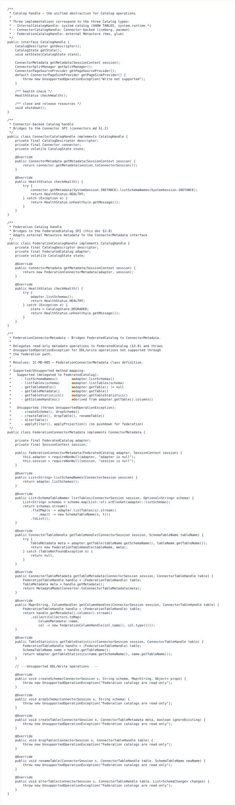

### 3.4 Catalog Health Checks

```java
/**
 * Catalog health monitoring
 *
 * Metrics are exposed to Prometheus (see observability.md)
 * The degraded state triggers alerts (see the degradation strategy in resilience.md)
 */
public class CatalogHealthMonitor {

    private final CatalogRegistry registry;
    private final ScheduledExecutorService scheduler;
    private final MetricsProvider metrics;

    private static final Duration CHECK_INTERVAL = Duration.ofSeconds(30);
    private static final int DEGRADED_THRESHOLD = 3; // consecutive failure count

    public void start() {
        scheduler.scheduleAtFixedRate(this::checkAll,
            CHECK_INTERVAL.toSeconds(), CHECK_INTERVAL.toSeconds(), TimeUnit.SECONDS);
    }

    private void checkAll() {
        for (CatalogHandle handle : registry.getAllHandles()) {
            HealthStatus status = handle.checkHealth();

            metrics.recordCatalogHealth(handle.getDescriptor().getName(), status);

            if (!status.isHealthy()) {
                int failCount = incrementFailCount(handle.getDescriptor().getName());
                if (failCount >= DEGRADED_THRESHOLD) {
                    handle.setState(CatalogState.DEGRADED);
                    metrics.recordCatalogDegraded(handle.getDescriptor().getName());
                }
            } else {
                resetFailCount(handle.getDescriptor().getName());
                if (handle.getState() == CatalogState.DEGRADED) {
                    handle.setState(CatalogState.ACTIVE);
                }
            }
        }
    }
}
```

#### 3.4.1 Error Propagation from External Catalogs


When a catalog enters `DEGRADED` state, the behavior for in-flight and new queries is:

| Scenario | Behavior | Rationale |
|----------|----------|-----------|
| `resolveTable()` on DEGRADED catalog | Target behavior: serve a bounded-staleness cache entry; otherwise surface a metadata/catalog backend error. | Avoid silently serving arbitrarily old metadata. |
| `listSchemas()` / `listTables()` on DEGRADED catalog | Same cache-or-fail strategy as `resolveTable()`. | Consistent behavior across all metadata operations. |
| DDL on DEGRADED catalog (`CREATE TABLE`, `ALTER TABLE`) | Fail with a metadata/catalog backend error. DDL requires authoritative state. | DDL against stale metadata risks schema corruption. |
| Connector internal error (non-DEGRADED) | Map to `PangrovaException` with `ErrorCategory.EXTERNAL_ERROR` (see [resilience.md](./resilience.md)). Propagate to query execution layer as query failure. | Connector errors are not retryable at metadata level. |
| External catalog timeout | Count toward DEGRADED threshold. If within threshold, retry once with halved timeout. If exceeded, transition to DEGRADED. | Graceful degradation with bounded retry. |

```java
// CatalogRegistry.getCatalog() — updated to handle DEGRADED state
public CatalogHandle getCatalog(String name) {
    CatalogHandle handle = catalogs.get(name);
    if (handle == null) throw new CatalogNotFoundException(name);
    if (handle.getState() == CatalogState.SUSPENDED) {
        throw new CatalogSuspendedException(name);
    }
    // DEGRADED catalogs remain accessible — MetadataService decides
    // whether to serve from cache or fail based on staleness policy.
    // See MetadataService.resolveTable() cache-or-fail logic.
    return handle;
}
```

MetadataCache staleness tolerance configuration:

| Property | Default | Description |
|----------|---------|-------------|
| `metadata.degraded.max-staleness` | `5m` | Maximum acceptable cache age when serving from DEGRADED catalog |
| `metadata.degraded.ddl-allowed` | `false` | Whether DDL is allowed on DEGRADED catalogs (always false in production) |
| `metadata.cache.async-refresh` | `true` | Non-blocking cache refresh on TTL expiry |

Error category mapping from connector exceptions to Pangrova error model
(see [resilience.md](./resilience.md) for full ErrorCategory definition):

| Connector Exception | Pangrova ErrorCategory | Retryable |
|---------------------|---------------------|-----------|
| `CatalogBackendException` (timeout) | `EXTERNAL_ERROR` | Yes (bounded) |
| `CatalogBackendException` (auth failure) | `PERMISSION_DENIED_ERROR` | No |
| `CatalogBackendException` (not found) | `USER_ERROR` | No |
| `ConnectorException` (internal) | `EXTERNAL_ERROR` | No |
| `UnsupportedOperationException` | `NOT_SUPPORTED_ERROR` | No |


### 3.5 Metadata cache

`MetadataCacheDeployment` selects the Coordinator's L2 provider and creates a bounded Caffeine L1. `PluginFederationHandleFactory` shares this cache with the metadata subsystem. During query planning, a federation handle reads its deployed catalog through `CachingFederatedCatalog`. Synchronization and health checks read the original external catalog. Connector query snapshots and permission checks retain their own authority.

A cache entry identifies the catalog, schema, table and deployment incarnation/revision. Each backend reads a group generation, table generation and serialized value atomically. When a load crosses a table or catalog invalidation, the backend rejects that fill. A replaced deployment has a different variant even if a new catalog reuses its old name. Local L1 eviction and invalidation also remove decoded projections. PostgreSQL's committed invalidation log drives cross-Coordinator L1 eviction. A remote L1 may still serve its prior projection until its poller receives the event or the L1 TTL expires.

| `metadata.cache.l2.provider` | Configuration and ownership |
|---|---|
| `disabled` (default) | Uses only local L1. Provider settings must be absent. |
| `memory` | In-process Caffeine store. Optional `metadata.cache.l2.properties.max-entries` defaults to 50000. Each serialized entry expires after five minutes. |
| `redis` | Requires `metadata.cache.l2.properties.url` and `metadata.cache.l2.properties.namespace`. Use a unique namespace per independent cluster. A standalone Redis server supports `redis://` and TLS `rediss://`. Jedis is packaged with this provider. Startup checks connectivity. Redis errors propagate to the operation. |

The Java `getStats()` and `getCatalogIndexStats()` methods expose local Caffeine statistics. Redis hit/miss metric exports and a SQL cache statistics system table are pending.

A catalog or table invalidation changes its generation. Obsolete serialized values expire under their original TTL. The Metadata subsystem closes the selected store after catalog use and event dispatch have stopped. A Coordinator closes its own Redis client pool and leaves other Coordinators' entries intact.

### 3.6 MetadataSyncService — Metadata Synchronization

Server assembles the table projection reader, projection transaction writer and sync repository
on one PostgreSQL database. The periodic Coordinator schedule supplies the deployment and adapter
from the federation handle. Before the first external read, the service recovers accepted work
and issues a new durable observation epoch under the current deployment row lock.

| Source path | Projection and progress |
|---|---|
| Full enumeration | Adds observed schemas and refreshes positively observed tables by authoritative point lookup. Omitted names are preserved. A missing or failed lookup for a listed table records a partial scan. |
| Incremental batch | Uses events as table references and rereads each current source object. Explicit absence deletes the projection. Only a completely applied, source-certified interval advances the checkpoint. |
| Push callback | Rechecks the named object for every notification, including DELETE. An old delete received after recreation publishes the recreated table. A source failure propagates and retains the projection. |
| Drift sample | Uses the parent batch's epoch for a separate current-source read and any column repair. The sampled check is diagnostic and never advances progress independently. |

A later epoch supersedes an earlier observation across Coordinator processes. Both mutation
and completion reservation verify the epoch under the deployment lock. A pending durable intent
blocks a new epoch until recovery under its original identity. Previously committed operations
remain visible and confirmable by ID. Each projection, tenant impact, invalidation and receipt
share a transaction. Checkpoint and run receipt have their own atomic transaction. A new epoch
can interrupt an incomplete scan, including an empty run awaiting completion.

The serialized projection preserves source creation and update instants at their supplied precision.
A same-name recreation replaces the previous object’s creation time.

A provider certifies point-in-time table existence or absence via `observeTable`. The cache decorator
forwards this operation directly. Unsupported lookup, timeout, access denial and ambiguous absence
cannot authorize deletion. A complete change interval identifies affected keys; it supplies no
per-object version. The current SPI supplies no common read snapshot for a full catalog. Readers
can see committed rows of a partial scan, and external changes after a point lookup remain possible.
Full verification of a catalog at one source revision would require a provider-issued snapshot or
comparable versioned tombstones. External federation providers must supply their own authority;
the repository ships no production Federation backend. Coordinator periodically polls. The push
entry point applies these guarantees when explicitly subscribed; no automatic subscription ships.

### 3.7 SchemaEvolutionValidator — Schema Change Validation

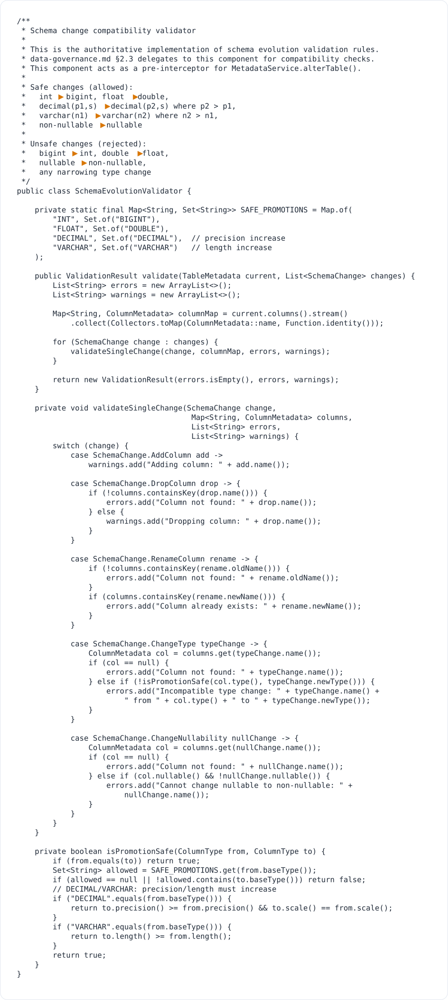


### 3.8 FederatedCatalog SPI — External Catalog Federation Interface

`FederatedCatalog` lives in `pangrova-metadata/pangrova-metadata-api` under
`org.pangrova.metadata.api.catalog`.
It exposes schema/table enumeration, table metadata and statistics, incremental
`readChangesSince(Instant)` returning `MetadataChangeBatch`, and adapter close.
The caching decorator forwards incremental batches and authoritative point lookups directly to the provider.

A complete-through bound must represent every change (including deletions) in the
requested interval and exclude late commits into that interval. A successful SELECT,
an empty result, or the current database time is insufficient. An adapter without
that guarantee explicitly returns an absent bound. Pull-only providers reject a push subscription with an explicit unsupported-operation error. Federation
factory discovery is plugin-based; a configured provider name alone does not establish
an installed implementation or its capabilities.

## 4. Unified Metadata Model

### 4.1 TableMetadata — Cross-Catalog Common Model

```java
/**
 * Unified table metadata model
 *
 * All FederatedCatalogs convert external-backend metadata into this model.
 * This model is the basic unit for Metastore persistence and cache storage.
 *
 * Relationship to ConnectorTableMetadata (connectors.md §1.2):
 * - ConnectorTableMetadata is the Connector SPI internal model, oriented toward query execution
 * - TableMetadata is the metadata-management-layer model, oriented toward federated storage and caching
 * - MetadataService.resolveTable() handles conversion between the two
 */
public record TableMetadata(
    String catalog,
    String schema,
    String table,
    List<ColumnMetadata> columns,
    Map<String, String> partitionSpec,
    List<String> sortOrder,
    Map<String, String> properties,
    Instant createdAt,
    Instant updatedAt
) {
    public String qualifiedName() {
        return catalog + "." + schema + "." + table;
    }
}

public record ColumnMetadata(
    String name,
    ColumnType type,
    boolean nullable,
    String comment,
    Map<String, String> tags    // data-classification tags (see data-governance.md §5)
) {}

/**
 * Column type — supports parameterized types (DECIMAL(p,s), VARCHAR(n))
 */
public record ColumnType(
    String baseType,            // INT, BIGINT, FLOAT, DOUBLE, DECIMAL, VARCHAR, ...
    int precision,              // DECIMAL precision; 0 for other types
    int scale,                  // DECIMAL scale; 0 for other types
    int length                  // VARCHAR length; 0 for other types
) {
    public static ColumnType of(String baseType) {
        return new ColumnType(baseType, 0, 0, 0);
    }

    public static ColumnType decimal(int precision, int scale) {
        return new ColumnType("DECIMAL", precision, scale, 0);
    }

    public static ColumnType varchar(int length) {
        return new ColumnType("VARCHAR", 0, 0, length);
    }

    @Override
    public String toString() {
        if (precision > 0) return baseType + "(" + precision + "," + scale + ")";
        if (length > 0) return baseType + "(" + length + ")";
        return baseType;
    }
}
```


### 4.2 TableMetadata ↔ ConnectorTableMetadata Conversion Contract

`MetadataService.resolveTable()` handles conversion between `TableMetadata` (the metadata-management layer) and `ConnectorTableMetadata` ([connectors.md §1.2](./connectors.md)). The two models serve different purposes, their field sets are not fully aligned, and conversion adds or drops some information.

#### Field Mapping

| TableMetadata Field | ConnectorTableMetadata Field | Direction | Notes |
|---|---|---|---|
| `catalog` | (implicit, from CatalogHandle) | → only | ConnectorTableMetadata has no catalog name; it is provided by the CatalogHandle context |
| `schema` + `table` | `SchemaTableName` | ↔ | lossless in both directions |
| `columns` | `List<ColumnMetadata>` | ↔ | see the type-mapping table below |
| `columns[].tags` | — | → lost | **Information loss**: ConnectorTableMetadata has no data-classification tags; they are dropped during conversion |
| `partitionSpec` | `ConnectorTableLayout.partitioning` | → transform | Map format is converted to the Connector's PartitioningHandle |
| `sortOrder` | `ConnectorTableLayout.sortOrder` | → transform | String list is converted to a SortItem list |
| `properties` | `Map<String, Object> properties` | ↔ | value type is widened from String to Object |
| `createdAt` / `updatedAt` | — | → lost | **Information loss**: ConnectorTableMetadata has no audit timestamps |
| — | `ConnectorTableHandle` | ← only | **Information gain**: created by the Connector; includes runtime state such as snapshot ID and delete-file information |

#### Type Mapping (ColumnType ↔ Connector Type)

| ColumnType | Connector Type | Reversible |
|---|---|---|
| `INT` | `IntegerType` | ✓ |
| `BIGINT` | `BigIntType` | ✓ |
| `FLOAT` | `RealType` | ✓ |
| `DOUBLE` | `DoubleType` | ✓ |
| `DECIMAL(p,s)` | `DecimalType(p,s)` | ✓ |
| `VARCHAR(n)` | `VarcharType(n)` | ✓ |
| `BOOLEAN` | `BooleanType` | ✓ |
| `DATE` | `DateType` | ✓ |
| `TIMESTAMP` | `TimestampType` | ✓ (precision may differ) |
| Nested (STRUCT/ARRAY/MAP) | `RowType/ArrayType/MapType` | ✓ (recursive) |

#### Information Loss and Compensation

Information lost during conversion is compensated by the following mechanisms:

| Lost Field | Compensation | When Needed |
|---|---|---|
| `tags` (data classification) | classification authority must be read from Governance; table projections do not grant policy authority | when RLS/Column Masking needs tag information ([security.md §5](./security.md)) |
| `createdAt/updatedAt` | available as source metadata or local table-projection observations; actual query routing determines freshness | auditing and data-governance scenarios |
| `ConnectorTableHandle` | created by `ConnectorMetadata.getTableHandle()`; includes runtime information such as the Iceberg snapshot ID | required during query execution |

#### Conversion Implementation

```java
/**
 * TableMetadata ↔ ConnectorTableMetadata converter
 *
 * One-way conversion: resolveTable() obtains ConnectorTableMetadata from ConnectorMetadata,
 * then maps the selected source observation. Local projections do not replace current governance or source authority.
 *
 * No reverse conversion is provided: ConnectorTableMetadata → TableMetadata is handled by MetadataSyncService,
 * which builds TableMetadata directly from the external backend via the FederatedCatalog.
 */
public class MetadataModelConverter {

    public static ResolvedTable merge(
            ConnectorTableMetadata connectorMeta,
            ConnectorTableHandle tableHandle,
            Optional<TableMetadata> cachedMeta) {
        // ConnectorTableMetadata provides: schema, columns, properties, partitioning
        // TableMetadata adds: tags, createdAt, updatedAt
        // ConnectorTableHandle provides: snapshot ID, runtime state
        return new ResolvedTable(connectorMeta, tableHandle,
            cachedMeta.map(TableMetadata::columnTags).orElse(Map.of()));
    }
}
```

### 4.3 MetadataChange — Synchronization Change Model

```java
/**
 * A source hint for one table. Optional metadata can diagnose a stale change feed.
 */
public record MetadataChange(MetadataChangeType type, QualifiedTableRef tableRef, TableMetadata metadata) {}

/**
 * Synchronization result
 */
public record SyncResult(
    String catalogName,
    String syncType,
    Instant syncTime,
    int changesApplied,
    int errors,
    List<String> errorMessages,
    long durationMs
) {}
```

### 4.4 TableMetadata JSON Serialization

```java
/**
 * TableMetadata serializer
 *
 * Used for Metastore persistence (PostgreSQL JSONB columns) and Redis caching.
 * Guarantees round-trip: serialize(deserialize(json)) == json
 */
public class TableMetadataSerializer {

    private final ObjectMapper mapper;

    public TableMetadataSerializer() {
        this.mapper = new ObjectMapper()
            .registerModule(new JavaTimeModule())
            .disable(SerializationFeature.WRITE_DATES_AS_TIMESTAMPS);
    }

    public String serialize(TableMetadata metadata) {
        try {
            return mapper.writeValueAsString(metadata);
        } catch (JsonProcessingException e) {
            throw new MetadataSerializationException("Serialize failed", e);
        }
    }

    public TableMetadata deserialize(String json) {
        try {
            return mapper.readValue(json, TableMetadata.class);
        } catch (JsonProcessingException e) {
            throw new MetadataSerializationException(
                "Deserialize failed: " + json.substring(0, Math.min(100, json.length())), e);
        }
    }
}
```

Serialization example:

```json
{
  "catalog": "iceberg_prod",
  "schema": "warehouse",
  "table": "orders",
  "columns": [
    {"name": "order_id", "type": {"baseType": "BIGINT"}, "nullable": false, "comment": "Primary key", "tags": {}},
    {"name": "customer_id", "type": {"baseType": "BIGINT"}, "nullable": false, "comment": null, "tags": {}},
    {"name": "amount", "type": {"baseType": "DECIMAL", "precision": 18, "scale": 2}, "nullable": false, "comment": "Order amount", "tags": {}},
    {"name": "email", "type": {"baseType": "VARCHAR", "length": 255}, "nullable": true, "comment": null, "tags": {"pii_type": "PII_EMAIL"}}
  ],
  "partitionSpec": {"date": "day(created_at)"},
  "sortOrder": ["created_at DESC"],
  "properties": {"format-version": "2", "write.format.default": "parquet"},
  "createdAt": "2024-01-01T00:00:00Z",
  "updatedAt": "2024-06-15T12:30:00Z"
}
```

### 4.7 Table Control Plane (Ownership and Admission)

At startup the coordinator selects the `postgresql` `TableStoreFactory` through
`ServiceLoader` and supplies the metadata data source. The factory creates the
ownership, statistics, governance binding and maintenance repositories together.
`CatalogRegistry` receives them before it opens catalogs. SQL maintenance and
scheduled maintenance share the same policy service and persisted run history.
Tests select a fresh memory store set or provide a PostgreSQL authority explicitly.

Catalog visibility is not ownership. The control plane adds the management state that a
connector cannot answer: who owns a table, which format identity it has, and whether
Pangrova may write, drop, or maintain it.

| Mode | Source | Persisted | Query | Governance | Maintenance | DML / DROP |
|---|---|---|---|---|---|---|
| `OBSERVED` | visible in the catalog, no control record | no | yes | observe only | no | no |
| `LINKED` | explicit adoption of an external table | yes | yes | yes | only policy-authorized non-destructive operations | no |
| `MANAGED` | created or written by Pangrova | yes | yes | yes | yes | yes |

- `table_control_registry` stores only `LINKED` / `MANAGED`; `OBSERVED` is computed on every
  resolve and never written. A connector remains the authority for schemas, snapshots, and
  statistics.
- A control record carries a stable `table_id`, the format UUID (`format_table_uuid`), the
  last observed `version_token`, and a `metadata_revision` that increments on every mutation.
  Drop/recreate under the same name therefore produces a different identity; stale handles
  and write intents cannot silently target the new table.
- Registration and adoption also capture the authoritative catalog incarnation and revision.
  Admission, controlled resolution (including cache hits), governance bindings, statistics,
  observations and rename/drop completion reject a deployment mismatch even when the physical
  table UUID has not changed. A stale local catalog handle is rejected against the durable
  descriptor before control authority can be used. Catalog replacement never rebinds an old
  control record automatically; a newly created table receives a new stable table ID.
  SQL DROP and the trusted Metadata API check the captured deployment before physical
  deletion, including shadow mode; completion retains its revision/deployment checks.
  This is not an atomic Catalog lease across connector I/O.
- Existing records with no catalog binding fail closed. The background observer may backfill
  both missing fields only for an explicitly legacy-write-allowlisted table whose live format
  UUID and location match the identity already recorded. It cannot overwrite an existing or
  partial deployment binding. Operators must confirm the intended current deployment before
  adding an entry to this migration allowlist. A LINKED record can be explicitly unlinked
  and adopted again to obtain a new stable ID without inheriting its previous bindings.
- `CREATE TABLE` registers `MANAGED` in the same DDL path. If the physical table was created
  but registration failed, the record is stored as `ORPHANED_MANAGED` and the DDL fails.
  `DROP TABLE` retires the captured live record (`DROPPED`). `ALTER TABLE ... RENAME`
  persists its original source and operation identity, then reserves both names through
  `table_control_name_reservation`. Registry changes, reservations and invalidations are
  atomic. Both names reject access and CREATE while RENAMING; successful completion
  releases the source name. An ambiguous connector exception retains the intent and
  reservations until the outcome can be proved.
- Ownership is checked before the connector is touched: `DdlExecutor` for DROP/ALTER,
  `CatalogMetadata` for the REST/metadata path, and `QuerySchedulingEngine` for
  distributed DML. Connectors are never asked to infer writability from catalog type.
- Capabilities are a separate, fail-closed contract. A connector returns `TableCapabilities`
  from `getTableCapabilities`; the default (`TableCapabilities.UNSUPPORTED`) declares nothing,
  and undeclared always means unsupported. Ownership admits a write; capabilities then decide
  whether the format can execute it. `INSERT` requires `supportsWrite`, and
  `UPDATE`/`DELETE`/`MERGE` additionally require `supportsDelete`. A missing capability fails
  before connector allocation with `CONNECTOR_UNSUPPORTED_OPERATION`. Iceberg keeps
  `supportsEqualityDeleteRead=false` and fails closed on equality delete files until the read
  path is verified against a reference engine; maintenance operations and system tables are
  likewise declared per format rather than inferred.
- `ALTER TABLE ... ADOPT` creates a `LINKED` record from the connector's live identity and
  version. It fails closed when the connector cannot report a format UUID, when the table is
  already `MANAGED`, or when an existing record's identity no longer matches (drop/recreate).
  Re-adopting the same identity is idempotent. ADOPT never changes the physical table.
- `ALTER TABLE ... UNLINK` retires a `LINKED` record only; the physical table stays and returns
  to `OBSERVED`. It rejects `OBSERVED` (nothing to unlink) and `MANAGED` (use `DROP TABLE`).
- Resolution caches a controlled entry only while its `metadata_revision` and version token
  still match the registry; `OBSERVED` entries use the short-lived local cache.
- `TableVersionObserver` reconciles every live `LINKED`/`MANAGED` record with the connector on
  the leader's metadata-sync cadence. A new `version_token` advances `metadata_revision`,
  appends `table_control_version_observation`, writes `invalidation_log`, and emits
  `ExternalCommitObservedEvent`. An observation is not a Pangrova write commit and never enters
  the write commit journal.
- A changed `format_table_uuid` or location transitions the record to `QUARANTINED`; writes and
  maintenance stay blocked until an operator confirms the replacement. A table the catalog no
  longer resolves becomes `STALE`. An unreachable catalog aborts the pass instead: discovery
  failure is never treated as proof of deletion.
- `OBSERVED` tables are never persisted or observed in the background. Resolution captures the
  live version token and its cache entry expires after 30 seconds (or the configured resolution
  TTL if shorter), so a drop/recreate is picked up without writing control state.
- `SHOW TABLE CONTROLS [FROM|IN catalog[.schema[.table]]]` reads the control plane:
  - without a scope it lists persisted `LINKED`/`MANAGED` records across all catalogs;
  - with a catalog/schema scope it merges the live catalog listing in as `OBSERVED` rows;
  - with a single-table scope it additionally resolves that table's live `format_table_uuid`
    and `version_token`.
  Control records missing from the live listing stay visible so `STALE`/`QUARANTINED` state is
  never hidden. This statement never writes control state. Rows also carry the collected
  statistics summary (`stats_version`, `stats_row_count`, `stats_data_size`,
  `stats_computed_at`), with `-1` meaning none are available.
- `ANALYZE TABLE` collects connector statistics only for an `ACTIVE` `LINKED`/`MANAGED` record and
  persists them in `table_control_statistics`, keyed by `table_id` and bound to the version
  token observed during collection. The collection aborts if the version changes mid-run, if the
  connector reports no version token, or if it reports no usable statistics; nothing is stored
  under a fabricated zero. The planner's `PlanningReadBindingResolver` uses a persisted row only
  when its stable ID and version match both the admitted control record and the bound
  connector version. The optimizer otherwise uses the selected source's connector estimates. `UNLINK` and `DROP TABLE` purge the row with the other table-scoped state, so a
  reused name cannot inherit old cardinalities.
- The SQL planner resolves a fully qualified source through the catalog at the root
  before consulting the session's default namespace. The catalog name therefore
  does not trigger a table lookup in the default namespace. Unqualified sources
  still resolve against their session defaults. An admitted Iceberg JDBC query
  checks the exact first-level namespace by name before consulting the schema
  listing. Exact spelling wins when names differ only by case. Names without
  an exact match use case-insensitive resolution. The query reuses each named
  check during compilation. Explicit schema listing still enumerates the catalog.
  The selected source proceeds through ownership, snapshot and split validation.
- `TableControlPolicyBinder` stores governance artifacts (column tag, column mask, row filter,
  quality rule, lineage) in `table_control_governance_binding`, keyed by `table_id` and the
  artifact reference. Binding requires an `ACTIVE` `LINKED`/`MANAGED` record: an `OBSERVED`
  table has no stable identity, and a `QUARANTINED`/`STALE` record may describe a replaced
  table. `requireCurrentBinding` re-resolves the live record and rejects a binding
  left over from a dropped/recreated table even though the name matches; callers that
  resolve a binding by name use it instead of trusting the name. Query-time tag and
  mask enforcement is name-keyed, so a recreated table can only inherit over-masking
  (never a policy bypass), and every control-plane operation on it fails until the
  record is `ACTIVE` again.
  `UNLINK` and `DROP TABLE` purge every binding for the retired `table_id`, so a new table
  created under the same name starts without inherited governance.

Staged rollout (system properties):

| Property | Default | Effect |
|---|---|---|
| `pangrova.table-control.enabled` | `true` | Write control records in shadow mode |
| `pangrova.table-control.external-readonly` | `false` | Enforce rejection of DML/DROP on `OBSERVED`/`LINKED` |
| `pangrova.table-control.legacy-write-allowlist` | empty | Comma-separated `catalog.schema.table` names lazily registered as `MANAGED` during migration |

Enforcement must use `JdbcTableControlStore` (wired whenever the metadata datasource exists)
so every coordinator reaches the same ownership decision. The in-memory store is limited to
tests and metadata-less modes.


---

## 5. Metadata Persistence

### 5.1 Canonical PostgreSQL initialization

`pangrova-schema-migrations` is the sole owner of `db/migration` resources and the
checksum manifest. Server and PostgreSQL tests use that bundle to initialize an empty
database. Repositories never create parallel schemas. The new project does not need
historical data conversion, dual writes, or compatibility stores.

Catalog current/history rows, schema/table projections, and invalidation outbox remain
separate facts. V107 adds synchronization progress and immutable run receipts; V108 adds per-operation projection receipts. Runtime
code no longer reads or writes the historical `sync_history` table. The earlier
MySQL-style schema/full-text examples have been removed; the canonical SQL resources
are the executable PostgreSQL specification.

### 5.2 Independent domain ports and PostgreSQL implementations

| Capability | Contract in Catalog Persistence API | PostgreSQL implementation |
|---|---|---|
| Current deployment and exact revision history | `CatalogDeploymentRepository` | `PostgresCatalogDeploymentRepository` |
| Read rebuildable table projections | `TableProjectionRepository` | `PostgresTableProjectionRepository` |
| Read observed schema names | `SchemaProjectionRepository` | `PostgresSchemaProjectionRepository` |
| Deployment-fenced projection + invalidation + receipt | `MetadataProjectionTransactions` | `PostgresMetadataProjectionTransactions` |
| Source progress, diagnostics and completion receipts | `MetadataSyncRepository` | `PostgresMetadataSyncRepository` |

The projection transaction contract is owned by `pangrova-persistence-workflow-api`,
with the PostgreSQL coordinator in `pangrova-persistence-workflow-postgresql`;
Catalog Persistence retains the deployment, projection-read, and synchronization
ports.

The former composite MetadataStore interface and PostgresMetadataStore implementation have
been removed. Deployment-only consumers do not implement or borrow projection methods.
Server selects providers explicitly; each provider borrows the same externally owned
DataSource and closes only the connections it acquires.

Deployment current/history publication and its invalidation are atomic. Each table
mutation and its invalidation are atomic, including its operation receipt and current deployment check; schema observation batches use the same atomic port. A schema list is an observed upsert batch, not a complete snapshot or a
request to delete omitted schemas. Failed/unknown persistence outcomes must not become
empty results or successful local-cache notifications.

Provider-internal `PostgresCatalogPersistenceBase` shares transaction handling.
Its package is excluded from consumer exports. RuntimeException/Error during rollback
is attached to the original failure, and shared resources are not closed by repositories.
This helper is not a domain SQL callback API. The projection workflow has its own typed
transaction coordinator; package-private SQL participants borrow its connection and
never commit or close it. Table/schema repositories are read-only. Receipt JSON stays
inside the PostgreSQL Provider and has an explicit format version. A replay confirms
past execution, including after deployment replacement; it never grants current authority.
Schema observations do not reconcile omitted schemas. PostgreSQL timestamp-column
precision remains unchanged; operation JSON retains request identity for exact replay.
The schema read port currently has component tests but no production consumer; it is
not evidence that a new end-user schema-list endpoint has been delivered.

The existing table-projection substring search primitive is implemented but currently
has no production caller. It is not a full-text search feature or an advertised SQL
entry point. Inventory search requirements and its eventual endpoint/retirement remain
an explicit capability-review item.

### 5.3 Catalog deployment revision lifecycle

Canonical write tasks bind a catalog name, incarnation ID, revision, provider and
fingerprint. The authenticated deployment endpoint reads the immutable
`catalog_descriptor_revisions` snapshot for that exact identity; it never substitutes
the current `catalog_definitions` row. Current-row compare-and-swap and historical
insert commit in one metadata PostgreSQL transaction. V35 backfills the current row of
every existing catalog; revisions overwritten before V35 cannot be reconstructed and
exact requests for them fail closed.

Catalog `DROP` deletes only the current row. `DROP`/re-`CREATE` gets a new incarnation,
so old and new snapshots remain distinguishable. Historical rows are not deleted
automatically; this is intentional capacity debt. Operators should monitor total
historical row count, `pg_total_relation_size(catalog_descriptor_revisions)`, growth
per catalog/incarnation and oldest `recorded_at`. Manual deletion is unsafe until a
durable revision lease/GC protocol exists:

1. Reserve the exact revision in the same transaction that commits a dispatchable
   `TaskRequest`/outbox record; never transmit before that commit.
2. Renew the reservation under the live execution anchor and exact owner fence;
   retain references needed by write-commit reconciliation after a task reply.
3. Mark the reservation terminal only after replay and write-commit paths are
   impossible; unknown owner, deadline or journal outcome retains the revision.
4. GC may delete a non-current revision only when no live or recoverable reference
   exists and the safety horizon has elapsed; a lease/GC race must preserve the
   snapshot or reject dispatch before it leaves the Coordinator.

A missing snapshot remains a hard error; never return a newer revision or use
provider-level defaults as a compatibility path.

The shared `X-Internal-Auth` secret is not tenant-scoped and the endpoint does not
itself require TLS. Any Worker holding that secret can request another tenant's
descriptor, and descriptor properties can contain connector secrets. Workload mTLS,
exact task/tenant/descriptor authorization, and secret references resolved at the
Worker remain required security work.

## 6. SQL DDL Support

### 6.1 Catalog DDL

```sql
-- register a Connector-backed Catalog
CREATE CATALOG iceberg_prod
USING iceberg
WITH (
    'uri' = 'http://iceberg-rest:8181',
    'warehouse' = 's3://data-lake/warehouse',
    's3.endpoint' = 'http://minio:9000',
    's3.access-key-id' = '${S3_ACCESS_KEY}',
    's3.secret-access-key' = '${S3_SECRET_KEY}'
);

-- register a Federation Catalog (external Metastore)
CREATE CATALOG hive_federation
USING hms
WITH (
    'uri' = 'thrift://hive-metastore:9083'
);

CREATE CATALOG glue_analytics
USING glue
WITH (
    'region' = 'us-east-1',
    'catalog-id' = '123456789012'
);

-- list registered Catalogs
SHOW CATALOGS;
-- output:
-- | name            | type       | provider | state  | last_sync_time       |
-- |-----------------|------------|----------|--------|----------------------|
-- | system          | INTERNAL   | built-in | ACTIVE | -                    |
-- | iceberg_prod    | CONNECTOR  | iceberg  | ACTIVE | 2024-06-15T12:30:00Z |
-- | hive_federation | FEDERATION | hms      | ACTIVE | 2024-06-15T12:29:45Z |
-- | glue_analytics  | FEDERATION | glue     | DEGRADED| 2024-06-15T12:25:00Z |

-- show Catalog details
DESCRIBE CATALOG iceberg_prod;

-- publish revised provider properties; tasks bound to an older revision retain its identity
ALTER CATALOG iceberg_prod SET PROPERTIES ('uri' = 'https://catalog.example.com/api');

-- unload a Catalog
DROP CATALOG hive_federation;

-- force a full sync
CALL system.sync_catalog('hive_federation', 'FULL');

-- view synchronization history
SELECT * FROM system.metadata.sync_history
WHERE catalog_name = 'hive_federation'
ORDER BY sync_time DESC LIMIT 10;
```


### 6.2 Metadata Queries (System Tables)

```sql
-- search tables across Catalogs
SELECT * FROM system.metadata.tables
WHERE table_name LIKE '%orders%';

-- view a table's column information
SELECT * FROM system.metadata.columns
WHERE catalog_name = 'iceberg_prod'
  AND schema_name = 'warehouse'
  AND table_name = 'fact_orders';

-- search by tag (integrates with data classification in data-governance.md §5)
SELECT * FROM system.metadata.columns
WHERE tags['pii_type'] IS NOT NULL;

-- view Catalog health status
SELECT * FROM system.metadata.catalog_health;
-- output:
-- | catalog_name   | state    | last_check_time      | consecutive_failures |
-- |----------------|----------|----------------------|----------------------|
-- | iceberg_prod   | ACTIVE   | 2024-06-15T12:30:00Z | 0                    |
-- | glue_analytics | DEGRADED | 2024-06-15T12:30:00Z | 5                    |

```

### 6.3 Schema Evolution DDL

```sql
-- add a column
ALTER TABLE iceberg_prod.warehouse.orders
ADD COLUMN shipping_address VARCHAR(500) AFTER customer_id;

-- type promotion (safe change)
ALTER TABLE iceberg_prod.warehouse.orders
ALTER COLUMN amount TYPE DECIMAL(20, 4);

-- unsafe change — rejected by SchemaEvolutionValidator
ALTER TABLE iceberg_prod.warehouse.orders
ALTER COLUMN amount TYPE INT;
-- ERROR: Incompatible type change: amount from DECIMAL(18,2) to INT

-- change nullability (only non-nullable → nullable is allowed)
ALTER TABLE iceberg_prod.warehouse.orders
ALTER COLUMN customer_id SET NULL;

-- view schema change history
SELECT * FROM iceberg_prod.warehouse.orders$schema_history;
```


---

## 7. Observability Integration

### 7.1 Metadata Metrics

All metrics are exposed to Prometheus via the MetricsProvider SPI (see [observability.md §2.1](./observability.md)).

| Metric | Type | Description |
|--------|------|------|
| `pangrova.metadata.cache.l1.hits` | Counter | L1 (Caffeine) cache hits |
| `pangrova.metadata.cache.l1.misses` | Counter | L1 cache misses |
| `pangrova.metadata.cache.evictions` | Counter | cache evictions |
| `pangrova.metadata.cache.size` | Gauge | current number of cache entries |
| `pangrova.metadata.catalog.health` | Gauge | Catalog health status (1=ACTIVE, 0.5=DEGRADED, 0=DOWN) |
| `pangrova.metadata.catalog.count` | Gauge | total number of registered Catalogs |
| `pangrova.metadata.sync.duration_ms` | Histogram | distribution of sync durations |
| `pangrova.metadata.sync.changes` | Counter | number of synced changes (by catalog label) |
| `pangrova.metadata.sync.errors` | Counter | number of sync errors (by catalog label) |
| `pangrova.metadata.resolve.latency_ms` | Histogram | resolveTable latency distribution |
| `pangrova.metadata.schema.validation.rejected` | Counter | number of rejected schema changes |


### 7.2 Metadata Operation Tracing

The following decorator is a proposed instrumentation pattern. The current source
tree does not contain this class.

```java
/**
 * Metadata operation tracing
 *
 * Each MetadataService method creates a Span,
 * associated with the query-level Trace (see observability.md §4.1).
 */
public class TracedMetadataService implements MetadataService {

    private final MetadataService delegate;
    private final TracingProvider tracing;

    @Override
    public ResolvedTable resolveTable(SessionContext session, TableRef tableRef) {
        Span span = tracing.startSpan("metadata.resolveTable", SpanKind.INTERNAL);
        try (Scope scope = span.makeCurrent()) {
            span.setAttribute("catalog", tableRef.getCatalog());
            span.setAttribute("schema", tableRef.getSchema());
            span.setAttribute("table", tableRef.getTable());

            ResolvedTable result = delegate.resolveTable(session, tableRef);

            span.setAttribute("cache.hit", result.isFromCache());
            return result;
        } catch (Exception e) {
            span.setStatus(StatusCode.ERROR, e.getMessage());
            span.recordException(e);
            throw e;
        } finally {
            span.end();
        }
    }
}
```

### 7.3 Grafana Dashboard Recommendations

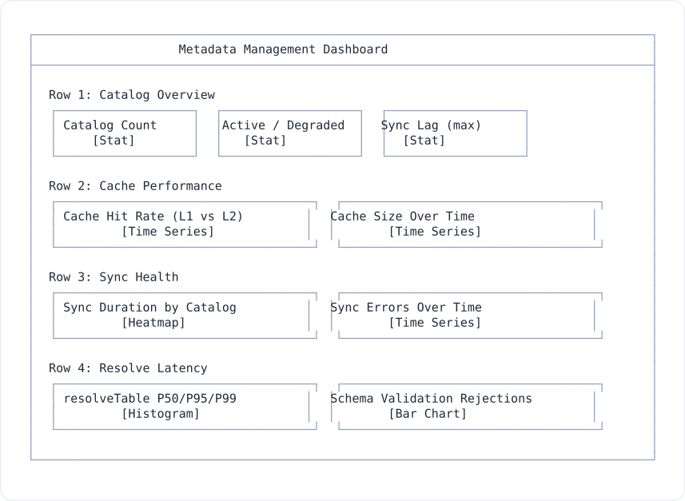


---

## 8. Configuration Reference

Configuration examples use YAML. Only keys listed in the
[configuration key reference](../configuration/reference.md) are part of the
verified typed runtime surface.

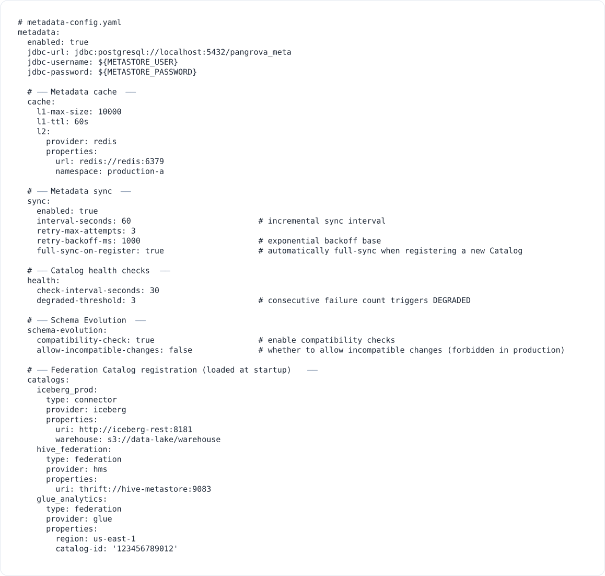


---

## 9. Event-Driven Architecture

### 9.1 MetadataEventDispatcher

Metadata changes are broadcast over an event bus, decoupling downstream consumers.

```java
/**
 * Metadata event dispatcher
 *
 * Consumers:
 * - MetadataCache: invalidate the cache
 * - QueryResultCache: invalidate associated query results (see query-optimization.md §3.3)
 * - LineageEventEmitter: record lineage (see data-governance.md §3)
 * - SecurityPolicyRefresher: refresh security policy (see security.md)
 * - StreamingMetadataTracker: update streaming-table metadata (see streaming.md)
 */
public class MetadataEventDispatcher {

    private final List<MetadataEventListener> listeners = new CopyOnWriteArrayList<>();
    private final ExecutorService asyncExecutor;

    public void addListener(MetadataEventListener listener) {
        listeners.add(listener);
    }

    public void dispatch(MetadataEvent event) {
        for (MetadataEventListener listener : listeners) {
            asyncExecutor.submit(() -> {
                try {
                    listener.onEvent(event);
                } catch (Exception e) {
                    // event consumption failures do not affect the main flow
                    log.warn("Event listener failed: {}", listener.getClass().getSimpleName(), e);
                }
            });
        }
    }
}

/**
 * Metadata event types
 */
public sealed interface MetadataEvent {
    record CatalogCreatedEvent(CatalogDescriptor descriptor) implements MetadataEvent {}
    record CatalogDroppedEvent(String catalogName) implements MetadataEvent {}
    record CatalogStateChangedEvent(String catalogName, CatalogState oldState, CatalogState newState) implements MetadataEvent {}
    record TableCreatedEvent(TableRef tableRef, TableMetadata metadata) implements MetadataEvent {}
    record TableDroppedEvent(TableRef tableRef) implements MetadataEvent {}
    record TableAlteredEvent(TableRef tableRef, List<SchemaChange> changes) implements MetadataEvent {}
    record MetadataSyncedEvent(String catalogName, MetadataChange change) implements MetadataEvent {}
}

public interface MetadataEventListener {
    void onEvent(MetadataEvent event);
}
```


---

## 10. Error Handling

### 10.1 Exception Hierarchy

```java
/**
 * Base class for metadata exceptions
 */
public class MetadataException extends RuntimeException {
    public MetadataException(String message) { super(message); }
    public MetadataException(String message, Throwable cause) { super(message, cause); }
}

// Catalog-related
public class CatalogNotFoundException extends MetadataException { ... }
public class CatalogAlreadyExistsException extends MetadataException { ... }
public class CatalogSuspendedException extends MetadataException { ... }
public class CatalogProviderNotFoundException extends MetadataException { ... }
public class CatalogNotEmptyException extends MetadataException { ... }

// Table-related
public class TableNotFoundException extends MetadataException { ... }

// external-backend-related
public class CatalogBackendException extends MetadataException { ... }

// persistence-related
public class MetastoreException extends MetadataException { ... }

// serialization-related
public class MetadataSerializationException extends MetadataException { ... }

// Schema-change-related (not an exception, a structured result)
public record ValidationResult(boolean compatible, List<String> errors, List<String> warnings) {}
```


**Exception → PangrovaErrorCode Mapping**:

| Exception | Error Code | Code | Retryable |
|-----------|-----------|------|-----------|
| CatalogNotFoundException | CATALOG_NOT_FOUND | 1701 | No |
| CatalogAlreadyExistsException | CATALOG_ALREADY_EXISTS | 1702 | No |
| CatalogSuspendedException | CATALOG_SUSPENDED | 1703 | No |
| CatalogProviderNotFoundException | CATALOG_PROVIDER_NOT_FOUND | 1704 | No |
| CatalogBackendException | CATALOG_BACKEND_ERROR | 1705 | Yes (external) |
| MetastoreException | METASTORE_ERROR | 1706 | Yes (transient) |
| MetadataSerializationException | METADATA_SERIALIZATION_ERROR | 1707 | No |
| TableNotFoundException | TABLE_NOT_FOUND | 1101 | No |

> Note: `CatalogBackendException` and `MetastoreException` are retryable because they represent transient external failures. All other metadata errors are user errors (wrong name, already exists, etc.) and should not be retried. Error codes registered in [resilience.md §2](./resilience.md).

### 10.2 Error Handling Strategy

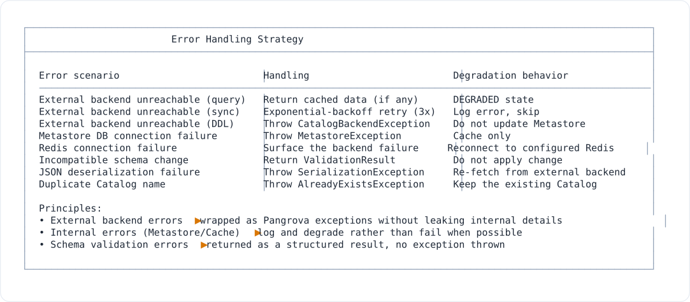


---

## 11. Module Structure

```text
pangrova-metadata/
  pangrova-metadata-api/       # metadata.api values and provider contracts
  pangrova-metadata-codec/     # shared table metadata encoding
  pangrova-metadata-catalog/      # domain orchestration, caches and remaining adapters
pangrova-persistence/
  pangrova-persistence-catalog-api/
    .../api/catalog/          # deployment authority
    .../api/projection/       # table and schema projection ports
    .../api/synchronization/  # checkpoints and run receipts
    .../api/dependency/       # dependency graph port
    .../api/invalidation/     # maintenance port
  pangrova-persistence-catalog-postgresql/
    .../postgresql/catalog/
    .../postgresql/projection/
    .../postgresql/synchronization/
    .../postgresql/invalidation/
    .../postgresql/transaction/ # internal, not consumer-exported
pangrova-schema-migrations/  # sole canonical initialization resource bundle
```

This is the currently implemented ownership, not a claim that all Metadata adapters,
graph providers or Coordinator assembly have reached their final locations. The
[modularization ADR](domain-modularization-adr.md) defines the complete target and the
current tests and `.pangrova/modules.yaml` record the verified state.

## 12. Observability Integration

This section defines the metrics and tracing integration points for the metadata management layer. For the full observability design, see [observability.md](./observability.md).

### 12.1 Metrics

| Metric | Type | Source Component | Description |
|--------|------|-----------------|-------------|
| `pangrova.metadata.catalog.refresh_total` | counter | CatalogRegistry | Catalog refresh operations |
| `pangrova.metadata.catalog.refresh_latency_ms` | histogram | CatalogRegistry | Catalog refresh latency |
| `pangrova.metadata.schema.cache_hit_ratio` | gauge | SchemaCache | Schema cache hit ratio |
| `pangrova.metadata.table.resolve_latency_ms` | histogram | FederatedCatalog | Table resolution latency |
| `pangrova.metadata.event.published_total` | counter | MetadataEventBus | Metadata change events published |

### 12.2 Tracing

Metadata management emits the following spans (see [14 §4](./observability.md) for span schema):

- `metadata.catalog.resolve` — Catalog resolution span
- `metadata.table.get` — Table metadata fetch span
- `metadata.schema.list` — Schema listing span
- `metadata.stats.collect` — Statistics collection span


> **Cross-reference (§3.1 MetadataService):** `MetadataService` resolves tables and
> Planner builds its Calcite root using `MetadataSchemaBuilder`. The registry implements the
> borrowed `CatalogReadAccess` contract. Table ownership checks remain in Table.
> `FederationCatalogHandle` wraps the `FederatedCatalog` SPI described in §3.8.


> **FederatedCatalog Authoritative Location**: FederatedCatalog SPI is defined in §3.8 of this document (07). All former references to "11 §6.2" have been corrected to point here. See also [00 §5.1](./overview.md) SPI summary table.


The production implementation of `MetadataService` is `metadata.catalog.CatalogMetadata`. Planner borrows the public interface to enumerate the visible catalogs for its Calcite schema. The installed registry supplies schemas and selected table handles under the authenticated connector session.

`CatalogTableResolution` owns the read cache and `CatalogTableDdl` owns physical DDL and invalidation. `MetadataQueryScopes` accounts for catalog admission and release under the exact issued query authority. Failed cleanup retains that scope for a retry. `CatalogColumnTags` verifies the column type and stable table identity before passing the operation to the Governance-owned bindings.


### Engine creation declarations

`CatalogMetadata.createTable` forwards typed scalar declarations to connector
schema builders. DECIMAL uses the supplied precision and scale; VARCHAR retains its
optional length. Missing/invalid parameters, unknown types and structured declarations
that the Metadata model cannot represent are rejected before physical creation. The
service does not fabricate format field IDs. This bridge does not establish REST
catalog protocol compatibility, recursive schema/nullability support or field-bound
governance; each requires its own provider contract and qualification.

### Durable synchronization recovery

Catalog Persistence records immutable projection and completion intents before execution.
`MetadataSyncService` resolves them under their original IDs before reading another source batch,
including when the service and providers are recreated. An unresolved intent rejects new IDs;
Pending and OutcomeUnknown errors stop the invocation without a full-sync fallback. Projection,
parent schema observation, invalidation, receipt and terminal intent state commit together;
checkpoint, completion receipt and terminal intent state also commit together. Obsolete deployment
intents are fenced and rejected, never reauthorized with a current descriptor.

The observation epoch and per-operation recovery interact as described in §3.6. Generic cache invalidation is durable.
Process-local schema-evolution event recovery, retention and cancellation of in-flight source calls remain open.
