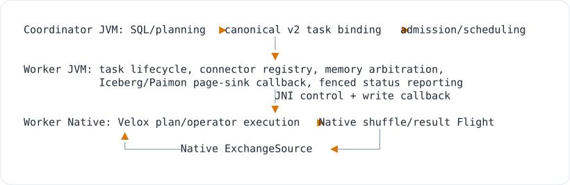
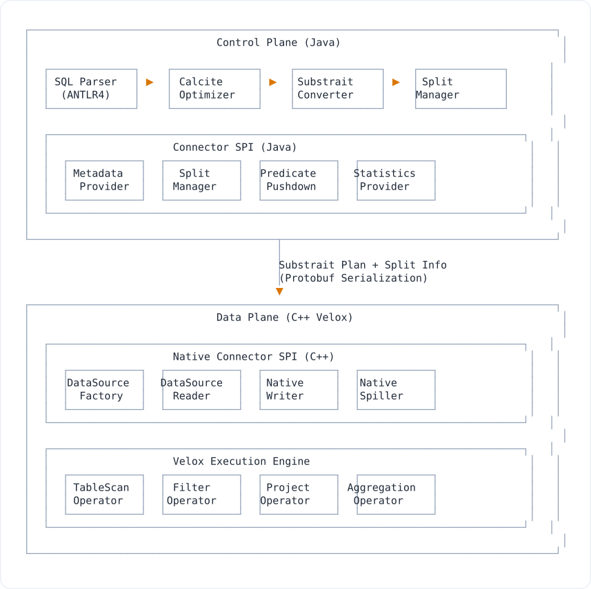
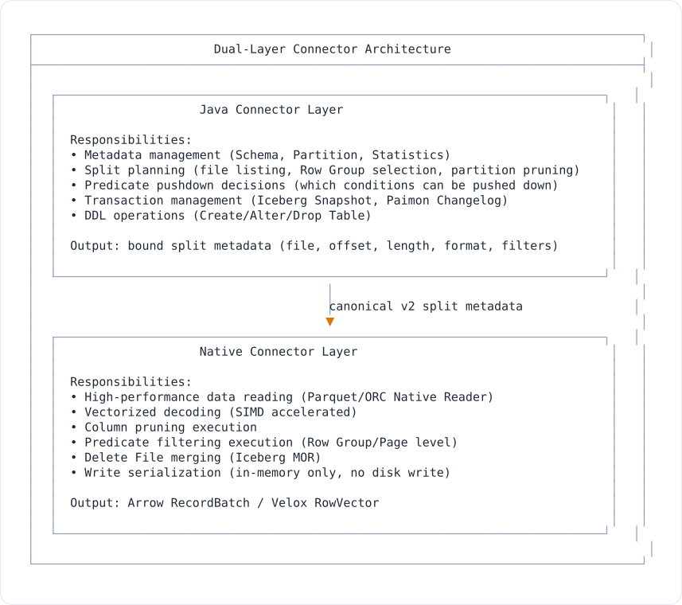
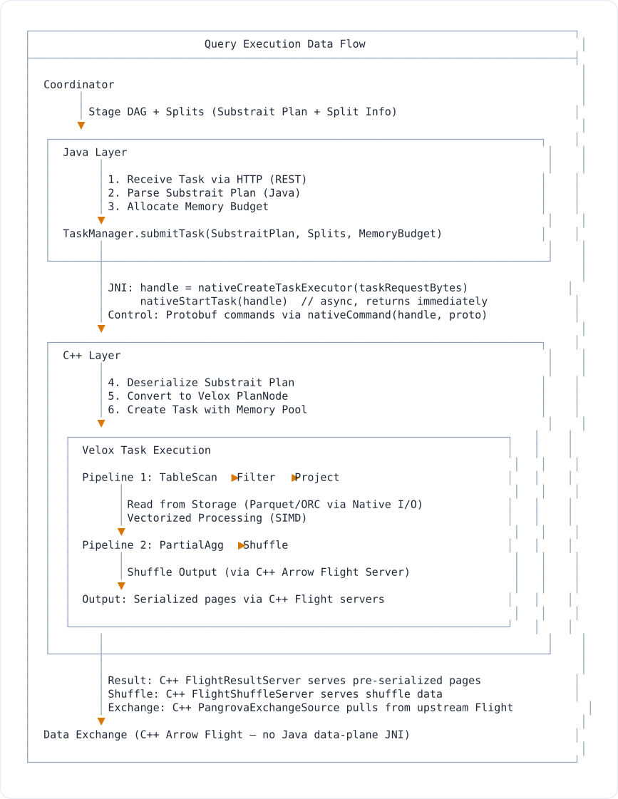
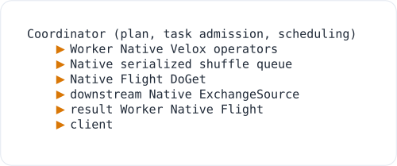

# Native Execution Layer

> **Accuracy scope.** This is a living architecture document. Content explicitly marked
> draft, proposed, planned, phase, target, or remaining work is design intent rather
> than implemented support. For current behavior, code wiring and end-to-end tests
> take precedence.

> **Current data-plane boundary.** Java owns task control and connector-backed
> write sinks. Velox executes relational operators in Native; Native Flight
> serves both result and shuffle streams. Worker-to-Worker shuffle carries
> standard Arrow stream batches serialized from Velox vectors and does not pull
> batches through Java/JNI. Serialization/conversion costs still apply. Historical
> interface sketches below are not executable contracts; the authoritative
> task/wire definitions are the canonical v2 proto and current JNI exports.

## 1. Overall Architecture

The main relational execution path places operators and vector Top-K merging on
Native Workers. With both streaming and query roles enabled, CDC ingestion runs in
Worker JVMs. The streaming-only role uses a local connector sink. Native Flight carries relational shuffle
traffic directly between Workers. See [Current Capability Status](../getting-started/capability-status.md).
Read-dependent
Iceberg/Paimon writes are staged through the Java connector SDK from a Native
write-drain callback; the final catalog commit remains Coordinator-owned.
Lance's Rust/C++ FFI is a separate Native storage adapter whose public SQL
write and catalog publication path is still subject to the acceptance criteria
in [distributed-writes.md](./distributed-writes.md).

For canonical v2 tasks, `StageResourceGrant.native_memory_bytes` is a hard
per-task Native growth limit, **not** an up-front resident-memory reservation.
The Worker installs its node pool before the Native allocation callback; actual
Native allocations charge both the node pool and the shared `MemoryArbitrator`.
The serialized shuffle-buffer grant is separately reserved in full before HTTP
task acceptance. This permits multiple small tasks to run concurrently without
charging each task's theoretical Native maximum as if it were already used.
Heartbeat placement advertises the smaller of the node-pool free bytes and the
shared arbitrator's available bytes; a node-specific cap cannot be hidden by a
larger global budget.
Admission and pressure handling still require bounded, fair scheduling across
Coordinators; a hard cap alone is not a memory guarantee.

The handwritten Java protocol code is organized by wire capability. Shared
Worker execution identity lives in `protocol.execution.identity`; both task
admission and REST registration consume it. `descriptor.CanonicalProtocolIdentity`
owns the existing exact version, descriptor hash and rollout identity used by
startup finalization and task admission. The JVM retains one immutable protocol
version for task construction and validation. Native admission and capability
inventory share the corresponding identity computed once in the Native process.
`checksum.ProtocolChecksums` hashes
caller-selected bytes without owning task validation or changing serialization.
Capability identities, inventory validation, source bindings and write receipts
live in their respective `capability`, `capability.inventory`, `source` and
`write` packages. These Java package changes do not rename protobuf messages or
change JSON fields, canonical descriptors, signatures or JNI exports.

`resource.StageResourceGrants` validates grants at transport and admission
boundaries. Unknown fields and unsigned quantities outside Java's signed
accounting range are rejected before they enter accounting. Relational execution
requires positive native memory; source preparation instead requires positive
JVM memory. Optional absence in the resource codec remains distinct from a
present invalid grant. Worker registration bounds every port field to 0–65535;
the existing zero representation is retained without changing endpoint startup
rules.

Worker registration carries the unchanged canonical v2 capability inventory in
its JSON control envelope. Only an authenticated internal service POST to
`/v1/workers/register` receives the protocol's inclusive 4 MiB encoded-inventory
bound plus 64 KiB of envelope metadata. Both declared length and streamed bytes
are limited. Public SQL and other control routes retain their existing request
limits; a route name or caller-supplied bearer header alone cannot grant the
registration allowance. This aligns the transport with the existing inventory
contract rather than removing the ingress bound or adding an AI-specific proto.

The planner places a hash exchange on grouping columns **before** a grouped
Aggregate, or a singleton exchange before a global Aggregate. An unbounded
`ORDER BY` is gathered before its Native Sort; root Top-K retains task-local
pruning followed by a Native final Top-K. These are Native data-plane
operators: the Coordinator only binds stages and never combines rows in its
JVM. Pipeline consumers may start only after upstream producer task records
exist, not while that stage is still `SCHEDULING`. The Native shuffle writer's
compression codec is also installed in Velox's Exchange QueryConfig and the
task-scoped Flight result decoder so both Native exchange pages and result
OutputBuffer pages use the same codec. The singleton global Sort
remains a scale bottleneck until distributed range-sort/merge is validated.

Native aggregate conversion binds distinct direct grouping columns to the source
vectors. It adds a projection when a computed key, nested argument, or repeated
grouping alias needs its own field. Grouping sets reuse the same prepared inputs
in the GroupId expansion while preserving the grouping set identifier. The local
Partial uses the accumulator type returned by the raw signature binding. The
Final keeps the original raw argument types alongside its state input. For
DECIMAL(22,7) SUM, the local accumulator is VARBINARY and the result is
DECIMAL(38,7).

Splitless sources such as `GENERATE_SERIES` need two cardinality boundaries:
the planner assigns one producer task to a stage containing the source, and
the zero-input Native table-function node limits its Velox source pipeline to
one driver. A task may still use multiple drivers for other pipelines, including
the scan side of a mixed `UNION ALL`. Table functions with input rows retain
per-input parallelism.

An admitted runtime filter is published for a task and scan node. Each scan
driver advances its own cursor through that publication sequence. Filters
available before a file opens can enter the reader's scan specification when
the physical column and type match and no deletion or conversion affects the
row. A late filter runs on materialized logical rows after applicable deletes,
partition values and schema evolution. A batch with zero matches retains its
identity as a batch so a driver continues to the next read.

Result-service shutdown first seals registration and revokes each retained result
authority, waking its actual pending SDK fetch. It then cancels transport calls
through Arrow's deadline shutdown and joins the real handlers and serving thread.
Shutdown must not depend on an idle client polling again or acknowledging GOAWAY.
Transport cancellation alone is not task drain: producer stop, queue cleanup,
reader leases and retained batch owners must still satisfy the task's existing
drain contract before resources are released. Failed queue cleanup remains owned
for retry and is reported to the caller.

For a finished result task, Native signals once after the producer stops,
the result authority is revoked, the queue clears, and all reader and exported
buffer leases exit. The Worker subscribes against the exact live executor
handle after reserving its FINISHED report and before sending that report.
The JNI callback only schedules release. The Worker cleanup owner joins the
Native executor and returns the memory grant before publishing the physical
drain receipt. It retains the local admission seal after the physical release.
Terminal HTTP attempts and backoff run asynchronously outside the cleanup
thread. Each result task preserves its initial FINISHED envelope until the
Coordinator acknowledges it. The physical receipt follows that ACK and keeps
its own exact sequence and body for retry. The registry entry remains until
delivery is acknowledged. Each retained result also has a deadline, which is
cancelled when its owner is removed. The slow retention pass schedules aged
owners and retries failed deliveries for registered result tasks.

## 2. Design Philosophy: Separation of Control Plane and Data Plane

Building on the core ideas of Velox, Pangrova adopts an architecture that separates the "control plane" from the "data plane":

## 3. Dual-Layer Connector Architecture

### 3.1 Why a Dual-Layer Design?

| Layer | Language | Responsibilities | Rationale |
|------|------|------|------|
| Java Connector | Java | Metadata, Split planning, transactions | Deep integration with lakehouse format SDKs |
| Native Connector | C++ | Data reading, vectorized processing | Extreme performance, SIMD optimization |

## 4. Data Flow in Detail

## 5. Native ↔ Java Interaction Protocol

### 5.1 Boundary Principles

- Java receives and validates task-control requests, admits the canonical v2
  resource grant, and passes the same serialized task contract to Native.
- Native owns Velox execution, Worker-to-Worker shuffle, Flight result serving,
  and the associated byte-level backpressure and resource lifetime.
- JNI commands and status are control-plane crossings. Memory arbitration may
  synchronously call the registered Java allocation listener; connector writes
  synchronously call the Java page sink with borrowed Arrow IPC bytes.
- The Coordinator never merges data rows or implements a second vector/shuffle
  wire format. It schedules and validates fenced terminal reports.
- The canonical v2 proto is the single authoritative task/report contract;
  this document contains no duplicate protobuf or JNI method declaration.

### 5.2 Current Native Data Flow

Java does not repeatedly pull shuffle or result batches through JNI. The
producer queue and Flight demultiplexer provide bounded handoff; producer
success, abort and cancellation have distinct terminal outcomes. A slow
consumer must propagate pressure through the Native handoff, and retained
pages must remain charged until the last reader or linger cleanup releases
them. The current queue has a known byte-accounting gap, tracked in
the [Roadmap](../getting-started/roadmap.md); count-only capacity
is not proof of bounded memory.

### 5.3 Canonical Protocol

The single authoritative task, resource-grant, operator-binding, report, and
exchange contracts live in `pangrova-protocol/src/main/proto/pangrova/protocol/v2`.
Generated Java/C++ bindings are build artifacts and must not be hand-edited.
Planner and Coordinator create a canonical `TaskRequest`; Worker admission
validates it before JNI passes the same serialized contract to Native.
Connector-specific read bindings and split metadata are carried by that task
contract, not by a second copy of a protobuf definition in this document.

### 5.4 Current JNI Boundary

`NativeRuntime` and the Native command dispatcher admit the canonical v2
`TaskRequest`, create/start/cancel/release task handles, and report fenced
status and resource usage. The authoritative method signatures are the Java
class and C++ JNI exports; this document does not define a second interface.
Result and shuffle batches are served by Native Flight, not repeatedly pulled
through Java JNI. Read-dependent table writes use a synchronous Native-to-Java
`NativeWriteExecutor` callback carrying Arrow IPC bytes to a connector
`ConnectorPageSink`; the Worker returns a staged commit fragment, and the
Coordinator performs the final connector catalog commit.

### 5.5 Native Shuffle and Result Lifetime

`VeloxTaskRunner` routes producer output through `TaskOutputRouter` into
`SerializedShuffleQueue`. `FlightShuffleServer` serves ticket-scoped
partitions; downstream `PangrovaExchangeSource` consumes those serialized
Velox pages. `FlightResultServer` serves final result batches on its separate
result path. Successful producer completion commits clean shuffle EOF;
cancellation or failure aborts it. The queue takes ownership independent of
the producer's Velox task pool so Flight readers may finish after producer
teardown. Queue and Flight retention must both be byte-accounted and bounded;
the current producer-queue gap is tracked in the
[Roadmap](../getting-started/roadmap.md).

The result reader records a Flight stream failure against the exact registered
Native executor before releasing its output buffer. Both Arrow error statuses
and C++ exceptions during page allocation or decoding prevent a successful
TaskReport; the Worker then publishes a failed, zero-completed-coverage
reconciliation with the Native failure attached. A result stream that returns
an error is not a successful producer EOF.

## 6. JNI Boundary

The JNI layer transfers task-control commands, canonical v2 task bytes and
fenced status between the Java Worker and Native runtime. Results and direct
Worker-to-Worker shuffle stream through Native Flight. External shuffle
consumption uses a Java gRPC reader and a bounded JNI handoff for each verified
chunk. Its control envelope carries the attempt and frame metadata. The chunk
bytes are copied into a Native-owned buffer as a separate argument.

Read-dependent writes are the deliberate exception: the Native drain sends
Arrow IPC bytes synchronously to Java `NativeWriteExecutor`, which decodes
them for the connector `ConnectorPageSink`. The borrowed direct buffer must
not outlive that call. The current code in `NativeRuntime`, `JniEntryPoints` and
`NativeWriteExecutor` is the authoritative interface and lifetime contract.
The Java write adapter consumes `worker.catalog.CatalogResourceResolver`;
the Worker-local catalog runtime supplies the exact leased revision and decoded output
handle. Its immutable `TaskConnectorSession` lives in `worker.connector.session`,
below both catalog binding and JNI write execution. Neither shared contract imports a
JNI executor or owns native handles. Moving these Java contracts does not change native
entry-point names, callback signatures or catalog-lease lifetime.
Each output-queue pop releases one producer slot. Deferred Velox producers
are resumed only after their exact batch enters that slot; competing producers
re-register without blocking the sole write-drain consumer.
The Arrow C Data bridge exists for columnar interoperability, but does not
make the network shuffle or result path zero-copy.

Before schema export, canonical vector binding materializes lazy children,
including complex columns whose names and types already match the declaration.
Unchanged wrappers and payload/null/index buffers remain shared. Schema export
must see the actual array/map/row vector rather than interpret LazyVector storage
as a complex vector; logical type equality alone does not prove that layout.

## 7. Native Read Architecture

Read-dependent SQL tasks arrive as canonical v2 task requests with connector
bindings and splits. `PangrovaVeloxConnector` supplies data to Velox operators.
The connector-specific split/reader/delete/merge behavior is defined by the
current connector and Native implementations, not by a duplicate split
or reader SPI sketch here. A connector capability is publishable only when its
planner binding, Native conversion, reader, failure semantics and E2E test agree.

With the actual Velox scan cache enabled, the SDK's
`facebook::velox::dwio::common::CachedBufferedInput` must own a live
`facebook::velox::StringIdLease` from the SDK `fileIds()` registry for the
immutable physical file path. An empty file identifier is invalid, not an
uncached execution mode.
Cache entries retain that identity after the reader closes; different physical
files must neither share entries nor lose their IDs while cached. The lease,
cache and reader remain Native-owned and are released through runtime shutdown.
Mutable objects overwritten under one path require a separate versioned identity
contract before they can safely use this immutable-file cache.

Canonical capability inventory distinguishes a `MATERIALIZER` from candidate
retrieval. Materializers describe bounded artifact output, supported formats and
their result contract, not a Top-K candidate limit. `RETRIEVAL_SOURCE`,
`RETRIEVAL_MERGE` and `RERANK` still require candidate bounds and a typed
relation contract; materializer readiness cannot waive those requirements.

## 8. Velox Integration

`VeloxTaskRunner` owns the Native task execution lifecycle. The current
operator plan, including scans, joins, aggregation, exchanges and result
output, is created from the bound task plan. The Worker JVM does not execute
these relational operators.

## 9. Memory Management

`VeloxMemoryGovernor` governs task-pool allocations through the Worker
memory-arbitration boundary. Native Flight demux/spill and producer-queue
retention have distinct lifetimes; a task's pool usage alone is not a complete
shuffle-memory accounting figure. The exact resource gap and acceptance
criteria are in [resource-management.md](./resource-management.md) and the
[Roadmap](../getting-started/roadmap.md).

The Velox allocator retains a strong reference to its registered
`AsyncDataCache`. Native shutdown joins task and I/O owners, clears the global
cache pointer, then calls the cache's `shutdown()` before checking allocator
pages or replacing the memory manager. Dropping only Pangrova's cache reference
does not release the allocator-owned cache pages.

## 10. Native I/O

Velox and connector readers perform storage I/O under task-level read limits
and connector credentials. This document does not define an independent
filesystem factory, custom async executor or a second cache protocol.
Connector-specific read semantics are documented in
[connectors.md](./connectors.md).

## 11. Shuffle Layer

Producer output is partitioned and serialized by the Native execution path.
`SerializedShuffleQueue` owns queued pages; `FlightShuffleServer` serves
ticket-scoped DoGet streams; `PangrovaExchangeSource` consumes upstream
partitions directly in Native.
`ShuffleBufferStore` bounds demux retention separately from the producer
queue. The current/default deployment must not be described as zero-copy or
producer-loss recoverable without matching storage and fault tests.

The external Shuffle provider reads committed partition streams through the
Worker's Remote Shuffle client. A live, partition-local computation can bind
up to 32 adjacent source partitions. The binding carries the original starting
partition and one exact publication receipt per partition, including empty ones.
The Worker verifies and closes each read before opening the next. It advances
the Native batch sequence over the group while retaining each remote batch's
bytes. One Native ingress enforces shared backpressure, checksum validation and
the total batch count before EOF. Each read retains its own exact attempt and
publication identity. Each durable replay input binds one original partition.

## 12. Delete and Merge Semantics

Iceberg/Paimon row-level semantics depend on the bound connector operation,
snapshot, file/delete metadata and Native reader. No generic delete/merge
pseudocode in this document overrides those connector implementations.
Incomplete connector capabilities must fail admission rather than silently
falling back to a different row set.

## 13. Project Structure

Authoritative code locations are `pangrova-worker-native/src` for Native
execution, shuffle and JNI; `pangrova-worker/src/main/java` for Worker
admission/lifecycle and connector write callbacks; and
`pangrova-protocol/src/main/proto/pangrova/protocol/v2` for the shared
contract. Generated protocol sources are never hand-edited.

## 14. Extensibility

Any new Native capability must declare its signature, version, resource
limits and execution mode in the canonical capability inventory; planner,
Worker admission and Native implementation must consume that same
declaration. SPI presence or a design sketch is not evidence of executable
support.

The Coordinator may share a fully validated, exactly equal immutable inventory
between registered Workers within its own WorkerManager. This is control metadata
deduplication, not candidate transport, score fusion or execution. Equality covers
the complete canonical inventory, including rollout identity; a matching manifest
label alone is insufficient. Worker identities, endpoint bindings, authorization
and metrics remain independent. Weak inventory references must not retain retired
rollouts; registry recovery uses the same validation and sharing boundary. This
does not establish a fleet-size SLO or normalize the durable registry schema.

## 15. Native Functions

Current scalar/vector functions are registered through the implemented
Native function bootstrap and capability catalog. This document does not
claim a separate WASM UDF host, generic dynamic UDF registry or Agent
execution path. Such a capability requires its own sandbox, resource
isolation, type contract and public-entry E2E before publication.

## 16. Serialization

`ShuffleBatchSerializer` encodes bounded Arrow IPC pages. Direct exchanges
carry these pages in Native Flight binary cells. Remote Shuffle publishes the
same pages through gRPC. Each producing Velox driver owns its partition hash
and selection scratch state. For fixed-width columns the accumulator estimates
the size of the selected rows. Variable-width selections use a conservative
source-size bound. The serializer checks the actual Arrow page bytes in both
cases. The final result path uses `FlightResultServer` and its own Arrow result
serialization. The canonical task/report proto carries the control messages.

## 17. Expression Execution

Velox expression evaluation is the current implementation. A separate LLVM
JIT or speculative operator-fusion pipeline is not a current Pangrova
capability and is not required to interpret the task protocol.

Planner validation maps the SDK's `io.substrait.expression.Expression.NestedList`
and `io.substrait.expression.Expression.NestedStruct` to the shared
Substrait `Nested` capability advertised by Native. It recursively validates
every element and field, including functions inside nested constructors;
support for a container never grants support for its children. Other nested
forms are not admitted by this mapping. The default scalar capability set
includes the implemented `round` binding; its decimal return parameters and
INTEGER position still require the exact declared signature.

For binary primitive arithmetic, Calcite may retain operands of different numeric
types even after validating a common result type. Planner lowering materializes
the common numeric argument types as explicit Substrait casts. Native still binds
an exact registered signature; it never guesses an overload or adds implicit
coercion. Each operand's nullability is preserved. SQL integer `MOD` keeps the
divisor's return type: compute in the common argument type and explicitly cast
the result to the validated SQL type. Decimal precision/scale and datetime/interval
operators are not routed through this primitive-number normalization.

The Java transport adapter preserves a producer's typed failure status both
before the first batch and after asynchronous cursor handoff. NOT_FOUND,
INVALID_ARGUMENT, RESOURCE_EXHAUSTED, UNAVAILABLE and CANCELLED remain distinct
wire failures; unknown exceptions and invalid OK exceptions become INTERNAL,
never successful EOF. This adapter contract does not replace the Native
Worker-to-Worker data path or prove distributed recovery.

## 18. Observability

`NativeMetricsCollector` and the canonical terminal task report expose
execution statistics. A successful task with missing or malformed required
terminal statistics must fail validation; metrics are not inferred from a
Java-side batch pull loop.

## 19. Function Lifecycle

Function registration and availability are governed by the Native capability
inventory and Worker admission. Historical examples of independent UDF
registries or WASM hosts are not executable implementation contracts.

## 20. Native Shuffle Throughput and Memory

Direct Worker-to-Worker shuffle does not cross JNI per batch. The producer's
Velox callback partitions rows, serializes bounded pages, and copies page bytes
into the independently owned `SerializedShuffleQueue`. Native Flight serves
ticket-scoped partitions; the downstream Native ExchangeSource consumes them.
The Coordinator carries control metadata only.

The page ownership copy is a correctness boundary: Flight readers may outlive
the producer's Velox task pool. The canonical page limit is 4 MiB. The producer
queue reserves both a slot and actual resident bytes before copying; its default
byte cap is 16 MiB, while production task creation binds the exact Coordinator
shuffle grant and rejects a partial Native pool reservation. This closes the
former count-only queue gap, but does **not** bound every shuffle allocation.
`ShuffleBufferStore` separately charges retained demux pages or spill files
against server-wide limits; the current Flight server starts with its own
default 64 MiB retention cap, not a reservation from the JVM node arbiter.
`PartitionDemuxer::pop()` releases that charge as
it hands a page to a Flight reader; the reader may then allocate replay,
coalesced IOBuf and Arrow binary-array copies while only the number of active
streams (default 128) is limited. This uncharged active-stream memory remains
a P1 production-scale gap. It requires byte credits covering in-flight Flight
responses through send completion, or a proved zero-copy owner transfer, plus
concurrent slow-reader/cancellation/linger stress tests. No throughput or
end-to-end memory ceiling is claimed from the current focused tests.

## 21. Future Optimization Boundary

LLVM JIT, additional operator fusion, custom SIMD reader components and a
separate RowVector reader rewrite are research ideas, not current execution
modes or alternate contracts. Any such work must demonstrate a measured
end-to-end gain on representative distributed queries, preserve identical
results and resource accounting, and replace rather than coexist with a
legacy execution path. The current Velox and connector implementations are
the production source of truth.

## 22. Build and Verification

Generated embedding artifacts use the same canonical logical type contract as
model output: FLOAT32 is declared as `VECTOR(dimension)`, with dimension in
1..65535 and no legacy metric suffix. Build and overlay conversion share the
strict canonical text parser; the typed schema, nullability and constraints
remain validated at their respective contract boundaries. Artifact sink input
names come from the canonical relation layout of the actual projected source,
not the target storage column name. The physical row-position BIGINT and
source-field identity checks remain mandatory.

Native artifact object IDs are fixed-length content identities, not concatenated
source paths. Hash a domain-separated, length-framed tuple of artifact ID,
generation, scope/source ID, object role and content checksum. Preserve the full
source identity, URI and checksum in their separate canonical metadata fields.
Identical output retries retain the same ID, while a changed role or content has
a distinct identity. This keeps normal source URIs out of bounded database key
columns without truncating them or widening indexed keys.

Iceberg split evidence describes physical reads, not SQL snapshot-selection
syntax. After the Connector has resolved an exact snapshot and its schema,
current and time-travel selection of that same snapshot both emit the canonical
`SNAPSHOT` scan mode. Historical declaration validation remains on the pinned
table handle; incremental scans retain their separate mode and snapshot bounds.
This lets a query reuse the exact durable artifact split checksum without
discarding range, schema, delete-file, source or snapshot evidence.

Generated-value publication row counts represent unique physical source rows,
not the sum of rows in the value segment and locator sidecar. The publication
transaction requires those roles to agree for each source object and counts the
source once. Overlay fill-key reservation uses this source-row count directly;
it must not halve it or require even totals. NULL generated values still occupy
their physical row and locator.

The authoritative Native/JNI build order, mandatory Lance FFI dependency,
Release packaging, full CTest, ASan and Java/E2E validation gates are in
the repository build pipeline.
Native resources use the packager's canonical OS/architecture path, including
`META-INF/native/osx/aarch64/libpangrova_native.dylib`; Maven copies that staged
resource rather than independently mapping the raw CMake output into test
resources. The loader extracts one resource and verifies every same-name
classpath resource against the extracted bytes before loading. Different
Native bundles on one classpath fail instead of selecting an older library by
classpath order. Identical duplicates are permitted; this byte-identity check
does not replace JNI ABI tests or same-source artifact provenance.
The bundle module publishes a packaging-only POM with an attached classifier
JAR. Its classifier profile explicitly stages resources before packaging;
successful Maven installation alone is not evidence that the JAR contains the
canonical Native entry. Verify that entry and its byte identity against the
source library before using the bundle in a runtime acceptance test.
Production process assemblies own an explicit SLF4J runtime backend and select
each module's principal Maven JAR, not every JAR in its target directory. Table
filesystem clients must not introduce a competing HTTP server or logging
binding onto that classpath. Retain API dependencies needed by filesystem
clients rather than removing an entire framework namespace without checking
their actual callers.
The Coordinator process entry owns an interruptible lifecycle wait after
startup. It returns only after actual dependency cleanup succeeds; daemon HTTP
threads are not process-lifetime ownership. Readiness requires registered
Workers and catalogs and is distinct from control-plane startup.
The Planner's unique Substrait serialization boundary emits canonical Join keys.
If the official SDK redundantly emits deprecated left/right keys, remove those
copies only after checking exact count, EQ comparison and field identity against
the standard comparison keys. Reject legacy-only, conflicting or lossy duplicates;
do not relax Native validation, translate legacy plans or introduce a second wire
contract. Preserve other canonical comparison semantics and recursive plan layout.
Live and durable stages share the canonical exchange-schema binding algorithm.
For a live query, retain the exact producer plan after adaptive planning and
operator binding, before task dispatch can publish RUNNING. Serialize a consumer
from its current live fragment and bind each input to that prepared producer's
canonical output schema, never its presentation column labels. Missing producers,
inconsistent input identities, distributions or physical types fail closed.
Durable replay validates its frozen contracts without recompilation or repair.
These are control-plane plan bytes; row exchange remains Native Worker to Worker.
Bounded statement acknowledgements use a request-scoped `DataStream` opened
by `DataProducer`. Each read emits the retained serialized response once and
then EOF; an independent read may reopen it within retention. Never model that
cursor with a global consumed-query set or poll the immutable result buffer
as if every repeated lookup were a new batch. Relational rows remain on the
Native Worker endpoint.
Configured Coordinator transport TLS applies to its acknowledgement server as
well as outbound shuffle control. Its advertised result protocol must match
the actual server, and mutual TLS must verify the client certificate chain.
`coordinator.transport.advertised-host` is the client-routable address and must
match that certificate's SAN; it is not the HTTP bind address.
`coordinator.transport.port` selects the acknowledgement listen port (zero
uses an ephemeral port). `coordinator.transport.allocator-limit-bytes` bounds
its memory and must be positive. The production Main consumes all three keys;
wildcard advertised addresses and out-of-range ports are rejected.
Batch-fill saturation, producer exceptions, cancellation and idle timeout are
transport failures, never successful EOF or silent partial-result completion.
Worker shutdown retains registration and periodic heartbeats until tasks have
released their Native owners and terminal receipts have been acknowledged.
It then joins heartbeat callbacks, requires a typed deregistration ACK and
releases registration and dependent runtime resources; interruption is not an ACK.
Physical resource release must not wait for history-retention eviction. The
Worker performs a bounded, incremental registry walk to probe actual consumed
result ownership, retaining failed releases for retry; it does not add a timer
or a duplicate ownership queue per task. Coordinator terminal-completion
retries use a separate bounded cadence, retain exponential backoff, and run
outside the timer thread. Neither cadence changes Native drain requirements,
tenant concurrency limits, result authority expiry or history retention.

All canonical task admission entry points validate the same request before
reservation, publication or Native creation. Invalid canonical HTTP input is
400; a valid request with missing internal signing/runtime authority remains
an internal failure, never a fabricated successful admission.
Shutdown preserves a won FINISHING commit point and puts other active tasks
through cancellation. Publish released terminal state only after actual
transport and Native owners exit. Retain successful per-owner cleanup
checkpoints when a later join fails; sealed Native operation admission must
not be reopened or bypassed to retry already-completed control commands.
A direct-result task can advertise its signed endpoint after Native start is
submitted. Flight verifies the admitted grant against the registered schema,
allocator and live output buffer. An early DoGet has a bounded readiness wait.

If a reader fails or the transport destroys it before committed EOF, it
claims result revocation and reports the failure before deleting the output
queue. The task adapter records the canonical error and stops the exact
Velox task. This ordering releases producers blocked by output backpressure
and preserves the failure when cleanup unblocks the SDK. If the task owner
already revoked authority, it retains its cancellation or failure outcome.
Physical release still waits for the task, reader, transport buffers and
output queue to exit.

Control acknowledgement buffers own their expiration tasks. After accepted query
and publication owners drain, seal acknowledgement admission and cancel only the
buffer's own timers before joining the shared scheduler. Keep acknowledgement
bytes readable until their serving transport actually exits, then close the buffer.
Quota or timer-admission failure must not publish a successful missing response;
roll back failed insertion and retain exact byte accounting.

The query assembly owns the tenant-aware fair scheduler; TaskScheduler only
borrows it. Bind that actual owner before later module construction, and join it
on successful shutdown and failed startup. Seal submissions atomically with
enqueueing, drain previously accepted callbacks, and require actual dispatcher
termination. Interruption, timeout and self-join are failed drains, not release
receipts; the retained owner may retry. Queue inspection must not expose a mutable
admission bypass.
An accepted callback owns its interrupt state only until it returns. The dedicated
dispatcher clears that completed callback's interrupt before dispatching another
callback or parking; this does not interrupt an in-flight callback or clear the
separate shutdown caller's status. A fatal dispatcher exit with accepted callbacks
still queued is a failed drain, even if the executor has terminated. That guard is
not a durable recovery mechanism for those callbacks. An unexpected terminal
dispatcher failure seals admission before propagating and retaining the original
cause; later owner shutdown must not report a successful drain for that failure.

Persisted file statistics are scoped by the authenticated tenant, exact table,
source snapshot, file and column. Queries without an exact snapshot cannot use
this cached pruning input. Connector-supplied statistics must also match the
requested snapshot and files. PostgreSQL writes replace complete file/snapshot
sets transactionally and idempotently; concurrent replacements acquire actual
per-table/snapshot advisory lock keys in deterministic order, while row predicates
compare complete identities rather than hashes. Failed batches roll back
replacements as well as inserts. Lock count must not grow with files in a snapshot.
V51 retains old unscoped rows without inventing a tenant; scoped reads and deletes
cannot consume them. Storage isolation does not authorize background
connector access: maintenance still requires its persisted subject and current
tenant, column, role and policy decisions before I/O.
File and column selections use typed PostgreSQL arrays rather than one bind
parameter per selected value. Keep every exact scope predicate, perform deletion
as one atomic statement, and free each JDBC array after the owning statement ends.
This removes bind-count growth, not array-size, query-cost or memory limits.
HTTP ingress captures the real transport peer before authentication. Untrusted
forwarding headers cannot change authentication or public rate-limit identity.
Authenticated internal control does not share the public IP request quota, so
public saturation cannot prevent Worker terminal ACKs, heartbeats or deregistration;
the body limit and endpoint-specific control authority remain enforced. This is
not a trusted-proxy policy or a production-scale control-plane throughput proof.
Independent process acceptance freezes the complete production runtime-JAR
manifest and verifies all canonical Native entries. Local builds require the
actual Release CMake cache; CI image extraction requires the immutable image
ID, source-revision label and byte-matching extraction receipt instead. These
are distinct provenance proofs, not fallback loading strategies. A host-local
Coordinator/two-Worker run proves only the exercised functional boundaries;
it does not establish production-scale latency, throughput or fault coverage.
Do not copy toolchain versions, machine-specific paths or a shortened
"quick start" into this architecture document; passing a targeted Native
test is not equivalent to the full-chain acceptance gate.
