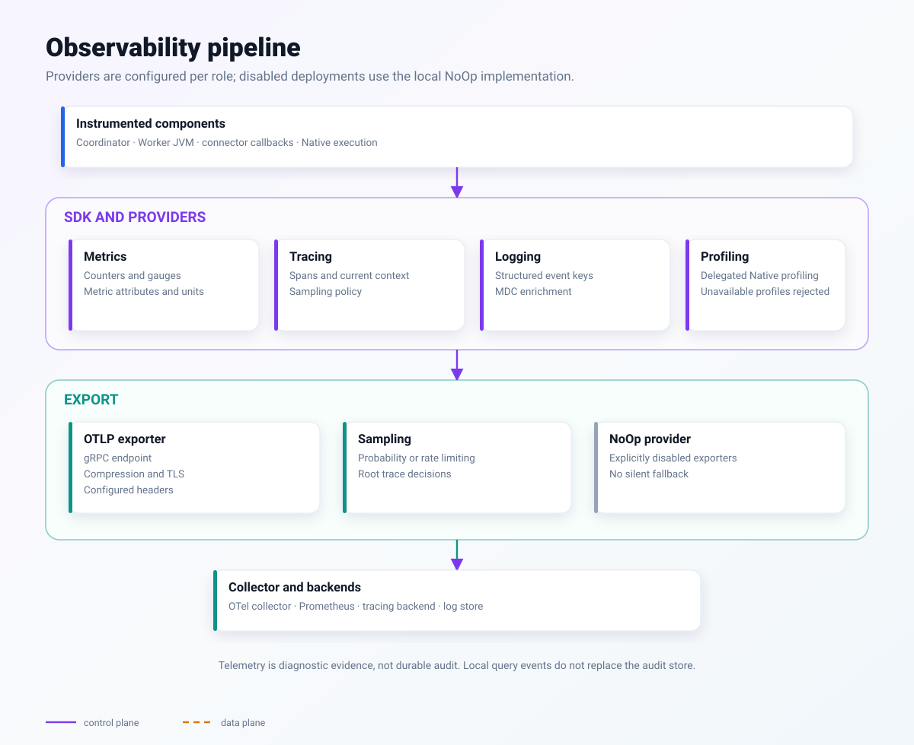
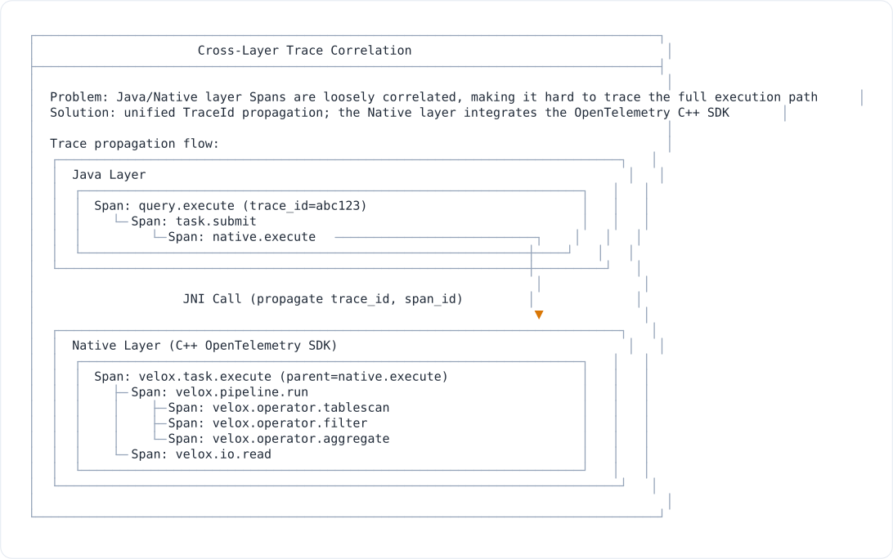
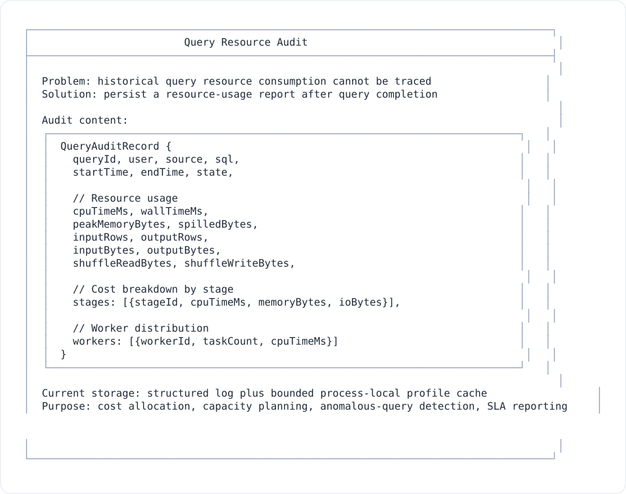
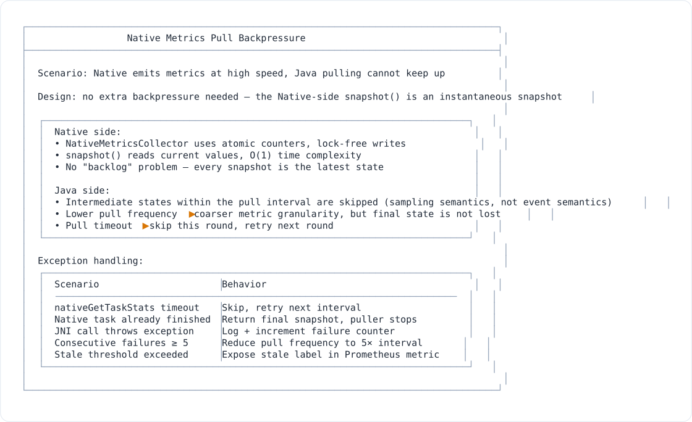
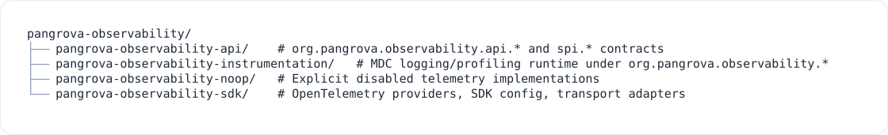
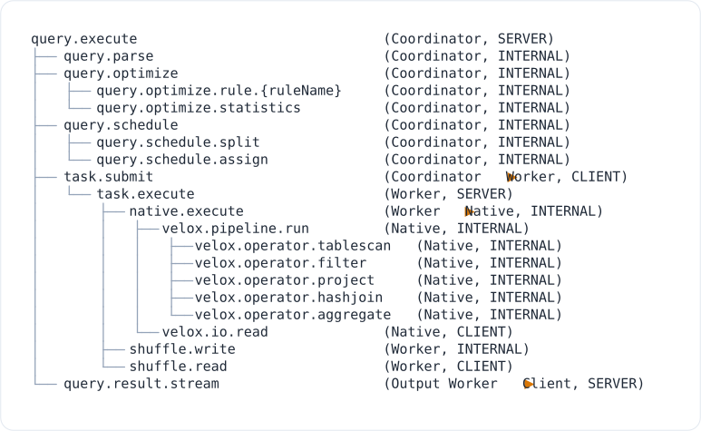

# Pangrova — Observability

> **Accuracy scope.** This is a living architecture document. Content explicitly marked
> draft, proposed, planned, phase, target, or remaining work is design intent rather
> than implemented support. For current behavior, code wiring and end-to-end tests
> take precedence.

> **Summary.** The OpenTelemetry + Prometheus observability model — distributed tracing, metrics, and structured logs.

## 1. Overall Architecture

Coordinator and Worker bootstraps own their `TelemetryInitializer` and inject
its configured `Meter` and `Tracer` into `OtelMetricsProvider` and
`OtelTracingProvider`. These two implementations are not class-path
`ServiceLoader` providers: they require the configured SDK and its lifecycle.
Registering them in `META-INF/services` fails the
[JDK provider-constructor contract](https://docs.oracle.com/en/java/javase/17/docs/api/java.base/java/util/ServiceLoader.html#developing-service-providers).
Provider selection remains explicit in process assembly. Task wrapping is an
explicitly constructed `TaskWrapping` implementation; no contract-level global
ServiceLoader or first-provider selection remains.

Execution identity is separate from exporting spans. `ExecutionTraceContext` and
`ExecutionTraceContextFactory` live in the unified Observability API artifact;
Server explicitly supplies the stateless `OtelExecutionTraceContextFactory` from
the current SDK module. The provider preserves trace ID, span ID, flags and W3C
vendor state, or generates an unsampled root when no valid parent exists. Snapshot
activation restores the calling thread's previous scope on close; it owns neither
query authority nor exporter shutdown. There is no static provider registry.

The SQL E2E fixture uses disabled telemetry. Its canonical TaskRequest identity
and actual Native result assertions do not prove exported-span continuity or
HTTP parent propagation under an enabled provider; SDK/filter/JNI tests cover
those individual boundaries. The full SDK/provider/transport module split is
still pending.



### Current artifact and ownership boundaries

| Artifact | Owns |
|---|---|
| `pangrova-observability-api` | `.api` tracing/metric/logging values and profiling configuration/errors; `.api` providers, task wrapping and profiler contracts |
| `pangrova-observability-instrumentation` | MDC capture/restore, metric registration scopes and profiling delegation |
| `pangrova-observability-noop` | Explicit disabled telemetry instruments/providers and `UnavailableProfiler` |
| `pangrova-observability-sdk` | Existing OpenTelemetry implementation, configuration and transport/native adapters pending their planned split |

The API depends only on Common. Query observations and listener contracts belong to
`pangrova-query` (`api.event` / `spi.event`); their process-local dispatcher belongs
to `pangrova-query` (`core.event`). Observability API and Core do not depend on
Query API/Core. Core and Noop do not depend on the central SPI, OpenTelemetry SDK,
Coordinator or Worker. Query observer callbacks remain fault-isolated; durable
audit/publication authority remains with the owning workflow, not the in-memory
event dispatcher. Provider factories, the remaining
SDK/Core separation, and dedicated HTTP/gRPC/native adapter artifacts remain
part of the target plan and are not claimed complete here.

Dimensioned metric overloads reject nonempty attributes when an implementation
has not implemented dimension handling; they never silently record an unlabelled
observation. Explicit disabled instruments discard the whole observation.
`Span.makeCurrent()` is mandatory: only the disabled span explicitly returns a
no-op scope; active providers must implement activation/restoration.

Gauge registrations implement `AutoCloseable`. The handle owner unregisters its
callback when the observation ends; closing it does not shut down the shared SDK.
Coordinator and Worker inject a `MetricsScope` that owns all registrations created
through it, including those whose handles were not retained by individual collectors.
Role shutdown closes that scope before the telemetry backend. A child scope borrows
its parent provider; Native metrics publishing uses a child scope and unregisters
its four gauges on `stop()`, after the sampling executor has drained in Worker
shutdown. Failed publisher construction closes any registrations already acquired.

Scope close rejects new instrument creation, releases gauges in reverse order,
attempts every release, and retains failed registrations for retry. Independent
owners sharing a backend remain active. A callback already collecting may finish
after unregister, so gauge suppliers must read safe snapshots rather than dereference
a released Native handle. This lifecycle does not establish cardinality bounds or
complete the remaining per-component metric accounting and adapter separation.

Coordinator's bounded async-submit executor captures request logging fields when each dispatch is submitted. The dispatch scope installs the query ID and execution span. Task wrappers capture the submitting context at decoration time and restore
the executing thread's previous MDC in `finally`, including inline execution,
nested wrappers and exceptions. The executor decorator shares its delegate's
lifecycle; shutting down the decorator shuts down that delegate. It does not
own an independently created pool.

Coordinator currently configures `UnavailableProfiler`. Profiling start, stop
and data retrieval reject with `ProfilingUnavailableException`, rather than
returning a fabricated session or empty successful result. The HTTP SVG profile
endpoint translates this explicit unsupported capability to **501** with
`UNSUPPORTED_CAPABILITY`. A configured profiler that has no data for a particular
query can still produce the separate existing **404** response. Structured JSON
query profiles are a distinct endpoint and are unchanged by this split.

## 2. OpenTelemetry Integration

### 2.1 SPI Definitions

```java
// TracingProvider SPI
public interface TracingProvider {
    Span startSpan(String name, SpanKind kind);
    Span startSpan(String name, SpanKind kind, Context parent);
    Span currentSpan();
    <C> void inject(Context context, C carrier, TextMapSetter<C> setter);
    <C> Context extract(Context context, C carrier, TextMapGetter<C> getter);
}

// MetricsProvider SPI
public interface MetricsProvider {
    LongCounter createCounter(String name, String description, String unit);
    ObservableDoubleGauge createGauge(String name, String description,
                                       String unit, Supplier<Double> supplier);
    DoubleHistogram createHistogram(String name, String description,
                                     String unit, List<Double> boundaries);
    LongUpDownCounter createUpDownCounter(String name, String description, String unit);
}

// LoggingProvider SPI
//
public interface LoggingProvider {
    Logger getLogger(String name);
    Logger getLogger(String name, Context context);
}
```

### 2.2 OpenTelemetry Configuration

```java
public class OpenTelemetryConfig {
    private String serviceName = "pangrova";
    private String serviceVersion = "1.0.0";
    private String otlpEndpoint = "http://localhost:4317";
    private boolean tracingEnabled = true;
    private boolean metricsEnabled = true;
    private boolean loggingEnabled = true;
    private double tracingSampleRate = 1.0;
    private Duration metricsInterval = Duration.ofSeconds(60);
}
```

## 3. Core Metric Definitions

### 3.1 Coordinator Metrics

| Metric Name | Type | Description |
|--------|------|------|
| `pangrova.coordinator.queries.submitted` | Counter | Total queries submitted |
| `pangrova.coordinator.queries.completed` | Counter | Total queries completed successfully |
| `pangrova.coordinator.queries.failed` | Counter | Total queries failed |
| `pangrova.coordinator.queries.running` | UpDownCounter | Currently running queries |
| `pangrova.coordinator.stage.dispatch.latency_ms` | Histogram | Actual dispatch phase duration, by phase and success or failure |
| `pangrova.coordinator.stage.preparation.queue_ms` | Histogram | Downstream preparation submission to start, by final outcome |
| `pangrova.coordinator.stage.preparation.run_ms` | Histogram | Downstream preparation start to finish, by final outcome |
| `pangrova.coordinator.stage.preparation.outcomes` | Counter | Completed, skipped, failed or rejected preparations |
| `pangrova.coordinator.query.latency` | Histogram | Query execution latency |
| `pangrova.coordinator.tasks.scheduled` | Counter | Total tasks scheduled |
| `pangrova.coordinator.scheduling.latency` | Histogram | Task scheduling latency |
| `pangrova.coordinator.workers.active` | UpDownCounter | Active Worker count |
| `pangrova.coordinator.queries.timed_out` | Counter | Queries for which timeout won the terminal transition |
| `pangrova.coordinator.queries.terminal_cleanup.local_release_ms` | Histogram | Terminal cleanup entry to local ownership release, including retry and wait time |

Local ownership release does not establish global drain: a durable retirement may still require recovery confirmation.

### 3.2 Worker Metrics

| Metric Name | Type | Description |
|--------|------|------|
| `pangrova.worker.tasks.received` | Counter | Total tasks received |
| `pangrova.worker.tasks.completed` | Counter | Total tasks completed |
| `pangrova.worker.tasks.failed` | Counter | Total tasks failed |
| `pangrova.worker.tasks.running` | UpDownCounter | Currently running tasks |
| `pangrova.worker.task.latency` | Histogram | Task execution latency |
| `pangrova.worker.memory.used` | Gauge | Current memory usage |
| `pangrova.worker.memory.reserved` | Gauge | Reserved memory |
| `pangrova.worker.io.bytes.read` | Counter | Total bytes read |
| `pangrova.worker.io.bytes.written` | Counter | Total bytes written |
| `pangrova.worker.io.rows.read` | Counter | Total rows read |
| `pangrova.worker.io.rows.written` | Counter | Total rows written |

## 4. Distributed Tracing

### 4.1 Query Tracing

`query.submit` ends when the Coordinator returns the durable HTTP acceptance
receipt. The captured span context remains the parent of asynchronous query
execution spans, including work that starts after the receipt is returned.

```java
public class QueryTracer {
    public QueryExecution traceQuery(String queryId, String sql,
                                      Supplier<QueryExecution> execution) {
        Span span = tracingProvider.startSpan("query.execute", SpanKind.SERVER);
        try (Scope scope = span.makeCurrent()) {
            span.setAttribute("query.id", queryId);
            span.setAttribute("query.sql", truncateSql(sql));

            // Parse phase
            tracePhase("query.parse", () -> { /* parse logic */ });
            // Optimize phase
            tracePhase("query.optimize", () -> { /* optimize logic */ });
            // Schedule phase
            tracePhase("query.schedule", () -> { /* schedule logic */ });

            return execution.get();
        } catch (Exception e) {
            span.setStatus(StatusCode.ERROR, e.getMessage());
            span.recordException(e);
            throw e;
        } finally {
            span.end();
        }
    }
}
```

### 4.2 Cross-Service Tracing


The Control Plane REST layer propagates the W3C Trace Context (`traceparent` + `tracestate`) via an HTTP Filter, making it easy to connect REST calls with traces in the Data Plane (Arrow Flight/gRPC).

HTTP filter configuration example:

```yaml
http:
  filters:
    - name: trace-propagation
      config:
        header: traceparent
        vendor: w3c
```

`TracingHttpFilter` implementation:

```java
public class TracingHttpFilter implements Filter {
    @Override
    public void doFilter(ServletRequest request, ServletResponse response, FilterChain chain)
            throws IOException, ServletException {
        HttpServletRequest http = (HttpServletRequest) request;

        // Extract Context from HTTP headers
        Context extractedContext = tracingProvider.extract(
            Context.current(), http, HttpHeaderGetter.INSTANCE);

        Span span = tracingProvider.startSpan(
            http.getMethod() + " " + http.getRequestURI(),
            SpanKind.SERVER, extractedContext);

        try (Scope scope = span.makeCurrent()) {
            chain.doFilter(request, response);
        } catch (Exception e) {
            span.setStatus(StatusCode.ERROR, e.getMessage());
            span.recordException(e);
            throw e;
        } finally {
            span.end();
        }
    }
}
```

Note: The data plane Arrow Flight is still based on gRPC streaming; a corresponding gRPC interceptor must be configured on the Flight Server side for Trace propagation.

### 4.3 Cross-Layer Trace Correlation (Java ↔ Native)




```cpp
// NativeTracer.h - Native-layer Trace integration
#pragma once

#include <opentelemetry/trace/provider.h>
#include <opentelemetry/context/propagation/text_map_propagator.h>

namespace pangrova {
namespace observability {

/**
 * Native-layer Tracer
 * Receives the TraceContext propagated from the Java layer and creates child Spans
 */
class NativeTracer {
public:
    static NativeTracer& instance();

    /**
     * Create a Span from the context propagated by the Java layer
     * @param traceId    Java-layer trace_id (hex string)
     * @param spanId     Java-layer parent span_id
     * @param spanName   Span name
     */
    opentelemetry::nostd::shared_ptr<opentelemetry::trace::Span>
    startSpanWithParent(const std::string& traceId,
                        const std::string& spanId,
                        const std::string& spanName);

    /** Create child span under current context */
    opentelemetry::nostd::shared_ptr<opentelemetry::trace::Span>
    startSpan(const std::string& spanName);

private:
    opentelemetry::nostd::shared_ptr<opentelemetry::trace::Tracer> tracer_;
};

/** RAII Span guard */
class SpanScope {
public:
    explicit SpanScope(opentelemetry::nostd::shared_ptr<opentelemetry::trace::Span> span);
    ~SpanScope();
private:
    opentelemetry::nostd::shared_ptr<opentelemetry::trace::Span> span_;
    opentelemetry::context::Token token_;
};

} // namespace observability
} // namespace pangrova
```

**Full NativeTracer implementation** (`NativeTracer.cpp`) — OpenTelemetry C++ SDK integration:

```cpp
// NativeTracer.cpp - Complete OpenTelemetry C++ SDK integration
#include "pangrova/observability/NativeTracer.h"

#include <opentelemetry/sdk/trace/tracer_provider.h>
#include <opentelemetry/sdk/trace/simple_processor.h>
#include <opentelemetry/sdk/trace/batch_span_processor.h>
#include <opentelemetry/exporters/otlp/otlp_grpc_exporter.h>
#include <opentelemetry/sdk/resource/resource.h>
#include <opentelemetry/trace/context.h>
#include <opentelemetry/trace/span_id.h>
#include <opentelemetry/trace/trace_id.h>

namespace pangrova {
namespace observability {

namespace trace_api = opentelemetry::trace;
namespace trace_sdk = opentelemetry::sdk::trace;
namespace otlp      = opentelemetry::exporter::otlp;
namespace resource  = opentelemetry::sdk::resource;

/**
 * Initialize OpenTelemetry C++ SDK with OTLP gRPC exporter.
 * Called once during Worker native library loading (JNI_OnLoad).
 *
 * @param otlpEndpoint  OTLP collector endpoint (e.g. "localhost:4317")
 * @param serviceName   Service name for resource attribution (e.g. "pangrova-native")
 */
void NativeTracer::initialize(const std::string& otlpEndpoint,
                               const std::string& serviceName) {
    // 1. Create OTLP gRPC exporter
    otlp::OtlpGrpcExporterOptions exporterOpts;
    exporterOpts.endpoint = otlpEndpoint;
    auto exporter = std::make_unique<otlp::OtlpGrpcExporter>(exporterOpts);

    // 2. Create BatchSpanProcessor (async, non-blocking)
    trace_sdk::BatchSpanProcessorOptions processorOpts;
    processorOpts.max_queue_size = 2048;
    processorOpts.schedule_delay_millis = std::chrono::milliseconds(5000);
    processorOpts.max_export_batch_size = 512;
    auto processor = std::make_unique<trace_sdk::BatchSpanProcessor>(
        std::move(exporter), processorOpts);

    // 3. Create Resource with service name
    auto res = resource::Resource::Create({
        {"service.name", serviceName},
        {"service.version", "1.0.0"},
        {"telemetry.sdk.language", "cpp"}
    });

    // 4. Create TracerProvider and register globally
    auto provider = std::make_shared<trace_sdk::TracerProvider>(
        std::move(processor), res);
    trace_api::Provider::SetTracerProvider(provider);

    // 5. Get tracer instance
    tracer_ = provider->GetTracer("pangrova-native", "1.0.0");
}

NativeTracer& NativeTracer::instance() {
    static NativeTracer inst;
    return inst;
}

/**
 * Create a child span from Java-provided W3C trace context.
 * Reconstructs the parent SpanContext from traceId + spanId hex strings.
 */
opentelemetry::nostd::shared_ptr<trace_api::Span>
NativeTracer::startSpanWithParent(const std::string& traceId,
                                   const std::string& spanId,
                                   const std::string& spanName) {
    // Reconstruct parent SpanContext from hex strings
    trace_api::TraceId tid;
    trace_api::SpanId sid;

    // Parse 32-char hex → 16-byte TraceId
    uint8_t traceIdBytes[16];
    for (int i = 0; i < 16; ++i) {
        traceIdBytes[i] = static_cast<uint8_t>(
            std::stoul(traceId.substr(i * 2, 2), nullptr, 16));
    }
    tid = trace_api::TraceId(traceIdBytes);

    // Parse 16-char hex → 8-byte SpanId
    uint8_t spanIdBytes[8];
    for (int i = 0; i < 8; ++i) {
        spanIdBytes[i] = static_cast<uint8_t>(
            std::stoul(spanId.substr(i * 2, 2), nullptr, 16));
    }
    sid = trace_api::SpanId(spanIdBytes);

    // Create remote parent SpanContext
    auto parentCtx = trace_api::SpanContext(
        tid, sid, trace_api::TraceFlags(trace_api::TraceFlags::kIsSampled),
        /*is_remote=*/true);

    // Start child span with parent context
    trace_api::StartSpanOptions opts;
    opts.parent = parentCtx;

    return tracer_->StartSpan(spanName, opts);
}

opentelemetry::nostd::shared_ptr<trace_api::Span>
NativeTracer::startSpan(const std::string& spanName) {
    return tracer_->StartSpan(spanName);
}

// --- SpanScope RAII implementation ---

SpanScope::SpanScope(opentelemetry::nostd::shared_ptr<trace_api::Span> span)
    : span_(std::move(span))
    , token_(opentelemetry::context::RuntimeContext::Attach(
          opentelemetry::trace::SetSpan(
              opentelemetry::context::RuntimeContext::GetCurrent(), span_))) {}

SpanScope::~SpanScope() {
    span_->End();
}

} // namespace observability
} // namespace pangrova
```

**JNI_OnLoad initialization entry point** — initialize OpenTelemetry when the Native library is loaded:

```cpp
// pangrova_jni_init.cpp
#include <jni.h>
#include "pangrova/observability/NativeTracer.h"

extern "C" JNIEXPORT jint JNICALL JNI_OnLoad(JavaVM* vm, void* /*reserved*/) {
    // Read OTLP endpoint from system property (set by Java layer)
    // Default: localhost:4317
    std::string otlpEndpoint = getSystemProperty(vm, "pangrova.native.otlp.endpoint",
                                                  "localhost:4317");
    std::string serviceName = getSystemProperty(vm, "pangrova.native.service.name",
                                                 "pangrova-native");

    pangrova::observability::NativeTracer::instance().initialize(otlpEndpoint, serviceName);

    return JNI_VERSION_1_8;
}

extern "C" JNIEXPORT void JNICALL JNI_OnUnload(JavaVM* /*vm*/, void* /*reserved*/) {
    // Flush pending spans before unload
    auto provider = opentelemetry::trace::Provider::GetTracerProvider();
    if (auto sdkProvider =
            std::dynamic_pointer_cast<opentelemetry::sdk::trace::TracerProvider>(provider)) {
        sdkProvider->ForceFlush(std::chrono::milliseconds(5000));
    }
}
```

**Operator-level Span usage example** — create a child Span inside a Velox Pipeline:

```cpp
// Example: TableScan operator with tracing
void TableScanOperator::getOutput(RowVectorPtr& output) {
    auto& tracer = pangrova::observability::NativeTracer::instance();
    auto span = tracer.startSpan("velox.operator.tablescan");
    pangrova::observability::SpanScope scope(span);

    span->SetAttribute("operator.id", operatorId_);
    span->SetAttribute("io.file_format", "parquet");

    // Actual scan logic
    auto batch = reader_->readNext();

    span->SetAttribute("operator.rows_out", batch ? batch->size() : 0);
    span->SetAttribute("io.bytes_read", reader_->bytesRead());

    output = std::move(batch);
}
```

Worker HTTP handlers read the active OpenTelemetry identifiers through `CurrentSpanIds`
when populating `LogContext`. Outside an active span the standard W3C invalid trace and
span identifiers are all zeroes. At task startup, `NativeTaskExecutor.startTask` obtains
the trace ID captured on that executor's admitted request. It holds the handle lease
while calling `NativeRuntime.nativeStartTaskWithTrace(executorHandle, traceId)`.

### 4.4 Native Operator Statistics

Velox supplies per-operator counters as part of its task statistics snapshot.
The Worker includes those counters in canonical Native task reports. After
validating the issued attempt and report sequence, the Coordinator retains
the latest immutable Protobuf statistics for the exact attempt. It converts
them to the public response model when the
[JSON query profile](../getting-started/clients/rest-api.md#query-profile) is read.
A repeated terminal delivery still matches the original evidence bytes.
Progress updates and reconciled failures can carry supplemental statistics as
the same typed `NativeTaskStats` message. The HTTP boundary passes that message
directly. Build-key evidence belongs to the authoritative Native terminal
report. The Coordinator exposes the accepted counters through one Profile
projection.

Native file I/O publishes a coherent snapshot of the existing task read grant.
Reservation bytes enforce admission. The same owner records file-adapter
payload calls, metadata calls, failed calls and returned bytes. A multi-range
reservation can issue several reads. Operations publish their counts as the
owner exits its drain fence and retain successful prior ranges when a later
SDK call fails. File-adapter work can be observed before a Velox operator
snapshot exists, and the Worker carries validated counters into reconciled
failure reports for the exact issued attempt. Velox can consume cached data
without issuing file-adapter payload reads, so an attempt can have operator
input bytes and metadata calls with zero payload calls and returned bytes.
Query Profile reads the Coordinator's retained attempt sample.

The Coordinator currently configures `UnavailableProfiler` for SVG flame
graphs. The SVG endpoint responds with HTTP 501 and `UNSUPPORTED_CAPABILITY`.

The query state machine retains the terminal audit record used by the audit sink.
Both JSON profile routes combine that record with locally retained attempt statistics.
The record expires with the query projection. An explicit history request reads
the durable audit row scoped to the authenticated submitting principal.

### 4.5 Query Resource Audit



### Resource audit admission and shutdown

Query audit values and the admission sink live in `pangrova-query` under
`org.pangrova.query.api.audit`; the storage port lives in `pangrova-persistence-query-api`
under `org.pangrova.persistence.query.api.audit`. The runtime service remains
`org.pangrova.query.audit.QueryAuditService`. Each Coordinator composes its own
`QueryAuditServices`: admission and profile lookup
share one `org.pangrova.persistence.query.memory.audit.InMemoryQueryAuditStore` instance.
Independent Coordinators do not share a global cache.
API consumers do not load the service, cache or JDBC backend.

Terminal query records preserve the query-owned submitting principal and resolved
tenant for both success and failure. Anonymous rejection is explicitly attributed
to `anonymous`, without inventing a tenant. The record persistence branch receives
the same immutable attribution as the security event branch; it must not drop
identity when the event backend is absent. This does not yet close the resource
audit integration gap: terminal resource records currently lack actual stage/task
and Native usage aggregation, and zero placeholders are not measured usage.

The unused asynchronous JdbcAuditStore (retired) implementation has been removed: no production
constructor, factory or service registration selected it. Its private queue tests were
removed with it; the active audit-service and shared-cache tests remain. The historical
`query_audit_records` migration is preserved byte-for-byte, but this table is not the
current resource-audit persistence path. The separately implemented
`org.pangrova.persistence.query.postgresql.event.JdbcQueryEventListener` writes completion/split
observations to `query_events` / `query_split_profiles`. It has PostgreSQL integration
coverage but is not registered by current production assembly; split-completion
publishing is also not wired in the execution path. Its callback logs and swallows
SQL failures, so it cannot serve as a durable resource-usage audit ledger or replace
the query journal, committed lineage facts, or publication authority.

Metric getters intentionally expose the same registered live instrument, JVM collectors
retain live management beans, and no-op instruments are stateless shared singletons.
Immutable profile and alert-rule collections are defensively copied; native metrics
arrays are copied on capture and access. Static-analysis exceptions for these shared
handles and immutable lists match exact classes, methods, fields, and bug patterns only.

## 5. Native-Layer Metrics

### 5.1 Native Metric Definitions

| Metric Name | Type | Description |
|--------|------|------|


| `pangrova.native.memory.allocated` | Gauge | Native allocated memory (source: Java MemoryManager, not Native Pull — 03 §5.3 TaskStats has `peak_memory_bytes` only; no `allocated_memory_bytes` field) |
| `pangrova.native.memory.peak` | Gauge | Native peak memory (unit: By) |
| `pangrova.native.spill.bytes` | Counter | Bytes spilled to disk (unit: By) |
| `pangrova.native.velox.cpu.time` | Counter | Velox CPU time (unit: ns) |
| `pangrova.native.velox.wall.time` | Counter | Velox wall-clock time (unit: ns) |
| `pangrova.native.io.read.bytes` | Counter | Native I/O bytes read (unit: By) |
| `pangrova.native.io.output.bytes` | Counter | Native I/O bytes written (unit: By) |
| `pangrova.native.io.read.latency` | Histogram | Native I/O read latency (unit: ns) |
| `pangrova.native.io.row.groups.total` | Counter | Total row groups encountered |
| `pangrova.native.io.row.groups.skipped` | Counter | Row groups skipped by predicate pushdown |
| `pangrova.native.io.bloom.filter.checks` | Counter | Bloom filter checks performed |
| `pangrova.native.io.bloom.filter.skipped` | Counter | Rows skipped by bloom filter |
| `pangrova.native.io.delete.rows.filtered` | Counter | Delete rows filtered during merge-on-read |
| `pangrova.native.operator.rows.in` | Counter | Operator input rows (by operator type) |
| `pangrova.native.operator.rows.out` | Counter | Operator output rows (by operator type) |

### 5.2 Native Metrics Reporting

```cpp
// NativeMetrics.h
namespace pangrova {
namespace metrics {

/**
 * Native-layer metrics collector
 * Metrics are accumulated on the Native side; Java pulls them via nativeGetTaskStats()
 */
class NativeMetricsCollector {
public:
    static NativeMetricsCollector& instance();

    void recordMemoryUsage(int64_t allocated, int64_t peak);
    void recordSpill(int64_t bytes);
    void recordOperatorStats(const std::string& operatorType,
                             int64_t rowsIn, int64_t rowsOut, int64_t cpuNanos);
    void recordIOStats(int64_t readBytes, int64_t readLatencyNanos);

    /** Snapshot current metrics (called by Java via nativeGetTaskStats) */
    TaskStats snapshot() const;

private:
    // Accumulate metrics in-process, no JNI callback
    std::atomic<int64_t> totalMemoryAllocated_{0};
    std::atomic<int64_t> peakMemory_{0};
    std::atomic<int64_t> spillBytes_{0};
    std::mutex mutex_;
    std::vector<OperatorStats> operatorStats_;
};

} // namespace metrics
} // namespace pangrova
```

### 5.3 Native Metrics Pull Frequency Contract

The Java layer actively pulls Native metrics via `nativeGetTaskStats()` (see [native-execution.md §5.1](./native-execution.md) NativeRuntime). This section defines the pull-frequency contract and backpressure behavior.

**Pull Frequency Contract**:

| Parameter | Default | Range | Description |
|-----------|---------|-------|-------------|
| `native.metrics.pull-interval` | 1s | 100ms – 30s | Interval at which Java pulls Native TaskStats |
| `native.metrics.pull-timeout` | 500ms | 50ms – 5s | Timeout for a single `nativeGetTaskStats()` call |
| `native.metrics.stale-threshold` | 3× pull-interval | — | If no successful pull within this time, mark metrics as stale |

**Pull Loop Design**:

```java
/**
 * Native metrics pull loop (Worker side)
 *
 * Each TaskExecutor has one pull loop, driven by a Java ScheduledExecutor.
 * A pull failure does not affect Task execution; it only makes metrics temporarily invisible.
 */
public class NativeMetricsPuller {

    private final long executorHandle;
    private final Duration pullInterval;
    private final Duration pullTimeout;
    private final Duration staleThreshold;
    private volatile Instant lastSuccessfulPull = Instant.now();
    private final AtomicInteger consecutiveFailures = new AtomicInteger(0);

    /**
     * Scheduled pull — called by ScheduledExecutorService
     */
    public void pull() {
        try {
            byte[] statsBytes = NativeRuntime.nativeGetTaskStats(executorHandle);
            TaskStats stats = TaskStats.parseFrom(statsBytes);

            metricsRegistry.updateNativeMetrics(executorHandle, stats);
            lastSuccessfulPull = Instant.now();
            consecutiveFailures.set(0);

        } catch (Exception e) {
            int failures = consecutiveFailures.incrementAndGet();
            handlePullFailure(failures, e);
        }
    }

    /**
     * Pull failure handling — backpressure & staleness
     *
     * Failure does NOT cancel the task. Metrics become stale but execution continues.
     */
    private void handlePullFailure(int failures, Exception e) {
        Duration sinceLastSuccess = Duration.between(lastSuccessfulPull, Instant.now());

        if (sinceLastSuccess.compareTo(staleThreshold) > 0) {
            // Mark metrics as stale — Prometheus label: pangrova_native_metrics_stale=1
            metricsRegistry.markStale(executorHandle);
            log.warn("Native metrics stale for task {}, last success: {}",
                     executorHandle, lastSuccessfulPull);
        }

        // Adaptive backoff: slow down pull frequency on repeated failures
        // to avoid JNI call overhead when Native is under heavy load
        if (failures >= 3) {
            log.warn("Native metrics pull failed {} times, backing off", failures);
        }
    }
}
```

**Backpressure Behavior** (Native metrics accumulation rate > Java pull rate):



**Proposed configuration** (not part of the verified
[configuration key reference](../configuration/reference.md)):

```yaml
observability:
  native-metrics:
    pull-interval: 1s
    pull-timeout: 500ms
    stale-threshold: 3s
    max-consecutive-failures-before-backoff: 3
    backoff-multiplier: 5    # pull interval × 5 on repeated failures
```

---

## 6. Module Structure



Provider implementations live in `pangrova-observability-sdk` (for example
`org.pangrova.observability.sdk.metrics.otel.OtelMetricsProvider` and
`...sdk.tracing.otel.OtelTracingProvider`), not in Core. Query audit/event
persistence belongs to Query and Persistence, not Observability.

---

## 7. Logging Conventions

### 7.1 Log Format

All logs use a JSON structured format, making them easy to collect and query with Loki/ELK.

```json
{
  "timestamp": "2025-01-15T10:30:00.123Z",
  "level": "INFO",
  "logger": "org.pangrova.worker.execution.TaskExecutor",
  "message": "Task completed",
  "trace_id": "abc123def456",
  "span_id": "789ghi",
  "query_id": "query-001",
  "task_id": "task-001",
  "worker_id": "worker-1",
  "tenant_id": "tenant-a",
  "duration_ms": 1234,
  "extra": {}
}
```

### 7.2 Log Level Conventions

| Level | Use Case | Example |
|-------|---------|------|
| ERROR | Failures requiring human intervention | Native crash, OOM, data corruption |
| WARN | Automatically recoverable anomalies | Retry succeeded, Spill triggered, circuit breaker opened |
| INFO | Key business events | Query submitted/completed, Task scheduling, Catalog registration |
| DEBUG | Development debugging info | SQL parse results, execution plan, Split assignment |
| TRACE | Extremely fine-grained tracing | Rows per batch, memory allocation details |

### 7.3 Log Context Propagation

```java
/**
 * Log context — automatically attached to all log output
 * Implemented via MDC (Mapped Diagnostic Context)
 */
public class LogContext {

    public static void withQuery(String queryId, String traceId, Runnable action) {
        MDC.put("query_id", queryId);
        MDC.put("trace_id", traceId);
        try {
            action.run();
        } finally {
            MDC.remove("query_id");
            MDC.remove("trace_id");
        }
    }
}
```

### 7.4 Log Sampling Strategy

| Scenario | Sampling Rate | Note |
|------|--------|------|
| ERROR/WARN | 100% | Full collection |
| INFO (query lifecycle) | 100% | Query submitted/completed/failed |
| DEBUG (execution plan) | 10% | Sampled by query_id hash |
| TRACE (batch-level) | 1% | Only enabled in diagnostic mode |

---

## 8. Tracing Span Definitions

### 8.1 Span Naming Conventions

Format: `{component}.{operation}`, all lowercase, dot-separated.

### 8.2 Core Span Hierarchy



### 8.3 Span Attributes Standard

| Attribute | Type | Applicable Span | Note |
|-----------|------|-----------|------|
| `query.id` | string | all | Query ID |
| `query.sql` | string | query.execute | SQL text (truncated to 1024 characters) |
| `task.id` | string | task.* | Task ID |
| `worker.id` | string | task.*, native.* | Worker node ID |
| `operator.type` | string | velox.operator.* | Operator type |
| `operator.rows_in` | long | velox.operator.* | Input rows |
| `operator.rows_out` | long | velox.operator.* | Output rows |
| `io.bytes_read` | long | velox.io.read | Bytes read |
| `io.file_format` | string | velox.io.read | File format (parquet/orc) |
| `memory.peak_bytes` | long | task.execute | Peak memory |
| `spill.bytes` | long | task.execute | Spilled bytes |


### 8.5 Audit and Lineage Integration

### Security Audit vs Resource Audit

Pangrova has two complementary audit subsystems:

| Aspect | Security Audit ([12 §6](./security.md)) | Resource Audit (§4.5) |
|--------|---------------------------------------------|----------------------|
| Scope | Who did what (authentication, authorization, DDL, data access) | How much was consumed (CPU, memory, I/O, shuffle) |
| Storage | `audit_logs` table | Structured log and bounded process-local cache |
| Key fields | principal, clientIp, sql, success, accessedObjects | cpuTimeMs, peakMemoryBytes, spilledBytes, inputRows |
| Owner | Security audit service / Persistence JDBC | Query audit service / Persistence Memory |

The active security events and resource records use distinct contracts. Query identifiers
allow correlation, but the process-local resource cache is not a durable SQL join source.

Query lifecycle security events retain the submitting principal in the query-owned
state machine before ownership acquisition. Completion and failure use that captured
principal and the resolved tenant (`properties.tenant_id`), rather than an emitter-side
identity cache or the thread's current request context. Anonymous rejection is
explicitly attributed to `anonymous`. Authentication tokens and arbitrary session
properties are not retained for terminal audit attribution.

This in-process attribution is not a durable audit guarantee. The current session
journal does not persist the principal for recovery, and early admission/ownership
rejections can precede terminal-event emission. Those paths and process-loss delivery
require separate recovery and durability verification.

The Coordinator module owner also closes and joins its metadata invalidation
poller before the metadata data source is released. Ownership is registered
before schema validation or scheduler startup, so a later bootstrap failure still
enters the same cleanup path. Canceling only the leader-gated cleanup timer is
insufficient: the poller owns a separate scheduled executor.

### OpenLineage Trace Correlation

Data lineage events emitted by [11 §3 LineageEventEmitter](./data-governance.md) should include `traceId` in the OpenLineage `RunEvent.run.facets` to enable lineage-to-trace correlation:

```json
{
  "run": {
    "facets": {
      "tracing": {
        "traceId": "abc123def456",
        "spanId": "789ghi"
      }
    }
  }
}
```

This allows querying Jaeger traces from lineage events and vice versa.

### Alerting

Operational alerting guidance is defined in the [day-2 operations guide](../operations/day-2.md).
Security components emit alerts through the observability pipeline defined in §3
metrics and §7 logging.


## 9. Cross-Module Observability Reference

This document (observability.md) is the authoritative source for the observability framework. The following architecture documents contain module-specific Observability Integration sections that reference this document:

| Document | Section | Coverage |
|----------|---------|----------|
| [distributed.md](./distributed.md) | §7 | Cluster-level metrics and tracing |
| [query-execution.md](./query-execution.md) | §16 | Query lifecycle metrics and tracing |
| [native-execution.md](./native-execution.md) | §18 | Native operator and JNI metrics |
| [connectors.md](./connectors.md) | Observability §  | Connector I/O metrics |
| [query-optimization.md](./query-optimization.md) | Observability § | Optimizer statistics metrics |
| [resource-management.md](./resource-management.md) | Observability § | Memory and resource pool metrics |
| [metadata.md](./metadata.md) | §12 | Catalog and schema metrics |
| [resilience.md](./resilience.md) | Observability § | Retry and circuit breaker metrics |
| [caching.md](./caching.md) | Observability § | Cache hit/miss and eviction metrics |
| [streaming.md](./streaming.md) | Observability § | Streaming ingestion metrics |
| [data-governance.md](./data-governance.md) | Observability § | Governance audit metrics |
| [security.md](./security.md) | Observability § | Authentication and authorization metrics |
| [multi-tenancy.md](./multi-tenancy.md) | Observability § | Tenant isolation metrics |

All metrics follow the `pangrova.*` naming convention defined in §3. All tracing spans follow the span schema defined in §4.


> **SPI Alignment Note**: TracingProvider and MetricsProvider signatures in §2.1 are authoritative. The [00 §5.1](./overview.md) SPI summary table has been updated to match (see SPI-C03, SPI-C04 fixes).


> **Configuration status:** `native.metrics.*` keys in this design are not part of
> the verified [configuration key reference](../configuration/reference.md).


> **Tracing sample rate:** The example value in §2.2 is illustrative. No
> `tracing.sampling-rate` key is currently exposed through the typed YAML options;
> do not treat this document as a runtime default.

---

## Appendix: Metrics Naming Conventions

### General Rules

All Pangrova metrics use the `pangrova_` prefix (Prometheus) or `pangrova.` prefix (OTel SDK). Naming structure: `pangrova.<component>.<entity>.<action>[.<detail>]`.

| Convention | OTel SDK | Prometheus |
|-----------|---------|------------|
| Separator | `.` (dot) | `_` (underscore) |
| Prefix | `pangrova.` | `pangrova_` |
| Counter suffix | — | `_total` (auto by OTel exporter) |
| Unit suffix | — | `_seconds`, `_bytes` (auto) |

### Instrument Selection

| Use Case | Instrument | Example |
|----------|-----------|---------|
| Monotonic count | Counter | `pangrova.coordinator.queries.submitted` |
| Request latency | Histogram | `pangrova.coordinator.query.duration` |
| Current value | Gauge | `pangrova.worker.memory.used_bytes` |
| Non-monotonic count | UpDownCounter | `pangrova.worker.tasks.active` |

### Component Metrics

**Coordinator**: `queries.submitted`, `queries.completed`, `queries.failed`, `queries.running`, `query.duration`, `planning.duration`, `scheduling.duration`

**Worker**: `tasks.submitted`, `tasks.completed`, `tasks.failed`, `memory.used_bytes`, `memory.peak_bytes`, `io.read_bytes`, `io.read_rows`, `shuffle.write_bytes`

**Native**: `velox.pipeline.duration`, `velox.operator.duration`, `velox.memory.current_bytes`, `velox.spill.bytes`

**Cache**: `cache.hits`, `cache.misses`, `cache.evictions`, `cache.size_bytes`

### Label Conventions

| Label | Scope | Values |
|-------|-------|--------|
| `query_id` | per-query | UUID |
| `task_id` | per-task | `{queryId}-{stageId}-{partitionId}` |
| `worker_id` | per-worker | hostname or configured ID |
| `tenant_id` | per-tenant | tenant identifier |
| `error_code` | per-error | `PangrovaErrorCode` string |
