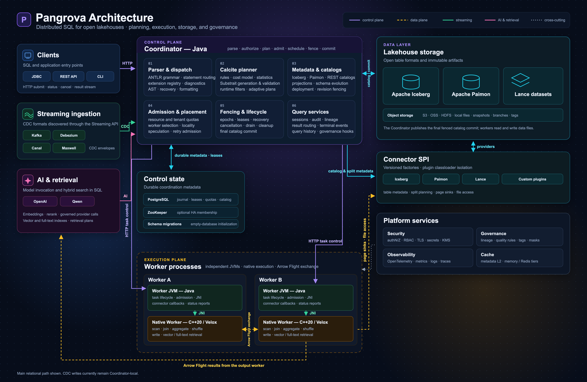

# System Overview

Pangrova combines Java coordination and Calcite planning with C++20 / Velox
execution through JNI. Iceberg and Paimon connectors provide metadata access,
scan planning, and catalog publication. Arrow supports interoperability and data
exchange; Velox owns the Native execution representation.

Read [Current Capability Status](../getting-started/capability-status.md) before
interpreting an architectural component as a completed product feature. This page
summarizes source ownership and design constraints, not production qualification
or measured performance.

## 1. Product Direction

The intended product is a distributed SQL engine over existing lakehouse assets,
with relational processing and bounded AI/retrieval paths in a shared execution
framework. The [positioning guide](../getting-started/project-positioning.md)
explains the problems, proposed customer profiles, advantages, and evidence limits.

## 2. Planning and Execution Stack

```text
SQL / API
  -> ANTLR parser and statement classification
  -> Java metadata dispatch, or Calcite relational planning
  -> canonical v2 task request containing the execution plan and bindings
  -> Worker admission and JNI
  -> C++ / Velox execution
  -> Native exchange and Output Worker result stream
```

Parser recognition alone does not establish dispatch or execution support.
See the [SQL reference](../sql-reference/index.md) for statement-specific boundaries.

## 3. Component Topology



The diagram describes the main relational execution path. When a Coordinator hosts
both streaming and query roles, the streaming scheduler disables its local pipeline and
dispatches bounded CDC ingest tasks to Workers; the Coordinator retains journal
publication and source-offset acknowledgement. A streaming-only Coordinator still uses
a Coordinator-local connector page-sink writer. Live acceptance coverage drives real Kafka
through two Worker CDC backends into one Paimon merge with an injected backend failure and a
retried exactly-once publication; process-level Worker crash qualification is still required.

Coordinator leases use JDBC by default; ZooKeeper is an optional backend.
Durable metadata/journal storage and external catalogs remain availability
dependencies. Redis, automatic Worker scaling, additional connectors, and a
particular deployment topology are not prerequisites implied by this diagram.

## 4. Execution Boundaries

### 4.1 Coordination and Data Processing

Java owns parsing, planning, authentication/authorization, admission, scheduling,
metadata operations, and the final fenced connector catalog commit.
Relational DML, including `INSERT VALUES`, follows the planner → Worker → Native
path; Workers return commit fragments rather than publishing the final catalog
transaction independently. Worker write staging includes JNI callbacks into Java
connector SDK page sinks; this is not a pure C++ physical writer claim. DDL remains
a Java metadata operation.

See [Distributed Write](distributed-writes.md) for publication, recovery ambiguity,
and partial implementation status. This is coordination/execution separation,
not a division in which C++ reads and Java performs all data writes.

### 4.2 Availability

Lease, fencing, Worker registration/heartbeat, journal, and recovery components
exist. Their presence does not guarantee uninterrupted queries or eliminate all
single points of failure. Database HA, catalog availability, object storage,
networking, client result recovery, and failure tests remain part of qualification.
See [Distributed Architecture](distributed.md) and [Deployment Planning](../deployment/planning.md).

### 4.3 Extensibility

Connector factories and SPIs separate metadata and storage integration from the
engine. Connector plugins use class-loader isolation. An SPI can precede a provider;
its existence does not establish bundled implementation, live hot reload, or
production support. See [Connector Design](connectors.md).

### 4.4 Observability

Metrics, tracing, and structured-logging components are available through their
providers and runtime wiring. Configure and exercise the chosen providers before
claiming operational coverage. See [Observability](observability.md).

The unified `pangrova-observability-api` owns both caller and extension contracts;
`observability-core` owns local event dispatch, profiling delegation and MDC helpers,
and `observability-noop` owns explicitly disabled implementations. The existing SDK
still contains OTel and transport integrations pending further separation. Unavailable
native profiling is rejected explicitly; local query events are not durable audit.

### 4.5 Control-Plane / Data-Plane Constraint

The architectural constraint places business-row processing, final aggregation,
retrieval fusion, and result streaming on Workers. The Coordinator validates
terminal metadata and exposes result endpoints. Worker JVM code supplies lifecycle,
policy, secrets, and governed provider networking; it is not a second relational engine.

This constraint is not a claim that every historical CDC, maintenance, or AI path
has completed migration. Known exceptions and missing wiring are tracked in the
[capability guide](../getting-started/capability-status.md) and subsystem documents.
Coordinator planning and metadata services still consume resources; neither
unlimited scaling nor automatic transparent result recovery is established here.

### 4.6 Canonical Protocol Mapping

| Communication path | Protocol / representation | Purpose |
|---|---|---|
| Client → Coordinator | HTTP REST | Submission, status, cancellation, endpoint discovery |
| Coordinator ↔ Worker | HTTP REST | Task control, registration, heartbeats, reports |
| Worker ↔ Worker | Arrow Flight | Data exchange; Native shuffle implementation |
| Output Worker → Client | Arrow Flight | Query results |
| Worker Java ↔ Native | Canonical v2 Protobuf; Arrow interoperability where applicable | Task bindings, lifecycle/status/reporting, typed data boundaries |

The authoritative execution definitions are in
`pangrova-protocol/src/main/proto/pangrova/protocol/v2`.
The admitted execution epoch and complete descriptor hash must match. Do not
substitute simplified documentation snippets for generated messages or invent a
Java shuffle relay from the existence of JNI interoperability methods.

Native shuffle serializes standard Arrow stream batches from Velox vectors and
serves them through Native Flight. Arrow can share buffers at specific boundaries.
IPC encoding, format conversion,
compression, Java callbacks, and network transfer still require separate accounting;
the whole query pipeline is not established as zero-copy.
See [JNI Runtime](jni-runtime.md), [Native Execution](native-execution.md), and
[Query Execution](query-execution.md).

## 5. Component Ownership

### 5.1 Core SPIs

Contracts live in the artifact that owns the domain boundary: connectors in
`pangrova-connector-api`, observability in `pangrova-observability-api`, indexing
in `pangrova-indexing-api`, AI in `pangrova-ai-api`, and admission/placement in
`pangrova-scheduler-api`'s `.api` packages. Production callers and bootstrap wiring
determine which providers are active. Not every contract is discovered through
`ServiceLoader`; `.pangrova/modules.yaml` records the registered providers.

The former central `pangrova-spi` artifact and namespace have been removed.
Indexing API owns both calling contracts and extension interfaces. Descriptor
state transitions and empirical recall estimation belong to Indexing Core;
its strategy, JDBC and planner implementation separation remains in progress.

Placement ranking runs through `WorkerSelectionStrategy` using an immutable,
current candidate set. Scheduler Core enforces health, memory, resource-pool,
capability and locality constraints; it rejects an identity outside that set.
Server discovers `WorkerSelectionStrategyFactory` implementations via Java services and selects
the configured `coordinator.query.placement-provider` (default `load-balanced`).
The builtin implementation ranks resource headroom and rotates equal scores.
It does not claim tenant CPU fairness. Specifying a pool with no eligible workers
returns no placement; it cannot fall back to a different pool.
`TenantPlacementResolver` separates tenant identity from pool identity. Server binds
it to the configured tenant authority; unknown/inactive tenants and lookup failures
are rejected. An explicitly shared deployment, or an active tenant without a pool,
uses only workers with no dedicated pool assignment. Query and durable-generation
selection use this scope before ranking. This is a placement rule, not a replacement
for admission or permission checks. Worker registration currently supplies no dedicated
pool assignment; dedicated-pool provisioning is not claimed as an implemented feature.

Use the actual source declarations and subsystem references for signatures:
[connectors](connectors.md), [streaming and maintenance](streaming.md),
[security](security.md), and [observability](observability.md).
Conceptual lifecycle or planner interfaces are not public SPIs unless present in source.

### 5.2 Protocol and Bootstrap

`pangrova-protocol` owns generated execution contracts. Coordinator bootstrap wires
statement dispatch, planner dependencies, metadata, leases, and service providers.

Protocol also owns Java Substrait version stamping/validation and its structured
error, independent of Planner conversion exceptions. Frozen Generation templates,
publication-dependent partition binding and exact partition resource budgets belong
to `pangrova-generation-workflow`. Replay consumes the authority and publication evidence
already obtained by the persistence transaction; moving these computations does not
create another transaction, authority or connection owner. Native retrieval preparation
and plan conversion share an explicit version validator: both require version metadata,
a nonempty producer and the supported major version before interpreting the plan.
Minor/patch acceptance does not replace individual capability checks. Packaged JNI
tests cover invalid-version rejection as well as compatible-version execution.
Worker bootstrap wires Native loading, admission, transport, and provider callbacks.
See the [current status table](../getting-started/capability-status.md) for default
no-op providers and absent registrations.

### 5.3 Parser

`pangrova-parser` aggregates `parser-api` and `parser-core`. API owns portable AST,
dialect, diagnostic/recovery values and the parsing/statement-extension contracts.
Core owns ANTLR, cache, builders, formatting, type syntax parsing and mutable
source locations. The generated grammar package is `core.build.antlr`; no generated
source is hand-edited. API recovery returns a partial AST and errors, while explicit
Core tooling may inspect `RecoveryParseDetails` and its invocation-local ANTLR tree.
The extension registry publishes one immutable sorted snapshot per change. Default
parser construction creates an empty registry; service discovery remains explicit,
and no production custom-statement provider is currently registered. Registration
does not invalidate existing parse-cache entries.

Some recognized statements have no executable
default path. `COPY INTO` URI loading and clustering must not be promoted to working
features based on grammar alone; dynamic-table handlers are registered only when
durable metadata publication is configured.

### 5.4 Planner

`pangrova-planner` owns Calcite integration, transformations, plan conversion,
and the SDK-free `.api` contracts for fragments, metadata, statistics, result
origin, retrieval intents, and adaptive notifications. Compiler and live fragment
implementations still reside in Core; this split does not yet complete the full
compiler API boundary.
Default dependency injection and enabled rules constrain which transformations
are usable. See [Query Optimization](query-optimization.md) and [AI Architecture](ai-native.md).

### 5.5 Native Execution

`pangrova-worker-native` owns Velox integration, Native operators, storage readers
and writers, artifact processing, exchange, memory, and result production.
Native registries are C++ integration points, not Java service-loader interfaces.

## 6. Project Structure

This is a selected ownership map, not a fixed count of Maven reactor modules.

| Area | Source roots |
|---|---|
| Shared JSON encoding | `pangrova-common` (`org.pangrova.common.json` owns Jackson configuration and canonical persistence encoding) |
| Shared contracts/configuration | `pangrova-protocol`, `pangrova-common`, `pangrova-config`, `pangrova-types`, `pangrova-batch` |
| Parsing and planning | `pangrova-parser`, `pangrova-planner` |
| Coordination and metadata | `pangrova-coordination/pangrova-coordination-control`, `pangrova-metadata/pangrova-metadata-catalog` |
| Query and durable generation contracts/runtime | `pangrova-query`, `pangrova-query`; `pangrova-generation` contains API, codec and core leaves; immutable generation values belong to Generation API, wire layouts/encoding to Codec, and storage contracts and PostgreSQL implementations live in `pangrova-persistence/pangrova-persistence-generation-api` / `pangrova-persistence-generation-postgresql`, with borrowed-connection ports in `pangrova-persistence/pangrova-persistence-jdbc-api` (authority/publication adapters still reside in Metadata) |
| Execution | `pangrova-worker`, `pangrova-worker-native`, `pangrova-shuffle`, `pangrova-transport` |
| Connectors | `pangrova-connector/pangrova-connector-api` (API/SPI), `pangrova-connector/pangrova-connector-runtime`, `pangrova-connector-{iceberg,paimon,lance}` providers |
| Platform services | Security API/Core, PostgreSQL/Tenant-memory persistence, and authentication/policy/secret/KMS Providers, `pangrova-operations`, `pangrova-governance`, `pangrova-streaming`, `pangrova-observability`, `pangrova-indexing` |
| Server, clients and packaging | `pangrova-server/pangrova-server-coordinator`, `pangrova-client`, `pangrova-standalone`, `pangrova-native-bundle` |
| Validation | `pangrova-testing` and module-local test sources |
| Documentation | `docs/`, `website/`; open work is tracked in the public roadmap |

## 7. Module Dependencies

Use module POMs for actual compile/runtime dependencies. Architecture policy defines
permitted access across modules and the Java/Native boundary; a dependency graph
sketch is not a substitute for those rules. Coordinator production dependencies
exclude the Worker JAR and JNI. The shared result address lives in Common.
Client HTTP owns REST requests and authentication. Transport Client fetches and
decodes result batches, and Transport Flight serves results. Execution Core
retains task dispatch outcomes with their exact Protocol shuffle descriptors. Scheduler-facing Query/Task adapters borrow
the authoritative registries and are explicitly composed by Server Coordinator.

## 8. Development Policy

### 8.1 Package Naming

Java packages follow the owning module under `org.pangrova`. Check source packages
rather than copying abbreviated names from architecture sketches.

### 8.2 Contracts

Before changing an SPI, inspect callers, implementations, bootstrap wiring, and tests.
Never hand-edit generated protocol sources.

### 8.3 Code Structure

The authoritative code and validation policy lives in
repository rules.
The [Developer Guide](../contributing/developer-guide.md) provides practical entry points;
this overview does not duplicate or override repository policy.

## 9. Dependency Management

Use the parent POM
and module POMs for pinned Java versions/dependencies, and the Native build configuration
for Velox and C++ dependencies. Baseline development uses JDK 17, Maven 3.9+, CMake,
and a C++20 compiler. A Native library or matching packaged Native bundle is required
for Worker execution; a Java-only build is not a substitute.


Query contracts are now owned by `pangrova-query`'s `.api` packages; QueryState
and StageState are the single domain state values. Query Core owns the migrated
stage state transitions and the audit/profile services, while backend selection
belongs to Server Coordinator. Query API does not depend on the central SPI,
Protocol, Planner, or any backend. QueryManager now runs in `pangrova-query`'s
runtime package behind explicit ports; the `PlanFragment`-bound stage binder and
split seam remain in Coordinator. Actual support and follow-up items are governed
by the [Roadmap](../getting-started/roadmap.md) and current tests.

Connector contracts are now owned exclusively by the `.api` packages of
`pangrova-connector-api`, whose dependencies are only Common, Types, and Batch
API. Write-commit journal/outbox and other Query storage ports belong to
`pangrova-persistence-query-api`; the same-connection execution fence belongs to
`pangrova-persistence-jdbc-api`. Existing persistence contracts and backends for
File, Table, Query, Coordination, Security, and Generation are split by domain;
the generic Persistence API/JDBC artifacts have been retired. Generation's
same-connection input, commit, authority, and fence ports belong exclusively to
JDBC API and do not enter the ordinary storage contracts. Backend separation for
Metadata and other domains, cross-domain workflows, and backend isolation for all
Core modules are still incomplete. Connector Runtime owns fixed split pagination
and CUSTOM_BINARY encoding and no longer depends on the central SPI. The
deployment, table identity, state, and snapshot values of `ManagedSourceCatalog`
were split out of nested types into Connector API; existing authority, fencing,
and transaction ownership are unchanged. Factory version/role negotiation and a
general Plugin Runtime remain to be implemented.
