# Pangrova — Query Execution

> **Accuracy scope.** This is a living architecture document. Content explicitly marked
> draft, proposed, planned, phase, target, or remaining work is design intent rather
> than implemented support. For current behavior, code wiring and end-to-end tests
> take precedence.

> **Summary.** The end-to-end query lifecycle — parse, optimize, Substrait conversion, native execution — plus the REST API, the exchange protocol, and the write path.

The diagrams and interface sketches below are explanatory, not generated wire/API
contracts or evidence that all statement forms are supported. Native Flight serves
shuffle and results; the Worker JVM is not a result/shuffle batch relay. The canonical
v2 definitions and current JNI exports take precedence over historical snippets.
Read [Current Capability Status](../getting-started/capability-status.md) for default
no-op providers, absent task registration, and qualification limits.

## Query session ownership

`pangrova-query` owns `api.session.QuerySession`. The immutable session borrows
its exact issued `ConnectorQueryAuthority`; copying a session never creates,
replaces or closes that lifetime. Tenant/property enrichment retains source
snapshots, incremental ranges and the trusted internal-materialization marker.
Client properties cannot set those trusted fields. SPI session conversion does
not authenticate a caller or derive a trusted tenant from a name.

Execution correlation is an Observability API snapshot. Entry services receive an
explicit `ExecutionTraceContextFactory`; Server selects the OpenTelemetry factory.
Capture preserves a valid current parent or creates a distinct unsampled root even
when telemetry export is disabled. Asynchronous execution activates/closes its
scope on the execution thread; no originating thread scope is retained. Query API
loads without the SDK, Coordinator, Worker, Client DTOs or provider implementations.
QueryManager and its lifecycle orchestration now live in `pangrova-query`'s
runtime package behind explicit execution, admission, audit, journal and tenant
ports; the Coordinator supplies the adapters. Query API still loads without the
SDK, Coordinator, Worker, Client DTOs or provider implementations.

## 1. End-to-End Query Flow

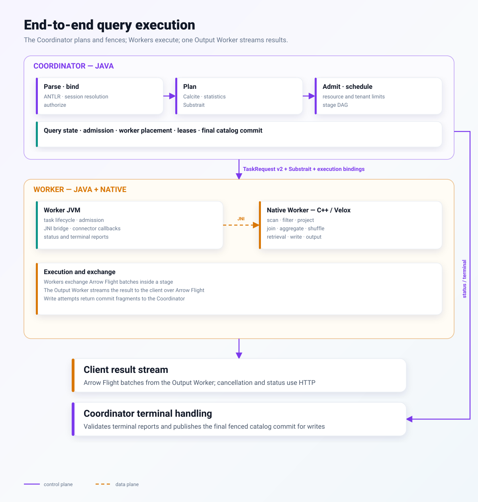

Note: the diagram above shows only the result path. Data from the Compute Workers is aggregated to the Output Worker via Arrow Flight Shuffle, and the Output Worker then streams the results back to the Client.

### Live split enumeration and published reads

`QuerySplit` in `pangrova-query` owns the immutable encoded split plus cache-affinity
locations. Enumeration and dispatch consume this value without depending on a nested
class of the catalog fetch implementation. It owns no connector session or buffer lease and does not grant publication or data-access
authority. Execution still validates the encoded connector payload.

The stage binding layer calls the typed `StageSplitSource` seam. Catalog enumeration
and index-aware enumeration are implementations; the latter owns pruning, not
Generation service discovery. A provider failure, cancellation or authorization
rejection propagates to the query. A real table scan without its configured catalog
registry fails; a source-free plan can legitimately have no connector splits.
Whole-table OVERWRITE/UPDATE enumeration keeps its unpruned path.

`QueryBootstrap` creates the published-artifact reader and obtains the generated-value
reader from `QueryMaterializationFactory`. It passes both readers explicitly into
Query/DAG construction. Dispatch borrows the readers independently of whether index
pruning is enabled. Storage connections, current authorization, transaction fencing
and publication facts retain their existing owners.

`StageSplitSource` and the stage binder still reside in the existing Coordinator
artifact during this migration: their signatures include live Planner and session
types. Only the closed `QuerySplit` value lives in Query API; the remaining
Query/Planner contracts must be separated before moving the whole execution family.
Index descriptor caching, mapping persistence orchestration and evaluation metrics
now belong to Indexing Core; the catalog-scoped connector access adapter is separate
from DDL command handling.

## 2. Calcite Integration

### AST package ownership

`org.pangrova.parser.api.ast` owns the shared expression/statement contracts, type
discriminators and query clauses. Built-in nodes declare their own `type()`;
the base interfaces do not import or register concrete statement/expression
classes. `ast.expression` and the `ast.statement` capability packages therefore
depend on shared AST contracts in one direction. `RerankClause` is a query clause
in `ast`, alongside `Query` and `WindowSpec`, rather than a concrete expression.

The `AlterTableStatement`, `ShowMetadataStatement`, grouping and select-item
sealed families retain their closed subtype sets. Parser extension statements
can still implement `Statement`; an extension without a built-in discriminator
continues to fail explicitly when `type()` is requested. Built-in kinds also cover
storage-profile DDL, table-control inspection and
subscript expressions. This discriminator does not grant execution support or
replace Planner validation.

### 2.1 The Role of Calcite in Pangrova

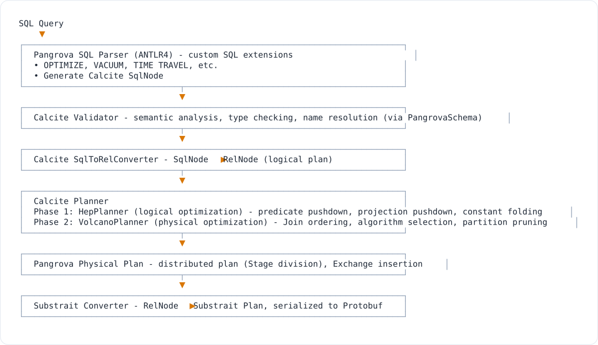

**Substrait serialization boundary**: After the Plan Fragmenter completes Stage division on the Coordinator, the Substrait Converter serializes the Calcite RelNode subtree of each Stage into a Substrait Plan (Protobuf bytes). The serialized bytes are carried as `TaskDescriptor.substraitPlan` (base64-encoded) and dispatched to the Worker over HTTP REST. Upon receipt, the Worker passes the bytes directly to the Native layer (`TaskRequest.substrait_plan`) without re-serialization.

The converter materializes Calcite's validated numeric result type in the function
arguments. When an arithmetic expression has a floating result and a DECIMAL
operand, it emits an explicit DECIMAL-to-floating cast before serializing the
function call. Native binding then checks the exact argument and result signature;
it does not guess an implicit conversion. Exact DECIMAL arithmetic retains its
DECIMAL arguments and precision/scale contract.

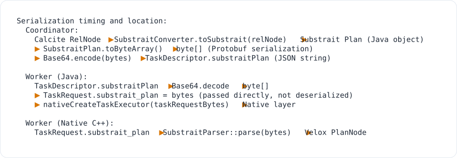

### 2.2 Schema Hierarchy

Planner's `MetadataSchemaBuilder` constructs a Calcite root for the authenticated
compilation. `MetadataService` enumerates visible catalogs. `CatalogReadAccess`
supplies each borrowed catalog handle and the table ownership checks. Server wires
the live registry. The planner package has no compile dependency on Coordinator
or the Metadata implementation.

`LazyMetadataSchema` uses a direct connector lookup for a named table and lists
tables for explicit enumeration. Catalog failures propagate as metadata errors.
Each compilation owns one `PlanningReadBindings` instance shared by Calcite table
declarations and cost statistics. It verifies table identity, the selected snapshot
or incremental range, and retained query authority. A reused binding is checked
against the current table owner. `CatalogStatisticsProvider` can use statistics
from ANALYZE while the stored version matches. Worker receives the bound execution
plan; Calcite schemas remain in the coordinator process.

### 2.3 Custom Optimization Rules

Equality-based join algorithms require at least one paired equality key.
`HashJoinRule`, `BroadcastJoinRule` and `SortMergeJoinRule` check this before
considering cost or input size. Cross joins and pure theta joins retain the
general join representation for Native execution. CBO join reassociation matches
logical joins only: changing the inputs or predicate of an already selected
physical join would invalidate its algorithm and required exchanges. Stage
serialization continues to reject equality joins with empty keys and broadcast
joins without a broadcast exchange.

Production fragment validation captures the union of current active Workers'
validated relation, expression and function inventories. The standalone compiler's
conservative name defaults do not represent cluster support. This coarse check
admits a name available on an eligible Worker; exact kind/URN/signature, build
identity and placement admission still run for the selected execution target.
An empty or invalid Worker inventory fails instead of substituting defaults.

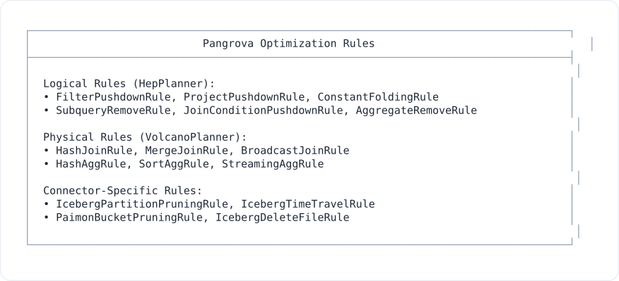

### 2.4 Cost Model

```java
public class PangrovaCostModel implements RelOptCostFactory {
    private static final double CPU_COST_PER_ROW = 1.0;
    private static final double IO_COST_PER_BYTE = 10.0;
    private static final double NETWORK_COST_PER_BYTE = 100.0;

    // TableScan cost: I/O + CPU, accounts for partition pruning
    // Join cost: distinguishes Broadcast/Hash/Merge, accounts for Shuffle network overhead
    // Aggregation cost: distinguishes Hash/Sort, accounts for memory footprint
}
```

## 3. Distributed Execution Plan

### 3.1 Stage Division Example

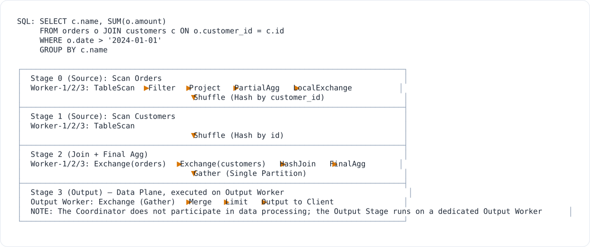

Correlated subqueries that remain as Calcite's
`org.apache.calcite.rel.logical.LogicalCorrelate` after
optimization execute in one task until their outer-row binding is converted.
Splitting their right-side input into an upstream stage would separate the
correlated filter from that binding. Native UNNEST retains its separate
single-input conversion and can still use the ordinary stage layout.
The Substrait conversion rewrites supported equality-correlated scalar
aggregates into a grouped aggregate and left join, preserving computed
projections such as `AVG`'s sum/count division. This correctness path does not
provide distributed parallelism for those queries; distributed decorrelation
before fragmentation remains necessary for scalable execution.
For supported equality-correlated existence shapes, the filter becomes an
explicit semi/anti join condition. A constant-grouped existence marker is
reconstructed after the semi join when the parent plan references it. Other
correlated forms fail explicitly instead of emitting an unbound cross join.
For scalar `COUNT`, the left join restores zero when the grouped side has no
matching row, before evaluating computed projections such as `COUNT(*) + 1`.
LATERAL `COUNT` is decorrelated by Calcite with an explicit `CASE ... ELSE 0`; its
declared non-null result type is preserved across stage exchange schemas.

### 3.2 Exchange Types

Live query fragmentation caps exchange partition cohorts by the schedulable
worker count and the per-worker task limit before assigning partition IDs.
This keeps the plan's exchange identity aligned with dispatch capacity; a
later dispatcher cannot safely shrink an already allocated cohort.
For a bound table scan, source-stage parallelism uses the larger of Calcite's
estimated scan bytes and the selected connector snapshot's independently
scannable source work units, subject to the cluster parallelism cap. Iceberg
publishes its selected snapshot's data-file count as this work-unit estimate;
connectors without trustworthy source-unit metadata report it as unknown and
retain byte-based planning. This keeps small, highly compressed files from
collapsing a multi-file scan into one source task while the downstream exchange
cohort remains fixed before dispatch.

| Exchange Type | Description | Use Case |
|--------------|------|----------|
| GATHER | All data aggregated to a single node | Final output, ORDER BY |
| REPARTITION | Repartition by Key Hash | JOIN, GROUP BY |
| REPLICATE | Broadcast to all nodes | Small-table Broadcast Join |
| ROUND_ROBIN | Round-robin distribution | Load balancing |

#### 3.2.1 Data Serialization Format Selection

The implemented shuffle and result paths use Flight as a transport but do not
share an identical payload format. The following table separates these paths
from other storage and JNI interfaces:

| Transfer Scenario | Serialization Format | Zero-copy | Note |
|----------|-----------|--------|------|
| Worker-to-Worker Shuffle (Native Flight) | Velox PrestoVectorSerde page in one Arrow binary cell | ✗ | Native producer callback → serialized shuffle queue → Flight DoGet → Native ExchangeSource; no per-batch Java/JNI hop |
| Output Worker→Client (Flight) | Arrow IPC RecordBatch where supported | ✗ | Result path is separate from the shuffle page format |
| Native→Java columnar bridge | Arrow C Data Interface | Potentially | Interface exists, but is not the current Worker-to-Worker shuffle path |
| RAM Cache storage | Component-specific | — | Not the shuffle wire contract |
| Velox operator spill | Velox-managed | — | Not an Arrow IPC shuffle persistence guarantee |
| Shuffle remote persistence | Not a current recovery guarantee | — | Do not assume producer-loss recovery from an S3 Arrow IPC file |


The Native Flight server wraps each serialized shuffle page as the value of a
single Arrow binary cell; the consumer extracts and deserializes that page into
Velox. Flight's Arrow IPC framing must not be confused with the shuffle
payload's PrestoVectorSerde format.

The current Arrow Flight reader exposes synchronous `Next()` calls. Native
exchange reads therefore run on a dedicated blocking-I/O CPU pool; Flight
long-poll timers and completion continuations run on separate event-base
threads. A blocked upstream stream must not occupy the event base that wakes
other exchange sources. The blocking pool is drained before the timer pool
during runtime shutdown, after task cancellation closes the streams.

At the Velox-to-Arrow IPC boundary, the exported C Data array's `null_count`
is recomputed from its validity bitmap, including nested children. Velox
expression results can retain a cached count from an earlier nullable input;
the wire metadata must describe the exported bitmap before Arrow imports the
record batch.

Planner serialization keeps Substrait join keys in the current `keys` field.
The Java SDK may also emit deprecated `left_keys` and `right_keys` for an
equijoin; the serializer removes those duplicate fields only when each entry
matches its current key. Native rejects plans that still contain deprecated
join key lists.

For a join with an ON predicate that contains both equijoin keys and residual
conditions, the planner serializes the complete predicate inside `JoinRel`.
The native join evaluates the residual while matching rows. A filter placed
above a LEFT or RIGHT join would instead remove the null-padded row and change
the outer join into an inner join for that row. Physical hash, broadcast, and
merge join rules require at least one equijoin key; a non-equijoin predicate
continues through the supported logical join conversion path.

Format conversion paths:
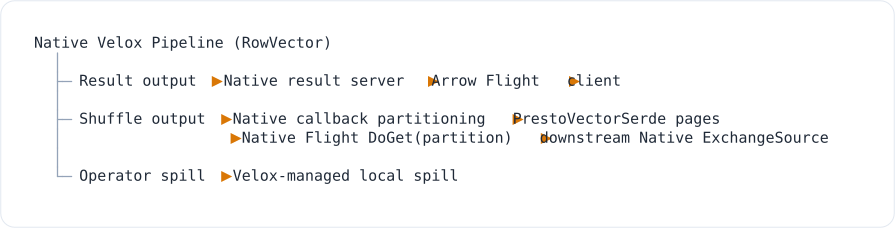

Key performance points:
- The Arrow C Data bridge does not make the current result or shuffle network path zero-copy
- Worker-to-Worker shuffle uses Native Arrow Flight and serialized pages; it does not cross JNI per batch
- The downstream Native ExchangeSource reads the Flight stream directly into Velox

### 3.3 Output Task Interaction Protocol (the Coordinator never participates in data processing)

The Coordinator executes no data-processing operators. All Output Stages (including Gather, Merge, Limit, and Final Aggregation) run on a dedicated Output Worker. The Coordinator acts purely as a proxy, redirecting the Client to the Output Worker's Arrow Flight endpoint.

#### 3.3.1 Design Goals and Constraints

**Core principles**

| Principle | Description |
|------|------|
| Coordinator zero data processing | The Coordinator only performs scheduling and state management; it never touches any RecordBatch |
| Output Task = ordinary Task | The Output Task's Substrait Plan contains Exchange(Gather) + Final operators, but no TableScan |
| Unidirectional data flow | Compute Worker → Output Worker → Client; there is no reverse data flow |
| End-to-end backpressure propagation | Client consumes slowly → Output Worker pauses → Compute Worker pauses |
| Idempotent retries | All scheduling operations are idempotent, supporting safe retries |

**Role definitions**

| Role | Responsibilities | What it does NOT do |
|------|------|----------|
| Coordinator | Generate the Stage DAG, schedule Tasks, monitor state, fault-tolerance recovery | Does not process data, does not cache RecordBatch |
| Compute Worker | Execute TableScan + compute operators, expose Shuffle data via Arrow Flight | Is unaware of the Client's existence |
| Output Worker | Execute Exchange(Gather) + Final operators, expose a Result Endpoint to the Client | Architecturally identical to an ordinary Worker |
| Client | Submit queries, poll state, pull results | Does not interact directly with Compute Workers |

#### 3.3.2 Stage Split Example

Using `SELECT * FROM orders ORDER BY amount LIMIT 10` as an example:

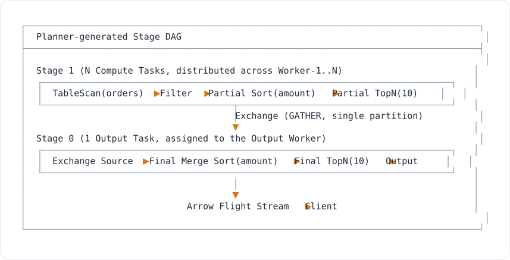

A more complex example — `SELECT c.name, SUM(o.amount) FROM orders o JOIN customers c ON o.cid = c.id GROUP BY c.name LIMIT 100`:

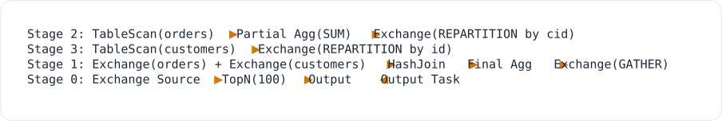

#### 3.3.3 REST API Definitions

> Note: this section is the authoritative specification of the Control Plane (REST/JSON). The Protobuf snippets that appear here serve only as design notes for the internal Java↔Native path or for the `.proto` definitions in `pangrova-protocol`. The final network API (Coordinator ↔ Worker) is JSON/HTTP; all Protobuf definitions should be kept in sync with the `pangrova-protocol` repository.

**Service overview**

Coordinator exposes (HTTP/REST):
- `POST /v1/query/submit` SubmitQuery
- `GET /v1/query/{queryId}/state` GetQueryState
- `POST /v1/query/{queryId}/cancel` CancelQuery

Worker exposes (HTTP/REST):
- `POST /v1/task` SubmitTask
- `DELETE /v1/task/{taskId}` CancelTask
- `POST /v1/task/{taskId}/dynamic-filter` InjectDynamicFilter
- `POST /v1/task/upstream-commit` NotifyUpstreamCommit
- `GET /v1/health` HealthCheck

Worker -> Coordinator (HTTP/REST):
- `POST /v1/task/status-report` ReportTaskStatus

The Coordinator accepts a status report only while it retains the matching
issued TaskRequest and attempt identity. A report for a merely registered task
without an issued request is rejected before sequence reservation. An exact
report whose publication already completed may be reacknowledged after a lost
HTTP response without repeating publication. Speculative loser cleanup reads
and retires the retained execution-drain receipt under one lock, so concurrent
compaction cannot turn the same receipt into a false mismatch; caller-supplied
receipts still require exact equality.
For durable artifact producers, a `FINISHED` report may commit its page only
after the corresponding Coordinator task has entered `SCHEDULED` or `RUNNING`.
Preparing an issued identity alone cannot commit the page. Exact retransmission
is acknowledged after publication; a new terminal sequence after completion
cannot commit the page again.

Durable artifact graph and exchange evidence values are independent of JSON and
JDBC. `GenerationStageGraphCodec` and `GenerationExchangeEvidenceCodec` own their
canonical persistence bytes and SHA-256 identities. Both writing and replay
limit the complete encoded envelope to 16 MiB, including JSON escaping and
Base64 expansion. Encoding stops before buffering excess bytes; oversized
evidence cannot be persisted and later become unreadable. The submission
factory validates graph size before returning a dispatch specification, and
all build insertion paths validate again before SQL mutations, including
caller-owned transactions. Domain record construction alone is not persistence
admission. Stored graph format 2, immutable bindings, owner/fence validation
and canonical replay comparison remain unchanged.

Generation values live in `pangrova-generation-api`; they do not own serialization. Canonical graph,
exchange and source-split codecs live in `pangrova-generation-codec`. Submission construction,
publication routing and generic immutable read binding live in `pangrova-generation-workflow` under
`org.pangrova.generation`. The generic reader has no Query retrieval intent or ANN eligibility
branch; query-side retrieval planning selects the capability and handles permitted exact-plan
fallback. Task-local materialization still verifies the exact source object coverage and checksum.

AI Control owns the catalog export request and transaction adapter, exposed by
`ai.control.assembly.AiInfrastructureStores` as a catalog-export port. Process assembly supplies
the real job-submission transaction provider explicitly; the AI factory has no default Metadata
lookup. It inserts the generic build and Feature View/Training Dataset association on one
connection, and rolls back both on failure. Generic job/stage/exchange ports currently belong to
Persistence API; actual PostgreSQL implementations belong to Persistence JDBC, with injected
authority, execution fence, current roles and publication candidate ports. Their target per-domain
API/provider split remains in progress. Core depends on neither the JDBC provider nor Coordinator.
Current-authority and domain-publication adapters still remain
in Metadata pending their owner migration. This does not yet remove the startup
dependency on Indexing.

Materialization lifecycle writes and reader-pin acquisition share the
materialization JDBC transaction helper. Pin acquisition still locks the generation
for share and checks its readable state on the same connection as the upsert.
Materialization and Shuffle transaction owners roll back SQL, runtime, and Error
failures, retain rollback exceptions as suppressed causes, and close their owned
connections without restoring auto-commit after a failure. This prevents failure
cleanup from committing a partial object, pin, or shuffle mutation; it does not
change publication authority, lock order, or caller-owned transaction boundaries.

Arrow Flight (data plane):
- Shuffle data pull + Client result pull (gRPC streaming)

**Query API (Coordinator REST)**

Submit query `POST /v1/query/submit`

Request:
```json
{
    "sessionId": "session-123",
    "sql": "SELECT * FROM orders",
    "sessionProperties": {"catalog": "iceberg"},
    "options": {
        "maxExecutionTimeMs": 1800000,
        "maxMemoryBytes": 34359738368,
        "resourceGroup": "interactive",
        "explainOnly": false
    }
}
```

Response:
```json
{
    "queryId": "query-20260206-001",
    "state": "RUNNING",
    "resultEndpoint": {
        "host": "worker-3",
        "port": 8082,
        "ticket": "query-20260206-001",
        "protocol": "arrow-flight"
    }
}
```

Every relational query returns the direct Output Worker `resultEndpoint`. This
includes tableless constants, folded expressions, `LIMIT 0`, and connector
system-table `SELECT` statements: none may be evaluated, buffered, cached, or
proxied by the Coordinator. Bounded DDL/SHOW/DML acknowledgement rows are the
only exception and use an isolated control-plane result transport.


> **INSERT/UPDATE/DELETE Response**: For DML statements, the response carries a `resultEndpoint` pointing to the Coordinator Flight server. The Client retrieves the affected-row-count result via Arrow Flight `doGet()`, same as any other query.
>
> ```json
> {
>     "queryId": "query-20260206-002",
>     "state": "FINISHED",
>     "resultEndpoint": {
>         "host": "coordinator-1",
>         "port": 8083,
>         "ticket": "query-20260206-002",
>         "protocol": "arrow-flight"
>     }
> }
> ```
>
> For long-running DML (large INSERT INTO ... SELECT), the initial response returns `state: "RUNNING"` with `resultEndpoint` pointing to the Output Worker. The Client polls `GET /v1/query/{queryId}/state` until `state: "FINISHED"`, then calls Flight `doGet()` to retrieve the final result.

Query state `GET /v1/query/{queryId}/state`

Response:
```json
{
    "queryId": "query-20260206-001",
    "state": "RUNNING",
    "resultEndpoint": {"host": "worker-3", "port": 8082, "ticket": "query-20260206-001"},
    "error": null,
    "stats": {
        "elapsedTimeMs": 2300,
        "processedRows": 1000000,
        "processedBytes": 128000000
    }
}
```

Cancel query `POST /v1/query/{queryId}/cancel`

Response:
```json
{ "queryId": "query-20260206-001", "state": "CANCELLED" }
```

**Task API (Worker REST)**

Submit Task `POST /v1/task`


Request: the body is a `SubmitTaskRequest` transport envelope with exactly one
field, `canonical_task_request`. Its value is the Base64 encoding of one complete
canonical v2 `TaskRequest`. The Worker validates and parses those bytes but does
not reconstruct protocol state from REST fields.

Response:
```json
{
    "accepted": true,
    "reject_reason": null,
    "task_id": "task-1",
    "result_endpoint": {
        "host": "worker-3",
        "port": 8082,
        "ticket": "task-1",
        "protocol": "arrow-flight"
    },
    "shuffle_endpoint": null
}
```


| Scenario | HTTP Status | `accepted` | Description |
|----------|-------------|------------|-------------|
| Task accepted | 200 OK | `true` | Canonical admission and task creation succeeded |
| Missing, malformed, or non-canonical request | 400 Bad Request | — | REST decoding or request validation rejects the body |
| Stale control/owner fence | 409 Conflict | `false` | Attempt cannot execute under the active ownership epoch |
| Control plane not ready | 503 Service Unavailable | `false` | Worker has not received a usable control epoch |
| Other admission/start failure | 500 Internal Server Error | `false` | Task is not accepted; the Coordinator handles the classified dispatch failure |

Cancel Task `DELETE /v1/task/{taskId}`

Exchange sources are complete, fenced task-admission bindings carried by
`POST /v1/task`. There is deliberately no REST API that replaces sources for a
running task: a producer retry creates a new downstream attempt, and the old
attempt is fenced. This prevents mixing rows from different attempts.

**Historical expanded TaskDescriptor design (not a production API)**

The following expanded shape is retained only to explain older diagrams in this
document. It is not accepted by `POST /v1/task`; all fields shown below now live
inside the canonical v2 protobuf named above.


```json
{
    "taskId": "task-1",
    "queryId": "query-20260206-001",
    "stageId": 0,
    "partitionId": 0,
    "taskType": "COMPUTE",
    "substraitPlan": "<base64-encoded Substrait Plan Protobuf bytes>",
    "splits": [
        "<base64-encoded SplitInfo Protobuf bytes>",
        "<base64-encoded SplitInfo Protobuf bytes>"
    ],
    "exchangeSources": [
        {
            "plan_node_id": "exchange-input-ex-1",
            "exchange_id": "ex-1",
            "expected_source_partitions": 1,
            "source_task_id": "task-2",
            "source_stage_id": 1,
            "source_partition_id": 0,
            "output_partition_id": 0,
            "plan_epoch": 41,
            "attempt_id": 0,
            "fencing_token": 176093659137,
            "host": "worker-1",
            "transport_port": 8082,
            "tls_identity": "worker-1.internal",
            "signed_ticket": "<opaque-producer-issued-ticket>",
            "ticket_expires_at_epoch_ms": 1788300000000,
            "expected_rows": 0,
            "expected_bytes": 0,
            "read_mode": "BLOCKING"
        }
    ],
    "resourceLimit": {
        "maxMemoryBytes": 34359738368,
        "maxThreads": 16,
        "maxSpillBytes": 1099511627776,
        "spillDirectory": "/data/spill"
    },
    "sessionProperties": {"timezone": "UTC"},
    "outputConfig": {
        "ticket": "query-20260206-001",
        "maxBufferedBytes": 33554432,
        "maxBufferedBatches": 64,
        "clientIdleTimeoutMs": 300000
    },
    "writeConfig": null
}
```

> **Field Notes**:
> - `taskType`: One of `COMPUTE`, `OUTPUT`, `WRITE`. Coordinator sets this explicitly. If absent (legacy), Worker infers: `writeConfig != null` → WRITE; `outputConfig != null` → OUTPUT; otherwise → COMPUTE.
> - This expanded JSON is historical design context, not the production request
> schema. The actual `SubmitTaskRequest` contains one Base64-encoded canonical v2
> `TaskRequest`; its `splits` field is repeated `DataSplit`. REST does not mirror
> task identity, plan, splits, exchange, resource, security, or write fields.
> - `stageId` / `partitionId`: Passed through to `TaskRequest` Protobuf for Native-layer logging and metrics correlation. See the field mapping table in [03 §5.3](./native-execution.md).
> - `exchangeSources`: converted into typed Native `ExchangeInput` bindings before
> task start. JVM performs validation and lifecycle wiring only; Arrow batches,
> partition routing, retry isolation and merge execution remain in Native.
> - Every source has a stable logical producer identity
> `(source_stage_id, source_partition_id)` plus `(plan_epoch, attempt_id,
> fencing_token)`. Duplicate logical producers and missing fences fail closed.
> - Producer-issued tickets are opaque, partition-scoped credentials. They are
> never synthesized by the Coordinator.


**Write Task TaskDescriptor**: For INSERT/UPDATE/DELETE statements, the `writeConfig` field is populated:

```json
{
    "taskId": "write-task-1",
    "queryId": "query-20260206-002",
    "stageId": 0,
    "partitionId": 0,
    "substraitPlan": "<base64 of SELECT part>",
    "splits": ["..."],
    "exchangeSources": [],
    "resourceLimit": { "maxMemoryBytes": 34359738368 },
    "sessionProperties": {"timezone": "UTC"},
    "outputConfig": null,
    "writeConfig": {
        "targetTable": "iceberg_prod.warehouse.fact_orders",
        "writeMode": "APPEND",
        "partitionSpec": ["order_date"],
        "transactionId": "txn-20260206-001",
        "fileFormat": "PARQUET",
        "targetFileSize": 134217728
    }
}
```


**Composite Task Model**: A read-dependent write runs as a Worker task. The
Native execution/drain path and Java connector sink share the task lifecycle:

1. **Native producer**: Velox executes the SELECT plan and places RowVectors on the task's output queue.
2. **Write drain**: Native serializes each output batch to Arrow IPC and synchronously invokes the Java `NativeWriteExecutor`/`ConnectorPageSink` through JNI. `finishWithMetadata()` returns a staged connector fragment; it does not publish the catalog snapshot.
3. **Catalog publication**: The Coordinator collects fenced task fragments and calls the connector's `finishDistributedWrite()` after all required tasks succeed. See [distributed-writes.md](./distributed-writes.md) for recovery limits.

The Coordinator identifies Write Tasks by the presence of `writeConfig` in the TaskDescriptor. The `taskType` field in the Native TaskRequest Protobuf is set to `TASK_TYPE_WRITE` for these tasks.


**WriteResult Reporting**: When a Write Task completes (state=FINISHED), the TaskStatusReport includes a `writeResult` field:

```json
{
    "taskId": "write-task-1",
    "queryId": "query-20260206-002",
    "state": "FINISHED",
    "stats": {"outputRows": 50000, "outputBytes": 67108864},
    "writeResult": {
        "dataFiles": [
            {"path": "s3://bucket/warehouse/fact_orders/data/00001.parquet", "sizeBytes": 67108864, "rowCount": 50000, "partition": "order_date=2026-02-06"}
        ],
        "totalRows": 50000,
        "totalBytes": 67108864
    },
    "error": null
}
```

The Coordinator collects `writeResult` from all Write Tasks, then performs an atomic commit via the table format SDK (Iceberg `commitTransaction()` / Paimon commit). If any Write Task fails, the Coordinator aborts the transaction and triggers orphan file cleanup (see §6.5).


**Multi-Worker Write Coordination Protocol**:

1. Coordinator dispatches Write Tasks to N Workers (one per partition range or hash bucket).
2. Each Worker executes SELECT + Write phases independently, reporting `writeResult` via `TaskStatusReport`.
3. Coordinator tracks Write Task states in `QueryStateMachine`:
   - All N tasks reach `FINISHED` → collect all `dataFiles` lists → atomic commit.
   - Any task reaches `FAILED` → abort: cancel remaining tasks, mark transaction as FAILED, trigger orphan cleanup (§6.5).
   - Coordinator crash during commit → on failover, new Coordinator reads `pending_writes` from PostgreSQL, detects incomplete transaction, triggers orphan cleanup.
4. Partial success is NOT supported — the commit is all-or-nothing (Iceberg/Paimon transaction semantics).


**Write Path Backpressure**: The Native write drain synchronously invokes the
Java page sink for each IPC batch. A slow connector delays draining the bounded
output queue and backpressures the Native producer. Queue closure alone does
not authorize publication: the drain checks the producer's terminal outcome
before finalizing the staged fragment.

**TaskStatusReport (Worker -> Coordinator)**

`POST /v1/task/status-report`

The REST body projects the fenced attempt identity from the canonical v2
`TaskRequest`. Terminal reports also carry `canonical_task_report` (base64-encoded
protobuf bytes in JSON). REST state, task ID, attempt, control epoch, execution
owner, coverage, and resource usage must agree with the Coordinator's retained
request; REST fields alone are not completion evidence.
This POST has an 8 MiB HTTP body limit to carry the bounded 4 MiB canonical
report after JSON/Base64 encoding. Other task and public routes retain the
generic 1 MiB request limit.

Request:
```json
{
    "task_id": "task-1",
    "query_id": "query-20260206-001",
    "stage_id": 1,
    "partition_id": 0,
    "task_type": "COMPUTE",
    "worker_id": "worker-1",
    "state": "RUNNING",
    "attempt": {"plan_epoch": 1, "attempt_id": 0, "fencing_token": 4294967297},
    "error": null,
    "report_sequence": 7,
    "timestamp_ms": 1707300000000
}
```

Response:
```json
{
    "task_id": "task-1",
    "command": "CONTINUE"
}
```

For `FINISHED`, Native completion and a validated Native-origin `TaskReport`
are required; result-buffer readiness alone does not finish the task. For
`FAILED` or `CANCELLED`, the Worker may produce a fenced
`TASK_REPORT_ORIGIN_WORKER_RECONCILED` report when Native did not produce a
usable terminal report. That report preserves a structured Native error only
from the same attempt and Native origin; Native usage must also fit the task's
resource grant. Its zero completed work units mean no trustworthy successful
work-unit evidence was available; they do not claim that every split physically
ran and failed. A reconciled report cannot claim success. Terminal reports with
an unspecified origin, missing canonical bytes, or mismatched identity/coverage
are rejected rather than downgraded to REST-only completion.

A cancellation request first enters the Worker-only, nonterminal `CANCELLING`
state and signals Native. This local state or Native's `CANCELLED` status alone
is not a driver-join proof. The Worker releases the Native executor (whose
release call joins the driver) before returning task memory budget, entering
`CANCELLED`, and publishing its canonical terminal report. If release fails,
the task stays `CANCELLING`, the budget remains reserved, and no cancellation
completion is reported. `FINISHING` is a non-cancellable commit point reached
only after Native completion metadata has been captured; a later cancel request
receives a conflict rather than racing result publication.

For at most 4,096 splits, a Worker-reconciled report identifies each missing split.
For a larger task with zero trustworthy completed units, the v2
`CoverageReport.all_work_units_failed` flag provides bounded aggregate coverage
instead of truncating split IDs. The name denotes the absence of trusted success
evidence, not a physical failure assertion for every split. Source/snapshot and
artifact identities remain explicit: Worker admission rejects a task with more
than 4,096 distinct source/snapshot identities or more than 4,096 bound artifact
identities, because such a report cannot pass the Coordinator's coverage limit.
The planner/scheduler must partition such work across tasks; a Worker must not
silently truncate these identities.

#### 3.3.4 Arrow Flight Data-Plane Protocol

**Flight Ticket encoding**

All Arrow Flight interactions use a unified Ticket encoding:

```protobuf
// Internal structure of the Flight Ticket (serialized to bytes and placed in the Arrow Flight Ticket)
message FlightTicket {
    string query_id = 1;
    string task_id = 2;
    int32 output_partition = 3;         // Shuffle partition number
    TicketType type = 4;
}

enum TicketType {
    TICKET_TYPE_UNSPECIFIED = 0;
    TICKET_TYPE_SHUFFLE = 1;            // Shuffle data between Compute Workers
    TICKET_TYPE_RESULT = 2;             // Final result: Output Worker → Client
}
```

**Shuffle data pull (Output Worker → Compute Worker)**

```
Exchange pull flow after the Output Worker starts:

1. Parse TaskDescriptor.exchange_sources to obtain the Flight endpoints of all upstream Tasks
2. For each ExchangeSource, construct a FlightTicket:
   {query_id, source_task_id, output_partition=0 (GATHER), type=SHUFFLE}
3. Call Arrow Flight DoGet(ticket) to establish a streaming connection


> **REPARTITION Scenario**: In REPARTITION shuffle (§3.3.9), Stage N+1 Task-k pulls partition k from every Stage N task. The FlightTicket is constructed as:
> `{query_id, source_task_id=task-j, output_partition=k, type=SHUFFLE}`
> where `task-j` iterates over all Stage N tasks and `k` is the target partition assigned to the consuming task. In GATHER mode (single Output Worker), `output_partition` is always 0.
4. Receive the RecordBatch stream and feed it into the input queue of the Velox Exchange Operator
5. Once all upstream Sources complete, the Exchange Operator marks the input as finished
```

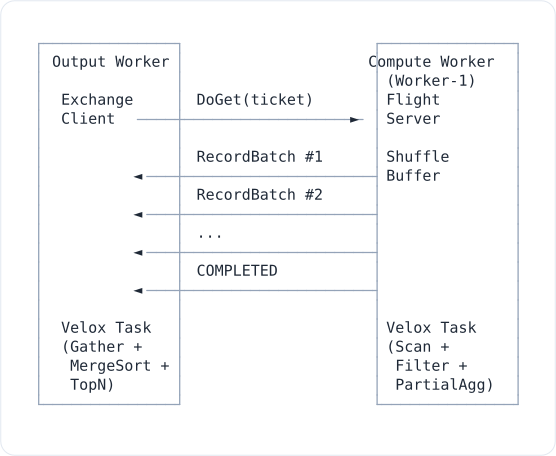

**Result pull (Client → Output Worker)**

```
Client result-pull flow:

1. The Client obtains the Output Worker address from SubmitQueryResponse.result_endpoint
2. The Client constructs a FlightTicket: {query_id, task_id="", output_partition=0, type=RESULT}
3. The Client calls GetFlightInfo(ticket) to obtain Schema information


> **Ticket Conversion Rule**: The `resultEndpoint.ticket` string returned by the REST API (e.g., `"query-20260206-001"`) maps directly to `FlightTicket.query_id`. The Client constructs the full FlightTicket Protobuf as: `{query_id = resultEndpoint.ticket, task_id = "", output_partition = 0, type = RESULT}`, serializes it to bytes, and passes it as the Arrow Flight `Ticket` in DoGet/GetFlightInfo calls.
4. The Client calls DoGet(ticket) to establish a streaming connection
5. The Output Worker reads RecordBatches from the Output Operator of the Velox Pipeline
6. Sends them batch by batch to the Client until all data is sent
7. Sends a COMPLETED signal, and the Client closes the connection
```

**Flight Server implementation notes**

```java
/**
 * The Arrow Flight Server on the Worker, serving both Shuffle and Result requests
 */
public class PangrovaFlightProducer extends NoOpFlightProducer {

    private final ExchangeManager exchangeManager;
    private final OutputBufferManager outputBufferManager;

    @Override
    public FlightInfo getFlightInfo(CallContext context, FlightDescriptor descriptor) {
        FlightTicket ticket = FlightTicket.parseFrom(descriptor.getCommand());

        switch (ticket.getType()) {
            case TICKET_TYPE_SHUFFLE:
                return getShuffleFlightInfo(ticket);
            case TICKET_TYPE_RESULT:
                return getResultFlightInfo(ticket);
            default:
                throw new FlightRuntimeException(
                    CallStatus.INVALID_ARGUMENT.withDescription("Unknown ticket type"));
        }
    }

    @Override
    public void getStream(CallContext context, Ticket ticket,
                          ServerStreamListener listener) {
        FlightTicket flightTicket = FlightTicket.parseFrom(ticket.getBytes());

        switch (flightTicket.getType()) {
            case TICKET_TYPE_SHUFFLE:
                streamShuffleData(flightTicket, listener);
                break;
            case TICKET_TYPE_RESULT:
                streamResultData(flightTicket, listener);
                break;
        }
    }
}
```

#### 3.3.5 Full Interaction Timeline

**Happy Path**

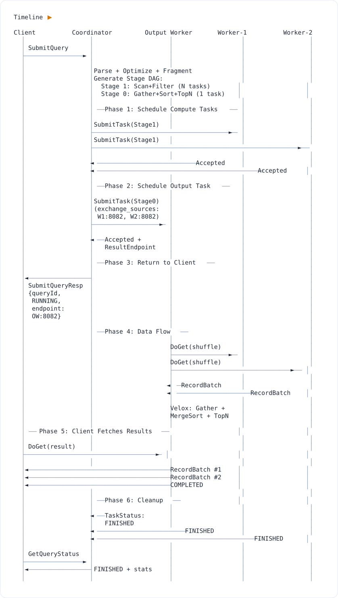

**Scheduling timing constraints**

| Constraint | Description | Rationale |
|------|------|------|
| Compute Tasks scheduled before Output Task | The Coordinator must schedule Stage 1 before Stage 0 | The Output Task needs to know the Flight endpoints of upstream Tasks |
| Return to Client only after Output Task is scheduled | SubmitQueryResponse must include resultEndpoint | The Client needs to know where to pull results |
| Client may connect to the Output Worker before data is ready | The Output Worker's Flight Server accepts connections as soon as the Task starts | DoGet blocks and waits for the first RecordBatch |
| Compute Tasks may produce data before the Output Worker connects | The Shuffle Buffer caches data, waiting for downstream to pull | Decouples upstream/downstream startup ordering |

**State machines**

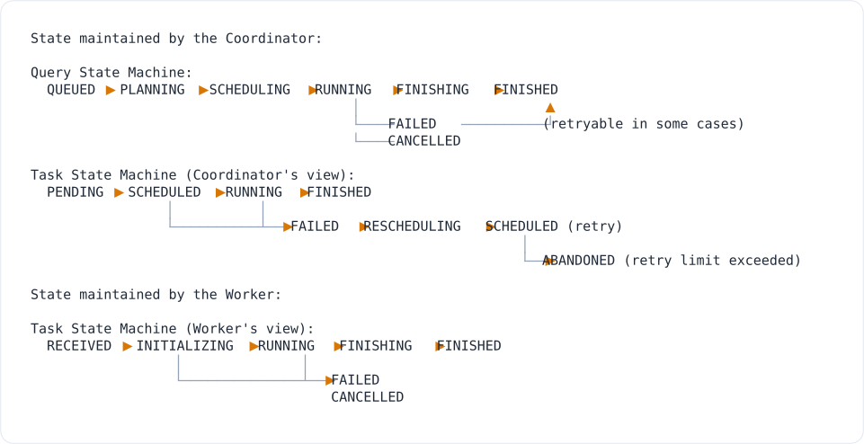

State transition rules:

| Current State | Event | New State | Action |
|----------|------|--------|------|
| QUEUED | Queue timeout or insufficient resources | FAILED | Notify Client that the query failed |
| QUEUED | Client cancels | CANCELLED | Remove from queue |
| PLANNING | SQL syntax error / insufficient permissions / table does not exist | FAILED | Notify Client that the query failed |
| PLANNING | Client cancels | CANCELLED | Abort planning |
| SCHEDULING | No available Worker | FAILED | Notify Client that the query failed |
| SCHEDULING | Client cancels | CANCELLED | Cancel already-scheduled Tasks |
| SCHEDULING | All Tasks scheduled successfully | RUNNING | Begin monitoring Task states |
| RUNNING | All Tasks FINISHED | FINISHING | Wait for the Client to finish pulling |
| RUNNING | Any Task FAILED (retryable) | RUNNING | Reschedule the failed Task |
| RUNNING | Any Task FAILED (non-retryable) | FAILED | Cancel all Tasks, notify Client |
| FINISHING | Client finished pulling or timed out | FINISHED | Release all Task resources |
| RUNNING | Client cancels | CANCELLED | Cancel all Tasks |


#### 3.3.6 Exception-Scenario Interaction Timelines

**Compute Task failure → reschedule**

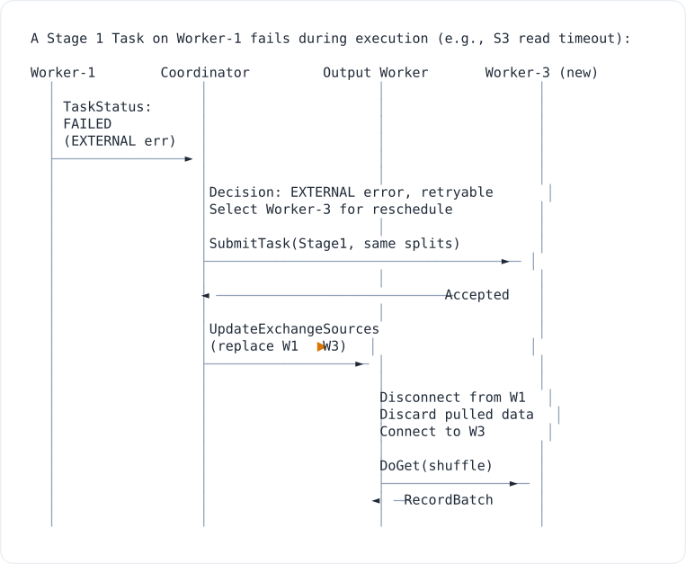

Key decisions:
- After the Output Worker receives UpdateExchangeSources, it must discard all already-pulled data and restart
- Reason: an upstream Task reschedule means the data must be recomputed; partial results cannot be reused
- The Velox Task must reset: destroy the current Task and create a new one with the same Plan

**Output Worker crash → reschedule**

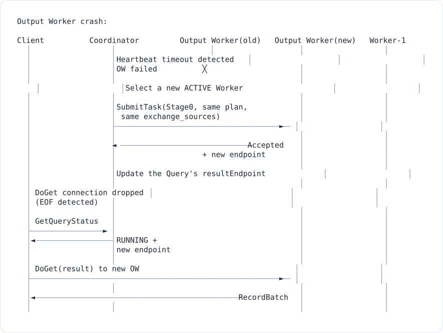

Key decisions:
- Upstream Compute Tasks are unaffected and keep running (the Shuffle Buffer retains data)
- The new Output Worker re-pulls all data from the upstream Tasks
- After the Client SDK detects the endpoint change via GetQueryStatus, it reconnects automatically
- The Client receives data from the beginning (resumable transfer is not supported, because the Output Task is stateful — MergeSort/TopN require the full dataset)


**Shuffle Buffer Retention Policy**: When the Output Worker crashes, the Shuffle Buffer on Compute Workers follows these rules:

| Scenario | Compute Task State | Shuffle Buffer Behavior |
|----------|-------------------|------------------------|
| Compute Task still RUNNING | RUNNING | Buffer continues to fill; bounded queue applies backpressure if full. Compute Worker pipeline yields until new Output Worker connects and drains. |
| Compute Task FINISHED, buffer not yet drained | FINISHED | Buffer data retained until all downstream Tasks confirm consumption OR retention timeout expires (default: `shuffle.retention-timeout = 5m`). |
| Compute Task FINISHED, retention timeout expired | FINISHED | Buffer released. New Output Worker must trigger Compute Task re-scheduling via Coordinator. |

If the new Output Worker connects before the retention timeout, it resumes pulling from the existing Shuffle Buffer (data is replayed from the beginning of each partition). If the buffer has been released, the Coordinator re-schedules the affected Compute Tasks with the same splits.

**Client disconnect → timeout cleanup**

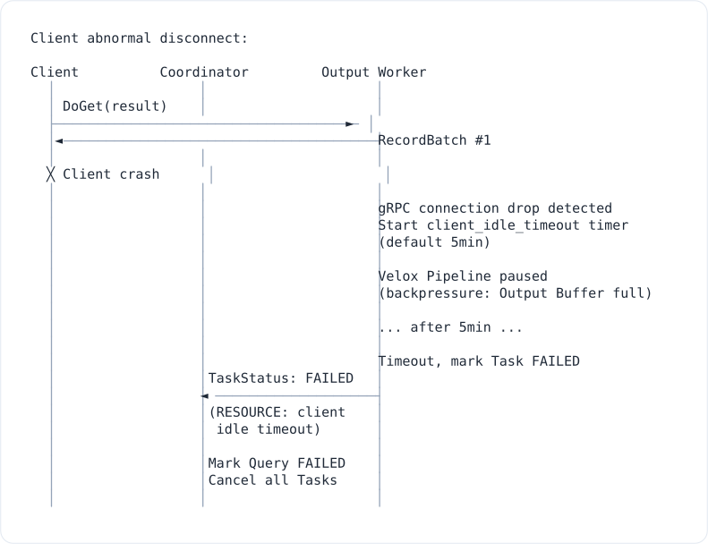

If the Client reconnects before the timeout:

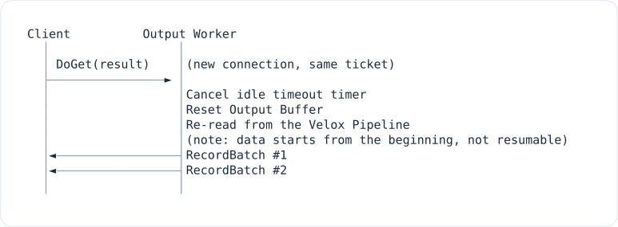

**Memory pressure → Spill + backpressure**

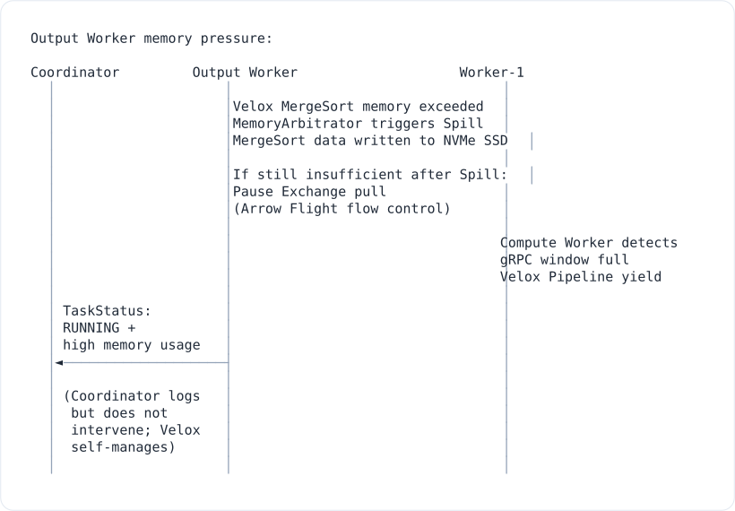

**Error classification and retry policy**


| ErrorCategory | Error Code Range | Example | Retryable | Retry policy |
|---------------|-----------------|------|--------|----------|
| USER_ERROR | 1000-1999 ([08 §3](./resilience.md)) | SQL type mismatch | No | Directly FAILED |
| INTERNAL_ERROR | 3000-3999 ([08 §3](./resilience.md)) | NullPointerException | No | Directly FAILED, log a Bug |
| RESOURCE_ERROR | 2000-2999 ([08 §3](./resilience.md)) | OOM (still insufficient after spill) | Conditional | Retry once after waiting for memory to be released |
| EXTERNAL_ERROR | 4000-4999 ([08 §3](./resilience.md)) | S3 timeout, HDFS unavailable | Yes | Exponential backoff retry, up to 3 times |
| EXCHANGE_ERROR | 5000-5999 ([08 §3](./resilience.md)) | Upstream task failure, connection dropped | Yes | Retry after the upstream task is rescheduled |

Retry decision flow:

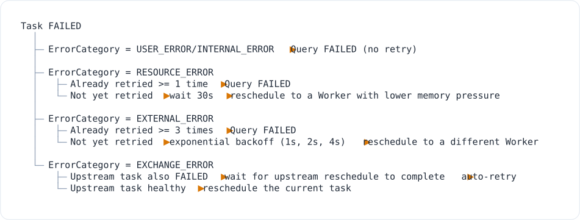

#### 3.3.7 Exchange Data Pull

The Coordinator dispatches canonical v2 stage edges with exact producer task
identity, partition count, endpoint, and signed ticket. Java handles placement
and lifecycle, not per-batch shuffle forwarding. The producer's Native callback
serializes and commits partitioned pages to its Native Flight server. The
downstream `PangrovaExchangeSource` obtains the bound endpoint and pulls its
partition through Flight DoGet into the Velox Exchange operator.

The producer reports `FINISHED` only after every buffered partition has
flushed and the queue has committed. Cancel, deadline, or failure aborts the
queue; a downstream reader must fail on aborted or incomplete input rather
than treating it as clean EOF. Flight demultiplexing and the bounded queue
provide backpressure without a Java `addBatch` bridge.

#### 3.3.8 Coordinator Scheduler Design

**Stage scheduling order**

The Coordinator schedules in topological order of the Stage DAG: leaf Stages are scheduled first, and the Output Stage is scheduled last.

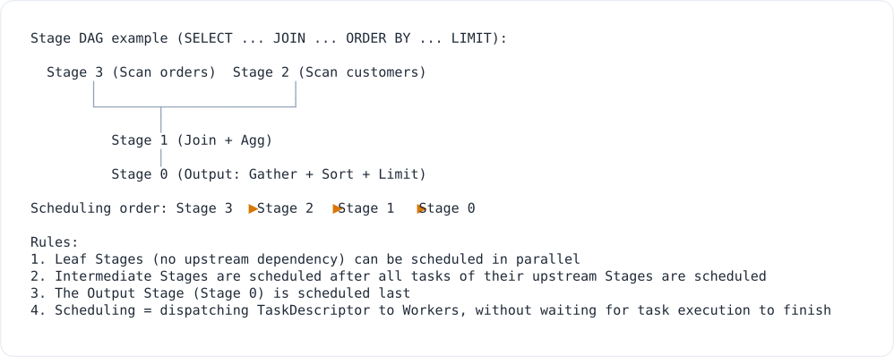

**Output Worker selection algorithm**

The production path is executed by `DefaultWorkerSelector`; it no longer maintains a separate warm pool or a Worker-side slot reservation API.

```java
public WorkerInfo selectWithCacheAffinity(String tenantId, List<String> splitFilePaths) {
    if (cacheAffinityAssigner == null || splitFilePaths.isEmpty()) {
        return select(tenantId);
    }
    WorkerInfo cacheHit = selectByCachedFiles(activeWorkers, splitFilePaths);
    if (cacheHit != null) {
        return cacheHit;
    }
    return firstConsistentHashPreferredWorkerOrLoadBasedFallback(tenantId, splitFilePaths);
}
```

Output Worker selection strategy:

| Priority | Condition | Note |
|--------|------|------|
| 1 | An ACTIVE Worker's heartbeat cache summary hits the split file | Reuse the real cache-hit signal, prioritize data locality |
| 2 | `CacheAffinityAssigner`'s consistent-hash preferred Worker for the split file | Keep stable placement when the cache is cold or has not been reported |
| 3 | `TaskScheduler.selectWorker`'s load-based selection | The general path when there is no file path or no cache affinity available |
| 4 | No ACTIVE Worker meets the resource threshold | Query queues or throws `NoAvailableWorkerException` |

#### 3.3.9 Multi-Stage Exchange Scenarios

Output Tasks appear not only at the final output; intermediate Stages also have Exchanges. Below is the full interaction for a multi-Stage scenario.

**Three-tier Stage example**

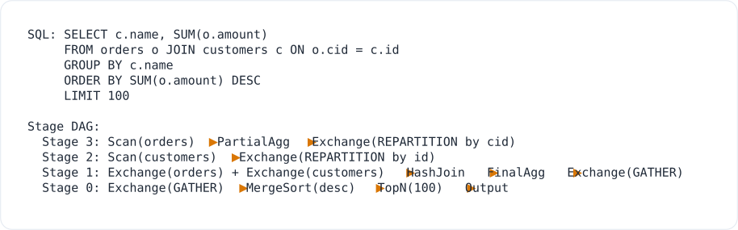

The TaskDescriptor content of each Stage:

| Stage | splits | exchange_sources | output_config |
|-------|--------|------------------|---------------|
| Stage 3 (N tasks) | Splits of the orders table | empty | empty |
| Stage 2 (N tasks) | Splits of the customers table | empty | empty |
| Stage 1 (M tasks) | empty | All task endpoints of Stage 3 + Stage 2 | empty |
| Stage 0 (1 task) | empty | All task endpoints of Stage 1 | ticket, buffer config |

**Difference between an intermediate Stage's Exchange and the Output Stage's Exchange**

| Dimension | Intermediate Stage Exchange | Output Stage Exchange |
|------|---------------------|----------------------|
| Exchange type | REPARTITION (many-to-many) | GATHER (many-to-one) |
| Downstream consumers | Multiple tasks (by partition) | 1 Output Task |
| Data routing | Hash(key) % partition_count | All sent to partition 0 |
| Shuffle Buffer | Bucketed by partition | Single bucket |
| Backpressure scope | Only affects the upstream of the corresponding partition | Affects all upstream |

**Shuffle Buffer design**

The Shuffle Buffer on the Compute Worker is responsible for buffering data produced by the Velox Pipeline, waiting for downstream tasks to pull it.

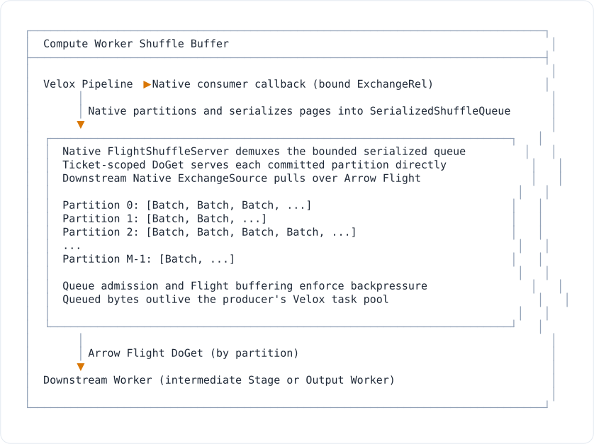

#### 3.3.10 Worker-Only Relational Result Path

Planner folding may produce `LogicalValues`, but that plan is still serialized
into the ordinary task contract, executed by Native, and served from the selected
Output Worker. Empty results (`LIMIT 0`) take the same route. There is no
Coordinator result-cache hit or writeback path; result caching can only be
reintroduced behind a Worker-owned protocol.

`SHOW`, `DESCRIBE`, session control, DDL status, and DML acknowledgement rows are
bounded control-plane responses. `StatementDispatcher` alone may publish these
through the isolated control-plane transport. Relational `SELECT` code cannot
access that service or its buffer. Connector system-table `SELECT` statements
therefore compile and dispatch like any other query, and fail closed if the
connector/Native scan contract is unavailable.

All DML row production follows the same boundary. `INSERT VALUES` and static
`INSERT OVERWRITE ... VALUES` compile to typed Substrait values relations and run
as canonical v2 write tasks on ordinary Workers. The Worker alone opens the
connector page sink; the Coordinator only registers the write intent, validates
the canonical task report, fences the attempt, and commits returned fragments.
There is no Coordinator JVM `Page`/`ConnectorPageSink` fallback.
The Coordinator records the terminal task state before notifying the Stage DAG.
When the task set appears finished but an asynchronous downstream stage remains,
the query finalizer holds its metadata-operation permit and subscribes to the
DAG's terminal event. Only successful DAG completion with all tasks finished
can publish the logical query result; failure or cancellation releases the
permit without committing the query. No per-query polling thread is used.
For INSERT, Calcite's `UNION ALL` of single-row literal projects is packed into
one values relation when every field is already a literal or has only a
nullability cast. Value-changing casts and dynamic expressions keep their
ordinary plan so the planner does not evaluate them outside the query session.

#### 3.3.11 Client SDK Wrapper

The Client SDK hides the Output Worker redirection details from the user:

```java
// User's perspective — no different from traditional JDBC
try (Connection conn = DriverManager.getConnection("jdbc:pangrova://coordinator:8080")) {
    ResultSet rs = conn.createStatement().executeQuery("SELECT * FROM orders LIMIT 10");
    while (rs.next()) {
        // The user is unaware that data comes from the Output Worker rather than the Coordinator
    }
}
```

```
SDK internal flow:
1. POST /v1/query/submit→ Coordinator
2. Poll the canonical query status until a readable result endpoint is published
3. Arrow Flight DoGet(resultEndpoint), then verify terminal query success; a JDBC
   query timeout also bounds the Flight call and every batch read
4. Decode the received Arrow IPC bytes into a ResultSet; the current JDBC driver
   buffers the full result and does not yet provide bounded-memory streaming or
   automatic reconnection after a broken Flight stream
```

For resultless DML, the submit response may return `RUNNING` after the actual
WRITE task is dispatched, with no Flight endpoint. The client polls canonical
query status through the final catalog commit. The 30-second submit timeout
bounds compilation and initial dispatch, not data-file writing or commit.

`Statement.execute()` and `executeQuery()` use this same Flight endpoint path.
An absent endpoint is waited for while the query runs and is an error if the
query finishes without one. The historical REST `/v1/query/{id}/result` page
client had no production server route and has been removed; it is not a
fallback for an unavailable Flight stream. Bounded-memory JDBC cursoring is a
separate required improvement before large-result support is claimed.

#### 3.3.12 Configuration Reference


> **Configuration status:** The YAML below includes target settings. Only keys in
> the [configuration key reference](../configuration/reference.md) are verified as
> runtime configuration.

```yaml
coordinator:
  scheduler:
    # Output Worker scheduling
    output-worker:
      scheduling-timeout: 5s

    # Task retry
    retry:
      max-retries-external: 3
      max-retries-resource: 1
      retry-backoff-initial: 1s
      retry-backoff-max: 30s
      retry-backoff-multiplier: 2.0

    # Stage scheduling
    stage:
      max-concurrent-stages: 16
      task-submit-timeout: 10s

worker:
  task:
    # Exchange Client
    exchange:
      max-buffer-size: 64MB
      max-concurrent-requests: 8
      request-timeout: 30s
      idle-timeout: 60s

    # Output Buffer
    output:
      max-buffered-bytes: 32MB
      max-buffered-batches: 64
      client-idle-timeout: 5m

    # Shuffle Buffer
    shuffle:
      max-buffer-size: 128MB
      partition-buffer-size: 16MB

  # Arrow Flight
  flight:
    port: 8082
    max-message-size: 16MB
    flow-control-window: 4MB
```

Design rationale: the Coordinator belongs to the control plane; its sole responsibility is SQL parsing, optimization, and scheduling. All data processing is pushed down to the Workers, ensuring full isolation of the control plane and data plane. The Output Worker has full Velox execution capability, is not restricted by operator type, and has production-grade fault tolerance such as Spill and memory arbitration.

## 4. Velox Pipeline Execution Model

The Worker passes every session performance option to Velox explicitly, including
`false` and zero values. Scaled table-scan processing is eligible only when the
native plan contains no join: on an empty join build side, Velox can park scan
drivers waiting for scale-up while the join build waits for those same drivers
to finish. The Worker records `scaled_scan_ineligible` for this plan shape and
runs the join with ordinary scan scheduling. Other requested Velox options remain
in effect. This guard is specific to the pinned Velox execution behavior and
must be reconsidered with a tested upstream fix.

A join stage with any directly scanned table input executes in one task until
every join input has an explicit compatible exchange distribution. This also
applies when another branch of the same join stage already has an exchange:
independent scan split allocation does not co-partition rows by join key and
could silently return incomplete results. A join remains parallel only when
both direct inputs are hash exchanges on the corresponding equijoin keys, or
the build input is broadcast for an inner, left, semi, or anti join. Other
exchange combinations gather to one task, including broadcast right/full
outer joins that would duplicate unmatched build-side rows.
This follows the [Trino partitioned-join contract](https://trino.io/docs/current/optimizer/cost-based-optimizations.html#join-distribution-selection),
which redistributes both inputs by join key, and Calcite's distinct
[hash distribution trait](https://calcite.apache.org/javadocAggregate/org/apache/calcite/rel/RelDistributions.html).
Greedy file-split balancing does not establish either distribution property.

### 4.1 Pipeline Structure

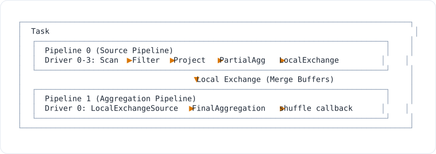

### 4.2 Pipeline Parallelism Calculation

The number of Drivers (parallelism) for each Pipeline is determined by the following rules:

| Pipeline type | Driver count rule | Note |
|--------------|-------------------|------|
| Source Pipeline (with TableScan) | `min(splits_count, max_drivers_per_task)` | Each Driver processes one or more Splits |
| Exchange Source Pipeline | `min(exchange_source_count, max_drivers_per_task)` | Each Driver pulls one or more upstream Sources |
| Local Exchange Consumer | 1 (FinalAgg) or `hash_partition_count` | Depends on operator semantics |
| Output Pipeline | 1 | A single Driver outputs to the OutputQueue |

Configuration parameters:

| Parameter | Default | Range | Note |
|------|--------|---------|------|
| `coordinator.scheduler.min-drivers-per-task` | 1 | 1-64 | Minimum number of Drivers per Task |
| `coordinator.scheduler.max-drivers-per-task` | 16 | 1-256 | Maximum number of Drivers per Task, usually set to the number of Worker CPU cores |
| `worker.native.thread-pool-size` | number of CPU cores | 1-256 | Velox execution thread pool size, shared by all Tasks |

Parallelism calculation pseudocode:
```
// Computed by the Coordinator when building the TaskDescriptor
int computeDriverCount(Pipeline pipeline, TaskDescriptor task) {
    if (pipeline.hasTableScan()) {
        return clamp(task.splits.size(), minDrivers, maxDrivers);
    }
    if (pipeline.hasExchangeSource()) {
        return clamp(task.exchangeSources.size(), minDrivers, maxDrivers);
    }
    if (pipeline.isFinalAggregation()) {
        return 1;  // A single Driver does the final aggregation
    }
    return maxDrivers;  // Use the maximum parallelism by default
}
```

Note: Velox internally uses a shared thread pool (`thread-pool-size`) to schedule all Drivers of all Tasks. The Driver count determines the logical parallelism, while the actual physical parallelism is limited by the thread pool size. When the total number of Drivers > the thread pool size, Velox achieves time-division multiplexing via cooperative scheduling (yield).

### 4.2 Operator Types

| Operator type | Description | Example |
|---------|------|------|
| SourceOperator | Data source, produces data | TableScan, Exchange |
| FilterOperator | Filters data | Filter |
| ProjectOperator | Projection/expression computation | Project |
| AggregationOperator | Aggregation | HashAggregation |
| JoinOperator | Join | HashJoin, MergeJoin |
| SortOperator | Sort | OrderBy |
| LimitOperator | Limit row count | Limit, TopN |
| SinkOperator | Data output | Native shuffle callback or result output |

## 5. Dynamic Filtering

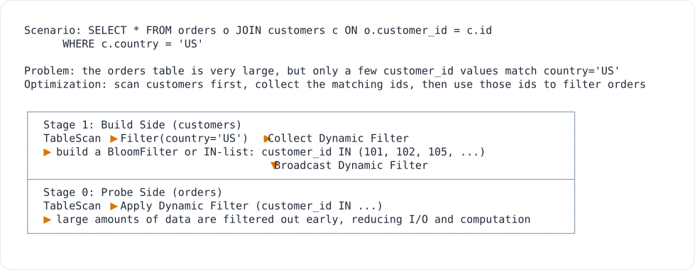

## 6. Write Path Design

### 6.1 Read/Write Separation Architecture

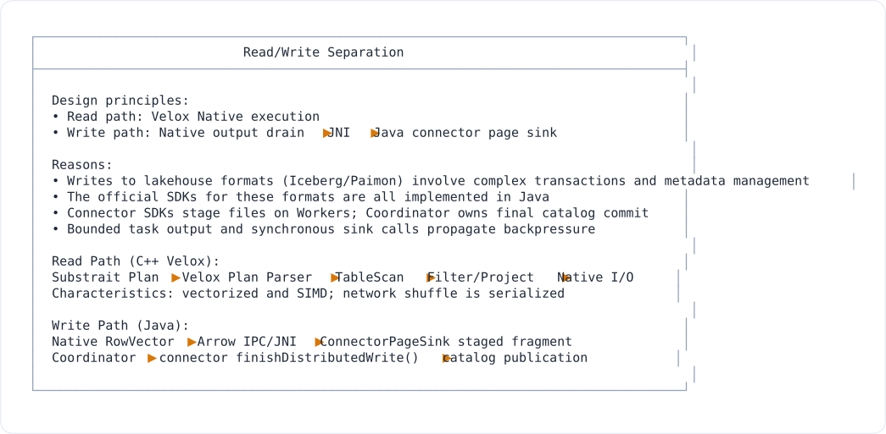

### 6.2 INSERT Flow

```
Phase 1: Worker Native query execution
  1. Parse the INSERT statement
  2. Optimize the SELECT subquery
  3. Generate the Substrait Plan
  4. Dispatch to Workers for execution
  5. Velox executes the SELECT and places RowVectors in the task output queue

Phase 2: Worker staging
  1. Native drain serializes bounded batches to Arrow IPC and calls the Java sink via JNI
  2. Each Worker stages data files and returns a connector commit fragment
  3. A failed or cancelled producer aborts the sink; no fragment is published

Phase 3: Coordinator publication
  1. Collect fragments from the required fenced Worker attempts
  2. Persist the commit intent and invoke finishDistributedWrite() on the connector
  3. Prove/recover an ambiguous catalog outcome before acknowledging success
```

### 6.3 Write Components

The current SQL write contract uses the Worker-side `NativeWriteExecutor` JNI
adapter to create a connector `ConnectorPageSink`, append serialized columnar
batches, and obtain a staged metadata fragment with `finishWithMetadata()`.
The Worker reports that fragment under the canonical task identity. The
Coordinator invokes `ConnectorMetadata.finishDistributedWrite()` to publish
the connector snapshot. This is not a `nativeGetNextBatch()` pull loop and does
not use the legacy `DataWriter` example or a single-shot batch-writer shortcut.

### 6.4 Write Path Responsibility Matrix

| Operation | Execution layer | Language | Note |
|------|--------|------|------|
| Data file write (Parquet/ORC) | Worker | Java | Write to S3/HDFS via the Iceberg/Paimon SDK |
| Snapshot/manifest publication | Coordinator | Java | Connector finalizes fenced Worker fragments; see [distributed-writes.md](./distributed-writes.md) for ambiguous-outcome limits |
| Catalog commit | Coordinator | Java | Persist intent, prove outcome, then acknowledge; not generic exactly-once under concurrent recovery |
| Shuffle serialization | Worker (Native) | C++ | Partition and serialize bounded pages into the Native shuffle queue |
| Shuffle network transfer | Worker (Native) | C++ | Serve ticket-scoped partitions via Native Arrow Flight DoGet |
| Read path data processing | Worker (Native) | C++ | Velox execution engine, vectorized processing |

**Key boundaries**:
- The C++ Native layer does not perform any persistence write operations (both data files and metadata files are written by the Java layer)
- Shuffle partitioning, buffering, and Flight transfer remain in the Native data plane; Java controls task placement and lifecycle
- Transaction commit is coordinated by the Coordinator: Workers are responsible for writing data files, and the Coordinator is responsible for the final atomic commit

### 6.5 DataFile Cleanup Mechanism After Commit Failure

In the write path, Workers write DataFiles in parallel and then the Coordinator performs an atomic Commit. Commit may fail due to conflicts, timeouts, or Coordinator failure, in which case the already-written DataFiles become orphan files.

**Commit failure scenarios**:
1. Iceberg `OptimisticLockException` (concurrent write conflict)
2. Coordinator crashes before Commit
3. Network timeout leaves the Commit status unknown

**Cleanup flow**:

| Phase | Operation | Note |
|------|------|------|
| Phase 1: Write | Each time a Worker writes a DataFile, it registers it in the `pending_files` table | Record the file list |
| Phase 2: Commit | Success → delete `pending_files` records; failure → mark the transaction as FAILED | Atomic commit |
| Phase 3: Synchronous cleanup | The Coordinator immediately attempts to delete orphan files after a Commit failure (best-effort) | Immediate cleanup |
| Phase 4: Fallback cleanup | The `OrphanFileCleanup` scheduled task cleans up remaining orphan files | See §10.1 |

The authoritative definition of the `pending_files` table schema is in §10.1.

Coordinator Commit failure handling pseudocode:

```
try {
    tx.commitTransaction();
    pendingFileStore.deleteByTransaction(transactionId);
} catch (CommitFailedException e) {
    pendingWriteStore.markFailed(transactionId);
    // Synchronously clean up DataFiles (best-effort)
    for (file : pendingFileStore.getFiles(transactionId)) {
        try { fileSystem.delete(file); }
        catch (IOException) { log.warn("Deferred to OrphanFileCleanup"); }
    }
    pendingFileStore.deleteByTransaction(transactionId);
    pendingWriteStore.delete(transactionId);
    throw e;
}
```

## 7. Global Consistency Design

### 7.1 Core Principles

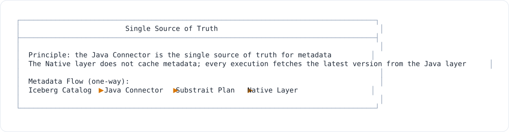

| Principle | Description | Implementation |
|------|------|----------|
| Single source of truth | The Java Connector is the sole source of metadata | The Native layer does not cache metadata |
| Snapshot isolation | Queries see a consistent data view | Bind the Snapshot ID at query start |
| Write atomicity | A write either fully succeeds or fully fails | Two-phase commit + cleanup mechanism |
| Write visibility | Immediately visible after commit | Active cache invalidation + broadcast |
| Lock-free concurrency | Reads and writes do not block each other | MVCC + optimistic concurrency control |

### 7.2 Versioned Snapshot Propagation

```
Step 1: Get the snapshot at query start
  VersionedTableSnapshot snapshot = connector.getMetadata(session)
      .getTableSnapshot(tableName);
  queryContext.setTableSnapshot(tableName, snapshot);
  List<Split> splits = splitManager.getSplits(snapshot, predicate);

Step 2: Snapshot info is serialized into the Substrait Plan
  PangrovaReadExtension:
    version_id, version_timestamp_ms, schema_version, arrow_schema
    data_files[], delete_files[], properties{}

Step 3: The Native layer reads based on the snapshot
  // The Native layer does not do any metadata query, it only reads data based on the passed-in SplitInfo
  // The full definition of SplitInfo is in native-execution.md §5.3 (the only authoritative definition)
  // PangrovaDataSource automatically composes the read components based on SplitInfo.connector_info (oneof)
  for (SplitInfo split : plan.getSplits()) {
      // Inside PangrovaDataSource, it selects based on connector_info:
      //   iceberg_info → FormatReader + DeleteFilter chain
      //   paimon_info  → FormatReader + MergeReader
      PangrovaDataSource dataSource = new PangrovaDataSource(split);
      while (dataSource.hasNext()) {
          RecordBatch batch = dataSource.readNext();
          output(batch);
      }
  }
```

### 7.3 Snapshot Isolation Guarantee

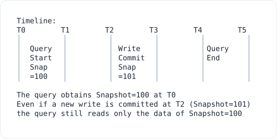

### 7.4 Cache Invalidation Strategy

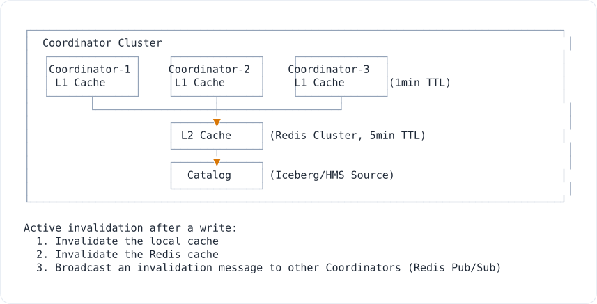

## 8. Custom SQL Extensions

### 8.1 Time Travel Queries

```sql
-- Query by timestamp
SELECT * FROM orders FOR SYSTEM_TIME AS OF '2024-01-01'

-- Query by version number
SELECT * FROM orders FOR VERSION AS OF 12345
```

### 8.2 Table Maintenance Statements

```sql
-- Table optimization (small file compaction)
OPTIMIZE TABLE orders WHERE date < '2024-01-01' REWRITE DATA

-- Data compaction
ALTER TABLE orders COMPACT PARTITION (date='2024-01-01')

-- Clean up expired data
VACUUM TABLE orders RETAIN 168 HOURS

-- Snapshot management
ALTER TABLE orders CREATE SNAPSHOT
ALTER TABLE orders ROLLBACK TO SNAPSHOT 12345

-- Branch management (Iceberg)
ALTER TABLE orders CREATE BRANCH dev AS OF 12345
ALTER TABLE orders DROP BRANCH dev
```

## 9. Statistics Collection

```java
/**
 * Collect statistics from Iceberg metadata
 */
public TableStatistics collectFromIceberg(Table table) {
    // Collect from manifest files: rowCount, sizeInBytes
    // Column statistics: nullCounts, lowerBounds, upperBounds
}

/**
 * Run ANALYZE to collect more detailed statistics
 */
public TableStatistics analyze(Table table, List<String> columns, double sampleRatio) {
    // Sampling scan
    // Collect: distinctCount (HyperLogLog), quantiles (TDigest)
}
```

---

## 10. Data Consistency Enhancements

### 10.1 Write Failure Cleanup (Authoritative Definition)

This section is the authoritative definition of the orphan file cleanup mechanism. §6.5 describes the immediate cleanup flow when a Commit fails; this section defines the fallback scheduled cleanup mechanism.

**pending_writes / pending_files table schema** (authoritative definition):

| Table | Fields | Note |
|----|------|------|
| `pending_writes` | `transaction_id, query_id, worker_id, status, created_at` | Transaction-level record |
| `pending_files` | `transaction_id, file_path, file_size_bytes, worker_id, created_at` | File-level record |

**Write flow (with cleanup guarantees)**:
1. `Begin Transaction` → record into the `pending_writes` table
2. `Write Data Files` → for each file written, record into the `pending_files` table
3. `Commit Transaction` → on success: delete records from both tables; on failure: keep records, wait for cleanup

**OrphanFileCleanup scheduled task**:

```java
/**
 * Orphan file cleaner — scheduled fallback cleanup for residual files that §6.5 synchronous cleanup failed to remove
 */
public class OrphanFileCleanup implements Runnable {

    private final Duration orphanThreshold = Duration.ofHours(1);

    @Override
    public void run() {
        List<PendingWrite> abandoned = pendingWriteStore.findOlderThan(orphanThreshold);
        for (PendingWrite write : abandoned) {
            try {
                List<String> files = pendingFileStore.getFiles(write.getTransactionId());
                for (String file : files) {
                    fileSystem.delete(new Path(file));
                }
                pendingFileStore.delete(write.getTransactionId());
                pendingWriteStore.delete(write.getTransactionId());
            } catch (Exception e) {
                log.error("Failed to cleanup transaction: {}", write.getTransactionId(), e);
            }
        }
    }
}
```

### 10.2 Snapshot Reference Counting

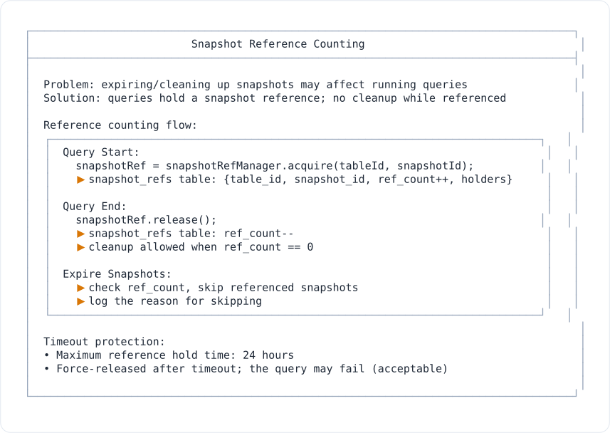

### 10.3 Cross-Table Transaction Note

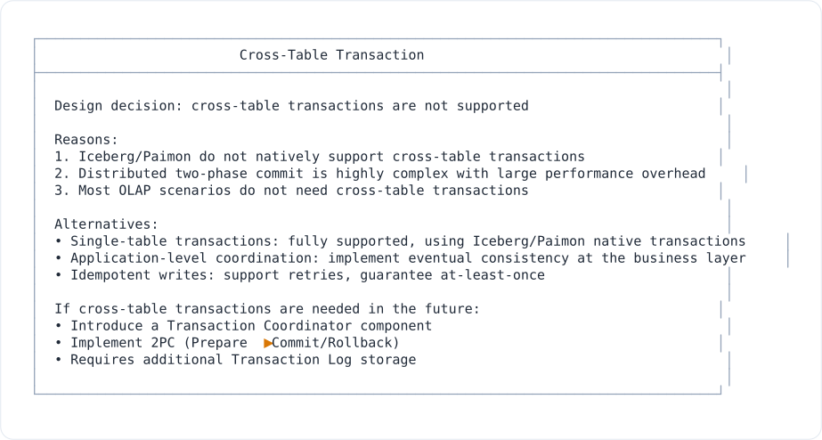

---

## 11. Operations Support

### 11.1 Native Version Management

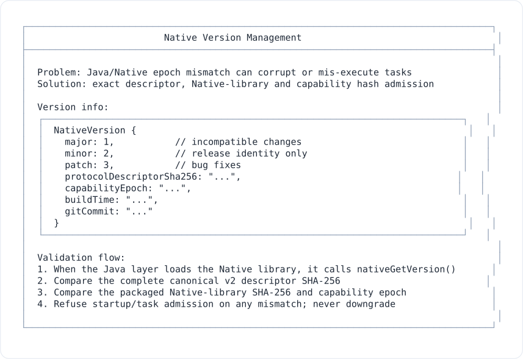

```java
/**
 * Native version validation
 */
public class NativeVersionChecker {

    private static final String REQUIRED_DESCRIPTOR_SHA256 = generatedDescriptorSha256();
    private static final String REQUIRED_CAPABILITY_EPOCH = configuredCapabilityEpoch();

    public static void checkVersion() {
        NativeVersion nativeVersion = NativeRuntime.getVersion();

        if (!nativeVersion.getProtocolDescriptorSha256()
                .equals(REQUIRED_DESCRIPTOR_SHA256)) {
            throw new IncompatibleNativeVersionException(
                "Canonical protocol descriptor mismatch");
        }
        if (!nativeVersion.getCapabilityEpoch().equals(REQUIRED_CAPABILITY_EPOCH)
                || !verifyPackagedNativeLibrarySha256(nativeVersion)) {
            throw new IncompatibleNativeVersionException(
                "Native library or capability epoch mismatch");
        }

        log.info("Native library loaded: version={}.{}.{}, commit={}",
            nativeVersion.getMajor(), nativeVersion.getMinor(),
            nativeVersion.getPatch(), nativeVersion.getGitCommit());
    }
}
```

### 11.2 Protocol-Epoch Upgrade

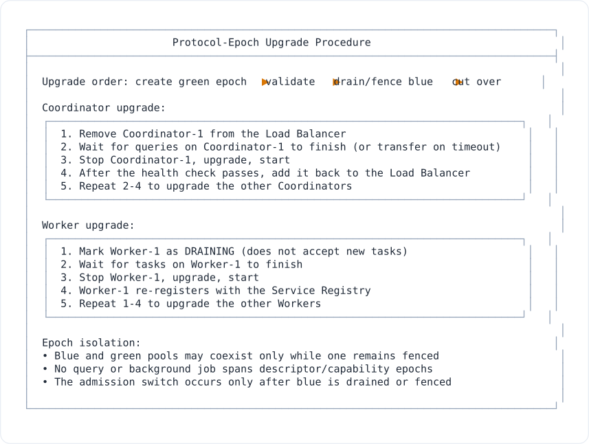

### 11.3 Dynamic Configuration

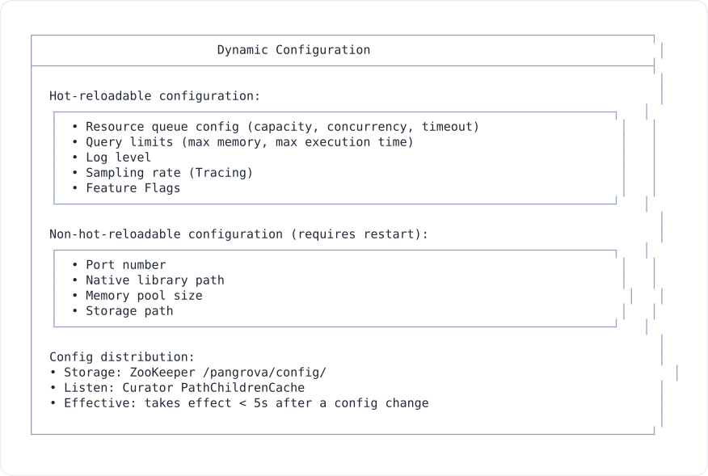

```java
/**
 * Dynamic configuration manager
 */
public class DynamicConfigManager {

    private final CuratorFramework curator;
    private final Map<String, ConfigListener> listeners = new ConcurrentHashMap<>();

    public void start() {
        PathChildrenCache cache = new PathChildrenCache(curator, "/pangrova/config", true);
        cache.getListenable().addListener((client, event) -> {
            String key = ZKPaths.getNodeFromPath(event.getData().getPath());
            String value = new String(event.getData().getData());

            ConfigListener listener = listeners.get(key);
            if (listener != null) {
                listener.onConfigChanged(key, value);
            }
        });
        cache.start();
    }

    public void registerListener(String key, ConfigListener listener) {
        listeners.put(key, listener);
    }

    @FunctionalInterface
    public interface ConfigListener {
        void onConfigChanged(String key, String value);
    }
}
```


---

## 12. Data Lake SQL Syntax Coverage

### 12.1 Syntax Category Overview

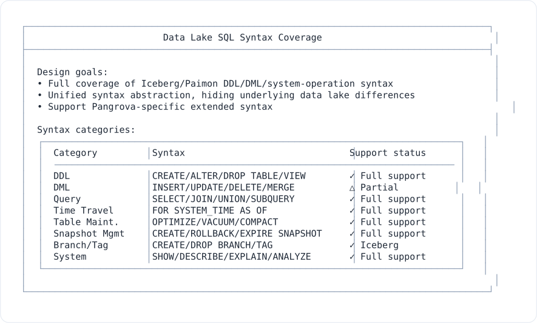

The table is a syntax overview, not a distributed conformance certificate.
As of 2026-09-27, real Iceberg E2E covers basic DML, static-partition
`INSERT OVERWRITE`, and single-action/UPDATE+INSERT `MERGE` in one Native write
and catalog commit. A `MERGE` combining `DELETE` with another action is rejected
rather than decomposed into non-atomic commits. Arbitrary distributed DML shapes,
multiple matching source rows, and cross-worker failure recovery are not yet
certified; see the [Roadmap](../getting-started/roadmap.md).


### 12.2 DDL Syntax

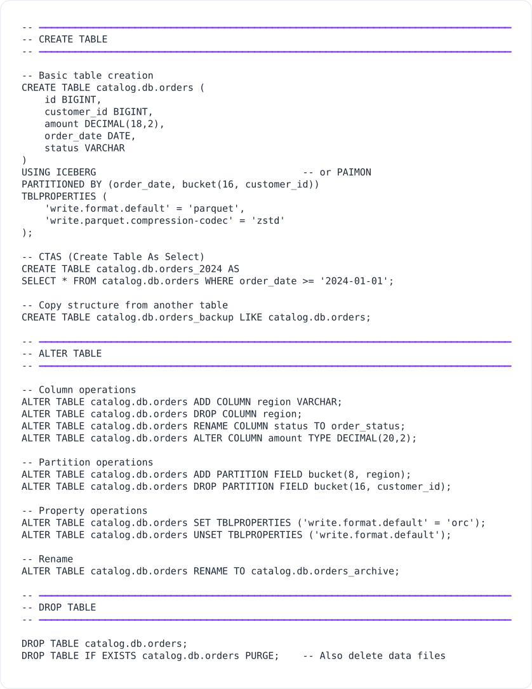


### 12.3 DML Syntax

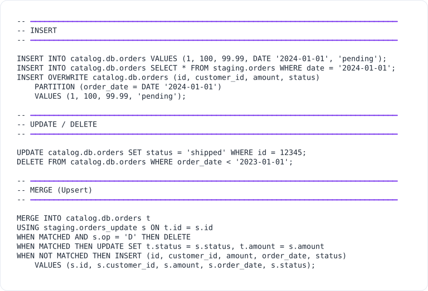

### 12.4 Time Travel Queries

```sql
-- Query historical data by timestamp
SELECT * FROM catalog.db.orders FOR SYSTEM_TIME AS OF 123456789;

-- Query by snapshot ID (Iceberg)
SELECT * FROM catalog.db.orders FOR VERSION AS OF 1234567890;

-- Query by tag (Iceberg)
SELECT * FROM catalog.db.orders FOR VERSION AS OF 'release-v1.0';

-- Incremental query (changes between two snapshots)
SELECT * FROM catalog.db.orders
    FOR SYSTEM_TIME BETWEEN TIMESTAMP '2024-01-01' AND TIMESTAMP '2024-01-02';
```


### 12.5 Table Maintenance Syntax

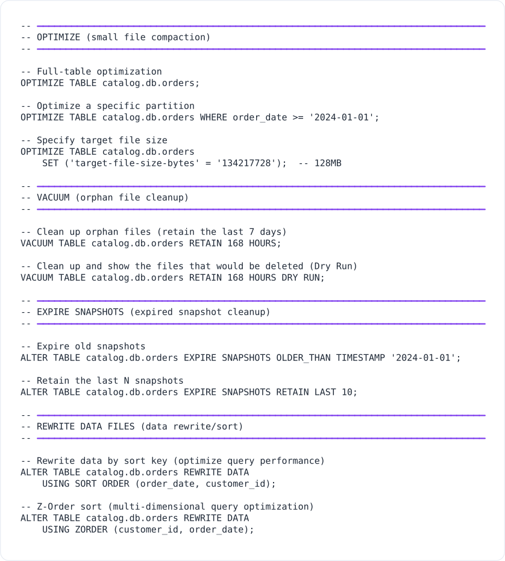


### 12.6 Snapshot and Branch Management

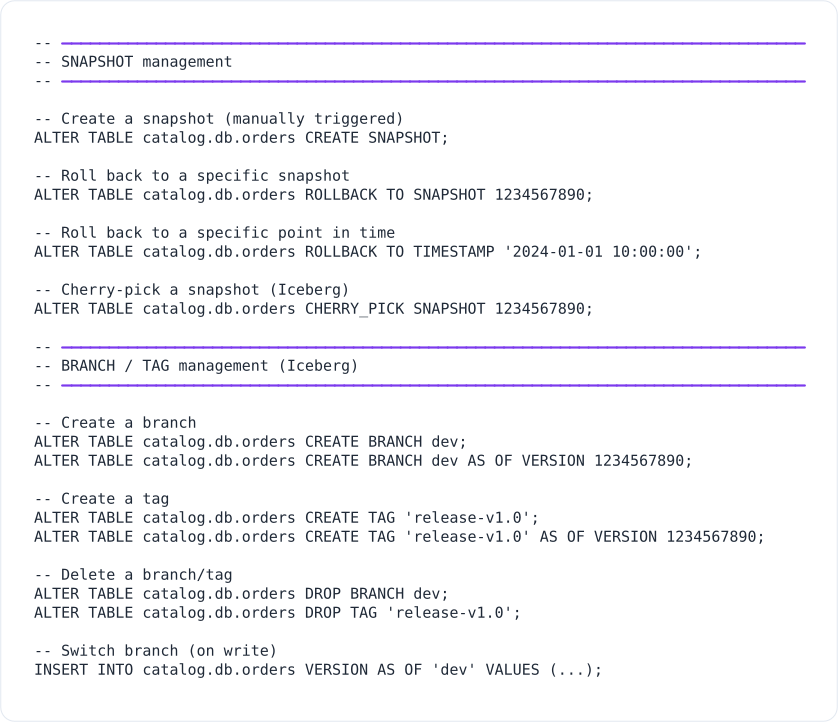

### 12.7 System Operation Syntax

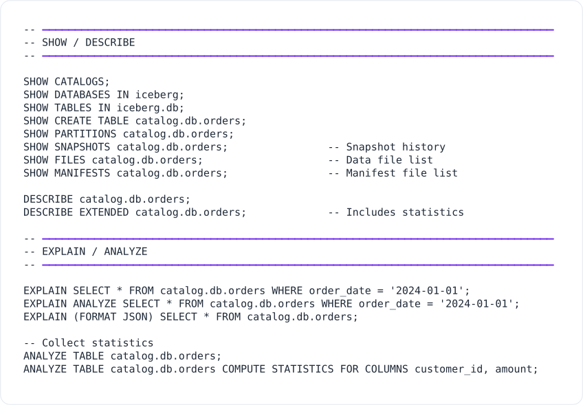


---

## 13. Table Maintenance SPI Design

### 13.1 Design Goals

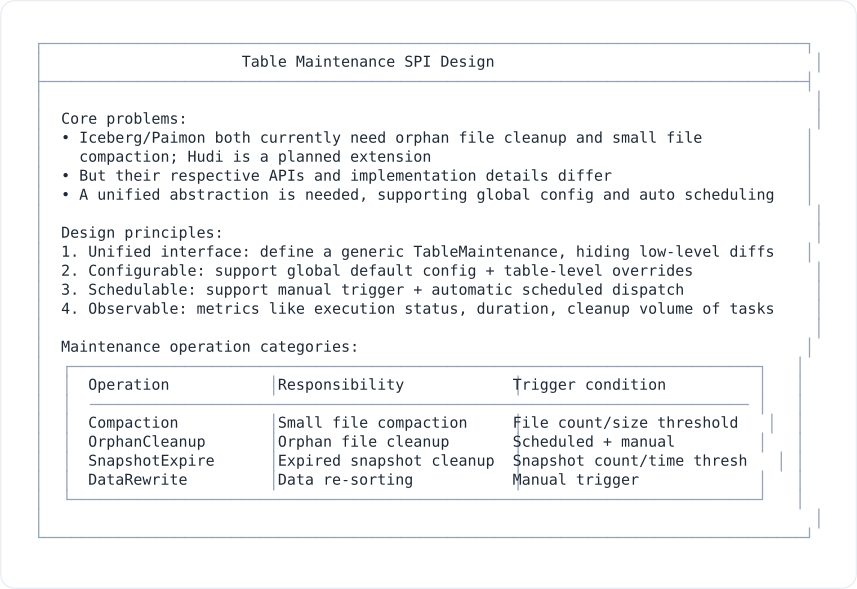


### 13.2 TableMaintenance Interface


The authoritative `TableMaintenance` interface is defined in [streaming.md §2.9](./streaming.md). All maintenance operations are **async and non-blocking**, returning `CompletableFuture<*Result>`. The interface provides:

| Method | Return Type | Description |
|--------|-------------|-------------|
| `compactAsync(tableName)` | `CompletableFuture<CompactionResult>` | Merge small files and equality delete files |
| `cleanOrphansAsync(tableName, olderThan)` | `CompletableFuture<OrphanCleanupResult>` | Remove files not referenced by any snapshot |
| `expireSnapshotsAsync(tableName, olderThan)` | `CompletableFuture<SnapshotExpirationResult>` | Expire old snapshots |
| `getMaintenanceStatus(tableName)` | `MaintenanceStatus` | Get current maintenance status (synchronous) |

The coordinator receives a `TableMaintenance` from the streaming-module wiring;
`MaintenanceExecutor` invokes it without depending on a connector-specific provider
type. Connector maintenance procedures remain format-specific.

### 13.3 Request/Result Data Model

Each maintenance operation corresponds to a group of Request/Result DTOs:

| Operation | Request key fields | Result key fields |
|------|-----------------|----------------|
| Compaction | `table, partitionFilter?, targetFileSizeBytes, minFilesToCompact, maxFilesToCompact, dryRun` | `inputFilesCount, outputFilesCount, inputBytesTotal, outputBytesTotal, duration` |
| OrphanCleanup | `table, retentionPeriod, location?, dryRun, maxFilesToDelete` | `orphanFilesFound, orphanFilesDeleted, bytesReclaimed` |
| SnapshotExpire | `table, retentionPeriod, retainCount` | `expiredCount, reclaimedBytes` |
| DataRewrite | `table, sortOrder, partitionFilter?` | `rewrittenFilesCount, duration` |

### 13.4 Connector Implementation Differences

| Operation | Iceberg | Paimon | Note |
|------|---------|--------|------|
| Compaction | `RewriteDataFiles` (by Partition) | `CompactAction` (by Bucket, LSM Level) | Paimon has a Level concept |
| Orphan Cleanup | `DeleteOrphanFiles` | `OrphanFilesClean` (including Changelog files) | Both need to scan storage vs metadata |
| Snapshot Expire | `ExpireSnapshots` | `ExpireSnapshots` | Similar API |
| Data Rewrite | `RewriteDataFiles` + Sort | Not supported | Paimon relies on LSM auto-sorting |
| Manifest Rewrite | `RewriteManifests` | N/A | Iceberg-specific |

### 13.5 Scheduling and Configuration

The maintenance scheduler's complete priority model, backpressure control, and processTaskQueue() implementation are authoritatively defined in [streaming.md §2.9](./streaming.md).

Core scheduling logic:
1. Periodically scan the `MaintenanceStatus` of all tables (small file count, snapshot count, etc.)
2. Decide whether to trigger a maintenance operation by threshold (file count ≥ `minFilesToCompact`, time since last execution ≥ `interval`)
3. Trigger an additional time-interval-based check after a write completes (`onWriteComplete`)
4. Concurrency control: `Semaphore` rate limiting, `maxConcurrentCompactions` upper bound

The proposed hierarchy is global YAML default followed by a table-level
`TBLPROPERTIES` override. See the [configuration key reference](../configuration/reference.md)
for settings implemented by the typed loader.

Maintenance metrics are exposed via Prometheus: `compaction_tasks_total`, `compaction_duration`, `orphan_files_deleted`, `snapshots_expired`, etc.

---

## 14. Version Compatibility Matrix

### 14.1 Java/Native Version Compatibility

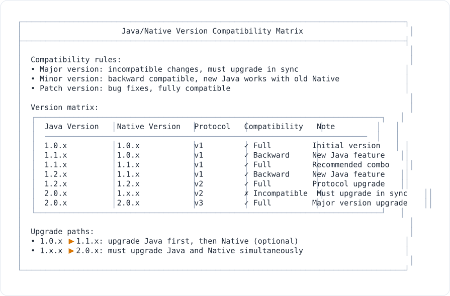

### 14.2 Protocol Version Change Log

| Protocol | Change | Java Version | Native Version |
|----------|----------|-----------|-------------|
| v1 | Initial protocol | 1.0.0+ | 1.0.0+ |
| v2 | Added Dynamic Filter support | 1.2.0+ | 1.2.0+ |
| v3 | Refactored Shuffle protocol | 2.0.0+ | 2.0.0+ |

---

## 15. Dynamic Filter Degradation Strategy

### 15.1 Degradation Architecture

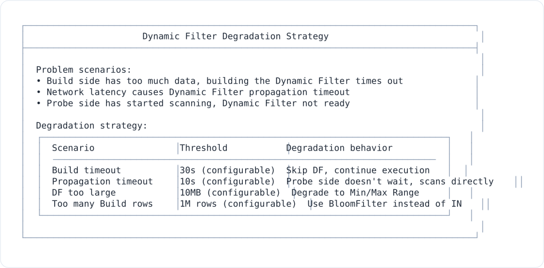

### 15.2 Degradation Implementation

```java
/**
 * Dynamic Filter degradation controller
 */
public class DynamicFilterDegradationController {

    private final DynamicFilterConfig config;

    /**
     * Evaluate whether degradation is needed
     */
    public DegradationDecision evaluate(DynamicFilterBuildContext ctx) {
        // 1. Check build timeout
        if (ctx.getBuildDuration().compareTo(config.getBuildTimeout()) > 0) {
            return DegradationDecision.skip("Build timeout exceeded");
        }

        // 2. Check data volume
        if (ctx.getDistinctValues() > config.getMaxDistinctValues()) {
            // Degrade to BloomFilter
            return DegradationDecision.useBloomFilter(
                ctx.getDistinctValues(),
                config.getBloomFilterFpp());
        }

        // 3. Check serialized size
        if (ctx.getEstimatedSize() > config.getMaxFilterSize()) {
            // Degrade to Min/Max Range
            return DegradationDecision.useMinMaxRange(
                ctx.getMinValue(),
                ctx.getMaxValue());
        }

        return DegradationDecision.proceed();
    }

    /**
     * Probe side wait strategy
     */
    public WaitDecision shouldWaitForFilter(ProbeContext ctx) {
        Duration elapsed = ctx.getWaitDuration();

        if (elapsed.compareTo(config.getProbeWaitTimeout()) > 0) {
            // Timed out, stop waiting
            metrics.recordDynamicFilterTimeout();
            return WaitDecision.proceedWithoutFilter();
        }

        // Continue waiting
        return WaitDecision.waitMore(config.getProbeWaitInterval());
    }
}
```

### 15.3 Configuration Parameters

```yaml
# Dynamic Filter degradation configuration
dynamic-filter:
  enabled: true

  # Build phase
  build:
    timeout: 30s                          # Build timeout
    max-distinct-values: 1000000          # Max number of distinct values
    max-filter-size: 10MB                 # Max filter size

  # Propagation phase
  propagation:
    timeout: 10s                          # Propagation timeout

  # Probe side
  probe:
    wait-timeout: 10s                     # Wait-for-DF timeout
    wait-interval: 100ms                  # Wait check interval

  # Degradation strategy
  degradation:
    bloom-filter-fpp: 0.01                # BloomFilter false positive rate
    use-min-max-fallback: true            # Whether to degrade to Min/Max
```

---


## 16. Adaptive Query Execution (AQE)

This section describes the Adaptive Query Execution framework that re-optimizes query plans at runtime using actual shuffle statistics. Workers report `ShuffleStageStatsReport`; after a shuffle stage completes, the Coordinator's `AdaptiveQueryEvaluator` builds `ShuffleStageStats`, while planner-side `StageReplanCoordinator` coordinates coalescing and replan decisions for downstream work.

For the statistics foundation that AQE depends on, see [query-optimization.md §Statistics Collection](./query-optimization.md).

### 16.1 Architecture

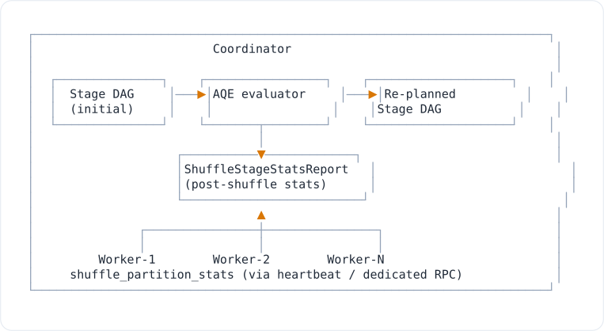

### 16.2 Capability 1 — Dynamic Coalescing of Shuffle Partitions

When actual shuffle output is much smaller than estimated, many partitions become tiny. AQE merges adjacent small partitions into larger ones to reduce scheduling overhead.

```pseudocode
function coalesceShufflePartitions(stageResult: ShuffleStageResult):
    partitionSizes = stageResult.getPartitionSizes()   // actual bytes per partition
    targetSize     = config.aqe.targetPartitionSize     // default 64 MB
    minPartitions  = config.aqe.minPartitions           // default 1

    coalescedGroups = []
    currentGroup = []
    currentSize  = 0

    for partition in partitionSizes:
        if currentSize + partition.size > targetSize AND currentGroup.nonEmpty:
            coalescedGroups.append(currentGroup)
            currentGroup = [partition]
            currentSize  = partition.size
        else:
            currentGroup.append(partition)
            currentSize += partition.size

    if currentGroup.nonEmpty:
        coalescedGroups.append(currentGroup)

    while coalescedGroups.size < minPartitions:
        splitLargest(coalescedGroups)

    return coalescedGroups   // downstream stage reads coalesced partitions
```

### 16.3 Capability 2 — Dynamic Join Strategy Switching

After the build side of a join completes, AQE checks actual data size. If the build side is small enough, it converts a SortMergeJoin or ShuffleHashJoin into a BroadcastHashJoin, cancelling the probe-side shuffle.

```pseudocode
function maybeConvertToBroadcastJoin(joinStage: JoinStage, buildStats: ShuffleStats):
    buildSideSize      = buildStats.totalBytes
    broadcastThreshold = config.aqe.broadcastThreshold   // default 10 MB

    if buildSideSize <= broadcastThreshold:
        newPlan = convertToBroadcastJoin(joinStage)
        cancelShuffleStage(joinStage.probeSideShuffleStage)
        broadcastData(buildStats.data, joinStage.probeSideTasks)
        return newPlan

    return joinStage   // keep original plan
```

Key integration points:
- `StageScheduler.onShuffleStageComplete(stageId, ShuffleStats)` — callback that triggers re-evaluation
- `cancelShuffleStage()` — cancels already-scheduled probe-side shuffle tasks
- Broadcast uses the existing Arrow Flight data distribution path

### 16.4 Capability 3 — Dynamic Skew Join Handling

When a single partition receives disproportionate data (> 5× median AND > 256 MB), AQE splits it into sub-partitions and replicates the matching partition from the other join side.

```pseudocode
function handleSkewedJoin(joinStage: JoinStage, shuffleStats: ShuffleStats):
    medianSize    = shuffleStats.medianPartitionSize
    skewThreshold = config.aqe.skewThreshold   // default 5x median AND > 256 MB

    for partition in shuffleStats.partitions:
        if partition.size > skewThreshold * medianSize AND partition.size > 256MB:
            numSplits = ceil(partition.size / medianSize)
            subPartitions = splitPartition(partition, numSplits)

            for sub in subPartitions:
                createTask(sub, replicatedOtherSide = partition.matchingPartition)

    return updatedJoinStage
```

### 16.5 Affected SPI Interfaces

| Interface | Change | Description |
|-----------|--------|-------------|
| `StageScheduler` | New callback | `onShuffleStageComplete(stageId, ShuffleStats)` |
| `TaskRequest` Protobuf | New field | `coalesced_partition_ranges` for coalesced reads |
| Worker heartbeat | New field | `shuffle_partition_stats` reporting per-partition sizes |

### 16.6 Trade-offs

| Aspect | Without AQE | With AQE |
|--------|-------------|----------|
| Performance | Fixed plan; may be fragile with imperfect statistics | Can correct skew or misestimation between stages; gains require workload measurement |
| Complexity | Simple — plan once, execute | Medium — Coordinator tracks shuffle stats and re-plans between stages |
| Risk | High — wrong plan decisions unrecoverable | Low — AQE only improves; worst case is no change |
| Latency overhead | None | ~50-100 ms per shuffle stage boundary |
| Memory overhead | None | ~1 KB per partition × partition count (ShuffleStats in Coordinator) |

### 16.7 Migration Path

| Phase | Scope | Description |
|-------|-------|-------------|
| 1 | ShuffleStats Collection | Add `shuffle_partition_stats` to Worker heartbeat; Coordinator collects and logs — no plan changes |
| 2 | Dynamic Coalescing | Merge small partitions in `StageScheduler`; safest capability — only merges, never changes join strategy |
| 3 | Dynamic Join Switching | Broadcast join conversion; requires `cancelShuffleStage()` and broadcast distribution |
| 4 | Skew Handling | Partition splitting + other-side replication; most complex, requires shuffle dedup logic |

---


## 17. Observability Integration

This section defines the metrics and tracing integration points for the query execution layer. For the full observability design, see [observability.md](./observability.md).

### 17.1 Metrics

The following metrics from [14 §3](./observability.md) are emitted by query execution components:

| Metric | Type | Source Component | Description |
|--------|------|-----------------|-------------|
| `pangrova.query.submitted_total` | counter | QueryCoordinator | Total queries submitted |
| `pangrova.query.completed_total` | counter | QueryCoordinator | Total queries completed (label: status) |
| `pangrova.query.latency_ms` | histogram | QueryCoordinator | End-to-end query latency |
| `pangrova.stage.task_count` | gauge | StageScheduler | Active tasks per stage |
| `pangrova.task.execution_time_ms` | histogram | TaskExecutor | Per-task execution time |
| `pangrova.shuffle.bytes_transferred` | counter | ShuffleManager | Shuffle data volume |
| `pangrova.dynamic_filter.rows_filtered` | counter | DynamicFilterService | Rows eliminated by dynamic filters |
| `pangrova.aqe.reoptimizations_total` | counter | AdaptiveQueryEvaluator | AQE re-optimization events |
| `pangrova.aqe.partitions_coalesced` | counter | AdaptiveQueryEvaluator | Partitions merged by coalescing |
| `pangrova.aqe.joins_converted` | counter | AdaptiveQueryEvaluator | Joins converted to broadcast |
| `pangrova.aqe.skew_splits` | counter | AdaptiveQueryEvaluator | Skewed partitions split |

### 17.2 Tracing Spans

Query execution emits the following spans (see [14 §4](./observability.md) for span schema):

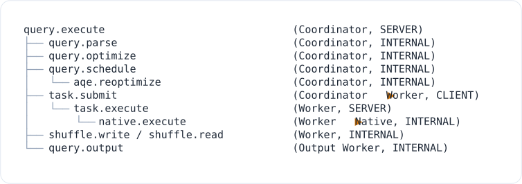

### 17.3 Log Events

- Query lifecycle transitions: QUEUED → PLANNING → SCHEDULING → RUNNING → FINISHED/FAILED (INFO)
- AQE re-optimization decisions: coalescing, join switching, skew handling (INFO)
- Dynamic filter generation and application events (DEBUG)
- Write path commit/abort events (INFO)

See [14 §7](./observability.md) for structured logging format.

During the PLANNING phase, `MetadataService.resolveTable()` performs security checks (authentication, RBAC, RLS filter injection, column masking). See [security.md §3.2](./security.md) for the security integration point.

---


## 18. External Shuffle Service (OPT-010)

This section introduces an optional External Shuffle Service (ESS) that decouples shuffle data lifecycle from Worker processes. ESS runs as a separate long-lived process on each node, enabling shuffle data to survive Worker crashes and dynamic scale-down events.

For the embedded shuffle architecture (current default), see §3.3.9 (Shuffle Buffer) and [native-execution.md §11](./native-execution.md) (Shuffle Partitioner). ESS is an alternative backend selected via configuration.

### 18.1 Architecture

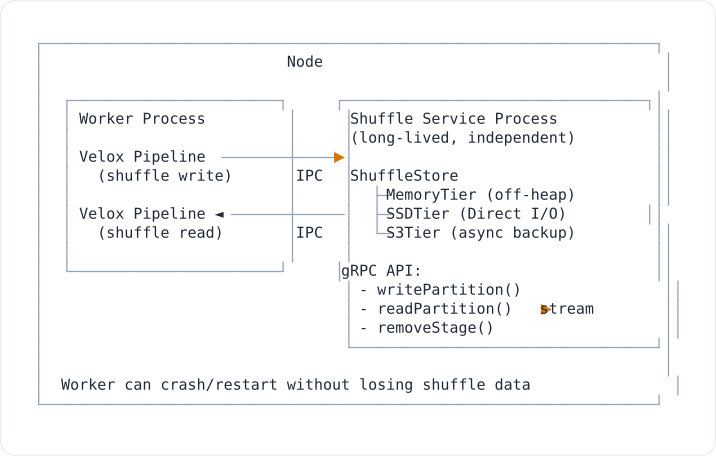

### 18.2 Shuffle Service API

```protobuf
service ShuffleService {
    rpc WritePartition(WritePartitionRequest) returns (WritePartitionResponse);
    rpc ReadPartition(ReadPartitionRequest) returns (stream DataChunk);
    rpc RemoveStage(RemoveStageRequest) returns (RemoveStageResponse);
    rpc GetStatus(GetStatusRequest) returns (ShuffleServiceStatus);
}

message WritePartitionRequest {
    string query_id = 1;
    int32 stage_id = 2;
    int32 partition_id = 3;
    int32 attempt_id = 4;       // for speculative execution dedup
    bytes data = 5;             // Arrow IPC serialized batch
    bool is_last = 6;           // marks end of partition
}

message ReadPartitionRequest {
    string query_id = 1;
    int32 stage_id = 2;
    int32 partition_id = 3;
}
```

### 18.3 Tiered Storage

```pseudocode
class ShuffleStore:
    memoryTier: OffHeapMemoryPool    // fast path, bounded (e.g., 16GB)
    ssdTier: DirectIOFileStore       // overflow, larger (e.g., 500GB)
    config:
        memoryThreshold = 0.8        // spill to SSD when memory > 80%

    function writePartition(req):
        key = (req.query_id, req.stage_id, req.partition_id, req.attempt_id)
        if memoryTier.usage < memoryThreshold:
            memoryTier.append(key, req.data)
        else:
            ssdTier.append(key, req.data)

    function readPartition(req):
        key = (req.query_id, req.stage_id, req.partition_id)
        if memoryTier.contains(key):
            return memoryTier.read(key)
        return ssdTier.read(key)

    function removeStage(queryId, stageId):
        memoryTier.removePrefix((queryId, stageId))
        ssdTier.removePrefix((queryId, stageId))
```

### 18.4 Pluggable Shuffle Backend (design sketch)

The pseudocode below is a proposed backend abstraction, not the production
shuffle writer. The current Worker executes the canonical producer Exchange
through the Native callback, serializes to `SerializedShuffleQueue`, and serves
partitions over Native Flight. The queue currently makes an independent byte
copy at admission; it is count-bounded, not yet byte-accounted against the
task memory grant.

```pseudocode
interface ShuffleWriter:
    function write(partitionId: int, batch: ArrowBatch)
    function flush()

class EmbeddedShuffleWriter implements ShuffleWriter:
    // Proposed embedded backend; not the production implementation
    function write(partitionId, batch):
        taskMemoryPool.allocate(batch.size)
        shuffleBuffer[partitionId].append(batch)

class ExternalShuffleWriter implements ShuffleWriter:
    // Delegates to External Shuffle Service via gRPC
    function write(partitionId, batch):
        client.writePartition(WritePartitionRequest(queryId, stageId, partitionId, batch))

function createShuffleWriter(config):
    if config.shuffleService.enabled:
        return ExternalShuffleWriter(config.shuffleService.endpoint)
    return EmbeddedShuffleWriter()
```

### 18.5 Trade-offs

| Aspect | Embedded (Current) | External (ESS) |
|--------|-------------------|-----------------|
| Performance | Current Native path copies serialized bytes once at queue admission; throughput is not yet benchmarked | Additional transport and service overhead; no measured per-batch claim yet |
| Reliability | In-memory queue is lost on Worker crash; recovery requires recomputation or a durable backend | A durable external service can survive Worker crash if its production commit/restore contract is proven |
| Scalability | Shuffle competes with compute for memory; cannot scale independently | Independent memory pool; can scale shuffle storage without adding Workers |
| Complexity | Simple — single process | Medium — separate process lifecycle, deployment, monitoring |
| Auto-scaling | Dangerous — scale-down loses shuffle | Safe — shuffle data persists on node even after Worker termination |
| Resource isolation | Shared Task Memory Pool | Dedicated off-heap memory + SSD; no contention with compute |

### 18.6 Migration Path

| Step | Phase | Description |
|------|-------|-------------|
| 1 | Pluggable Interface | Proposed refactor to shuffle reader/writer interfaces and an `EmbeddedShuffleWriter`. |
| 2 | Shuffle Service Process | Proposed standalone `ShuffleService` with gRPC and tiered storage. |
| 3 | Worker Integration | Proposed `ExternalShuffleWriter`/`ExternalShuffleReader`; the shown config flag is not implemented. |
| 4 | Coordinator Awareness | Coordinator tracks shuffle locations via Shuffle Service (not Worker heartbeat). Enables shuffle-aware scheduling and speculative execution dedup. |

> **Target cross-reference:** The proposed stage-retry and external-shuffle designs
> use an attempt identifier in the proposed `WritePartitionRequest` for deduplication. The current
> native shuffle partitioner is described in [native execution](./native-execution.md).

### Table qualification and metadata lookup ownership

`SessionTableNames` binds a query's default catalog/schema to Metadata's
`QualifiedTableNames`; neither performs authorization. `ConnectorTableLookup`
uses the caller's already scoped Connector session and preserves unknown-table
and `IF EXISTS` behavior. The trusted identity, tenant, snapshot selectors, and
query authority continue to be bound by `SessionContextConverter`; call sites
invoke it directly. These helpers do not own transactions or close borrowed
Catalog/Connector resources.

`TableProcedureCall` owns CALL table-literal interpretation shared by
admission and execution. Clustering, Index DDL, Branch DDL, and Server streaming
assembly no longer depend on the former query-statement TableResolver (retired) class.
Metadata's helpers currently ship in the existing `pangrova-metadata-catalog` artifact;
its full API/Core/Provider split remains pending. Query session adaptation still
lives in Coordinator until the session contract closure is extracted.

### Compiled relation ownership

Planner Core owns `analysis.AuthorizedRelation` and
`substrait.CompiledScanSchemas`. Query's authenticated compilation pipeline
produces the relation, and Generation/Feature/AI consumers depend on that
Planner product rather than a Query runtime value class. Policy snapshots in
the product are compilation observations: runtime submission/publication must
still check current permissions and ownership. Structural schema extraction
alone does not authorize a read.

`planner.api.fragment.SerializedPlanFragment` owns serialized bytes plus typed
retrieval/AI plan intents. It exposes no Calcite, protocol SDK, central SPI or
Core types; inputs and returned bytes retain their defensive-copy semantics.
`AuthorizedRelation` remains in Core because its graph, scan descriptors and
policy evidence still have implementation dependencies. `StagePlanAccess`
continues to expose live compiler capabilities and is not yet a pure execution
contract. Moving those remaining types into API without extracting their
closure would violate the module boundary.

### Privilege statement execution

GRANT/REVOKE use the Parser API AST and the Server-owned `PrivilegeStatementTasks`.
`StatementClassifier` categorizes them as DDL; `PermissionChecker` requires an
identity and configured access control, while the persistence operation rechecks
current delegation authority under the shared authorization mutation gate.
`SecurityAdministrationBootstrap` selects the PostgreSQL repository. NOOP/bypass
and security-disabled configurations register explicit rejection, not an unsecured
implementation. Query UUIDs identify durable privilege mutation receipts.
See [security semantics and verification limits](security.md#sql-privilege-administration).
