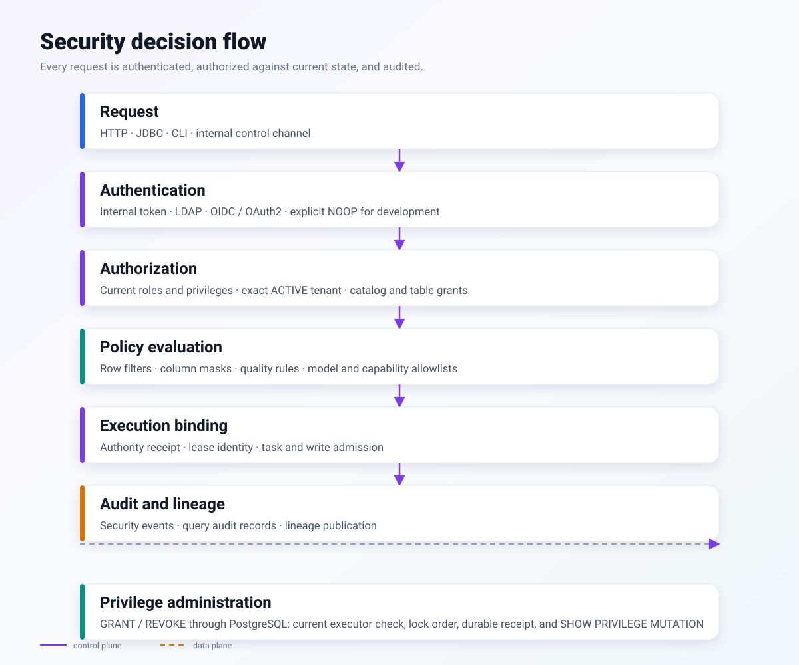
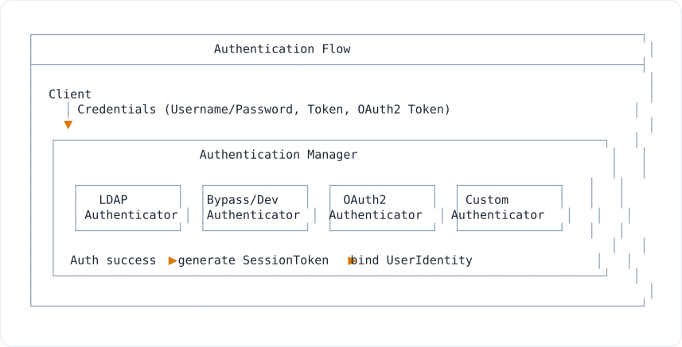
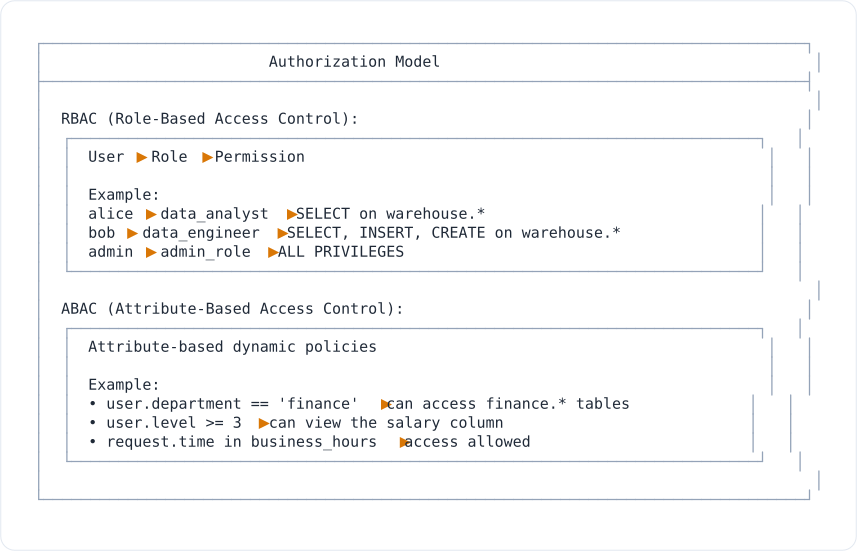
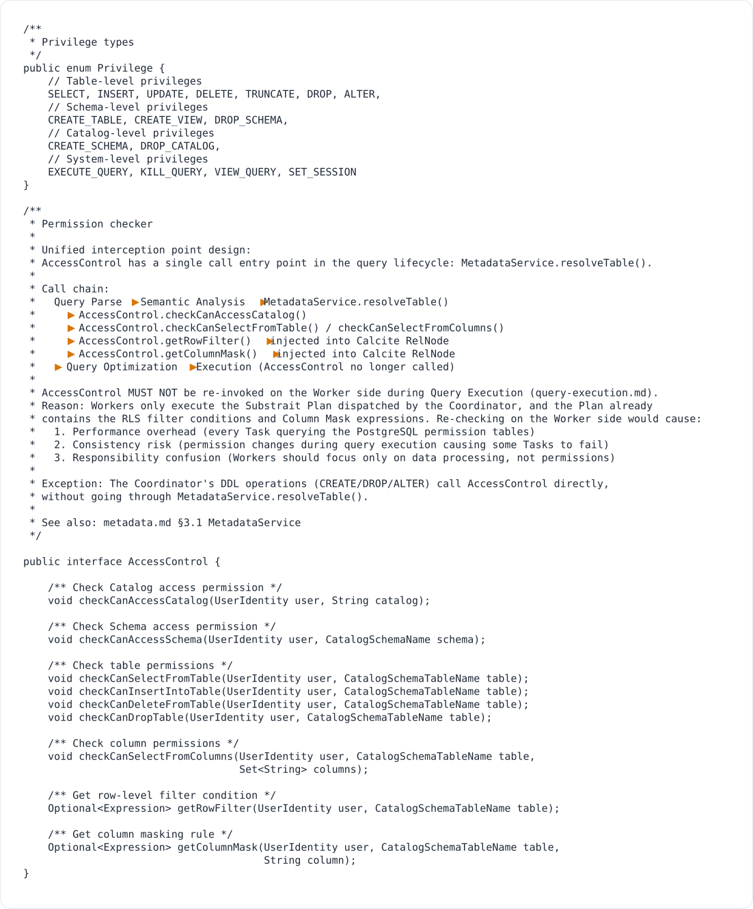
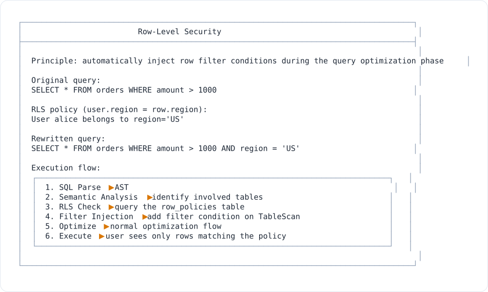
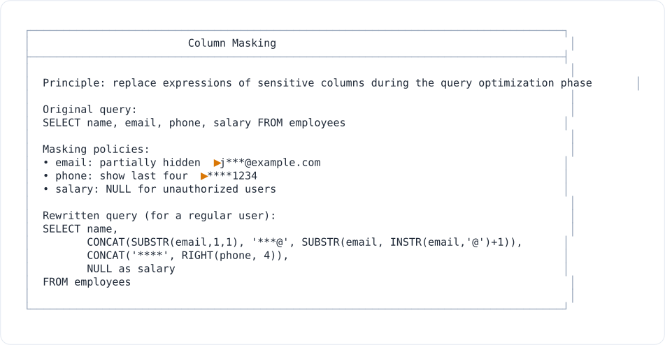
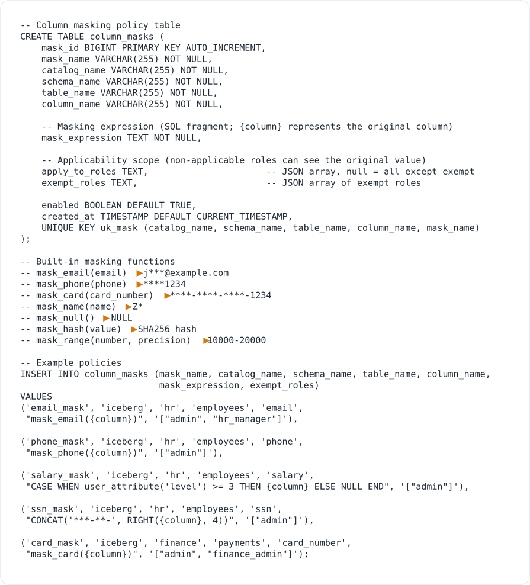
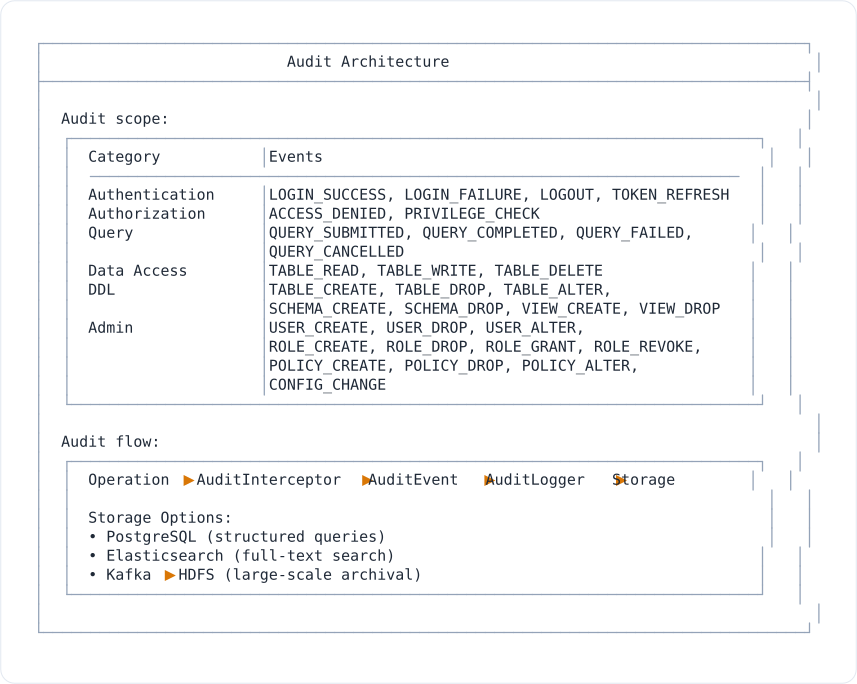
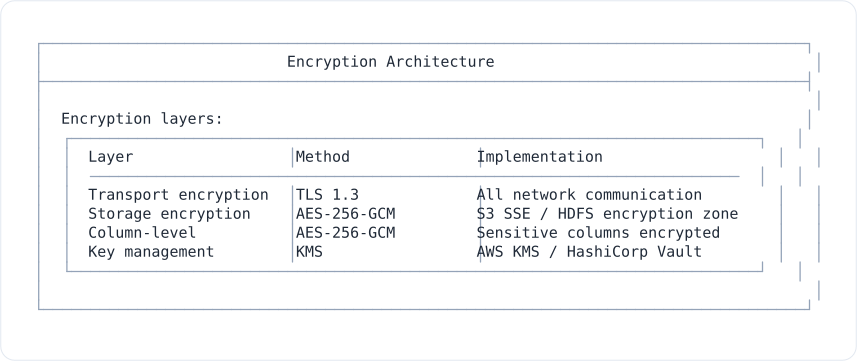
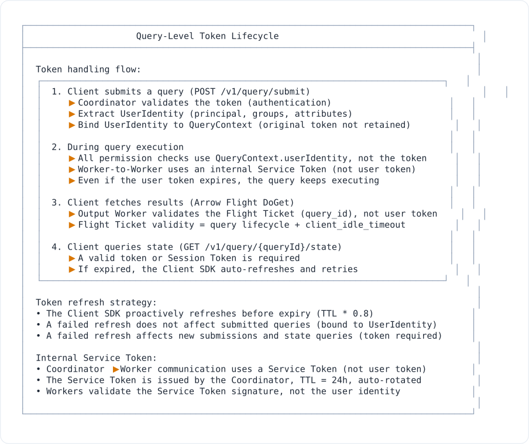

# Pangrova — Security

> **Accuracy scope.** This is a living architecture document. Content explicitly marked
> draft, proposed, planned, phase, target, or remaining work is design intent rather
> than implemented support. For current behavior, code wiring and end-to-end tests
> take precedence.

> **Summary.** Authentication, authorization, row/column-level access control, data masking, and audit logging.

The OAuth2 provider verifies signed tokens with issuer-scoped JWKS keys. It accepts RS256 and ES256 (P-256). A configured audience must match an entire case-sensitive `aud` member. Key rotation replaces the signing set. Encryption-only keys, conflicting key usages and ambiguous key IDs are excluded. A change of issuer publishes its discovery keys and validation policy together. A failed discovery for a new issuer leaves its signing set empty. Signed claims may occupy up to 256 KiB after decoding or DEF/GZIP expansion. The entire compact token is limited to 512 KiB.

SQL privilege `GRANT`/`REVOKE` now has a parser → Server SQL adapter → atomic
PostgreSQL authority path. It supports multiple privileges and roles, grant options,
exact scope revocation, RESTRICT/CASCADE, and durable mutation receipts. The old
unauthorized direct-store SecurityStatementHandler (retired) has been removed. Component
verification uses real PostgreSQL and the production statement dispatcher.
`SqlPrivilegeAuthorityE2ETest` additionally exercises the authenticated HTTP query
pipeline and actual Iceberg/Native reads. Its bearer authenticator is a test
identity fixture; OAuth2/LDAP implementations have separate integration coverage. See [SQL privilege administration](#sql-privilege-administration).

## Current module boundary

`pangrova-security` is now an aggregator. Its API artifact owns calling and plugin contracts under `.api`;
Core owns orchestration, and authentication (builtin/LDAP/OAuth2), RBAC policy,
environment/file secrets and AWS KMS are separate implementation artifacts.
OAuth2 owns its JJWT/Jackson/cache dependencies; KMS owns AWS configuration and SDK.
`EncryptedData` and the `KeyManager` extension live in the SDK-free API.

Security store ports belong to `pangrova-persistence-security-api`. Connection-bound
current-role/grant/policy and model authority ports belong to `persistence-jdbc-api`.
Their Connection is borrowed from the caller. `AuthorizationPublicationLock` specifies
transaction-scoped acquisition without committing, rolling back or closing that connection.
Core's deferred authorization and policy reader now receive their backend collaborators
explicitly. Security Core's production dependency closure contains no persistence backend.
Lock → current roles → grants → policy checks, and row validation before mask reads,
remain in the original order. The Metadata adapter still selects the PostgreSQL readers;
whole-workflow ownership and Server-only composition remain unfinished P5 work.

`pangrova-persistence-security-postgresql` owns the extracted SQL readers, policy stores,
audit writer, codecs and authorization gate. `pangrova-persistence-security-memory`
contains the existing production Tenant implementation only. In-memory Role, static Grant
and in-memory Mask are shared Testing Kit fixtures: they have no production startup path.
Tenant now has one PostgreSQL implementation under `persistence.security.postgresql.tenant`.
It stores definition, nullable quota, namespace restrictions and properties in `tenants`,
and memberships in `tenant_user_memberships`. The former Metadata implementation and
the unassembled normalized `tenant/tenant_quota/tenant_property/tenant_membership`
implementation have been merged; the parallel table definitions are removed.

Tenant Store has no schema-creation method. Canonical migrations V1/V4/V103 initialize
its tables, distinguish absent quota from explicit all-zero quota, and install authority
mutation triggers before stores are used. Existing migration bytes remain unchanged.
No old-table mapping, data-copy, dual-write or compatibility tool is provided.
V104 initializes policy/audit tables and installs the authority, role-drop, storage-profile
and file-space grant triggers. Policy stores no longer expose `initSchema`; the audit
writer performs a read-only readiness check and fails if its schema is unavailable.
The Coordinator applies the canonical bundle before constructing security services.
Initialization for other domains is tracked separately; this change covers Security persistence.

Both Tenant backends atomically upsert complete definitions and retain original creation
metadata. PostgreSQL locks the authority mutation gate before its write, rolls back on
SQL/runtime/error failures, and preserves rollback failures as suppressed exceptions.
Membership resolution reads membership and tenant in one backend snapshot; stale removal
for a former tenant cannot delete a reassigned membership. Memory filters ACTIVE tenants
and uses one instance monitor, with no durability or cross-process guarantee.
`TenantPersistenceException` belongs to the persistence contract and preserves the existing
outward metastore error code; a commit exception does not prove rejection.


`SecurityPolicyEventPublisher` is a notification contract. `LocalSecurityPolicyEventBus`
is now a Testing Kit fixture after the caller audit found only test consumers. It
is synchronous and process-local: listener exceptions are logged and isolated, with
no durability, replay or atomic-outbox guarantee. Empty row-policy and column-mask
stores are also test-only fixtures, never a production authorization fallback. The former
SecurityStatementHandler/event bus mutation path has been removed. Production SQL privilege
and tenant mutations are registered by `SecurityAdministrationBootstrap` and recheck current
PostgreSQL authority; test-only event delivery is not an alternative authorization path.

The lightweight `pangrova-security-secrets` runtime owns template expansion and
provider discovery for Coordinator, Worker, and AI. Its registry rejects duplicate
or blank prefixes. Prefixes are case-sensitive and installation takes effect at process restart.

Coordinator discovers authentication providers through `AuthenticatorFactory`, checks
the contract version and validates the selected mechanism before the HTTP entry point
accepts traffic. Anonymous mode is reserved for the built-in NOOP authenticator.
Server selects the audit backend and wires PostgreSQL-backed RBAC. The AWS envelope
encryption library records a logical format version. KMS owns physical key rotation.

## Public policy contracts

`org.pangrova.security.api.exception.AuthorizationDeniedException` is the shared authorization
failure, retaining the `AccessDeniedException` hierarchy and `ACCESS_DENIED` error code.
Consumers must not import this exception from the former `security.core.authz` package.
`security.api.policy.SqlIdentifierValidator` owns lexical identifier/policy checks used
by both row-filter and column-mask API constructors and the grant/revoke handler.
These contracts can load without Security Core or JDBC implementations.

Policy expressions reject standalone DROP, ALTER, CREATE, TRUNCATE, GRANT and REVOKE
keywords, including a later keyword following an identifier that contains the same
text. Underscores and dollar signs remain identifier characters, so `drop_count`
and `can_drop` do not count as standalone DROP. Case normalization is locale independent.
This conservative precheck also rejects keywords in quoted text; it is not a SQL parser
or an authorization decision. Planning and authorization remain mandatory downstream.

## Audit composition

`org.pangrova.server.coordinator.assembly.security.audit.AuditWriterFactory` owns backend selection; audit contracts,
Core emitters and JDBC writers do not depend on this assembly. A null/blank backend
token defaults to LOG, while an unknown token is rejected. Explicit JDBC or COMPOSITE
selection requires a DataSource and fails if it is absent, preserving the requested
durability contract. Coordinator composition selects COMPOSITE when it has a metadata
DataSource and explicitly selects LOG for an in-memory deployment. COMPOSITE writes
to both structured logging and the JDBC audit store.

## 1. Security Architecture Overview



---

## 2. Authentication

### 2.1 Authentication Architecture



### 2.2 Authentication SPI

```java
/**
 * Authenticator SPI
 */
//
public interface Authenticator extends AutoCloseable {
    String getName();
    void init(Map<String, String> config);
    AuthenticationResult authenticate(AuthenticationRequest request);
    boolean supports(AuthenticationRequest request);
    boolean isHealthy();
    @Override void close();
}

/**
 * Authentication request
 */
public class AuthenticationRequest {
    private final String username;
    private final String password;
    private final String token;
    private final byte[] kerberosTicket;
    private final Map<String, String> extraCredentials;
    private final String clientIp;
}

/**
 * User identity
 */
public class UserIdentity {
    private final String principal;           // Principal identifier
    private final Set<String> groups;         // Groups the user belongs to
    private final Map<String, String> attributes;  // Extended attributes
    private final Instant authenticatedAt;
}

/**
 * LDAP authenticator implementation
 */
public class LdapAuthenticator implements Authenticator {

    private final LdapConfig config;
    private final LdapContextFactory contextFactory;

    @Override
    public AuthenticationResult authenticate(AuthenticationRequest request) {
        try {
            DirContext ctx = contextFactory.createContext(
                config.getUserDnPattern().replace("{0}", request.getUsername()),
                request.getPassword());

            // Fetch user groups
            Set<String> groups = fetchUserGroups(ctx, request.getUsername());

            return AuthenticationResult.success(
                new UserIdentity(request.getUsername(), groups, Map.of()));

        } catch (AuthenticationException e) {
            return AuthenticationResult.failure("Invalid credentials");
        }
    }
}

/**
 * OAuth2 authenticator implementation
 */
public class OAuth2Authenticator implements Authenticator {

    @Override
    public AuthenticationResult authenticate(AuthenticationRequest request) {
        // 1. Validate Access Token
        TokenInfo tokenInfo = tokenValidator.validate(request.getToken());

        // 2. Fetch user info
        UserInfo userInfo = userInfoClient.getUserInfo(request.getToken());

        return AuthenticationResult.success(
            new UserIdentity(userInfo.getSubject(), userInfo.getGroups(),
                Map.of("email", userInfo.getEmail())));
    }
}
```

---

## 3. Authorization

### 3.1 RBAC + ABAC Hybrid Model



### 3.2 Permission Model



### 3.3 Permission Storage

The PostgreSQL authorization path resolves direct assignments and group mappings
against the current role registry in one statement. Grant lookup applies the
effective role set in SQL. A subject with no effective roles requires no grant read.

```sql
-- Role definitions
CREATE TABLE roles (
    role_id BIGINT PRIMARY KEY AUTO_INCREMENT,
    role_name VARCHAR(255) UNIQUE NOT NULL,
    description TEXT,
    created_at TIMESTAMP DEFAULT CURRENT_TIMESTAMP
);

-- User-role mapping
CREATE TABLE user_roles (
    user_principal VARCHAR(255) NOT NULL,
    role_id BIGINT NOT NULL,
    granted_by VARCHAR(255),
    granted_at TIMESTAMP DEFAULT CURRENT_TIMESTAMP,
    PRIMARY KEY (user_principal, role_id)
);

-- Permission grants
CREATE TABLE privileges (
    privilege_id BIGINT PRIMARY KEY AUTO_INCREMENT,
    role_id BIGINT NOT NULL,
    privilege_type VARCHAR(50) NOT NULL,      -- SELECT, INSERT, etc.
    object_type VARCHAR(50) NOT NULL,         -- CATALOG, SCHEMA, TABLE, COLUMN
    catalog_name VARCHAR(255),
    schema_name VARCHAR(255),
    table_name VARCHAR(255),
    column_name VARCHAR(255),
    with_grant_option BOOLEAN DEFAULT FALSE,
    granted_at TIMESTAMP DEFAULT CURRENT_TIMESTAMP,
    INDEX idx_role_object (role_id, object_type, catalog_name, schema_name, table_name)
);
```

### 3.4 Metadata-table read authority

The implemented metadata suffixes (`$files`, `$entries`, `$manifests`,
`$snapshots`, `$history`, `$tags`, `$options`, `$schemas`, `$branches`) require
full SELECT authority on the base table. A grant on a suffix name does not
permit reading the base table's metadata. `AccessControlEnforcer` invokes
`TableAccessControl.checkCanReadTableMetadata` for planned scans, explicit
metadata SELECT checks and metadata column checks. The policy subject is always
the authenticated reader.

`DynamicRbacAccessControl` denies these unfiltered metadata reads when a base
row filter or column mask applies to that subject. Metadata counts, paths,
partition values and summaries cannot be transformed by applying a base-row
predicate to the metadata schema. This restriction also covers aggregate-only
queries and SHOW statements routed through these relations. Ordinary base
queries continue through the existing row-filter and mask transformations.

Tenant creation and update persist the tenant, quota, and properties on one JDBC
connection. Role deletion removes the role, grants, and user/group bindings in
one transaction. These owned transactions roll back SQL exceptions, runtime
exceptions, and Errors, preserving rollback failures as suppressed exceptions.
They close the connection without restoring auto-commit after a failure; cleanup
must not commit a partial tenant update or partially revoke a surviving role.
The SQL exception wrappers and authorization-version triggers remain unchanged.

The metadata check resolves roles once for both grants and policy applicability;
revoking a role during the check cannot erase an applicable mask after the
SELECT check succeeds. `EnrichedColumnMaskStore.getTableMasks` enumerates table
policies independently of projection and current schema, including policies on
historical column names. Mask selection preserves normal enabled, role, priority
and exemption semantics. Removing the applicable policy restores metadata
eligibility on the next check. Policy-store failures propagate without allowing
a raw read.

[Athena's documented Iceberg restrictions](https://docs.aws.amazon.com/athena/latest/ug/querying-iceberg.html)
provide a precedent for denying sensitive metadata when row or cell filters
apply. Pangrova deliberately applies one eligibility rule to its whole
implemented metadata family, rather than treating individual metadata columns
as policy-safe without a connector-specific proof. This section describes the
current read boundary; it does not claim a transaction spanning policy changes
and an already running data-plane query.

---

## 4. Row-Level Security

### 4.1 RLS Architecture



### 4.2 RLS Policy Definition

```sql
-- Row-level security policy table
CREATE TABLE row_policies (
    policy_id BIGINT PRIMARY KEY AUTO_INCREMENT,
    policy_name VARCHAR(255) NOT NULL,
    catalog_name VARCHAR(255) NOT NULL,
    schema_name VARCHAR(255) NOT NULL,
    table_name VARCHAR(255) NOT NULL,

    -- Policy expression (SQL fragment)
    -- May reference: current_user(), current_groups(), user_attribute('key')
    filter_expression TEXT NOT NULL,

    -- Applicable scope
    apply_to_roles TEXT,                      -- JSON array of role names, null = all
    enabled BOOLEAN DEFAULT TRUE,
    priority INT DEFAULT 0,                   -- priority when multiple policies apply

    created_at TIMESTAMP DEFAULT CURRENT_TIMESTAMP,
    UNIQUE KEY uk_policy (catalog_name, schema_name, table_name, policy_name)
);

-- Example policies
INSERT INTO row_policies (policy_name, catalog_name, schema_name, table_name, filter_expression)
VALUES
-- Users can only see data from their own department
('department_isolation', 'iceberg', 'hr', 'employees',
 "department = user_attribute('department')"),

-- Can only see orders from their own region
('region_isolation', 'iceberg', 'sales', 'orders',
 "region IN (SELECT region FROM user_regions WHERE user_id = current_user())"),

-- Sensitive data visible only to high-level users
('salary_protection', 'iceberg', 'hr', 'salaries',
 "CASE WHEN user_attribute('level') >= 3 THEN TRUE ELSE employee_id = current_user() END");
```

### 4.3 RLS Implementation

```java
/**
 * Row-level security filter
 */
public class RowLevelSecurityFilter {

    private final RowPolicyStore policyStore;
    private final ExpressionParser expressionParser;

    /**
     * Get the row filter condition for a table
     */
    public Optional<Expression> getRowFilter(UserIdentity user, CatalogSchemaTableName table) {
        List<RowPolicy> policies = policyStore.getPolicies(
            table.getCatalog(), table.getSchema(), table.getTable());

        if (policies.isEmpty()) {
            return Optional.empty();
        }

        // Filter policies applicable to the current user
        List<RowPolicy> applicablePolicies = policies.stream()
            .filter(p -> p.isEnabled())
            .filter(p -> p.appliesTo(user))
            .sorted(Comparator.comparingInt(RowPolicy::getPriority).reversed())
            .toList();

        if (applicablePolicies.isEmpty()) {
            return Optional.empty();
        }

        // Combine multiple policies with AND
        Expression combined = applicablePolicies.stream()
            .map(p -> parseAndBind(p.getFilterExpression(), user))
            .reduce((a, b) -> new LogicalExpression(AND, a, b))
            .orElseThrow();

        return Optional.of(combined);
    }
```

### 4.4 RLS Multi-Policy Conflict Resolution Rules

For a controlled table, the planner reads policies by current stable table ID in
the same statement that checks for unbound rows at its current name. An enabled
unbound policy blocks compilation. Scans of the same authorization target reuse
the resulting predicate within one compilation and bind it to each scan's column
order. Publication re-reads the current policy on its existing transaction and
compares it with the observed predicate.

When a single table has multiple RLS policies, explicit merge rules are required. Pangrova adopts an **AND semantics + priority ordering** model.

#### Merge semantics: AND vs OR

| Scenario | Merge method | Reason |
|------|----------|------|
| Multiple policies on the same table | **AND** (all policies must be satisfied simultaneously) | Security first: multiple policies represent isolation requirements across multiple dimensions and must all be satisfied |
| A single user matches multiple roles, each with a different policy | **AND** (intersection of per-role policies) | Least-privilege principle: the user can only see the intersection of all role policies |
| Policy with `apply_to_roles = null` (global policy) | **AND**-merged with role-specific policies | A global policy is a baseline constraint and cannot be relaxed by role policies |

> **Design decision**: The core reason for choosing AND over OR is security. OR semantics means access is granted if any single policy is satisfied, which lets a permissive policy override a strict one and creates a data-leak risk. AND semantics ensures all security constraints take effect simultaneously.

#### Role of priority

The `row_policies.priority` field does not affect AND/OR semantics; instead it controls the evaluation order and short-circuit behavior of policies:

| priority value | Behavior |
|---|---|
| High priority (larger value) | Evaluated first. If this policy evaluates to `FALSE`, short-circuit and skip subsequent policies (performance optimization) |
| Low priority (smaller value) | Evaluated later. Executed only when higher-priority policies did not short-circuit |
| Same priority | Evaluated in lexicographic order of `policy_name` (ensures determinism) |

#### Conflict scenario example

```sql
-- Scenario: the employees table has two RLS policies

-- Policy 1: department isolation (priority=10)
-- filter: department = user_attribute('department')

-- Policy 2: region isolation (priority=5)
-- filter: region IN (SELECT region FROM user_regions WHERE user_id = current_user())

-- User alice: department='engineering', region='US'
-- Merged filter condition (AND):
--   department = 'engineering' AND region IN ('US')
-- alice can only see employees in the engineering department and US region

-- User bob: department='finance', but has no user_regions record
-- Merged filter condition (AND):
--   department = 'finance' AND region IN ()  <- empty set
-- bob sees no data (under AND semantics, an empty-set IN condition filters out all rows)
```

#### Special-case handling

| Case | Behavior | Note |
|------|------|------|
| User matches no policy | Returns `Optional.empty()` -> no filter | No policy = no restriction (access must be controlled via RBAC privileges) |
| All matching policies are disabled | Same as above | Disabled policies do not participate in merging |
| Policy expression fails to parse | Throws `PangrovaException(INTERNAL_ERROR)` -> query fails | Security first: on a policy error, deny access rather than degrading to no filter |
| An interactive policy references a nonexistent user_attribute | That attribute returns the empty string `""` | The predicate determines whether it matches; policy authors must handle absent attributes explicitly |
| A deferred execution's policy references current_groups() or user_attribute(...) | Rejected before rendering or execution | A stored principal does not reconstruct the original authentication claims |
| Policy contains a subquery (e.g., `IN (SELECT ...)`) | The subquery is expanded during the Calcite optimization phase | Subquery results are cached per-query and not shared across queries |

Deferred execution restores the persisted principal and tenant through
`DeferredSubjectContext` and resolves roles from current durable grants. Its
internal subject marker only adds restrictions. Row filters and selected,
non-exempt column masks reject policies requiring ephemeral groups or attributes;
they do not substitute missing claims with empty values. The publication-time
policy reader uses the same guard. Stable principal expressions such as
`current_user()` remain available.

The immutable deferred permission, connector-definition and model observations
are owned by `org.pangrova.security.api.authorization.DeferredAuthorizationScope`.
They describe previously admitted work and do not confer current authority.
The canonical metadata encoding owned by `pangrova-security-codec`,
`org.pangrova.security.codec.authorization.DeferredAuthorizationScopeCodec`, handles
encoding, decoding, write receipts and canonical SHA-256 digests. API values do
not depend on the codec or Jackson; callers that need a persisted identity use
`DeferredAuthorizationScopeCodec.sha256(scope)`.

The codec preserves the existing JSON fields, ordering and digests. It rejects
duplicate fields, invalid or oversized scopes, and trailing JSON values or
garbage after a complete scope. Trailing whitespace remains valid for ordinary
scope decoding; write receipts still require the exact canonical bytes. Artifact
replay and publication revalidate restored observations against current durable
authority within the existing transaction gate.

```java

    /**
     * Parse and bind the user context
     */
    private Expression parseAndBind(String expression, UserIdentity user) {
        Expression parsed = expressionParser.parse(expression);

        // Replace built-in functions
        return parsed.accept(new ExpressionRewriter() {
            @Override
            public Expression visitFunctionCall(FunctionCall call) {
                switch (call.getName()) {
                    case "current_user":
                        return new StringLiteral(user.getPrincipal());
                    case "current_groups":
                        return new ArrayLiteral(user.getGroups());
                    case "user_attribute":
                        String key = ((StringLiteral) call.getArguments().get(0)).getValue();
                        return new StringLiteral(user.getAttributes().getOrDefault(key, ""));
                    default:
                        return call;
                }
            }
        });
    }
}
```

---

## 5. Column Masking

### 5.1 Masking Architecture



### 5.2 Masking Policy Definition



### 5.3 Masking Implementation

`DynamicRbacAccessControl` reads the subject's direct and group roles in one
PostgreSQL statement and resolves masks for one authorized table. The policy store
reads authored masks and projects current tag bindings against the stable table ID.
An unproven policy binding fails the read.

`ColumnMaskApplier` keeps the resulting `TableColumnMasks` within one compilation.
Scans of the same authorization target reuse the captured values, including self-joins.
The processor evaluates each referenced column in memory. Mandatory classification
masks retain priority. The first enabled policy applicable to the current roles
determines the expression or exemption.

Each new compilation reads current policy state. Index build admission and
materialization fingerprints use the same table-level mask lookup.
Deferred publication reads masks for the requested column set on the publication
transaction and projects stable table tags once per table observation. It renders
and compares each requested column's effective policy with the captured value.

---

### 5.4 Security Policy Change Events

Security policy changes need to publish events externally so that components such as the result cache can trigger invalidation.

```java
/**
 * Security policy change event
 */
public sealed interface SecurityPolicyChangeEvent
        permits RlsPolicyChanged, ColumnMaskChanged, RoleAssignmentChanged {
    String catalog();
    String schema();
    String table();
}

public record RlsPolicyChanged(String catalog, String schema, String table)
        implements SecurityPolicyChangeEvent {}

public record ColumnMaskChanged(String catalog, String schema, String table)
        implements SecurityPolicyChangeEvent {}

public record RoleAssignmentChanged(String userPrincipal)
        implements SecurityPolicyChangeEvent {
    @Override
    public String catalog() { return ""; }
    @Override
    public String schema() { return ""; }
    @Override
    public String table() { return ""; }
}

/**
 * Event publisher
 */
public interface SecurityPolicyEventPublisher {
    void publish(SecurityPolicyChangeEvent event);
}
```

Consumer contracts:
- Query Result Cache subscribes and performs cache invalidation (see [query-optimization.md](./query-optimization.md)).
- The metadata cache may optionally subscribe, for cache cleanup after privilege changes.

## 6. Audit Log

### 6.1 Audit Architecture



### 6.2 Audit Event Model


```java
/**
 * Audit event
 */
public class AuditEvent {
    private final String eventId;             // UUID
    private final AuditEventType eventType;
    private final Instant timestamp;

    // User information
    private final String principal;
    private final String clientIp;
    private final String userAgent;

    //
    // Distributed tracing correlation (see observability.md §4)
    private final String traceId;             // OpenTelemetry trace ID for cross-referencing with Jaeger
    private final String spanId;              // OpenTelemetry span ID

    // Query information
    private final String queryId;
    private final String sql;
    private final String catalog;
    private final String schema;

    // Accessed objects
    private final List<AccessedObject> accessedObjects;

    // Result
    private final boolean success;
    private final String errorMessage;

    // Resource consumption
    private final long durationMs;
    private final long rowsRead;
    private final long rowsWritten;
    private final long bytesRead;

    // Extended attributes
    private final Map<String, String> properties;
}

/**
 * Accessed object
 */
public class AccessedObject {
    private final ObjectType objectType;      // TABLE, VIEW, COLUMN
    private final String catalog;
    private final String schema;
    private final String table;
    private final Set<String> columns;
    private final AccessType accessType;      // READ, WRITE, DDL
}

/**
 * Audit event types
 */
public enum AuditEventType {
    // Authentication
    LOGIN_SUCCESS, LOGIN_FAILURE, LOGOUT, TOKEN_REFRESH,

    // Authorization
    ACCESS_DENIED, PRIVILEGE_CHECK,

    // Query
    QUERY_SUBMITTED, QUERY_COMPLETED, QUERY_FAILED, QUERY_CANCELLED,

    // Data access
    TABLE_READ, TABLE_WRITE, TABLE_DELETE,

    // DDL
    TABLE_CREATE, TABLE_DROP, TABLE_ALTER,
    SCHEMA_CREATE, SCHEMA_DROP,
    VIEW_CREATE, VIEW_DROP,

    // Administration
    USER_CREATE, USER_DROP, USER_ALTER,
    ROLE_CREATE, ROLE_DROP, ROLE_GRANT, ROLE_REVOKE,
    POLICY_CREATE, POLICY_DROP, POLICY_ALTER,
    CONFIG_CHANGE
}
```

### 6.3 Audit Storage


```sql
-- Audit log table (PostgreSQL)
CREATE TABLE audit_logs (
    event_id VARCHAR(36) PRIMARY KEY,
    event_type VARCHAR(50) NOT NULL,
    event_time TIMESTAMP(6) NOT NULL,

    -- User information
    principal VARCHAR(255) NOT NULL,
    client_ip VARCHAR(45),
    user_agent VARCHAR(500),

    --
    -- Distributed tracing correlation
    trace_id VARCHAR(32),                     -- OpenTelemetry trace ID (hex)
    span_id VARCHAR(16),                      -- OpenTelemetry span ID (hex)

    -- Query information
    query_id VARCHAR(36),
    sql_text TEXT,
    sql_hash VARCHAR(64),                     -- SQL fingerprint

    -- Accessed objects
    catalog_name VARCHAR(255),
    schema_name VARCHAR(255),
    table_name VARCHAR(255),
    accessed_columns JSON,

    -- Result
    success BOOLEAN NOT NULL,
    error_code VARCHAR(50),
    error_message TEXT,

    -- Resource consumption
    duration_ms BIGINT,
    rows_read BIGINT,
    rows_written BIGINT,
    bytes_read BIGINT,

    -- Extension
    properties JSON,

    -- Indexes
    INDEX idx_time (event_time),
    INDEX idx_principal (principal, event_time),
    INDEX idx_query (query_id),
    INDEX idx_table (catalog_name, schema_name, table_name, event_time),
    INDEX idx_type (event_type, event_time)
) PARTITION BY RANGE (UNIX_TIMESTAMP(event_time)) (
    -- Partition by month, retain 12 months
);

-- Audit log archival configuration
-- Hot data: PostgreSQL (30 days)
-- Warm data: Elasticsearch (90 days)
-- Cold data: HDFS/S3 (permanent)
```

### 6.4 Audit Query API

```sql
-- Query all operations of a given user
SELECT * FROM audit_logs
WHERE principal = 'alice'
  AND event_time > NOW() - INTERVAL 7 DAY
ORDER BY event_time DESC;

-- Query access records of a sensitive table
SELECT principal, event_type, sql_text, event_time
FROM audit_logs
WHERE table_name = 'salaries'
  AND event_time > NOW() - INTERVAL 30 DAY
ORDER BY event_time DESC;

-- Query failed access attempts
SELECT principal, client_ip, error_message, event_time
FROM audit_logs
WHERE success = FALSE
  AND event_type = 'ACCESS_DENIED'
  AND event_time > NOW() - INTERVAL 1 DAY;

-- Aggregate query volume per user
SELECT principal, COUNT(*) as query_count,
       SUM(rows_read) as total_rows_read
FROM audit_logs
WHERE event_type = 'QUERY_COMPLETED'
  AND event_time > NOW() - INTERVAL 7 DAY
GROUP BY principal
ORDER BY query_count DESC;
```

---

## 7. Encryption

### 7.1 Encryption Architecture



### 7.2 Transport Encryption Configuration


```yaml
# coordinator-config.yaml — TLS configuration
# Proposed config path: security.encryption.tls.*
security:
  encryption:
    tls:
      enabled: true
      keystore-path: /etc/pangrova/ssl/keystore.jks
      keystore-password: ${SSL_KEYSTORE_PASSWORD}
      truststore-path: /etc/pangrova/ssl/truststore.jks
      truststore-password: ${SSL_TRUSTSTORE_PASSWORD}
      protocol: TLSv1.3
      ciphers:
        - TLS_AES_256_GCM_SHA384
        - TLS_CHACHA20_POLY1305_SHA256

# Internal communication encryption (Worker-to-Worker, Coordinator-to-Worker)
    internal:
      mutual-auth: true  # Mutual authentication
```

### 7.3 Key Management

Security Core uses the `KeyManager` contract for AES-256-GCM envelope encryption.
Tenant and table IDs are length-delimited in the additional authenticated data,
which makes each tenant/table pair distinct even when an identifier contains a
colon. An unsupported envelope format version is rejected before calling KMS.

The AWS implementation owns its SDK client. Close the provider after the last
encryption or decryption. Its rotation operation enables AWS automatic rotation
for the customer-managed key. The library's LocalStack integration covers the
encrypt/decrypt round trip. SQL and storage entry points currently do not install
the library as a data-at-rest policy.

---

## 8. Security Configuration Summary

### 8.1 Query-Level Token Lifecycle Management

Long-running queries (such as large table scans or complex JOINs) may encounter token expiration during execution. Pangrova adopts a query-level token binding strategy:

**Design principle**: bind the token at query submission; a valid token is not required during the query lifecycle.



```java
/**
 * Query-level token binding
 */
public class QueryTokenBinder {

    /**
     * At query submission: validate token → extract identity → bind to QueryContext
     * Query execution thereafter no longer depends on the original token
     */
    public QueryContext bindToken(AuthenticationResult authResult, QueryRequest request) {
        UserIdentity identity = authResult.getUserIdentity();

        return QueryContext.builder()
            .queryId(generateQueryId())
            .userIdentity(identity)           // Bind identity, do not retain the token
            .authenticatedAt(Instant.now())
            .sessionProperties(request.getSessionProperties())
            .build();
    }
}
```

### 8.2 Security Configuration Reference

```yaml
# security-config.yaml
security:
  # Authentication configuration
  authentication:
    type: ldap  # ldap, oauth2, kerberos, custom
    ldap:
      url: ldap://ldap.example.com:389
      base-dn: dc=example,dc=com
      user-dn-pattern: uid={0},ou=users
      group-search-base: ou=groups
    oauth2:
      issuer-uri: https://auth.example.com
      client-id: pangrova
      client-secret: ${OAUTH_CLIENT_SECRET}

  # Authorization configuration
  authorization:
    type: file  # file, database, ranger
    file:
      path: /etc/pangrova/access-control.json
    database:
      url: jdbc:postgresql://localhost:5432/pangrova_security

  # Row-level security
  row-level-security:
    enabled: true
    cache-ttl: 5m

  # Column masking
  column-masking:
    enabled: true
    cache-ttl: 5m

  # Audit
  audit:
    enabled: true
    storage: postgresql  # postgresql, elasticsearch, kafka
    postgresql:
      url: jdbc:postgresql://localhost:5432/pangrova_audit
    retention-days: 90

  # Encryption — proposed path: security.encryption.tls.* (see §7.2)
  #
  encryption:
    tls:
      enabled: true
      protocol: TLSv1.3
      ciphers:
        - TLS_AES_256_GCM_SHA384
        - TLS_CHACHA20_POLY1305_SHA256
    storage:
      enabled: true
      key-provider: aws-kms
      master-key-id: alias/pangrova-master
```


---

## 9. Secret Management

Coordinator and Worker discover prefix-scoped `SecretProviderFactory` implementations through
the same registry. It checks contract versions and duplicate prefixes before creating one resolver per installed prefix. Coordinator includes ENV and FILE. The standard Worker includes
ENV for both AI credentials and connector references. Embedded hosts can install
additional providers on their process classpath. An unavailable prefix fails lookup,
and duplicate prefixes fail registration. ENV validates the variable name before
reading it and rejects blank values. FILE reads the first line and resolves projected
volume symlinks within its administrator-controlled directory. Links outside that
directory are rejected. These providers receive the tenant scope where the caller
supplies one. Neither caches plaintext on behalf of another tenant.

### 9.1 Connector credentials

Catalog properties consumed by a connector can contain templates such as
`${ENV:AWS_ACCESS_KEY_ID}` and `${FILE:s3-secret-key}`. The default FILE root is
`/etc/pangrova/secrets`. A relative reference is resolved within that directory.
The process constructing the connector needs the referenced provider and credential.
A remote Worker may therefore need its own provider installation and secret mount.

### 9.2 Worker AI credentials

A configured model accepts a URI-shaped reference such as
`worker.ai.models.chat.secret-reference=env://PANGROVA_CHAT_API_KEY`.
Worker resolves that reference when constructing the provider client. A governed
FILE capability secret is resolved when its Worker runtime initializes. Both paths
use the role's secret registry. Refer to the [Worker configuration](../configuration/worker.md)
for the model and governed FILE settings.

### 9.3 Rotation and revocation

ENV reads the process environment. Restart the affected role to load a changed
environment variable. FILE reads its current target on lookup. An existing
connector or model client can retain credentials for its lifetime. Rotate the
credential in its authority and recreate the affected runtime when the new value
must take effect. Pangrova ships no background refresh timer or file watcher.

Vault and KMS secret references require a separately installed provider. The AWS
KMS key manager serves envelope encryption through a separate API.

---

## 10. Cross-Reference: Result Cache Security Isolation

> **See also:** [`query-optimization.md`](query-optimization.md) — Section 3.2 (QueryFingerprintCalculator) and Section 3.3 (Cache Invalidation Triggers)

The query result cache includes security dimensions in its fingerprint to prevent cross-boundary data leakage. Specifically:

- **Cache fingerprint** incorporates `tenant_id`, `user_principal`, `active_roles_hash`, `rls_policy_hash`, and `column_mask_hash`, ensuring that cached results are never shared across different security contexts.
- **Cache invalidation** is triggered automatically when security policies change:
  - RLS policy change → invalidates all cache entries for the affected table
  - Column mask change → invalidates all cache entries for the affected table
  - Role assignment change → invalidates all cache entries for the affected user
- `SecurityPolicyChangeEvent` and `SecurityPolicyEventPublisher` define the event contract. A production cache-invalidation subscriber is target design; the current test-kit implementation is `LocalSecurityPolicyEventBus`.

This design ensures that the result cache respects all security boundaries defined in this document (authentication, RBAC, RLS, column masking) without requiring callers to manually manage cache coherence.

---


## 11. Observability Integration

This section defines the metrics and tracing integration points for the security layer. For the full observability design, see [observability.md](./observability.md).

### 11.1 Metrics

| Metric | Source Component | Description |
|--------|-----------------|-------------|
| `pangrova.security.auth.attempts` | Authenticator | Authentication attempts |
| `pangrova.security.auth.failures` | Authenticator | Authentication failures |
| `pangrova.security.auth.latency` | Authenticator | Authentication latency |
| `pangrova.security.authz.checks` | AccessControl | Authorization check count |
| `pangrova.security.authz.denials` | AccessControl | Authorization denials |
| `pangrova.security.authz.latency` | AccessControl | Authorization check latency |
| `pangrova.security.rls.filters_injected` | AccessControl | RLS filters injected |
| `pangrova.security.column_masks.applied` | AccessControl | Column masks applied |
| `pangrova.security.audit.events` | AuditLogger | Audit events recorded |

### 11.2 Tracing Spans

Security operations are children of the `query.optimize` span:

- `security.authenticate` — Authentication (child of `query.execute`)
- `security.authorize` — Authorization check (child of `query.optimize`)
- `security.rls.inject` — RLS filter injection (child of `query.optimize`)
- `security.mask.apply` — Column mask application (child of `query.optimize`)

### 11.3 Log Events

- Authentication success/failure events (INFO/WARN)
- Authorization denial events with principal and resource (WARN)
- Security policy change events (INFO)
- Audit log write events (DEBUG)

See [14 §7](./observability.md) for structured logging format.


> **Provider registration.** Coordinator loads `AuthenticatorFactory` for authentication.
> The secret registry loads `SecretProviderFactory` for prefix-based resolution. Embedders
> construct the AWS `KeyManager` with its configuration and own its lifetime.


> **Audit implementation:** Security events use `AuditEventEmitter`. A separate
> resource-audit logger and the unified `audit_events` storage model described in
> the observability target design are not currently implemented.


> **Configuration status:** Only the keys listed in
> [Security configuration](../configuration/security.md) are verified runtime
> configuration. The broader RLS, masking, audit, and secret-management YAML in
> this document is target design.


> **ColumnMaskStore Interface (§5.3)**:
> ```java
> public interface ColumnMaskStore {
>     Optional<ColumnMask> getMask(String table, String column, SecurityContext ctx);
>     void createOrUpdateMask(String table, String column, String maskExpr, String tag);
>     void removeMask(String table, String column);
>     List<ColumnMask> listMasks(String table);
> }
> ```


> **Security Error Codes**: Security-related error codes are defined in [resilience.md §2.2](./resilience.md) at range 1800–1899: `AUTHENTICATION_FAILED(1801)`, `TOKEN_EXPIRED(1802)`, `RLS_POLICY_ERROR(1803)`, `COLUMN_MASK_ERROR(1804)`, `AUDIT_WRITE_FAILED(1805)`. These codes cover authentication failures, token expiry, RLS/masking policy errors, and audit write failures. All security components (Authenticator, AccessControl, AuditLogger) should throw `PangrovaException` with the corresponding error code from this range.

## SQL privilege administration

```sql
GRANT SELECT, INSERT ON TABLE lake.sales.orders TO ROLE analysts, loaders;
GRANT SELECT ON SCHEMA lake.sales TO ROLE delegation_team WITH GRANT OPTION;
REVOKE GRANT OPTION FOR SELECT ON SCHEMA lake.sales FROM ROLE delegation_team CASCADE;
REVOKE SELECT ON TABLE lake.sales.orders FROM ROLE analysts RESTRICT;
```

The supported scope kinds are CATALOG, SCHEMA, TABLE, VOLUME, STAGE, and
STORAGE PROFILE (`STORAGE_PROFILE` is also accepted). Table/volume/stage names
use the session catalog and schema when omitted. Schema names accept one or two
components; catalog/profile names accept one. Quoted names preserve component
boundaries and case. Literal wildcard targets are rejected. Privileges must be
valid for their scope; OWNER is managed through ownership operations, not GRANT.
Column-specific grants, user recipients, role membership DDL and role inheritance
are not exposed by this SQL grammar. Existing roles and trusted bootstrap grants
are provisioned through their existing administrative stores. No role name or IdP
group name implicitly grants administrator authority.

`SecurityAdministrationBootstrap` registers the SQL handlers for both supported
and unavailable configurations, so disabled capability fails explicitly. Mutation
is enabled only with configured authentication (OAuth2/LDAP) and PostgreSQL.
Security-disabled and NOOP/bypass configurations cannot mutate privileges, even
when a supplied identity happens to have a privileged role. The SQL adapter never
constructs a Store or interprets an HTTP identity claim itself.

`PrivilegeMutationRepository` owns a complete atomic operation. The PostgreSQL
implementation takes the existing exclusive authorization transaction gate before
reading current role membership and grants. Each requested privilege requires a
containing OWNER or matching WITH GRANT OPTION. All recipients must be existing
roles. The entire multi-role/multi-privilege statement, authorization revision and
receipt/audit row commit together. Failures roll back the whole statement; there
is no memory fallback. Namespace policy grants may precede discovery of external
tables. Storage profile read grants retain the existing database existence guard.

Each SQL-issued grant records a specific supporting grant. Independent grantors
retain independent rows. RESTRICT (the default) rejects unresolved descendants;
CASCADE removes only the transitive dependency chain, preserving independent
support. Revoking the grant option preserves the recipient's own use permission
while removing dependent grants. Non-owners revoke only grants they issued;
owners can revoke matching non-OWNER grants from any grantor. Revocation matches
scope columns exactly: `NULL` in a schema target is not a delete wildcard over
all table/column grants. Role membership is checked when issuing a grant; changing
the issuing user's membership does not itself revoke grants already issued as
that role. Dropping the role or its supporting grant removes their dependent grants.

Initialization lives only in V105 of `pangrova-schema-migrations`. The parent
foreign key and mutation guard also prevent trusted low-level Store mutations
from leaving orphan delegated privileges. Existing migrations are unchanged;
there is no historical data migration, dual write or compatibility layer.

The query UUID is the mutation request ID. A successful SQL result contains
`request_id`, `authorization_revision`, `changed_grants`, and `recorded_at`.
The repository returns the same durable outcome for same-ID, same-principal,
same-payload replay; different content or principal is rejected. Commit
acknowledgement loss raises `PrivilegeMutationOutcomeUnknownException`, retaining
the request ID. Callers of the repository confirm by replaying that exact request,
not by assigning a new ID. End users confirm with
`SHOW PRIVILEGE MUTATION '<request UUID>'`. Only the original authenticated
principal can see the receipt, even after its delegation authority has been
revoked. `CONFIRMED` carries the committed revision, count and timestamp.
`UNCONFIRMED` means there is no visible committed receipt yet (or it belongs to
another principal); it is not proof of rollback. Storage read failures propagate
rather than being reported as unconfirmed. A query failure alone is not proof
that no privilege change committed.

The built-in RBAC provider resolves the authenticated subject's effective roles
and grants once during each protected plan authorization pass. The internal
`ReadAuthorizationSubjectSource` contract connects that read to the Coordinator's
PostgreSQL role store. The SELECT check, row filters and column masks use those
same roles. The PostgreSQL read authority reads the current table identity,
governance bindings, enabled row policies and column masks from one statement
snapshot. Governance tags apply to the stable table identity and the local
catalog deployment is checked before applying the policies. A query without
governed table reads skips role resolution.
New compilations resolve current membership, grants and policies. The Coordinator
requires the same authorization provider for admission and both policy
transformations.

Authorization readers use current database grants rather than process-local
cached allow decisions. Subsequent checks on another coordinator observe the
committed revoke. Compilation applies current policy before optimization; the
legacy coordinator result-cache facade does not serve cached result bytes.
This does not promise cancellation of queries already admitted before revocation.

Tests: `PrivilegeDdlParserTest`, `JdbcPrivilegeMutationRepositoryTest`, and
`PrivilegeSqlExecutionTest` cover grammar/printing, real PostgreSQL transactions,
current-role races, lost commit acknowledgement, audit rollback, dependency
cleanup, production registration/dispatch, and cross-instance authority reads.
`SqlPrivilegeAuthorityE2ETest` additionally submits GRANT/REVOKE/receipt SQL through
HTTP, removes broad fixture authority before executing an actual Native query,
proves the SQL-issued grant enables reads and a subsequent SQL revoke denies the
same query, and rejects unauthenticated submission. Production OAuth2/LDAP checks
remain separately exercised by `SecurityAuthFlowE2ETest`; the Native SQL test uses
the fixture's explicit bearer authenticator, not a bypass or an assumed user name.
