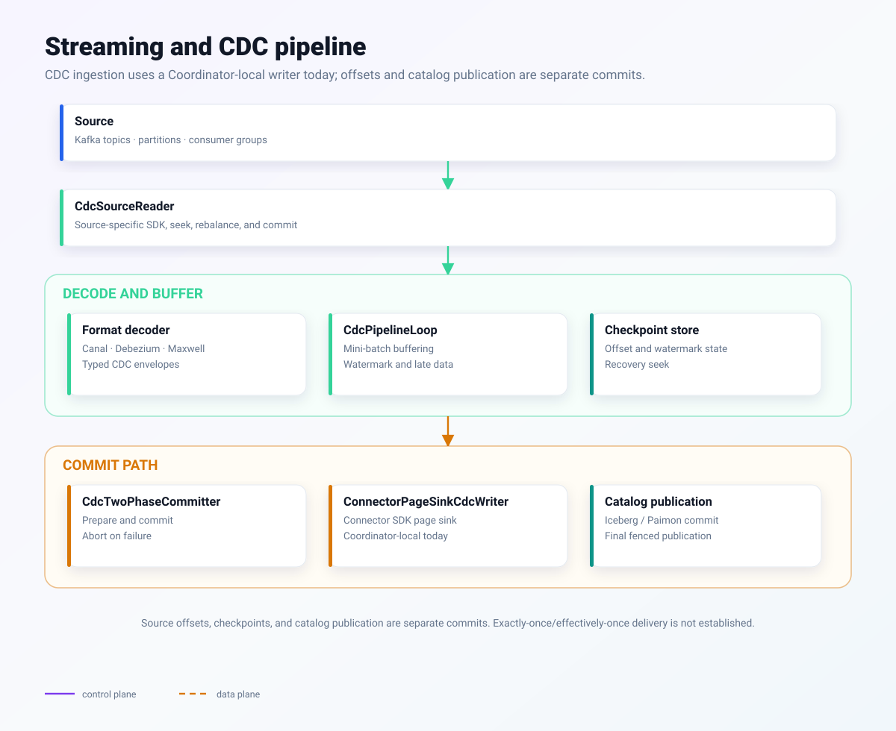
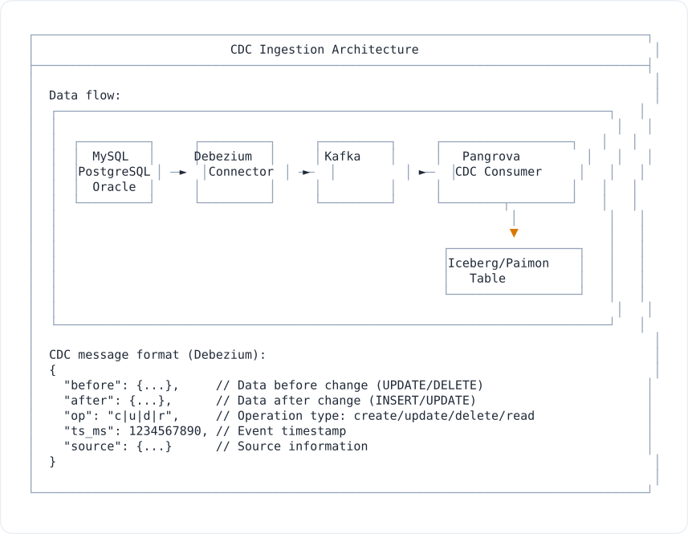
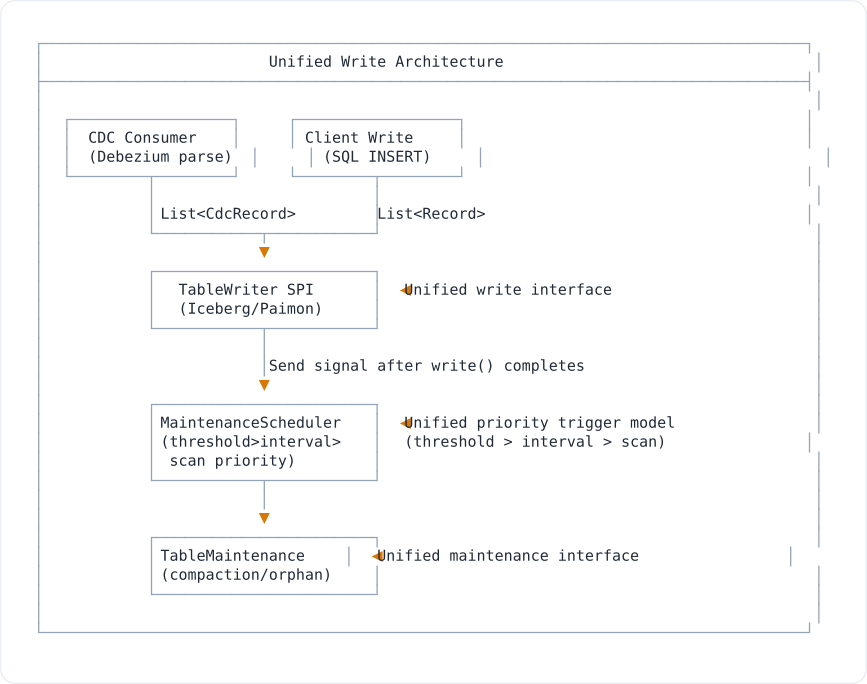
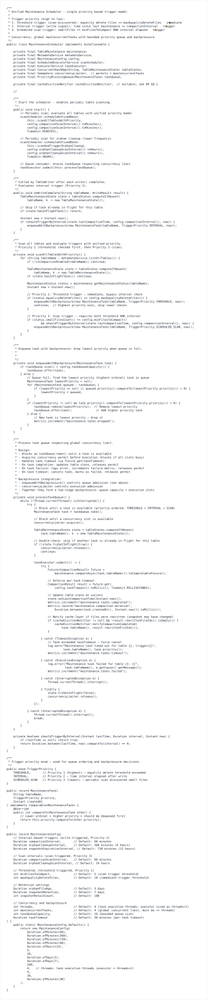
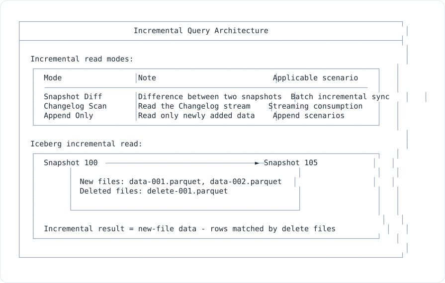
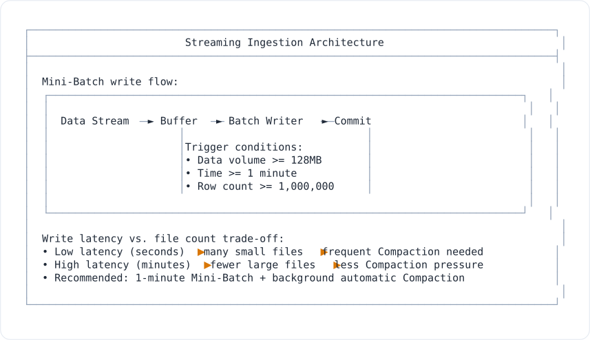
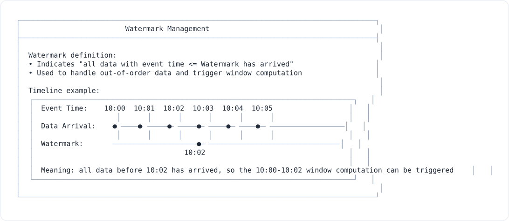
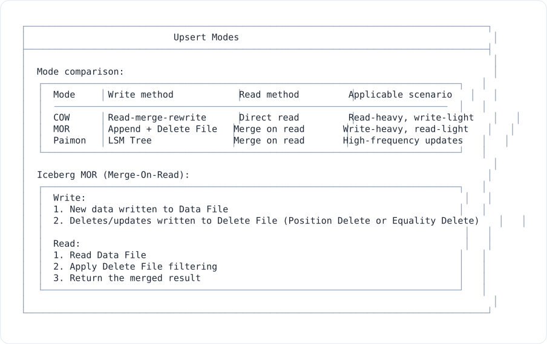

# Streaming & CDC

> **Accuracy scope.** This is a living architecture document. Content explicitly marked
> draft, proposed, planned, phase, target, or remaining work is design intent rather
> than implemented support. For current behavior, code wiring and end-to-end tests
> take precedence.

> **Current CDC boundary.** Sections 2.4–2.5 describe current wiring and gaps;
> sections 2.6–2.8 retain retired `TableWriter` sketches: that batch-write hierarchy
> had no production factory, consumer or close owner and was removed. The running pipeline uses
> `CdcPipelineLoop` → `CdcTwoPhaseCommitter` → `ConnectorPageSinkCdcWriter` on the
> Coordinator. The source offset and Iceberg/Paimon catalog do not share an
> atomic transaction. `COMMITTING` is now quarantined on ambiguous failure;
> Paimon rejects the context-free CDC commit, and UPDATE phases are not one
> snapshot. See [distributed writes](./distributed-writes.md#cdc-repair-contract-identity-implemented-execution-pending)
> for the required durable Native design and its acceptance criteria. No
> exactly-once/effectively-once production guarantee is currently claimed.

> **Summary.** CDC ingestion, incremental queries, streaming writes, and watermark tracking.

> **Code ownership.** `pangrova-streaming` owns
> `api.{aggregation,cdc,checkpoint,commit,source,watermark}` and `core.*`
> (including `store/memory` and `coordinator`). CDC format and writer providers
> live under `org.pangrova.streaming.{format,writer}`. JDBC offset and
> watermark persistence lives in
> `pangrova-persistence/pangrova-persistence-streaming-postgresql`
> (`org.pangrova.persistence.streaming.postgresql`). The Coordinator constructs
> the streaming bootstrap; it does not own a second registration, scheduler or
> offset/watermark store.

The JDBC offset batch store owns one connection and commits the complete batch
only after all writes succeed. SQL exceptions, runtime exceptions, and Errors
trigger rollback; a rollback exception is suppressed on the original failure.
The store closes its connection without restoring auto-commit in a failure path,
which could otherwise commit pending offsets. This is local database atomicity;
it does not make source acknowledgement and lake publication one transaction.

## 0. Product Positioning

The Pangrova streaming module is a **declarative incremental data transformation** engine.
CDC-related components exist, but complete incremental transformation and automatic
materialized-view refresh remain incomplete. Stream task registration is conditional.
Dynamic-table, continuous-query, and materialized-view DDL, refresh, scheduling,
recovery, and GC are served by the unified materialization kernel when durable
metadata publication is configured: refreshes claim a durable lease, execute Native
CTAS, and publish an immutable generation through CAS; a restart reconciles reserved
attempts from the write-commit journal, and GC is fenced by reader pins.
`CREATE CONTINUOUS QUERY ... REFRESH EVERY <interval>` creates a dynamic table whose
target lag is the declared interval; refresh is interval-driven and full, not
watermark-gated. That lifecycle does not establish exactly-once CDC output or
incremental continuous-query materialization.

**Reading scope:** the diagrams, SQL/API examples, SPI sketches, and connector writer
sketches below describe design or component contracts unless explicitly identified
as current bootstrap behavior. They do not establish a working distributed ingestion,
refresh, maintenance, or recovery lifecycle. Use
[Current Capability Status](../getting-started/capability-status.md) for default wiring.

**It is NOT a general-purpose stream processing engine.**

Pangrova does not compete with Apache Flink, Spark Structured Streaming, or Kafka Streams.
Those systems provide arbitrary stateful stream processing with complex event processing,
windowed joins, and user-defined operators. Pangrova's streaming module has a narrower,
more focused scope: keeping lake tables fresh via incremental data ingestion.

### Scope Definition

#### What Pangrova Streaming IS

| Capability | Description |
|---|---|
| CDC Ingestion | Kafka source/parser and connector-sink components; current bootstrap writes on the Coordinator and has unresolved publication/offset semantics |
| Incremental ETL | Component/design scope; arbitrary transformation execution is not established |
| Materialized View Refresh | Served by the unified materialization kernel alongside dynamic tables: durable schedule, reserved attempts, Native execution, immutable publication |
| Table Maintenance | Scheduler/provider components; distinct from standalone SQL maintenance, whose default provider is a no-op |
| Watermark Tracking | Tracking components; does not establish a functioning refresh lifecycle |

#### What Pangrova Streaming is NOT

| Anti-Pattern | Use Instead |
|---|---|
| Arbitrary stateful stream processing | Apache Flink |
| Complex event processing (CEP) | Apache Flink CEP |
| Windowed stream joins | Apache Flink / Spark Structured Streaming |
| User-defined stream operators | Apache Flink / Kafka Streams |
| Exactly-once barrier-based checkpointing | Apache Flink (Chandy-Lamport) |
| Backpressure-driven DAG execution | Apache Flink / Akka Streams |
| Stream-table duality with changelog topics | Kafka Streams / ksqlDB |

### Architecture Principles

1. **Declarative Over Imperative** — Users declare WHAT they want (a table that stays fresh from a CDC source), not HOW to process streams.
2. **Table-Centric, Not Stream-Centric** — The primary abstraction is the table, not the stream. Streams are an implementation detail for keeping tables fresh.
3. **At-Least-Once with Idempotent Writes** — Duplicates eliminated through primary key deduplication at the storage layer (Iceberg equality deletes, Paimon LSM merge).
4. **Batch-Oriented Internals** — CDC processing uses mini-batch semantics (poll N records, write batch, commit offsets).

### Comparison with Stream Processing Engines

| Dimension | Pangrova Streaming | Apache Flink | Spark Structured Streaming |
|---|---|---|---|
| Primary abstraction | Table (kept fresh) | DataStream / Table | DataFrame (micro-batch) |
| Processing model | Mini-batch CDC ingest | Record-at-a-time | Micro-batch |
| State management | Offset + watermark only | Arbitrary keyed state | Arbitrary state |
| Delivery guarantee | No qualified exactly-once/effectively-once guarantee | Depends on source/sink and checkpoint configuration | Depends on source/sink and checkpoint configuration |
| Windowing | Refresh interval only | TUMBLE/HOP/SESSION/CUMULATE | Window operations |
| Joins | Not supported in stream | Stream-stream, stream-table | Stream-stream, stream-static |
| User operators | No (declarative only) | Yes (ProcessFunction) | Yes (mapGroupsWithState) |
| Deployment | Embedded in coordinator | Standalone cluster | Spark cluster |

### Migration Notes (v0.2.0)

| Old Name | New Name | Rationale |
|---|---|---|
| Former `StreamSourceReader` | `CdcSourceReader` | Clarifies this reads CDC events, not arbitrary streams |
| StreamWriteSink (old name) | `CdcWriteSink` | Clarifies this writes CDC data, not arbitrary stream output |
| StreamWriteResult (old name) | `CdcWriteResult` | Consistent with CdcWriteSink |
| Former `StreamingWriter` | Former `IncrementalWriter` (both retired) | Clarifies incremental batch buffering, not stream processing |
| Former `StreamingWriterConfig` | Former `IncrementalWriterConfig` (both retired) | Consistent with IncrementalWriter |

Removed APIs: CheckpointCoordinator and the streaming-local CheckpointStore —
Flink-style barrier checkpointing is not needed for CDC offset-based recovery.

## 1. Unified Batch-Streaming Architecture Overview



---

## 2. CDC Data Ingestion

### 2.1 CDC Architecture



### 2.2 Unified Write Architecture

**Earlier unified-write proposal (retired).** CDC writes and client writes were to share the retired `TableWriter` batch component, with CDC adding a parsing layer. That hierarchy had no production factory, consumer or close owner and was removed. The coordinator CDC runtime writes through `CdcWriteSink` and `ConnectorPageSinkCdcWriter`; SQL writes use the Worker `NativeWriteExecutor` with the connector page sink. The coordinator owns transaction orchestration and metadata commit and does not write data files.



### 2.3 CDC Ingestion Loop

The CDC loop parses source records and publishes them through `CdcWriteSink`; the coordinator-side `ConnectorPageSinkCdcWriter` performs the connector write.

> **Historical sketch.** The retired `CdcConsumer` batch-writer class shown below belongs to the retired `TableWriter` hierarchy.

```java
/**
 * CDC Consumer - consumes Debezium messages from Kafka.
 * Only responsible for parsing, delegates actual write to TableWriter.
 */
public class CdcConsumer implements AutoCloseable {

    private final KafkaConsumer<String, String> consumer;
    private final TableWriter writer;  // Unified TableWriter SPI
    private final CdcConfig config;
    private final ObjectMapper objectMapper;
    private volatile boolean running = true;

    public CdcConsumer(CdcConfig config, TableWriter writer) {
        this.config = config;
        this.writer = writer;
        this.objectMapper = new ObjectMapper();
        this.consumer = createConsumer(config);
    }

    /**
     * Consume CDC messages and delegate to TableWriter
     */
    public void consume() {
        while (running) {
            ConsumerRecords<String, String> records = consumer.poll(Duration.ofMillis(100));
            if (records.isEmpty()) continue;

            Map<String, List<CdcRecord>> byTable = groupByTable(records);

            for (Map.Entry<String, List<CdcRecord>> entry : byTable.entrySet()) {
                String tableName = entry.getKey();
                List<CdcRecord> cdcRecords = entry.getValue();

                // Convert to unified WriteRecord and delegate to TableWriter
                List<WriteRecord> writeRecords = cdcRecords.stream()
                    .map(WriteRecord::fromCdc)
                    .toList();

                writer.write(tableName, writeRecords, WriteMode.UPSERT,
                    new WriteContext(org.pangrova.connector.api.enums.WriteTransactionMode.SELF_MANAGED, Optional.empty()));
            }

            consumer.commitSync();
        }
    }

    /**
     * Parse Debezium message
     */
    CdcRecord parseDebeziumMessage(String json) {
        JsonNode node = objectMapper.readTree(json);

        CdcOperation op = switch (node.get("op").asText()) {
            case "c", "r" -> CdcOperation.INSERT;
            case "u" -> CdcOperation.UPDATE;
            case "d" -> CdcOperation.DELETE;
            default -> throw new IllegalArgumentException("Unknown op");
        };

        JsonNode after = node.get("after");
        JsonNode before = node.get("before");
        long tsMs = node.get("ts_ms").asLong();

        return CdcRecord.builder()
            .operation(op)
            .before(before != null && !before.isNull() ? parseRow(before) : null)
            .after(after != null && !after.isNull() ? parseRow(after) : null)
            .eventTime(Instant.ofEpochMilli(tsMs))
            .build();
    }
}
```

### 2.4 CDC vs SQL Write: Transaction Orchestration Comparison

The production relational DML path uses Native Workers to produce fragments for
one Coordinator-owned, fenced catalog publication. It does not use a Coordinator
row writer for `INSERT VALUES` or other relational DML.

When the Coordinator hosts both streaming and query roles, the streaming scheduler
disables its local pipeline and the supervised CDC Worker runtime owns execution:

```text
StreamingBootstrap
  -> CdcWorkerRuntime (leader-gated)
  -> CdcTaskPlanner (bounded topic/partition ranges)
  -> Worker CDC_INGEST tasks (Kafka read + connector fragment staging)
  -> WriteCommitJournal intent -> connector publication -> source-offset ack
```

A streaming-only Coordinator still instantiates the local path:

```text
StreamingBootstrap
  -> CdcPipelineLoop
  -> CdcTwoPhaseCommitter
  -> ConnectorPageSinkCdcWriter (Coordinator-local)
```

The local path is not covered by the relational distributed write journal. The Worker
path journals its intent and fences publication and offset acknowledgement on streaming
leadership. A live test drives real Kafka through two Worker CDC backends, injects a backend
failure, and verifies the retry publishes to Paimon exactly once with offsets acknowledged only
after publication; process-level Worker crash qualification is still required. See
[Distributed Write](distributed-writes.md) for the current publication and repair boundary.

Schedulers start paused until maintenance leadership is acquired. A dedicated
control loop reconciles persisted stream states every five seconds, and immediately
after election, without running source initialization on the lease-renewal thread.
It discovers remote CREATE/RESUME operations and stops local attempts superseded
by remote SUSPEND/DROP or a newer epoch. Each start, lifecycle change, configuration
change and terminal failure advances the stream epoch. Source and sink cleanup is
owned by exactly one queued cancellation or running pipeline. A late callback cannot
remove a replacement attempt. Maintenance renewal exceptions demote local background
services; a changed backend epoch triggers demotion and activation again.

These are local scheduling and metadata fences. They do not atomically fence an
external catalog publication or establish Kafka-to-Worker recovery correctness.

### 2.5 CDC Write Semantics

**Current status: correctness and recovery qualification remain open.**
Catalog publication and source-offset persistence are separate operations. Existing
primary-key semantics do not prove that replay, partial publication, delete/insert
phases, or ambiguous outcomes are safe across both Iceberg and Paimon.

The current pipeline fences batch ownership, but ambiguous `COMMITTING` state is
quarantined rather than blindly replayed. Paimon rejects context-free sink writes;
UPDATE delete and insert phases are not established as one atomic table publication.
There is no production claim of exactly-once or effectively-once semantics.

The required repair design must bind tenant, source offset range, table identity,
snapshot, attempt, and fence to a durable Native batch and one observable catalog
publication. It is a proposed acceptance contract, not implemented support. See the
[CDC repair contract](distributed-writes.md#cdc-repair-contract-identity-implemented-execution-pending).

### 2.6 Retired Table Writer SPI (historical sketch)

**Scope: SPI contract and illustrative code.** The current CDC bootstrap instantiates
`ConnectorPageSinkCdcWriter`, not the writer sketches below.

> **Historical.** The batch-write SPI below was retired; the current write contracts are
> `CdcWriteSink` for CDC and `ConnectorPageSink` for connector persistence.

Earlier proposal for one batch-write entry point shared by CDC ingestion and SQL writes.
It was never given a production factory, consumer or close owner, so the code and its
writers were removed.


```java
/**
 * Table Writer SPI - unified interface for all write paths.
 * Shared by CDC ingestion (record-oriented) and SQL writes (batch-oriented).
 *
 * This is the AUTHORITATIVE definition. query-execution.md §6 DataWriter is
 * DEPRECATED — use TableWriter for all new write path implementations.
 *
 * After each write()/writeBatch(), notifies MaintenanceScheduler to check
 * if maintenance should be triggered based on time interval.
 */
public interface TableWriter extends AutoCloseable {

    /**
     * Write records to the table (CDC path — record-oriented).
     *
     * @param tableName  fully qualified table name
     * @param records    list of WriteRecord (CDC or client records)
     * @param writeMode  APPEND, UPSERT, or OVERWRITE
     * @param context    write context specifying transaction mode and metadata
     * @return write result containing data file list and statistics
     */
    WriteResult write(String tableName, List<WriteRecord> records,
                      WriteMode writeMode, WriteContext context);

    /**
     * Write an Arrow batch to the table (SQL path — batch-oriented).
     * Accepts VectorSchemaRoot directly from the native execution engine,
     * avoiding expensive columnar-to-row conversion.
     *
     * Resolves IC-WR-004: bridges native VectorSchemaRoot output with
     * the TableWriter input interface for zero-conversion SQL writes.
     *
     * @param tableName  fully qualified table name
     * @param batch      Arrow VectorSchemaRoot produced by native Velox engine
     * @param writeMode  APPEND or OVERWRITE (UPSERT not supported for batch path)
     * @param context    write context specifying transaction mode and metadata
     * @return write result containing data file list and statistics
     */
    WriteResult writeBatch(String tableName, VectorSchemaRoot batch,
                           WriteMode writeMode, WriteContext context);

    TableFormat format();
}

/**
 * Write context — distinguishes transaction orchestration modes.
 * Resolves IC-WR-008: provides transaction mode so TableWriter implementations
 * can decide whether to commit internally or defer to Coordinator.
 *
 * @param transactionMode  COORDINATOR_MANAGED (SQL) or SELF_MANAGED (CDC)
 * @param sessionContext   optional session metadata for multi-tenant isolation
 */
public record WriteContext(
    TransactionMode transactionMode,
    Optional<SessionContext> sessionContext
) {
    public enum TransactionMode {
        /** SQL write path: Coordinator orchestrates commit across multiple Workers. */
        COORDINATOR_MANAGED,
        /** CDC write path: TableWriter commits transaction internally per batch. */
        SELF_MANAGED
    }
}
```

**Write path selection:**

| Caller | Method | WriteContext.transactionMode | Behavior |
|--------|--------|-----------------------------|----------|
| SQL INSERT (Worker) | `writeBatch(VectorSchemaRoot)` | `COORDINATOR_MANAGED` | Writes data files only; does NOT commit. Coordinator collects DataFile list and commits atomically. |
| CDC Consumer | `write(List<WriteRecord>)` | `SELF_MANAGED` | Writes data files AND commits transaction internally. |

```java
/**
 * Unified write record - abstracts CDC and client records.
 */
public record WriteRecord(
    Map<String, Object> data,
    WriteOperation operation,
    Instant eventTime
) {
    public enum WriteOperation { INSERT, UPDATE, DELETE }

    // Convert from CdcRecord (used by CDC Consumer)
    public static WriteRecord fromCdc(CdcRecord cdc) {
        return new WriteRecord(
            cdc.operation() == CdcOperation.DELETE ? cdc.before() : cdc.after(),
            switch (cdc.operation()) {
                case INSERT -> WriteOperation.INSERT;
                case UPDATE -> WriteOperation.UPDATE;
                case DELETE -> WriteOperation.DELETE;
            },
            cdc.eventTime()
        );
    }

    // Convert from client Record (used by SQL writes)
    public static WriteRecord fromClient(Map<String, Object> data, WriteOperation op) {
        return new WriteRecord(data, op, Instant.now());
    }
}

/**
 * Unified write record - abstracts CDC and client records
 */
public record WriteRecord(
    Map<String, Object> data,
    WriteOperation operation,
    Instant eventTime
) {
    public enum WriteOperation { INSERT, UPDATE, DELETE }

    // Convert from CdcRecord (used by CDC Consumer)
    public static WriteRecord fromCdc(CdcRecord cdc) {
        return new WriteRecord(
            cdc.operation() == CdcOperation.DELETE ? cdc.before() : cdc.after(),
            switch (cdc.operation()) {
                case INSERT -> WriteOperation.INSERT;
                case UPDATE -> WriteOperation.UPDATE;
                case DELETE -> WriteOperation.DELETE;
            },
            cdc.eventTime()
        );
    }

    // Convert from client Record (used by SQL writes)
    public static WriteRecord fromClient(Map<String, Object> data, WriteOperation op) {
        return new WriteRecord(data, op, Instant.now());
    }
}
```

### 2.7 Iceberg Table Writer (historical sketch)

**Status: design/component sketch; not the default CDC sink or a delivery guarantee.**

```java
/**
 * Iceberg Table Writer with hybrid delete strategy.
 *
 * Hybrid Delete Strategy:
 * - Same-batch updates: Position Delete (same file, query engine friendly)
 * - Cross-batch updates: Equality Delete (needs async compaction)
 */
public class IcebergTableWriter implements TableWriter {

    private final Catalog catalog;
    private final MaintenanceScheduler scheduler;

    @Override
    public WriteResult write(String tableName, List<WriteRecord> records,
                             WriteMode writeMode, WriteContext context) {
        Table table = catalog.loadTable(TableIdentifier.parse(tableName));
        List<String> primaryKeys = getPrimaryKeys(table);

        // Group by primary key to detect same-batch updates
        Map<Object, List<WriteRecord>> byKey = groupByPrimaryKey(records, primaryKeys);

        List<Record> inserts = new ArrayList<>();
        List<PositionDelete> positionDeletes = new ArrayList<>();  // Same-batch
        List<Record> equalityDeletes = new ArrayList<>();          // Cross-batch

        for (var entry : byKey.entrySet()) {
            List<WriteRecord> keyRecords = entry.getValue();

            if (keyRecords.size() > 1) {
                // Multiple updates to same key in same batch → Position Delete
                processSameBatchUpdates(table, keyRecords, inserts, positionDeletes);
            } else {
                WriteRecord record = keyRecords.get(0);
                switch (record.operation()) {
                    case INSERT -> inserts.add(toIcebergRecord(record.data(), table.schema()));
                    case UPDATE -> {
                        equalityDeletes.add(toIcebergRecord(record.data(), table.schema()));
                        inserts.add(toIcebergRecord(record.data(), table.schema()));
                    }
                    case DELETE -> equalityDeletes.add(toIcebergRecord(record.data(), table.schema()));
                }
            }
        }

        WriteResult result = commitWithHybridDeletes(table, inserts, positionDeletes,
                                                      equalityDeletes, primaryKeys);

        // Notify scheduler to check if maintenance should be triggered
        scheduler.onWriteComplete(tableName, result);

        return result;
    }
}
```

### 2.8 Paimon Table Writer (historical sketch)

**Status: design/component sketch; not the default CDC sink or a delivery guarantee.**

```java
/**
 * Paimon Table Writer with native changelog support.
 * Paimon handles changelog natively, no need for hybrid delete strategy.
 */
public class PaimonTableWriter implements TableWriter {

    private final ConnectorManager connectorManager;
    private final MaintenanceScheduler scheduler;

    @Override
    public WriteResult write(String tableName, List<WriteRecord> records,
                             WriteMode writeMode, WriteContext context) {
        FileStoreTable table = loadPaimonTable(tableName);

        var write = table.newWrite(UUID.randomUUID().toString());
        var commit = table.newCommit(UUID.randomUUID().toString());

        for (WriteRecord record : records) {
            RowKind rowKind = switch (record.operation()) {
                case INSERT -> RowKind.INSERT;
                case UPDATE -> RowKind.UPDATE_AFTER;
                case DELETE -> RowKind.DELETE;
            };

            var row = toPaimonRow(record.data(), rowKind);
            write.write(row);
        }

        var messages = write.prepareCommit(true, 0);
        commit.commit(0, messages);

        WriteResult result = new WriteResult(tableName, records.size(), 1, 0, 0, Instant.now());

        // Notify scheduler to check if maintenance should be triggered
        scheduler.onWriteComplete(tableName, result);

        return result;
    }
}
```

---

### 2.9 TableMaintenance

This interface describes maintenance operations, not their statement wiring. The
default bootstrap injects `ControlledTableMaintenance` into `MaintenanceExecutor`;
catalog-qualified `CALL` uses a separate connector path. See
[Maintenance SQL](../sql-reference/maintenance.md).

A unified table maintenance interface supporting compaction, orphan cleanup, and snapshot expiration.

```java
/**
 * Table Maintenance SPI - unified interface for table maintenance operations.
 * All operations are async and non-blocking.
 * Triggered by MaintenanceScheduler based on time interval (not threshold).
 */
public interface TableMaintenance {

    /**
     * Execute compaction asynchronously.
     * Merges small files and equality delete files into larger data files.
     */
    CompletableFuture<CompactionResult> compactAsync(String tableName);

    /**
     * Clean orphan files asynchronously.
     * Removes files not referenced by any snapshot.
     */
    CompletableFuture<OrphanCleanupResult> cleanOrphansAsync(String tableName, Duration olderThan);

    /**
     * Expire old snapshots asynchronously.
     */
    CompletableFuture<SnapshotExpirationResult> expireSnapshotsAsync(String tableName, Duration olderThan);

    /**
     * Get current maintenance status for a table.
     */
    MaintenanceStatus getMaintenanceStatus(String tableName);
}


public record MaintenanceStatus(
    String tableName,
    int smallFilesCount,
    int totalFilesCount,
    long totalSizeBytes,
    int snapshotCount,
    int equalityDeleteFiles,
    long equalityDeleteBytes,
    long orphanFilesEstimate,
    Instant lastCompactionTime,
    Instant lastOrphanCleanupTime,
    Instant lastSnapshotExpireTime
) {}
```

### 2.10 Maintenance Scheduler (Unified Maintenance Scheduling)

**Design principle**:
- Unify the three trigger mechanisms into a single priority model to eliminate ambiguity
- Clarify trigger priority: threshold trigger > interval trigger > scheduled scan trigger
- Global concurrency control + queue + backpressure to ensure maintenance load is predictable

### Unified Trigger Model

The three trigger mechanisms are ranked by priority from high to low. When multiple conditions are met simultaneously, the higher-priority trigger executes first and lower-priority triggers are suppressed (only one maintenance task is produced for the same table at the same time).

| Priority | Trigger Type | Source | Condition | Behavior |
|---|---|---|---|---|
| **1 (Highest)** | Threshold Trigger | Scan-discovered | `equalityDeleteFiles >= maxEqualityDeleteFiles` | Trigger immediately, bypass interval check |
| **2** | Interval Trigger | Write signal | Time since last maintenance `>= compactionInterval` | Trigger on next write completion |
| **3 (Lowest)** | Scheduled Scan Trigger | Periodic scan | `smallFilesCount >= minFilesToCompact` AND time since last `>= compactionInterval` | Trigger during periodic scan cycle |

**Precedence Rules**:
- **Threshold > Interval**: Threshold trigger fires immediately regardless of interval timer. If a threshold trigger and an interval trigger both qualify for the same table, only the threshold-triggered task executes (higher priority subsumes lower).
- **Interval > Scan**: If an interval trigger already fired for a table within the current scan cycle, the scan trigger skips that table.
- **Deduplication**: Each table maintains an `inFlightTask` flag. If a maintenance task is already running or queued for a table, new triggers for the same table are dropped.

### Automatic Cycles for Controlled Tables

Production scheduling is registry-driven. `ControlledTableSource` lists only
ACTIVE LINKED/MANAGED records whose policy enables an operation; OBSERVED tables
are absent because they have no persisted record. `CoordinatorTableMaintenance`
reports due-ness from the last terminal run per operation and executes
`COMPACT`, `EXPIRE_SNAPSHOTS`, and `REMOVE_ORPHAN_FILES` through the same
ownership/policy/lease/version checks as a manual statement.

The periodic scan is leader-gated: `ModuleIntegrationBootstrap` starts it in
`onLeaderElected()` and stops it in `onLeadershipLost()`. Non-leader coordinators
therefore never run the policy cycle. A write-triggered task remains a
compaction of the data just written; only `SCHEDULED_SCAN` tasks run the full
retention cycle. Every automatic run persists `mode = AUTOMATIC` and actor
`system:maintenance`; an active external writer aborts the run as `SKIPPED`, and
other failures surface to the scheduler instead of being reported as success.
Format-specific `expire_snapshots` arguments are selected from the control
record's format.

### Concurrency Control and Backpressure

| Parameter | Default | Description |
|---|---|---|
| `maxConcurrentTasks` | 4 | Global max concurrent maintenance tasks across all tables |
| `taskQueueCapacity` | 16 | Max queued tasks waiting for execution |
| `taskTimeout` | 30m | Max duration per maintenance task before forced cancellation |

**Backpressure Behavior**:
1. **Running tasks < maxConcurrentTasks**: New task executes immediately.
2. **Running tasks = maxConcurrentTasks, queue not full**: New task enters the priority queue (ordered by trigger priority, then by wait time).
3. **Running tasks = maxConcurrentTasks, queue full**: Drop the lowest priority task in the queue. If the new task has higher priority than the dropped task, enqueue the new task; otherwise, drop the new task itself.
4. **All slots busy + queue full + new task is lowest priority**: Log warning and discard the new task. Metric `maintenance.tasks.dropped` incremented.



---

## 3. Incremental Query

### 3.1 Incremental Query Architecture



### 3.2 Incremental Query SQL

```sql
-- Iceberg incremental query (snapshot-based)
SELECT * FROM iceberg.db.orders
FOR SYSTEM_VERSION BETWEEN 100 AND 105;

-- Iceberg incremental query (time-based)
SELECT * FROM iceberg.db.orders
FOR SYSTEM_TIME BETWEEN '2024-01-01 00:00:00' AND '2024-01-02 00:00:00';

-- Paimon Changelog read
SELECT * FROM paimon.db.orders$changelog
WHERE _commit_time > '2024-01-01 00:00:00';

-- Incremental read (read only newly added data)
SELECT * FROM iceberg.db.orders
INCREMENTAL SINCE SNAPSHOT 100;

-- Streaming consumption (continuous read)
SELECT * FROM iceberg.db.orders
STREAMING START FROM SNAPSHOT 100;
```

### 3.3 Incremental Query Implementation

```java
/**
 * Incremental scan planner
 */
public class IncrementalScanPlanner {

    /**
     * Generate the incremental scan plan
     */
    public IncrementalScanPlan plan(IncrementalScanRequest request) {
        Table table = catalog.loadTable(request.getTableIdentifier());

        // Get the start and end snapshots
        Snapshot fromSnapshot = table.snapshot(request.getFromSnapshotId());
        Snapshot toSnapshot = request.getToSnapshotId() != null
            ? table.snapshot(request.getToSnapshotId())
            : table.currentSnapshot();

        // Collect incremental files
        Set<DataFile> addedFiles = new HashSet<>();
        Set<DeleteFile> addedDeletes = new HashSet<>();

        // Traverse the snapshot chain
        Snapshot current = toSnapshot;
        while (current != null && current.snapshotId() != fromSnapshot.snapshotId()) {
            for (DataFile file : current.addedDataFiles(table.io())) {
                addedFiles.add(file);
            }
            for (DeleteFile file : current.addedDeleteFiles(table.io())) {
                addedDeletes.add(file);
            }
            current = table.snapshot(current.parentId());
        }

        return IncrementalScanPlan.builder()
            .dataFiles(addedFiles)
            .deleteFiles(addedDeletes)
            .fromSnapshot(fromSnapshot)
            .toSnapshot(toSnapshot)
            .build();
    }
}

/**
 * Changelog reader
 */
public class ChangelogReader {

    /**
     * Read the Changelog (returns records with operation type)
     */
    public Iterator<ChangelogRecord> readChangelog(Table table, long fromSnapshot) {
        IncrementalScanPlan plan = planner.plan(
            IncrementalScanRequest.builder()
                .tableIdentifier(table.name())
                .fromSnapshotId(fromSnapshot)
                .build());

        return new ChangelogIterator(plan);
    }

    /**
     * Changelog record
     */
    public static class ChangelogRecord {
        private final ChangeType changeType;  // INSERT, UPDATE_BEFORE, UPDATE_AFTER, DELETE
        private final GenericRecord record;
        private final long snapshotId;
        private final Instant commitTime;
    }
}
```

---

## 4. Streaming Ingestion

### 4.1 Mini-Batch Writes



### 4.2 Streaming Ingestion API

```java
/**
 * Streaming writer
 *
 *
 */
public class StreamingWriter implements AutoCloseable {

    private final String tableName;
    private final TableWriter tableWriter;  // Delegates to unified TableWriter SPI (§2.6)
    private final StreamingWriterConfig config;
    private final List<Record> buffer = new ArrayList<>();
    private final ScheduledExecutorService scheduler;

    private long bufferBytes = 0;
    private Instant lastFlushTime = Instant.now();

    public StreamingWriter(String tableName, TableWriter tableWriter, StreamingWriterConfig config) {
        this.tableName = tableName;
        this.tableWriter = tableWriter;
        this.config = config;
        this.scheduler = Executors.newSingleThreadScheduledExecutor();
    }

    /**
     * Write a single record
     */
    public void write(Record record) {
        synchronized (buffer) {
            buffer.add(record);
            bufferBytes += estimateSize(record);

            if (shouldFlush()) {
                flush();
            }
        }
    }

    /**
     * Batch write
     */
    public void writeBatch(List<Record> records) {
        synchronized (buffer) {
            buffer.addAll(records);
            bufferBytes += records.stream().mapToLong(this::estimateSize).sum();

            if (shouldFlush()) {
                flush();
            }
        }
    }

    private boolean shouldFlush() {
        return bufferBytes >= config.getMaxBufferBytes() ||
               buffer.size() >= config.getMaxBufferRows() ||
               Duration.between(lastFlushTime, Instant.now()).compareTo(config.getMaxBufferTime()) > 0;
    }

    /**
     * Flush buffer via TableWriter SPI (not direct Iceberg API).
     * Uses SELF_MANAGED transaction mode — TableWriter commits internally.
     * MaintenanceScheduler is notified by TableWriter.write() automatically.
     */
    public void flush() {
        List<Record> toWrite;
        synchronized (buffer) {
            if (buffer.isEmpty()) return;
            toWrite = new ArrayList<>(buffer);
            buffer.clear();
            bufferBytes = 0;
            lastFlushTime = Instant.now();
        }

        // Delegate to TableWriter SPI — unified write path
        List<WriteRecord> writeRecords = toWrite.stream()
            .map(r -> WriteRecord.fromClient(r.toMap(), org.pangrova.connector.api.enums.WriteOperation.INSERT))
            .toList();

        tableWriter.write(tableName, writeRecords, WriteMode.APPEND,
            new WriteContext(org.pangrova.connector.api.enums.WriteTransactionMode.SELF_MANAGED, Optional.empty()));

        log.info("Flushed {} records to {} via TableWriter", toWrite.size(), tableName);
    }

    @Override
    public void close() {
        flush();  // Flush remaining data before closing
        scheduler.shutdown();
    }
}
```

---

## 5. Watermark Management

### 5.1 Watermark Concept



### 5.2 Table-Level Watermark

```sql
-- Set the table's Watermark column
ALTER TABLE iceberg.db.events
SET TBLPROPERTIES ('watermark.column' = 'event_time', 'watermark.delay' = '5 minutes');

-- Query the current Watermark
SELECT watermark FROM system.table_watermarks WHERE table_name = 'iceberg.db.events';

-- Watermark-based window query
SELECT
    TUMBLE_START(event_time, INTERVAL '1' HOUR) as window_start,
    COUNT(*) as event_count
FROM iceberg.db.events
WHERE event_time <= CURRENT_WATERMARK('iceberg.db.events')
GROUP BY TUMBLE(event_time, INTERVAL '1' HOUR);
```

### 5.3 Watermark Tracker

```java
/**
 * Watermark tracker
 */
public class WatermarkTracker {

    private final Map<String, Instant> tableWatermarks = new ConcurrentHashMap<>();
    private final WatermarkStore store;

    /**
     * Update the Watermark
     */
    public void updateWatermark(String tableName, Instant watermark) {
        Instant current = tableWatermarks.get(tableName);

        // The Watermark can only advance, not go backward
        if (current == null || watermark.isAfter(current)) {
            tableWatermarks.put(tableName, watermark);
            store.persist(tableName, watermark);
        }
    }

    /**
     * Infer the Watermark from data
     */
    public Instant inferWatermark(String tableName, List<Record> records,
                                   WatermarkConfig config) {
        // Find the maximum event time
        Instant maxEventTime = records.stream()
            .map(r -> r.getTimestamp(config.getWatermarkColumn()))
            .max(Instant::compareTo)
            .orElse(Instant.MIN);

        // Subtract the lateness tolerance
        return maxEventTime.minus(config.getWatermarkDelay());
    }

    /**
     * Get the current Watermark
     */
    public Instant getWatermark(String tableName) {
        return tableWatermarks.getOrDefault(tableName, Instant.MIN);
    }
}
```

---

## 6. Upsert Support

### 6.1 Upsert Modes



### 6.2 Upsert SQL

```sql
-- Create a table that supports Upsert
CREATE TABLE iceberg.db.users (
    user_id BIGINT,
    name STRING,
    email STRING,
    updated_at TIMESTAMP
) USING ICEBERG
TBLPROPERTIES (
    'write.upsert.enabled' = 'true',
    'write.delete.mode' = 'merge-on-read'
);

-- Upsert operation (MERGE INTO)
MERGE INTO iceberg.db.users t
USING (SELECT * FROM staging.users) s
ON t.user_id = s.user_id
WHEN MATCHED THEN UPDATE SET *
WHEN NOT MATCHED THEN INSERT *;

-- Simplified Upsert syntax
UPSERT INTO iceberg.db.users
SELECT * FROM staging.users;

-- Paimon table (native primary key update support)
CREATE TABLE paimon.db.users (
    user_id BIGINT PRIMARY KEY,
    name STRING,
    email STRING,
    updated_at TIMESTAMP
);

-- A plain INSERT is enough to perform an Upsert
INSERT INTO paimon.db.users VALUES (1, 'Alice', 'alice@example.com', NOW());
INSERT INTO paimon.db.users VALUES (1, 'Alice Updated', 'alice2@example.com', NOW());
-- The second row updates the first
```

### 6.3 Upsert Implementation

```java
/**
 * Upsert writer
 */
public class UpsertWriter {

    /**
     * Perform the Upsert
     */
    public void upsert(Table table, List<Record> records, List<String> primaryKeys) {
        String deleteMode = table.properties().getOrDefault(
            "write.delete.mode", "merge-on-read");

        if ("copy-on-write".equals(deleteMode)) {
            upsertCOW(table, records, primaryKeys);
        } else {
            upsertMOR(table, records, primaryKeys);
        }
    }

    /**
     * COW-mode Upsert
     */
    private void upsertCOW(Table table, List<Record> records, List<String> primaryKeys) {
        // 1. Find the affected files
        Set<DataFile> affectedFiles = findAffectedFiles(table, records, primaryKeys);

        // 2. Read data from the affected files
        Map<Object, Record> existingData = readExistingData(affectedFiles, primaryKeys);

        // 3. Merge old and new data
        for (Record record : records) {
            Object key = extractKey(record, primaryKeys);
            existingData.put(key, record);  // Overwrite or add
        }

        // 4. Rewrite the files
        RewriteFiles rewrite = table.newRewrite();
        for (DataFile oldFile : affectedFiles) {
            rewrite.deleteFile(oldFile);
        }
        DataFile newFile = writeDataFile(existingData.values());
        rewrite.addFile(newFile);
        rewrite.commit();
    }

    /**
     * MOR-mode Upsert
     */
    private void upsertMOR(Table table, List<Record> records, List<String> primaryKeys) {
        // 1. Write the new data file
        DataFile dataFile = writeDataFile(records);

        // 2. Write the Equality Delete file (delete the old version)
        DeleteFile deleteFile = writeEqualityDeleteFile(table, records, primaryKeys);

        // 3. Commit
        RowDelta rowDelta = table.newRowDelta();
        rowDelta.addRows(dataFile);
        rowDelta.addDeletes(deleteFile);
        rowDelta.commit();
    }
}
```

---

## 7. Configuration Summary

```yaml
# streaming-config.yaml
streaming:
  # CDC configuration
  cdc:
    enabled: true
    deployment-mode: embedded  # embedded | standalone
    consumer:
      bootstrap-servers: kafka:9092
      group-id: pangrova-cdc-consumer
      auto-offset-reset: earliest
    debezium:
      format: json
      include-schema: false

  # Unified write configuration (shared by CDC and client writes)
  writer:
    batch-size: 1000
    delete-strategy: hybrid  # position-first for same-batch, equality for cross-batch

  # Asynchronous maintenance scheduling configuration (unified priority model)
  maintenance:
    # Interval triggers (Priority 2: write-triggered)
    compaction-interval: 60m       # Trigger compaction every 60 minutes
    orphan-cleanup-interval: 360m  # Trigger orphan cleanup every 6 hours
    snapshot-expiration-interval: 720m  # Trigger snapshot expiration every 12 hours

    # Scan intervals (Priority 3: periodic scan)
    compaction-scan-interval: 60m
    orphan-cleanup-scan-interval: 24h

    # Thresholds (Priority 1: immediate trigger)
    max-equality-delete-files: 10  # equality delete files >= 10 → immediate compaction
    min-files-to-compact: 5        # small files >= 5 → scan-triggered compaction

    # Retention
    orphan-file-age: 3d            # Clean up orphan files older than 3 days
    snapshot-retention: 7d         # Retain snapshots within the last 7 days

    # Concurrency and backpressure
    threads: 4                         # task execution threads (executor = threads+1 to avoid deadlock)
    max-concurrent-tasks: 4        # Global max concurrent maintenance tasks (must be <= threads)
    task-queue-capacity: 16        # Wait queue capacity; backpressure triggered when full
    task-timeout: 30m              # Single-task timeout

  # Streaming ingestion configuration
  ingestion:
    buffer:
      max-bytes: 128MB
      max-rows: 1000000
      max-time: 1m
    commit:
      interval: 1m
      retry-times: 3

  # Incremental query configuration
  incremental:
    default-lookback: 24h
    max-snapshots-per-query: 100

  # Watermark configuration
  watermark:
    default-delay: 5m
    update-interval: 10s

  # Upsert configuration
  upsert:
    default-mode: merge-on-read  # copy-on-write, merge-on-read
    equality-delete-enabled: true
```

---


## 8. Observability Integration

This section defines the metrics and tracing integration points for the streaming and CDC layer. For the full observability design, see [observability.md](./observability.md).

### 8.1 Metrics

The Coordinator passes its configured metrics provider to each scheduled CDC loop. Instruments use a `stream` dimension. Both direct writes and checkpointed two-phase publication emit the following series.

| Metric | Source component | Measurement |
|--------|------------------|-------------|
| `pangrova.streaming.cdc.records.consumed` | Source poll | Records returned in a fresh poll. Retrying the retained batch does not increment the counter. |
| `pangrova.streaming.cdc.bytes.consumed` | Source poll | Sum of raw key and value lengths, in bytes. |
| `pangrova.streaming.cdc.batches.processed` | Source acknowledgement | Batches whose next offsets were acknowledged successfully, including checkpointed replays. |
| `pangrova.streaming.cdc.source.poll.duration` | Source reader | Duration of each poll attempt in seconds, including empty polls. |
| `pangrova.streaming.cdc.write.duration` | Sink | Duration of the direct write or two-phase stage attempt in seconds. |
| `pangrova.streaming.cdc.commit.duration` | Source reader | Duration of each offset acknowledgement attempt in seconds. |
| `pangrova.streaming.cdc.failures` | Pipeline | Recovery and cycle failures observed while running. |
| `pangrova.streaming.cdc.consumer.lag` | Kafka reader | Last sampled sum of assigned partition offset distances. Collection omits the point until all assigned distances are available. |
| `pangrova.streaming.cdc.pipeline.uptime` | Pipeline executor | Elapsed seconds since this loop started. The loop unregisters both gauges on exit. |

If a watermark update fails after the source acknowledges a batch, the running loop retries the watermark update before its next poll. The source acknowledgement and the watermark store have independent commits. A process loss between them can leave the persisted watermark behind the acknowledged offsets.

Maintenance design measures are listed separately.

| Metric | Source component | Measurement |
|--------|------------------|-------------|
| `pangrova.maintenance.tasks.submitted` | MaintenanceScheduler | Maintenance tasks submitted |
| `pangrova.maintenance.tasks.completed` | MaintenanceScheduler | Maintenance tasks completed |
| `pangrova.maintenance.compaction.bytes` | CompactionTask | Bytes compacted |

### 8.2 Tracing Spans

- `cdc.consume` — CDC batch consumption (SERVER span)
  - `cdc.write` — TableWriter write operation (INTERNAL)
  - `cdc.commit` — Transaction commit (INTERNAL)
- `maintenance.compact` — Compaction task (SERVER span)
- `maintenance.expire_snapshots` — Snapshot expiration (SERVER span)

### 8.3 Log Events

- CDC consumer start/stop events (INFO)
- Write batch completion with record count and latency (INFO)
- Maintenance task lifecycle events (INFO)
- Deduplication events for at-least-once delivery (DEBUG)

See [14 §7](./observability.md) for structured logging format.


> **Write Interface Hierarchy**: `CdcWriteSink` owns the CDC commit handoff and `ConnectorPageSinkCdcWriter` persists through the connector page sink. SQL writes use the Worker `NativeWriteExecutor` with `ConnectorPageSink`. The former `TableWriter` batch hierarchy was retired; §2.6 keeps its sketch as history. `DataWriter` (02 §6) is deprecated.


> **CDC execution boundary:** The current streaming bootstrap creates a
> Coordinator-local `ConnectorPageSinkCdcWriter`; it does not run CDC consumers in
> Workers and does not require ZooKeeper for partition assignment. ZooKeeper is an
> optional coordination backend, not a CDC dependency. Distributed native CDC
> ingestion, atomic source-offset/catalog publication, and exactly-once delivery
> remain unimplemented. See [Current Capability Status](../getting-started/capability-status.md).


> **TableMaintenance Authoritative Definition**: The authoritative async interface is defined in §2.9 of this document. All references in [00 §5.1](./overview.md) and [02 §13.2](./query-execution.md) have been updated to match the async signatures here. Method names use `*Async` suffix with `CompletableFuture<*>` return types.


> **Watermark State Machine (§5)**:
>
> | State | Trigger | Next State | Action |
> |-------|---------|------------|--------|
> | INITIALIZING | First event received | ACTIVE | Set initial watermark from event timestamp |
> | ACTIVE | Event within allowed lateness | ACTIVE | Advance watermark |
> | ACTIVE | No events for `idle-timeout` | IDLE | Emit idle watermark, pause advancement |
> | IDLE | New event received | ACTIVE | Resume watermark advancement |
> | ACTIVE | Watermark regression detected | STALE | Log warning, hold current watermark |
> | STALE | Newer event received | ACTIVE | Resume normal advancement |
> | ANY | Unrecoverable error | FAILED | Emit error metric, stop tracker |
