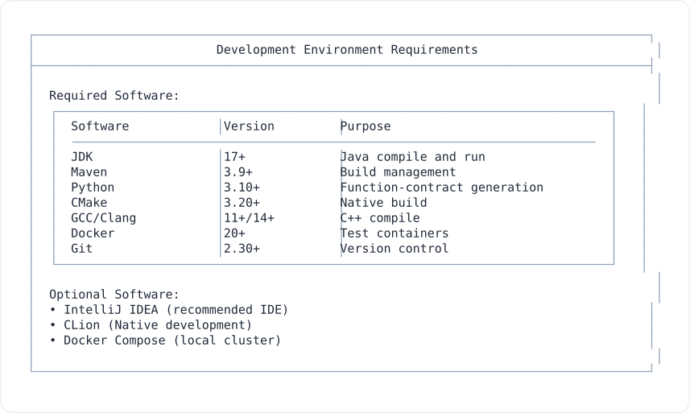
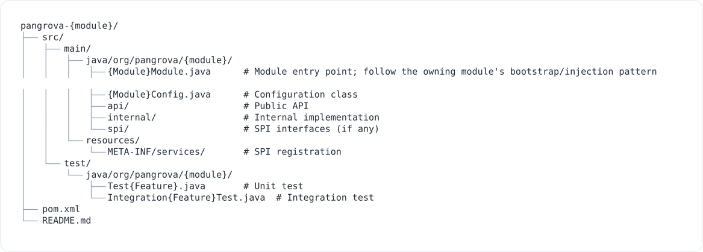
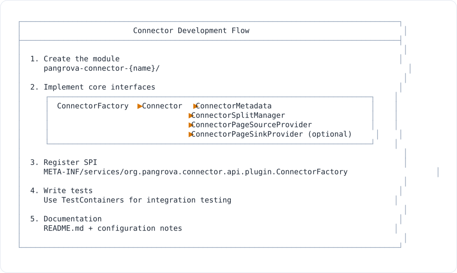

# Developer Guide

> **Summary.** Development-environment setup, the module development workflow, and connector development.

> **Module inventory:** Use the root and child POMs for the actual Maven reactor;
> the [System Overview](../architecture/overview.md) provides a selected ownership map,
> not a fixed module count.

## 1. Development Environment Setup

### 1.1 System Requirements



### 1.2 Quick Start

Use JDK 17 for the repository verification chain. Both Maven's function-contract
generator and the native SDK generator require Python 3.10 or later. Ensure
`python3` on `PATH` selects that interpreter, including test subprocesses. For an
explicit Maven generator interpreter use
`-Dpangrova.function-contract.python=/absolute/path/to/python3`; native bootstrap
accepts `PANGROVA_FUNCTION_CONTRACT_PYTHON`, and CMake accepts `Python3_EXECUTABLE`.
The host OS's older default Python is not a compliant build runtime.

Run these commands from the repository root with JDK 17, Maven 3.9+, Python 3.10+,
and Gradle 8.14.4 installed. The native prerequisite check reports the additional
platform toolchain requirements without installing OS packages.

```bash
git clone https://github.com/pangrova-io/pangrova.git
cd pangrova

# Check native tools, then build the pinned Java connector dependency.
./pangrova-worker-native/bin/setup-native-build-env.sh --check-tools
.pangrova/scripts/build-iceberg-sdk-candidate.sh

# Build native dependencies, Lance, the engine, and packaged JNI resources.
./pangrova-worker-native/bin/build-native.sh
mvn clean install -DskipTests

# Validate the native and Java suites (Docker is needed for container tests).
python3 pangrova-worker-native/bin/run-native-tests.py
mvn test

# Start Coordinator and Worker in one JVM.
./bin/pangrova-standalone.sh
```

The patched Iceberg candidate is built from pinned upstream source and checked
patches; it is not a Maven Central release. Set `GRADLE_BIN` when Gradle 8.14.4 is
not the default executable. For the full release validation chain, use the
repository's build-pipeline rule and the production CI workflow.

Runtime CI builds and tests the pinned candidate once per workflow run. Native
fixtures, Maven jobs, and the production image consume that run's SDK artifact.
A Docker build from a local checkout builds the pinned candidate from source.

The Lance Rust archive is tied to its Rust sources, Cargo lock/configuration,
owned SDK patch, canonical protocols and C header by
`liblance_c_ffi.a.provenance.json`. CMake verifies that receipt both when
configuring and before linking. After these inputs change, run
`pangrova-worker-native/bin/build-lance-ffi.sh` before rebuilding Native; copying
an older archive into the expected path is rejected. When installing a separate
`LANCE_FFI_PREFIX`, copy the receipt next to its archive in `lib/` and install the
matching header in `include/`. The receipt is created only after a successful
build whose inputs remained unchanged.

The daily Java jobs and production regression restore the Lance fixture tool
from the same workflow run's Linux x86-64 Native build. The test artifact
preserves executable permissions and includes the tool's shared dependencies.
Locally, build the `pangrova_lance_fixture_tool` Native target before running
the Lance SDK tests. Maven looks for it in `pangrova-worker-native/build` by
default. Set `-Dpangrova.lance.fixture.tool` when using another build directory.

On GitHub-hosted macOS, the Native test job runs the PostgreSQL TestContainer
through a temporary Lima Docker VM with loopback port forwarding. The Native
test binary and its Java fixture broker run on the macOS host.
If Docker startup fails, the job prints the Lima host agent and guest boot logs,
plus the guest provisioning log when SSH is available.

### 1.3 Matching AddressSanitizer Dependencies

ASan must use one compiler and a matching instrumented dependency cohort. Using
Release RE2/gRPC/Flight with ASan Abseil can change inline hash-table layouts even
when the headers and dependency versions match. A successful link is insufficient;
the native configure executes the canonical RE2 template/regex admission check.

After the regular bootstrap has fetched the pinned sources, build the separate
sanitizer dependencies and explicitly select them. Run from the repository root:

```bash
source "$HOME/.pangrova/env.sh"
./pangrova-worker-native/bin/setup-native-asan-env.sh
source "$HOME/.pangrova/asan-env.sh"
cmake --preset dev-asan -S pangrova-worker-native \
  -DPANGROVA_DEPS_PREFIX="$PANGROVA_DEPS_PREFIX" \
  -DCMAKE_PREFIX_PATH="$PANGROVA_DEPS_PREFIX" \
  -DVELOX_BUILD_DIR="$VELOX_BUILD_DIR" \
  -DArrow_DIR="$Arrow_DIR" \
  -DARROW_FLIGHT_HOME="$ARROW_FLIGHT_HOME" -UARROW_FLIGHT_LIB \
  -Dre2_DIR="$re2_DIR" -DgRPC_DIR="$gRPC_DIR" \
  -DProtobuf_DIR="$Protobuf_DIR" -Dabsl_DIR="$absl_DIR" \
  -DPANGROVA_ASAN_PROTOBUF_LIB="$PANGROVA_ASAN_PROTOBUF_LIB"
cmake --build pangrova-worker-native/build-asan --parallel 2
ctest --test-dir pangrova-worker-native/build-asan --output-on-failure
```

The bootstrap reconfigures and incrementally builds the actual pinned sources;
cached package presence is not provenance. An existing CMake cache retains package
paths, so the explicit arguments above matter when changing cohorts. Flight
admission rejects a cached library outside the selected package prefix. Cross-built
RE2 admission requires a real target emulator. A bootstrap/configure pass is not an
ASan test pass; retain the original leak/error checks and report platform/runtime
failures accurately.

If an upstream source download is unavailable, Arrow's official `ARROW_LZ4_URL`
and `ARROW_ZSTD_URL` environment variables may select an existing source archive
(including a `file://` URL). Verify its SHA-256 against the matching SDK Arrow
source's `cpp/thirdparty/versions.txt` first; Arrow's ExternalProject also retains
its mandatory hash check. Rebuild the codec from this source with ASan. A cached
Release codec library is not an acceptable replacement. Do not change codec
versions, disable compression, or edit generated download scripts to pass setup.

### 1.4 IDE Configuration

```xml


<code_scheme name="Pangrova" version="173">
  <JavaCodeStyleSettings>
    <option name="CLASS_COUNT_TO_USE_IMPORT_ON_DEMAND" value="999" />
    <option name="NAMES_COUNT_TO_USE_IMPORT_ON_DEMAND" value="999" />
  </JavaCodeStyleSettings>
  <codeStyleSettings language="JAVA">
    <option name="RIGHT_MARGIN" value="120" />
    <option name="KEEP_BLANK_LINES_IN_CODE" value="1" />
    <indentOptions>
      <option name="INDENT_SIZE" value="4" />
      <option name="TAB_SIZE" value="4" />
    </indentOptions>
  </codeStyleSettings>
</code_scheme>
```

### 1.5 Local cleanup and SessionEnd hook

Development runs leave ephemeral artifacts such as `javac.*.args`,
`.jqwik-database`, `__pycache__`, and `dependency-reduced-pom.xml`. Clean them
before ending a session and confirm the hygiene gate passes:

```bash
.pangrova/scripts/clean-dev-artifacts.sh          # ephemeral caches
.pangrova/scripts/clean-dev-artifacts.sh --all    # also target/build outputs
.pangrova/scripts/check-dev-artifacts.sh          # gate; --strict also rejects local leftovers
```

The cleanup script removes the retired non-published documentation directory if
it reappears. It never touches `data/worker-admission/`, `.env*`, `.secrets/`,
IDE directories, or `~/.qoder/plans/`.

Qoder Desktop can run the cleanup at the end of every task. Add this to the
user-level `~/.qoder/settings.json` (not committed; `.qoder/` is ignored):

```json
{
  "hooks": {
    "SessionEnd": [
      {
        "hooks": [
          {
            "type": "command",
            "command": "root=$(git rev-parse --show-toplevel 2>/dev/null) && [ -x \"$root/.pangrova/scripts/clean-dev-artifacts.sh\" ] && \"$root/.pangrova/scripts/clean-dev-artifacts.sh\" --quiet || true"
          }
        ]
      }
    ]
  }
}
```

The command is a no-op outside a Pangrova checkout and never blocks session end.

## 2. Module Development Guide

### 2.1 Module Structure Convention



### 2.2 Code Conventions

```java
/**
 * Class design convention example
 * 
 * Rules:
 * 1. One responsibility per class; Java file hard ceiling: 800 lines
 * 2. Coherent methods; hard ceiling: 100 nonblank, noncomment lines
 * 3. At most 10 method/constructor parameters; group only cohesive concepts
 * 4. Keep nesting shallow; Checkstyle depth limits: if/for 3, try 2
 */
public class QueryExecutor {
    
    // 1. Static constants
    private static final Logger LOG = LoggerFactory.getLogger(QueryExecutor.class);
    private static final int DEFAULT_TIMEOUT_MS = 30000;
    
    // 2. Dependencies (final, constructor injection)
    private final QueryParser parser;
    private final QueryOptimizer optimizer;
    private final ExecutionEngine engine;
    
    // 3. Constructor (parameter validation)
    public QueryExecutor(QueryParser parser, 
                         QueryOptimizer optimizer,
                         ExecutionEngine engine) {
        this.parser = requireNonNull(parser, "parser is null");
        this.optimizer = requireNonNull(optimizer, "optimizer is null");
        this.engine = requireNonNull(engine, "engine is null");
    }
    
    // 4. Public methods (ordered by importance)
    public QueryResult execute(String sql, QueryContext context) {
        // Keep the method body concise; extract complex logic into private methods
        Statement statement = parse(sql);
        ExecutionPlan plan = optimize(statement, context);
        return executeInternal(plan, context);
    }
    
    // 5. Private methods (ordered by call order)
    private Statement parse(String sql) { /* ... */ }
    private ExecutionPlan optimize(Statement stmt, QueryContext ctx) { /* ... */ }
    private QueryResult executeInternal(ExecutionPlan plan, QueryContext ctx) { /* ... */ }
}
```

### Validation Scope and Readability

Repository policy is discovered through `AGENTS.md` and `.pangrova/rules/`, which
own validation selection (`development.md`), structural review thresholds
(`code-standards.md`), test rules (`testing.md`) and CI selection (`ci-gates.md`).
Start with the closest check, then the owning module and affected consumers, and
report blockers instead of disabling tests or claiming unexecuted checks passed.

### 2.3 Comment Conventions

```java
/**
 * Class comment: describe the class's responsibility and how to use it
 * 
 * <p>Detailed description of the class's functionality, thread safety, usage constraints, etc.
 * 
 * <p>Example usage:
 * <pre>{@code
 * QueryExecutor executor = new QueryExecutor(parser, optimizer, engine);
 * QueryResult result = executor.execute("SELECT * FROM t", context);
 * }</pre>
 * 
 * @see RelatedClass
 */
public class QueryExecutor {
    
    /**
     * Method comment: describe the method's functionality, parameters, return value, exceptions
     * 
     * @param sql     SQL statement, must not be null or empty
     * @param context query context, containing session information
     * @return query result, never null
     * @throws QueryException if the SQL syntax is invalid or execution fails
     */
    public QueryResult execute(String sql, QueryContext context) {
        // Implementation comment: explain WHY, not WHAT
        // Use the cached execution plan to avoid re-optimizing the same query
        ExecutionPlan plan = planCache.get(sql, () -> optimize(sql));
        return executeInternal(plan, context);
    }
}
```

## 3. Connector Development Guide

### 3.1 Connector Development Flow



### 3.2 Connector Implementation Example

```java
/**
 * Example: implement a simple CSV Connector
 */

// 1. ConnectorFactory
public class CsvConnectorFactory implements ConnectorFactory {
    @Override public int apiVersion() { return ConnectorFactoryContract.CURRENT_API_VERSION; }
    @Override public Set<ConnectorRole> roles() { return Set.of(ConnectorRole.COORDINATOR, ConnectorRole.WORKER); }
    @Override public void validateConfiguration(Map<String, String> config) { new CsvConfig(config); }

    
    @Override
    public String getName() {
        return "csv";
    }
    
    @Override
    public Connector create(String catalogName, 
                            Map<String, String> config, 
                            ConnectorContext context) {
        CsvConfig csvConfig = new CsvConfig(config);
        return new CsvConnector(csvConfig, context);
    }
    
}

// 2. Connector
public class CsvConnector implements Connector {
    
    private final CsvConfig config;
    private final CsvMetadata metadata;
    private final CsvSplitManager splitManager;
    private final CsvPageSourceProvider pageSourceProvider;
    
    @Override
    public ConnectorMetadata getMetadata(ConnectorSession session) {
        return metadata;
    }
    
    @Override
    public ConnectorSplitManager getSplitManager() {
        return splitManager;
    }
    
    @Override
    public ConnectorPageSourceProvider getPageSourceProvider() {
        return pageSourceProvider;
    }
}

// 3. ConnectorMetadata
public class CsvMetadata implements ConnectorMetadata {
    
    @Override
    public List<SchemaTableName> listTables(ConnectorSession session, 
                                            Optional<String> schemaName) {
        // Scan the directory; treat each CSV file as a table
        return Files.list(config.getPath())
            .filter(p -> p.toString().endsWith(".csv"))
            .map(p -> new SchemaTableName("default", getTableName(p)))
            .collect(Collectors.toList());
    }
    
    @Override
    public ConnectorTableMetadata getTableMetadata(ConnectorSession session,
                                                   ConnectorTableHandle table) {
        CsvTableHandle csvTable = (CsvTableHandle) table;
        // Infer the schema from the CSV header
        List<ColumnMetadata> columns = inferSchema(csvTable.getPath());
        return new ConnectorTableMetadata(csvTable.getTableName(), columns);
    }
}

// 4. ConnectorSplitManager
public class CsvSplitManager implements ConnectorSplitManager {
    
    @Override
    public ConnectorSplitSource getSplits(ConnectorTransactionHandle transaction,
                                          ConnectorSession session,
                                          ConnectorTableHandle table,
                                          DynamicFilter dynamicFilter,
                                          Constraint constraint) {
        CsvTableHandle csvTable = (CsvTableHandle) table;
        
        // Treat each CSV file as one Split
        // Large files can be split into multiple Splits by row count
        List<CsvSplit> splits = createSplits(csvTable.getPath());
        
        return new FixedSplitSource(splits);
    }
}

// 5. ConnectorPageSourceProvider
public class CsvPageSourceProvider implements ConnectorPageSourceProvider {
    
    @Override
    public ConnectorPageSource createPageSource(ConnectorTransactionHandle transaction,
                                                ConnectorSession session,
                                                ConnectorSplit split,
                                                ConnectorTableHandle table,
                                                List<ColumnHandle> columns,
                                                DynamicFilter dynamicFilter) {
        CsvSplit csvSplit = (CsvSplit) split;
        CsvTableHandle csvTable = (CsvTableHandle) table;
        
        return new CsvPageSource(
            csvSplit.getPath(),
            csvSplit.getStart(),
            csvSplit.getLength(),
            columns,
            config
        );
    }
}
```

### 3.3 Connector Testing

```java
/**
 * Connector integration test example
 * Uses real objects and real dependencies; Mock/Stub/Test Double are prohibited
 */
public class CsvConnectorIntegrationTest {
    
    @TempDir
    Path tempDir;
    
    private CsvConnector connector;
    
    @BeforeEach
    void setup() throws IOException {
        // Create a test CSV file
        Path csvFile = tempDir.resolve("test.csv");
        Files.writeString(csvFile, """
            id,name,value
            1,Alice,100
            2,Bob,200
            3,Charlie,300
            """);
        
        // Create a real Connector
        connector = new CsvConnectorFactory().create(
            "csv_test",
            Map.of("csv.path", tempDir.toString()),
            new TestConnectorContext()
        );
    }
    
    @Test
    void testListTables() {
        ConnectorMetadata metadata = connector.getMetadata(testSession());
        List<SchemaTableName> tables = metadata.listTables(testSession(), Optional.empty());
        
        assertThat(tables).containsExactly(new SchemaTableName("default", "test"));
    }
    
    @Test
    void testScan() {
        // Get table metadata
        ConnectorMetadata metadata = connector.getMetadata(testSession());
        ConnectorTableHandle table = metadata.getTableHandle(
            testSession(), new SchemaTableName("default", "test"));
        
        // Get Splits
        ConnectorSplitSource splitSource = connector.getSplitManager().getSplits(
            null, testSession(), table, DynamicFilter.EMPTY, Constraint.alwaysTrue());
        List<ConnectorSplit> splits = getAllSplits(splitSource);
        
        // Read data
        List<ColumnHandle> columns = List.copyOf(
            metadata.getColumnHandles(testSession(), table).values());
        
        List<Page> pages = new ArrayList<>();
        for (ConnectorSplit split : splits) {
            ConnectorPageSource pageSource = connector.getPageSourceProvider()
                .createPageSource(null, testSession(), split, table, columns, DynamicFilter.EMPTY);
            
            while (!pageSource.isFinished()) {
                Page page = pageSource.getNextPage();
                if (page != null) pages.add(page);
            }
        }
        
        // Verify the result
        long totalRows = pages.stream().mapToLong(Page::getPositionCount).sum();
        assertThat(totalRows).isEqualTo(3);
    }
}
```

## 4. Connector Development Quickstart

Step-by-step guide from project creation to running integration tests. Assumes JDK 17+, Maven 3.9+, Docker installed.

### Step 1: Create Module

```bash
# From pangrova root directory
mkdir -p pangrova-connector/pangrova-connector-mydb/src/main/java/org/pangrova/connector/mydb
mkdir -p pangrova-connector/pangrova-connector-mydb/src/main/resources/META-INF/services
mkdir -p pangrova-connector/pangrova-connector-mydb/src/test/java/org/pangrova/connector/mydb
```

### Step 2: Add pom.xml

```xml

<project>
    <parent>
        <groupId>org.pangrova</groupId>
        <artifactId>pangrova-connector</artifactId>
        <version>0.1.0-SNAPSHOT</version>
    </parent>
    <artifactId>pangrova-connector-mydb</artifactId>

    <dependencies>
        <dependency>
            <groupId>org.pangrova</groupId>
            <artifactId>pangrova-connector-api</artifactId>
        </dependency>
        <dependency>
            <groupId>org.pangrova</groupId>
            <artifactId>pangrova-testing-kit</artifactId>
            <scope>test</scope>
        </dependency>
        <dependency>
            <groupId>org.testcontainers</groupId>
            <artifactId>testcontainers</artifactId>
            <scope>test</scope>
        </dependency>
    </dependencies>
</project>
```

### Step 3: Implement ConnectorFactory

```java
package org.pangrova.connector.mydb;

public class MyDbConnectorFactory implements ConnectorFactory {
    @Override public int apiVersion() { return ConnectorFactoryContract.CURRENT_API_VERSION; }
    @Override public Set<ConnectorRole> roles() { return Set.of(ConnectorRole.COORDINATOR, ConnectorRole.WORKER); }
    @Override public void validateConfiguration(Map<String, String> config) { new MyDbConfig(config); }


    @Override
    public String getName() {
        return "mydb";
    }

    @Override
    public Connector create(String catalogName,
                            Map<String, String> config,
                            ConnectorContext context) {
        MyDbConfig myDbConfig = new MyDbConfig(config);
        return new MyDbConnector(myDbConfig);
    }

}
```

### Step 4: Implement Core Interfaces

Implement these interfaces in order (each depends on the previous):

| Order | Interface | Responsibility |
|-------|-----------|----------------|
| 1 | `Connector` | Return metadata, split manager, page source provider |
| 2 | `ConnectorMetadata` | List schemas/tables, get column info |
| 3 | `ConnectorSplitManager` | Partition table into splits |
| 4 | `ConnectorPageSourceProvider` | Read data from splits into Arrow pages |
| 5 | `ConnectorPageSinkProvider` (optional) | Write data |

Refer to the CSV Connector example in §3.2 for implementation patterns.

### Step 5: Register SPI

```bash
# Create SPI registration file
echo "org.pangrova.connector.mydb.MyDbConnectorFactory" > \
  pangrova-connector-mydb/src/main/resources/META-INF/services/org.pangrova.connector.api.plugin.ConnectorFactory
```

### Step 6: Write Integration Test

> **Illustrative test code.** `TestConnectorContext` and
> `CsvConnectorIntegrationTest` below are tutorial-local names, not repository
> classes. Real connector acceptance extends
> `org.pangrova.testing.testkit.AbstractConnectorTckTest`.

```java
package org.pangrova.connector.mydb;

public class MyDbConnectorIntegrationTest {

    @Container
    static final GenericContainer<?> MY_DB = new GenericContainer<>("mydb:latest")
        .withExposedPorts(3306);

    private MyDbConnector connector;

    @BeforeEach
    void setup() {
        connector = (MyDbConnector) new MyDbConnectorFactory().create(
            "test_catalog",
            Map.of(
                "mydb.url", "jdbc:mydb://localhost:" + MY_DB.getMappedPort(3306),
                "mydb.user", "test"
            ),
            new TestConnectorContext()
        );
    }

    @Test
    void listTables_returnsExpectedTables() {
        List<SchemaTableName> tables = connector.getMetadata(testSession())
            .listTables(testSession(), Optional.of("public"));
        assertThat(tables).isNotEmpty();
    }

    @Test
    void scan_returnsCorrectRowCount() {
        // Follow the pattern in §3.3 CsvConnectorIntegrationTest.testScan()
    }
}
```

### Step 7: Build and Test

```bash
# Build
mvn clean install -pl pangrova-connector-mydb -DskipTests

# Run unit tests
mvn test -pl pangrova-connector-mydb -Dtest.type=unit

# Run integration tests (requires Docker)
mvn test -pl pangrova-connector-mydb -Dtest.type=integration
```

### Step 8: Deploy

```yaml
# Add catalog config: etc/catalog/mydb.yaml
connector:
  name: mydb
  mydb:
    url: "jdbc:mydb://prod-host:3306/warehouse"
    user: "${ENV:MYDB_USER}"
```

Restart Coordinator and Workers. Verify with:

```sql
SHOW CATALOGS;
SHOW SCHEMAS FROM mydb;
SELECT * FROM mydb.public.my_table LIMIT 10;
```

---

## 5. Testing Standards

For the complete standards covering testing principles, the layered strategy,
Testcontainers usage, and fuzz testing, see the [testing guide](testing.md).

- Testing constraint (mandatory): all test levels must use a real environment and real dependencies; Test Double / Stub / Mock and their variant implementations are prohibited.
- Runtime faking frameworks such as Mockito/PowerMock/EasyMock are prohibited; if external dependencies are needed, use TestContainers or a reproducible embedded real service.


### 5.1 Test Naming Convention

```java
/**
 * Test naming convention: methodName_scenario_expectedBehavior
 */
public class QueryExecutorTest {
    
    @Test
    void execute_validSelectQuery_returnsResults() { }
    
    @Test
    void execute_syntaxError_throwsQueryException() { }
    
    @Test
    void execute_tableNotFound_throwsTableNotFoundException() { }
    
    @Test
    void execute_timeout_throwsTimeoutException() { }
    
    @Test
    void execute_nullSql_throwsNullPointerException() { }
}
```

### 5.2 Mutation Testing

After installing the reactor dependencies, use the `mutation` profile on the
module you want to measure. PIT selects classes from that module's build output.

```bash
mvn -pl :pangrova-scheduler-policy -Pmutation test-compile org.pitest:pitest-maven:mutationCoverage
```

The report is written to the selected module's `target/pit-reports/` directory.

## 6. Code Submission Conventions

### 6.1 Commit Message Format

```
<type>(<scope>): <subject>

<body>

<footer>

# Type:
# - feat: New feature
# - fix: Bug fix
# - docs: Documentation update
# - style: Code formatting (does not affect functionality)
# - refactor: Refactoring (neither a new feature nor a fix)
# - perf: Performance optimization
# - test: Test-related
# - chore: Build/tooling-related

# Example:
feat(parser): add support for TIME TRAVEL syntax

Implement FOR SYSTEM_TIME AS OF and FOR VERSION AS OF clauses
for Iceberg time travel queries.

Closes #123
```

### 6.2 PR Checklist

```markdown
## PR Checklist

- [ ] Code conforms to project conventions
- [ ] Added necessary unit tests
- [ ] Added necessary integration tests
- [ ] All tests pass
- [ ] Updated related documentation
- [ ] No new compiler warnings introduced
- [ ] No new dependencies introduced (or reason explained)
```

## 7. Debugging Tips

### 7.1 Local Debugging

```bash
# Start Coordinator (debug mode)
java -agentlib:jdwp=transport=dt_socket,server=y,suspend=n,address=5005 \
     -jar pangrova-coordination/pangrova-coordination-control/target/pangrova-coordination-control-0.1.0-SNAPSHOT.jar

# Start Worker (debug mode)
java -agentlib:jdwp=transport=dt_socket,server=y,suspend=n,address=5006 \
     -jar pangrova-worker/target/pangrova-worker-0.1.0-SNAPSHOT.jar

# Native debugging (GDB)
gdb --args ./pangrova-worker-native/build/pangrova_worker_native
```

### 7.2 Log Debugging

```yaml
# Dynamically adjust log level
logging:
  level:
    org.pangrova.coordinator.query: DEBUG
    org.pangrova.worker.execution: DEBUG
    org.pangrova.connector.iceberg: TRACE
```

---


### 7.3 CI Failure Summaries

When CI fails on a push to `main`, open the **Main CI failure diagnostics**
workflow for the corresponding run and attempt. Its summary lists the first
failing step in each job, incomplete jobs, report publishing failures, and the
aggregate validation result. Open the linked job to inspect its logs and
confirm the cause. The summary covers the jobs reported for that attempt.

## 8. Observability Integration

This section describes how developers should integrate observability into new components. For the full observability design, see [observability.md](../architecture/observability.md).

### 8.1 Adding Metrics

Use `MetricsProvider` SPI ([14 §2.1](../architecture/observability.md)) to create metrics:

```java
LongCounter counter = metricsProvider.createCounter(
    "pangrova.mycomponent.operations", "Total operations", "1");
```

Follow the `pangrova.{component}.*` naming convention defined in [14 §3](../architecture/observability.md).

### 8.2 Adding Tracing

Use `TracingProvider` SPI ([14 §2.1](../architecture/observability.md)) to create spans:

```java
Span span = tracingProvider.startSpan("mycomponent.operation", SpanKind.INTERNAL);
```

Attach spans as children of the appropriate parent in the span hierarchy ([14 §8.2](../architecture/observability.md)).

### 8.3 Structured Logging

Follow the structured logging format defined in [14 §7](../architecture/observability.md). Always include `trace_id` and `span_id` fields for log-trace correlation.


> **Module Structure (§2.1)**: Provider code lives under `src/main/java/org/pangrova/connector/{format}/` with `read/`, `write/`, `handle/`, and `type/` subpackages. SPI contracts live in `pangrova-connector/pangrova-connector-api`, not in provider modules.


> **Code Standards (§2.2):** The authoritative policy lives in repository code standards. This guide is a practical reference and does not override those rules.


> **Connector Example (§3.2)**: `ConnectorFactory` exposes `getName()`, `apiVersion()`, `roles()`, `validateConfiguration(...)`, and `create(...)`; it has no `getConfigProperties()` method. See [connectors.md §1](../architecture/connectors.md).

---

## Appendix: Native E2E prerequisites

Complete the [build setup](#12-quick-start) before running these checks.

### Running Tests

Native E2E tests require a matching packaged JNI library and an immutable real
model fixture. Prepare the fixture before Maven; test startup does not download
models or require the public model registry:

```bash
docker pull ollama/ollama:0.6.2
python3.12 .pangrova/scripts/prepare-e2e-ai-image.py --receipt /tmp/pangrova-ai-fixture.json
ai_fixture_id=$(python3.12 -c 'import json; print(json.load(open("/tmp/pangrova-ai-fixture.json"))["imageId"])')
```

Use a fresh receipt path when building another artifact. See the
[real SQL regression prerequisite](../testing/tpc-benchmark-methodology.md#real-sqlnative-regression-prerequisite)
for offline model imports, fixture integrity checks and the focused Q9 command.

```bash
mvn test -pl pangrova-coordination/pangrova-coordination-control -am                  # Unit tests
mvn test -pl pangrova-testing/pangrova-testing-integration-tests -am -Pnative-runtime \
  -Dpangrova.e2e.ai.image-id="$ai_fixture_id"           # Real E2E tests
mvn test -pl pangrova-testing/pangrova-testing-benchmark -am # TPC-H benchmark
```

### Code Conventions

- **Style**: Checkstyle at `config/checkstyle/`
- **Bugs**: SpotBugs at `config/spotbugs/`
- **SPI**: All public interfaces under an `-api`/`-spi` contract artifact must have `@Stable`/`@Experimental`/`@Internal`
- **License**: All new Java files require Apache 2.0 header

### Native (C++) Build

```bash
./pangrova-worker-native/bin/setup-native-build-env.sh  # One-time (builds abseil→protobuf→gRPC→Velox)
source ~/.pangrova/env.sh                                # Activate environment
cmake --preset dev-release -S pangrova-worker-native     # Configure
cmake --build pangrova-worker-native/build --parallel    # Build
ctest --test-dir pangrova-worker-native/build            # Test
./pangrova-worker-native/bin/package-native-lib.sh       # Package for Java
```

CMake presets: `dev-release` (recommended), `dev-debug` (C++ debugging only), `ci-linux-x86_64`, `ci-osx-aarch64`.

Dependencies are hermetic (`~/.pangrova/`). System paths blocked via `CMAKE_IGNORE_PATH`.
