# Pangrova — Testing Framework

> **Summary.** The real-environment test strategy plus fuzzers, performance benchmarks, and chaos testing.

## 1. Testing Framework Overview

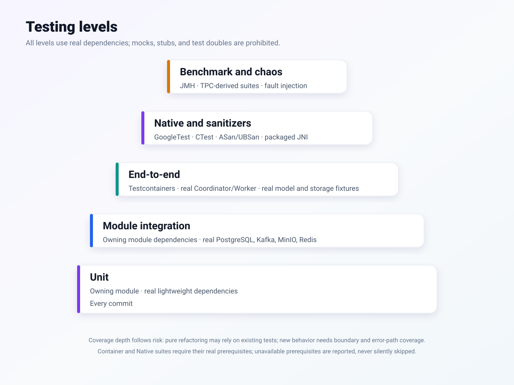

**Policy:** use a layered real-environment strategy; mocks, stubs, and test doubles are prohibited; verify complete data flow rather than isolated components.

## 2. Layered Testing Policy

### 2.1 Real Environment Policy by Level

All test levels must run against real implementations and real dependencies. Test doubles (including controlled test doubles), stubs, and mocks are not permitted.

| Test Level | Environment Policy | Examples |
|-----------|--------------------|----------|
| Unit Test | Must use real dependency implementation (containerized or embedded real service) | Embedded database, local object storage service, real clock behavior |
| Unit Test | **Prohibit** `Stub` / `Mockito.when()` / `PowerMock` / `EasyMock` | — |
| Integration Test | Must use TestContainers (real services) | MinIO, ZooKeeper, PostgreSQL |
| E2E Test | Must use real cluster | Full Coordinator + Worker deployment |
| Fuzzer Test | Use DuckDB as reference implementation | Expression / Join / Aggregation Fuzzer |

### 2.2 Prohibited Patterns

The following patterns are prohibited in all test levels:

1. Any stub/mock implementation that replaces real dependency behavior.
2. Any in-memory fake designed to avoid real protocol/storage/network semantics.
3. Any framework-based runtime mocking (class/static/constructor/method).

### 2.3 Prohibited Examples

**❌ Prohibited: Mockito / PowerMock / Stub on any class**

```java
// PROHIBITED: Mocking an SPI interface
Mockito.when(fileSystem.read(any())).thenReturn(data);

// PROHIBITED: Mocking an internal class
Mockito.when(queryPlanner.optimize(any())).thenReturn(plan);

// PROHIBITED: PowerMock static mocking
PowerMockito.mockStatic(ConfigLoader.class);
```


**Enforcement Mechanism**:

| Layer | Mechanism | Description |
|-------|-----------|-------------|
| Build | Maven dependency exclusion | `mockito-core`, `powermock-*`, `easymock` excluded from all modules |
| Static Analysis | ArchUnit rule | `noClasses().should().dependOnClassesThat().resideInAPackage("org.mockito..")` applied to all production and test modules |
| CI Gate | Dependency check step | CI pipeline fails if prohibited test framework JARs appear on any module's test classpath, and verifies that no `*Stub`/`*Mock` test-double implementations exist |

### 2.4 Common Scenario Real Dependency Reference

| Scenario | Real Dependency | Tooling | Used In |
|----------|-----------------|---------|---------|
| Storage access | S3-compatible object storage | TestContainers + MinIO | Connector, Cache layer tests |
| Metadata persistence | Real relational database | TestContainers + PostgreSQL | Catalog, Planner tests |
| Time-dependent logic | Real system clock + timeout policy | JUnit + deterministic test window | Scheduler, TTL, Heartbeat tests |
| Configuration loading | Real config source/files | TempDir + real parser/loader | All modules tests |
| Event publishing | Real message broker | TestContainers + Kafka/Redis Streams | Coordinator, Streaming tests |

### 2.5 Integration and E2E Test Requirements

For integration and E2E tests, **no test doubles/stubs/mocks are permitted**. All external dependencies must be real:

| Dependency | Integration Test Tool | Configuration |
|-----------|----------------------|---------------|
| Object Storage (S3) | TestContainers + MinIO | `minio/minio` image |
| ZooKeeper | TestContainers + ZooKeeper | `zookeeper:3.8` image |
| PostgreSQL | TestContainers + PostgreSQL | `postgres:16-alpine` image |
| Redis | TestContainers + Redis | `redis:7` image |
| Full Cluster (E2E) | Real Coordinator + Worker | Multi-process deployment |

> **Rationale**: Integration tests validate cross-module interactions with real protocols and serialization. Test doubles at this level hide bugs in serialization, network handling, and state management that only surface in production.

`RestCatalogTest` needs real, separately configured catalog services. Set
`PANGROVA_ICEBERG_REST_CATALOG_URI` to an Iceberg REST endpoint with the
`default` namespace already created; the service and test workers must be able
to access the same warehouse files. Set `PANGROVA_PAIMON_REST_CATALOG_URI` and
`PANGROVA_PAIMON_REST_CATALOG_WAREHOUSE` together for a Paimon REST service;
the warehouse value identifies the server-side catalog instance. An Iceberg
REST endpoint cannot serve the Paimon tests. When an endpoint is absent, its
suite is skipped and does not count as REST catalog validation.

## 3. Fuzzer Testing Framework

### 3.1 Fuzzer Architecture

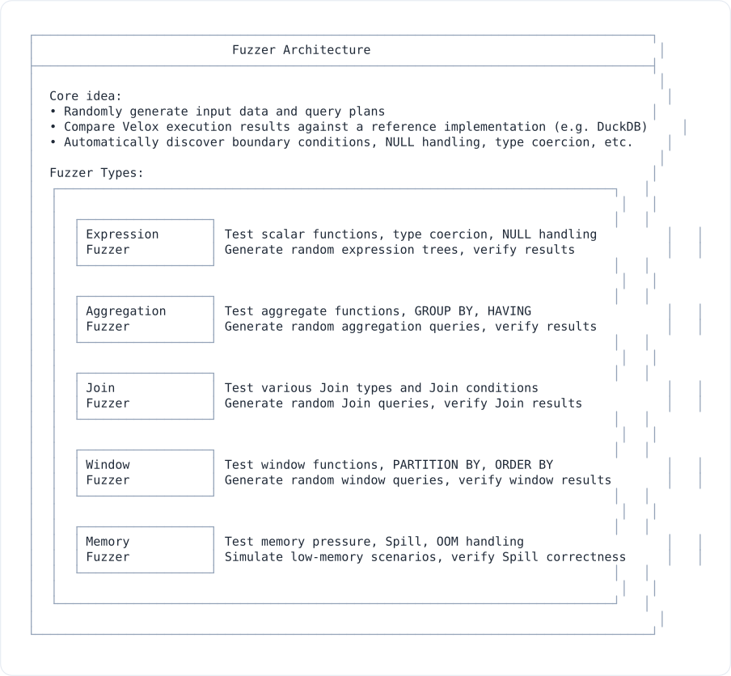


### 3.2 Expression Fuzzer

```cpp
// ExpressionFuzzer.h - Expression fuzzer
// Actual path: pangrova-testing/pangrova-testing-fuzzer/src/main/cpp/ExpressionFuzzer.h
#pragma once

#include <velox/expression/Expr.h>
#include <random>

namespace pangrova {
namespace testing {

/**
 * Expression Fuzzer
 * Randomly generates expression trees and verifies computation correctness
 */
class ExpressionFuzzer {
public:
    struct Config {
        int maxDepth = 5;                    // Maximum expression tree depth
        int maxWidth = 10;                   // Maximum number of children per level
        int batchSize = 1000;                // Test data batch size
        int iterations = 10000;              // Number of test iterations
        double nullRatio = 0.1;              // NULL value ratio
        bool enableNestedTypes = true;       // Whether to test nested types
        std::vector<std::string> functions;  // List of functions to test
    };
    
    explicit ExpressionFuzzer(const Config& config);
    
    /**
     * Run the Fuzzer
     * @return number of errors found
     */
    int run();
    
    /**
     * Generate a random expression
     */
    facebook::velox::core::TypedExprPtr generateExpression(
        const facebook::velox::RowTypePtr& inputType,
        int depth = 0);
    
    /**
     * Generate random input data
     */
    facebook::velox::RowVectorPtr generateInputData(
        const facebook::velox::RowTypePtr& type);
    
    /**
     * Verify the expression result
     * Compare the Velox result against the reference implementation
     */
    bool verifyResult(
        const facebook::velox::core::TypedExprPtr& expr,
        const facebook::velox::RowVectorPtr& input,
        const facebook::velox::VectorPtr& veloxResult);

private:
    // Random generator
    std::mt19937 rng_;
    
    // Supported types
    std::vector<facebook::velox::TypePtr> scalarTypes_;
    std::vector<facebook::velox::TypePtr> complexTypes_;
    
    // Supported function signatures
    std::vector<facebook::velox::exec::FunctionSignaturePtr> functionSignatures_;
    
    // Reference implementation (DuckDB)
    std::unique_ptr<ReferenceEngine> referenceEngine_;
    
    Config config_;
    
    // Generate a random scalar value
    facebook::velox::variant generateScalarValue(
        const facebook::velox::TypePtr& type);
    
    // Generate a random function call
    facebook::velox::core::TypedExprPtr generateFunctionCall(
        const facebook::velox::RowTypePtr& inputType,
        int depth);
    
    // Generate a random literal
    facebook::velox::core::TypedExprPtr generateLiteral();
    
    // Generate a random field reference
    facebook::velox::core::TypedExprPtr generateFieldAccess(
        const facebook::velox::RowTypePtr& inputType);
};

} // namespace testing
} // namespace pangrova
```

### 3.3 Join Fuzzer

```cpp
// JoinFuzzer.h - Join fuzzer
#pragma once

namespace pangrova {
namespace testing {

/**
 * Join Fuzzer
 * Tests various Join types and boundary conditions
 */
class JoinFuzzer {
public:
    struct Config {
        int iterations = 1000;
        int maxTableRows = 10000;
        int maxJoinKeys = 5;
        double nullKeyRatio = 0.1;
        double duplicateKeyRatio = 0.3;
        bool testAllJoinTypes = true;
    };
    
    /**
     * Run the Join Fuzzer
     */
    int run();

private:
    /**
     * Generate a random Join query
     */
    JoinTestCase generateJoinTestCase();
    
    /**
     * Generate test data
     * Includes various edge cases: NULL keys, duplicate keys, empty tables, etc.
     */
    std::pair<facebook::velox::RowVectorPtr, facebook::velox::RowVectorPtr>
    generateJoinData(const JoinTestCase& testCase);
    
    /**
     * Verify the Join result
     */
    bool verifyJoinResult(
        const JoinTestCase& testCase,
        const facebook::velox::RowVectorPtr& leftInput,
        const facebook::velox::RowVectorPtr& rightInput,
        const facebook::velox::RowVectorPtr& veloxResult);
    
    // Join types
    enum class JoinType {
        INNER,
        LEFT,
        RIGHT,
        FULL,
        LEFT_SEMI,
        RIGHT_SEMI,
        LEFT_ANTI,
        RIGHT_ANTI,
        CROSS
    };
    
    struct JoinTestCase {
        JoinType joinType;
        std::vector<std::string> leftKeys;
        std::vector<std::string> rightKeys;
        std::optional<std::string> filter;
        facebook::velox::RowTypePtr leftType;
        facebook::velox::RowTypePtr rightType;
    };
};

} // namespace testing
} // namespace pangrova
```

### 3.4 Aggregation Fuzzer

```cpp
// AggregationFuzzer.h - Aggregation fuzzer
#pragma once

namespace pangrova {
namespace testing {

/**
 * Aggregation Fuzzer
 * Tests the correctness of aggregate functions
 */
class AggregationFuzzer {
public:
    struct Config {
        int iterations = 1000;
        int maxInputRows = 100000;
        int maxGroupByKeys = 5;
        int maxAggregates = 10;
        double nullRatio = 0.1;
        bool testDistinct = true;
        bool testGlobalAgg = true;
        bool testGroupByAgg = true;
    };
    
    int run();

private:
    /**
     * Generate a random aggregation query
     */
    AggTestCase generateAggTestCase();
    
    /**
     * Test scenarios:
     * 1. Global aggregation (no GROUP BY)
     * 2. Single-column GROUP BY
     * 3. Multi-column GROUP BY
     * 4. DISTINCT aggregation
     * 5. Aggregation with FILTER
     * 6. Empty input
     * 7. All-NULL input
     * 8. Single-row input
     * 9. Many duplicate values
     */
    std::vector<AggTestCase> generateEdgeCases();
    
    struct AggTestCase {
        std::vector<std::string> groupByKeys;
        std::vector<AggregateSpec> aggregates;
        facebook::velox::RowTypePtr inputType;
    };
    
    struct AggregateSpec {
        std::string functionName;  // sum, avg, count, min, max, etc.
        std::vector<std::string> arguments;
        bool distinct = false;
        std::optional<std::string> filter;
    };
};

} // namespace testing
} // namespace pangrova
```


### 3.5 Memory Fuzzer

```cpp
// MemoryFuzzer.h - Memory pressure fuzzer
#pragma once

namespace pangrova {
namespace testing {

/**
 * Memory Fuzzer
 * Tests system behavior under memory pressure
 */
class MemoryFuzzer {
public:
    struct Config {
        int iterations = 100;
        int64_t minMemoryLimit = 1 * 1024 * 1024;      // 1MB
        int64_t maxMemoryLimit = 100 * 1024 * 1024;    // 100MB
        int64_t inputDataSize = 500 * 1024 * 1024;     // 500MB
        bool testSpill = true;
        bool testOom = true;
    };
    
    int run();

private:
    /**
     * Test scenarios:
     * 1. Sufficient memory - normal execution
     * 2. Memory pressure - triggers Spill
     * 3. Memory limit - multiple Spills
     * 4. Out of memory - graceful failure
     */
    void testMemoryScenario(int64_t memoryLimit, const QueryPlan& plan);
    
    /**
     * Generate a large-data-volume query
     * Includes memory-intensive operators such as Hash Join, Aggregation, Sort
     */
    QueryPlan generateMemoryIntensiveQuery();
    
    /**
     * Verify Spill correctness
     * Compare result consistency before and after Spill
     */
    bool verifySpillCorrectness(
        const QueryPlan& plan,
        const facebook::velox::RowVectorPtr& noSpillResult,
        const facebook::velox::RowVectorPtr& spillResult);
    
    /**
     * Verify Spill file cleanup
     */
    bool verifySpillCleanup(const std::string& spillDir);
};

} // namespace testing
} // namespace pangrova
```

## 4. Reference Implementation Comparison

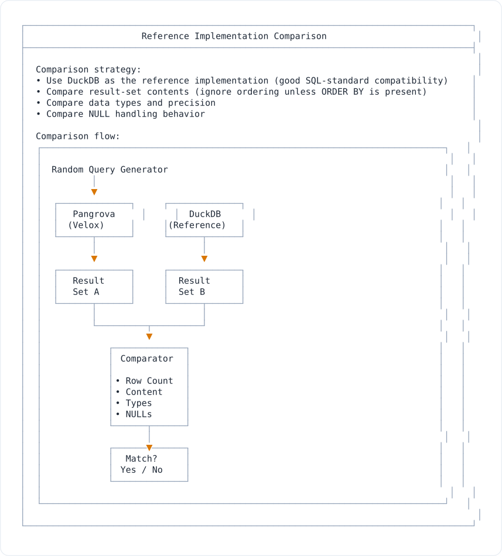

```cpp
// ReferenceEngine.h - reference implementation engine
#pragma once

#include <duckdb.hpp>

namespace pangrova {
namespace testing {

/**
 * Reference implementation engine
 * Uses DuckDB as the reference implementation for SQL execution
 * 
 * Version Requirement: duckdb >= 0.9.0 (pinned in CMakeLists.txt).
 * DuckDB has frequent releases with behavioral changes in NULL handling
 * and type coercion. Pin the version to ensure reproducible fuzzer results.
 */

class ReferenceEngine {
public:
    ReferenceEngine();
    ~ReferenceEngine();
    
    /**
     * Execute a SQL query
     */
    std::shared_ptr<arrow::Table> executeQuery(
        const std::string& sql,
        const std::vector<std::shared_ptr<arrow::Table>>& inputs);
    
    /**
     * Compare two result sets
     * @return description of the differences; an empty string means identical
     */
    std::string compareResults(
        const std::shared_ptr<arrow::Table>& expected,
        const std::shared_ptr<arrow::Table>& actual,
        const CompareOptions& options = {});
    
    struct CompareOptions {
        bool ignoreOrder = true;           // Ignore row order
        bool ignoreColumnOrder = false;    // Ignore column order
        double floatTolerance = 1e-6;      // Floating-point tolerance
        bool strictNullCompare = true;     // Strict NULL comparison
    };

private:
    std::unique_ptr<duckdb::DuckDB> db_;
    std::unique_ptr<duckdb::Connection> conn_;
};

} // namespace testing
} // namespace pangrova
```


## 5. Performance Testing Framework

When PR CI selects performance checks, it builds the JMH harness from both the
pull request base and the candidate commits. It measures both on the same runner
using the same JDK and fork options. The comparator requires matching benchmark
cases, units and harness settings and fails for point-estimate regressions above
10%. The `jmh-benchmark-results` artifact retains both raw result files and source
revisions. Use dedicated hosts and the published workload runbook for TPC
performance qualification.

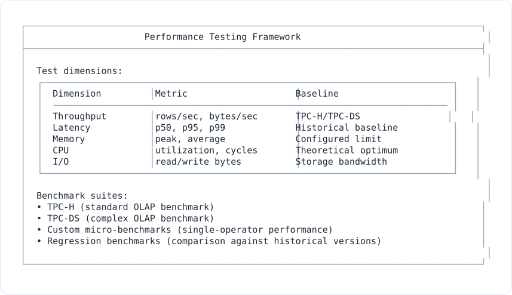

```java
// PerformanceBenchmark.java - performance benchmark
package org.pangrova.testing.benchmark;

import org.openjdk.jmh.annotations.*;

/**
 * Performance benchmark
 * Uses JMH for micro-benchmarking
 */
@State(Scope.Benchmark)
@BenchmarkMode(Mode.Throughput)
@OutputTimeUnit(TimeUnit.SECONDS)
@Warmup(iterations = 3, time = 10)
@Measurement(iterations = 5, time = 30)
@Fork(1)
public class PerformanceBenchmark {
    
    private PangrovaClient client;
    private String tpchQuery;
    
    @Setup
    public void setup() {
        client = PangrovaClient.builder()
            .coordinatorUrl("localhost:8080")
            .build();
        
        // Warm up the data cache
        client.execute("SELECT 1");
    }
    
    @Benchmark
    public void tpchQ1() {
        // TPC-H Q1: scan + aggregate
        client.execute("""
            SELECT l_returnflag, l_linestatus,
                   SUM(l_quantity) as sum_qty,
                   SUM(l_extendedprice) as sum_base_price,
                   AVG(l_quantity) as avg_qty,
                   COUNT(*) as count_order
            FROM lineitem
            WHERE l_shipdate <= DATE '1998-12-01' - INTERVAL '90' DAY
            GROUP BY l_returnflag, l_linestatus
            ORDER BY l_returnflag, l_linestatus
            """);
    }
    
    @Benchmark
    public void tpchQ3() {
        // TPC-H Q3: Join + aggregate
        client.execute("""
            SELECT l_orderkey, SUM(l_extendedprice * (1 - l_discount)) as revenue,
                   o_orderdate, o_shippriority
            FROM customer, orders, lineitem
            WHERE c_mktsegment = 'BUILDING'
              AND c_custkey = o_custkey
              AND l_orderkey = o_orderkey
              AND o_orderdate < DATE '1995-03-15'
              AND l_shipdate > DATE '1995-03-15'
            GROUP BY l_orderkey, o_orderdate, o_shippriority
            ORDER BY revenue DESC, o_orderdate
            LIMIT 10
            """);
    }
    
    @Benchmark
    public void scanBenchmark() {
        // Pure scan performance
        client.execute("SELECT * FROM lineitem WHERE l_shipdate > '1998-01-01'");
    }
    
    @Benchmark
    public void hashJoinBenchmark() {
        // Hash Join performance
        client.execute("""
            SELECT * FROM orders o
            JOIN lineitem l ON o.o_orderkey = l.l_orderkey
            WHERE o.o_orderdate > '1998-01-01'
            """);
    }
    
    @Benchmark
    public void aggregationBenchmark() {
        // Aggregation performance
        client.execute("""
            SELECT l_returnflag, COUNT(*), SUM(l_quantity), AVG(l_extendedprice)
            FROM lineitem
            GROUP BY l_returnflag
            """);
    }
}
```

## 6. End-to-End Testing Framework

```java
// E2ETestFramework.java - end-to-end testing framework
package org.pangrova.testing.integration.e2e;

/**
 * End-to-end testing framework
 * Tests the complete query execution flow
 */
public class E2ETestFramework {
    
    private final TestCluster cluster;
    private final DataGenerator dataGenerator;
    private final ResultValidator validator;
    
    /**
     * Run the end-to-end test suite
     */
    public TestReport runTestSuite(TestSuite suite) {
        TestReport report = new TestReport();
        
        for (TestCase testCase : suite.getTestCases()) {
            try {
                // 1. Prepare test data
                prepareTestData(testCase);
                
                // 2. Execute the query
                QueryResult result = executeQuery(testCase.getQuery());
                
                // 3. Validate the result
                ValidationResult validation = validator.validate(
                    result, testCase.getExpectedResult());
                
                // 4. Record the result
                report.addResult(testCase, validation);
                
            } catch (Exception e) {
                report.addFailure(testCase, e);
            } finally {
                // 5. Clean up test data
                cleanupTestData(testCase);
            }
        }
        
        return report;
    }
    
    /**
     * Test scenario types
     */
    public enum TestScenario {
        // Basic functionality
        SIMPLE_SELECT,
        FILTER_PUSHDOWN,
        PROJECTION_PUSHDOWN,
        
        // Join tests
        INNER_JOIN,
        LEFT_JOIN,
        MULTI_WAY_JOIN,
        
        // Aggregation tests
        GLOBAL_AGGREGATION,
        GROUP_BY_AGGREGATION,
        DISTINCT_AGGREGATION,
        
        // Window functions
        ROW_NUMBER,
        RANK,
        LAG_LEAD,
        
        // Distributed scenarios
        SHUFFLE,
        BROADCAST_JOIN,
        MULTI_STAGE,
        
        // Fault-tolerance scenarios
        WORKER_FAILURE,
        COORDINATOR_FAILOVER,
        NETWORK_PARTITION,
        
        // Data lake scenarios
        ICEBERG_SNAPSHOT,
        ICEBERG_TIME_TRAVEL,
        ICEBERG_MOR,
        PARTITION_PRUNING
    }
}
```


## 7. Distributed failure tests

`CoordinatorRestartChaosTest` exercises network isolation, Coordinator restart and Worker loss in Docker. The test verifies the supplied image ID and source revision and starts the production roles. An LDAP-authenticated client reads each result to EOF over mutual TLS Flight and checks the exact Native completion report. Toxiproxy interrupts Worker control traffic until the Coordinator removes the Worker or marks its ID dead. Killing the only Worker while its terminal report is held must produce a durable FAILED state and retain the tenant reservation. The restarted Worker reopens its persistent admission directory and proves that the previous execution ended. The test waits for the Coordinator to acknowledge physical drain and release the exact PostgreSQL reservation before injecting the next failure.

After SIGKILL and restart, the new non-HA Coordinator must serve the same FINISHED query and the exact persisted RUNNING state of another query whose Native terminal report is held. The recovered cluster completes a fresh query and returns its reservation. The previous RUNNING query retains its reservation while physical drain remains unconfirmed.

`IndependentClientCancellationE2ETest` uses a Coordinator and two Worker processes. The relay holds an actual Native terminal task report while `Statement.cancel()` or the packaged CLI timeout cancels the matching query over HTTP. The checks require the same UUID to become CANCELLED. Each client must also have one PostgreSQL query history row with its exact SQL, LDAP principal, tenant and unsuccessful outcome. The security audit must contain one submission and one cancellation event in that order for the same ID. Submission records the already authenticated principal and SQL. The cancellation event records the tenant resolved during admission. The CLI case holds the first FINISHED notification while its real retry proceeds. After PostgreSQL shows that the tenant admission slot was released, it delivers the original delayed notification and requires separate acknowledgements for that superseded notice and the actual Native release receipt. JDBC then consumes a TLS result stream on the same connection, and a fresh CLI query also reads its result. Supply the local role classpaths, CLI and Native manifest used by the independent-process suites.

`JdbcQueryStateJournalIntegrationTest` and `QueryManagerDurableAcceptanceTest` cover durable idempotent acceptance with real PostgreSQL: one normal INSERT and zero readback, replay across journal instances, principal isolation, same-key fingerprint conflict without poisoning later writes, lost commit response reconciliation, active-query TTL protection, bounded expiry sweep, row-locked acceptance replacement, replay lineage suppression, retention through terminal cleanup, replay reservation release, rejected-candidate throttle cleanup, drain cleanup ordering, atomic candidate publication, and cancellation while owner acquisition is pending. A full two-Coordinator process failover suite remains part of B1 and is not replaced by these component tests.

Run the same-source Linux image with the release properties `pangrova.e2e.image`, `pangrova.e2e.image-id` and `pangrova.e2e.local.source-commit`. The selected class is `CoordinatorRestartChaosTest`.

For scenarios using a dedicated Docker network, `ContainerFaultInjector` implements `FaultInjector` with explicit partition, reconnect, process-kill and clock operations. A test owns its containers and restores its injected fault during cleanup.

## 8. Test Data Generator

`org.pangrova.testing.testkit.TestDataGenerator` generates deterministic TPC-H
rows for integration and validation tests. It covers the eight TPC-H tables and
supports typed column values; the same seed produces the same rows.

```java
TestDataGenerator generator = new TestDataGenerator(seed);
List<TypedRow> lineitems = generator.generateTable("lineitem", 1_000);

Map<String, TestDataGenerator.TableSchema> schemas = TestDataGenerator.getSchemas();
```

The generator does not invoke external `dbgen`. For scale-factor dataset
generation, use
`pangrova-testing/pangrova-testing-benchmark/scripts/generate_tpc_data.py`.

## 9. CI/CD Integration

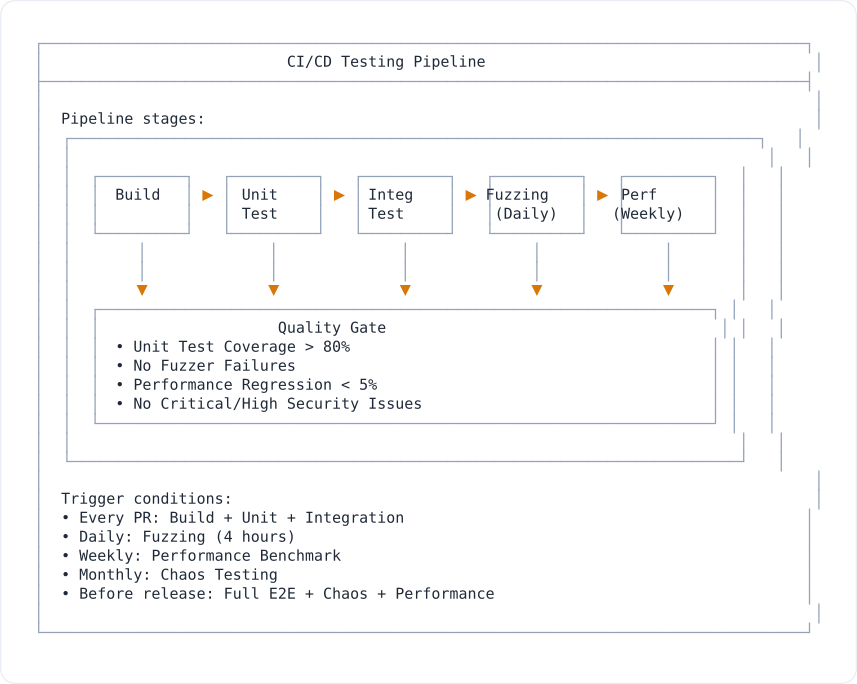

```yaml
# .github/workflows/test.yml - example CI test configuration

name: Pangrova CI

on:
  push:
    branches: [main]
  pull_request:
    branches: [main]

jobs:
  build:
    runs-on: ubuntu-latest
    steps:
      - uses: actions/checkout@v3
      - name: Build
        run: mvn clean compile -DskipTests

  unit-test:
    needs: build
    runs-on: ubuntu-latest
    steps:
      - name: Run Unit Tests
        run: mvn test -Dtest.type=unit
      - name: Upload Coverage
        uses: codecov/codecov-action@v3

  integration-test:
    needs: unit-test
    runs-on: ubuntu-latest
    services:
      minio:
        image: minio/minio
      zookeeper:
        image: zookeeper:3.8
    steps:
      - name: Run Integration Tests
        run: mvn test -Dtest.type=integration

  native-test:
    needs: build
    runs-on: ubuntu-latest
    steps:
      - name: Build Native
        run: |
          cd pangrova-worker-native
          cmake -B build -DCMAKE_BUILD_TYPE=Release
          cmake --build build
      - name: Run Native Tests
        run: ./build/pangrova_native_test

  fuzzing:
    if: github.event_name == 'schedule'  # Daily
    runs-on: ubuntu-latest
    steps:
      - name: Run Expression Fuzzer
        run: ./build/expression_fuzzer --iterations=100000
      - name: Run Join Fuzzer
        run: ./build/join_fuzzer --iterations=10000
      - name: Run Aggregation Fuzzer
        run: ./build/aggregation_fuzzer --iterations=10000
```

## 10. Testing Best Practices

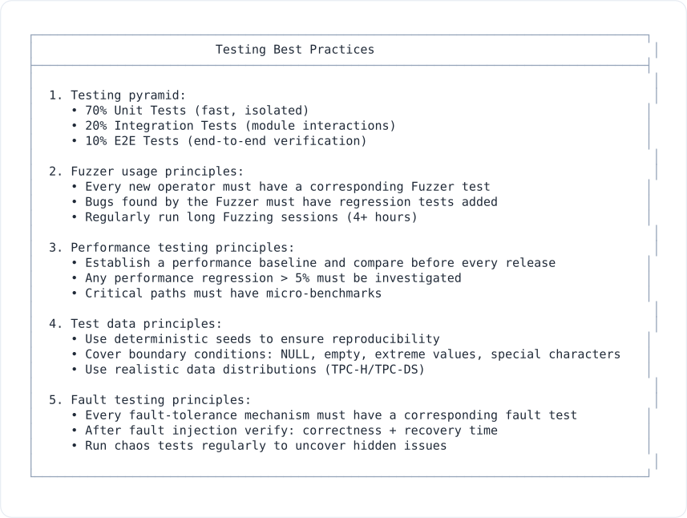

## 11. Testing Module Structure

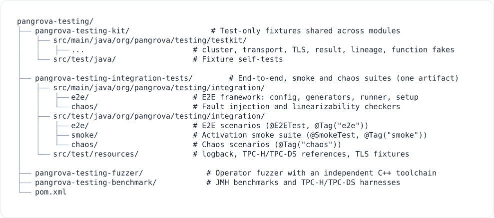

Suite selection is preserved after the merge: E2E runs through `-Pe2e`/`full-regression`,
the smoke suite through `-Dgroups=smoke`, and the chaos suite through `-Dgroups=chaos`
or its class names. No suite is selected by module identity any more.

---

## 12. Performance Benchmark Targets

### 12.1 TPC-H Benchmark Targets

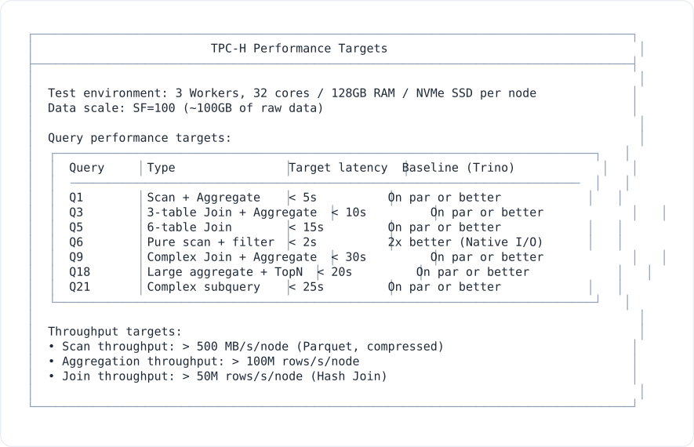

### 12.2 TPC-DS Benchmark Targets

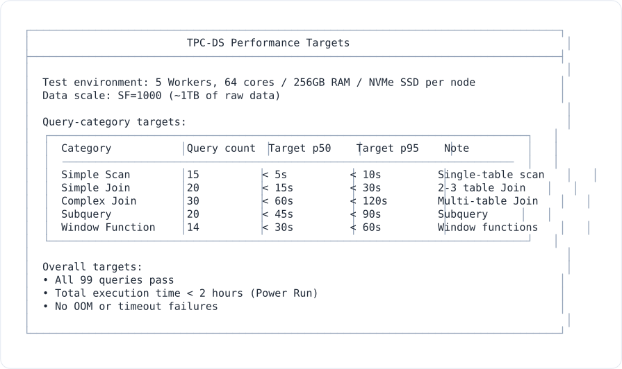

### 12.3 Performance Benchmark Execution Specification

This section defines the formal execution rules for TPC-H and TPC-DS benchmarks, including environment requirements, execution procedure, pass/fail criteria, and CI integration.

#### 12.3.1 Execution Environment

| Item | TPC-H | TPC-DS |
|------|-------|--------|
| Scale Factor | SF=100 (~100GB) | SF=1000 (~1TB) |
| Workers | 3 nodes | 5 nodes |
| CPU per node | 32 cores | 64 cores |
| RAM per node | 128 GB | 256 GB |
| Storage | NVMe SSD, ≥ 1TB per node | NVMe SSD, ≥ 2TB per node |
| File Format | Parquet + ZSTD | Parquet + ZSTD |
| Data Layout | Iceberg table, default partitioning | Iceberg table, default partitioning |
| JVM | JDK 17, `-Xmx16g` | JDK 17, `-Xmx32g` |
| OS | Linux 5.15+, `vm.swappiness=0` | Linux 5.15+, `vm.swappiness=0` |

#### 12.3.2 Execution Procedure

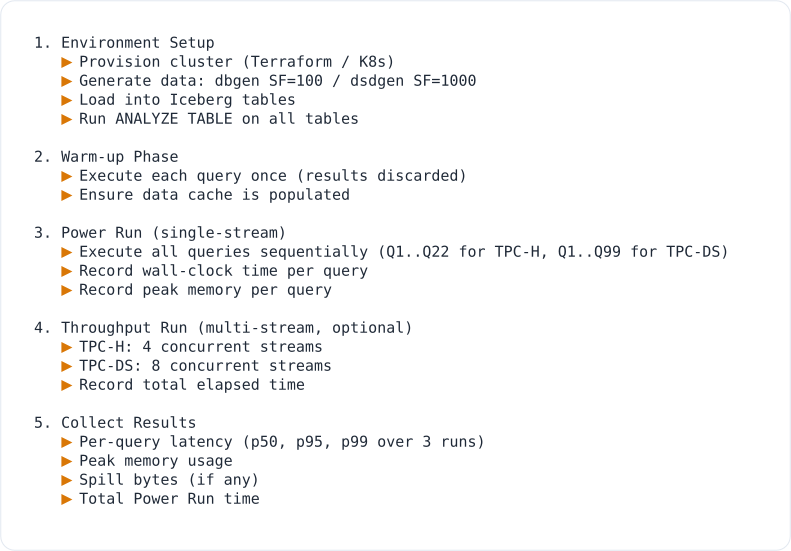

#### 12.3.3 Pass/Fail Criteria

| Criterion | Threshold | Action on Failure |
|-----------|-----------|-------------------|
| Query correctness | 100% queries return correct results (vs DuckDB reference) | Block release |
| Single query regression | Latency increase > 10% vs baseline | Investigate; `tpch-regression-check.sh` fails beyond the checked-in 15% threshold |
| Total Power Run regression | Total time increase > 5% vs baseline | Investigate, block if > 10% |
| OOM failure | 0 OOM across all queries | Block release |
| Spill correctness | Spill results match non-spill results | Block release |
| Query timeout | No query exceeds 2x target latency | Investigate |
| Absolute latency target | Per-query targets from §12.1/§12.2 (e.g., TPC-H Q1 < 5s) | Investigate; these are aspirational goals, not hard CI gates. Only regression-relative thresholds (rows above) block release. Absolute targets are tracked for roadmap planning. |


#### 12.3.4 Baseline Management

- The versioned baseline lives in
  `pangrova-testing/pangrova-testing-benchmark/baseline/tpch-performance-baseline.json`
- It records the scale factor, environment, regression threshold, and per-query
  `baselineP50Ms`/`baselineP99Ms`
- `tpch-regression-check.sh` compares a results file against this baseline and
  rejects missing, uncalibrated, or scale-mismatched measurements
- Update the baseline only for an intentional performance change or a release,
  never on an ordinary feature branch

#### 12.3.5 CI Integration

The scheduled benchmark is `.github/workflows/nightly-tpc-benchmark.yml`. It runs
daily on `[self-hosted, benchmark, linux, x86_64]` under an exclusive hardware
lease and also supports `workflow_dispatch` inputs for workload, scale factor,
streams, and profile. The schedule is skipped until the repository variable
`TPC_BENCHMARK_CONFIG_DIR` is set, so an unprovisioned fleet never leaves a run
queued forever in the exclusive hardware group; a manual dispatch still runs and
fails loudly on missing configuration.

The workflow:

1. Validates the dedicated-host configuration in `TPC_CONFIG_DIR`.
2. Builds the canonical same-source production image and verifies its source label.
3. Runs each selected suite with
   `pangrova-testing/pangrova-testing-benchmark/scripts/run_tpc_job.py`, which
   records results under `tpc-results/`.
4. Stops any cluster recorded in a `cluster-state.json` even when the job was
   interrupted.
5. Uploads result JSON/JSONL artifacts.

Run the regression comparison against the checked-in baseline with
`pangrova-testing/pangrova-testing-benchmark/scripts/tpch-regression-check.sh
<results-json>`. The script fails when a query exceeds the baseline threshold or
when measurements are missing, uncalibrated, or scale-mismatched.

#### 12.3.6 Regression Detection Rules

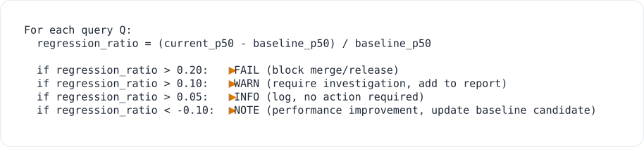

Regression is evaluated on p50 latency from 3 consecutive runs. If variance across runs exceeds 15%, the result is marked `UNSTABLE` and requires re-run.

---

### 12.4 Performance Regression Detection

```java
/**
 * Performance regression detector
 */
public class PerformanceRegressionDetector {
    
    private static final double REGRESSION_THRESHOLD = 0.05;  // 5% regression threshold
    
    /**
     * Detect performance regressions
     */
    public RegressionReport detect(BenchmarkResult current, BenchmarkResult baseline) {
        List<RegressionItem> regressions = new ArrayList<>();
        
        for (String queryName : current.getQueryNames()) {
            double currentLatency = current.getLatency(queryName);
            double baselineLatency = baseline.getLatency(queryName);
            
            double regression = (currentLatency - baselineLatency) / baselineLatency;
            
            if (regression > REGRESSION_THRESHOLD) {
                regressions.add(RegressionItem.builder()
                    .queryName(queryName)
                    .baselineLatency(baselineLatency)
                    .currentLatency(currentLatency)
                    .regressionPercent(regression * 100)
                    .build());
            }
        }
        
        return RegressionReport.builder()
            .hasRegression(!regressions.isEmpty())
            .regressions(regressions)
            .build();
    }
}
```


---

## 13. Cross-Module Integration Test Matrix

This section defines the end-to-end integration test scenarios that verify cross-module contracts. Each scenario covers interaction paths defined across multiple architecture documents, ensuring the correctness of inter-module integration.

### 13.1 Scenario Overview

| Scenario ID | Name | Modules Covered | Priority | Phase |
|---------|------|---------|--------|-------|
| IT-01 | Single-table scan end-to-end | 02 + 03 + 04 + 07 | P0 | Phase 1 |
| IT-02 | Distributed Join + Shuffle | 02 + 03 + 01 + 06 | P0 | Phase 2 |
| IT-03 | Output Task result return | 02 §3.3 + 01 §2.4 | P0 | Phase 2 |
| IT-04 | Coordinator failover | 01 §3.5 + 08 | P0 | Phase 2 |
| IT-05 | Worker crash + Split retry | 01 §4.2 + 08 | P0 | Phase 2 |
| IT-06 | Memory pressure + Spill | 06 + 03 §5 | P0 | Phase 2 |
| IT-07 | CDC write + incremental query | 10 + 04 + 02 | P1 | Phase 4 |
| IT-08 | Multi-tenant concurrency + resource isolation | 13 + 06 + 08 | P1 | Phase 4 |
| IT-09 | Security: RBAC + Column Masking | 12 + 07 + 02 | P1 | Phase 3 |
| IT-10 | Cache hit + invalidation | 09 + 07 + 05 | P1 | Phase 3 |
| IT-11 | Rolling upgrade with zero downtime | 15 + 01 | P1 | Phase 3 |
| IT-12 | Native Trace end-to-end | 14 + 03 + 02 | P2 | Phase 3 |

### 13.2 Scenario Detailed Definitions

#### IT-01: Single-table scan end-to-end

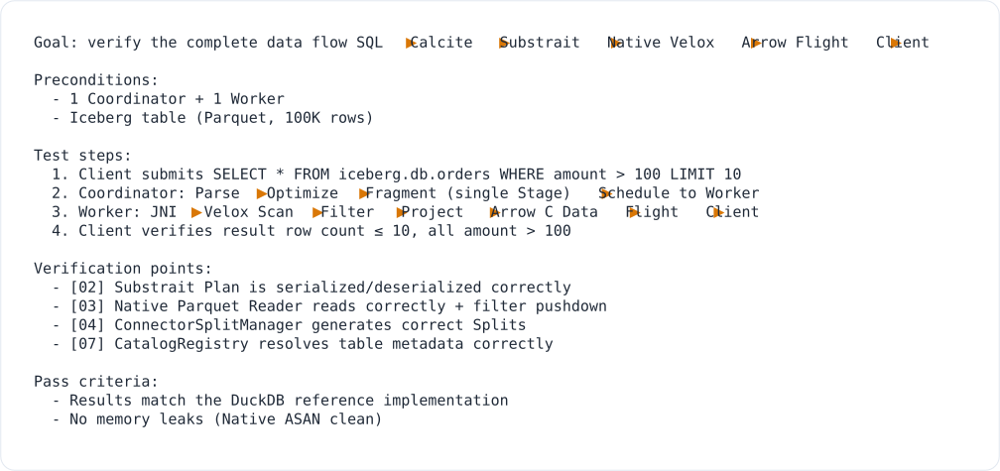

#### IT-02: Distributed Join + Shuffle

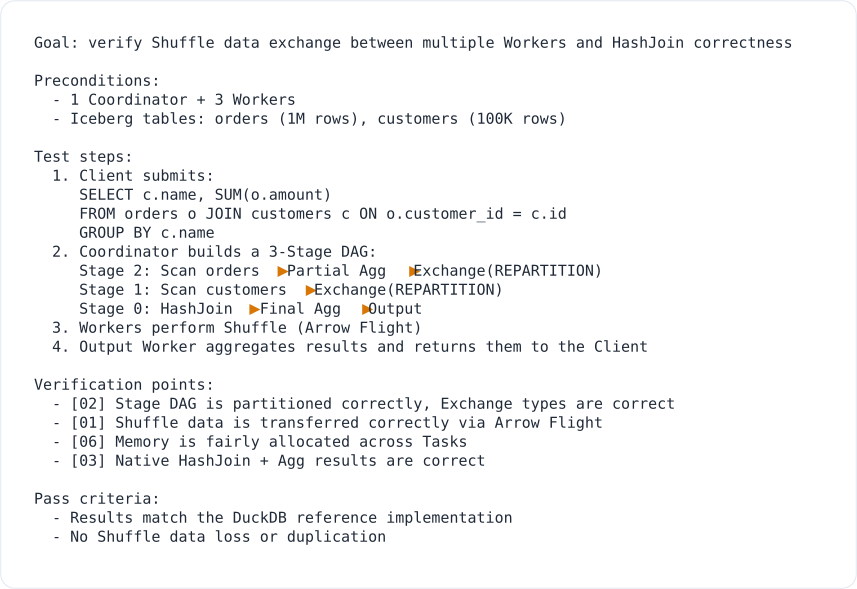

#### IT-03: Output Task result return

```
Goal: verify the Coordinator does not participate in data processing; the Client connects directly to the Output Worker to pull results

Preconditions:
  - 1 Coordinator + 2 Workers

Test steps:
  1. Client submits SELECT * FROM orders ORDER BY amount LIMIT 10
  2. If result_disposition is PENDING, poll live state until STREAM; NONE is invalid for this SELECT
  3. Verify STREAM carries result_endpoint (Output Worker address) and connect to that Arrow Flight endpoint
  4. Verify the Coordinator process memory has no RecordBatch allocations

Verification points:
  - [02 §3.3] result_endpoint points to the Output Worker, not the Coordinator
  - [02 §3.3] endpoint publication and STREAM are visible in the same status version
  - [02 §3.3] Coordinator does zero data processing (monitor JVM heap for no Arrow buffer allocations)
  - [02 §3.3] Backpressure propagation: Client pauses consumption → Output Worker pauses → Compute Worker pauses

Pass criteria:
  - Results are correct (ORDER BY + LIMIT semantics)
  - Coordinator heap growth < 1MB (scheduling metadata only)
```

#### IT-04: Coordinator failover

```
Goal: verify that after a Coordinator crashes the query is taken over by another Coordinator

Preconditions:
  - 3 Coordinators + 2 Workers
  - Long-running query (scans a large table, expected > 30s)

Test steps:
  1. Client submits a long-running query via Coordinator-1
  2. After the query enters the RUNNING state, kill Coordinator-1
  3. Wait for the ZK session to expire (30s)
  4. Verify Coordinator-2 or Coordinator-3 takes over the query
  5. Client reconnects; the query ultimately returns correct results

Verification points:
  - [01 §3.5] Deletion of the ZK ephemeral node triggers a CHILD_REMOVED event
  - [01 §3.5] acquireOwnership() wins the contention
  - [01 §4.4] QueryCheckpoint is restored correctly from PostgreSQL
  - [08] Error code TRANSPORT-0001 (TRANSPORT_CONNECTION_FAILED) is reported correctly

Pass criteria:
  - The query ultimately succeeds (latency may increase, but results are correct)
  - No data loss
```

#### IT-05: Worker crash + Split retry

```
Goal: verify that after a Worker crashes, incomplete Splits are rescheduled to other Workers

Preconditions:
  - 1 Coordinator + 3 Workers
  - Large-table query (many Splits)

Test steps:
  1. Submit the query, distributing Splits across 3 Workers
  2. Kill Worker-2 halfway through execution
  3. Coordinator detects the Worker-2 crash (ZK ephemeral node deleted)
  4. Coordinator reschedules the incomplete Splits from Worker-2 to Worker-1/3
  5. The query ultimately completes

Verification points:
  - [01 §4.2] Split-level retry (not Task-level)
  - [01 §4.1] Results of completed Splits are reused, not recomputed
  - [08] Error code WORKER-0002 (WORKER_LOST) is reported correctly

Pass criteria:
  - The query ultimately succeeds
  - Results match a fault-free execution
```

#### IT-06: Memory pressure + Spill

```
Goal: verify that when memory is insufficient the Spill mechanism triggers correctly and the query still returns correct results

Preconditions:
  - 1 Coordinator + 1 Worker (Native memory limited to 2GB)
  - Large aggregation query (expected to need > 2GB of memory)

Test steps:
  1. Submit SELECT key, COUNT(*) FROM large_table GROUP BY key (high cardinality)
  2. Native-layer memory reaches its limit; the Velox MemoryArbitrator triggers Spill
  3. Spill data is written to NVMe SSD (Arrow IPC + LZ4)
  4. The query completes with correct results

Verification points:
  - [06] Java MemoryManager correctly sets the Native memory limit
  - [03 §5] Velox SpillManager writes/reads Spill data correctly
  - [06 §12] The Java-Native memory coordination protocol works correctly

Pass criteria:
  - Results match the DuckDB reference implementation
  - Spill files are cleaned up after the query completes
  - No OOM
```

#### IT-07: CDC write + incremental query

```
Goal: verify that CDC data written from Kafka into an Iceberg table can be read via incremental queries

Preconditions:
  - Kafka + Debezium + 1 Coordinator + 1 Worker
  - Source table: MySQL orders table

Test steps:
  1. Start the CDC Consumer to consume Kafka CDC messages
  2. INSERT 10 records into MySQL
  3. Wait for the CDC Consumer to write into the Iceberg table (mini-batch commit)
  4. Execute an incremental query: SELECT * FROM orders FOR SYSTEM_TIME AFTER <snapshot>
  5. Verify the 10 newly added records are returned

Verification points:
  - [10 §2] CDC Consumer parses Debezium messages correctly
  - [10 §3] CDC two-phase commit through CdcWriteSink
  - [02 §6] The Worker Native write path commits through ConnectorPageSink
  - [04] Iceberg Connector incremental queries are correct

Pass criteria:
  - The incremental query returns exactly the 10 newly added records
  - The Iceberg snapshot is generated correctly
```

#### IT-08: Multi-tenant concurrency + resource isolation

```
Goal: verify that when two tenants run queries concurrently their resources do not interfere

Preconditions:
  - 1 Coordinator + 4 Workers
  - Tenant A: resource_pool = premium (30% of resources)
  - Tenant B: resource_pool = default (50% of resources)

Test steps:
  1. Tenant A submits a large query (TPC-H Q9)
  2. Concurrently, Tenant B submits a small query (SELECT COUNT(*) FROM small_table)
  3. Verify Tenant B's query is not blocked by Tenant A
  4. Verify Tenant A's memory usage does not exceed the premium pool quota

Verification points:
  - [13 §3] ResourcePool resource isolation
  - [13 §4] QuotaChecker quota checks
  - [06] Memory is allocated correctly across resource pools
  - [08] Tenant A returns TENANT_QUOTA_EXCEEDED (1602) when exceeding its quota

Pass criteria:
  - Tenant B's query latency is unaffected by Tenant A (< 2x normal latency)
  - Tenant A's memory usage ≤ premium pool quota
```

### 13.3 Integration Test Infrastructure

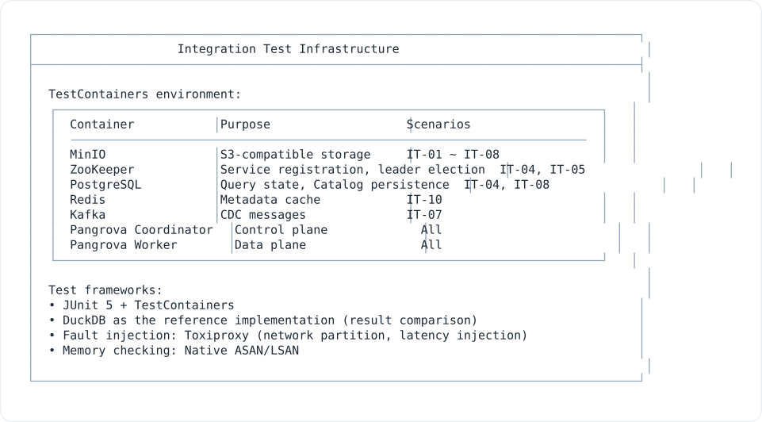

### 13.4 CI Integration

```yaml
# .github/workflows/integration-test.yml
name: Integration Tests

on:
  pull_request:
    paths: ['pangrova-*/src/**', 'pangrova-worker-native/src/**']
  push:
    branches: [main]

jobs:
  integration-test:
    runs-on: [self-hosted, docker]
    timeout-minutes: 60
    strategy:
      matrix:
        suite: [IT-01, IT-02, IT-03, IT-04, IT-05, IT-06]
    steps:
      - uses: actions/checkout@v3
      - name: Build
        run: mvn clean install -DskipTests -T4
      - name: Run Integration Test
        run: |
          mvn test -pl pangrova-testing \
            -Dtest.suite=${{ matrix.suite }} \
            -Dtest.type=integration
      - name: Upload Logs
        if: failure()
        uses: actions/upload-artifact@v3
        with:
          name: integration-logs-${{ matrix.suite }}
          path: pangrova-testing/target/logs/
```

> **Cross-Reference**: For the unit-testing strategy see [§2 Layered Testing Policy](#2-layered-testing-policy); for performance benchmarks see [§12 Performance Benchmark Targets](#12-performance-benchmark-targets).

---


## 14. Observability Integration

This section defines the metrics and tracing integration points for the testing framework. For the full observability design, see [observability.md](../architecture/observability.md).

### 14.1 Metrics

| Metric | Source Component | Description |
|--------|-----------------|-------------|
| `pangrova.test.suite.duration` | TestRunner | Test suite execution duration |
| `pangrova.test.cases.passed` | TestRunner | Test cases passed |
| `pangrova.test.cases.failed` | TestRunner | Test cases failed |
| `pangrova.test.benchmark.throughput` | BenchmarkRunner | Benchmark throughput (rows/sec) |

### 14.2 Tracing Spans

- `test.suite.execute` — Test suite execution (SERVER span)
- `test.case.execute` — Individual test case (INTERNAL span)

Test environments should enable full tracing (`sampling.probability=1.0`) for debugging.

### 14.3 Log Events

- Test case start/complete/fail events (INFO)
- Performance regression detection events (WARN)

See [14 §7](../architecture/observability.md) for structured logging format.


---

## Appendix A: Chaos Framework Decision (ADR)

**Status**: Accepted

**Decision**: Custom Java chaos testing framework built on TestContainers (over Jepsen).

**Rationale**:

| Dimension | Jepsen | Custom (TestContainers) |
|-----------|--------|------------------------|
| Language | Clojure (requires JVM interop) | Java (native to project) |
| CI Integration | Requires Clojure toolchain | Maven module, same build pipeline |
| Container Orchestration | SSH-based (requires VMs) | Docker-native, zero infra |
| Fault Injection | iptables/tc via SSH | Docker network disconnect, container kill, Toxiproxy |
| Linearizability Checker | Knossos (Clojure, slow) | Custom Wing & Gong algorithm (Java) |
| Developer Adoption | Clojure expertise required | Any Java developer |
| Startup Time | Minutes (VM provisioning) | Seconds (container start) |

**Consequences**: We own the linearizability checker implementation. We lose Jepsen's visualization tools but gain faster test execution and developer accessibility.

---

## Appendix B: E2E Performance Verification

**Baseline**: `reuseForks=false` → 169 JVM forks → ~30+ min wall-clock.
**After**: `reuseForks=true` → 1 JVM fork → target < 5 min.

**Verification checklist**:

| Check | Command | Expected |
|-------|---------|----------|
| Total wall-clock | `time mvn test` (in pangrova-testing-integration-tests) | < 5 min |
| Single fork | `grep -c "Forking command line" log` | 1 |
| No SIGSEGV | `grep -i "SIGSEGV\|signal 11" log` | No matches |
| No OOM | `grep -i "OutOfMemoryError" log` | No matches |
| Memory stable | `grep "native_memory_snapshot" log \| tail -5` | No monotonic growth |

**Time savings**: Eliminating 168 redundant JVM+container+native-init cycles saves ~30 min per E2E run.
> **Benchmark Environment (§12.3.1)**: In addition to JVM settings (`-Xmx16g` for single-node, `-Xmx32g` for cluster), the benchmark environment must also configure Native memory limits: `memory.native.max-memory = 48GB` (single-node) or `memory.native.max-memory = 48GB` per Worker (cluster). The total Worker memory budget follows [06 §2](../architecture/resource-management.md): Reserved (4GB) + Root Arbitrator (60GB) for a 64GB machine. Benchmark JVM heap is intentionally smaller than production to leave more memory for the Native layer.
