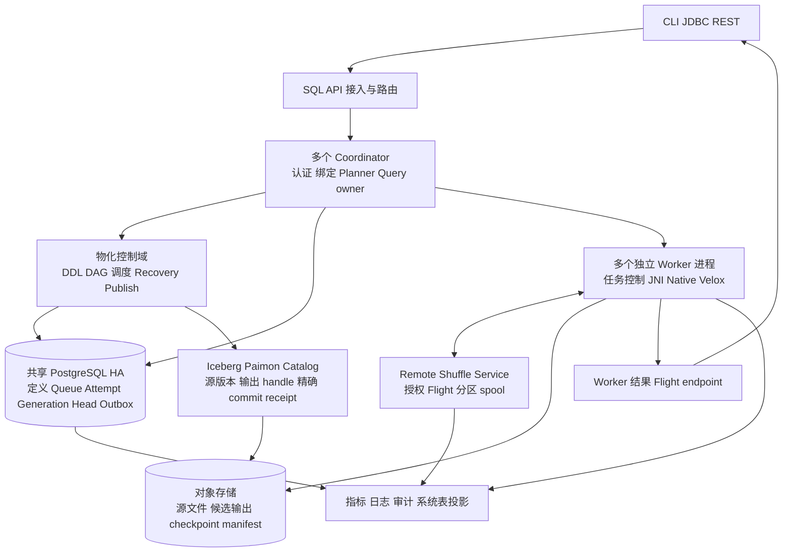

# Pangrova 动态表与物化视图完整分布式架构及落地方案

日期：2026-09-30。状态：Target design，待实施与验收。本文不会把设计目标记为当前已实现能力。

本方案覆盖动态表与物化视图从 SQL、对象生命周期、依赖图和刷新计划，到分布式执行、Shuffle、湖表提交、逻辑发布、查询读取、HA、增量状态、资源治理、迁移和生产验收的完整链路。业界依据见 [深度调研](dynamic-table-materialized-view-industry-research.md)，可直接拆分执行的依赖任务见 [工程任务清单](dynamic-table-materialized-view-delivery-backlog.yaml)。

**推荐决策：MV 与 DT 共用版本化 Materialization 内核，依靠现有 Calcite 与 Native Worker 批执行链路，先交付可证明正确的全量物化，再提供分区、受影响键及通用 delta 维护。发布的权威是绑定精确物理版本的逻辑 generation，dispatch、task success 和刷新成功必须分开。**

## 1 范围与设计依据

采用当前 [.pangrova 架构约束](../../.pangrova/rules/architecture.md)：Java 负责绑定、授权、调度、fencing 和 catalog metadata commit；C++20/Velox 负责行数据计算；Java/native 边界仅使用 canonical v2 与 JNI。Coordinator 不能扫描行、构造 Page、计算 group state 或打开业务行写 sink。

[2026-09-12 审查](dynamic-table-materialized-view-architecture-review.md)是历史输入，本文已重新检查当前工作树。工作树中已有大量未提交修改，本次只新增研究、设计和计划，不覆盖源代码或旧审查。源码与 wiring 优先于注释和旧文档。静态阅读可以确认断点，不能替代真实 E2E、容量和故障测试。

[长期模块方案](../architecture/long-term-modular-architecture.md)提出独立 materialization domain；[元数据中心方案](../architecture/metadata-center-redesign.md)要求运行状态回归业务域。两者是目标方案，不能绕过现行模块依赖矩阵。

首期在现有 Coordinator 下建立明确的物化领域包与 store adapter，公共跨模块契约放 SPI，Planner 只依赖 SPI。旧 metadata DT store 通过迁移 adapter 收敛。独立 materialization Maven module 在架构 ADR、依赖矩阵与装配一起变更时抽出，不能单独新增一个依赖 Coordinator 内部类的模块。

## 2 当前实现复核

### 2.1 已存在但不等于闭环的能力

- Parser 有 DT CREATE/ALTER/DROP/SHOW/DESCRIBE AST；MV 有定义/registry 与 rewrite 类。
- DT 有 scheduler、DAG、snapshot/CDC detector、evaluator、writer、state/history、lease/recovery 与测试。
- 正常分布式查询已有 canonical v2 TaskRequest、execution owner、资源授权、Substrait、Worker/JNI/native、exchange 与输出绑定。
- 分布式 DML 已有 worker fragment、WriteCommitJournal、精确输出 handle codec、Iceberg/Paimon final commit 与 reconcile。这是可复用基础，但它不是完整 DT 发布协议。

### 2.2 事实与对应处理

| 编号 | 当前代码事实 | 影响与设计决定 |
|---|---|---|
| F01 | 历史审计中执行装配未注册 DT tasks；无调用的 QueryExecutionWiring 副本现已删除 | 必须用唯一 QueryExecutionBootstrap 与真实进程证明 DT reachable，删除副本不是验收 |
| F02 | PlannerWiring 仍向 DT rewriter 与 metadata version provider 位置传 null | 显式读 DT 无正常 generation binder；不能依靠测试 override |
| F03 | MV listener 与 recovery 已在 PlannerWiring 构造；MetadataBootstrap 使用 InMemoryMaterializedViewStore | 旧审查“listener 未 wiring”不能照搬；生产持久化仍缺失 |
| F04 | 历史 native 路径忽略 DispatchResult 并构造零行成功；现已要求终态 NativeRefreshOutcome、核对 checkpoint 与实际行数/字节数 | 消除了“派发即成功”的接口漏洞；尚须真实目标提交 receipt、原子 generation 发布和独立 E2E |
| F05 | 历史 NativeRefreshOutcome 未被消费；现 dispatch 接口及调用方均验证终态 | 生产没有该函数的真实装配，接口通过不代表 Worker 完成或 Catalog 提交已验证 |
| F06 | DynamicTableWriter 把输出转成 INSERT，统一 WriteMode.APPEND | FULL/UPDATE/DELETE/group replace 语义不成立；迁出 JVM 数据路径 |
| F07 | Checkpoint 幂等只比 target 最近属性；读取失败或 TableWriter 不支持读取现拒绝写；type 固定 SNAPSHOT | 防止无法验证时盲写，但仍无完整批次身份，历史 replay 不安全；使用 durable attempt/receipt |
| F08 | ChangeResult.CdcBatch checkpoint 是最后事件 eventTime 字符串 | 无 partition/source 恢复坐标；改为类型化 opaque position vector |
| F09 | tryUseIncrementalSplits 仅检查并打日志，未把增量 split 绑定执行；使用 dtName | 不能称 O(delta)；能力对象和 range 必须由 source binding 提供 |
| F10 | 增量 merge 异常后返回原 delta，并称 fallback_to_full_result | 这没有重跑 full；改为显式失败或重新编译 full attempt |
| F11 | RefreshScheduler 单线程同步刷新，per-object fixed-rate；backoff 取消 periodic 后仅 one-shot | 并发配置不能兑现，retry 成功后可能不再周期刷新 |
| F12 | triggerCascadeRefresh 当前只有一次调用 | 旧审查“双调用”结论不适用于当前代码；仍需 durable event 幂等 |
| F13 | lease renew/release 已携带 LeaseEntry epoch；renewalAborted 仍是共享 AtomicBoolean | 已有局部改善，但 claim 不能权威约束逻辑 publish 与物理可见性 |
| F14 | DDL extractName 取最后一段；state 主键 dt_name；ACTIVE 在初次刷新前写入 | 同名跨 namespace 冲突，readiness 不能依赖布尔 rewrite flag |
| F15 | source extractor 只看 query.from，IncrementalAnalyzer 主要检查聚合可 merge | JOIN/CTE 依赖和所有算子未证明；无聚合不代表可增量 |
| F16 | matcher 以表/列/group 集合为主；DigestPlanRewriter 用原 query rowType 构造伪 MV scan | 没有完整等价与 output ordinal 补偿；关闭旧自动 rewrite 路径 |
| F17 | MOR 仅进入 PlanResult/PlannedQuery hints，未发现 worker/native 执行消费 | 不是可执行补偿计划，先禁止声称 MOR 已支持 |
| F18 | DynamicTableRewriter 与 IncrementalScanCapability 比较 snapshot long 大小 | Iceberg ID 不按数值排序；应比较 ancestry/ref/incarnation |
| F19 | IcebergIncrementalScanCapability 用无 delete manifests 判 append-only | overwrite/数据文件移除未必有 delete files；需检查 operation 和 removed entries |
| F20 | Paimon supportsChangelogScan 是 connector-wide true，PK 检查可打开行 reader | 表配置可能无 before image；数据检查不能放 Coordinator，需 capability proof/native validation |
| F21 | SqlE2ETestBase.refresh 将简单 DT 指向源表，复杂 DT 替换为 inline SELECT | 读结果正确不能证明物化；必须用独立物理 target 和生产 wiring |
| F22 | V1__init_schema.sql 使用单 state row 和 VARCHAR(1024) checkpoint | desired、claim、progress 互相覆盖，多源 vector 与历史需要重建模型 |
| F23 | 现有分布式写文档明确外部 commit 与本地 ACK 的 fencing/idempotency race 未闭环 | 复用基础但不能承诺已有 exactly-once；新方案隔离候选、绑定不可变精确版本 |

Iceberg 随机 snapshot ID 与原子 metadata pointer 机制来自 [规范](https://iceberg.apache.org/spec/)；Paimon before-image 条件来自 [1.4 changelog 文档](https://paimon.apache.org/docs/1.4/primary-key-table/changelog-producer/)。F18–F20 是据此与本地代码对照的判断。更精确的源码入口列在文末。

## 3 对外产品契约

### 3.1 一个内核与四个独立维度

```text
产品对象       MV | DYNAMIC_TABLE
触发策略       MANUAL | EVENT | SCHEDULE | TARGET_LAG | DOWNSTREAM
计算策略       FULL | AUTO | INCREMENTAL_STRICT
变化读取方式   SNAPSHOT | CHANGELOG | AUTO
查询一致性     LAST_COMMITTED | BOUNDED_STALENESS | EXACT_QUERY_SNAPSHOT
```

当前 Parser RefreshMode 的 SNAPSHOT/CDC/AUTO 表示源变化读取方式，不能直接重解释为 Snowflake 的 full/incremental 模式。新增明确的计算策略；解析旧语法时做语义明确的兼容映射，并在 SHOW 中分别展示。AUTO 选择必须记录算子、connector 与成本原因，严格增量不允许自动 full。

MV 默认 manual/event/schedule，DT 默认 target lag 托管；显式 SELECT 两者均解析逻辑对象并读指定已发布 generation。自动 rewrite 是独立能力与开关，不能把 enableQueryRewrite 当作 DT 可读条件。

物化对象只读；用户的 DML 修改源表。首期禁止 volatile/session-dependent 函数和不可重复外部副作用进入物化定义；函数支持需同时具备 native 执行、版本化语义和 replay 证明。计划结构复杂可以 full，不意味着任意未支持 native SQL 都能接受。

### 3.2 成功和新鲜度

- CREATE ON_CREATE 返回成功：至少首个结果已逻辑发布；CREATE DEFERRED 返回对象 ID 与 INITIALIZING，首次完成前 SELECT 返回 NOT_READY。
- REFRESH 默认返回 durable operation/intent ID；同步形式等待 PUBLISHED、FAILED 或 timeout。timeout 只表示等待结束，后台状态必须仍可查询。
- refresh SUCCEEDED 只等于 PUBLISHED。dispatch、RUNNING、PREPARED、PHYSICAL_COMMITTED 都是中间状态。
- 最近结果可读与“满足 target lag”分别展示。刷新失败可使旧结果陈旧；不能让失败产生部分新结果。
- SOURCE_VECTOR 表示源位置，SOURCE_FRONTIER 表示系统已证明处理到的覆盖边界，event-time watermark 另列。不能用刷新完成时间作为数据新鲜度。

### 3.3 一致性级别

| 级别 | 提供的保证 | 不可偷偷扩大的保证 |
|---|---|---|
| OBJECT_ATOMIC | 一个对象读一个精确已发布结果版本 | 不声称整条 DAG 多对象读同一时刻 |
| PINNED_VECTOR | 一个 refresh 全程读取固定输入版本向量 | 独立 catalog 的向量不天然是全局事务切面 |
| PIPELINE_CUT | 可证明的共同 root cut，上下游来源兼容 | 必须有时间线映射/历史/ref 和 failure propagation |
| BOUNDARY_VECTOR | 明确边界上的独立已提交输入 | 明示边界新鲜度和跨域一致性变化 |

首期交付 OBJECT_ATOMIC + PINNED_VECTOR。多源 SQL 可以使用固定向量全量计算，但跨 catalog 共同事务一致性不作无证承诺。PIPELINE_CUT 随阶段 M3 交付，缺证据时 strict pipeline 拒绝，或由用户明确选择 boundary 模式。

Snowflake 共享时间线中的管道 snapshot isolation 是外部参考；其官方文档也区分 refresh cycle 一致性与 ad-hoc 多对象读取。[Snowflake Data Consistency](https://docs.snowflake.com/en/user-guide/dynamic-tables/data-consistency)

## 4 完整分布式部署拓扑

下面是目标部署，节点数量用于解释职责，可按可靠性等级与容量调整，不是已完成的部署配置。



部署层次：

1. Coordinator 多实例承接前台 SQL，query execution anchor 确定一个执行的 owner；source/DDL 监听及全局维护可以有单 leader，但它不代替 query ownership。
2. Materialization scheduler 按 shard claim intent，可运行在同批 Coordinator；业务 owner epoch 在共享控制库中仲裁。
3. Worker 是不同进程和 endpoint，可按交互查询、后台 full、delta 划分 warehouse/resource group。无依赖私有 Coordinator 行处理路径。
4. Remote Shuffle 独立部署，producer/consumer 通过签名 capability 访问；data plane 不经 Coordinator 转发行。
5. Catalog 管理湖表的版本与提交；控制库管理逻辑物化 head。Catalog snapshot commit 不是逻辑对象 publish。
6. 对象存储保存 immutable data/state/manifests；未发布候选 namespace 对用户不可见。控制库、catalog、source 与对象存储的独立故障必须各自有恢复路径。
7. 最小分布式验收环境包含至少 2 个 Coordinator、3 个独立 Worker、独立 Shuffle、PostgreSQL、对象存储与两个真实 connector；节点数是验收建议，不能以多个 worker ID 指向一个 endpoint 替代。

## 5 控制流与数据流

### 5.1 生命周期控制流

```text
SQL DDL
  -> Parser AST
  -> tenant/catalog/schema 对象绑定与授权
  -> validated RelNode 与语义指纹
  -> source/output capability decision
  -> 定义及依赖持久化 + name reservation + transactional outbox
  -> 初始 refresh intent
  -> scheduler claim
  -> 内部刷新执行
  -> precise physical receipt
  -> publication transaction
  -> ready object + outbox
```

### 5.2 刷新数据流

```text
source snapshot/position vector
  -> connector metadata/split planning
  -> Calcite full/partition/affected-key/delta RelNode
  -> Substrait + canonical v2 task/output binding
  -> Worker authenticates exact owner/catalog/resource binding
  -> JNI -> Native scan/filter/project/join/aggregate
  -> signed Arrow Flight exchange/shuffle
  -> Native/Worker connector sink stages immutable data
  -> Worker terminal commit fragments only
  -> Coordinator validates all required winning fragments
  -> existing distributed-write adapter commits isolated physical candidate
  -> generation publisher atomically switches logical head
```

Coordinator 可以读取 file/manifest 元数据和 bounded fragment reports；不能读取源/目标业务行或把整个物化结果拉回 Java merge。分区列表与大 source vector 使用 content-addressed artifact 和分页读取，避免控制面 payload 随行数增长。

### 5.3 查询流

```text
SELECT FROM dt/mv
  -> authorize logical object
  -> read active definition + generation in one consistent control read
  -> pin generation and exact target VersionToken
  -> real catalog RelOptTable + output schema
  -> ordinary query execution through v2/Native
  -> Worker result endpoint -> client
```

query 内重复引用同一对象必须使用同一 generation binding。长查询持有 pin；后台刷新不改变已运行查询的输入。DROP/GC 不能删除 pin 保护的 snapshot/files。query result/plan cache 键必须包含 generation、definition、policy 和语义上下文版本；广播 invalidation 失败时不会返回另一版本的结果。

### 5.4 现有通用分布式执行链与物化接入点

DT/MV 不能建立第二套绕过普通查询的执行引擎。以下是当前代码的通用执行入口及目标接入方式；列出类不代表该路径已经通过本次运行验证。

| 层次 | 当前真实代码入口 | 物化需要接入的行为 |
|---|---|---|
| Coordinator 执行装配 | [QueryExecutionBootstrap](../../pangrova-coordinator/src/main/java/org/pangrova/coordinator/bootstrap/QueryExecutionBootstrap.java) | 内部刷新继承普通 QueryDispatcher 的授权、执行 owner、资源与终态回调 |
| Planner 与物理协议 | [SubstraitPlanSerializer](../../pangrova-planner/src/main/java/org/pangrova/planner/substrait/SubstraitPlanSerializer.java) | 固定 source binding、真实 output schema 与写入计划；不是 SQL 文本交给 Worker 自行解释 |
| stage/task 分发 | [StageScheduler](../../pangrova-coordinator/src/main/java/org/pangrova/coordinator/scheduler/StageScheduler.java)、[RemoteTaskDispatcher](../../pangrova-coordinator/src/main/java/org/pangrova/coordinator/scheduler/RemoteTaskDispatcher.java) | 把 intent/attempt 与 execution/task attempt 关联；每个 task 带同版 source/output/owner grant |
| Worker 控制面与 JNI | [WorkerBootstrap](../../pangrova-worker/src/main/java/org/pangrova/worker/bootstrap/WorkerBootstrap.java)、[NativeTaskExecutor](../../pangrova-worker/src/main/java/org/pangrova/worker/execution/NativeTaskExecutor.java)、[JniBridge](../../pangrova-worker-native/src/jni/bridge/JniBridge.cpp) | Worker 正常 admission/身份核验；native 资源释放、取消和状态报告沿用普通任务生命周期 |
| native 解析与计算 | [TaskRequestParser](../../pangrova-worker-native/src/jni/command/TaskRequestParser.cpp)、[PlanExecutionDriver](../../pangrova-worker-native/src/executor/driver/PlanExecutionDriver.cpp) | canonical v2 → Substrait → Velox，scan/JOIN/aggregate/输出在 C++；物化只增加经过协商的语义 |
| Remote Shuffle | [RemoteShuffleClient](../../pangrova-worker/src/main/java/org/pangrova/worker/exchange/remote/RemoteShuffleClient.java)、[ShuffleServerRuntime](../../pangrova-shuffle/pangrova-shuffle-service/src/main/java/org/pangrova/shuffle/server/ShuffleServerRuntime.java) | execution/stage/partition attempt 隔离、signed capability 与 spool 完整性；后台刷新不能绕过鉴权 |
| 写入终态 | [TaskStatusReceiver](../../pangrova-coordinator/src/main/java/org/pangrova/coordinator/query/task/TaskStatusReceiver.java)、[WriteCommitWiring](../../pangrova-coordinator/src/main/java/org/pangrova/coordinator/bootstrap/WriteCommitWiring.java) | winning fragments → durable exact intent → candidate commit receipt；之后由物化 publisher 做逻辑 CAS |

HA 中至少有三种不同身份：全局控制协调 term、单个 query execution owner、单个物化对象 claim epoch。当前 QueryExecutionBootstrap 同时配置 control epoch 和 execution owner resolver；新物化域必须额外验证自身 claim。它们不能用一个“leader 还活着”的布尔值替代，也不能把普通任务重试自动等同于可安全重放的物化写入。

## 6 模块责任与完整装配

| 所有者 | 核心责任 | 允许输入输出 | 需要连上的调用 |
|---|---|---|---|
| parser | qualified DDL，策略 AST | SQL ↔ AST | MetadataTask 注册 |
| planner | validated dependencies、capability、full/delta plan、rewrite proof | SPI descriptor ↔ RelNode/Substrait | 内部 refresh planner 和 generation binder |
| metadata | tenant scoped name/schema/catalog/version binding | catalog object/value descriptors | 物化定义引用和真实 RelOptTable |
| coordinator 物化域 | intent、claim、DAG、refresh、publish、reconcile | immutable 控制记录、manifest、receipt | production bootstrap、recovery、shutdown |
| spi | typed source/change/write/publication 契约 | 无实现模块依赖 | 至少一个真实实现、所有调用同版更新 |
| streaming | ingestion source ownership、durable positions | position 与 source capability | 基础表提交后驱动物化；后续 direct CDC adapter |
| connectors | exact source range、split、target staging/commit/pin | opaque token/handle/fragments/receipt | Worker reader/sink 与 Coordinator metadata adapter |
| worker/native | scan、交换、计算、row delta/state checkpoint、输出文件 | v2/Arrow/task grant | native capability、JNI、terminal report |
| shuffle | Flight、stage attempt 数据隔离、durable spool lifecycle | authenticated partition streams | producer/consumer capability renewal |
| resource/security/governance | admission、policy、run-as、audit | grant/security descriptor/event | 所有后台 attempt 与 query 使用同一限制体系 |
| testing | 真实目标、差分、HA、chaos、capacity | real process/container+fixtures | 生产 bootstrap 作为共用入口 |

目标装配链：Coordinator bootstrap → 物化 store/repository → recovery barrier → logical generation provider → Planner binder → MetadataTask registration → queue poller → native refresh executor → distributed commit receipt adapter → publisher → outbox relay。启动时 recovery 不可用则该能力不 ready；不静默回落到内存。关闭顺序为 stop claims → terminate/drain attempts → preserve uncertain intents → stop relay/recovery → close store。

各新 SPI 在首个功能 PR 同时提交实现、registration、生产 caller、unit/integration/E2E；不得先堆接口再假设以后接线。独立领域抽模块仍保持 connector 只依赖 spi/common/protocol，native 不引入 Java 业务模块。

## 7 稳定身份与持久模型

### 7.1 身份

```text
logical key  = (tenant_id, catalog_id, namespace_path, normalized_quoted_name)
object_id    = 稳定 UUID，不由显示名称推导
source id    = (catalog_incarnation, table_uuid/object_id, ref)
definition   = (object_id, definition_version, semantics_fingerprint)
attempt      = (intent_id, refresh_attempt_id, claim_epoch)
execution    = (execution_id, owner_incarnation, execution_fence)
generation   = (object_id, generation_id, exact target VersionToken)
```

catalog revision 和 incarnation 分别绑定配置部署与 drop/recreate。quoted identifier/大小写规则与 Parser/Catalog 一致，不使用默认 locale 的字符串 lower-case 代替绑定。源同名重建和 DT 同名重建都生成新 identity，旧 attempt 不能重定向到新对象。

### 7.2 数据表职责

以下为逻辑 schema 草案，真实 DDL 由所属领域 migration 一次落地，版本号在实施时取当前未占用号。

| 持久记录 | 主键及关键字段 | 主要约束 |
|---|---|---|
| derived_object | object_id；qualified key、kind、owner、run_as、desired_state、lifecycle_epoch | 活名称唯一；catalog/name owner 与领域控制记录有明确关联 |
| derived_definition | object_id+version；SQL、normalized semantic plan、fingerprint version、schema、strategy、policy context | 定义不可变；active 与 pending 版本分开 |
| derived_dependency | object_id+version+edge_id；source identity、field IDs、boundary mode | 与定义同事务；保留 view 展开的来源 |
| derived_head | object_id；active_definition、active_generation、revision、current_claim_epoch | 逻辑发布唯一权威；同事务绑定 generation 与 checkpoint |
| refresh_intent | intent_id；object/version、trigger、requested cut、deadline、tenant、shard、eligible_at、status | 同对象变更可合并；pending work 不能静默丢失 |
| refresh_attempt | attempt_id；intent、epoch、owner、lease、execution ID、base head、phase、error | immutable 计划身份；phase CAS；恢复按 owner scoped claim |
| source_vector | vector_id；source identity、schema、range/frontier artifacts、digest | typed opaque positions，内容不可变，不能仅 VARCHAR 时间戳 |
| materialization_generation | generation_id；definition、source_vector、target binding/receipt、state manifest、schema、coverage | PHYSICAL_PREPARED/SEALED/PUBLISHED/SUPERSEDED/QUARANTINED |
| publication_record | object+publication revision；attempt、base/new generation、exact receipt、epoch | same attempt 不得关联另一结果；历史足够用于 replay |
| pipeline_cycle | cycle_id；graph version、root cut、required nodes、状态 | 历史 generation 为 downstream 保留 |
| generation_pin | query/attempt+generation；owner、expires_at、pin kind | GC 校验，lease renewal 不改变版本 |
| domain_outbox | event_id；object/revision、event_type、payload、delivery state | 与 head/intent 变更同事务写入 |

大 payload 存 JSONB 或 immutable artifact reference，包含 schema/codec version、SHA-256、大小与 tenant scope。history 使用 `(object_id, start_time, attempt_id)` keyset 分页、时间分区与 retention；不以 OFFSET 全库分页。

definition 与 schema 属 catalog 逻辑对象信息；attempt、intent、publish、runtime/checkpoint 属物化领域。可共享 PostgreSQL DataSource 与 transaction adapter，但 repository 不能越域直接修改表。跨 name reservation 与 definition 激活由窄 transaction/unit-of-work adapter 协作；Coordinator 负责装配，不让 metadata/planner 反向依赖物化实现。

### 7.3 并发更新规则

DDL 修改 desired/config revision；调度仅更新 intent；claim 更新 attempt/claim epoch；publisher 更新 head；failure handler 仅 CAS 自己的 attempt。禁止任何路径 `saveState(full stale row)` 覆盖另一路已经发布的 checkpoint。

graph DDL 事务对 tenant/catalog graph revision 做 CAS 或串行化约束，cycle detection 与 edge activation 必须同一事务；图变化后读取 cache 按 revision 整体替换。输入依赖基于 validated RelNode table IDs/field IDs，覆盖 JOIN、CTE、子查询和视图展开，缓存只是可重建投影。

## 8 物理候选与逻辑可见性

### 8.1 首期采用隔离候选加逻辑发布

每个执行写入独占候选 target，或 connector 已证明隔离的 private branch/ref。候选名由 object ID 与 attempt allocation 派生，由 connector 分配真实位置，Worker 不从表名猜 path。首期 full refresh 可以为每 attempt 建一个隐藏 target；它有成本但不依赖尚未证明的 branch/fork API。

逻辑对象永远读取 generation 中的 **exact target snapshot/version**，不读隐藏 target 的 latest/current pointer。同一物理表后续出现提交，不改变旧 generation 的读取。schema、所有文件、receipt 和 pin 必须指向同一个版本。没有精确版本读取/保留能力的 connector 不允许承载该一致性级别。

未 published 候选不可由用户 catalog listing/direct SELECT 绕过逻辑 ACL。物理 namespace 的写/GC 权限分离；文件 immutable，使用 attempt prefix 和作用域凭据。所谓 SEALED 是读取绑定不可变且 retention pin 已建立，不是假设整个 catalog table 此后不会有任何 metadata commit。

### 8.2 为什么不能直接修改 active target

现有 distributed write 有 redo/fingerprint，但 [分布式写文档](../architecture/distributed-writes.md)明确列出“外部 commit 和 journal ACK 不原子”、历史 marker expiry 与并发 replay race。先查 epoch 再发 catalog RPC，不等于在 catalog 原子点 fencing；不能把每次新 leader 的检查当作严格保证。

隔离候选让旧 owner 最多产生不可见版本/文件；真正 publication 在控制库中使用权威 CAS，拒绝过期 claim 和被替换定义。对同一 candidate 的未知提交绝不直接用新的身份重复 append。仍需精确 receipt、immutable snapshot pin 和恢复策略，才能保证 published 的数据本身完整。

### 8.3 两种后续优化

- Iceberg branch/tag 或等价 metadata-only fork：只有 connector adapter 能固定 base、隔离 writes、精确 commit/pin、保留 file references 并通过竞争测试后启用。
- Paimon private table/branch/tag 或 copy-on-write：逐 API 验证 1.4.1 的能力；若不能低成本构建独立完整结果，保留 full，或明确计入复制旧结果的 O(output) 成本。不能用主键 upsert active 表偷换 publication 原子性。

不可变复合 generation/manifest 可复用旧分区文件，但必须有真实 reader adapter；没有 reader 时不能把“旧文件+delta manifest”写成已经可以 SELECT 的方案。

## 9 刷新提交协议与 HA

### 9.1 状态机

```text
intent: PENDING -> CLAIMED -> RUNNING -> COMPLETED
                    \-> RETRY_PENDING / BLOCKED / CANCELLED

attempt: PLANNING -> RUNNING -> PREPARED -> COMMITTING
          -> PHYSICAL_COMMITTED -> SEALED -> PUBLISHED
          \-> FAILED / ABORTED / FENCED / QUARANTINED
```

phase 是持久状态，不是日志推断。UNCERTAIN catalog result 进入 QUARANTINED/RECONCILING，不能直接 FAILED 然后清理输出。

### 9.2 完整执行次序

1. 控制事务创建/合并 refresh intent。claim 在同一权威库更新 object claim epoch、owner、lease 和 attempt，记录 base head；数据库时间判 lease，不能仅用本地时钟。
2. 绑定 immutable definition、安全上下文、source vector、input schema 与 target allocation。保留 source snapshot/change range。定义变化、源 lineage 不可达或授权失效时在 dispatch 前拒绝。
3. 创建普通内部 Query execution anchor，记录 refresh attempt 与 execution ID 的映射。物化 claim epoch 与 execution fence 是不同 token；分别在各自权威存储验证，不能用单 leader term 代替。
4. Planner 生成 full/delta 与 stage DAG，登记 required partitions/tasks，分配 resource grants，派发 canonical v2。数据只在 Worker/native/Shuffle。
5. Worker stage files/state 后上报 terminal fragments。Coordinator 验证 task attempt、owner、schema/target binding、覆盖分区、checksum、数量限制和所有 required outputs；选择每个 task 的唯一 winner，丢弃迟到/speculative loser。首期关闭 write speculation。
6. 在外部 catalog commit 前持久化 exact intent、output handle、base snapshot、fragments digest、fingerprint 与 candidate identity。调用既有 context-bearing distributed commit adapter，并保留/扩展其恢复语义。
7. 获得能证明**精确**输出版本的 CommitReceipt；既有 void finish API 需要 receipt lookup/adapter，不以 currentSnapshot 或 task count 替代。固定 snapshot/ref 和 retention pin，验证 output schema/state completeness，标记 SEALED。
8. publication 单一 PostgreSQL transaction 检查 live claim、definition、lifecycle、base head、schema/security compatibility，写 immutable publication record，更新 active head/source checkpoint/state manifest，完成 intent，写 outbox。事务提交是用户可见点。
9. 发布后确认 source 消费进度（若有 source ACK）、传播 DAG 需求与 cache invalidation。ACK/outbox 可重放；不把网络通知成功作为结果成功条件。旧版本按 pin/retention 异步 GC。

### 9.3 publication CAS 草案

```sql
BEGIN;
-- 锁 head/claim 并在同一权威事务检查 epoch、owner、lease、lifecycle。
-- 锁定 candidate receipt 与 exact snapshot pin；检查 definition/source/state。
UPDATE derived_head
   SET active_generation_id = :new_generation,
       active_definition_version = :new_definition,
       revision = revision + 1
 WHERE object_id = :object_id
   AND revision = :expected_head_revision
   AND current_claim_epoch = :claim_epoch;
-- 必须影响 1 行；0 行即 FENCED/CONFLICT，不能覆盖新 head。
-- 同事务写 publication_record、committed vector/state、intent 完成、outbox。
COMMIT;
```

上面仅是事务设计示意，不能只实现 UPDATE 而省略 live claim/lease/definition/authorization 校验。claim 接管与 publish 使用同一套行锁/CAS 域，过期 owner 不得在 publish 后反写 claim。定义 head 和 generation/source checkpoint 必须被一个原子读取引用，不要求跨湖表 catalog 建分布式 XA。

### 9.4 故障窗口处理

| 故障时点 | 用户可见结果 | 恢复决策 |
|---|---|---|
| claim 后、dispatch 前 | 旧 generation | 新 owner 重绑同定义或取消旧 intent |
| 部分 task 完成 | 旧 generation | 使用有效 durable outputs 或新 candidate 重跑，不推进 checkpoint |
| files 完成但未发 catalog commit | 旧 generation | proven uncommitted 可 abort/延迟 GC |
| catalog RPC timeout/owner 丢失 | 旧 generation | 保留文件和 redo；查精确 marker/receipt，未知则 quarantine |
| target commit 成功、未 publish | 旧 generation | 若 exact snapshot 可证明且 pinned、定义有效，new owner 可重新授权收养；否则新 candidate full 重建 |
| 旧 owner 在接管后迟到提交 | 旧 generation 或新 owner 已发布结果 | 迟到候选不可发布；exact snapshot 绑定不被 latest pointer 改写 |
| publish 成功、ACK 丢失 | 新 generation 一次可见 | 读取 publication record 返回同 receipt，重放 ACK/outbox |
| publish 与 REDEFINE/DROP 并发 | CAS 事务先后决定 | 无 definition/generation 错配；DROP 后不能出现晚到 publish |
| control DB 不可用 | 已绑定查询可继续读 pin 版本 | 不 claim、不 publish；新查询是否可用按 fresh authorization 能力明确判定 |
| active snapshot 被外部误清理 | 不返回部分/猜测结果 | STORAGE_VERSION_LOST，隔离并 rebuild；该事件构成保证违约 |

没有 marker 不能一概推导“没提交”，特别是 snapshot expiry/rollback。通用 catalog 接管无法原子防止迟到 RPC 时，首期不再向同一有歧义候选重发提交；改用全新隔离 candidate 重算。未解决候选保留供 reconcile，不阻止独立新候选在已证明安全的 head CAS 下发布。

### 9.5 必须保持的不变量

1. 每个 published generation 等于其固定 definition 在来源向量上的批查询结果。
2. committed source/state checkpoint 总是与 active generation 同一发布记录；不能领先输出。
3. refresh success 只能由 publication receipt 产生。
4. 一个 object 同时只有一个 active head；一个 query binding 不在执行中换 generation。
5. 过期 claim、旧 definition、旧 lifecycle epoch 不能 publish。
6. 输入重放/任务重复/ACK 丢失不增加可见重复；无 PK 查询仍保留原 SQL 的合法重复行。
7. target exact snapshot、state manifest、schema、source vector 与 security context 相互绑定。
8. uncertain physical commit 不允许删除可能被 snapshot 引用的文件。
9. scope/identity mismatch 不允许“换 latest/换表名/回内存/返回 delta”继续。
10. downstream strict cut 只能消费来源兼容且完整的 upstream generation。

同一 active definition 下，正常刷新还必须证明 committed source vector 不倒退：单源用 connector lineage，CDC 用每 partition 的 next-offset，派生输入用来源兼容 generation。不能用 snapshot-ID 大小判断。旧 cut 的候选不能在更新后的 head 上简单改 expected revision 后发布；必须重新规划或重新验证完整 provenance。rollback、branch reset、REDEFINE 和灾备重建是显式语义转换，使用新 definition/lineage 或单独记录的恢复 publication，不混入普通进度前进。source ACK 也必须按同一来源身份单调推进；迟到 ACK 不覆盖较新进度。

## 10 源变化契约与 connector 方案

### 10.1 能力按表与范围求交集

```text
可执行策略 = query operator capability
           ∩ source range capability
           ∩ target generation/write/read capability
           ∩ schema/security constraints
           ∩ runtime native capability
```

建议的公共值契约如下；名称是目标草案，不能作为已存在 class 引用：

```text
SourceBinding:
  source identity + catalog revision + exact VersionToken/ref
  schema/field IDs + security context + retention pin

SourcePositionVector:
  source identity -> connector codec version + opaque position
  partitions/ranges artifact + interval convention + lineage certificate
  observed/source frontier + completeness + digest

ChangeRangeDescriptor:
  start/end bindings + INSERT/UPSERT/RETRACT capabilities
  before-image availability + stable row identity/multiplicity
  complete range proof + schema transitions + expiration
  native split descriptor/manifest reference

MaterializationWriteRequest:
  object/definition/attempt/base generation
  FULL_REPLACE | PARTITION_REPLACE | KEY_REPLACE | APPLY_SIGNED_DELTA
  isolated allocation + exact output binding + fragment manifest

CommitReceipt:
  fingerprint + immutable target identity + exact VersionToken
  output schema + rows/bytes + source digest + state manifest
  completeness proof + retention pin reference
```

Kafka 类 offset 使用 `[start,next_offset)`；snapshot lineage 常用 `(from,to]`。两者不能隐式混用，descriptor 持久保存区间约定。snapshot ID 是 identity；sequence/parent/ref 由 connector 解释，不向通用 SPI 暴露一个跨格式 `from > to` 的假排序规则。

Changes 不携带 Coordinator 行列表。Worker 根据 descriptor 读取 typed rows/change blocks。UPDATE 拆为同一源事务边界上的 before/after；如果只有 upsert，新旧关联需要 native keyed normalize state，或采用 source affected-key recompute。没有足够旧值、身份、范围完整性时不得执行 signed aggregation。

### 10.2 Iceberg

- 首期 full：绑定 table UUID、ref、精确 snapshot 与 schema，Native 读取正确的 delete semantics；结果写隐藏 target，提交后精确 snapshot pin，再逻辑 publish。
- append range：parent ancestry 连续、源 incarnation 相同、每个快照 operation 和 data manifest entries 验证 append，区分 compaction/rewrite 与真实新增业务行。delete manifest 为空不等于没删除/overwrite。
- removed/overwrite/row delete：初期重新 full 或可证明分区 replace；后续 native changelog/diff adapter 处理 equality/position deletes、sequence、重复与 schema。
- branch reset、rollback、source expiry：lineage 不兼容时标记 NEEDS_REBUILD；不按较大/较小 ID 猜进度。
- 目标 private branch/fork 优化只在 metadata/file-sharing 和 snapshot pin 生命周期得到验证后开启；GC 要保留复用旧文件的 references。

### 10.3 Paimon

- 能力须按 append/PK、merge engine、changelog-producer、保留期、before/after 和 schema 配置判定，不采用恒定 supportsChangelogScan=true 作为完整证明。
- 源普通 upsert 只有新值时，可以先 source-backed affected-key replace；signed aggregate 必须取得完整旧值或 durable normalize state。
- input/lookup/full-compaction 对变化完整度和可见时点不同；不能把短 target lag 配到延迟很大的 changelog producer 后声称满足。
- 读取 exact snapshot/version、pin/tag 和候选提交必须用仓库 1.4.1 实际 API 做集成。reader binding 未实现时该 connector 不开放此物化模式。
- PK 主键只用于已证明的结果身份。源 PK 不一定是 JOIN/投影后的唯一输出键；group key 也必须处理 NULL 与类型语义。

### 10.4 CDC 先落基础表再物化

推荐生产主线：外部 CDC → 完整分布式 ingestion commit → Iceberg/Paimon 基础表版本 → 物化刷新。外部 ingestion exactly-once 与 DT/MV exactly-once effect 是不同边界，各自验收。

现有 CdcPipelineLoop/CdcTwoPhaseCommitter 可复用 position、ownership 与协调思路，但其 Coordinator sink/2PC 名称不证明外部 target 和 source offset 原子。direct CDC 作为后续 adapter：multi-topic/partition vector、bootstrap snapshot 与 log handoff、所有 key 的 before/after、native sink 和 durable receipt 全部贯通后开放。

direct CDC 的 source ACK 只能发生在 output/state/vector publish 之后。process restart 从 committed vector 恢复；offset 重复、迟到和 event-time disorder 不影响消费位置正确性。source bootstrap 与 log cut 必须由 source adapter 给一致边界，不能 CDC 失败后继续拿时间戳去 snapshot scan。

## 11 全量到增量的执行设计

### 11.1 全量是正确性基线

```text
Pinned source scans -> filters/projects -> joins/aggregates
  -> isolated target FULL_REPLACE -> receipt -> publish
```

empty result 也是完整物化结果：full overwrite 不能因零 fragments 就跳过 truncate。第一次完整物化成功后才能 ACTIVE。所有增量测试在同一个 source vector 上与 full 查询做差分，不与“执行时的 latest”比较。

### 11.2 分区替换

计算受影响源分区和输出分区集合，并证明 query 不跨这些边界。例如按 day 聚合、输出同 day 分区可逐日重算；跨天 window、全局排名、维度更新影响所有天，不能只刷新变化日期。

输出生成一个包含 unchanged partitions 与 replaced partitions 的完整新版本，catalog 一次 commit/publish；reader 可以看到全体结果。分区 transform/spec evolution 用 field ID 和 spec ID 绑定，不能仅比较日期字符串。

### 11.3 受影响键重算

```text
Change scan -> typed old/new affected keys K
Source(new cut) semi-join K -> full computation for K
Base generation excluding K + recomputed result for K
  -> isolated complete candidate -> publish
```

首个实现可将 affected keys 存 native/worker 侧临时 artifact，按 key exchange；它们不是 Coordinator Set<Row>。更新 group key 必须包含旧、新两组，删除最后一条记录必须删除旧输出组；query HAVING 可以使组出现或消失。若为了候选隔离需要复制所有 unchanged rows，应计入 O(output) 读写，不能称为全链路 O(delta)。

### 11.4 signed delta 与 SQL bag 语义

```text
row delta = (typed row, signed multiplicity, source position)
UPDATE old->new = -old + new

Δ(R JOIN S) = (ΔR JOIN S_old) + (R_new JOIN ΔS)
            = (ΔR JOIN S_old) + (R_old JOIN ΔS) + (ΔR JOIN ΔS)
```

两种 JOIN 公式只能选择一套；不能既使用 R_new 又重复加交叉项。JOIN 多重性、NULL 等值和外连接无匹配到有匹配的回撤都要有明确算法。投影后的重复行不能简单按输出列去重；使用稳定源身份或 signed bag count。source range 重放的幂等不等于删掉 SQL 本来允许的重复。

| 算子 | 可先交付策略 | 通用增量需要的条件 |
|---|---|---|
| deterministic filter/project | full；append-only 时 delta append | UPDATE 穿越谓词时正确 before/after，表达式/类型指纹 |
| UNION ALL | full 或 signed union | 各源完整 range 与 multiplicity |
| COUNT(*) | affected group replace | group row count 加减，最后一行消失 |
| COUNT(x)、SUM(x)、AVG(x) | affected group replace | 非 NULL count、sum、total count；空组与 all-NULL SQL 语义 |
| MIN/MAX | affected group recompute | retract 时 multiset/index 或回源重算；不可 min(old,delta) 通吃 |
| DISTINCT/COUNT DISTINCT | full/affected group | reference count 或可回撤状态；近似 sketch 不能冒充 exact |
| INNER JOIN | full/affected-key recompute | 双侧变化、cross term、state lookup、fanout |
| OUTER/SEMI/ANTI JOIN | full | match count 与 NULL-extended rows 转换 |
| window/Top-N | full/受影响 partition | 顺序、tie break、跨边界影响、删除后的候选补足 |
| volatile/UDF/AI 调用 | 首期拒绝 | 函数/模型版本、确定性、持久结果与 replay budget 另行证明 |

不能只扫描 AggregateCall 决定整棵 query incrementalizable。capability analyzer 在 normalized validated RelNode 上逐算子合成证书。类型、decimal precision、overflow、collation、timezone、NULL、函数版本纳入语义指纹；正负 zero、NaN 和浮点结果的测试容差须与引擎契约一致，不能默认逐 bit 相等。

### 11.5 AUTO 与严格增量

AUTO 比较 full、partition、key、signed 四类实际 candidate plan，包含 scan/shuffle/state/output write/compaction 和目标分配成本。允许 full 时必须创建新的 full plan/candidate，清楚记录原因和预算；任何错误、lost lease、权限/schema mismatch 都不能靠 AUTO 隐藏。

INCREMENTAL_STRICT 不可用时返回稳定错误与 rebuild 指引。首次 initialization 必需的 full 与后续增量契约分开明确；大规模已有对象启用 strict 前测量初始化预算。source range 已过期即不可恢复增量，不能跨缺失区间继续。

### 11.6 后续分布式 operator state

该能力归 Native Worker data plane，首期不依赖它：

- key groups/vnodes 固定逻辑分片，task placement 变化不改变 key identity。
- state schema、codec、hash version、definition fingerprint、source epoch 写入 immutable manifest；聚合/lookup state 使用受预算约束的内存和 local spill，checkpoint 落对象存储。
- state delta 与输出 fragment 同一个 checkpoint/cut；publish 同时绑定 output snapshot 和完整 state manifest。部分 group 未确认时不得 publish。
- 普通 microbatch 可用 staged state manifest，无需假装已有 continuous barrier；持续多输入时必须实现真实 alignment/frontier/barrier。
- crash 从已 publish manifest 恢复并重放源；rescale 在一致 checkpoint 重新分配 key group，旧 owner 后续写不能进入新 manifest。
- exact MV 不得随意 TTL 丢 state；只有证明数据不再影响结果的 window/retention 规则才可压缩。

## 12 分布式 DAG 与新鲜度调度

### 12.1 持久队列与多 Coordinator

用 PostgreSQL durable intent queue 和 bounded batch polling 替换每表 timer。建议按 object ID shard 分区，索引 `(shard, status, eligible_at, deadline, intent_id)`，claim 用事务/CAS 与 SKIP LOCKED。没有 slot 的工作保持 PENDING；scheduler 线程只调度，真正执行交给受 admission 限制的异步 execution。

一次成功或 retry 后通过同一事务生成下一需求；不依赖把某个 JVM periodic future 重新挂回。event/manual/target lag 需求合并到 object/version 的单个未满足 intent；新源变化不能在 attempt 执行中悄悄改变它的 source cut。

source commit notification/outbox 驱动 change invalidation；低频按 shard reconciliation 发现外部写、丢通知与 registry drift。notification 是优化，catalog/version binding 才是真相。批量发现 source head，再按反向依赖索引触发，避免 N 个 DT 重复询问同一源。

### 12.2 新鲜度计算与任务截止时间

```text
object_lag = now - certified_source_frontier(active_generation)
ready_start_deadline = certified_frontier + target_lag
                       - estimated_critical_path_runtime - safety_margin
```

source frontier 是“已证明处理或等价覆盖到”的时间，不是最近一行 eventTime 或 lastRefreshTime。source 无变化时也必须有 no-change certificate/heartbeat 才能推进覆盖时间，不能让一个静态源的 SLO 永远红，也不能把通知丢失误判无变化。多源不同时间域无共同可比较 frontier 时显示 per-source lag 与 UNKNOWN；不能求一个未经证明的 min timestamp。

数据变化被 filter 消除时，可生成新的 provenance generation 复用同一物理 snapshot，但必须证明 range 完整、结果等价，并通过正常 publish 更新 vector。不能直接把 checkpoint 改到当前时间。

调度器维护 runtime 预测、queue wait、warehouse saturation、关键路径；deadline 不可满足时标 LAGGING/BUDGET_BLOCKED 并解释原因。target lag 是 SLO，不是未经容量测试的严格 SLA。

### 12.3 Pipeline cycle

cycle 固定 graph revision 和 root cut，逐层准备来源兼容的 upstream generations。多个叶子消费者可合并同源需求，DOWNSTREAM 节点只由需求链触发。上游 no-change 可复用其结果但需兼容来源证书；mid-node failure 阻止该 cycle 下游前进，其他独立 cycle/边界可继续。

同一 upstream 为多个历史 cut 服务时，需要 retained generation index；不能只保存 latest head。如果 common cut 无法映射到某源历史版本，strict cycle 失败，而非取最近 snapshot 冒充。ad-hoc join 多个 DT 默认分别绑定最新已提交 generation；显式一致 cycle read 才通过 generation-set manifest 固定共同 cut。

### 12.4 公平、背压和资源

tenant weight + earliest deadline + aging 组合队列，不以大量高频对象垄断所有 slots；manual 设有限 burst，不能无限压过周期任务。per-tenant/warehouse 限制 CPU、memory、scan bytes、shuffle bytes、output bytes、concurrent attempts 和 initialization budget。

Coordinator admission reservation 由共享 store 管理，lease 失效可回收；Worker 强制执行 grant。native、Arrow、JVM、local spill、remote shuffle、state、output allocations 分别记账，明确 buffer ownership，不用多个组件重复预留同一 bytes。后台 full 与交互查询分 warehouse，可限制 full 并发，明确 BUDGET_BLOCKED 而非无限排队。

## 13 canonical v2 Worker 与 Shuffle 贯通

当前 task.proto 已有 TaskRequest、DataSplit source_id/source_snapshot、SecurityContext、资源 grant、WriteTaskOptions.output_binding、catalog incarnation/revision 与 output codec；task/execution binding 和 remote_shuffle 已有 owner/epoch 与访问 capability。首期复用，不能增加 dt.proto、v1 路径或特定功能的另一个执行协议。

确需 change/state 语义时，在 generic canonical v2 operator/capability 合约中成套扩展，descriptor epoch、Java/C++ codegen、worker advertisement 和测试同时更新。控制元数据的 attempt→execution 映射在 durable journal；worker write binding 已包含精确输出身份，不以 tenant/name 字符串猜目标。

| 边界 | 必须验证 | 失败行为 |
|---|---|---|
| Coordinator→Worker | exact execution owner、task attempt、catalog revision、source snapshot、schema、budget | 拒绝 stale/unknown，不静默降级 |
| Worker→JNI→Native | canonical protobuf checksum、operator capability、Arrow schema/ownership | 明确错误并终止 attempt |
| Native producer→Shuffle | tenant/execution/stage/plan epoch/task attempt、write grant | 旧 producer 不能写入新 partition namespace |
| Shuffle→consumer | finalized complete winning partitions、read grant、checksum | 缺失输出不能当 empty partition |
| Worker→Coordinator terminal report | winning task attempt、exact fragment digest、output handle、counts | 迟到/重复幂等，冲突 report 拒绝 |
| Coordinator→Catalog commit | immutable candidate、base version、redo identity、exact fragments | UNKNOWN 留存并 reconcile |
| publication→query binder | head revision、generation/definition、security、pin | 错配拒绝；不切到 latest |

shuffle partition namespace 按 execution/stage/plan epoch/task attempt 隔离。retry 若能用已 finalized durable spool，就按 checksum/owner 复用；丢失 spool 时只从固定输入重算。stage retry、AQE 和 rescale 不可改变来源 cut 或 state hash contract；能力不具备时重开 attempt。

Worker write speculative tasks 暂不开放。未来开放必须选择唯一 terminal winner、绑定 fragment ordinal 与 dedup key，并确保 loser files 不被 catalog引用。worker task SUCCESS 是 prepared 执行结果，不能代替 Coordinator 物理 commit 或 generation publish。

## 14 正确的查询绑定与自动 rewrite

显式读逻辑 DT/MV 只需要 active generation binder；自动用 MV 替换基表 query 是另一条严格 guard 链：

```text
source-ID/operator 倒排筛候选
  -> real catalog MV RelOptTable
  -> Calcite substitution/MaterializedViewRule 产生等价候选
  -> predicate/join multiplicity/aggregate/type proof
  -> tenant/security/policy check
  -> exact source-vector/query-snapshot coverage
  -> cost selection + bounded candidate/time budget
  -> pinned physical scan
```

Calcite 提供关系改写规则，不自动证明本产品的 tenant、refresh completeness 或 snapshot 安全；这些 guard 必须由 Pangrova 实现。[Calcite MV 规则](https://calcite.apache.org/docs/materialized_views.html)

EXACT_QUERY_SNAPSHOT 默认要求 MV 来源向量与 query bindings 一致，或 connector 提供已验证的“无相关变化”证书。MV 来源较新也不能回答历史 query；来源较旧也不能仅因在 30 分钟 freshness window 内就替代严格 query。不存在通用的 `vector >= query_vector` 判定。

query 使用 MV 加残余基表部分时，必须仍绑定兼容源 cut。BOUNDED_STALENESS 是用户显式选择的读取契约，需选择符合该契约的整个 query binding；不能未经声明给 strict 查询塞陈旧片段。

predicate 包含关系、表达式/ordinal mapping、outer join multiplicity、group rollup 要正式构造 residual plan。AVG rollup 使用 SUM 与 COUNT 权重，不能 AVG(AVG)。未 enforcement 的 PK/FK/unique metadata 不作为保证，除非明确 RELY 信任契约与校验策略。

旧 DigestPlanRewriter/StructuralSubsumptionMatcher 不进入正式生产候选生成。迁移时保留已需要的定义读取 adapter，但删除 unsafe rewrite caller 与测试 override 依赖；无证明拒绝 MV 并走原 query plan是安全行为，不是异常兜底刷新。

MOR 在后期用真实 relational compensation 实现：固定 materialized base cut 与 query cut，读取完整 delta；append-only 才允许某些 UNION ALL，signed/delete/aggregate 场景需要回撤与重聚合。每个补偿算子必须在 native/v2 注册并通过差分；没有证书或超出预算使用原计划。

## 15 DDL 并发与状态管理

```text
desired: RUNNING | PAUSED | DROPPED
observed: CREATING | INITIALIZING | ACTIVE | LAGGING
          | BLOCKED | NEEDS_REBUILD | DROPPING | DROPPED
```

desired 与 observed 分开，刷新中状态不覆盖生命周期。retryable failure 属 attempt，不必立刻撤销旧可读结果；security invalidation/源丢失等不能继续作为合格 rewrite 候选。

| 操作 | 事务及执行语义 |
|---|---|
| CREATE | name reservation、definition/edges/intent 原子记录；初始化 publish 后 READY；崩溃从 intent 续作 |
| REDEFINE | 建 pending definition，新结果成功后 definition+generation 同事务激活；旧 active 直到替换成功仍按旧版本提供服务 |
| SUSPEND | 停新 claims；默认已合法运行的 attempt 可完成；用户显式 CANCEL 才阻止在途 publish |
| RESUME | 更新 desired 与新 intent，源 retention 已过期则 NEEDS_REBUILD/明确 full 策略 |
| SET TARGET_LAG | 修改调度配置 revision 并重算 deadline，不强制改变结果语义指纹 |
| DROP RESTRICT | 事务检查当前活依赖，tombstone、提升 lifecycle fence；禁止晚到 publish |
| DROP CASCADE | 固定依赖图版本并原子 tombstone 受影响逻辑对象，异步停止 execution/GC；崩溃可续 |
| RENAME | qualified name binding 改变但 object ID 不变；consumer 依赖 ID，plan cache invalidation |
| same-name recreate | 新 object incarnation；旧 attempt/pin 不得访问新 target |

刷新 old definition 与 pending redefine 可并行准备，但激活 CAS 必须明确 expected active/pending version。pending 失败不替换旧结果；新定义激活后旧 refresh 不可 publish。后台任务不能持 name 全局锁把所有 tenant 同名对象串起来。

## 16 Schema 安全与语义升级

schema 绑定 source incarnation、field ID、类型、nullability、partition spec、output schema 与语义指纹。rename 使用 field identity 解释，不以 SQL contains(name) 扫影响；drop/narrowing/类型语义改变进入 NEEDS_REBUILD 或 BLOCKED。SELECT * 在创建时固定展开字段；新增字段是否进入输出由 REDEFINE 明确，不偷偷改变 JDBC schema。

semantic fingerprint 包含 normalized definition、展开视图、函数版本、关键 session semantics 与必要 policy version；physical optimizer digest 独立用于缓存与 explain。升级时用 versioned fingerprint codec 与兼容判断，不能仅因 planner 输出编号变化重算所有大表，也不能旧 state 无条件读入新 codec。

安全采用 tenant scope 和显式 DEFINER run-as，refresh 前检查 source SELECT、catalog usage、warehouse 与 policy context。物化逻辑对象授权是可控数据产品共享：拥有该对象 SELECT 不必自动拥有源 SELECT。自动 rewrite 基表 query 则必须满足原查询授权，不借 MV绕过。

RLS/column mask 场景首期保守：使用固定有效 refresh policy context，policy 改变即失效/rebuild；不把包含不同 policy 输出的物化结果作为通用候选。不能只给聚合后的敏感结果重新加行过滤就声称等价。授权撤销必须使新 bind 与 cached results 失效；active query 的处理按既有安全契约执行。

internal target、state artifact 和 refresh history 默认不向用户显示未授权名称或来源细节。audit 记录 DDL、claim、source binding、commit receipt、publish、rewrite decision，凭据仅传 secret reference，Worker 按 exact catalog revision 本地解析。

## 17 运维 系统表与成本解释

建议系统表作为授权后的控制信息投影；大量查询通过既有系统表 native scan 通路执行，不能把后台业务行载入 Coordinator：

| 视图 | 核心字段 |
|---|---|
| system.materializations | logical identity、kind、desired/observed、active/pending definition、generation、lag/target、readiness |
| system.materialization_dependencies | graph version、source identity、field IDs、boundary、cut mode |
| system.refresh_intents | trigger、eligible/deadline、queue wait、warehouse、budget block、owner |
| system.refresh_attempts | phase、execution、claim epoch、source vector、strategy、stage/task summary、receipt、error |
| system.materialization_generations | exact snapshot、definition、schema、coverage、state manifest、pin、storage bytes |
| system.refresh_failures | stable reason、stage、retryability、quarantine/reconcile state、required action |
| EXPLAIN MATERIALIZATION | capability decision、full/delta plans、estimated read/write/state/shuffle cost、fallback reasons |
| query EXPLAIN rewrite | candidates、proof/coverage/security/cost decision、reject reason |

指标：within-target ratio、oldest unprocessed change、source frontier、queue wait、critical-path runtime、scan/shuffle/output bytes、state bytes/checkpoint time、full fraction、change amplification、receipt latency、publish conflicts、quarantine backlog、GC bytes、rewrite hit/rejection、tenant fairness。

object/attempt ID 放系统表/trace，不无界展开 Prometheus 高基数 labels。reason codes 建稳定枚举与文档，例如 SOURCE_RANGE_EXPIRED、SOURCE_LINEAGE_CHANGED、NO_BEFORE_IMAGE、UNSUPPORTED_OPERATOR、POLICY_CHANGED、FENCED、OUTPUT_INCOMPLETE、COMMIT_OUTCOME_UNKNOWN、BUDGET_EXCEEDED；都需真实调用与测试，不仅配置占位。

## 18 Retention GC 与灾备

source range retention 至少覆盖 queue delay + 最长 attempt + 故障恢复窗口 + safety margin。目标 snapshot/pin 保留覆盖 active generations、running query、downstream retained cuts、state references、reconcile 与回滚窗口。静态分钟数不是正确性证明；实际依赖按 pin/ref 驱动，不能只按文件年龄删。

GC 分 mark/sweep：control publish records 和 pins 给 root set；connector 确认 snapshot/file references；unknown attempts 永不直接 sweep；恢复/GC race 用 claim+CAS。跨 generation 复用文件必须按引用而非 target prefix 存活。

控制库 PITR 与对象存储/catalog history 是独立恢复域。DR 流程为恢复定义/head/journal → 校验每个 exact target/state pin → fence 灾前 owners → quarantine 未决 → 重建缺失对象 → 恢复 claims。若恢复的 control head 较旧但 target 数据更晚，查询仍读 head 指定版本，不跳 latest。

RPO/RTO 依 PostgreSQL HA、对象存储、source replay 和 rebuild 成本测量，不在未经验证时承诺零丢失。RPO=0 的已发布结果要求对应控制库提交与 pinned artifacts 被备份/复制保护；演练测试必须覆盖这两类证据。

## 19 迁移与生产开放

首期不双写旧/新 checkpoint。旧时间戳不能无损转换为 Kafka vector 或 Iceberg lineage：

1. 盘点旧 DT/MV 定义、namespace/tenant、目标表、权限、source 与未决刷新。简单名称碰撞必须显式解决，不从唯一 dt_name 猜 tenant。
2. 创建新 schema/repositories，回填 object IDs/qualified keys/definition，不激活新 scheduler。保留旧 state 作为只读审计。
3. 冻结旧刷新和 unsafe rewrite；fence 在途 attempt，等待已证明 completion，unknown 留 reconcile。
4. 用明确 source cut 在隔离 target 冷重建，运行差分、权限、pin 和 receipt 验证。旧输出不能作为可信增量 base。
5. 单物化逻辑对象切到新 binder/head，新 scheduler 开始；按 tenant/warehouse canary 扩大。对象切换期间旧/新 refresh 不双活。
6. 保留旧 adapter/只读历史至回滚窗口。回滚优先关闭新 claims/rewrite 或按授权切回经验证的 generation；不得将新状态塞回旧时间戳字段继续运行。
7. 所有对象迁移验证后移除 source passthrough fixture、旧 Java evaluator/write 路径、遗留 config 和 dangling wiring，再执行 dead-code gate。

kill switch 分三种：pause refresh、disable automatic rewrite、block publication；已绑定 query 的精确结果读取可继续。数据结果有误时 rollback 需要新的 publication revision 与正确 source checkpoint/state绑定，不能改 target current pointer 而 head 仍旧。

## 20 分阶段交付与依赖

所有阶段同时实现观测、错误路径和真实 wiring。工期仅在确定团队与依赖后估算，本方案以验收结果而非自然周推进。

| 阶段 | 可交付结果 | 核心任务 | 退出条件 |
|---|---|---|---|
| M0 真实性与契约 | 生产路径地图，旧风险不进入 preview | MAT-001/002 | 生产 harness 无 source override；关键错误能被真实测试暴露 |
| M1 正确 full 垂直闭环 | manual MV/DT，真实 native 全量刷新、查询、重启 | MAT-003～010 | generation/receipt/identity/HA/empty/schema/security invariants 通过 |
| M2 实用增量 | append、partition、affected-key 策略与成本解释 | MAT-011～013 | 每个支持组合差分为零；unsupported 明确拒绝/full重新规划 |
| M3 分布式调度与 cut | durable sharded queue、多源/DAG、DOWNSTREAM、公平 | MAT-014～016 | queue/graph durable，strict cut有来源证明，负载下可解释 SLO |
| M4 通用 delta/state/CDC | retract、state checkpoint/rescale、完整 CDC adapter | MAT-017～019 | 多输入/多 partition/replay/state/source/output 同步 publish |
| M5 安全查询加速 | Calcite rewrite、shadow差分、有限 MOR | MAT-020/021 | snapshot/security/type guard + 正式等价/native补偿通过 |
| M6 生产硬化 | migration、GC/DR、运维、发布门槛 | MAT-022～024 | 真实多进程 chaos、容量、升级、DR、全仓 gate 全绿 |

主依赖链：身份/模型 → pinned sources + isolated targets → native执行/receipt → publish/recovery → full E2E → 增量/调度 → state/rewrite → rollout。M1 的 durable queue 可以先少量 bounded polling；M3 增加 shard/critical path，不能等 M3 才持久化任务。模块抽取按现行规则独立安排，不阻塞这一纵向闭环。

## 21 验证方案与可审计发布门槛

### 21.1 首个真实验收场景

```text
建 orders(id, region, amount nullable) 源表，正常客户端 CREATE DT/MV
  -> pinned S0 -> Native full aggregate -> hidden target T0
  -> exact receipt -> publish G0 -> SELECT 返回批 SQL 相同的 bag/schema

SUSPEND，源做 insert/update/delete 得到 S1
  -> SELECT 仍是 G0（证明不是源透传）
REFRESH，wait publication G1
  -> SELECT 等于定义 SQL 在 S1 的结果
kill/restart owner
  -> G1/source vector/read pin 恢复，继续下一刷新
```

补充全量输出变空、all-NULL SUM/AVG、COUNT(NULL)、最后一组删除、重复行和维度更新 JOIN。真实 target UUID 与源 UUID 必须不同。EXPLAIN/task binding 证明扫描的是生成结果版本；不能仅检查最终数字而放任 inline SQL fixture。

### 21.2 差分与属性

- 基于可控随机 seed 生成 source history、查询算子和失败顺序；以同一 source vector 的 full执行作为 oracle。
- 比较 output bag multiplicity、类型/schema、NULL、decimal、stable ordering契约；浮点按明确引擎容差。
- monotonic published revision、没有 checkpoint 越过结果、same attempt 同结果、stale owner publish被拒、graph concurrent DDL无环。
- 同 tenant/schema 同名和跨 tenant同名；same-name source/target recreate；catalog config revision切换。
- exact/bounded query consistency、time travel、新旧 MV、residual ordinal/rollup、RLS/mask/role change。

### 21.3 多进程故障矩阵

使用 PangrovaClusterContainer/真实独立进程和 PostgreSQL TestContainers，网络故障使用 Toxiproxy，不用 Thread.sleep 驱动 interleaving。

| 注入点 | 必验结果 |
|---|---|
| claim/plan间 owner崩溃 | intent存在，新owner继续；无提前readiness |
| shuffle一侧未finalize/丢spool | 不把缺分区视为空，固定cut重算 |
| worker输出后report丢失 | 唯一winning fragment或新candidate；无重复可见 |
| catalog commit RPC超时、旧owner延迟返回 | unknown留存；新head不会被覆盖；published精确snapshot不变 |
| physical commit/publish间崩溃 | 精确receipt可恢复或quarantine；checkpoint不领先 |
| publish/ACK间崩溃 | 同publication重放，结果不重复 |
| 同batch两个reconcile请求 | 不向共享active结果重复append |
| snapshot marker过期/rollback | 不将“未找到”当“未提交” |
| REDEFINE/DROP/SUSPEND与refresh交错 | lifecycle/definition CAS按已定义语义生效 |
| control DB/source/catalog/对象存储局部故障 | 清晰phase/error，无静默空结果或错误cleanup |
| state checkpoint/rescale失败 | 回到完整已发布state，源/output进度一致 |

### 21.4 容量与性能目标

下面是**建议资格测试输入/目标，尚未测得**：

- 逐级跑 1 千、1 万、10 万对象与最高 100 万 DAG edges，启动/recovery、内存和 DB查询有界。
- 1 万 overdue intents、多个 tenant/warehouse，队列无静默丢任务或永久停刷，公平与截止时间违约可解释。
- 1000 source partitions/multi-topic、wide/deep DAG、维度高fanout、倾斜key、超内存state；分别测vector/metadata/state和data plane瓶颈。
- 对变化比例 0、0.01%、0.1%、1%、10%、50%比较full/partition/key/delta。分开报告compute、output复制、shuffle、checkpoint、small-file/compaction成本。
- HA测量takeover与reconcile时间，DR测量restore/rebuild，量化RTO与实际RPO；不能只把单JVM速度写成分布式结果。
- 初始目标可选健康负载下 within-target ratio >=99%，恢复队列公平无饥饿；具体SLO按source retention和warehouse容量经benchmark后确定。

### 21.5 每个功能的贯通检查表

```text
SQL/API
 -> parser AST
 -> authorization/bound identity
 -> versioned definition/dependency/store
 -> production registration/intent/claim
 -> full/delta RelNode
 -> canonical v2 Java+C++ capability
 -> Worker+JNI+Native+Shuffle
 -> exact staged target/state fragments
 -> durable physical receipt/recovery
 -> atomic logical head/vector publish
 -> real version-pinned query binding
 -> result endpoint/client
 -> audit/system tables/GC
 -> normal/error/replay/HA/property/E2E tests
```

每个新 public API、config、proto field 都有真实 consumer 和测试；没有 wiring/错误路径/读写闭环不得计完成。不支持的组合 fail明确错误，禁止补一个空SPI或返回默认空列表通过gate。

### 21.6 构建与 gate

当前交付只修改文档，不执行 native/全仓源码回归，不将其记PASS。后续源码工作严格执行 [.pangrova build-pipeline](../../.pangrova/rules/build-pipeline.md) Full-Chain Build Order 全部8步及相关 ASan，native repackage、JNI、E2E与smoke不能跳过。

最近测试选择：parser/planner unit+property → PostgreSQL store/claim/publish integration → connector exact-version/commit tests → native operators/Arrow ownership → 真 target E2E → multi-process failpoint/chaos → 全链构建。新增源码仍以仓库要求全项目回归作为完成门槛。

相关可执行gates：setup.sh --check、SPI annotation/stability、proto descriptor diff、doc class refs/staleness、dead stubs、plan stability、distributed checklist、E2E truthfulness、diff coverage >=60%。执行结果和日志路径记录在每个实施PR，未运行/前提缺失明确标记，不能以跳过E2E报通过。

## 22 运维恢复操作手册

| 状态/故障 | 操作与恢复边界 |
|---|---|
| NOT_READY | 查看initial intent/attempt；恢复或重跑未publish初始化；不把enableRewrite改true |
| LAGGING/queue饱和 | 看source frontier、critical path和warehouse；增加预算或明确放宽target，不只调timer |
| SOURCE_RANGE_EXPIRED | strict增量停；经已配置full策略新candidate重建；不伪造offset |
| POLICY_CHANGED | 禁止新不合规binding/rewrite，重验run-as与重建；cached result也按policy版本失效 |
| COMMIT_OUTCOME_UNKNOWN | pin/staged files/redo保留；对精确fingerprint/target version reconcile；不手动mark success |
| FENCED | 停止旧owner并保留证据；新claim重跑/收养安全candidate；不减小epoch |
| STORAGE_VERSION_LOST | isolate object，恢复pin artifact或新candidate重建；查询不返回残缺结果 |
| 错误定义需要回滚 | 选择已验证definition+generation+vector+state，新publication revision，重验policy |
| GC backlog | 查unknown/pins/ref依赖；只能按root set删除，不能清空prefix解压 |

## 23 代码证据入口与旧方案修正

以下是当前核查的真实路径，行号会随其他工作树修改漂移；工程任务开始前应重新定位symbol。

| 证据主题 | 当前路径/定位点 |
|---|---|
| DDL AST与策略 | [CreateDynamicTableStatement](../../pangrova-parser/src/main/java/org/pangrova/parser/ast/CreateDynamicTableStatement.java)、[RefreshMode](../../pangrova-parser/src/main/java/org/pangrova/parser/ast/RefreshMode.java) |
| 生产task注册 | [QueryExecutionBootstrap](../../pangrova-coordinator/src/main/java/org/pangrova/coordinator/bootstrap/QueryExecutionBootstrap.java) buildStatementDispatcher |
| Planner null与listener | [PlannerWiring](../../pangrova-coordinator/src/main/java/org/pangrova/coordinator/bootstrap/PlannerWiring.java) buildMetadataAwarePlanner/buildMaterializedViewRegistry |
| 内存MV store | [MetadataBootstrap](../../pangrova-coordinator/src/main/java/org/pangrova/coordinator/metadata/MetadataBootstrap.java) initialize |
| orphan基线 | [BootstrapReachabilityTest](../../pangrova-testing/pangrova-test-e2e/src/test/java/org/pangrova/testing/e2e/arch/BootstrapReachabilityTest.java) BASELINED_ORPHANS |
| dispatch当success与delta兜底 | [RefreshCoordinator](../../pangrova-coordinator/src/main/java/org/pangrova/coordinator/dynamictable/refresh/pipeline/RefreshCoordinator.java) executeNativeRefreshPipeline/tryIncrementalMerge |
| 未闭环dispatch contract | [DynamicTableRefreshDispatchFunction](../../pangrova-coordinator/src/main/java/org/pangrova/coordinator/dynamictable/DynamicTableRefreshDispatchFunction.java)、[NativeRefreshOutcome](../../pangrova-coordinator/src/main/java/org/pangrova/coordinator/dynamictable/NativeRefreshOutcome.java) |
| APPEND/checkpoint | [DynamicTableWriter](../../pangrova-coordinator/src/main/java/org/pangrova/coordinator/dynamictable/write/DynamicTableWriter.java) write/isCheckpointAlreadyCommitted |
| timestamp checkpoint | [ChangeResult](../../pangrova-coordinator/src/main/java/org/pangrova/coordinator/dynamictable/detect/ChangeResult.java) CdcBatch.extractCheckpoint |
| lease改善与共享flag | [RefreshLockManager](../../pangrova-coordinator/src/main/java/org/pangrova/coordinator/dynamictable/refresh/lock/RefreshLockManager.java)、[RefreshLockCoordinator](../../pangrova-coordinator/src/main/java/org/pangrova/coordinator/dynamictable/refresh/pipeline/RefreshLockCoordinator.java) |
| scheduler/retry | [RefreshScheduler](../../pangrova-coordinator/src/main/java/org/pangrova/coordinator/dynamictable/schedule/RefreshScheduler.java) schedulePeriodicRefresh/scheduleBackoff |
| qualified identity与readiness | [DynamicTableDdlExecutor](../../pangrova-coordinator/src/main/java/org/pangrova/coordinator/dynamictable/DynamicTableDdlExecutor.java) extractName/activateAndSchedule |
| 不完整依赖与增量分析 | [DynamicTableViewRegistrar](../../pangrova-coordinator/src/main/java/org/pangrova/coordinator/dynamictable/DynamicTableViewRegistrar.java)、[IncrementalAnalyzer](../../pangrova-planner/src/main/java/org/pangrova/planner/incremental/IncrementalAnalyzer.java) |
| unsafe replacement | [StructuralSubsumptionMatcher](../../pangrova-planner/src/main/java/org/pangrova/planner/mv/StructuralSubsumptionMatcher.java)、[DigestPlanRewriter](../../pangrova-planner/src/main/java/org/pangrova/planner/mv/DigestPlanRewriter.java) |
| snapshot数值比较与MOR hint | [DynamicTableRewriter](../../pangrova-planner/src/main/java/org/pangrova/planner/mv/DynamicTableRewriter.java)、[DynamicTablePlanningSupport](../../pangrova-planner/src/main/java/org/pangrova/planner/DynamicTablePlanningSupport.java)、[PlannedQuery](../../pangrova-planner/src/main/java/org/pangrova/planner/PlannedQuery.java) |
| connector能力 | [IncrementalScanCapability](../../pangrova-spi/src/main/java/org/pangrova/spi/connector/metadata/IncrementalScanCapability.java)、[IcebergIncrementalScanCapability](../../pangrova-connector/pangrova-connector-iceberg/src/main/java/org/pangrova/connector/iceberg/IcebergIncrementalScanCapability.java)、[PaimonIncrementalScanCapability](../../pangrova-connector/pangrova-connector-paimon/src/main/java/org/pangrova/connector/paimon/PaimonIncrementalScanCapability.java) |
| 伪物化fixture | [SqlE2ETestBase](../../pangrova-testing/pangrova-test-e2e/src/test/java/org/pangrova/testing/e2e/SqlE2ETestBase.java) executeRefresh/registerSourceTableOverride |
| 旧SQL schema/state CAS | [V1__init_schema](../../pangrova-metadata/src/main/resources/db/migration/V1__init_schema.sql)、[JdbcDynamicTableStateStore](../../pangrova-metadata/src/main/java/org/pangrova/metadata/dynamictable/JdbcDynamicTableStateStore.java) |
| 已有commit/wiring | [TaskStatusReceiver](../../pangrova-coordinator/src/main/java/org/pangrova/coordinator/query/task/TaskStatusReceiver.java) commitDistributedWriteIfNeeded、[WriteCommitWiring](../../pangrova-coordinator/src/main/java/org/pangrova/coordinator/bootstrap/WriteCommitWiring.java) |
| exact写入身份 | [DistributedWriteCommitContext](../../pangrova-spi/src/main/java/org/pangrova/spi/connector/metadata/DistributedWriteCommitContext.java)、[WriteCommitFencer](../../pangrova-coordinator/src/main/java/org/pangrova/coordinator/query/task/write/WriteCommitFencer.java) |
| 现有CDC边界 | [CdcTwoPhaseCommitter](../../pangrova-streaming/src/main/java/org/pangrova/streaming/cdc/CdcTwoPhaseCommitter.java)、[StreamingBootstrap](../../pangrova-coordinator/src/main/java/org/pangrova/coordinator/bootstrap/StreamingBootstrap.java) |
| canonical协议 | [task.proto](../../pangrova-protocol/src/main/proto/pangrova/protocol/v2/task.proto)、[execution_binding.proto](../../pangrova-protocol/src/main/proto/pangrova/protocol/v2/execution_binding.proto)、[remote_shuffle.proto](../../pangrova-protocol/src/main/proto/pangrova/protocol/v2/remote_shuffle.proto) |

相对旧审查，本文修正了 listener 已 wiring、cascade 单调用、lease token 已改善、migration文件名等现状；补充了 snapshot-ID 排序、append proof、跨存储提交不确定性、物理隔离与精确绑定、跨catalog cut能力、state/输出同步发布及按现行模块约束落地。旧审查保留作为历史材料，不覆写其已有内容。

## 24 完成定义

本设计与工程清单可作为实施基线，但**完整设计不等于系统已经贯通**。只有工程任务对应的真实实现、生产装配、差分/故障/多进程验证和全仓发布门槛通过，才可宣布对应阶段完成。第一份实施PR应建立真实production harness和风险复现证据，随后按 MAT-003～010 完成full垂直闭环。

本次文档交付检查（2026-09-30）：

| 检查 | 结果与范围 |
|---|---|
| `.pangrova/setup.sh --check` | PASS；两个 rules adapter 符号链接有效 |
| `check-doc-class-refs.sh` | PASS；170 个现有 architecture 文档类引用；该 gate 默认不扫描 internal 文档 |
| `check-doc-staleness.sh` | PASS；25 份现有 architecture 文档无 stale 提示 |
| 新交付文件的路径与格式检查 | PASS；62 个 Markdown 本地链接存在、代码围栏闭合、无行尾空白且文件以 newline 结束 |
| 工程清单语法与贯通性检查 | PASS；Ruby YAML 解析成功，24 个唯一任务、依赖无环、里程碑覆盖完整、existing_entrypoints 全部存在 |
| 源码构建、JNI/native、真实 E2E、chaos、容量 | 本次未运行；当前交付仅为文档，所有 MAT 任务仍是 planned |
