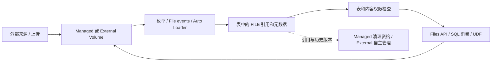
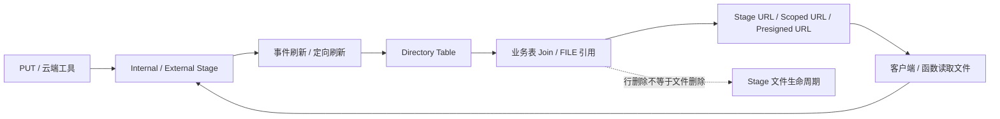

# Databricks / Snowflake 多模态存储与管理调研

调研日期：2026-10-24（Asia/Shanghai）。Status: Research, not a product support contract.

本文记录官方公开文档所描述的产品行为，不反推厂商未公开的底层实现、数据库分片或事务协议。范围为文件存储、目录、访问、版本、生命周期与规模；不把模型推理能力当作存储能力。云和版本范围以各条来源为准。

修订后的 Pangrova 方案见 [存储与管理设计](multimodal-storage-management-design.md)。

## 1. Databricks：Volume 管文件，FILE 把文件关联到表

### D1. 存储和命名空间

Unity Catalog Volume 管理非表格文件，分 managed 和 external 两类。后者复用已有对象存储位置；删除 external volume 不删除原始文件。Volume 是路径访问与治理对象，不能把它理解成具有 Delta 事务的普通表，也不能把 Volume 中的文件直接注册成 UC 表。

来源：[Unity Catalog volumes](https://docs.databricks.com/aws/en/volumes/)。本次打开页面标注更新于 2026-10-12。

### D2. FILE、FileSpace 与生命周期

FILE 当前标为 **Beta**。FILE MANAGED 将文件复制到表配置的 FileSpace；FILE EXTERNAL 引用 Volume 中已有文件。表内存引用和元数据，内容按需读取。文档区分表元数据访问与文件内容访问：后者还要求相应 Volume 权限，managed 文件要求表及 FileSpace 背后 Volume 的访问权限。

删除 managed 引用让文件具备回收资格，但 **Beta 尚无自动 GC**。官方清理示例检查表版本引用。external 引用不拥有源文件生命周期，并建议使用不可变文件。不能由此推导“删除行立即物理删除”或“FILE 已解决所有历史保留问题”。

来源：[FILE type and unstructured data](https://docs.databricks.com/aws/en/unstructured/file)。本次打开页面标注更新于 2026-09-11。

### D3. 大文件访问

Files API 提供文件和目录操作，支持 Multipart、Range 与条件请求；当前页面描述单请求上传上限 5000 MiB，更大文件分段上传。分段下载应携带首次读取的 ETag，以 If-Match 防止不同请求拼接不同版本；不匹配返回 412。这是并发校验，并非内容 SHA-256 保证。

来源：[Files API](https://docs.databricks.com/aws/en/volumes/files-api/)、[Range requests](https://docs.databricks.com/aws/en/volumes/files-api/range-requests)。前者本次打开页面标注更新于 2026-10-21。

### D4. 规模化发现和接入

Auto Loader 的 file-events 路径共享事件基础设施，维护发现位置和 checkpoint；第一次运行仍需枚举已有文件，缓存位置失效也可能重新枚举。事件服务会补充盘点，事件本身不能提供有序、绝不遗漏的文件全集。

来源：[File events overview](https://docs.databricks.com/aws/en/ingestion/cloud-object-storage/auto-loader/file-events-explained)、[Notification mode](https://docs.databricks.com/aws/en/ingestion/cloud-object-storage/auto-loader/file-notification-mode)。

Auto Loader 文档将恢复和 exactly-once 保证与 checkpoint 及写入 Delta Lake 联系起来；它不是对任意外部文件写入、任意 Catalog 或多系统事务的通用承诺。

来源：[Auto Loader](https://docs.databricks.com/gcp/en/ingestion/cloud-object-storage/auto-loader)。该条来源为 GCP 文档，不据此推导 AWS 上所有配置均相同。

### D5. 授权访问和路径边界

官方 API 提供短期凭据用于直接访问 Volume 数据；本次核查该接口标为 **Public Preview**，需开启外部访问并满足相应权限。这说明内容传输不必在概念上绑定 SQL 控制服务，但不证明所有 Files API 请求都使用同一路由。

来源：[Temporary volume credentials](https://docs.databricks.com/api/uc-credentials/v1/credential)。

UC 最佳实践强调路径边界及避免对象路径重叠。Pangrova 应把“一个物理范围的生命周期所有者”作为显式约束，不能给同一路径重复挂载互相冲突的删除权限。

来源：[Unity Catalog best practices](https://docs.databricks.com/aws/en/data-governance/unity-catalog/best-practices/)。

### 公开行为流程归纳

此图为产品抽象归纳，不是 Databricks 私有架构图。

## 2. Snowflake：Stage 保存或映射文件，Directory 提供目录投影

### S1. 文件、目录和关系表分层

文件位于 internal/external stage；Directory Table 是 Stage 上的隐式文件元数据对象，没有独立可授予权限，可用于列举文件并与业务表 Join。目录刷新负责跟踪文件变化，不能当作不可变对象快照。

来源：[Directory tables](https://docs.snowflake.com/en/user-guide/data-load-dirtables)。

### S2. FILE 引用不接管原始文件生命周期

Snowflake FILE 保存文件引用。官方明确：源文件修改或删除不会自动修正已保存的 FILE 值；删除表中 FILE 值也不会删除源文件。因此表行时间旅行不能被当成原始文件字节的恢复保证。

当前 FILE 文档还列出 Iceberg/external/hybrid tables、部分 SQL 子句及客户端等限制，不能把其他 Snowflake 文件 API 的支持范围外推到 FILE 类型。

来源：[Unstructured data types](https://docs.snowflake.com/en/sql-reference/data-types-unstructured)。本次该页面未显示 Beta 标记；这不等于所有相关功能和客户端均已无限制可用。

### S3. 三类 URL 具有不同授权语义

Stage file URL 依赖调用者角色的 Stage 权限；Scoped URL 提供与生成用户关联的临时访问；Presigned URL 是有效期内持有者可使用的链接。长期地址、身份验证与临时访问权不能混成一种 token。文档所述 Scoped URL 当前期限关联结果缓存周期，约 24 小时，不应照搬为 Pangrova 的安全默认值。

来源：[Unstructured data introduction](https://docs.snowflake.com/en/user-guide/unstructured-intro)。

### S4. 接入与刷新

PUT 上传到 internal stage，对较大文件分块并发传输；GET 命令面向 internal stage，external stage 下载使用其他适用接口。不能把 PUT 命令语义理解成文件字节经 SQL 查询执行器逐行上传。

来源：[PUT](https://docs.snowflake.com/en/sql-reference/sql/put)、[GET](https://docs.snowflake.com/en/sql-reference/sql/get)。

目录支持事件刷新及手工刷新；手工全量 LIST 可能昂贵，官方建议按 SUBPATH 缩小范围。internal stage 自动刷新当前为 **AWS Open Preview**。目录刷新状态和失败明细必须可观察。

来源：[Manage directory tables](https://docs.snowflake.com/en/user-guide/data-load-dirtables-manage)、[Automated refresh](https://docs.snowflake.com/en/user-guide/data-load-dirtables-auto)。

### S5. 恢复边界

内部 Stage 文件复制依赖 Directory Table 映射；本次文档列出内部 Stage 复制刷新遇到大于 5GB 文件的限制。该限制属于复制链路，不能写成 Snowflake 通用最大文件大小。它提示必须分别验收“能上传”“能读取”“能备份恢复”。

来源：[Replication considerations](https://docs.snowflake.com/en/user-guide/account-replication-considerations)。

### 公开行为流程归纳

此图为产品抽象归纳，不声称公开文档证明了厂商内部传输和事务拓扑。

## 3. 对 Pangrova 的判断

两者共同证明的产品方向是：文件字节与表中描述分离、统一命名和授权、目录可查询、按需内容读取、增量发现。公开资料不足以证明两者提供了跨所有表格式和外部对象的统一强事务、自动全局 GC、亿级资产数据库分片或最优媒体打包布局。

因此，Pangrova 采用上述接口和治理分层；对自身更强的快照保留、跨表引用、分布式回收承诺单独设计和验收。具体纠偏、痛点方案、完整读写链路、容量模型和实施顺序均在 [修订设计](multimodal-storage-management-design.md) 中，不将方案描述为厂商已验证的实现。
