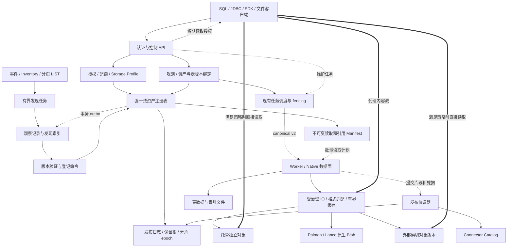
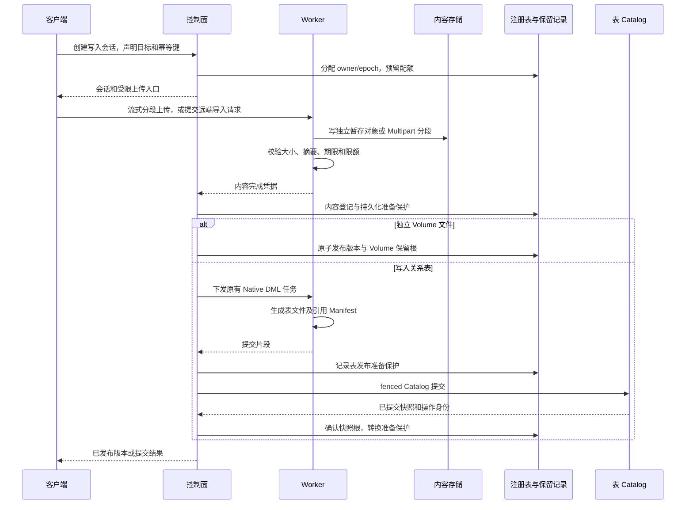
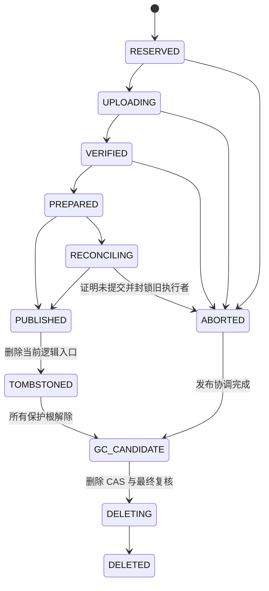
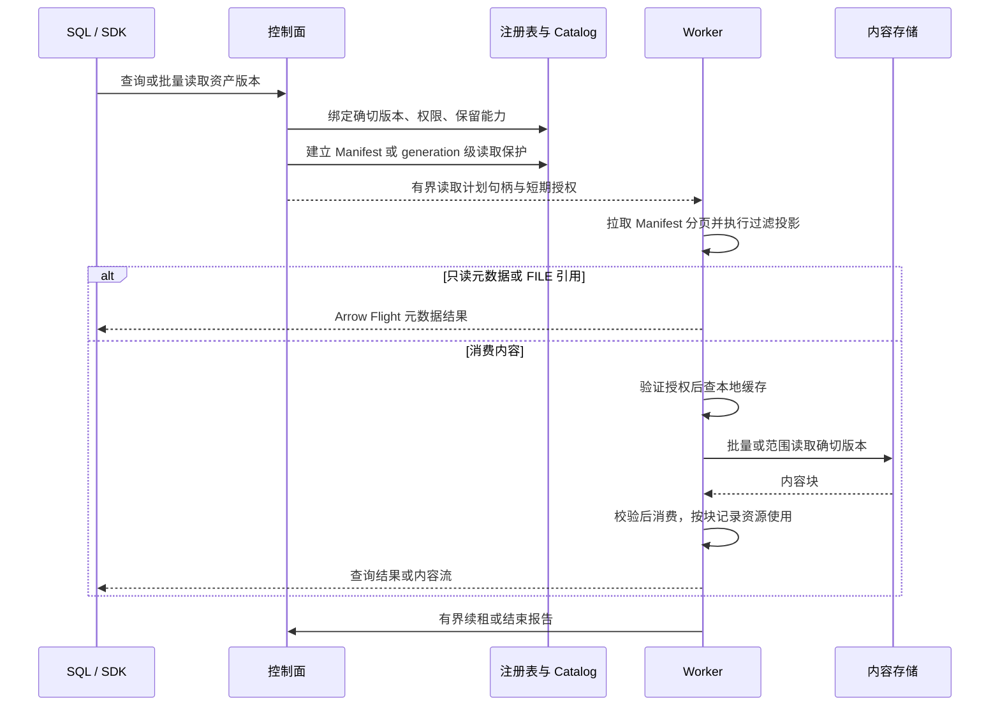

# Pangrova 多模态存储与管理：修订架构与痛点解决方案

日期：2026-10-24。Status: Target architecture / Draft — 尚未实现或完成生产验收。

范围：亿级文件、PB 级容量；托管与外部纳管；文档、图片优先，音视频、组合资产与其他二进制原件共享底座。包含存储、目录、版本、权限、生命周期及运维，不建设模型训练或标注平台。

本文替代此前聊天中的设计。行业事实及可用性范围见 [Databricks / Snowflake 调研](multimodal-storage-industry-research-2026-10-24.md)。以下设计、阈值和目标为 Pangrova 提案，不是两家厂商的内部实现，也不是当前产品能力。

## 0. 2026-10-25 实施前复核

本设计的最新源码审查、官方资料复核和协议细化见
[Table / File Plane 架构对齐](table-and-file-plane-architecture-alignment-2026-10-25.md)。
下面 1.1 节保留原调研基线，不代表当前实现状态；最新进展以[合并台账](table-and-file-plane-readiness-2026-10-25.md)为准。

后续 Native DIRECTORY 使用不可变目录 generation / Manifest 和现有 canonical v2；
现有 Worker JDBC 页读取器不作为直连控制数据库的生产 SQL 路径。
上传须补齐持久会话、UNKNOWN 协调与独立清理，目录长扫描须有 checkpoint 和同根授权续期。
短期 ticket、任务所有权、活动流撤权和内容保留分别约束，不相互替代。

按用户要求，先完成架构合理性对齐及有界正确性验证；100 GiB、亿级目录、PB 数据面与 Linux 生产环境资格
留待专用环境执行。以下容量目标保留为待验收目标，不在开发机创建重型数据，不降低发布门槛。

## 1. 现状、主要纠偏与设计决策

### 1.1 当前代码证据

核查基线：`6bba6243` 加当前未提交工作区；不是干净 release 快照。本次只修改调研与设计文档，未运行 Java/Native 验收。

| 边界 | 已观察到的源码 | 不应外推的能力 |
|---|---|---|
| FILE 存储 | [BlobStorage](../../pangrova-worker/pangrova-worker-core/src/main/java/org/pangrova/worker/ai/blob/BlobStorage.java) 提供 publish/open | 不具备范围 IO、完整目录和安全回收契约 |
| 受治理内容 | [GovernedBlobStore](../../pangrova-worker/pangrova-worker-core/src/main/java/org/pangrova/worker/ai/blob/GovernedBlobStore.java) 提供租户校验、持久化和整流校验 | 不能直接证明资产级撤权；read 会形成 byte[]，close 可能为完成摘要验证继续排空流，不是大文件局部读取契约 |
| 外部版本 | [S3VersionedCopyStager](../../pangrova-worker/pangrova-worker-core/src/main/java/org/pangrova/worker/copy/S3VersionedCopyStager.java) 固定并校验 S3 版本 | 是可复用基础，不等于全量外部文件管理 |
| Volume | [VolumeAsset](../../pangrova-metadata/src/main/java/org/pangrova/metadata/model/asset/VolumeAsset.java) 是资产模型 | 不等于已实现目录、授权和生命周期服务 |
| Paimon | [类型映射](../../pangrova-connector/pangrova-connector-paimon/src/main/java/org/pangrova/connector/paimon/type/PaimonToPangrovaTypeVisitors.java) 把 BlobType 映射为 VARBINARY；依赖为 1.4.1 | 不能代表原生 Blob 延迟读取和回收支持 |
| Lance | [FFI 依赖](../../pangrova-worker-native/lance-ffi/Cargo.toml) 为 0.20；[发布校验](../../pangrova-worker-native/lance-ffi/src/preparation.rs) 拒绝部分 SDK blob 对象 | 不等于支持上游新版本全部 Blob 能力 |

### 1.2 对上一版的明确修正

| 原设计问题 | 修订决策 | 原因 |
|---|---|---|
| 托管/外部一种属性同时表达所有权、保留与历史可读性 | 拆成 storage ownership、retention roots、version assurance 三个维度 | 文件在托管存储中，也可能只是临时查询产物；外部有 VersionId，也不保证该版本不会被删除 |
| 所有文件读取都逐次查询目录数据库 | 查询/批任务冻结不可变读取 Manifest，批量授权及保护；Worker 本地验证 | 避免每个小文件、每段视频都产生数据库 RPC |
| 所有内容都由 Worker 代理 | 统一读取契约下提供受控代理与授权直读两种传输 | 直读降低转发成本；代理处理细粒度范围、敏感内容和共享打包对象 |
| 每次 FILE 函数调用都创建永久资产 | SQL 临时结果使用显式短期根；写入表后由快照根保留，独立文件由 Volume 根保留 | 避免删表后内容仍被无意创建的永久根保护 |
| 默认所有文件都迁入 Paimon 聚合 | 独立对象为通用基线；Paimon/Lance 原生 Blob 按工作负载启用 | 打包改善小文件，却会增加随机读取、删除和生态直读成本 |
| 同一目录既作对象观察结果又作事务权威 | 强一致资产注册表与可重建发现索引分离 | 事件和搜索索引可能滞后，不能决定是否授权、提交或回收 |
| 只有 GC 标记和引用计数 | 增加快照保护、发布待确认保护、删除 CAS 和禁止新增引用的 fence | 防止扫描到删除之间新增引用造成误删 |
| 外部纳管要求立即计算全文件摘要 | 版本身份、完整内容摘要、块摘要分别记录 | PB 级纳管不能为了登记元数据先读一遍全部内容 |
| 广泛承诺自动强历史保留 | 后端声明并证明保护能力后才承诺；弱外部源只能观察或检测漂移 | 目录数据库不能阻止外部管理员或旧 SDK 删除对象 |

## 2. 总体架构与一致性边界

### 2.1 架构总图

图中的服务是职责边界，不要求新增一组独立微服务。Coordinator 只处理元数据、授权、任务和提交，不传输行或媒体字节。Worker 不直接访问数据库，图中的注册表交互通过受认证的控制 API 完成。

SQL 关系数据面仍只有 Planner → canonical v2 → Worker/JNI → Native → Arrow Flight。文件直读是内容传输方式，不是第二套关系执行引擎。新任务沿用现有调度、资源准入、取消、报告与发布设施；不把文件生命周期塞入 Dynamic Table 领域内核。

### 2.2 三类事实源

| 事实 | 权威 | 缓存/投影与一致性 |
|---|---|---|
| Pangrova 资产版本是否已发布 | 资产注册表的单对象/集合发布事务 | 发现索引可滞后；写入返回的版本必须可按 ID 立即读取 |
| 表 DML 是否成功 | 对应 Connector Catalog 的提交身份/快照 | Pangrova 日志可处于待确认；不得因日志未写完重做 DML |
| 字节是否存在、是否为确切版本 | 实际后端版本与校验证据 | HEAD/事件不是永久保留承诺 |
| 文件是否允许物理删除 | 生命周期所有者 + 当前完整保留保护 | 发现索引、统计计数和缓存均不能独立授权删除 |
| 谁可访问 | 当前授权策略与未过期的受限授权 | 数据版本可冻结，权限不能永久冻结在历史快照中 |

元数据实体延续 Volume → Asset → AssetVersion → ContentObject → PhysicalLocation；表快照和集合保存不可变成员引用。路径只是名称，不能兼任身份、权限和版本。物理范围注册时检查托管根、表路径及其他 Volume 的冲突，默认禁止生命周期所有权重叠。

### 2.3 所有权、保留根与版本保证

| 维度 | 值 | 语义 |
|---|---|---|
| storage ownership | MANAGED / EXTERNAL / FORMAT_OWNED | 分别由 Pangrova、外部系统、表格式维护器删除字节 |
| retention root | VOLUME_ENTRY / TABLE_SNAPSHOT / COLLECTION / TEMP_RESULT / BACKUP / HOLD / IN_FLIGHT | 所有有效根的并集决定可回收性，普通目录记录本身不是永久保留根 |
| version assurance | RETAINED / PINNED / OBSERVED | RETAINED 有可执行保留保证；PINNED 固定可读取版本但不能阻止外部删除；OBSERVED 只有观察结果及变更校验 |

需要可复现集合/备份的任务默认只接收 RETAINED；PINNED 可用于明确接受源丢失失败的版本化读取；OBSERVED 不能冒充强时间旅行。非版本化外部对象可登记和列举，内容读取必须条件校验；业务需要强保证时导入托管区。

单对象操作在所属分片提交。跨分片集合使用不可变成员 Manifest + 各分片持久化 prepare 保留凭据 + 一个集合发布指针；旧 epoch 无权发布。仅当各分片已保留成功才切换指针。该协议固定成员版本，但不宣称异步外部系统具备同一全局时间点。

初期注册表复用 PostgreSQL，按 tenant/volume 与稳定虚拟分片路由；热点 Volume 继续分桶，不能只按 tenant 分片。位置和保留关系共置于内容归属分片；跨分片操作使用持久化 prepare/confirm 协调。大规模列举、GC 标记和集合成员放入对象存储上的不可变分片 Manifest，不把每个时间片和每次读取都写成 PostgreSQL 行。搜索投影可重建，禁止成为第二个事务权威。

## 3. 完整写入链路

### 3.1 文件上传、远端导入与表 DML

1. 注册会话时确定 lifecycle owner、保留意图、权限、大小上限、并发与暂存额度。配额先预留，再按实际字节结算，重试不能重复扣费。
2. 默认 Worker 流式上传。大对象不先完整落本地临时文件，再做第二遍上传；采用有界分段缓冲、可恢复 Multipart 与增量摘要。复用现有实现但新增真正的流式契约。
3. 现有客户端直传若未来启用，只能写会话独占暂存位置；客户端不能 Complete 后直接发布资产。控制面/Worker 验证实际对象及内容证据后发布，补算摘要造成的二次读取必须计量。首期不启用通用直传上传。
4. 上传完成不是资产提交。先登记不可变内容及准备保护；同名替换通过 expected version CAS，不能 last-writer-wins 静默覆盖。
5. 关系表文件和引用 Manifest 由 Worker 生成；Coordinator 只接收句柄、摘要和提交凭据。引用校验、行级权限和受保护写声明沿用现有 Native 写链路。
6. Catalog 是表提交权威。提交结果不明进入 RECONCILING，通过 writeId 和快照证据确认；不能在不明状态重新提交或解除保护。
7. 完成通知通过事务 outbox 发出，目录索引消费幂等事件。API 返回的是权威版本，搜索列表允许延迟并返回 watermark。

新 SQL FILE 临时结果默认保留 24 小时（Pangrova 提案，可配置），在结果元数据返回 expires_at；写入表前必须原子建立目标根，不能先释放临时根。既有 FILE 引用不回溯套用该过期策略，进入迁移保护集。用户显式上传到 Volume 的文件持续保留，直到删除或显式策略到期。

### 3.2 外部发现与纳管

共享来源事件 → 分片观察日志 → 版本验证 → 幂等注册 → outbox 更新目录。初次接入用 provider Inventory 或受限分页 LIST 建基线；接入事件和基线扫描并行时保存扫描 epoch、消费 checkpoint 和重放窗口，完成后按版本身份去重，不按事件到达顺序认定最新。

外部目录按前缀和分片巡检；不完整扫描不得据“未看到”生成删除结论。删除事件须验证目标版本，403 不当作 404。过旧事件只补历史记录，不能复活已删除的新版本。可查询 last_observed、last_reconciled、event_lag、scan_coverage 和失败明细。

登记只需确切版本、大小及来源证据；全文摘要可以异步验证。源版本丢失标记 SOURCE_VERSION_GONE，既不返回空内容也不换读 latest。外部删除不触发 Pangrova 删除同内容的托管副本。

### 3.3 生命周期状态

公开状态还应区分内容可用性：AVAILABLE、ARCHIVED、RESTORING、MISSING、CORRUPT，与上述发布状态正交。已发布对象损坏不能被改写成“未发布”。

## 4. 完整读取链路

### 4.1 目录查询和 SQL

目录过滤 → 授权过滤 → 分片键集分页 → 返回元数据。无需 payload GET，也不按行 HEAD。普通列表是带 watermark 的目录观察；要求固定全集时生成 CollectionVersion，不假装一次分页能获得全局快照。

读取计划固定资产版本、源快照、location epoch、范围和校验策略；批量解析后 Worker 不为每个小文件做数据库 RPC。数据面接到的逐页 Manifest 必须有校验和可信根，客户端不能自填未授权对象 ID。

如果有效位置可变化，读取固定旧位置并持有 generation 级保护；新读取拿新位置。数据位置缓存长期按不可变版本命中；授权缓存有短期限和 policy epoch，不能混为一种缓存。

### 4.2 受控代理与授权直读

| 模式 | 选择条件 | 限制 |
|---|---|---|
| PROXY | 默认；敏感资产、片段访问、共享 pack、审计要求或不支持安全直读的后端 | Worker 内容端点可水平扩容，媒体缓冲与 SQL 查询隔离 |
| DIRECT | 显式允许外部交付；独立完整对象；精确版本、后端授权范围与保留条件可证明 | 不下发宽泛 bucket/prefix 凭据，不把共享 pack 的整对象权限交给单个片段用户 |

两个模式使用同一个 read descriptor、授权契约和审计操作身份，只改变内容传输路径。SELECT 的关系结果仍走现有执行链。DIRECT 签发前再次授权，返回模式、到期时间和完整性级别；无策略许可时不能自行尝试直读。

Pangrova 默认代理授权有效期 60 秒，续租时重查策略；直读请求默认 5 分钟有效（均为设计默认，不是厂商参数）。在策略服务不可达且授权过期时拒绝续租，不永久沿用缓存权限。

特别注意：预签名 URL 到期通常只限制新请求，不能据此认定已经开始的下载完成。严格可恢复交付只有后端能界定传输保护期限时才允许 DIRECT；否则采用 PROXY。外部自管源可明确选择 best-effort 直读，但不能承诺传输期间不被外部删除。直接访问也不能承诺立即撤回已签发授权，严格撤权策略必须选代理。

### 4.3 完整性和范围 IO

- 对象版本校验、全文 SHA-256、块校验三个字段分别表达，不把 ETag 当作内容 SHA-256。
- Multipart 服务端 composite checksum 不等同于串行全文摘要；需要全文 SHA-256 时按原始顺序计算或后验证，明确额外 IO。
- 范围校验需要可信块摘要 Manifest，或格式原生块校验。读取覆盖块、验证后裁剪，可产生读放大，必须计量。
- 只有全文摘要时不得声称局部读取已做全文验证。对要求强校验的调用，要么完整流验证，要么拒绝局部模式；普通外部读取显式报告 VERSION_VALIDATED。
- 新范围流 close/取消不能为补齐全文摘要偷偷读完剩余视频。完整流若未读到 EOF，不能记录 FULL_VERIFIED。
- SDK 下载校验失败删除或隔离局部输出；SQL 消费失败使查询失败，不能先把错误内容生成的结果标为成功。
- JPEG/视频/压缩包原则上保留原始字节，不默认再次全文件压缩；媒体格式解码和帧索引独立于存储范围协议。

## 5. 痛点、根因与解决方案

### P1. 小文件导致请求数与元数据成本超过字节成本

根因：百万张小图的 GET/HEAD、鉴权与调度固定成本远大于实际传输，简单增加带宽无效。

方案：优先批量描述读取、授权缓存、合并范围 IO 与有界预取，再对数据共读、同策略组启用原生 Blob 聚合。独立原件和训练副本可以采用不同布局，不强制重写唯一原件。打包对象不能跨租户、加密、保留锁或严格删除域。

压实选择以实测请求减少、读放大、更新频率和回收成本为准。基准覆盖 4 KiB/64 KiB/1 MiB 小对象、10/100 MiB 图片文档及 1/10/100 GiB 音视频；这些是测试档位，不是产品限制或打包阈值。

验收：同一请求集比较独立/聚合布局的 requests per 1k files、useful_bytes/fetched_bytes、P99 和成本。没有收益或破坏删除 SLO 的分组不启用打包。

### P2. 大文件造成 OOM、暂存盘耗尽和整文件重传

根因：整文件 byte[]、全量本地暂存、把查询内存当媒体预算，以及不带版本的断点续传。

方案：流式 Multipart、精确版本 Range、条件续传、分段与字节双配额；取消同时关闭远端请求并回收暂存。查询内存、媒体缓冲、暂存磁盘、上传会话数分开计量。恢复从已验证部分继续，不重复收取已完成部分的逻辑配额。

验收：100 GiB 文件、并发上传、断网、取消和磁盘限额测试；内存峰值受资源 grant 限制，与文件长度无关；取消后记录残留上传及清理完成时间。

### P3. 亿级目录的全量 LIST 和逐文件 HEAD 不可持续

根因：将存储枚举用作交互查询，将所有消费者各自监听同一来源，事件积压又触发同时全量回扫。

方案：共享事件日志、Inventory/分页扫描补齐、每来源 checkpoint、限速分片任务；按前缀增量修复而非全桶重扫。事件驱动发现与事务发布分离，暴露 freshness、coverage 和 backlog，禁止目录缺项被默认为文件不存在。

验收：丢事件、重放、乱序、checkpoint 失效、扫描与写入并发；十个消费者复用发现结果，不把来源 LIST/HEAD 放大十倍。

### P4. 元数据可见但内容不可读，或旧版本悄悄变成新内容

根因：路径可变、引用含临时 URL、没有保留承诺、表时间旅行和对象保留混淆。

方案：稳定身份 + 精确版本 + assurance 分级；永久元数据不保存短期授权。恢复性数据集仅接收 RETAINED，PINNED 源允许缺失失败但禁止换读。归档/恢复/损坏状态显式返回，来源漂移触发新版本而非原地改写历史。

验收：写入后源覆盖、指定版本删除、URL 过期、表回滚与跨存储迁移；返回原版本或明确错误。

### P5. 删除不生效、共享文件误删与无限保留

根因：每次入表都创建永久资产根；依赖计数不理解旧快照；bucket 规则绕过引擎；打包残余区间仍保留敏感字节。

方案：根类型显式化；表创建内容由表快照根保留，独立 Volume 文件才有独立根。删除逻辑入口、解除保护和物理清除分别记录。严格擦除请求必须汇总所有引用、旧版本、备份、replica、pack 和阻塞保留锁；不能用 tombstone 当作成功擦除。

严格物理擦除域默认不打包；已经打包的对象重写存活成员并回收旧 pack。共享加密密钥不能仅为删除一个资产就整体销毁。外部内容不报告“已物理删除”，只报告登记解除和外部责任边界。

验收：共享引用、历史快照、保留锁、备份和并发读取交叉测试；擦除回执列明完成范围、阻塞项与残留后端版本。

### P6. 文件 URI 泄漏、同租户越权和撤权失效

根因：把持有引用当永久能力；表行权限在下载端丢失；缓存、预签名链接或 raw cloud credential 绕过策略。

方案：Volume 内容权限与表读取策略都需满足，行策略过滤后才能产生可用读取描述；普通用户自构 FILE 不能授权。使用短期 subject/operation/version 绑定票据，签名携 key_id、issuer 和 epoch；密钥轮换允许受控验证窗口，旧授权到期后退出。批量授权压缩为可信 Manifest 根，不把用户任意列出的 ID 作为已授权集合。

路径与文件名也可能敏感；目录 browse、metadata read、content read、export、delete、manage 分开授权。跨云直接访问受 cloud IAM 约束，不能宣称撤销 Pangrova 权限会撤销用户原有云权限。

验收：复制引用到其他表、缓存命中、签名重放、跨租户、权限变化和 key rotation；禁止日志出现凭据或预签名 query string。

### P7. 文件与表、索引、衍生产物不能一起恢复

根因：多个独立 Catalog 和对象存储没有共同事务；把通知当提交记录；恢复时只备份数据库。

方案：持久化 publish intent、prepared pin、提交身份和 outbox；按各自权威协调恢复。集合记录源版本、衍生版本、转换参数及算法版本；新的解析/向量结果发布新 generation，不覆盖旧结果。备份固定完整 Manifest 并保护相应内容，恢复先验证字节再开放 GC。

验收：每个提交边界注入崩溃；未知结果不重复发布，不能丢保护；恢复后的原件与衍生关系仍指向同一版本。

### P8. 多模态片段使元数据量膨胀，并造成读取放大

根因：把每帧都当一张永久独立图片，或把视频时间戳当字节偏移；标注、字幕和原始媒体分散且版本不一致。

方案：原件、媒体索引、集合/片段三层分离。时间段使用明确 timebase，页码、图像区域与字节范围分别编码；帧索引固定解码版本。高基数逐帧记录放分区列式表或 Manifest，不强制进入资产事务目录；只有需要独立权限、保留或复用的片段才提升为独立资产。

验收：可变帧率、旋转图片、页序变化、字幕时间基准和父原件替换；查询片段不能误读另一版本或越过授权区间。

### P9. PB 级成本、跨区带宽和恢复窗口失控

根因：只统计净存储容量，忽略副本、暂存、快照、pack 重写、检查、跨区流量和归档取回。

方案：按 tenant/Volume 统计 logical bytes、physical bytes、retained bytes、orphan bytes、requests、egress、scrub、restore 和 maintenance IO。调度优先存储同区域，维护与在线配额分离，未批准跨区导出和归档恢复不隐式执行。

验收：额度耗尽时停止接收新任务但允许结算与清理；迁移和备份任务有预算、进度、失败恢复及吞吐证据。

## 6. GC、压实与恢复的共同协议

GC 首先以 dry-run 交付；旧 FILE 迁移保护和所有 connector 保留适配完成后才开启删除。默认不按年龄删除已发布内容。孤儿宽限期配置必须大于最大有效写入/恢复期限，但不能代替未决提交的持久化保护。

删除状态与新增引用在归属分片 CAS。DELETING 后引用不能复活旧对象；若同内容重新上传，使用新物理 generation，旧删除令牌不得删除新 generation。后端支持时按精确版本删除，避免按复用 key 删除后来对象。

压实/迁移顺序：固定输入及读保护 → Worker 写新位置 → 内容和映射验证 → 格式提交（如适用）→ CAS 发布新 location epoch → 等待旧读取和导出保护解除 → 唯一 owner 回收旧位置。新格式版本未提交前不得发布其 Blob 位置。

表格式对象必须在该格式维护器可理解的快照/tag/保留机制中建立保护；Pangrova 私有 pin 不足以约束外部 compactor。无法满足的组合拒绝 RETAINED 能力，不能加长睡眠或依赖非 fencing 锁弥补。

恢复顺序：加载分片目录与日志 → 协调不明提交 → 验证 Manifest 和精确对象 → 恢复身份/密钥配置引用 → 重建发现索引 → 开放读取 → 开放写入 → 单独恢复维护。发现缺失对象保留故障状态，禁止通过 GC “修复”目录。

## 7. 容量模型与验收目标

以下是量级计算，不是厂商基准或 Pangrova 性能实测：

- 一亿条记录，每条仅 1 KiB 原始元数据约 95.4 GiB；若 4 KiB 则约 381.5 GiB。索引、MVCC、WAL、历史和副本另算，不能把原始记录大小当数据库磁盘需求。
- 若每个文件形成 10 个历史/引用记录，管理对象达到十亿量级；视频逐帧再放大。因此要分离事务实体和高基数列式描述。
- 假设 LIST 每页 1000 条，遍历一亿对象至少 10 万次请求；再逐对象 HEAD 就是一亿次。该计算没有考虑限流与重试，是发现路径下限模型。
- 1 PB 按十进制字节计算，即使有效吞吐持续 10 GiB/s，完整读一遍也约 25.9 小时。首次全量摘要、迁移和 scrub 都是独立成本，不能藏在“登记”里。
- 单 Worker 代理收取 B 字节再发送 B 字节，两条链路各承担 B；它不是零成本路径。计量 ingress/egress，不能由此推导网络设备必定只提供半速。

专用测试环境的初始工程目标（需冻结硬件/区域/并发后验收；本轮不执行重型数据测试）：

| 类别 | 测试与目标 |
|---|---|
| 目录 | 实际一亿资产记录；100 并发已索引列表查询、每页 100 条，目标 P95 ≤ 500 ms、P99 ≤ 2 s；固定快照大导出另测 |
| 增量发现 | 正常事件下目标 P99 可发现延迟 ≤ 60 s；丢事件修复目标 ≤ 24 h，前提是分片扫描预算可覆盖；无法满足需暴露 coverage 不能报告正常 |
| 数据面 | 100 GiB 单对象与混合小文件压力；内存不随对象长度增长；元数据查询 payload GET=0 |
| 授权 | 代理续租窗口 ≤ 60 s；直读撤销上界按实际后端语义报告，不承诺即时撤回 |
| 安全性 | 已确认提交无丢失、误删数为 0、跨租户泄漏为 0、同查询不拼接版本 |
| 恢复 | 按故障点、对象量和恢复带宽分别报告 RPO/RTO；未验证跨区复制前不声明区域故障 RPO=0 |
| PB 资格 | 亿级目录实测与 PB 数据面资格分开；小规模/合成 metadata 不替代 PB 内容实测，预算与硬件待实际部署确定 |

相同字节量分别测试 4 KiB 小文件、MB 图片和大视频，固定有用输出比较成本。打包、缓存和直读性能必须用相同权限、校验、快照与保留要求比较，不能删掉保证后宣称优化。

## 8. 实施与验证工作包

| 工作包 | 主要边界 | 依赖与验收 |
|---|---|---|
| W0 契约和迁移 | FILE/BLOB、身份、保留根、版本保证、连接器能力 | 补齐当前能力清单；历史 FILE 全部进入保守保护；未改现有数据前完成映射验证 |
| W1 目录与发布 | metadata / coordinator / security | 权威注册表、outbox、独立 Volume 生命周期、权限矩阵、跨分片集合 prepare/confirm；崩溃恢复通过 |
| W2 有界传输 | worker / protocol / client | 流式 Multipart、Range、条件读取、摘要和取消；100 GiB 边界测试，无整文件 byte[] |
| W3 发现与批量读取 | worker / metadata / planner | 共享事件、Inventory、恢复 checkpoint、不可变读取 Manifest、批量授权；百万至亿级递增验证 |
| W4 格式适配与 GC | connector / worker-native / metadata | Paimon 和 Lance 分别完成固定版本能力验证、快照保护、历史兼容、压实与删除；从 dry-run 切入受控 GC |
| W5 管理与交付 | client / governance / operations | 集合、片段描述、归档恢复、迁移、备份、擦除回执、配额与审计；策略允许时启用 DIRECT |
| W6 生产资格 | testing / deployment | 多节点、多租户、长期运行、容量与成本、恢复演练及 PB 数据面资格 |

W1/W2 建立最小完整纵向闭环；W3/W4 在首期架构中设计并作为亿级规模发布前置，不以“以后优化”为由省略。通用对象存储闭环不等待全部原生 Blob 功能，但不能提前宣布亿级小文件生产资格。

公开接口按五组组织：Volume/资产版本管理；文件目录与集合查询；上传会话；读取 descriptor/内容流；维护与恢复任务。新增 SPI、canonical v2 字段、JNI 和客户端表达必须成对落地，生成协议代码只由工具生成。目录路径、短期凭据和原始内容不得泄漏进控制面日志。

本设计不把 Volume、FILE、目录、模型服务混成一种对象，不新增 Coordinator 数据扫描路径；格式适配守住 connector 依赖边界。若变更确实需要新架构规则，另行修改 canonical rules，本文不隐式覆盖它们。

验证顺序遵循 development/build-pipeline：最近契约测试 → 拥有模块测试 → 受影响 Java/Native/JNI 链 → 独立进程/多节点集成 → release full regression。文档本身的检查只验证链接、代码块和引用，不代表这些 runtime 任务已通过。

故障注入必须覆盖上传、验证、prepare、Catalog 提交、确认、outbox、位置切换、GC CAS 和后端删除的每个边界；对每个状态验证可见性、保留性、幂等性、owner fencing 和最终恢复。

最终交付物：能力矩阵、协议/接口说明、读写时序与状态机、存量迁移清单、格式兼容矩阵、故障恢复 runbook、容量成本报告、逐场景验收证据。未通过的后端或场景保持不公开能力，不以接口存在或测试源码存在作为完成依据。
