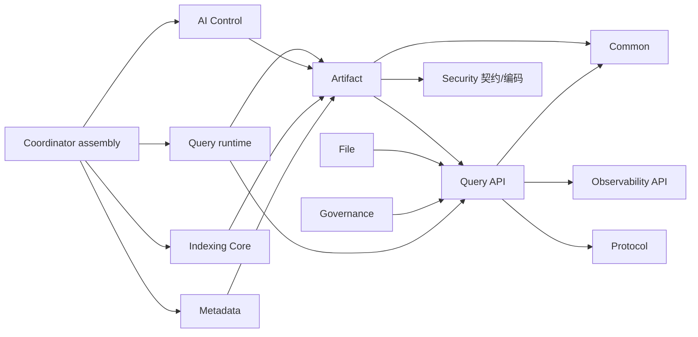

# 项目目录、模块与内部包重构执行计划

当前整体设计与待执行顺序见 [全项目目录与包重构计划](project-structure-refactoring-plan.md)，附全部 649 个起点包的迁移台账和本次结构检查证据。本文继续保留各历史实施批次，不以历史通过记录覆盖新的失败或未完成项。

状态：执行中，尚未完成全模块语义审查和全链验证。审计起点：2026-10-31 当前工作区（包括既有暂存和未暂存迁移）。本文是执行清单；长期蓝图中的历史数量、M 编号和“done”不能代替当前验收证据。

**最新源码快照（第48节对象传输provider与S3条件删除）**：74 个 Maven reactor 项目、58 个 Java 代码叶子、1 个纯资源 JAR、15 个聚合项目、3,599 个 Java 主源文件、669 个主源包、2,391 个测试源文件。全图仍有4组 SCC；模块7项、包结构2项通过，无环项真实失败。74项 clean reactor 编译通过（skipTests）；本批验证见第48节，各历史章节保留当批事实。

## 1. 已核实的现状和设计判断

- 起点根 POM 有 30 个直接 entry，完整 reactor 为 59 个项目。删除空 Observability Core 后为 58 个项目；基线生成器报告 46 个代码叶子和 12 个聚合/打包项目（含根）。不以长期蓝图中的 24/36 数量作为硬目标。
- `coordination-core` 有 596 个 Java 主源文件，包含 QueryManager、QueryDispatcher、PlanExecutionFactory、调度、materialization 和 artifact 实现；`query` 只有 35 个。领域迁移尚未结束，不能把新建 owner 目录视为边界落地。
- Metadata 的 `artifact.build`、`artifact.jdbc`、`artifact.jdbc.build` 仍拥有构建及持久化实现；`service` 仍有 16 个主源文件。应按事实归属迁入 Indexing 或 Metadata 的具体能力，而不是统一改成 `core.service`。
- Common 声明 SnakeYAML 编译依赖、Jetty/Jackson provided 依赖，且仍包含 Jackson/Jetty 实现。provided 只改变传递性，不意味着 Common 已经框架无关。SnakeYAML 当前无 Common 源码引用，需核验测试和下游依赖后删除。
- Semantic 已有 View API/Core/JDBC store，但测试通过 Metadata 获得 migration。包迁移与数据库迁移所有权必须分开审查，不能挪动已发布 SQL 后破坏 Flyway 校验。
- 模块清单检查通过；现有 10 项模块/包测试通过。但包环测试只遍历硬编码旧目录，只检测同父包的二元环，吞掉读取错误并包含豁免；不能证明全图无环。Planner、Indexing 的 protocol 边仍在 manifest 债务清单中。
- `observability-core` 只有 package-info 和测试日志配置；没有实现、资源迁移或 provider。已删除该空制品、reactor 项、依赖管理、消费者依赖与清单项，保留 API/SDK 两个真实边界。

结论：保留 Java 协调规划 / C++ 执行和 Coordinator / Worker 两个主要进程；按领域所有权收敛内部代码，不机械拆微服务，不为目录对称创建 API/Core/Store 空制品。跨域只消费明确导出的契约；基础设施实现由装配层注入。

## 2. 全模块目标与内部包处理表

下列每行均需完成生产入口、调用者、实现、注册、持久化、测试的闭环审查。表中是目标和待办，除明确标为已完成外均不表示已实现。API/core/store 是逻辑边界，仅在实际存在代码时创建包。

| 模块或产品族（覆盖所有叶子） | 目标内部结构及代码审查重点 | 验收证据 |
|---|---|---|
| common | 保留 exception/lifecycle/concurrent/value 等真正共享原语；删除无用 YAML 依赖；HTTP 服务实现迁 Transport，Jackson 实现迁 wire/serde owner；逐个核验 util、双 annotation 家族的语义再合并或更名 | 最小 classpath 加载、所有消费者编译、零框架实现依赖 |
| config | 配置定义、加载、校验分包；YAML adapter 归此处；配置键与读取者一一对应 | 默认值、无效值、覆盖顺序测试 |
| function | API registry/runtime 与执行 provider 分离；函数描述符、回调失败投影使用唯一契约 | provider discovery、函数注册和 JNI 回调测试 |
| connector-spi | catalog/metadata/read/write/type/index/materialization 能力分包；拆解混合消费者的大接口，保持 connector-facing 契约 | 三种 connector 的契约测试、无框架泄漏 |
| connector-runtime | discovery/classloader/lifecycle；校验共享包策略、重复 provider 拒绝、关闭资源 | 隔离 classloader 和真实 ServiceLoader 测试 |
| connector-iceberg/paimon/lance | 各自 catalog/read/write/type/index adapter；公共逻辑仅在语义相同时提取；不共享 SDK 类型 | 各格式读写、提交幂等、故障恢复及映射测试 |
| parser | 按 statement 能力归类 AST/parser/validation；不引入领域服务或运行时 provider | SQL 正反例和 round-trip |
| planner | logical/physical/binding/optimization 与 substrait adapter 分离；将 protocol DTO 转换限制在序列化出口；审查缓存键和权限版本 | 计划契约、TPC 规划、Java/native golden tests |
| protocol | 按 control/task/result/capability wire 边界归类；生成源码只由 canonical proto/声明生成 | N/N-1、字段稳定性、生成器与 JNI 编解码 |
| transport | HTTP/REST/Flight/TLS adapter；承接 Common 的 HTTP server 实现；Client 公共 DTO 留 client-core | transport 契约、TLS、分页/流式结果和异常关闭 |
| observability-api/sdk | API 只含契约及 API-owned no-op；SDK 只含采集器和适配器；领域指标定义迁领域 owner；空 core 已删除 | API 最小 classpath、上下文传播、指标注册 |
| query-api / query | 独立 API 制品已提取 coordination/state/lineage/transaction/audit 契约；runtime 保留 core/store/adapter。后续迁入 Coordinator 的 QueryManager 和 query execution 领域逻辑，HTTP DTO 在 endpoint 映射；当前契约不需要 runtime JDBC/Security 实现 | API 最小 classpath、无重复 class、single writer、取消/重试/迟到报告、journal/recovery/fencing |
| artifact（第 20 节已建立，尚未迁完运行时） | 通用 durable build 的 api/build/execution/publication、protocol、core、store.jdbc；消费 Query API，禁止依赖 Query runtime/Metadata/AI Control/Indexing Core。领域 publication 与 authority 通过窄端口装配，见第 18 节 | 生产及测试依赖图无环、原子发布、撤权/租约/fence/恢复、关闭 Indexing 的启动链路 |
| scheduler | api.admission/placement/resource；core 对应能力和 strategy；迁 Coordinator 的通用 task/stage/split 调度；SQL 编译留 Planner/Query adapter | 公平性、资源释放、speculation、故障及竞争测试 |
| coordination-core/zookeeper | core 收敛为应用装配、server/endpoint、embedding、集群协调；ZK 是 coordination port 的 provider；领域实现全部迁 owner | 两种启动模式、leader/fence、无跨域 core 导入 |
| worker-core/native-bridge | Worker task/resource/exchange/result 生命周期；COPY/file 仅执行 adapter；native-bridge 独占 JNI 声明、加载、handle 和序列化；根包需非重叠 ownership | Worker 生命周期、JNI symbol 对称、native loader、任务取消关闭 |
| storage | content-addressed publication API 与 filesystem/S3 adapter；确认不是 File/AI 权限 authority | 原子发布、内容校验、失败清理 |
| file | api volume/stage/directory/upload/copy；core publication/claim；store.jdbc；将 Worker/Coordinator 中事实管理归回 File | COPY 幂等、claim、fence、过期回收 |
| table | api identity/maintenance/statistics/policy；core 与 store 分离；不依赖 Metadata implementation | table 生命周期、维护恢复、policy binding |
| metadata | api catalog/object/schema/version；core 对应能力；adapter connector/governance/security；store.jdbc。拆 service 内聚职责；索引专属 artifact 迁 Indexing，通用构建迁入第 18 节确定的 Artifact owner，跨域原子 publication 先解开 authority/契约耦合 | catalog/version/cache/outbox、migration 升级兼容 |
| semantic | api/core view 等现有能力，compiler/projection/adapter 按真实实现建立；JDBC store 归自己；不把长期 ontology 新功能当本次目录重构前置条件 | View 生命周期、编译、权限绑定、原 migration 升级 |
| ai-api/control/worker | API 仅 model/capability/invocation/embedding/runtime port；Control 拥有 evaluation/feature/model state；Worker 拥有 provider adapter 和受控执行，不持久化语义 authority | 无 AI 基础 SQL、provider 契约、评估与释放失败路径 |
| security | api authn/authz/tenant/secret/mask；core 策略；provider adapter；store.jdbc。审查重复 tenant schema 与权威写入者，不按类名强行合并 | 权限拒绝、版本变更、租户隔离、secret 解析 |
| governance | catalog/classification/lineage/quality 按能力组织；同步链仅保留 commit correctness gate；adapter 与核心规则隔离 | lineage 发布、quality 拒绝及事务一致性 |
| indexing-api/core | API 保留插件稳定边界；Core 按 generation/build/publication/GC/provider；承接 Metadata 的索引专属 artifact 与 Coordinator 索引编排。通用构建、生成列与导出不能因类名含 artifact 就归入可选 Indexing，详见第 16 节 | generation fencing、发布/回收、关闭 indexing 后基础 SQL |
| streaming | api checkpoint/offset/watermark/state；core lifecycle；provider CDC；store.jdbc；Coordinator adapter 只做绑定和启动 | checkpoint/offset 恢复、CDC 提交一致性 |
| materialization-core/store-jdbc | Core 的 definition/generation/attempt/publication/scheduling 与 extension；JDBC 单向实现端口；逐一核验零实现 SPI | refresh/retry/publication、持久化恢复、实现注册 |
| shuffle-core/service | Core 管 exchange 契约与编排；Service 管网络和 durable spool；审查内存/磁盘实现是否实际可达 | shuffle ticket、spill/recovery、remote exchange |
| operations | 按 upgrade/scaling/recovery/diagnostics 组织；移出 DDL、bootstrap 和核心 query 行为；诊断不获得变更权限 | 各运维入口、副作用与恢复测试 |
| client-core/cli/jdbc | Core 无框架公开契约；CLI/JDBC 分别拥有输入/展示和 JDBC 状态机；wire adapter 不泄漏进公共模型 | JDBC 契约、Driver discovery、CLI、结果消费关闭 |
| standalone | 仅调用 Coordinator/Worker embedding 装配入口；删除 server 内部依赖和重复生命周期管理 | 单机启动、关闭、同 SQL 结果一致性 |
| testing-kit/integration-tests/benchmark/fuzzer | 独占 testing 根；架构检查从 reactor 发现叶子；fixtures 不产生 split package；性能/模糊测试不充当 correctness 替代 | discovery 自测、真实 native E2E、seed 可重放 |
| native-bundle | 只做平台资源发布与来源验证，不拥有业务代码 | 包中平台/架构/ABI/JNI 库一致性 |
| worker-native（C++/Rust） | bridge/engine/capabilities/indexing/vector/udf/lance 以 target 明确所有权；审查已记录的双向 include seam；需要反转时由 engine 持有窄 port，不宣称 OBJECT target 天然无环；Lance FFI ABI 保持稳定 | Release 编译、native tests、ASan、重新打包和 Java E2E |

## 3. 执行顺序与迁移协议

1. **R0 事实与构建闭环（进行中）**：记录 POM、所有包、import、provider、migration；保留原工作区；删除空制品；建立 JDK17/Python3.10+ 可复现基线。恢复架构检查真实性：动态 reactor discovery、确定性全图 SCC、嵌套类型和 static import 正确解析、读取失败直接报错；用三节点环、非同级环和新增叶子回归测试证明检查有效。不扩大豁免来得到绿灯。
2. **R1 基础依赖清理**：Common/Config/Transport/Observability/Client。先确认调用者并迁框架 adapter，再改 POM、manifest exports 和 optional/provided 依赖。用最小 classpath 测试验证公开 API 可加载。
3. **R2 契约与数据权威**：Metadata/Table/File/Security/Governance/Semantic/AI Control/Indexing/Streaming/Materialization。每张表列唯一 owner、writer、migration、恢复路径。仅资源归属改变时保留既有 migration 内容和版本；需要 schema 改变时新增向前 migration，禁止篡改历史 checksum。
4. **R3 控制面瘦身**：Query 生命周期/事务 → Scheduler task/stage placement → Coordinator adapter/assembly。先抽 producer-owned port，迁实现及测试，再切所有调用者；移除临时 façade。不得让 Query/Scheduler 反向依赖 Coordinator，或用泛化 Context 包隐藏依赖。
5. **R4 执行与交付边界**：Worker/Native/Shuffle/Connector/AI Worker/Standalone。逐个切 runtime 装配和服务描述符，再进行 native build/test/package 与 Java 消费者验证。目录搬迁不得改变 JNI ABI、wire 编号或 SQL 语义。
6. **R5 内部代码收敛**：每个叶子逐包审查职责、可见性、重复逻辑、异常处理、状态机、并发和资源所有权；死实现必须有无调用/无注册证据；有真实问题才拆类。代码规模和接口方法数只用于定位，不为指标增加转发类。移动包同步测试、反射类名、ServiceLoader、配置、Docker、脚本和文档。
7. **R6 最终验收**：全 reactor 编译、owner suites、全图架构 gate、数据库升级、native 与共享/独立 JVM E2E 全通过；人工检查未解决债务和旧路径；逐行关闭本表。编译成功、目录已存在或旧台账 done 均不足以关闭审查项。

每一批只在具体行为测试通过后继续依赖该批的迁移。公共 Java FQN 调整视为源码兼容变更，所有仓内消费者同批迁移；不保留永久旧包 alias。外部兼容要求若被发现，记录受影响消费者并明确迁移版本。数据库和协议兼容不随 Java 重命名自动放弃。

## 4. 验证矩阵与起点结果

- 已通过：模块事实生成与 `check-module-manifest.sh`；JDK17/Python3.12 全 reactor `mvn -B -DskipTests install`（58 项，2026-10-31）；Testing Kit 的 ModuleDependency/PackageStructure/PackageDependencyAcyclicity 共 10 个测试，零失败/跳过。
- 首轮失败原因：系统 Python3 为 3.9.6，协议生成器要求 3.10+。使用已安装的 Python3.12 后通过，未修改版本检查。默认 JDK21 不用于本次验收。
- 待验：完整模块内部审查、无环检查修复、逐 owner 测试、静态分析、native 源码一致性编译/测试、ASan、打包、完整 Java/native 回归。本次 `skipTests` 不构成运行时证明。
- 每次变更先最近测试，再 owner suite；共享 API/POM/跨模块改动运行完整 reactor；JNI/protocol/native/执行路径按 build-pipeline 完整链条；最后 `full-regression verify` 加五个独立 native-owner 选择，不能遗漏被共享 JVM 排除的测试。
- 本次删除空制品不修改 native runtime；后续 native 验证必须核实源码/库一致性，不能仅复用历史日志。

## 5. 逐叶子包盘点（源码事实，不是完成声明）

以下是主源包分布，用于逐项审查防漏，随本轮迁移刷新。计数含 package-info，不含 target 生成源码；生成/shaded/runtime artifact 的 split package 仍需在 R0/R6 单独验证。包名清单是覆盖范围，不表示每个包的行为与资源所有权已验收。

### pangrova-ai/pangrova-ai-api

审查状态：待逐包闭环；33 个主源文件，6 个包。

`org.pangrova.ai.api.capability` (4); `org.pangrova.ai.api.embedding` (7); `org.pangrova.ai.api.error` (2); `org.pangrova.ai.api.invocation` (11); `org.pangrova.ai.api.model` (6); `org.pangrova.ai.api.runtime` (3)。

### pangrova-ai/pangrova-ai-control

审查状态：catalog export 请求与原子事务适配器已归位；其他包待逐项闭环；37 个主源文件，8 个包。

`org.pangrova.ai.control` (2); `org.pangrova.ai.control.api` (1); `org.pangrova.ai.control.embedding` (11); `org.pangrova.ai.control.evaluation` (12); `org.pangrova.ai.control.feature` (3); `org.pangrova.ai.control.store.jdbc.embedding` (2); `org.pangrova.ai.control.store.jdbc.evaluation` (3); `org.pangrova.ai.control.store.jdbc.feature` (3)。

### pangrova-ai/pangrova-ai-worker

审查状态：待逐包闭环；93 个主源文件，17 个包。

`org.pangrova.ai.worker` (1); `org.pangrova.ai.worker.blob` (6); `org.pangrova.ai.worker.config` (2); `org.pangrova.ai.worker.context` (10); `org.pangrova.ai.worker.embedding` (3); `org.pangrova.ai.worker.embedding.provider.openai` (2); `org.pangrova.ai.worker.function` (20); `org.pangrova.ai.worker.function.file` (4); `org.pangrova.ai.worker.governance` (4); `org.pangrova.ai.worker.governance.observer` (4); `org.pangrova.ai.worker.inference.provider.openai` (10); `org.pangrova.ai.worker.invocation` (15); `org.pangrova.ai.worker.provider` (4); `org.pangrova.ai.worker.provider.env` (1); `org.pangrova.ai.worker.provider.governed` (4); `org.pangrova.ai.worker.rerank.provider.openai` (1); `org.pangrova.ai.worker.text` (2)。

### pangrova-data-build

审查状态：契约、编码、发布路由、JDBC 事务权限端口和共享查询已迁入；执行 route/fence 已迁入，generic state 与领域 publication runtime 尚待迁入；50 个主源文件，13 个包。

`org.pangrova.databuild.api` (8); `org.pangrova.databuild.api.build` (11); `org.pangrova.databuild.api.execution` (6); `org.pangrova.databuild.api.execution.template` (2); `org.pangrova.databuild.api.format` (2); `org.pangrova.databuild.api.manifest` (2); `org.pangrova.databuild.api.publication` (2); `org.pangrova.databuild.assembly` (4); `org.pangrova.databuild.core.publication` (2); `org.pangrova.databuild.protocol` (4); `org.pangrova.databuild.spi.jdbc` (2); `org.pangrova.databuild.store.jdbc.query` (2); `org.pangrova.databuild.store.jdbc.execution` (3)。

### pangrova-client/pangrova-client-cli

审查状态：待逐包闭环；8 个主源文件，1 个包。

`org.pangrova.client.cli` (8)。

### pangrova-client/pangrova-client-core

审查状态：待逐包闭环；19 个主源文件，5 个包。

`org.pangrova.client.core` (1); `org.pangrova.client.core.api` (4); `org.pangrova.client.core.error` (5); `org.pangrova.client.core.protocol` (7); `org.pangrova.client.core.session` (2)。

### pangrova-client/pangrova-client-jdbc

审查状态：待逐包闭环；17 个主源文件，2 个包。

`org.pangrova.client.jdbc` (16); `org.pangrova.client.jdbc.value` (1)。

### pangrova-common

审查状态：待逐包闭环；75 个主源文件，21 个包。

`org.pangrova.common` (2); `org.pangrova.common.activation` (2); `org.pangrova.common.annotation` (2); `org.pangrova.common.api.annotation` (4); `org.pangrova.common.bloom` (1); `org.pangrova.common.concurrent` (8); `org.pangrova.common.exception` (12); `org.pangrova.common.file` (5); `org.pangrova.common.http` (6); `org.pangrova.common.http.adapter.jetty` (1); `org.pangrova.common.jdbc` (1); `org.pangrova.common.json` (2); `org.pangrova.common.json.provider.jackson` (1); `org.pangrova.common.lifecycle` (11); `org.pangrova.common.resilience` (2); `org.pangrova.common.resilience.api` (2); `org.pangrova.common.resilience.policy` (4); `org.pangrova.common.session` (1); `org.pangrova.common.storage` (1); `org.pangrova.common.util` (5); `org.pangrova.common.value` (2)。

### pangrova-config

审查状态：待逐包闭环；15 个主源文件，1 个包。

`org.pangrova.config` (15)。

### pangrova-connector/pangrova-connector-iceberg

审查状态：待逐包闭环；97 个主源文件，9 个包。

`org.pangrova.connector.iceberg` (53); `org.pangrova.connector.iceberg.fs` (3); `org.pangrova.connector.iceberg.handle` (16); `org.pangrova.connector.iceberg.index` (2); `org.pangrova.connector.iceberg.read` (5); `org.pangrova.connector.iceberg.schema` (1); `org.pangrova.connector.iceberg.system` (4); `org.pangrova.connector.iceberg.type` (1); `org.pangrova.connector.iceberg.write` (12)。

### pangrova-connector/pangrova-connector-lance

审查状态：待逐包闭环；16 个主源文件，1 个包。

`org.pangrova.connector.lance` (16)。

### pangrova-connector/pangrova-connector-paimon

审查状态：待逐包闭环；86 个主源文件，10 个包。

`org.pangrova.connector.paimon` (30); `org.pangrova.connector.paimon.fs` (2); `org.pangrova.connector.paimon.handle` (19); `org.pangrova.connector.paimon.index` (2); `org.pangrova.connector.paimon.read` (2); `org.pangrova.connector.paimon.scan` (5); `org.pangrova.connector.paimon.schema` (4); `org.pangrova.connector.paimon.system` (8); `org.pangrova.connector.paimon.type` (3); `org.pangrova.connector.paimon.write` (11)。

### pangrova-connector/pangrova-connector-runtime

审查状态：待逐包闭环；7 个主源文件，4 个包。

`org.pangrova.connector.runtime` (1); `org.pangrova.connector.runtime.classloader` (4); `org.pangrova.connector.runtime.discovery` (1); `org.pangrova.connector.runtime.lifecycle` (1)。

### pangrova-connector/pangrova-connector-spi

审查状态：待逐包闭环；221 个主源文件，23 个包。

`org.pangrova.connector.spi` (8); `org.pangrova.connector.spi.base` (2); `org.pangrova.connector.spi.base.protocol` (1); `org.pangrova.connector.spi.base.split` (1); `org.pangrova.connector.spi.clustering` (10); `org.pangrova.connector.spi.coordination` (9); `org.pangrova.connector.spi.data` (5); `org.pangrova.connector.spi.data.block` (10); `org.pangrova.connector.spi.data.page` (6); `org.pangrova.connector.spi.data.type` (12); `org.pangrova.connector.spi.data.type.mapping` (2); `org.pangrova.connector.spi.data.type.primitive` (12); `org.pangrova.connector.spi.data.type.primitive.temporal` (5); `org.pangrova.connector.spi.data.value` (3); `org.pangrova.connector.spi.data.write` (2); `org.pangrova.connector.spi.data.write.model` (5); `org.pangrova.connector.spi.index` (16); `org.pangrova.connector.spi.index.predicate` (15); `org.pangrova.connector.spi.index.statistics` (2); `org.pangrova.connector.spi.materialization` (13); `org.pangrova.connector.spi.metadata` (60); `org.pangrova.connector.spi.metadata.table` (18); `org.pangrova.connector.spi.plugin` (4)。

### pangrova-coordination/pangrova-coordination-api

审查状态：契约提取与最小classpath已验证；12 个主源文件，1 个包。

`org.pangrova.coordination.api` (12)。

### pangrova-coordination/pangrova-coordination-core

审查状态：Worker JDBC 注册事务已核验，领域迁出及其他包待逐包闭环；596 个主源文件，99 个包。

`org.pangrova.coordinator` (2); `org.pangrova.coordinator.adapter.indexing` (9); `org.pangrova.coordinator.adapter.indexing.ai.lifecycle` (4); `org.pangrova.coordinator.adapter.indexing.ddl` (11); `org.pangrova.coordinator.adapter.indexing.filter` (9); `org.pangrova.coordinator.adapter.indexing.lifecycle` (13); `org.pangrova.coordinator.adapter.indexing.lifecycle.gc` (3); `org.pangrova.coordinator.adapter.scheduler` (6); `org.pangrova.coordinator.ai.branch` (4); `org.pangrova.coordinator.ai.embedding` (9); `org.pangrova.coordinator.ai.layout` (1); `org.pangrova.coordinator.ai.model` (1); `org.pangrova.coordinator.databuild` (15); `org.pangrova.coordinator.databuild.runtime` (1); `org.pangrova.coordinator.databuild.template` (4); `org.pangrova.coordinator.bootstrap` (33); `org.pangrova.coordinator.bootstrap.lifecycle` (5); `org.pangrova.coordinator.bootstrap.module` (7); `org.pangrova.coordinator.cache` (1); `org.pangrova.coordinator.clustering` (9); `org.pangrova.coordinator.coordination` (9); `org.pangrova.coordinator.coordination.api` (11); `org.pangrova.coordinator.coordination.provider.memory` (3); `org.pangrova.coordinator.coordination.store.jdbc` (3); `org.pangrova.coordinator.dynamictable` (1); `org.pangrova.coordinator.embedding` (1); `org.pangrova.coordinator.feature` (6); `org.pangrova.coordinator.file` (1); `org.pangrova.coordinator.governance` (1); `org.pangrova.coordinator.http` (5); `org.pangrova.coordinator.http.endpoint` (16); `org.pangrova.coordinator.http.endpoint.catalog` (11); `org.pangrova.coordinator.http.endpoint.copy` (3); `org.pangrova.coordinator.http.endpoint.file` (1); `org.pangrova.coordinator.http.jdbc` (7); `org.pangrova.coordinator.maintenance` (2); `org.pangrova.coordinator.materialization` (20); `org.pangrova.coordinator.metadata` (9); `org.pangrova.coordinator.metadata.nativecontrol` (2); `org.pangrova.coordinator.metadata.read` (9); `org.pangrova.coordinator.query` (12); `org.pangrova.coordinator.query.admission` (1); `org.pangrova.coordinator.query.audit` (5); `org.pangrova.coordinator.query.cache` (4); `org.pangrova.coordinator.query.execution` (20); `org.pangrova.coordinator.query.execution.dispatch` (19); `org.pangrova.coordinator.query.execution.dispatch.adaptive` (6); `org.pangrova.coordinator.query.execution.dispatch.dag` (14); `org.pangrova.coordinator.query.execution.dispatch.dag.binding` (6); `org.pangrova.coordinator.query.execution.dispatch.dag.control` (7); `org.pangrova.coordinator.query.execution.dispatch.dag.handler` (15); `org.pangrova.coordinator.query.execution.dispatch.dag.retrieval` (5); `org.pangrova.coordinator.query.execution.dispatch.dag.runtime` (5); `org.pangrova.coordinator.query.execution.dispatch.dag.split` (1); `org.pangrova.coordinator.query.execution.dispatch.listener` (3); `org.pangrova.coordinator.query.execution.dispatch.shuffle` (8); `org.pangrova.coordinator.query.execution.dispatch.shuffle.databuild` (3); `org.pangrova.coordinator.query.execution.dispatch.shuffle.lifecycle` (2); `org.pangrova.coordinator.query.execution.dispatch.task` (29); `org.pangrova.coordinator.query.execution.dispatch.task.branch` (4); `org.pangrova.coordinator.query.execution.dispatch.task.catalog` (5); `org.pangrova.coordinator.query.execution.dispatch.task.file` (5); `org.pangrova.coordinator.query.execution.dispatch.task.semantic` (3); `org.pangrova.coordinator.query.execution.dispatch.task.storage` (3); `org.pangrova.coordinator.query.execution.dispatch.task.stream` (5); `org.pangrova.coordinator.query.execution.phase` (8); `org.pangrova.coordinator.query.execution.result` (2); `org.pangrova.coordinator.query.execution.retrieval` (1); `org.pangrova.coordinator.query.execution.security` (3); `org.pangrova.coordinator.query.execution.split` (13); `org.pangrova.coordinator.query.lifecycle` (2); `org.pangrova.coordinator.query.resourcegroup` (5); `org.pangrova.coordinator.query.security` (3); `org.pangrova.coordinator.query.session` (5); `org.pangrova.coordinator.query.stage` (7); `org.pangrova.coordinator.query.state` (1); `org.pangrova.coordinator.query.statement` (13); `org.pangrova.coordinator.query.statement.dml` (5); `org.pangrova.coordinator.query.task` (9); `org.pangrova.coordinator.query.task.report` (6); `org.pangrova.coordinator.query.task.write` (6); `org.pangrova.coordinator.query.tenant` (1); `org.pangrova.coordinator.resilience.breaker` (1); `org.pangrova.coordinator.resilience.checkpoint` (3); `org.pangrova.coordinator.resilience.config` (1); `org.pangrova.coordinator.resilience.degradation` (3); `org.pangrova.coordinator.resilience.idempotency` (1); `org.pangrova.coordinator.resilience.lineage` (1); `org.pangrova.coordinator.resilience.provider.resilience4j` (2); `org.pangrova.coordinator.resilience.retry` (2); `org.pangrova.coordinator.result` (4); `org.pangrova.coordinator.scheduler` (6); `org.pangrova.coordinator.scheduler.ft` (1); `org.pangrova.coordinator.semantic` (1); `org.pangrova.coordinator.speculation` (1); `org.pangrova.coordinator.storage` (1); `org.pangrova.coordinator.task` (11); `org.pangrova.coordinator.transport` (2); `org.pangrova.coordinator.worker` (7)。

### pangrova-coordination/pangrova-coordination-zookeeper

审查状态：待逐包闭环；4 个主源文件，1 个包。

`org.pangrova.coordination.zookeeper` (4)。

### pangrova-file

审查状态：待逐包闭环；38 个主源文件，17 个包。

`org.pangrova.file` (1); `org.pangrova.file.adapter.worker` (1); `org.pangrova.file.api.access` (5); `org.pangrova.file.api.claim` (2); `org.pangrova.file.api.copy` (1); `org.pangrova.file.api.directory` (3); `org.pangrova.file.api.profile` (3); `org.pangrova.file.api.space` (8); `org.pangrova.file.api.upload` (4); `org.pangrova.file.core` (1); `org.pangrova.file.core.directory` (1); `org.pangrova.file.core.space` (2); `org.pangrova.file.store.jdbc.claim` (1); `org.pangrova.file.store.jdbc.copy` (1); `org.pangrova.file.store.jdbc.directory` (1); `org.pangrova.file.store.jdbc.profile` (1); `org.pangrova.file.store.jdbc.space` (2)。

### pangrova-function

审查状态：待逐包闭环；17 个主源文件，6 个包。

`org.pangrova.function.api.aggregate` (2); `org.pangrova.function.api.metadata` (2); `org.pangrova.function.api.registry` (2); `org.pangrova.function.api.runtime` (3); `org.pangrova.function.api.scalar` (3); `org.pangrova.function.api.table` (5)。

### pangrova-governance

审查状态：待逐包闭环；62 个主源文件，16 个包。

`org.pangrova.governance` (1); `org.pangrova.governance.api.audit` (3); `org.pangrova.governance.api.catalog` (1); `org.pangrova.governance.api.classification` (4); `org.pangrova.governance.api.lineage` (5); `org.pangrova.governance.api.quality` (15); `org.pangrova.governance.core` (2); `org.pangrova.governance.core.audit` (1); `org.pangrova.governance.core.classification` (7); `org.pangrova.governance.core.lineage` (6); `org.pangrova.governance.core.quality` (9); `org.pangrova.governance.lineage.provider.log` (1); `org.pangrova.governance.lineage.provider.openlineage` (1); `org.pangrova.governance.quality.executor.sql` (1); `org.pangrova.governance.quality.executor.unconfigured` (1); `org.pangrova.governance.store.jdbc` (4)。

### pangrova-indexing/pangrova-indexing-api

审查状态：待逐包闭环；42 个主源文件，12 个包。

`org.pangrova.indexing.api` (2); `org.pangrova.indexing.api.data` (5); `org.pangrova.indexing.api.data.bitmap` (1); `org.pangrova.indexing.api.data.spatial` (5); `org.pangrova.indexing.api.data.text` (4); `org.pangrova.indexing.api.descriptor` (5); `org.pangrova.indexing.api.eval` (6); `org.pangrova.indexing.api.pruning` (6); `org.pangrova.indexing.api.publish` (1); `org.pangrova.indexing.api.state` (1); `org.pangrova.indexing.api.statistics` (3); `org.pangrova.indexing.api.vector` (3)。

### pangrova-indexing/pangrova-indexing-core

审查状态：待逐包闭环；103 个主源文件，36 个包。

`org.pangrova.indexing` (1); `org.pangrova.indexing.adapter.fs` (1); `org.pangrova.indexing.assembly.serde` (2); `org.pangrova.indexing.core.build` (8); `org.pangrova.indexing.core.config` (9); `org.pangrova.indexing.core.eval` (5); `org.pangrova.indexing.core.eval.defaults` (2); `org.pangrova.indexing.core.lifecycle` (1); `org.pangrova.indexing.core.metrics` (2); `org.pangrova.indexing.core.normalize` (1); `org.pangrova.indexing.core.planner` (3); `org.pangrova.indexing.core.planner.vector` (6); `org.pangrova.indexing.core.registry` (1); `org.pangrova.indexing.core.serde` (4); `org.pangrova.indexing.core.storage` (5); `org.pangrova.indexing.engine.bitmap.provider` (1); `org.pangrova.indexing.engine.bitmap.serializer` (3); `org.pangrova.indexing.engine.bloom.provider` (1); `org.pangrova.indexing.engine.bloom.serializer` (1); `org.pangrova.indexing.engine.btree.evaluator` (2); `org.pangrova.indexing.engine.btree.provider` (1); `org.pangrova.indexing.engine.btree.serializer` (1); `org.pangrova.indexing.engine.gin.provider` (1); `org.pangrova.indexing.engine.gin.serializer` (2); `org.pangrova.indexing.engine.hash.provider` (1); `org.pangrova.indexing.engine.hash.serializer` (1); `org.pangrova.indexing.engine.ngram.provider` (1); `org.pangrova.indexing.engine.ngram.serializer` (2); `org.pangrova.indexing.engine.prefix.provider` (1); `org.pangrova.indexing.engine.prefix.serializer` (1); `org.pangrova.indexing.engine.rtree.provider` (1); `org.pangrova.indexing.engine.rtree.serializer` (2); `org.pangrova.indexing.engine.sparse.provider` (1); `org.pangrova.indexing.engine.sparse.serializer` (1); `org.pangrova.indexing.store` (14); `org.pangrova.indexing.store.jdbc` (13)。

### pangrova-materialization/pangrova-materialization-core

审查状态：待逐包闭环；114 个主源文件，6 个包。

`org.pangrova.materialization` (1); `org.pangrova.materialization.domain` (46); `org.pangrova.materialization.extension` (10); `org.pangrova.materialization.port` (28); `org.pangrova.materialization.strategy` (4); `org.pangrova.materialization.usecase` (25)。

### pangrova-materialization/pangrova-materialization-store-jdbc

审查状态：待逐包闭环；10 个主源文件，1 个包。

`org.pangrova.materialization.store.jdbc` (10)。

### pangrova-metadata

审查状态：关系图已分包并修复已定位语义缺陷；Artifact 当前权限归 adapter、工厂显式装配，通用查询及 execution route/fence 已迁出；其余 runtime 与领域存储仍待闭环；149 个主源文件，35 个包。

`org.pangrova.metadata` (1); `org.pangrova.metadata.adapter` (7); `org.pangrova.metadata.adapter.databuild` (1); `org.pangrova.metadata.adapter.governance` (2); `org.pangrova.metadata.adapter.security` (1); `org.pangrova.metadata.api.cache` (6); `org.pangrova.metadata.api.catalog` (8); `org.pangrova.metadata.api.object` (12); `org.pangrova.metadata.api.relation` (7); `org.pangrova.metadata.databuild` (5); `org.pangrova.metadata.databuild.jdbc` (11); `org.pangrova.metadata.databuild.jdbc.build` (13); `org.pangrova.metadata.databuild.jdbc.submission` (1); `org.pangrova.metadata.assembly.databuild` (2); `org.pangrova.metadata.assembly.security` (2); `org.pangrova.metadata.checkpoint` (1); `org.pangrova.metadata.core.cache` (4); `org.pangrova.metadata.core.catalog.handle.connector` (2); `org.pangrova.metadata.core.catalog.handle.federation` (2); `org.pangrova.metadata.core.catalog.handle.internal` (1); `org.pangrova.metadata.core.catalog.registry` (2); `org.pangrova.metadata.core.event` (3); `org.pangrova.metadata.core.object` (1); `org.pangrova.metadata.core.outbox` (4); `org.pangrova.metadata.core.relation` (3); `org.pangrova.metadata.core.schema` (4); `org.pangrova.metadata.exception` (7); `org.pangrova.metadata.exception.catalog` (6); `org.pangrova.metadata.provider.memory.relation` (1); `org.pangrova.metadata.service` (16); `org.pangrova.metadata.source.jdbc` (5); `org.pangrova.metadata.store.jdbc.cache` (1); `org.pangrova.metadata.store.jdbc.catalog` (5); `org.pangrova.metadata.store.jdbc.object` (1); `org.pangrova.metadata.tenant` (1)。

### pangrova-observability/pangrova-observability-api

审查状态：待逐包闭环；37 个主源文件，4 个包。

`org.pangrova.observability.api` (18); `org.pangrova.observability.api.event` (8); `org.pangrova.observability.api.noop` (10); `org.pangrova.observability.api.profiling` (1)。

### pangrova-observability/pangrova-observability-sdk

审查状态：待逐包闭环；47 个主源文件，16 个包。

`org.pangrova.observability.sdk` (1); `org.pangrova.observability.sdk.alerting` (5); `org.pangrova.observability.sdk.config` (2); `org.pangrova.observability.sdk.logging` (1); `org.pangrova.observability.sdk.logging.provider.mdc` (5); `org.pangrova.observability.sdk.logging.provider.otel` (1); `org.pangrova.observability.sdk.metrics` (8); `org.pangrova.observability.sdk.metrics.jvm` (2); `org.pangrova.observability.sdk.metrics.nativebridge` (3); `org.pangrova.observability.sdk.metrics.provider.otel` (6); `org.pangrova.observability.sdk.profiling` (1); `org.pangrova.observability.sdk.tracing` (2); `org.pangrova.observability.sdk.tracing.adapter.grpc` (2); `org.pangrova.observability.sdk.tracing.adapter.http` (1); `org.pangrova.observability.sdk.tracing.adapter.nativebridge` (2); `org.pangrova.observability.sdk.tracing.provider.otel` (5)。

### pangrova-operations

审查状态：待逐包闭环；44 个主源文件，8 个包。

`org.pangrova.operations` (2); `org.pangrova.operations.config` (2); `org.pangrova.operations.ddl` (3); `org.pangrova.operations.diagnostics` (13); `org.pangrova.operations.dr` (2); `org.pangrova.operations.recovery` (3); `org.pangrova.operations.scaling` (10); `org.pangrova.operations.upgrade` (9)。

### pangrova-parser

审查状态：待逐包闭环；201 个主源文件，8 个包。

`org.pangrova.parser` (26); `org.pangrova.parser.ast` (46); `org.pangrova.parser.ast.expression` (25); `org.pangrova.parser.ast.statement` (82); `org.pangrova.parser.ast.statement.dml` (5); `org.pangrova.parser.ast.statement.maintenance` (5); `org.pangrova.parser.ast.statement.stream` (6); `org.pangrova.parser.ast.type` (6)。

### pangrova-planner

审查状态：待逐包闭环；281 个主源文件，35 个包。

`org.pangrova.planner` (40); `org.pangrova.planner.adaptive` (15); `org.pangrova.planner.advisor` (1); `org.pangrova.planner.databuild` (7); `org.pangrova.planner.branch` (2); `org.pangrova.planner.cache` (12); `org.pangrova.planner.cost` (17); `org.pangrova.planner.cost.aggregate` (1); `org.pangrova.planner.cost.convention` (2); `org.pangrova.planner.cost.distribution` (6); `org.pangrova.planner.cost.join` (11); `org.pangrova.planner.cost.sort` (1); `org.pangrova.planner.declaration` (2); `org.pangrova.planner.embedding` (7); `org.pangrova.planner.exchange` (1); `org.pangrova.planner.extension` (2); `org.pangrova.planner.incremental` (4); `org.pangrova.planner.lineage` (8); `org.pangrova.planner.metadata` (2); `org.pangrova.planner.mv` (6); `org.pangrova.planner.optimization` (7); `org.pangrova.planner.parse` (8); `org.pangrova.planner.rerank` (5); `org.pangrova.planner.retrieval` (2); `org.pangrova.planner.rewrite` (2); `org.pangrova.planner.rule` (10); `org.pangrova.planner.runtimefilter` (8); `org.pangrova.planner.security` (7); `org.pangrova.planner.security.expression` (2); `org.pangrova.planner.stability` (6); `org.pangrova.planner.stats` (11); `org.pangrova.planner.substrait` (33); `org.pangrova.planner.throttle` (9); `org.pangrova.planner.type` (10); `org.pangrova.planner.validation` (14)。

### pangrova-protocol

审查状态：根包与循环边界已梳理，其他能力仍待逐包闭环；165 个主源文件，38 个包。

`org.pangrova.protocol` (1); `org.pangrova.protocol.databuild` (3); `org.pangrova.protocol.batch` (4); `org.pangrova.protocol.capability` (2); `org.pangrova.protocol.capability.inventory` (2); `org.pangrova.protocol.catalog` (2); `org.pangrova.protocol.checksum` (2); `org.pangrova.protocol.descriptor` (3); `org.pangrova.protocol.execution` (10); `org.pangrova.protocol.execution.identity` (2); `org.pangrova.protocol.function` (12); `org.pangrova.protocol.function.catalog` (6); `org.pangrova.protocol.function.declaration` (11); `org.pangrova.protocol.function.formula` (2); `org.pangrova.protocol.function.selection` (3); `org.pangrova.protocol.index` (3); `org.pangrova.protocol.metadata` (2); `org.pangrova.protocol.resource` (4); `org.pangrova.protocol.rest.catalog` (1); `org.pangrova.protocol.rest.config` (3); `org.pangrova.protocol.rest.copy` (3); `org.pangrova.protocol.rest.data` (2); `org.pangrova.protocol.rest.filter` (1); `org.pangrova.protocol.rest.shuffle` (2); `org.pangrova.protocol.rest.task` (14); `org.pangrova.protocol.rest.task.convert` (1); `org.pangrova.protocol.rest.task.exchange` (3); `org.pangrova.protocol.rest.version` (2); `org.pangrova.protocol.rest.worker` (4); `org.pangrova.protocol.retrieval` (16); `org.pangrova.protocol.source` (4); `org.pangrova.protocol.substrait` (10); `org.pangrova.protocol.substrait.generated` (1); `org.pangrova.protocol.task` (5); `org.pangrova.protocol.transport` (8); `org.pangrova.protocol.type` (3); `org.pangrova.protocol.validation` (4); `org.pangrova.protocol.write` (4)。

### pangrova-query

审查状态：审计服务/存储端口已分层，其他 runtime 包及 Coordinator 领域迁入待闭环；25 个主源文件，14 个包。

`org.pangrova.query.adapter` (1); `org.pangrova.query.adapter.audit` (1); `org.pangrova.query.core` (1); `org.pangrova.query.core.audit` (2); `org.pangrova.query.core.profiling` (1); `org.pangrova.query.core.state` (1); `org.pangrova.query.store` (1); `org.pangrova.query.store.jdbc.anchor` (2); `org.pangrova.query.store.jdbc.audit` (1); `org.pangrova.query.store.jdbc.event` (1); `org.pangrova.query.store.jdbc.journal` (5); `org.pangrova.query.store.jdbc.lineage` (2); `org.pangrova.query.store.jdbc.transaction` (2); `org.pangrova.query.store.memory` (4)。

### pangrova-query-api

审查状态：契约制品及最小 classpath 已验证，后续领域 API 随实现迁入继续审查；20 个主源文件，7 个包。

`org.pangrova.query.api` (1); `org.pangrova.query.api.audit` (3); `org.pangrova.query.api.coordination` (3); `org.pangrova.query.api.coordination.jdbc` (2); `org.pangrova.query.api.lineage` (2); `org.pangrova.query.api.state` (7); `org.pangrova.query.api.transaction` (2)。

### pangrova-scheduler

审查状态：待逐包闭环；55 个主源文件，14 个包。

`org.pangrova.scheduler` (1); `org.pangrova.scheduler.api.placement` (15); `org.pangrova.scheduler.api.quota` (1); `org.pangrova.scheduler.api.resource` (5); `org.pangrova.scheduler.core.admission` (7); `org.pangrova.scheduler.core.failure` (5); `org.pangrova.scheduler.core.placement` (2); `org.pangrova.scheduler.core.resource` (1); `org.pangrova.scheduler.core.scoring` (2); `org.pangrova.scheduler.core.speculation` (12); `org.pangrova.scheduler.core.strategy.fair` (1); `org.pangrova.scheduler.core.strategy.loadbalanced` (1); `org.pangrova.scheduler.resource` (1); `org.pangrova.scheduler.store.jdbc.admission` (1)。

### pangrova-security

审查状态：API 授权快照与协议编码归属已切换，租户/角色 JDBC 事务已核验，其他包待逐包闭环；133 个主源文件，32 个包。

`org.pangrova.security` (1); `org.pangrova.security.adapter.kms` (1); `org.pangrova.security.api` (14); `org.pangrova.security.api.audit` (6); `org.pangrova.security.api.authn` (5); `org.pangrova.security.api.authz` (2); `org.pangrova.security.api.event` (2); `org.pangrova.security.api.mask` (5); `org.pangrova.security.api.policy` (9); `org.pangrova.security.api.rowfilter` (5); `org.pangrova.security.api.secret` (5); `org.pangrova.security.api.session` (1); `org.pangrova.security.api.tenant` (8); `org.pangrova.security.assembly.audit` (3); `org.pangrova.security.core.audit` (4); `org.pangrova.security.core.authn` (4); `org.pangrova.security.core.authn.provider.bypass` (1); `org.pangrova.security.core.authn.provider.ldap` (1); `org.pangrova.security.core.authn.provider.oauth2` (9); `org.pangrova.security.core.authz` (6); `org.pangrova.security.core.crypto` (4); `org.pangrova.security.core.mask` (2); `org.pangrova.security.core.mask.provider.empty` (1); `org.pangrova.security.core.mask.provider.memory` (1); `org.pangrova.security.core.rowfilter` (2); `org.pangrova.security.core.secret` (1); `org.pangrova.security.core.secret.provider.env` (1); `org.pangrova.security.core.secret.provider.file` (1); `org.pangrova.security.core.session` (1); `org.pangrova.security.core.tenant` (15); `org.pangrova.security.protocol` (2); `org.pangrova.security.store.jdbc` (10)。

### pangrova-semantic

审查状态：待逐包闭环；11 个主源文件，4 个包。

`org.pangrova.semantic` (1); `org.pangrova.semantic.api.view` (8); `org.pangrova.semantic.core.view` (1); `org.pangrova.semantic.store.jdbc` (1)。

### pangrova-shuffle/pangrova-shuffle-core

审查状态：待逐包闭环；61 个主源文件，8 个包。

`org.pangrova.shuffle.api` (26); `org.pangrova.shuffle.core` (4); `org.pangrova.shuffle.exchange` (15); `org.pangrova.shuffle.provider` (1); `org.pangrova.shuffle.provider.spool` (2); `org.pangrova.shuffle.scheduling` (2); `org.pangrova.shuffle.spool` (6); `org.pangrova.shuffle.spool.localfs` (5)。

### pangrova-shuffle/pangrova-shuffle-service

审查状态：待逐包闭环；34 个主源文件，9 个包。

`org.pangrova.shuffle.checksum` (1); `org.pangrova.shuffle.config` (2); `org.pangrova.shuffle.deployment` (2); `org.pangrova.shuffle.security` (4); `org.pangrova.shuffle.server` (16); `org.pangrova.shuffle.server.authority` (1); `org.pangrova.shuffle.server.error` (2); `org.pangrova.shuffle.server.persistence` (1); `org.pangrova.shuffle.transport` (5)。

### pangrova-standalone

审查状态：待逐包闭环；2 个主源文件，1 个包。

`org.pangrova.standalone` (2)。

### pangrova-storage

审查状态：待逐包闭环；6 个主源文件，1 个包。

`org.pangrova.storage.blob` (6)。

### pangrova-streaming

审查状态：待逐包闭环；120 个主源文件，25 个包。

`org.pangrova.streaming` (1); `org.pangrova.streaming.adapter.coordinator` (9); `org.pangrova.streaming.api.aggregation` (5); `org.pangrova.streaming.api.cdc` (12); `org.pangrova.streaming.api.checkpoint` (6); `org.pangrova.streaming.api.source` (2); `org.pangrova.streaming.api.watermark` (1); `org.pangrova.streaming.core.aggregation` (4); `org.pangrova.streaming.core.cdc` (27); `org.pangrova.streaming.core.commit` (9); `org.pangrova.streaming.core.maintenance` (16); `org.pangrova.streaming.core.pipeline` (4); `org.pangrova.streaming.core.query` (2); `org.pangrova.streaming.core.watermark` (8); `org.pangrova.streaming.provider.cdcformat.canal` (1); `org.pangrova.streaming.provider.cdcformat.debezium` (1); `org.pangrova.streaming.provider.cdcformat.maxwell` (1); `org.pangrova.streaming.provider.writer.incremental` (2); `org.pangrova.streaming.provider.writer.lake` (1); `org.pangrova.streaming.provider.writer.mergetree` (1); `org.pangrova.streaming.store.jdbc.cdc` (1); `org.pangrova.streaming.store.jdbc.checkpoint` (1); `org.pangrova.streaming.store.jdbc.offset` (1); `org.pangrova.streaming.store.jdbc.watermark` (2); `org.pangrova.streaming.store.memory` (2)。

### pangrova-table

审查状态：待逐包闭环；37 个主源文件，11 个包。

`org.pangrova.table` (1); `org.pangrova.table.api.control` (11); `org.pangrova.table.api.governancebinding` (3); `org.pangrova.table.api.maintenance` (5); `org.pangrova.table.api.policy` (1); `org.pangrova.table.api.statistics` (2); `org.pangrova.table.core.control` (4); `org.pangrova.table.core.maintenance` (1); `org.pangrova.table.core.statistics` (1); `org.pangrova.table.store.jdbc.control` (4); `org.pangrova.table.store.memory.control` (4)。

### pangrova-testing/pangrova-testing-benchmark

审查状态：待逐包闭环；7 个主源文件，2 个包。

`org.pangrova.testing.benchmark` (2); `org.pangrova.testing.benchmark.jmh` (5)。

### pangrova-testing/pangrova-testing-fuzzer

审查状态：待逐包闭环；1 个主源文件，1 个包。

`org.pangrova.testing.fuzzer` (1)。

### pangrova-testing/pangrova-testing-integration-tests

审查状态：待逐包闭环；22 个主源文件，7 个包。

`org.pangrova.testing.integration.chaos.fault` (4); `org.pangrova.testing.integration.chaos.linearizability` (3); `org.pangrova.testing.integration.e2e` (3); `org.pangrova.testing.integration.e2e.config` (1); `org.pangrova.testing.integration.e2e.generator` (5); `org.pangrova.testing.integration.e2e.runner` (3); `org.pangrova.testing.integration.e2e.setup` (3)。

### pangrova-testing/pangrova-testing-kit

审查状态：模块引用事实已统一为 JDK AST，增加真实 JDBC 写后故障 fixture，其他能力待逐包闭环；25 个主源文件，7 个包。

`org.pangrova.testing.testkit.architecture` (1); `org.pangrova.testing.testkit` (14); `org.pangrova.testing.testkit.function` (2); `org.pangrova.testing.testkit.lineage` (1); `org.pangrova.testing.testkit.postgres` (2); `org.pangrova.testing.testkit.result` (2); `org.pangrova.testing.testkit.security` (3)。

### pangrova-transport

审查状态：待逐包闭环；27 个主源文件，5 个包。

`org.pangrova.client.transport` (1); `org.pangrova.client.transport.http` (10); `org.pangrova.client.transport.security` (2); `org.pangrova.transport` (12); `org.pangrova.transport.security` (2)。

### pangrova-worker/pangrova-worker-core

审查状态：待逐包闭环；242 个主源文件，37 个包。

`org.pangrova.worker` (3); `org.pangrova.worker.bootstrap` (10); `org.pangrova.worker.bootstrap.lifecycle` (5); `org.pangrova.worker.bootstrap.phase` (8); `org.pangrova.worker.buffer` (9); `org.pangrova.worker.cache` (3); `org.pangrova.worker.clustering` (1); `org.pangrova.worker.copy` (9); `org.pangrova.worker.dataset` (5); `org.pangrova.worker.embedding` (1); `org.pangrova.worker.exchange` (8); `org.pangrova.worker.exchange.remote` (15); `org.pangrova.worker.exchange.remote.security` (3); `org.pangrova.worker.exchange.source` (4); `org.pangrova.worker.exchange.transport` (2); `org.pangrova.worker.execution` (9); `org.pangrova.worker.execution.filter` (5); `org.pangrova.worker.file` (12); `org.pangrova.worker.heartbeat` (6); `org.pangrova.worker.http` (2); `org.pangrova.worker.http.endpoint` (8); `org.pangrova.worker.memory` (4); `org.pangrova.worker.resource` (3); `org.pangrova.worker.resource.guard` (4); `org.pangrova.worker.resource.memory` (25); `org.pangrova.worker.resource.spill` (4); `org.pangrova.worker.resource.tenant` (2); `org.pangrova.worker.resource.thread` (1); `org.pangrova.worker.result` (7); `org.pangrova.worker.shuffle` (5); `org.pangrova.worker.split` (1); `org.pangrova.worker.task` (42); `org.pangrova.worker.task.index` (2); `org.pangrova.worker.task.memory` (3); `org.pangrova.worker.task.report` (2); `org.pangrova.worker.task.state` (1); `org.pangrova.worker.transport` (8)。

### pangrova-worker/pangrova-worker-native-bridge

审查状态：待逐包闭环；38 个主源文件，9 个包。

`org.pangrova.worker.nativebridge` (1); `org.pangrova.worker.nativebridge.connector.session` (2); `org.pangrova.worker.nativebridge.connector.spi` (2); `org.pangrova.worker.nativebridge.jni` (10); `org.pangrova.worker.nativebridge.jni.write` (10); `org.pangrova.worker.nativebridge.jni.write.catalog` (10); `org.pangrova.worker.nativebridge.jni.write.secret` (1); `org.pangrova.worker.nativebridge.jni.write.secret.env` (1); `org.pangrova.worker.nativebridge.memory` (1)。

## 6. 包依赖环初筛

显式 import 初筛（按源码顶层类型归属解析 static/嵌套类型前缀；不覆盖全限定名引用、生成代码或运行时反射，因此只是审查线索，不替代 Java AST/字节码验证）起点发现 26 个多包强连通分量。既有包环 gate 通过不能作为无环证据。每个分量需按实际类型依赖裁定同职责合包或抽 owner port，禁止新增豁免掩盖。

1. 25 包：`org.pangrova.coordinator.adapter.indexing`, `org.pangrova.coordinator.adapter.indexing.ddl`, `org.pangrova.coordinator.adapter.indexing.filter`, `org.pangrova.coordinator.ai.embedding`, `org.pangrova.coordinator.databuild`, `org.pangrova.coordinator.databuild.template`, `org.pangrova.coordinator.query`, `org.pangrova.coordinator.query.audit`, `org.pangrova.coordinator.query.execution`, `org.pangrova.coordinator.query.execution.dispatch`, `org.pangrova.coordinator.query.execution.dispatch.adaptive`, `org.pangrova.coordinator.query.execution.dispatch.dag`, `org.pangrova.coordinator.query.execution.dispatch.dag.binding`, `org.pangrova.coordinator.query.execution.dispatch.dag.control`, `org.pangrova.coordinator.query.execution.dispatch.dag.handler`, `org.pangrova.coordinator.query.execution.dispatch.dag.retrieval`, `org.pangrova.coordinator.query.execution.dispatch.dag.runtime`, `org.pangrova.coordinator.query.execution.dispatch.task`, `org.pangrova.coordinator.query.execution.phase`, `org.pangrova.coordinator.query.execution.retrieval`, `org.pangrova.coordinator.query.execution.split`, `org.pangrova.coordinator.query.lifecycle`, `org.pangrova.coordinator.query.stage`, `org.pangrova.coordinator.scheduler`, `org.pangrova.coordinator.task`。

2. 15 包：`org.pangrova.planner`, `org.pangrova.planner.cost`, `org.pangrova.planner.cost.distribution`, `org.pangrova.planner.cost.join`, `org.pangrova.planner.cost.sort`, `org.pangrova.planner.exchange`, `org.pangrova.planner.lineage`, `org.pangrova.planner.metadata`, `org.pangrova.planner.optimization`, `org.pangrova.planner.parse`, `org.pangrova.planner.rewrite`, `org.pangrova.planner.security`, `org.pangrova.planner.security.expression`, `org.pangrova.planner.substrait`, `org.pangrova.planner.validation`。

3. 10 包：`org.pangrova.indexing.core.serde`, `org.pangrova.indexing.engine.bitmap.serializer`, `org.pangrova.indexing.engine.bloom.serializer`, `org.pangrova.indexing.engine.btree.serializer`, `org.pangrova.indexing.engine.gin.serializer`, `org.pangrova.indexing.engine.hash.serializer`, `org.pangrova.indexing.engine.ngram.serializer`, `org.pangrova.indexing.engine.prefix.serializer`, `org.pangrova.indexing.engine.rtree.serializer`, `org.pangrova.indexing.engine.sparse.serializer`。

4. 6 包：`org.pangrova.parser.ast`, `org.pangrova.parser.ast.expression`, `org.pangrova.parser.ast.statement`, `org.pangrova.parser.ast.statement.dml`, `org.pangrova.parser.ast.statement.maintenance`, `org.pangrova.parser.ast.statement.stream`。

5. 5 包：`org.pangrova.connector.spi`, `org.pangrova.connector.spi.data`, `org.pangrova.connector.spi.data.block`, `org.pangrova.connector.spi.data.page`, `org.pangrova.connector.spi.metadata`。

6. 4 包：`org.pangrova.ai.api.capability`, `org.pangrova.ai.api.embedding`, `org.pangrova.ai.api.invocation`, `org.pangrova.ai.api.model`。

7. 4 包：`org.pangrova.coordinator.http`, `org.pangrova.coordinator.http.endpoint`, `org.pangrova.coordinator.http.endpoint.catalog`, `org.pangrova.coordinator.http.endpoint.copy`。

8. 4 包：`org.pangrova.governance.api.catalog`, `org.pangrova.governance.api.classification`, `org.pangrova.governance.core.classification`, `org.pangrova.governance.store.jdbc`。

9. 3 包：`org.pangrova.connector.spi.data.type`, `org.pangrova.connector.spi.data.type.primitive`, `org.pangrova.connector.spi.data.type.primitive.temporal`。

10. 3 包：`org.pangrova.scheduler.core.placement`, `org.pangrova.scheduler.core.strategy.fair`, `org.pangrova.scheduler.core.strategy.loadbalanced`。

11. 3 包：`org.pangrova.security.api.audit`, `org.pangrova.security.core.audit`, `org.pangrova.security.store.jdbc`。

12. 3 包：`org.pangrova.worker.bootstrap`, `org.pangrova.worker.bootstrap.lifecycle`, `org.pangrova.worker.bootstrap.phase`。

13. 3 包：`org.pangrova.worker.exchange`, `org.pangrova.worker.exchange.remote`, `org.pangrova.worker.execution`。

14. 3 包：`org.pangrova.worker.task`, `org.pangrova.worker.task.memory`, `org.pangrova.worker.task.state`。

15. 2 包：`org.pangrova.ai.worker.function`, `org.pangrova.ai.worker.provider`。

16. 2 包：`org.pangrova.connector.paimon`, `org.pangrova.connector.paimon.read`。

17. 2 包：`org.pangrova.connector.paimon.handle`, `org.pangrova.connector.paimon.write`。

18. 2 包：`org.pangrova.coordinator.bootstrap`, `org.pangrova.coordinator.bootstrap.module`。

19. 2 包：`org.pangrova.file.adapter.worker`, `org.pangrova.file.core.space`。

20. 2 包：`org.pangrova.metadata.adapter.security`, `org.pangrova.metadata.service`。

21. 2 包：`org.pangrova.metadata.api.cache`, `org.pangrova.metadata.store.jdbc.cache`。

22. 2 包：`org.pangrova.metadata.databuild`, `org.pangrova.metadata.databuild.build`。

23. 2 包：`org.pangrova.metadata.databuild.jdbc`, `org.pangrova.metadata.databuild.jdbc.build`。

24. 2 包：`org.pangrova.metadata.core.relation`, `org.pangrova.metadata.store.jdbc.object`。

25. 2 包：`org.pangrova.shuffle.deployment`, `org.pangrova.shuffle.server`。

26. 2 包：`org.pangrova.worker.nativebridge.jni.write`, `org.pangrova.worker.nativebridge.jni.write.catalog`。

### 首批源码核验修正

Metadata `TableInvalidationListener`、Security 两个 audit API、Governance `ColumnTagStore` 对实现包的反向 import 仅服务于 Javadoc。已改为描述契约职责，删除对具体 JDBC/Core 实现的源码依赖，没有修改行为或签名。复查后多包强连通分量从 26 降至 24；上方列表保留起点事实用于对照。此结果也说明必须逐条审查：import 环不等于运行时循环，不能据此直接拆模块。

当前剩余分量：
- `org.pangrova.coordinator.adapter.indexing`, `org.pangrova.coordinator.adapter.indexing.ddl`, `org.pangrova.coordinator.adapter.indexing.filter`, `org.pangrova.coordinator.ai.embedding`, `org.pangrova.coordinator.databuild`, `org.pangrova.coordinator.databuild.template`, `org.pangrova.coordinator.query`, `org.pangrova.coordinator.query.audit`, `org.pangrova.coordinator.query.execution`, `org.pangrova.coordinator.query.execution.dispatch`, `org.pangrova.coordinator.query.execution.dispatch.adaptive`, `org.pangrova.coordinator.query.execution.dispatch.dag`, `org.pangrova.coordinator.query.execution.dispatch.dag.binding`, `org.pangrova.coordinator.query.execution.dispatch.dag.control`, `org.pangrova.coordinator.query.execution.dispatch.dag.handler`, `org.pangrova.coordinator.query.execution.dispatch.dag.retrieval`, `org.pangrova.coordinator.query.execution.dispatch.dag.runtime`, `org.pangrova.coordinator.query.execution.dispatch.task`, `org.pangrova.coordinator.query.execution.phase`, `org.pangrova.coordinator.query.execution.retrieval`, `org.pangrova.coordinator.query.execution.split`, `org.pangrova.coordinator.query.lifecycle`, `org.pangrova.coordinator.query.stage`, `org.pangrova.coordinator.scheduler`, `org.pangrova.coordinator.task`
- `org.pangrova.planner`, `org.pangrova.planner.cost`, `org.pangrova.planner.cost.distribution`, `org.pangrova.planner.cost.join`, `org.pangrova.planner.cost.sort`, `org.pangrova.planner.exchange`, `org.pangrova.planner.lineage`, `org.pangrova.planner.metadata`, `org.pangrova.planner.optimization`, `org.pangrova.planner.parse`, `org.pangrova.planner.rewrite`, `org.pangrova.planner.security`, `org.pangrova.planner.security.expression`, `org.pangrova.planner.substrait`, `org.pangrova.planner.validation`
- `org.pangrova.indexing.core.serde`, `org.pangrova.indexing.engine.bitmap.serializer`, `org.pangrova.indexing.engine.bloom.serializer`, `org.pangrova.indexing.engine.btree.serializer`, `org.pangrova.indexing.engine.gin.serializer`, `org.pangrova.indexing.engine.hash.serializer`, `org.pangrova.indexing.engine.ngram.serializer`, `org.pangrova.indexing.engine.prefix.serializer`, `org.pangrova.indexing.engine.rtree.serializer`, `org.pangrova.indexing.engine.sparse.serializer`
- `org.pangrova.parser.ast`, `org.pangrova.parser.ast.expression`, `org.pangrova.parser.ast.statement`, `org.pangrova.parser.ast.statement.dml`, `org.pangrova.parser.ast.statement.maintenance`, `org.pangrova.parser.ast.statement.stream`
- `org.pangrova.connector.spi`, `org.pangrova.connector.spi.data`, `org.pangrova.connector.spi.data.block`, `org.pangrova.connector.spi.data.page`, `org.pangrova.connector.spi.metadata`
- `org.pangrova.ai.api.capability`, `org.pangrova.ai.api.embedding`, `org.pangrova.ai.api.invocation`, `org.pangrova.ai.api.model`
- `org.pangrova.coordinator.http`, `org.pangrova.coordinator.http.endpoint`, `org.pangrova.coordinator.http.endpoint.catalog`, `org.pangrova.coordinator.http.endpoint.copy`
- `org.pangrova.connector.spi.data.type`, `org.pangrova.connector.spi.data.type.primitive`, `org.pangrova.connector.spi.data.type.primitive.temporal`
- `org.pangrova.scheduler.core.placement`, `org.pangrova.scheduler.core.strategy.fair`, `org.pangrova.scheduler.core.strategy.loadbalanced`
- `org.pangrova.worker.bootstrap`, `org.pangrova.worker.bootstrap.lifecycle`, `org.pangrova.worker.bootstrap.phase`
- `org.pangrova.worker.exchange`, `org.pangrova.worker.exchange.remote`, `org.pangrova.worker.execution`
- `org.pangrova.worker.task`, `org.pangrova.worker.task.memory`, `org.pangrova.worker.task.state`
- `org.pangrova.ai.worker.function`, `org.pangrova.ai.worker.provider`
- `org.pangrova.connector.paimon`, `org.pangrova.connector.paimon.read`
- `org.pangrova.connector.paimon.handle`, `org.pangrova.connector.paimon.write`
- `org.pangrova.coordinator.bootstrap`, `org.pangrova.coordinator.bootstrap.module`
- `org.pangrova.file.adapter.worker`, `org.pangrova.file.core.space`
- `org.pangrova.metadata.adapter.security`, `org.pangrova.metadata.service`
- `org.pangrova.metadata.databuild`, `org.pangrova.metadata.databuild.build`
- `org.pangrova.metadata.databuild.jdbc`, `org.pangrova.metadata.databuild.jdbc.build`
- `org.pangrova.metadata.core.relation`, `org.pangrova.metadata.store.jdbc.object`
- `org.pangrova.security.core.audit`, `org.pangrova.security.store.jdbc`
- `org.pangrova.shuffle.deployment`, `org.pangrova.shuffle.server`
- `org.pangrova.worker.nativebridge.jni.write`, `org.pangrova.worker.nativebridge.jni.write.catalog`

### 下一批已定位的实际代码依赖

Security `api.rowfilter.RowPolicy` 和 `api.mask.ColumnMask` 的构造器通过全限定名调用 `core.authz.SqlIdentifierValidator`，属于实际 API → Core 反向依赖，未被 import 初筛覆盖。该校验器还依赖同 Core 中的 `AuthorizationDeniedException`。下一批须将契约校验及其异常一并按消费者归属审查，覆盖 SecurityStatementHandler 和所有异常 catch 的调用方；不能只移动 validator 留下异常反向依赖。校验器当前使用默认 locale 转大写，并且词搜索只检查第一次出现；需补多次出现、标识符边界及 locale 不变性回归测试，明确这种词法预检与真正 SQL 解析/授权的职责，不能把关键词筛查当 SQL 安全授权。

### 首批最终验证

删除空制品并清理上述 API 文档依赖后，完整 reactor `install` 配合仅选择三组架构测试再次通过（2026-10-31，58 项，1 分 6 秒）。该命令编译全部主源与测试源码，但只执行 ModuleDependencyPropertyTest、PackageStructurePropertyTest、PackageDependencyAcyclicityPropertyTest；不得解读为全部业务测试通过。模块 manifest gate、dead-stub gate 均通过。日志保留于本次执行环境的 `/tmp/pangrova-restructure-final-batch.log` 与 `/tmp/pangrova-restructure-dead-stubs.log`，不是仓库长期证据；最终验收仍需重新执行 R6。


## 7. Security 契约闭环（2026-10-31）

- 已将 `AuthorizationDeniedException` 从 `core.authz` 迁到既有 `security.api`，保留原继承链、错误码和消息；将 `SqlIdentifierValidator` 迁到 `api.policy`，同批更新生产和测试调用者（含全限定名、catch 和断言）。不存在旧包兼容 alias。
- 修复关键词扫描仅检查首次匹配而漏掉后续独立关键词的问题；标识符下划线和美元符不再被误判为关键词边界；使用 Locale.ROOT。保留对引号内关键词的保守拒绝，不新增 SQL parser 或放宽授权。
- 先在旧实现上运行新增用例，确实出现 2 个回归失败；修复后 47 项定向测试通过。补充 locale/quoted-text 用例后，Security `clean test` 362 项通过，零失败、错误或跳过，包括 PostgreSQL 测试。
- 新增 PolicyContractIsolationTest：仅允许 Security API 和 Common 的隔离 classloader 中执行 RowPolicy/ColumnMask 构造及拒绝路径，保证验证不会加载 Core/Store 实现。源码检查之外，jdeps 检查当前 Security 编译产物的 API 也未发现到本模块 Core/Store/Provider 的字节码依赖。
- `api.policy` 新增包职责文档，修正 `api/package-info` 把 package 误写成独立 module 的描述。生成模块事实基线后 manifest gate 通过。
- 此阶段尚未全面收敛：audit backend 工厂当时仍在 core，JDBC 实现通过文档 import 反向指向工厂，工厂还会在 JDBC/COMPOSITE 缺 DataSource 时退到日志。这部分装配归属、显式配置失败语义、Coordinator 默认审计选择与 fixture 生命周期随后已按第 8 节处理。


## 8. Audit 装配与 Common 依赖清理（2026-10-31）

- AuditWriterFactory/Config 及其测试迁到 `security.assembly.audit`，包文档明确仅应用装配消费；JdbcAuditEventWriter 删除指向工厂/Core writer 的文档 import，解开 Core Audit / JDBC Store 环的这一组引用。
- 显式 JDBC/COMPOSITE 没有 DataSource 时抛出配置错误，未知非空 backend token 同样报错；空配置仍默认为 LOG。Coordinator 无数据库时明确选择 LOG，有数据库时选择 COMPOSITE，因此保留现有部署模式而不由工厂隐式降级。
- 在旧行为上新增三项配置断言，三项均先失败；修复后 AuditWriterFactoryTest 9 项通过。测试容器改用 ContainerTestBase + SharedPostgres 的 JVM 单例及隔离 schema，删除每类手动创建/关闭 PostgreSQL。
- QueryBootstrapAuditWriterWiringTest 原来只构造配置对象，不能证明审计接通；现改为调用实际 QueryRuntimeWiring、发出事件、关闭 emitter 等待落盘，并分别检查无数据库的日志输出和有数据库时日志/数据库双写。
- Common 无生产/测试代码使用 SnakeYAML，移除其编译依赖；Config、Coordinator 和 Shuffle Service 的 YAML 实现已有自己依赖，Testing Kit 的架构 manifest 测试增加显式 test 依赖，避免借用 Common 的传递依赖。Jetty/Jackson adapter 仍待后续迁移，不声称 Common 已完全纯净。
- 本批 Security `clean install`：363 项测试通过，Common `clean install`：294 项通过，均零失败/错误/跳过。完整 reactor 和应用装配回归结果在本节后续记录。


### 本轮最终验证和继续入口

- JDK17/Python3.12 完整 58 项 reactor `install` 通过（1 分 20 秒）；选择执行的架构检查 10 项、Coordinator 应用回归 20 项全部通过。后者覆盖真实双审计输出、OIDC 启动、授权 grants、deferred authority 和 HTTP 安全异常映射。未选择执行所有业务测试，不能据此宣布全项目行为验收完成。
- 模块清单/基线 gate、dead-stub gate、本批 diff 空白检查均通过。Security/Common 的 owner suite 结果保留为 363/294 项，不用重复的局部回归替代或夸大全链结果。
- 下一优先级仍是 R0 架构检查真实性：现有包环测试遗漏全限定名调用、三节点环、非同父包环及部分 reactor 叶子；先建立可验证的依赖采集和环诊断，再逐个消解实际 SCC，不能通过扩大豁免得到绿灯。Common 的 HTTP/Jackson 实现迁移、各领域 owner 收敛和最终 native/full-regression 仍未完成。


## 9. 可执行包图检查与三组解环（2026-10-31）

### 检查器修复

- PackageDependencyAcyclicityPropertyTest 不再使用硬编码模块清单、同父包判断、二元环限制、随机抽样或 EXEMPT_PAIRS。递归读取根 POM 的默认 reactor，以 JDK 17 语法树提取显式 import（包括 wildcard/static/nested type）及全限定类型引用，Tarjan 算法确定性枚举全部多包强连通分量。每条内部依赖保留文件、行号和类型引用证据。
- 发现不到源文件、重复 reactor 模块、重复类型、POM/Java 解析失败和读取失败均直接失败，不吞异常。文本、注释和 Javadoc 内容本身不是代码依赖；为文档额外写的真实 import 仍是源码依赖。
- PackageDependencyGraphTest 11 项自测通过，覆盖新增深层叶子、缺失模块、重复模块/类型、无环图、跨模块三节点环、非同级二元环、嵌套/静态/wildcard import、全限定引用、文本块/注释及确定性诊断。macOS 临时目录别名统一为 real path，报告使用仓库相对路径。
- 模块依赖 gate 原先用正则读取 import，会把文本块中的测试示例当成真实跨模块引用；已改为 AST import 解析。三组非循环 gate 合计 20 项通过（11 个检查器自测 + 7 个模块检查 + 2 个包结构检查）。
- `check-module-manifest.sh` 曾在 Python 遍历并发删除的 target/surefire 目录失败后仍打印 OK。现复用生成器的 POM 发现逻辑，进入遍历前剪枝 target/.git/node_modules，读取错误直接抛出；用命令替换捕获发现阶段的非零状态，消除 process substitution 隐藏失败的问题。4 项 Python 回归、shell 语法检查及真实 manifest gate 均通过。
- 范围说明：这是默认 reactor 的手写主源码显式依赖图，不是反射、方法返回类型推断或生成字节码的完整运行时图。当前仓库没有 profile-only module；若将来新增，需要把 profile reactor 覆盖作为显式扩展处理，不能默认声称已覆盖。

### 已处理的三个强连通分量

1. **File**：FileAccessGrant 从 FileSpaceAccessService 内嵌 record 抽至 `file.api.access`，FileListingClient/FileDeletionClient/FileUrlClient 三个端口迁入同一 API 能力包；HTTP WorkerFileClient 留 adapter.worker。Core 现在只消费 API 端口，不再依赖 HTTP 实现包；所有调用方、测试及原 SpotBugs 字段类型引用同步迁移。record 字段、有效期换算、HTTP JSON 结构和接口行为不变。
2. **Scheduler**：WorkerPerformanceScorer 及测试迁到 `scheduler.core.scoring`。TaskScheduler 和 fair/loadbalanced 策略均单向依赖该纯计算能力，评分逻辑不再反向依附 TaskScheduler 所在包；没有为消环新建空接口或转发类，计算公式保持不变。
3. **Metadata relation**：InMemoryObjectDependencyStore 仅因 Javadoc import 引用 JdbcObjectDependencyStore，造成内存实现与 JDBC store 双向源依赖。删除该实现链接，文档直接说明需要 durable provider，保留存储契约与所有运行行为。

### 验证与未完成状态

- File/Scheduler owner suites 分别 8/128 项通过；Coordinator 的 WorkerFileClient、FileSpaceAccessService、FileUrlService、StageDirectoryRefreshService、FileSpaceTaskIntegration、ListStageTask、RemoveStageTask 共 41 项通过，覆盖实际 HTTP 与 PostgreSQL 路径。
- 完整 58 项 reactor `install -DskipTests` 已通过（1 分 2 秒），包括所有主源及测试源码编译。新的 Java gate/工具修改随后通过最近范围编译测试。
- **包循环 gate 仍失败，且必须保持失败直到剩余问题修复。** 增强检查最初发现 24 个 SCC，三组解环后为 21 个。没有新增豁免、基线放行或跳过条件；编译通过和另外 20 项 gate 通过不能代替这一失败。
- 完整源码证据生成在 Testing Kit `target/package-dependency-cycles.txt`；后续通过同一测试重新生成，不能以旧的正则扫描数量作为验收依据。完整业务回归/native 验证和全模块职责审查仍未完成。

当前待处理 SCC（以本次 AST 扫描为准）：
- `org.pangrova.ai.api.capability`, `org.pangrova.ai.api.embedding`, `org.pangrova.ai.api.invocation`, `org.pangrova.ai.api.model`
- `org.pangrova.ai.worker.function`, `org.pangrova.ai.worker.provider`
- `org.pangrova.connector.paimon`, `org.pangrova.connector.paimon.read`
- `org.pangrova.connector.paimon.handle`, `org.pangrova.connector.paimon.write`
- `org.pangrova.connector.spi`, `org.pangrova.connector.spi.coordination`, `org.pangrova.connector.spi.data`, `org.pangrova.connector.spi.data.block`, `org.pangrova.connector.spi.data.page`, `org.pangrova.connector.spi.metadata`, `org.pangrova.connector.spi.noop`
- `org.pangrova.connector.spi.data.type`, `org.pangrova.connector.spi.data.type.primitive`, `org.pangrova.connector.spi.data.type.primitive.temporal`
- `org.pangrova.coordinator.adapter.indexing`, `org.pangrova.coordinator.adapter.indexing.ddl`, `org.pangrova.coordinator.adapter.indexing.filter`, `org.pangrova.coordinator.ai.embedding`, `org.pangrova.coordinator.databuild`, `org.pangrova.coordinator.databuild.runtime`, `org.pangrova.coordinator.databuild.template`, `org.pangrova.coordinator.clustering`, `org.pangrova.coordinator.query`, `org.pangrova.coordinator.query.audit`, `org.pangrova.coordinator.query.execution`, `org.pangrova.coordinator.query.execution.dispatch`, `org.pangrova.coordinator.query.execution.dispatch.adaptive`, `org.pangrova.coordinator.query.execution.dispatch.dag`, `org.pangrova.coordinator.query.execution.dispatch.dag.binding`, `org.pangrova.coordinator.query.execution.dispatch.dag.control`, `org.pangrova.coordinator.query.execution.dispatch.dag.handler`, `org.pangrova.coordinator.query.execution.dispatch.dag.retrieval`, `org.pangrova.coordinator.query.execution.dispatch.dag.runtime`, `org.pangrova.coordinator.query.execution.dispatch.task`, `org.pangrova.coordinator.query.execution.phase`, `org.pangrova.coordinator.query.execution.retrieval`, `org.pangrova.coordinator.query.execution.split`, `org.pangrova.coordinator.query.lifecycle`, `org.pangrova.coordinator.query.stage`, `org.pangrova.coordinator.query.statement`, `org.pangrova.coordinator.query.statement.dml`, `org.pangrova.coordinator.scheduler`, `org.pangrova.coordinator.task`
- `org.pangrova.coordinator.bootstrap`, `org.pangrova.coordinator.bootstrap.module`
- `org.pangrova.coordinator.http`, `org.pangrova.coordinator.http.endpoint`, `org.pangrova.coordinator.http.endpoint.catalog`, `org.pangrova.coordinator.http.endpoint.copy`, `org.pangrova.coordinator.http.endpoint.file`
- `org.pangrova.indexing.core.serde`, `org.pangrova.indexing.engine.bitmap.serializer`, `org.pangrova.indexing.engine.bloom.serializer`, `org.pangrova.indexing.engine.btree.serializer`, `org.pangrova.indexing.engine.gin.serializer`, `org.pangrova.indexing.engine.hash.serializer`, `org.pangrova.indexing.engine.ngram.serializer`, `org.pangrova.indexing.engine.prefix.serializer`, `org.pangrova.indexing.engine.rtree.serializer`, `org.pangrova.indexing.engine.sparse.serializer`
- `org.pangrova.metadata.adapter.security`, `org.pangrova.metadata.service`
- `org.pangrova.metadata.databuild`, `org.pangrova.metadata.databuild.build`
- `org.pangrova.metadata.databuild.jdbc`, `org.pangrova.metadata.databuild.jdbc.build`
- `org.pangrova.parser.ast`, `org.pangrova.parser.ast.expression`, `org.pangrova.parser.ast.statement`, `org.pangrova.parser.ast.statement.dml`, `org.pangrova.parser.ast.statement.maintenance`, `org.pangrova.parser.ast.statement.stream`
- `org.pangrova.planner`, `org.pangrova.planner.cost`, `org.pangrova.planner.cost.distribution`, `org.pangrova.planner.cost.join`, `org.pangrova.planner.cost.sort`, `org.pangrova.planner.declaration`, `org.pangrova.planner.embedding`, `org.pangrova.planner.exchange`, `org.pangrova.planner.lineage`, `org.pangrova.planner.metadata`, `org.pangrova.planner.optimization`, `org.pangrova.planner.parse`, `org.pangrova.planner.rewrite`, `org.pangrova.planner.rule`, `org.pangrova.planner.security`, `org.pangrova.planner.security.expression`, `org.pangrova.planner.substrait`, `org.pangrova.planner.validation`
- `org.pangrova.protocol`, `org.pangrova.protocol.function.catalog`, `org.pangrova.protocol.rest.worker`, `org.pangrova.protocol.retrieval`, `org.pangrova.protocol.task`
- `org.pangrova.shuffle.deployment`, `org.pangrova.shuffle.server`
- `org.pangrova.worker.bootstrap`, `org.pangrova.worker.bootstrap.lifecycle`, `org.pangrova.worker.bootstrap.phase`
- `org.pangrova.worker.exchange`, `org.pangrova.worker.exchange.remote`, `org.pangrova.worker.execution`
- `org.pangrova.worker.nativebridge.jni.write`, `org.pangrova.worker.nativebridge.jni.write.catalog`
- `org.pangrova.worker.task`, `org.pangrova.worker.task.memory`, `org.pangrova.worker.task.state`

### Testing Kit 完整模块复核

完整 `test` 实际执行 100 项：97 通过，包循环 gate 失败，另两项 native Docker bootstrap 生成器契约测试因本次命令使用系统 Python3.9 而失败。保留该失败记录；修正 PATH 为已安装 Python3.12 后，仅复测这两项，均通过。没有修改生成器版本检查、跳过测试或重复碰运气。当前已知未解决的模块验证失败为包循环 gate 的 21 组 SCC；尚未有全模块统一绿灯。另执行 CI gate-policy 26 项 Python 测试，全部通过；新 manifest 测试会被已有 CI 的 `test_*.py` 自动发现，无需新增重复 job。

## 10. AI、Paimon、Metadata 装配和 Shuffle 包边界（2026-10-31）

以下六组 SCC 已按真实消费者职责解开，没有新增 Maven 制品或放行规则。

| 原位置与问题 | 最终位置与依赖方向 | 同步检查 |
|---|---|---|
| AI `capability/model/invocation/embedding` 互相依赖 | 公共异常到 `api.error`；AiRequestConstraints/Modality 到 `api.capability`；EmbeddingProvider 到 `api.invocation`。model 单向依赖 capability，embedding 值对象依赖 model，invocation 消费模型与 embedding 值对象 | 所有仓内调用者、包文档、API exports；runtime factory 的 ServiceLoader 名称不变 |
| AI Worker `function/provider` 相互依赖 | AiFunctionActivation 到 `worker.config`，两方消费同一配置定义 | 工厂、实际 provider 选择、activation 测试 |
| Paimon 根包与 `read` 相互依赖 | PageSource 只消费 `java.io.Closeable` lease；SplitRegistry.ReadLease 实现该契约，registry 保留资源与 reader 所有权 | Closeable 保留 IOException 关闭语义，真实 SDK 读取、pin、shutdown 和 admission 关闭测试 |
| Paimon `handle/write` 相互依赖 | PaimonPhysicalSchemas 与内部 PaimonDeclaredMetadata 迁到已有 `schema` 能力包，codec 与 writer 单向消费 | schema ID、字段分配、handle round-trip、声明 metadata |
| Metadata `adapter.security/service` 相互依赖 | ColumnMaskStoreWiring 迁至 `assembly.security`；具体 adapter 与门面不再互相负责构造 | Coordinator 装配调用者、metadata 模块编译与测试 |
| Shuffle `deployment/server` 相互依赖 | ShuffleServiceConfig 到 `config`，CoordinatorPeerInterceptor 到 `security`；deployment 只拥有进程装配 | 所有消费者及配置 ownership/exports，TLS、renewal、durable storage 集成 |

AI API 56 项通过；AI Worker 默认测试 210 项、Paimon 默认测试 357 项、Shuffle 默认测试 26 项、Metadata 默认测试 463 项通过，均零失败/错误/跳过。默认命令会排除部分 `*IntegrationTest`，这些数字不能写成整个模块的所有测试通过。已另行运行 Paimon 六组 IntegrationTest 共 39 项、Coordinator 七组 Paimon 消费者测试 50 项、Shuffle 三组 IntegrationTest 20 项，均通过。AI 三组真实 Ollama 模型/HTTP/provider/function 集成测试 15 项也全部通过；首次下载模型计入该次约四分钟的测试时间，没有用 fake provider 替代。

本批 58 项 reactor `install -DskipTests` 通过，包含主源与测试源码编译；AST 包环从 21 组降至 15 组。随后开始的 Indexing 装配修复及其后续验证见下一节。SPI 注解 gate 通过，84 个契约已标注，未标注基线为零。Java API 包迁移不改变 canonical proto 字段或 JNI ABI；这不免除最终源码一致的 native/Java 全链验收。

## 11. Indexing 序列化装配与重复注册（2026-10-31）

`core.serde.TypeSerializerRegistry.createDefault()` 直接构造九种 engine serializer；每种 serializer 又依赖 `core.serde.TypeSerializer/SerdeCodec`，形成十包 SCC。只移动整个 Registry 会让 IndexSerializer 继续反向依赖装配层，因此没有采用整类搬迁。

- Registry 保留在 `core.serde`，只负责契约注册和查找；默认九种实现的选择移至 `assembly.serde.DefaultTypeSerializers.createRegistry()`。
- 10 个调用文件同批更新，包括 Coordinator IndexingBootstrap、默认 evaluator factory、生命周期测试和 golden/property tests；没有保留旧的反向委托方法，也没有增加兼容 façade。serializer 实现、stable ID、编码字节和 checksum 算法均未修改。
- 深审发现 Builder 用 `put` 后才检查重复，抛异常时已经替换原 serializer。新增测试在旧代码上实际失败，改为 `putIfAbsent` 后拒绝重复且原注册保持不变。
- 最近范围 14 项通过，包括重复注册回归、stable ID、golden bytes 和 round-trip；Indexing 默认模块测试 202 项通过。该默认命令不等于最终 native 跨语言验收。
- 刷新 baseline 后，模块 manifest、模块依赖 7 项、包结构 2 项和图检查器自测 11 项通过；全图包环仍失败，剩余 14 组。没有修改 gate 接受条件、增加豁免或把失败移到非阻断作业。

### 本批最终验证

包含 Indexing 修改的完整 58 项 reactor `install -DskipTests` 再次通过（1 分 4 秒），主源和测试源码均编译；Coordinator 的五组 Indexing 消费者回归 38 项通过，覆盖默认 serializer 的实际使用、持久化提交重试、leader gate 和过滤权威。10 个迁移类型家族的最终 owner JAR 已逐项核对：新类存在，旧 FQN 及其嵌套类不残留。仓内非文档源码/配置没有发现这些旧 FQN 或旧 `TypeSerializerRegistry.createDefault()` 调用。

模块 manifest、SPI 注解、dead-stub gate 与本批空白检查通过。Java 包图依旧有 14 组 SCC，因此全架构验收未通过；完整逐包审查、其余模块运行测试、静态分析及源码一致的 native/full-regression 仍未完成。日志在本机 `/tmp/pangrova-ownership-batch-final-reactor.log`、`/tmp/pangrova-indexing-registry-consumers.log` 等，仅作为本次执行证据，不代替最终可复现的 R6。

## 12. 剩余重构的具体批次与完成条件

### 12.1 目录决策

当前有 48 个代码叶子，Query API 与 Artifact 已因真实独立消费者与依赖反转需要提取；Artifact JDBC 运行时尚待迁入。不以历史蓝图或当前 module 数量作为目标。下列形态是每个现有领域 module 的内部职责模式，并非要求每个 module 创建全部目录：

```text
pangrova-<domain>/
  pom.xml                         # 领域所有权，不以数据库/框架分割业务事实
  src/main/java/org/pangrova/<domain>/
    api/<capability>/             # 跨域输入、输出、端口；不引用 core/store/assembly
    core/<capability>/            # 不依赖进程入口的规则、状态机、编排
    adapter/<external-system>/    # 消费其他领域契约的转换；不拥有对方的事实
    provider/<implementation>/    # SPI 可替换实现；有实际注册才建立
    store/jdbc/<capability>/      # 事务、映射、恢复；单向实现领域端口
    assembly/<capability>/        # 选择实现、工厂、装配与生命周期归属
  src/main/resources/             # 仅本模块实际拥有的 descriptor/schema/config
  src/test/java/                  # 跟随被测 owner；跨域场景留明确集成位置
```

Parser/Planner 保留语法/规划专用组织，不套用通用 CRUD 分层；Connector 保留 catalog、read、write、schema、handle、type；Worker 保留 task、resource、exchange、result 与 process assembly。`spi` 仅表示可替换扩展契约，不作为所有 interface 的收纳目录。native 的 `src`/`test` 继续按现有 CMake target 分组，最终仍是一个共享库；Rust FFI 不与 Java 包结构强行对齐。

根目录也纳入迁移闭环：`.pangrova/rules` 保留唯一政策源，`.pangrova/scripts` 保留可执行 gate；`config` 保留工具配置，业务配置定义归各模块；`deploy` 保留 Docker/发布装配；`docs/architecture` 描述当前边界，`docs/internal` 记录执行证据。ServiceLoader descriptor、反射类名、日志分类、shaded jar 服务合并、Docker classpath、native resource 路径均随拥有者迁移。禁止把模块源码挪入通用 `scripts`、`shared` 或新的无所有者 `utils` 树。

### 12.2 起点 14 组依赖环的迁移单元

B1–B4 的源码迁移现已落实，验证状态见第 13–15 节；第 20、22 节依次消除 Artifact API 和 JDBC 环后剩余 8 组 SCC。以下保留批次依赖关系；B5/B6 的事务和契约前置条件在第 16–18 节进一步细化。

以下目标来自源码依赖证据；具体类的最终可见性须在该批次读完全部调用者后确定。不能用一次全仓替换代替这一检查。B 编号是本轮执行依赖，不替换 R0–R6 总阶段。

| 批次 / 优先级 | 当前问题与迁移边界 | 前置条件及必须通过的证据 |
|---|---|---|
| G1 / P0：模块引用扫描完整性（已修复，见第 21 节） | main/test 共用 JDK AST 事实，覆盖全限定名、wildcard、static/nested；修复 Integration tests 缺失 Parser 直接依赖与 CI 漏接基线校验 | 等价引用边界回归、源码/POM/exports/baseline 一致；未扩大模块 allow-list 或 baselineViolations；9 组既有 SCC 仍阻断全图验收 |
| G2 / P0：已定位的 autoCommit 收尾入口已修复（第 22–24 节） | Artifact、Materialization、Streaming、Shuffle、Security、Worker 注册和 Object Dependency 共 11 个入口已修复；全仓主源码直接恢复 autoCommit 的业务收尾已清除 | 各 owner 真实数据库故障回归、异常因果链、默认 owner/静态检查、编译和受影响实际运行链已验收；其他事务关闭、锁和 caller-owned 语义继续归 R5，不据此宣布所有存储审查完成 |
| G3 / P1：对象依赖图排序与分包（第 25 节） | 反转 BFS 的错误级联顺序已修复；七个契约迁 API、内存实现迁 provider，明确现有 SQL 删除权威；没有直接注册缺少 tenant/incarnation 的旧图 | 两种存储的交叉边/共享后代/循环/失败级联及深链回归；全模块、实际 SQL 消费链及旧 FQN 检查。自然键/kind、通知快照和 WARN 时序已按第 26–27 节修复；同 child 并发写已按第 28 节修复；跨进程交付及全图/DDL 事务边界保持明确，不将分包验收等同于全部方法已正确 |
| B1 / P0：Connector SPI 生命周期与数据契约（1 SCC） | 根 Connector 是聚合入口，ConnectorSession/handle 是底层值；将聚合入口与 session/transaction 值分离。Page/Block 的共享契约下沉；协调 commit 值对象不能反向依赖整个 Metadata 门面；no-op 由契约所有者提供，取消根契约对独立 noop 实现包的反向引用 | 逐个签名追踪三个 connector、metadata、worker、JNI writer；保留事务/no-op 语义；Connector SPI owner suite、插件隔离与实际读写提交 |
| B2 / P0：Connector Type（1 SCC） | PangrovaTypeMapping 与 Type 基础契约同包，映射依赖 concrete primitive、primitive 又依赖 Type。把映射/解析/具体类型选择放到单向依赖基础类型的能力包；检查 Type 工厂及 constants 是否还有实现回指 | B1 的共享 data 契约稳定；三个格式的类型 round-trip、decimal/timestamp 精度、Java/native type golden bytes |
| B3 / P0：Parser AST（1 SCC） | 实查 Expression/Statement 是开放契约，反向边来自默认方法中的具体类分派/注册；由内置节点自己声明 type，基础接口不再登记实现。RerankClause 是 Query 子句，归共享 ast。保留 AlterTable/ShowMetadata/SelectItem/GroupBy 等既有 sealed 家族和扩展语句行为，详见第 14 节 | 全语句 parser 正反例、AST 类型完整性/SQL round-trip、Planner 编译；确认维护/stream/DML 节点无业务执行依赖 |
| B4 / P0：Protocol（1 SCC） | 根包混合 CapabilityInventoryCodec、NativeWriteBindings 与底层 wire 值，task/retrieval/function/worker DTO 又回引根包。把共同版本/identity/描述值、领域 codec、启动聚合校验分层；CanonicalTaskRequests 不成为新通用工具包 | B1/B2 的 Java 契约稳定；只改手写代码，proto/生成源码保持唯一来源；描述符比较、N/N-1、JNI 编解码和全链回归 |
| B5 / P1：Artifact 领域（API SCC 已消除，运行时待迁） | DataBuildPublicationRouter/Store 消费 DataBuildJob，BuildStore 返回 DataBuildGenerationManifest。先分离共享值、构建端口、publication adapter 和运行编排；索引专属实现归 Indexing，生成列与导出仍按其领域 authority 装配，共用的 durable build 不获得这些领域的写入权威。目标为第 18 节的独立 Artifact owner；不能整包搬入 indexing-api 或只在 Metadata 内换一层包名 | 先证明没有 Indexing→Metadata→Indexing 新模块环；解除契约对 Security core、Metadata JDBC codec 的依赖；迁接口、实现、调用者、装配与测试；generation fencing、publish/abort/recovery |
| B6 / P1：Artifact JDBC（包环已消除，制品迁移待完成） | 第 22 节已提取真实共享查询、独立 generated submission 端口及事务 adapter；下一步是 tenant/table/model 当前权限和 published-input 事实的事务端口，再迁 generic runtime 到 Artifact | 当前锁顺序与单 Connection 原子性已保留；跨制品迁移仍需真实 PostgreSQL 并发/租约/过期/撤权及 SQL/native 验证；历史 Flyway checksum 保持可升级 |
| B7 / P1：Worker task（1 SCC） | TaskInfo/TaskManager.TaskState 被 memory/state 使用，而 TaskManager 又依赖它们。TaskState 与不可变快照归 task API 值；状态转换单独拥有规则；allocator 不依赖 TaskManager 实现 | 先核查状态唯一写者；取消/终止/迟到报告、内存归还、并发关停；禁止把可变 manager 字段直接暴露为共享 Context |
| B8 / P1：Worker bootstrap（1 SCC） | WorkerComponentRefs、ShutdownContext、phase 和 lifecycle 相互回指。先区分 owned resource、初始化阶段结果和关闭序列，装配器消费它们；phase 不向上依赖整个 bootstrap | B7 生命周期边界明确；每一启动阶段失败注入、反向关闭顺序、重复关闭与 registration rollback；Standalone/Worker 启动 |
| B9 / P1：Worker exchange（1 SCC） | NativeExchangeTransport 消费 TaskExecutor，execution 又创建 remote egress；通用 batch chunks 与 remote 实现混放。共享 wire/流控值归低层，executor 只消费明确的 exchange port，由装配创建 remote 实现 | B4 wire、B7 资源所有权稳定；local/remote shuffle、backpressure、取消、buffer/lease 释放与真实 native 执行 |
| B10 / P1：Native write Java bridge（1 SCC） | NativeWriteExecutor 依赖 catalog runtime，catalog runtime 依赖 TaskConnectorSession。共享 session 值下沉到独立能力包，catalog 资源解析与 JNI 入口单向分离；不改变 native 可见签名 | B1 session 契约稳定；扫描 C++ FindClass/签名/注册与 JNI symbols；真实 connector 写入、commit fragment、关闭失败及打包 |
| B11 / P1：Coordinator bootstrap（1 SCC） | QueryBootstrap 消费 DefaultModuleContext，IndexingModule 反向调用 IndexingBootstrap。模块装配契约/上下文与具体 bootstrap 实现分离；如果只是同一职责拆散则合包，避免再造泛化服务定位器 | 领域工厂接口稳定；两种部署模式、可选能力关闭、失败释放；不得以空默认实现隐藏漏装配 |
| B12 / P1：Coordinator HTTP（1 SCC） | Server/Context 聚合 endpoint，而 QueryResource 回引 IdempotencyKeyRegistry 等 server 包能力。HTTP 公共错误/认证/idempotency 值与服务端装配分开；endpoint 只拿领域端口与窄请求能力 | 认证/租户/错误映射、幂等并发、catalog/file/copy 端点、连接关闭；不能因移动包扩大 endpoint 对 core 的 imports |
| B13 / P1：Planner（1 SCC） | PlannedQuery/PlanFragment 等跨阶段产物与 PangrovaPlanner 装配同根包，cost/rewrite/substrait 等因此互相回指。先建立不可变计划产物和 binding 契约，再拆阶段职责，最后收窄 protocol 依赖到编码出口 | B2/B3/B4；TPC 规划、缓存与权限版本、security rewrite、Substrait golden；保留同一 SQL/native 语义 |
| B14 / P1：Coordinator 领域大环（1 SCC） | 按 Query 生命周期 → execution/split/dispatch → Scheduler placement → Indexing/artifact/clustering 的顺序迁 owner；IndexAwareSplitFetcher 等留薄 adapter，SplitFetcher 等消费端口随 Query；QueryManager/PlanExecutionFactory 不再承担其他领域实现 | B5–B13 已提供稳定边界；先核验完整调用链再迁类；query recovery/fencing、调度竞争、DML write/commit、端到端结果与故障恢复 |

环数下降只是结构证据；如果一个 SCC 拆成多个较小 SCC，数量可能暂时增加，应按已消除的反向边与剩余源码证据验收，不能只追求数量。每批成功后都重新生成全图，不预先保证上表一次迁移即可解开所有隐含边。

### 12.3 无环之后仍必须做的逐包审查

第 5 节每个包都要得到明确处理结论：保留、移动、合并、拆分或删除，并记录调用者、生产装配、测试位置及理由。不能把“没有循环”写成“职责合理”。重点包括 Common 的 Jetty/Jackson 依赖、Config 单包的加载/校验职责、Operations 名义职责与实际 DDL/DML 代码、Metadata service 和存储权威、Query/Scheduler 的未迁入实现、测试仍留在旧 owner 的情况，以及 AI/Indexing/Streaming 可选能力关闭后的基础 SQL。

具体代码审查逐项覆盖：公开 API 必要性、契约实现与注册是否可达、重复类型/转换、异常投影与隐式降级、mutable 状态单一写者、线程与取消边界、资源获取/释放顺序、超时/重试/幂等与 fencing、序列化稳定性。只在发现证据后改代码；不为减少文件数、方法数或包数制造转发层。

每个 durable state 另列 owner/writer/reader/migration/recovery 五元组。一次源码迁移不移动混合领域的历史 SQL；新 owner 通过装配继续执行已发布的 migration，待独立的向前迁移设计就绪再调整资源归属。保留 schema/checksum 与版本升级测试，不以全新空库测试代替旧库升级。

### 12.4 批次切换与回滚

每批先保存该批受影响路径的起点差异，再执行源包、调用者、装配、descriptor、配置、测试和文档的完整切换；最近测试、owner suite、消费者编译和架构检查通过后才启动依赖它的下一批。工作区原有暂存/未暂存迁移不作为可丢弃基线，禁止使用全仓 reset/checkout 回滚。

纯 Java 包迁移可在单批内连同调用者反向迁回；部署时必须使用同一构建的所有 Java 制品，不能混用新旧 FQN。涉及持久化和 wire 的批次须先证明旧数据/旧节点兼容；数据库改动只做向前修复，不编辑已发布 migration。最终关闭条件仍是 R6：全部包有审查结论，全部架构 gate 通过，全部相关测试及源码一致的 native/full-regression 通过，未解决项为零。

## 13. Connector SPI 的契约分层与代码审查

B1/B2 已完成源码切换；跨语言和消费者验证仍按下表逐项收口。这一批未新增 Maven 制品，未修改 canonical proto 或 native 可见的 JNI 签名。

| 原位置 / 反向依赖 | 本批处理及理由 | 迁移连带范围 |
|---|---|---|
| 根包 Connector/ConnectorFactory/ConnectorContext 聚合高层能力，session/handle 又被这些能力消费 | 三个聚合入口迁 `spi.plugin`；根包只保留共享生命周期、session、handle 契约 | 三种 connector 的服务描述符、runtime discovery、消费者和 manifest provider 声明同批切换 |
| 根 ConnectorQueryAuthority 直接引用 Metadata 类型 | 基础 authority 只管理准入、操作与 drain；`metadata.ConnectorMetadataScope` 扩展它并拥有 metadata begin/cleanup | QueryStateMachine 绑定的同一个对象实现 scope；原始任务 issuance 不再声称拥有 metadata；不得按 query ID 重取替代对象 |
| data 值、metadata 提交值与 page/write 消费者形成互引 | ColumnValue/TypedRow 归 `data.value`；DistributedWriteCommitContext/NativeWriteFinalization 归 `coordination` | 三个格式、Worker、Coordinator、Protocol、测试夹具、SpotBugs 精确类型名 |
| Type 基础契约与具体 primitive 映射同包 | PangrovaTypeMapping 迁 `data.type.mapping`，单向消费基础及具体类型 | 各格式类型转换、Planner 类型系统、native write 消费者 |
| 根契约依赖单独的 noop 实现包 | NoopTransactionHandle 回到契约所在根包并收窄为包私有；`ConnectorTransactionHandle.empty()` 保持唯一入口 | 所有直接引用核查；不新增对外实现 API |
| ArrayBlock/NativePage 的 Javadoc import 产生不必要的包边 | 改用不引入源依赖的文字说明，并纠正 NativePage 构造复制输入的文档 | 无运行时行为变化；不是忽略真实 import 的 gate 豁免 |

Metadata scope 的拆分保留已绑定 owner 的对象身份、操作未排空时拒绝清理、失败 cleanup 留存重试以及同名 query ID 的隔离。`ConnectorMetadataScope.require` 对不具备 metadata 所有权的原始 issuance 明确报错，不创建空 scope 或重新查询一个 owner。

深审同时发现并修复两个行为问题：类型解析会接受 `VECTOR_EXTRA(128)` 和 `VECTOR(128) trailing`，并受土耳其语默认 Locale 影响；Block 的 `offset + length` 校验会发生整数溢出，RLE 能接受越界区域。新回归均先在旧实现上验证失败，再验证修复：类型解析使用精确名称/尾部校验与 Locale.ROOT，七种直接实现采用无加法溢出的范围判定，LazyBlock 继续委托同一检查。错误消息中的范围终点使用 long 计算，不改变合法空区域语义。

| 验证范围 | 当前结果与证明边界 |
|---|---|
| SPI owner | 285 项通过，零失败/错误/跳过；包括类型解析、值、Page/Block、事务和提交契约 |
| 公共 scope 及真实插件装配 | 40 项通过，包含生命周期失败聚合、事务、清理重试和三个真实服务描述符发现 |
| 完整 Java reactor | 58 项 `install` 成功，全部主源/测试源码编译；只运行了上行指定测试，不能等同全测试通过 |
| Planner 类型消费者 | 54 项通过，覆盖 ConnectorColumnTypeMapper、TypeSystemConsistency 和 TypeSystemProperty |
| 包与模块 gate | 模块依赖 7 项通过；最新图覆盖 620 包，12 组 SCC，SPI 的两组环已消除；全图 gate 仍失败 |
| 制品与资源 | 三个 connector 新 ConnectorFactory descriptor 存在，旧 descriptor 不残留；迁移 Java FQN 需要同版本插件重新构建 |
| Native | Release 构建和平台库打包完成；首次 fixture 因旧 Docker API 设置失败；修正调用环境后 4,337 项 native 测试全部通过，用时 350 秒 |
| Runtime / Lance / Paimon | Runtime 28 项、Lance 47 项、Paimon 396 项通过；connector 命令显式选择 `*Test`，包含相应 IntegrationTest |
| Iceberg | 486 项中 485 项通过，1 项因本机 C locale 的子进程编码失败；将调用环境改为 UTF-8 后，该集成类 7 项全部通过，没有删除 Unicode/引号/空格断言 |
| Native Bridge / Worker / Coordinator | Bridge 默认测试 350 项、Worker 默认测试 1,076 项、Coordinator 的提交与读取绑定消费者 48 项通过；默认测试仍有 native-required 排除规则，不替代专门的 E2E |
| SPI 注解与 manifest | 85 个公开契约已标注，未标注基线为零；manifest 与源码事实一致 |

本批起点/失败日志保留用于定位，不以最终成功日志覆盖失败经历。native runner 独立启动 Java fixture，不经过 Surefire 的 Docker API 属性；本机 Docker 29 与旧 API 设置不匹配，验证命令显式传入可用 socket 和 `JAVA_TOOL_OPTIONS=-Dapi.version=1.44`。Unicode 路径测试使用主机提供的 UTF-8 locale；个人 socket 路径不写入仓库。Activation smoke 首次因缺少已准备的真实 AI 镜像失败；镜像准备后又遇到后续 Parser 包移动与旧 Planner 制品混用，这两次失败均保留。完整 reactor 统一重编译、安装后，最终 101 项真实 Java/native 集成测试全部通过（见第 14 节），没有复用混合制品作为通过证据。

## 14. Parser 的内置节点类型归属

B3 的实际根因与最初假设不同：Expression 和 Statement 本身不是 sealed，基础接口通过 instanceof/类注册表依赖全部实现。把所有节点合并到一个大包会牺牲现有能力分组，故选择由节点提供类型判别值；已有 sealed 子家族保持原样。

- 102 个直接 Statement 类型拥有者和 27 个 Expression 类型拥有者逐一核对；各内置节点或封闭子家族声明自身的枚举值。基础接口只保留契约与未声明类型的显式异常，不再集中注册具体类。
- 现有 GrantPrivilegeStatement、RevokePrivilegeStatement、Create/Drop/ShowStorageProfile、ShowTableControlsStatement 和 SubscriptExpression 缺少类型登记。新增 7 项回归在旧代码中全部报 Unknown type；修复后全部通过。新增枚举项追加到尾部，现有项顺序未调整；枚举完整 switch 测试逐个增加 case，没有 default 兜底。
- RerankClause 不实现 Expression，是 Query 的组成子句；迁到 `org.pangrova.parser.ast`，随同 AstBuilder、AstPrinter、Planner rerank/rewrite 和测试更新，保留其 sealed strategy 家族。
- 外部 StatementParser 扩展可继续定义自己的 Statement；没有内置判别值时调用 type 仍明确报错。类型名称不表示 SQL 执行已受支持，验证与执行准入职责不变。
- 最近范围 26 项通过（包括上述 7 项、类型完整性和扩展 parser）；Parser 默认 owner 640 项通过；Planner 的转换、重写、rerank 消费者 49 项通过。完整 58 项 reactor 重新编译、安装通过；模块依赖 7 项和包结构 2 项通过。包环 gate 确认 Parser SCC 已消除，全图剩余 11 组，仍然失败。Parser JAR 已确认新 RerankClause 及 5 个嵌套类型齐全，旧包类和 StatementTypeRegistry 均无残留；使用同批制品的真实 E2E 已通过，结果如下。

本批源码只迁一个 AST 子句包，不迁业务执行、不修改 SQL grammar、数据库 migration 或生成协议。第 5 节文件/包总数不变，ast 与 ast.expression 的归属计数已刷新。

### 本批最终链路验证与剩余范围

完整 reactor 安装后，在已准备的真实 Ollama 镜像、真实 PostgreSQL 和重新打包的 native 库上运行六组测试，共 101 项通过，零失败/错误/跳过：NativeWriteExecutor 13、NativeWriteCleanupFailureIntegration 75、ActivationSmoke 3、LanceSqlDdlSession 2、IcebergReadWrite 的 MERGE 场景 1、PaimonLanceNativeRead 7。该选择只证明对应链路，不能称整个 integration-tests 或全部 Connector SQL 用例通过。最终日志为 `/tmp/pangrova-spi-parser-chain.log`。

本轮 native Release 全测试 4,337 项通过；Java 58 项 reactor 编译/安装通过；Parser JAR 的旧 RerankClause/StatementTypeRegistry 和 SPI JAR 的 9 个旧迁移类型家族均无残留。manifest、模块依赖、包结构、SPI 注解及本批空白检查通过。此前 Iceberg Unicode 路径失败由 UTF-8 调用环境修正并通过最近范围，不改 Hadoop 行为或测试断言。

全图 gate 仍明确失败，剩余 11 组是 Coordinator 领域大环/装配/HTTP、Metadata artifact/JDBC、Planner、Protocol、Worker task/bootstrap/exchange 和 Native Bridge write/catalog。B4–B14、无环包的职责/状态/资源审查、静态分析、数据库升级及最终 full-regression 仍未完成；没有将本批通过扩大为 R6 完成或全项目合理性已经验收。

## 15. Protocol 按 wire 能力归属，任务准入不再依赖 REST

B4 的源码审查追踪了根包全部 14 个手写类型、任务校验、启动契约、注册 envelope 及仓内调用者。根包原先将高层 inventory 聚合校验与底层能力标识混放；CanonicalTaskRequests 又直接调用 REST 包内的 WorkerExecutionIdentity，形成根包、function.catalog、retrieval、task、rest.worker 的循环。调整没有增加 Maven 制品或依赖豁免。

| 起点类型或职责 | 最终 owner / 处理 | 不变量 |
|---|---|---|
| BuiltInCapabilityCatalog | `capability` | capability ID、签名、artifact format 版本不变 |
| CapabilityInventoryCodec | `capability.inventory` | 单向消费 capability、function、retrieval、resource；Base64 与 protobuf payload 不变 |
| PublishedGenerationBindingChecksum / BoundExecutionPlan | `artifact` / `execution` | 原序列化、checksum 和不可变复制行为保留 |
| DataSplitProtoCodec / RowLocatorContractValidator / SourceSnapshotBindings | `source` | split identity、row locator、授权 catalog 与已接受 snapshot 的等值校验保留 |
| NativeWriteBindings / PhysicalFileWriteBindings / PhysicalFileWriteReceipts | `write` | allocation、attempt staging、winning receipt 与 commit 校验不变，不迁提交权威 |
| GeneratedColumnMetadataCodec | `metadata` | 仍为 connector 属性中的 wire 声明，不迁 Metadata 领域实现 |
| CatalogDeploymentFingerprint | `catalog` | unresolved catalog 的规范化顺序和 fingerprint 字节不变 |
| ModelResourceEnvelopes / StageResourceGrantCodec | `resource` | 模型限额、任务授权和 transport codec 同属资源契约，不负责发放授权 |
| WorkerExecutionIdentity | `execution.identity` | task、Worker 注册与恢复共同消费；JSON 字段和 protobuf 消息名不变；执行身份 UUID 校验保留 |
| CanonicalTaskRequests 中的版本、descriptor、rollout | `descriptor.CanonicalProtocolIdentity` | 启动与任务准入直接消费同一身份；值仍为 2.0 / 原 rollout epoch |
| CanonicalTaskRequests 与 CatalogDeploymentFingerprint 的公共 SHA-256 工厂 | `checksum.ProtocolChecksums` | 只计算调用方所选字节的 checksum，不决定领域序列化或授予执行权限 |

15 个生产类型和 18 个测试文件迁到实际 owner；三项共享职责分别落到 CanonicalProtocolIdentity、ProtocolChecksums 和 StageResourceGrants。所有仓内消费者、精确类型配置、包说明同步更新；不保留旧包 alias 或任务工具类的转发方法。重新生成 canonical protobuf 仍使用唯一源；未手改 generated source、schema、descriptor golden 或 JNI 签名。

### 行为缺口与回归

资源传输 codec 原先仅检查 cpu/native 数量不等于零，允许 18 个整数字段的无符号溢出值及未知字段；任务准入已有更严格检查。现由 `StageResourceGrants` 共享字段校验，传输与准入一致拒绝非法值。关系执行要求正 native memory，source preparation 要求正 JVM memory；保留两者的资源需求差异，以及 optional absent 与 present-invalid 的区别。

Worker 注册原先只有 copyTaskTlsPort 校验上界，其余三个端口可大于 65535。四个端口现在都校验 0–65535，不改变原有 0 值可表示性。最近回归在修改前共 34 项、25 项失败（18 个资源数量、未知字段、6 个越界端口），修改后最近范围 64 项通过；另增加 source-preparation 不得冒充关系执行授权的回归。

首次 owner suite 的两个失败揭示 DTO 不可变性扫描只识别旧 REST 包；新 `execution.identity` 同时加入 discovery 和字段检查范围，迁移类型继续接受全部三项检查，没有仅将其列为免检类型。

| 本批验证 | 结果与覆盖范围 |
|---|---|
| Protocol owner / 全 reactor | Protocol 默认 602 项通过；58 项 reactor 编译、测试源码编译及安装成功。后续改动仅删除多余空行，没有改变受测逻辑 |
| Worker / Native Bridge | 默认 owner 分别 1,076 / 350 项通过；不能代替默认排除的 native-required 集成测试 |
| Coordinator 消费者 | 38 项通过，覆盖 Worker 注册版本/能力、原生 dataset 控制、任务资源授权、memory fit 与 embedding admission |
| 真实 Java/native | 90 项通过：NativeCapabilityHandshakeE2E、ActivationSmokeE2E、NativeResourceLifecycle、ResourceGovernanceE2E、PaimonLanceNativeWriteE2E、NativeWriteCleanupFailureIntegration；使用同批 Java 制品、真实 PostgreSQL/AI 镜像及重打包 native 库 |
| Native 全测试 | Release 构建及打包通过；独立 runner 的 4,337 项全部通过，349.84 秒 |
| 协议及制品 | Canonical descriptor 与既有 golden 一致；15 个迁移类型的新 class 均在 JAR 中；根包只剩 package-info，旧 WorkerExecutionIdentity class 不残留 |
| 静态分析 | Protocol `-Pstatic-analysis -DskipTests verify` 通过：Checkstyle 0 error，保留两项非阻断复杂度/参数数量提示；SpotBugs 0 bug / 0 error。首次失败的三处多余空行已修复，没有扩大过滤规则 |
| 结构 gate | 模块依赖 7 项、包结构 2 项、manifest 与 dead-stub 扫描通过；629 包中仍有 10 组 SCC，Protocol SCC 已消除，全图无环 gate 仍失败 |

日志分别为 `/tmp/pangrova-protocol-owner-final.log`、`/tmp/pangrova-protocol-ownership-reactor.log`、`/tmp/pangrova-protocol-worker.log`、`/tmp/pangrova-protocol-nativebridge.log`、`/tmp/pangrova-protocol-coordinator.log`、`/tmp/pangrova-protocol-e2e.log`、`/tmp/pangrova-protocol-native-tests.log` 和 `/tmp/pangrova-protocol-static-analysis-final.log`。ResourceGovernanceE2E 的选择只证明其实际断言的 SQL/并发场景，不扩大为租户公平性或所有配额耗尽路径均已验收。

本批只关闭已追踪的包边与明确行为缺口；Protocol 的 function、retrieval、transport 等其余包仍需逐项语义审查。完整项目验收仍受剩余 SCC、逐包审查和 R6 验证约束。

## 16. Artifact 迁移前置审查：通用构建、领域发布与事务权威

本节记录 B5/B6 的审查起点和细化任务；其中 Security 授权快照前置依赖已按第 17 节切换，Artifact 物理 owner 迁移尚未完成。它修正“Metadata artifact 整体迁 Indexing”的过粗表述。索引、生成列和关系导出共享 durable job，但不共享各自领域的写入权威。现有 `DataBuildPublicationRouter` 正是通过不同 publication adapter 保持这个区别；它不是将任意 artifact 注册成 Index 的理由。

### 16.1 已确认的耦合与处理决定

| 当前源码证据 | 处理决定与迁移单位 | 迁移时必须保留 |
|---|---|---|
| DataBuildGenerationManifest 只依赖 artifact.contract 的不可变值；DataBuildStore 返回它，而根 DataBuildPublicationStore 消费 DataBuildJob | manifest 与 dependency/format 值进入共享契约层；publication port、router 实现和 build port 分开。不能通过把所有类型合成一个包隐藏职责差异 | manifest 的 source snapshot 约束、format/version、checksum、计数及 publication 时间校验 |
| DataBuildDispatchSpec 持有 `security.core.authz.DeferredAuthorizationScope`；StageGraph 持有其 ModelSnapshot | 先把跨域授权快照识别为 Security 所有的公开契约，生产授权判断与 store 仍留 Security；同步审查 scope 的 sha256/codec 调用，不能只改 import | principal/tenant/observed policy/model identity 的精确匹配，撤权后拒绝继续执行 |
| DataBuildStageGraph 直接调用 `metadata.store.jdbc.catalog.MetadataJsonMapper`；其模板也参与持久化编码 | 图/模板不可变值与持久化 codec 分开；codec 由 durable graph owner 持有，不能让契约引用 JDBC 实现工具。迁移前记录 canonical bytes/hash 的 golden | formatVersion、排序、base64/digest、重放字节不变；不能因换 mapper 默认值改变已有任务身份 |
| DataBuildStore 的 claim/publication 签名消费 Query ExecutionAnchor；DataBuildExecutionOwner.from 做转换 | ExecutionAnchor 仍由 Query 签发。跨域共享值不负责生成 anchor；映射归执行 adapter，并检查未来 Query→Artifact 依赖方向 | backend-issued owner、incarnation、fencing token；禁止新造可绕过 issuance 的身份工厂 |
| ArtifactCurrentAuthority 向下调用 JdbcDataBuildStoreMappings.findDispatchSpec，build completion 反向调用 authority | JDBC 层拆共享 scoped-dispatch 查询与 authority 校验；build/publication 编排单向消费窄能力，不再引用整套 build store 的继承基类 | 使用原 Connection；锁、授权检查和数据写入仍在同一事务 |
| JdbcGeneratedWriteOutbox 同时调用 build insertion、descriptor insertion，并更新 Query write_commit_journal | 保留跨域事务 adapter。Query 提供带既有 Connection 的精确 COMMITTED acknowledgment 能力，build/descriptor owner 提供同事务写入能力，由装配组合 | 原始 authorization receipt、commit fingerprint、全部 build 原子写入；不能拆成三个各自 commit 的服务调用 |
| GeneratedModelCurrentAuthority 查询 AI 模型表，且 JdbcManagedSourceCatalog 也消费它 | 模型当前事实与角色检查归 AI/Security 的窄能力，Metadata 消费事务 adapter；不能直接令 Metadata 依赖已有反向依赖的 AI Control | 当前 incarnation、部署版本和签名重查；没有模型时仍明确拒绝 |
| QueryMaterializationWiring 将生成值与 Feature View 创建绑定到 IndexingBootstrap 是否存在 | 审查并分离通用 durable runtime 启用条件与可选索引 provider 开关。只有确实缺失所需能力时拒绝该功能 | 关闭索引仍能执行无索引基础 SQL；生成列/导出按真实能力准入，不能静默缺少必要处理器 |

模块落位不能跳过依赖证明：当前 `metadata → indexing-api`、`indexing-core → metadata` 已存在；直接增加 `metadata → indexing-core` 会形成 Maven 环。把整个 build 包放进 indexing-api 又会引入 Security core、Query 和 JDBC codec。第 18 节已确定独立 `pangrova-data-build` 作为目标物理 owner，并先提取 Query API 以消除未来 Query↔Artifact 环。第 20 节已先迁入独立的契约、编码和路由；剩余 authority/事务反向边解除后再迁 JDBC 运行时，不把内核提取写成完整运行时迁移。该 owner 必须同时允许 Query、AI、Indexing 单向消费，并在 Indexing 关闭时独立存在；不为守住历史数量把跨域状态机塞回 Common。

### 16.2 持久化事实与迁移边界

以下是本次已追踪的事实集合；migration 列是关键创建版本，不表示此后没有 ALTER。执行前须对全部版本计算资源清单/checksum 并追踪后续修改。

| 事实与 owner 目标 | 当前 writer / reader | migration 起点 | 恢复与迁移约束 |
|---|---|---|---|
| 通用 job/page/source/output/dependency/dispatch spec：durable build owner | JdbcDataBuildStore、其 insertion/claim/completion/reader helpers；Coordinator dispatcher/publisher 读取 | V19、V21、V27 | job/page 租约、completion 幂等、依赖 barrier；移动 store 不移动或改写已发布 SQL |
| execution route 与 stage exchange 证据：durable execution owner；Query 保留 anchor authority | ArtifactExecutionFence、JdbcDataBuildStageExecutionStore、JdbcDataBuildStageExchangeStore；任务报告/dispatch 消费 | V23、V46、V47 | 保留 owner/fence 与 registration/finalization 精确 proof；恢复不能合成缺失 owner |
| index descriptor / generation / active publication：Indexing | JdbcIndexGenerationPublicationStore 与 Indexing 已有 JDBC stores；index retrieval/read binding 消费 | V1、V17、V18 | generation、expected pointer 与 generic job PUBLISHED 必须同事务更新 |
| generated-column descriptor / immutable generation：生成值领域 adapter，共享 build 仅负责执行状态 | JdbcGeneratedValueDescriptorStore、JdbcGeneratedValuePublicationStore；GeneratedValueReadResolver 消费 | V25 | 按 tenant/source/column/snapshot 精确选择，不能借用 Index descriptor 替代 identity |
| catalog export request / tabular generation：Feature/Export owner | JdbcCatalogExportJobInsertion、JdbcTabularExportPublicationStore；AI FeatureCatalogStore 和 evaluation evidence 读取 | V29 | request、generation、job 的关联和 publication 同事务；AI evaluation 中直接 SQL JOIN 也需登记消费者，不能只搜 Java import |
| COMMITTED write redo/outbox：Query | Query journal 保存 commit；JdbcGeneratedWriteOutbox 在同事务 acknowledgment；恢复处理器读取 | V24，及后续 journal 升级 | fingerprint/receipt 精确校验、所有 build 落库后才 ack；重试不重复提交 |
| embedding model current authority：AI；角色准入：Security | AI model stores 写；GeneratedModelCurrentAuthority 读取并核验角色 | V10，及后续模型身份升级 | 读取当前 incarnation/deployment/version，不以缓存或历史快照授予权限 |

已有 V46/V47 明确拒绝存在旧 artifact job 的升级，要求显式 rebuild；V46 的拒绝且不删除旧状态已有 DataBuildExecutionFenceMigrationTest。不能把目录重构描述成“任意旧库自动无损升级”，也不能为迁移方便删除这两道保护。需要区分：同一 schema 下更换 Java owner 的兼容性、历史受保护版本的预期拒绝、以及另行设计的重建/恢复流程。B5/B6 不擅自修改历史迁移的语义。

### 16.3 可执行子批次与退出条件

1. **B5.1 契约前置**：枚举所有 artifact 主源类型及仓内消费者，分类为不可变值、port、codec、领域 adapter、事务 adapter、装配。解除 Security core / Metadata JDBC mapper 对契约的泄漏，记录旧编码 golden；检查 Query anchor 的转换边。退出：契约不引用实现包，原授权拒绝和二进制重放仍成立。
2. **B5.2 模块决策及依赖模拟**：把拟移动类型的 imports、完整限定名、签名和测试资源映射到目标 module，先验证生产和 test-jar 两张图。确定通用构建物理 owner，并记录 Indexing 关闭时的装配路径。退出：无反向模块边，API 不获得数据库/框架实现依赖，全部现有能力有真实 provider。
3. **B5.3 值与 port 迁移**：按 manifest/contract、build、publication 分批切换全部调用者；测试随 owner 移动，历史 migration 暂留原资源位置。退出：全 reactor 编译，契约测试和数据库恢复场景通过，旧 FQN/descriptor 无残留；不以局部 SCC 消失关闭整个 B5。
4. **B6.1 JDBC 共享能力**：先抽 scoped dispatch 查询和 authority/fence，再迁 build、publication、export 等 store；明确谁开始/提交/回滚事务。将继承基类对外开放的静态查询改为窄的 store 能力，不复制 SQL。退出：无 JDBC 包反向边，授权锁、job/page 锁顺序和同一 Connection 保持一致。
5. **B5.4/B6.2 装配与真实发布**：Coordinator 只组合 router、各领域 publisher 和 durable runtime；索引专属 store/构建实现迁 Indexing，生成值和导出接各自 adapter。覆盖 CoordinatorBootstrap、QueryBootstrap、HighAvailabilityBootstrap、QueryMaterializationWiring 四个入口。退出：基础 SQL、三类 artifact 发布、leader 切换/过期、取消与启动失败释放通过。
6. **B6.3 资源与升级验收**：比对 migration 文件名/内容/checksum；测试当前 schema 既有任务的恢复与历史受保护升级的拒绝。仅在部署 migration ownership 另有完整向前方案时迁资源。退出：旧库测试、模块/包 gate、静态分析、源码一致 native 与 artifact E2E 均通过，目标制品没有旧 class。

最近测试从 DataBuildContractTest、DataBuildStageGraphTest、DataBuildStageTemplateTest、DataBuildDependencySetTest、DataBuildExchangeEvidenceTest 开始；数据库层至少包含 JdbcDataBuildStoreTest、ArtifactCurrentAuthorityIntegrationTest、DataBuildCancellationLockIntegrationTest、JdbcDataBuildStageExchangeStoreTest、JdbcTabularExportPublicationStoreTest，以及 Indexing 的 JdbcIndexGenerationPublicationStoreTest、DataBuildExecutionFenceLockIntegrationTest、DataBuildPublicationFenceLockIntegrationTest。消费者覆盖 DurableDataBuildPublisherTest、DurableGeneratedValueBuildServiceTest、GeneratedValuePublicationIntegrationTest、GeneratedValueReadResolverIntegrationTest 和 DataBuildDispatchDeadlineIntegrationTest。它们是已找到的验证入口，不代表所有升级、可选能力和故障路径已经有测试；缺口须在对应子批次补齐，不能用空库初始化替代。

## 17. B5.1 授权快照契约与持久化编码解耦

已完成两个生产类型的源码迁移和所有仓内消费者切换：`security.core.authz.DeferredAuthorizationScope` 归 `security.api.authz`；`DeferredAuthorizationScopeCodec` 归 Security 自己的 `security.protocol`，不迁入 native Protocol 模块。API 值描述曾经观察到的权限、connector definition 和 model identity；当前准入、撤权与同事务 publication gate 仍由原有 Security/领域实现负责。

快照原来的 `sha256()` 方法会回调 Jackson codec，无法形成独立 API。现在摘要由 `DeferredAuthorizationScopeCodec.sha256(scope)` 计算，API 不引用协议包；列数上限作为同一契约的公开常量供边界解码前置校验使用。Feature export、generated values 和 StageExecutionContext 均消费同一编码摘要；不保留旧方法或旧包 alias。首次全 reactor 编译找到 StageExecutionContext 两处链式旧调用，修复后完整 reactor 重新通过。SpotBugs 中不可变 ModelSnapshot 列表的精确类名同步迁移，未增加免检范围。

### 编码兼容与实际行为修复

- 固定了迁移前两种完整持久化样本：raw scope（321 bytes，SHA-256 `187a40a6ce1cf430e8d3387bb3490f396bfe4632b85568e5f491e0e761dafd60`）与 generated write scope（785 bytes，SHA-256 `00d4ef38da346154aa9c2e919389e276b681e9648bfd1ad8c250d105ba4eaa63`）。两个 golden 在旧实现和新实现都通过；字段、排序、权限内容、connector declaration、模型版本及摘要未变化。
- 旧 decoder 的 `readTree` 会忽略合法 JSON 后面的第二个值或垃圾。六个新回归在旧实现全部失败；启用 `FAIL_ON_TRAILING_TOKENS` 后全部通过。合法尾随空白仍允许，write receipt 原有精确 canonical bytes 要求保留；不是把所有历史 scope 强行改为另一种编码。
- 真实 PostgreSQL 新回归把已存在任务的 `authorization_scope_bytes` 追加第二个 JSON 对象，验证 authorized replay 与 publication 均抛 AuthorizationDeniedException，job 保持 READY_TO_PUBLISH 且没有生成 publication。校验没有改数据库 schema、事务边界或自动清理已有任务。
- 隔离 classloader 仅提供 Security、Connector SPI、Common 的位置并禁止 Security 实现/协议类，且没有 Jackson JAR；新 API 的构造、嵌套类型链接及权限读取通过。此证据只证明这些契约不需要实现类，不代表整个 Security POM 的 SDK 传递依赖审查已完成。

| 验证 | 结果与范围 |
|---|---|
| 最近范围与 Security owner | 最近 19 项通过（含 100 次 property 尝试）；Security 全 owner 373 项通过 |
| 最终 reactor 与清单 | 删除重复 POM 依赖后，58 项完整 reactor 再次编译/安装通过，1 分 7 秒；manifest 与第 5 节全部 46 叶子的文件/包清单一致，无 Maven 重复依赖模型警告 |
| Security 静态分析与制品 | Checkstyle 0 violation、SpotBugs 0 bug / 0 error；JAR 有 API 的 6 个类型文件与新 codec，旧类型家族为零 |
| 数据库准入 | ArtifactCurrentAuthorityIntegrationTest 的 6 项通过，含损坏 scope、撤权、tenant、policy 与发布并发顺序 |
| Metadata Artifact 消费者 | 56 项通过，覆盖图/模板/依赖/格式、build store、exchange、取消锁、导出发布与 V46 升级保护 |
| Indexing owner | 默认完整 owner 202 项通过 |
| Coordinator / Query journal 消费者 | Coordinator 39 项通过，覆盖 generated values、Feature View、durable task report 与 stage 契约；Query journal 的两个 PostgreSQL 类共 27 项通过，覆盖持久化 receipt、redo、commit、recovery 与 publication |
| 真实 SQL / Java-native | 7 项通过：真实异步生成列及 NULL 源 publication 2 项、Feature View 导出与当前策略重编译 2 项、Activation smoke 3 项；复用上一批已验证且 native 输入未变的构建库，没有声称本批重跑 C++ 全测试 |
| 模块 / 包 gate | 7 项模块依赖、2 项包结构通过；631 包仍有原来 10 组 SCC，无新增 Security 环；全图 gate 继续失败 |

相关日志为 `/tmp/pangrova-artifact-authority-before.log`、`/tmp/pangrova-artifact-authority-after.log`、`/tmp/pangrova-artifact-security-owner.log`、`/tmp/pangrova-artifact-security-static.log`、`/tmp/pangrova-artifact-authority-pg.log`、`/tmp/pangrova-artifact-metadata-consumers.log`、`/tmp/pangrova-artifact-indexing-owner.log`、`/tmp/pangrova-artifact-coordinator-consumers.log`、`/tmp/pangrova-artifact-query-journal.log`、`/tmp/pangrova-artifact-authority-e2e.log`、`/tmp/pangrova-artifact-authority-final-install.log`。这些是本批范围的证据，不代替 R6 的完整回归。

同轮 Maven 验证还发现 integration-tests POM 重复声明完全相同的 test-scope pangrova-transport。已删除第二条；所有 reactor POM 的同一 dependencies 列表中未发现其他重复坐标。依赖版本、scope 和有效依赖边不变，不以增加 suppression 隐藏 Maven 模型警告。

本节完成时剩余 B5.1 包括 DataBuildStageGraph/ExchangeRegistration 对 MetadataJsonMapper 的依赖、图/证据的序列化边界与 Query ExecutionAnchor 转换归属；Query 契约与 B5.2 的物理 module 决策已在第 18 节进一步推进。Security 的其他实现包、实现依赖的传递性与全项目逐包语义审查也仍需继续。


## 18. Query 契约制品与 Artifact 目标依赖图

### 18.1 问题、决策和已完成边界

Artifact 的 claim、执行路由和恢复依赖 Query 签发的 `ExecutionAnchor`，File 的 COPY 和 Governance 的 lineage 也消费 Query 契约。原 `pangrova-query` 同时打包这些契约、审计/缓存服务及 JDBC store；未来 Query 编排若反过来消费独立 Artifact，便会产生 Query→Artifact→Query 的制品环。仅保持 `api` 包名不能解决 Maven 依赖，因此本批提取有真实消费者的 `pangrova-query-api`，保留 `pangrova-query` 作为运行时制品。两者分别拥有 `org.pangrova.query.api` 与互不重叠的 `query.core`、`query.store`、`query.adapter` 根。

| 类型/调用点 | 当前落位及处理 | 保留的语义 |
|---|---|---|
| ExecutionAnchor/Store、JournalEventContext、Query/TaskStateEvent、Journal/Reader/Config、QueryLifecycle、QueryLineageFact/Outbox、QuarantinedWriteCommit/Store、QueryAuditRecord | 原有 14 个 API 生产类全部迁 Query API 制品，Java FQN 保持不变 | owner/incarnation/fence、时间与 journal/recovery 契约不变；构造值不代表 backend 已签发 |
| QueryAuditService 与其嵌套 AuditStore | service 归 `query.core.audit`；嵌套存储接口提取为 API 的 QueryAuditStore；JdbcAuditStore/LogAuditStore 直接实现 | save/findById/retention 语义、异常投影、异步 admission 与 durable flush 区别不变 |
| QueryManagerContext、QueryAuditEmitter、QueryAuditDispatcher | 消费新增 API QueryAuditSink；runtime service 实现该窄端口 | 调用者只提交终态记录，不能因此获得存储查询/保留期接口；成功 admission 不承诺事务已提交 |
| HttpBootstrap、QueryRuntimeWiring | 启动装配显式构造 runtime service，再以端口注入领域消费者 | 唯一实现选择与生命周期仍在装配；不引入默认静默丢弃实现 |
| File、Governance POM 与 manifest | 编译依赖由 Query runtime 改为 Query API | effective dependency tree 两者均无 Query runtime；COPY 与 lineage 不拉入审计 JDBC 实现 |
| Metadata、Coordinator、Lance/Indexing/Integration 测试 | 前两者保留需要的 runtime 并直接声明 API；后三者按实际用途增加 test-scope API | 不用 transitive dependency 偶然提供编译类型，也不扩大生产依赖 |

API 当前直接生产依赖为 Common、Observability API、Protocol：QueryLifecycle 仍使用 Protocol QueryId；本批没有宣称完成其进一步低层身份归属审查。隔离 classloader 遍历并链接该制品全部类型，classpath 没有 Query runtime、Security、Jackson 或 Caffeine。此测试证明契约加载独立性，不证明 Protocol 的所有外部传递依赖都已清理。

构建产物检查：API JAR 有 19 个 class，runtime 有 42 个 class 且 API 路径下为零；二者没有重复 class，旧 `api.audit.QueryAuditService` 类型族为零。该 service 的 FQN 变更属于仓内源码迁移，所有消费者同批切换；不支持混装新旧版本。模块 manifest、生成 baseline、SpotBugs 原有精确类名、架构与可观测性文档同步更新，没有扩大静态检查豁免。

### 18.2 Artifact 的目标物理目录（第 20 节已迁入独立内核）

确定新增一个包含真实通用构建实现的 `pangrova-data-build`；本阶段不再拆 artifact-api/artifact-core/artifact-jdbc 三个制品。只在实现实际迁入时创建以下包，命名可在逐类签名审查中收敛，职责和依赖方向是本计划的约束：

```text
pangrova-data-build/
  pom.xml
  src/main/java/org/pangrova/databuild/
    api/                   # 共享 dependency、kind、type 等基础值，不能反向依赖细分包
    api/format/            # format/version/role 契约
    api/manifest/          # immutable generation
    api/execution/template/ # 阶段绑定与发布读取快照
    api/build/             # request、job/page state、build/claim/recovery ports
    api/execution/         # graph、stage、exchange 证据及执行存储端口
    api/publication/       # publication request/result、领域 publisher/authority ports
    protocol/              # versioned canonical graph/template/exchange codec
    core/build/            # 通用 durable job 编排，不拥有 AI/索引业务规则
    core/publication/      # publication router，单向消费各领域端口
    store/jdbc/            # 通用状态、映射、锁、执行 fence 与恢复
    assembly/              # 仅必要工厂，不创建服务定位器
  src/test/java/           # 契约/codec/state/store owner 测试；不依赖 Metadata test-jar
```

概念上的生产依赖图如下；箭头表示“消费”，不是进程间 RPC。Artifact 不替代 Storage 的 blob publication，也不接管 Query 的 anchor 签发权。



基于当前 59 个 reactor POM 对“生产边”和“含测试边”分别模拟：新增 Artifact→Common/QueryAPI/Security，以及 Query/Metadata/AIControl/IndexingCore/Coordinator/Integration→Artifact，两张图均无环；反例 Artifact→Query runtime 与 Query→Artifact 会立即形成二元环。此为目标边集可行性证明，不是尚未迁入代码已经满足这些边的证明。Security 尚为单制品，Artifact 消费其契约不等于 Security 实现 SDK 的传递性已经消除；后续必须分别审查源码依赖与有效 POM 依赖。

### 18.3 完整运行时迁入前必须关闭的反向边

1. **图与编码**：本项已按第 19 节解除：DataBuildStageGraph/Template 和 exchange evidence 的 canonical bytes/hash 由专属 codec 持有，契约不回调 store/codec。生产提交工厂保留编码准入，所有持久化入口补充 mutation 前预算校验，精确历史字节样本已冻结；第 20 节已迁入物理模块。
2. **Query 身份转换**：DataBuildExecutionOwner.from(ExecutionAnchor) 只是投影 Query 签发事实，可以通过 Query API 形成单向依赖；不得新增绕过 backend 当前 owner/expiry 校验的签发入口。不为回避类型依赖复制另一个 anchor 模型。
3. **当前 authority 与事务**：ArtifactCurrentAuthority 对 Metadata tenant、table/model 读取及 JdbcDataBuildStoreMappings 的回指须改为窄事务能力。通用 store 负责 job/fence，租户、表、模型授权各自拥有当前事实；adapter 继续使用调用方同一 Connection 和既有锁顺序。不得令 Artifact 反向依赖 Metadata、AI Control 或 Query runtime。
4. **业务请求与发布**：DataBuildStore.createCatalogExportJob 原本消费 Feature View/Training Dataset 请求并写领域关联；第 20 节已拆为 AI Control 的业务事务 adapter 与通用 build insertion。索引 publisher 归 Indexing，Feature/Export 身份和模型事实归 AI 领域 adapter，generated-value descriptor/publication 按现有 authority 边界迁移；泛化 build store 不拥有这些领域的授权判断。
5. **Query journal 原子性**：generated write outbox 的 build/descriptor insertion 与 COMMITTED acknowledgment 保持单事务；Query 暴露精确事务能力，由跨域 adapter 组合，不把三个自动提交服务拼成表面上的原子操作。
6. **测试图与 migration**：Metadata 主制品将消费 Artifact，因此 Artifact 测试不能再依赖 Metadata test-jar（Maven 测试边同样会成环）。纯 owner 测试随 Artifact 移动，组合 PostgreSQL/迁移/权限/原子发布场景进入现有 integration-tests，通用容器 fixture 归 Testing Kit。历史 SQL 留 Metadata 原位置且 checksum 不变；不能挪走 SQL 或复制 fixture 来绕过测试依赖环。
7. **真实装配**：四个 Coordinator/Query/HA/materialization 入口分别组合 generic runtime 和 domain publisher，通用 build 启用不取决于可选 Indexing 开关。先补足可选关闭证据，再迁 Coordinator durable dispatcher；不能在 build 模块已创建后就宣称 R3 瘦身完成。

退出条件沿用第 16.3 节，并额外要求：源/测试两张模块图无环、没有旧 artifact class 或双重 owner、历史任务重放字节一致、三类 publication 同事务、失效授权与 fence 明确拒绝、关闭 Indexing 不破坏基础 SQL。除上文标明已完成的契约/编码项外，其余条目仍待实施，B5/B6 和 R6 未关闭。

### 18.4 本批验证记录

| 验证 | 结果与范围 |
|---|---|
| Query API / runtime | API 5 项、runtime 默认 owner 74 项通过；新增 audit sink 后 API 5 项与 audit service 5 项再次通过 |
| 完整 reactor | 最终 59 项编译/安装通过，1 分 8 秒；同轮运行 Coordinator 两个审计类共 12 项通过 |
| File / Governance | 默认 owner 分别 8 / 120 项通过；effective dependency tree 仅保留 Query API |
| Coordinator 持久化/审计消费者 | 25 项通过，含 audit、durable recovery wiring、generated publication、durable task status；窄 audit sink 切换后相关 12 项已重验 |
| 静态分析 / 制品 | API 与 runtime Checkstyle、SpotBugs 通过；JAR class 集无重叠且旧 service 类型族为零 |
| 数据库 anchor / lineage | 28 项 PostgreSQL/HTTP 恢复测试通过：anchor store 10、ordering 5、lineage outbox 9、HTTP recovery 4 |
| 实际 SQL / Java-native | 7 项通过：真实异步生成列/NULL 源 publication 2、Feature View 导出/策略重编译 2、Activation smoke 3；native/JNI/proto 输入未改，使用前批已验证且一致的 native 库，本批未重跑 C++ 全测试 |
| 模块 / 包 gate | manifest 与生成 baseline 一致；模块依赖 7 项、包结构 2 项通过；635 个主源包仍有原有 10 组 SCC，无新增 Query 环，全图 gate 继续失败 |

日志：`/tmp/pangrova-query-api-final-reactor.log`、`/tmp/pangrova-query-api-owners.log`、`/tmp/pangrova-query-api-file-owner.log`、`/tmp/pangrova-query-api-governance-owner.log`、`/tmp/pangrova-query-api-coordinator.log`、`/tmp/pangrova-query-api-static-final.log`、`/tmp/pangrova-query-api-consumer-tree.log`、`/tmp/pangrova-query-api-anchor-lineage.log`、`/tmp/pangrova-query-api-e2e.log`、`/tmp/pangrova-query-api-gates-complete.log`。全项目逐包语义审查与 10 组既有包环仍待继续，不能以此次 API 提取代替完整完成声明。


## 19. Artifact 图、证据与编码边界及写入可恢复性

### 19.1 已完成的源码边界

- DataBuildStageGraph、DataBuildExchangeRegistration、DataBuildExchangeFinalization 保留不可变值、结构约束、拓扑/分区检查和二进制字段的 Base64 校验；移除 canonicalBytes/sha256/decode 等实现方法。DataBuildStageTemplate 本来不依赖 JSON，继续作为纯契约。
- `artifact.protocol.ArtifactStageGraphCodec` 拥有图的持久化编码/解码/摘要；`DataBuildExchangeEvidenceCodec` 拥有注册与完成证据的编码、摘要和 `requireRegistration` 精确绑定校验。API 不再反向引用 MetadataJsonMapper、codec 或 Jackson。共同的包私有 DataBuildCanonicalJson 使用 Common 的固定 JsonMapperFactory 配置；没有复制可变 mapper、改默认字段顺序或开放配置。
- `artifact.assembly.ArtifactBuildDispatchSpecFactory` 在生产提交返回 spec 前验证编码预算；Index、generated value、Feature export 三类提交者同批切换。原 `DataBuildDispatchSpec.of` 删除；record 构造只验证领域值和资源，不序列化。数据库读取先通过有界 canonical decoder，再构造 record。
- 直接构造 record 的调用者也不能绕过准入：JdbcArtifactBuildPageLoader.validateNewJob 在任何 SQL mutation 前验证图大小，覆盖普通 create、catalog export 和 caller-owned transaction；store 最终编码端仍有同一上限。新增 PostgreSQL 回归故意捕获拒绝后提交外部事务，验证 job、dispatch、page、dependency、route、exchange 六张表均无残留。
- JDBC 插入使用同一份 encoded bytes 计算摘要；graph-edge 批量插入仅计算一次图摘要，避免每条边重复序列化。原授权顺序、锁、Connection、事务提交归属未变。

隔离 classloader 明确拒绝 Metadata 实现/codec、Security 实现且不提供 Jackson，仍能链接 graph/template/evidence/spec 的公开成员，并构造包含真实 Security API scope 的 graph/spec。最终 Metadata JAR 中这四个顶层值类也没有 JDBC、JSON 或 codec 的 class 引用，三个新 codec 已包含在同一制品中。这些证据证明本批契约独立，不表示其余 DataBuildStore 与 manifest 的包环已经消失。

### 19.2 兼容性样本与行为修复

迁移前通过旧 writer 固定以下 UTF-8 样本；含 Unicode identity、stage/endpoint/partition 排序、模板发布指针、模型 incarnation、执行 owner 和 response Base64。样本是 codec 元数据测试，不冒充真实 Native/shuffle RPC；后者仍由 E2E 验证。

| 持久化样本 | 精确字节数 | SHA-256 |
|---|---:|---|
| stage-graph-v2.json | 1,711 | `8373d039d72a8da44581c45f520e3b9bce59d1bcd4d488bb139a0ef388b00e80` |
| exchange-registration.json | 838 | `426efd918bd7cd87eb29db74efbbc3fba906b754b7a6ef8ae328268d358d15cd` |
| exchange-finalization.json | 818 | `46a7d1f615466499981917adc591450164b80c31ac6dead9b7fbbd3697a39d1e` |

旧 writer 不限总 JSON 大小，但 decoder 拒绝超过 16 MiB 的 envelope；特别是 12 MiB 原始 finalize response 经 Base64 扩展后，连同其他字段必然超过读取上限。三个写入预算回归在旧实现失败、在新实现通过；旧图仅在 dispatch spec 构造检查总长，原 exchange 写入没有同等保护。

新 writer 通过有界 OutputStream 在超过 16 MiB 前停止缓冲并拒绝写入，计算的是实际 UTF-8 JSON 字节（包括 escaping/Base64/字段），不估计 Java 字符数或只限制 raw response。恰好 16 MiB 的证据仍能编码并恢复。decoder 保留大小、严格小写 digest、完整 canonical 重编码比较；未知字段、非规范排序、尾随字节都不能因摘要匹配而被接受。format 2 与旧格式显式 rebuild 要求、历史 SQL/migration 不变。

### 19.3 本批验证与后续

最近契约范围 31 项通过；随后新增 factory/隔离加载/外部事务拒绝证据的 10 项通过，其中与前一选择重叠的测试不重复累计为独立覆盖。最终验证记录如下：

| 验证范围 | 结果 |
|---|---|
| Metadata 默认 owner | 473 项通过，零失败/跳过；包含真实 PostgreSQL build/exchange store 和 migration，不仅是纯单元测试 |
| 最终 codec 契约/加载 | 10 项通过；包含额外的正确摘要下 null root、未知字段和尾随值拒绝，以及最小 classpath |
| Metadata 授权/取消/升级补验 | 显式取消 integration 分组排除，11 项通过：当前 authority 6、取消锁 3、execution fence 升级保护 2 |
| Coordinator 消费者 | 35 项通过：stage exchange、Index/生成列/Feature View、durable producer、publication、deadline 与装配 |
| Indexing 默认 owner | 202 项通过 |
| 静态检查 | Metadata 与 Coordinator 的 Checkstyle / SpotBugs 全部通过，未增加豁免 |
| 完整 reactor | 最终 59 项编译/安装通过，1 分 2 秒；`skipTests` 不代替上列已执行的 owner/消费者测试 |
| 实际 SQL / Java-native | 同一最终制品集的 7 项通过：真实异步生成列/NULL 源 publication 2、Feature View 导出/当前策略重编译 2、Activation smoke 3。native/JNI/proto 输入未变，复用前批已验证且一致的 native 库，本批未重跑 C++ 全测试 |
| 模块 / 包 gate | manifest 与全部 47 个叶子的包清单一致；模块依赖 7 项、包结构 2 项通过；637 包仍有原有 10 组 SCC，全图 gate 失败，没有新增 codec/assembly 环 |

首次消费者编译发现 Feature export 的 `compiled.stageGraph()` 实际是 Planner AuthorizedStageGraph，其摘要属于已授权计划身份；该调用已保留原算法，仅 DataBuildStageGraph 切换 codec。两种图不是可互换类型。静态检查发现的 Metadata 三处换行问题已修正；Coordinator 还暴露此前迁移遗留的两处长行和一处 lambda 缩进，本批仅调整这些格式/类型 import，不改变控制逻辑或扩大豁免。

日志为 `/tmp/pangrova-artifact-encoding-before-corrected.log`（旧实现三个预算回归失败）、`/tmp/pangrova-artifact-codec-focused.log`、`/tmp/pangrova-artifact-codec-admission.log`、`/tmp/pangrova-artifact-codec-owner.log`、`/tmp/pangrova-artifact-codec-authority.log`、`/tmp/pangrova-artifact-codec-coordinator.log`、`/tmp/pangrova-artifact-codec-indexing.log`、`/tmp/pangrova-artifact-codec-static-final.log`。另见 `/tmp/pangrova-artifact-codec-reactor-final.log`、`/tmp/pangrova-artifact-codec-coordinator-static-final.log`、`/tmp/pangrova-artifact-codec-gates-final.log`；真实 SQL 记录使用 `/tmp/pangrova-artifact-codec-e2e.log`。

剩余 B5/B6 的主路径是 ArtifactCurrentAuthority 与 build mappings 回指（共享查询包括 findDispatchSpec、三个 publication store 消费的 loadArtifactDependencies，以及 output validator 消费的 loadPages）、当前 tenant/table/model 事务端口、catalog export 业务关联、generated write outbox 原子 acknowledgment；第 20 节随后先迁入了无这些反向边的契约、编码和路由；这些剩余依赖关闭后才能迁完 JDBC 运行时。本批没有新建空 Artifact 制品，也没有宣布整个 Metadata 或全项目完成。


## 20. Artifact 独立内核与 catalog export 事务归属

### 20.1 物理落位及包内依赖

本批建立真实 `pangrova-data-build` 制品，迁入并建立 42 个主源文件（含 package-info），没有创建空的 API/Core/Store 三层制品。它直接生产依赖 Common、Query API、Security、Jackson；禁止引用 Metadata、AI Control、Indexing Core、Query runtime、Coordinator、Worker、Planner。Security 和 Query API 的有效依赖仍需后续审查，本批只证明 API 加载与源码方向，不宣称整个传递 classpath 已轻量化。

| 原 owner / 类型族 | 当前 owner / 包 | 依赖约束与处理 |
|---|---|---|
| Metadata artifact.contract 基础值 | Artifact `api` / `api.format` | kind、type、dependency、empty policy 等为底层值；根包不放回调子包的大接口 |
| build request/job/page/lease/result/store port | Artifact `api.build` | 单向消费 execution、manifest 和基础值 |
| graph、execution owner、exchange evidence、stage template | Artifact `api.execution` / `.template` | ExecutionAnchor 仍由 Query 签发；graph 不再消费 build pages |
| generation manifest | Artifact `api.manifest` | 只消费基础值，不回调 build store |
| publication port / router | Artifact `api.publication` / `core.publication` | port 消费 build 值，router 选择领域 publisher，不接管领域事实写入 |
| canonical JSON、graph/evidence codec | Artifact `protocol` | API 不引用 codec；旧 UTF-8 golden 样本随 owner 原字节移动 |
| dispatch admission / page-to-stage graph construction | Artifact `assembly` | `DataBuildStageGraphFactory.forArtifactPages` 组合 build/execution，消除 execution→build 回边；工厂不获得持久化权限 |
| CatalogExportRequest 与业务创建端口 | AI Control `feature` | `CatalogExportBuildStore` 持有 Feature View/Training Dataset 的关联语义；不放进 Worker 共享 AI API |
| catalog export insertion 与原子事务 adapter | AI Control `store.jdbc.feature` | 新 `JdbcCatalogExportBuildStore` 在同一 Connection 中调用通用 insertion 并写业务关联；内部 insertion helper 不再公开 |

Metadata、AI Control、Indexing Core、Coordinator 直接声明 Artifact 生产依赖；Integration tests 按实际使用声明测试依赖。Artifact 纯契约测试不依赖 Metadata test-jar；AI Control 的 PostgreSQL 组合测试消费现有 Metadata fixture，方向为 AI Control→Metadata→Artifact，没有反向测试边。最终安装前清理旧 Metadata 编译输出，避免旧 FQN class 留在 JAR。

发布路由保留在未导出的 `core.publication`，三个装配入口调用 `assembly.ArtifactPublicationFactory.route` 并只持有 publication 接口；不让调用者直接依赖内部路由类。

旧 `metadata.artifact` / `.build` 的 API 包环已消除；新 Artifact 所有包无环。Metadata `.artifact.jdbc` 与 `.artifact.jdbc.build` 的环仍然存在，不能靠把两个包合并或扩大 gate 豁免掩盖。

### 20.2 事务与兼容性

Coordinator 的 DurableFeatureExportService 改为消费业务端口，正常启动装配、Feature SQL integration 和真实 SQL E2E 三处通过既有 `AiInfrastructureStores.jdbc(...).catalogExports()` 获取适配器；JDBC 实现选择留在 AI Control，调用方不直接引用新 store 类。唯一 record 构造点和全部工厂消费者同批更新，没有保留缺省为空的旧构造器。泛化 DataBuildStore 删除 catalog export 专属方法；普通 Index/生成列 createJob 不因此依赖 AI Control。

适配器在开连接前验证 request/job/dispatch 的 tenant、job、principal、artifact、generation、dependency，以及 TABULAR_EXPORT/EXPORT 类型。事务中继续使用原通用 insertion 的当前授权、幂等比较、锁和路由写入；随后写业务关联，全部成功才 commit。SQL/runtime/Error 失败时回滚；回滚本身失败保留原异常并附带 suppressed 异常，不返回成功。没有新增 schema、修改历史 migration 或把两个自动提交操作拼在一起。

新 PostgreSQL 测试覆盖两个业务对象族的重复提交、关联冲突后完整回滚、tenant/principal/job 错配、非导出类型、撤销当前 SELECT 权限。冲突用不同 artifact identity、相同 catalog object/version/generation，确保失败发生在业务关联阶段，真正覆盖“通用 job 已插入之后再回滚”。最初夹具共用了 artifact/generation，会先触发通用唯一约束；已修正夹具，未放宽生产约束。

隔离 classloader 遍历 Artifact 全部 API 类型及公开签名，拒绝 Metadata、Artifact assembly/protocol/core、Security 实现且不提供 Jackson；仍能构造 graph/template/scope/dispatch。源码 FQN 改名属于仓内同步迁移，不能混装新旧 JAR。持久化 format 2、canonical bytes/hash、SQL 表和历史升级保护保持不变。

### 20.3 验证记录与下一阶段

| 验证范围 | 本批结果 |
|---|---|
| 默认 owner suite | Artifact 32、Metadata 442、AI Control 44、Indexing Core 202 项通过，均零失败/跳过；AI Control 包含新增 5 项真实 PostgreSQL 事务回归 |
| Metadata authority / cancel / migration | 显式启用 integration 分组，当前权限、取消锁、execution fence 升级保护 11 项通过 |
| Coordinator 消费者 | 49 项通过，覆盖 stage exchange、Index/生成列/Feature View、publication、durable producer、deadline、binding 与真实装配；收紧 publication factory 和 AI factory 端口后，相关 7 项再次通过（不重复累计为独立覆盖） |
| 全 reactor | 最终 60 项编译/安装通过，1 分 3 秒；包括收紧 publication factory 与 AI factory 端口后的完整制品集 |
| 静态分析 | Artifact、Metadata、AI Control、Indexing Core、Coordinator 的 Checkstyle / SpotBugs 通过；原精确不可变字段分类仅改 FQN，边界反例测试通过，没有扩大豁免 |
| 真实 SQL / Java-native | 最终完整制品集的 7 项通过：异步生成列/NULL 源 publication 2、Feature View 导出/当前策略重编译 2、Activation smoke 3。native/JNI/proto 输入未改，复用前批已验证且一致的 native 库，本批未重跑 C++ 全测试 |
| 制品与目录 | 33 个迁移顶层类型及其 nested class 无旧 FQN 残留；Artifact/Metadata/AI Control JAR 无重复 class。模块 manifest/baseline 一致，模块依赖 7 项与包结构 2 项按当前扫描范围通过（全限定名盲区见第 20.4 节），225 个架构文档类名引用通过 |
| 全图包环 | 641 个包剩余 9 组 SCC；Artifact 包无环，完整包环 gate 继续失败；完整生产回归 R6 未关闭 |

owner/authority/消费者日志：`/tmp/pangrova-artifact-module-owners.log`、`/tmp/pangrova-artifact-module-export-test.log`、`/tmp/pangrova-artifact-module-authority.log`、`/tmp/pangrova-artifact-module-coordinator.log`。静态/边界与文档日志：`/tmp/pangrova-artifact-module-static.log`、`/tmp/pangrova-artifact-module-core-boundary.log`、`/tmp/pangrova-artifact-module-filter.log`、`/tmp/pangrova-artifact-module-docrefs.log`。最终 reactor 日志为 `/tmp/pangrova-artifact-module-cohort-final.log`，最终真实 SQL 日志为 `/tmp/pangrova-artifact-module-e2e-final.log`；最终模块/包检查见 `/tmp/pangrova-artifact-module-gates-complete.log`（唯一失败为已列出的 9 组 SCC）。验证只对应本批作用域，不表示全项目已完成。

最终装配复验曾因 Docker 随机映射端口与本机已有 HTTP 服务冲突，导致 Ryuk 初始化失败；容器日志显示其内部正常监听，宿主端口返回 HTTP 404，故障发生在测试执行前。失败容器退出后，新分配端口的同一组 7 项测试与静态检查通过；没有关闭 Ryuk、放宽等待或修改测试来绕过失败。记录分别为 `/tmp/pangrova-artifact-module-wiring-final.log` 和 `/tmp/pangrova-artifact-module-wiring-retry.log`。AI Control 的最终工厂 owner 44 项及静态检查见 `/tmp/pangrova-artifact-module-ai-final.log`；Indexing 静态检查见 `/tmp/pangrova-artifact-module-indexing-static.log`。

下一阶段先修复第 20.4 节的模块引用扫描缺口，再按以下顺序处理，避免提前移动带反向依赖的 JDBC 实现：

1. 抽取 scoped dispatch、artifact dependencies、pages/splits/dependency 查询能力；不能只加一个转调旧 build 基类的门面。CurrentAuthority 与 publication validator 直接消费共享查询。具体入口是 `JdbcDataBuildStoreMappings.findDispatchSpec/loadArtifactDependencies`、`JdbcArtifactBuildPageLoader.loadPages` 和 `JdbcDataBuildStoreSupport.loadSplits/loadDependencies`；page 查询必须连同后两项迁移，避免保留隐藏的继承回指。
2. 明确当前 tenant/table/model 权限和 published-input 事实的窄事务端口，适配器复用调用方 Connection 与原锁顺序；generic store 不反向消费 Metadata/AI/Indexing 的实现。
3. generated write outbox 的 descriptor/build insertion 与 COMMITTED acknowledgment 保留同事务；将业务组合与通用 build insertion 分离，再迁通用 JDBC 状态机和领域 publication adapter。当前 `JdbcGeneratedValuePublicationStore.submitCommittedBuilds`→`JdbcGeneratedWriteOutbox`→build store 是共享查询提取后仍会保留的回边；不能只移动 outbox 私有 helper 而让根 publication class 回调它，必须同步确定业务提交端口与事务 owner。
4. 解除启动对可选 Indexing 的隐式前置条件，验证关闭 Indexing 的基础 SQL/导出路径后，迁 Coordinator 的通用 durable dispatcher。新建 Artifact 模块不等于 Coordinator 已完成瘦身。
5. 继续 Planner、Coordinator、Worker/Native Bridge 剩余 9 组包环及全部无环包的职责、状态、资源释放审查，最终再关闭 R6。


### 20.4 模块边界检查的剩余扫描缺口（G1 / P0）

最后装配审查区分了两个不同的 gate：全图包环扫描会读取显式全限定类型引用；模块 manifest 校验使用的 `PackageDependencyGraph.imports(Path)` 只遍历 `CompilationUnitTree.getImports()`，并跳过 wildcard import。Python baseline 的 `collect_imports` 同样只记录显式 import。因此，7 项模块测试通过不能证明方法体里 `new org.pangrova.someowner.internal.Type(...)` 或 wildcard 引用满足模块 exports/friendExports。当前 Artifact 的新调用点已手工核查并收敛到工厂/端口，内部路由没有仓外包引用；这一局部核查不能代替全仓 gate 的修复。

**下一批优先执行 G1：** 复用完整 Java AST/source-owner 索引，为 main/test 同时解析 import、static/nested、wildcard 和显式全限定类型引用；baseline 生成器与 Java 校验消费同一引用事实或交叉验证等价结果，不能一个按文本、一个按 AST 却称为同一事实。注释、字符串和反射配置不能伪装成直接编译依赖；反射/provider 连通性仍单独验证。

先加入能在旧实现失败的回归：在方法体绕过未导出 core、跨模块 wildcard、嵌套/静态成员、测试作用域依赖，以及注释/字符串反例。随后生成真实违规清单，按契约归属、导出工厂与窄 friend port 修复调用和 POM；不能把新发现的违规全量加进 allow-list/baseline 取得绿灯。验收要求 main/test 源码证据、baseline、POM 和 exports 一致，且任何一种等价引用写法都无法绕过同一边界。此项先于后续大规模迁移，不增加或隐藏当前已报告的 9 组 SCC。


## 21. 模块引用事实统一与 G1 验收

### 21.1 根因、扫描语义与实际违规

原 Python 正则与 Java import-only 扫描无法覆盖方法体全限定引用，且跳过 wildcard。两个回归在旧实现失败后，改由 Testing Kit 的 `architecture.JavaSourceReferences` 提供唯一 JDK AST 解析实现。Java 模块策略直接调用它；Python baseline 通过 JDK 17 source launcher 调用同一个源文件，无须先构建 Maven 或安装项目制品。

扫描所有叶子的 main/test source sets，区分 package declaration 与 dependency reference，保留显式 import、static/nested/wildcard、构造器/方法/类型字面量/方法引用和 package annotation 中的全限定名。注释与字符串不产生边，Unicode escape 由 Java 语法处理。文件遍历或解析失败、非法 UTF-8 直接失败，不吞掉错误生成空事实。缺少可选 source set 仍合法。导出与 friend-export 违规保留确定性的源码文件/行号证据；修复了 macOS `/var` 与 `/private/var` 符号路径差异造成的不正确相对路径。

扫描只解析源码，不对全部依赖 classpath 做类型归因；运行时反射、生成 bytecode、provider 的实际可达性仍需各自检查。它不替代全图 SCC 扫描和运行时装配测试，也不把所有测试实现包强行改成生产导出契约。

| 新发现的模块源码边 | 处理 |
|---|---|
| Config main → Common | 原 POM 与模块许可已声明；补全事实 |
| Coordinator test → Connector Runtime | 原测试依赖已声明；补全事实 |
| Governance main/test → Connector SPI；test → Testing Kit | 原依赖与许可已声明；补全事实 |
| Integration tests → Materialization JDBC store | 原依赖已声明；补全事实 |
| Integration tests → Parser | `SqlE2ETestBase` 的 DDL 类型注册直接使用 Parser FQN，原先依赖传递 classpath；补充明确的 `test` 依赖 |

上述共 7 条新增可见边来自已有代码，不是增加新的生产调用。重新生成的 baseline 还补全了实际被引用包的 `exportedPackages` 事实；该字段不等同于 policy 的 `exports`。没有扩大 `.pangrova/modules.yaml` 的 exports、allowedImports、friendExports 或 baselineViolations。模块策略的 POM 作用域校验改为读取当前 POM，过期 baseline 不能成为依赖已声明的替代证据。

### 21.2 CI、静态规则及迁移遗留

轻量 lint 原先没有实际运行文档宣称的 `check-module-manifest.sh`，JDK 安装又晚于工具测试且受 runtime-change 条件限制。现将 JDK 17 前移为无条件步骤，显式加入模块基线校验；回归验证顺序与条件。Proto descriptor 仍按原 runtime 条件执行。

Checkstyle 的旧 `com.sun.*` 禁止规则误伤 `jdk.compiler` 公开导出的 `com.sun.source.tree/util`。已通过本机 JDK 17 的模块描述核实公开导出，只调整公开 API 范围；真实 Checkstyle fixture 验证内部 javac API、相似前缀、`sun.*`、`jdk.internal.*` 继续阻断。该 fixture 同时暴露先前 Materialization 迁移遗留的旧路径，已改为真实 `materialization.store.jdbc` 路径，保留绑定值/业务数字反例。扫描器其余格式与 map iteration 问题直接修复，没有新增文件级忽略。

完整 Testing Kit owner suite 额外发现 Artifact 状态枚举清单仍指向 Metadata。源码唯一类型已在 Artifact，故替换清单中的旧 owner，不保留双重 owner 条目。该测试的正则枚举发现、固定目录深度与吞掉 I/O 错误尚需单独改造；这不是 G1 完成后就自动成立的全面状态权威证明。


### 21.3 验证记录与退出边界

| 验证 | 本批结果 |
|---|---|
| 扫描/模块/包最近测试 | 26 项通过：Graph 14、Boundary 3、Module policy 7、Package structure 2；两个新增引用覆盖回归先在旧实现失败 |
| Testing Kit 默认 owner suite | 最终 106 项运行，105 项通过，1 项失败，零 error/skip；唯一失败为全图既有 9 组 SCC。Artifact 状态枚举清单修正后对应 3 项通过 |
| 仓库工具自测 | 58 项通过，其中 manifest/AST launcher 7 项；覆盖 Unicode、注释/字符串、main/test、缺失可选 source set、畸形 Java 和非法 UTF-8 |
| 静态规则及检查 | Testing Kit 的 Checkstyle、SpotBugs 通过；真实 Checkstyle 边界 fixture 通过，内部 API 及业务数字反例仍阻断 |
| 完整 reactor | 60 项编译/安装通过，1 分 2 秒；本批没有修改运行时、JNI、proto 或 native 输入，没有将此前 E2E/C++ 结果记为本批重跑 |
| 基线、指引与文档 | manifest 与 baseline 一致，指引布局检查通过；226 个架构文档类引用通过；本批修改文件的 whitespace diff 检查通过 |
| 全图包环 | 642 个主源包，仍为原有 9 组 SCC；未增加豁免、删除失败测试或将全图 gate 记为通过 |

日志：`/tmp/pangrova-module-references-red.log`、`/tmp/pangrova-module-references-final-gates.log`、`/tmp/pangrova-module-references-owner-final.log`、`/tmp/pangrova-module-references-tooling.log`、`/tmp/pangrova-module-references-static.log`、`/tmp/pangrova-module-references-checkstyle-policy.log`、`/tmp/pangrova-module-references-reactor.log`、`/tmp/pangrova-module-references-manifest.log`、`/tmp/pangrova-module-references-docrefs.log`。首次 owner 失败及修复前证据留在 `/tmp/pangrova-module-references-owner.log`。

G1 的模块引用检查修复已经验收，后续按第 20.3 节推进 B6 的真实共享查询、同 Connection 的 authority/publication 端口与业务提交 owner；不以门面转调旧 build 基类消除表面上的包环。第 12.3 节逐包审查还要改造 StateEnumUniquenessPropertyTest 的发现与失败语义，清除已迁移 owner 的过期库存，并验证唯一权威定义。第 5 节其余包的语义审查、9 组包环、完整生产回归 R6 均未完成。


## 22. Artifact JDBC 共享查询与生成列提交事务分离

### 22.1 实际依赖消除

第 20.3 节列出的共享读取已从 build 状态机继承链移出：`artifact.jdbc.query.JdbcArtifactBuildQueries` 独占 scoped dispatch、版本依赖、pages、splits 与 page dependencies 的真实 SQL 和行映射。它只消费调用方 Connection、Artifact 契约/codec 和 Security scope codec，不获得 DataSource，不创建连接，不提交事务，不转调原 build 基类。原来的 tenant/job/page 过滤、ordinal 排序、canonical split 检查与 graph/scope 解码保持一致。

CurrentAuthority、三个领域 publication store、publication output validator 和 generic build 的读取/claim/completion/replay 都直接消费该查询能力。`JdbcDataBuildStoreMappings` 收为包内；原 `JdbcArtifactBuildPageLoader` 删除读取职责并更名为包内 `JdbcDataBuildAdmission`，仅处理准入/身份/页 cohort 校验，没有保留旧公开门面。

生成列 COMMITTED 提交是业务事务，不属于发布查询接口：

- `GeneratedValueBuildMetadataStore` 仅保留 descriptor register 与已发布 generation lookup。
- 新 `GeneratedValueBuildSubmissionStore` 拥有“全部 build/descriptor 创建 + 精确 COMMITTED redo acknowledgment”的单一业务操作。
- `artifact.jdbc.submission.JdbcGeneratedValueBuildSubmissionStore` 接管原 outbox 的真实 SQL 组合以及连接、commit/rollback 生命周期；原 `JdbcGeneratedWriteOutbox` 删除。它依次获得 authority gate、锁定已提交日志、验证原始和当前权限、创建全部 build、登记全部 descriptor、更新 acknowledgment，仍使用同一个 Connection。
- Descriptor store 只公开带显式事务检查的内部 `registerWithinTransaction` 入口；其构造、普通注册、锁和 pointer/epoch 更新仍包内。提交 adapter 不获得另一条自动提交的 descriptor 写入链。
- `assembly.artifact.GeneratedValueArtifactStores.submissions` 为应用装配返回业务端口。DurableGeneratedValueBuildService 只持有该提交端口；生产 wiring、Coordinator PostgreSQL 测试和真实 SQL E2E 三个构造源均已切换，没有缺省空实现或旧构造重载。

这使 `.jdbc` 不再回引 `.jdbc.build`，新 `.jdbc.submission` 单向组合 build 与领域 descriptor/authority，`.jdbc.query` 位于两者之下。完整 AST 图由 9 组降为 8 组 SCC，Metadata 内该包环消失；这一结果没有将 root 与 build 合包，也没有删去全图 gate 或添加豁免。

当前仍是 Metadata 内部的实际解耦，未把 generic JDBC 运行时误报为已迁入 Artifact。tenant/table/model authority、execution fence、domain published-input 查询、Metadata 异常与装配依赖仍是跨制品迁移的前置条件；之后应通过明确的事务适配端口处理，而不能让 Artifact 反向依赖 Metadata/AI Control/Query runtime。


### 22.2 发现并修复的事务收尾缺陷

原 `JdbcDataBuildStoreMappings.inTransaction` 只捕获 SQLException/RuntimeException，然后在 finally 中恢复原 autoCommit。真实 PostgreSQL 回归在 job、route 和 dispatch 已写入、pages 尚未写入时注入驱动 Error：旧实现仍抛出该 Error，但 finally 的 `setAutoCommit(true)` 提交了半成品 job。另一条故障回归证明 rollback SQLException 会替换最初的业务/SQL 失败。两项均先在旧实现失败，有数据库残留与异常因果链证据，不是仅凭代码推测。

事务助手现在对 SQL、RuntimeException、Error 都显式回滚；rollback 自身失败作为 suppressed 保留，原异常继续传播。方法拥有并关闭从 DataSource 借出的连接，不在失败收尾恢复自动提交，避免提交未完成事务。生成列提交 adapter 采用同样的失败保留规则；caller-owned `createJobWithinTransaction` 仍不提交、不回滚调用方连接。原 SQL、锁获取顺序、fencing 判定、数据库结构和 Flyway 历史版本保持不变。

验证覆盖实际 PostgreSQL 六类持久化表均无部分残留；SQL/运行时/Error 三类故障下连接回滚后关闭，rollback 失败不覆盖原故障；同一连接读取尚未提交的 dispatch/dependencies/pages，并确认另一租户及另一个连接看不到该 cohort。已有 generated descriptor 故障注入与重试/acknowledgment 测试继续作为跨域原子性的消费者验证。


### 22.3 下一批跨制品迁移的精确边界

复查 `JdbcDataBuildPublishedInputs` 与 `JdbcDataBuildOutputQueries` 后，其 manifest/output/split 读取实际只访问通用 Artifact 表，并不读取 generated/index/tabular 领域 publication 表。这部分可随通用存储直接迁移；第 20 节对 published-input 事务端口的泛化要求据此收窄，保留同 Connection 的 published job 锁、source checksum 与 manifest identity 校验即可。

剩余跨领域 seam 已具体定位：

1. `ArtifactCurrentAuthority` 在同一 authority gate 下组合 `JdbcTenantStore.requireDeferredTenant`、`TableControlDeferredPolicy.requireCurrent` 和 `GeneratedModelCurrentAuthority.requireCurrent`。通用 store 需要消费受约束的 JDBC 事务能力；实现保留在实际领域/组合 owner，不能在 Artifact API 中引入 Metadata 实现或把整个 DataSource 服务容器作为 Context 注入。
2. `CurrentDeferredExecutionContext` 组合原编译 scope、当前 direct roles 与 backend-issued ExecutionAnchor。事实与读取/锁定实现需分离；Query 的执行租约是唯一权威，不能复制或合成新的 owner token。
3. `ArtifactExecutionFence` 同时访问通用 artifact route/job 和 Query execution_anchor；迁移时明确哪一层负责在调用方事务中锁定并验证 Query 租约。原数据库锁顺序与 publication 前后两次当前租约检查需要真实并发证据。
4. 三个领域 publisher 都直接更新 `artifact_build_jobs` 的 PUBLISHED、digest、计数与时间。generic job 状态写入需由 Artifact 事务实现统一拥有，领域 generation/active pointer 仍由各领域 adapter 更新，并通过同一 Connection 原子组合；不能把发布拆成两个自动提交调用。
5. generic JDBC 的 `MetastoreException`、读取/claim/lease/completion 与 stage exchange、revocation 的归属一并核验，接口/实现/工厂/消费者/测试同批迁移。Metadata 历史 SQL 不搬动；Artifact 测试不能反向消费 Metadata test-jar 形成测试依赖环。

Worker B7 的下一次实现也需按状态所有权处理：实查 TaskInfo 包含 native creation、cleanup retry、release receipt、terminal publication 和可变 memory/buffer 计数，不是单纯不可变 DTO。可独立下沉 TaskState 与纯转换规则；memory consumer 需要精确的请求/资源能力，而不能把整个 TaskInfo 改名后放进公开 API。上述只是已核实的后续迁移边界，本批尚未更改 Worker 执行行为。


### 22.4 本批最终验证

| 范围 | 结果与限制 |
|---|---|
| Metadata 默认 owner | 最终 445 项通过，零失败/错误/跳过；含新增 Error 半提交、rollback 异常保留、生成列事务关闭回归与共享连接未提交读取验证 |
| Metadata authority / cancel / migration | 显式启用 integration 分组，11 项通过；当前权限、取消锁与 execution fence 升级保护 |
| AI Control / Indexing | 两个默认 owner suite 分别 44 / 202 项通过，覆盖 catalog export 事务与索引发布消费者 |
| Coordinator 消费者 | 49 项通过：生成列提交/descriptor 故障回滚/精确重试、发布、Index build、Feature View SQL、stage exchange、durable producer 与 deadline |
| 静态检查 | Metadata、Coordinator 的 Checkstyle / SpotBugs 均通过，未新增豁免 |
| 完整 reactor | 60 项编译/安装通过，1 分 2 秒；新端口与所有构造源一起编译 |
| 实际 SQL / Java-native | 最终制品集 7 项通过：异步生成列 COMMITTED 生命周期与 NULL 源 publication 2、Feature View 导出/当前策略重编译 2、Activation smoke 3。native/JNI/proto 输入未改，复用前批已验证且一致的 native 库，本批未重跑 C++ 全测试 |
| 制品 / 源码边界 | Metadata JAR 包含新查询、提交和工厂类，无旧 JdbcGeneratedWriteOutbox / JdbcArtifactBuildPageLoader class；Mappings、Admission 收为包内 |
| 模块 / 全图 | manifest/baseline 一致；模块依赖 7 项、包结构 2 项通过；645 个主源包仍有 8 组 SCC，全图 gate 继续失败，完整 R6 未关闭 |

红灯证据：`/tmp/pangrova-artifact-jdbc-transaction-red.log`（真实 PostgreSQL 留下部分 job，以及 rollback 覆盖原始错误）。修复后的最近 17 项见 `/tmp/pangrova-artifact-jdbc-transaction-green.log`。完整 owner 与静态检查见 `/tmp/pangrova-artifact-jdbc-owner-final.log`；其余为 `/tmp/pangrova-artifact-jdbc-authority.log`、`/tmp/pangrova-artifact-jdbc-domain-owners.log`、`/tmp/pangrova-artifact-jdbc-coordinator.log`、`/tmp/pangrova-artifact-jdbc-reactor-final.log`、`/tmp/pangrova-artifact-jdbc-e2e.log`、`/tmp/pangrova-artifact-jdbc-gates-final.log`。模块基线与 226 个架构文档类引用检查分别见 `/tmp/pangrova-artifact-jdbc-manifest.log`、`/tmp/pangrova-artifact-jdbc-docrefs.log`。

### 22.5 同类事务收尾的跨模块审查项（G2 / P0，发现时未修复；进展见第 23 节）

从本批已复现的根因出发，源码检索并逐一读取发现以下四个入口也在 finally 中恢复自动提交，且未覆盖 Error；其中 Offset 入口只捕获 SQLException，ReaderPins 还会用 rollback SQLException 覆盖原始失败：

- Materialization JDBC：`JdbcMaterializationSql.inTransaction`、`JdbcMaterializationReaderPins.pinReader`。
- Streaming：`JdbcStreamOffsetStore.executeBatchSave`。
- Shuffle Service：`JdbcTransactions.transaction`。

这是已确认的同类代码路径，尚未对这四个入口完成独立数据库故障复现和修复，不能把 Artifact 的通过结果外推为全仓事务安全。下一批优先补各 owner 的真实部分写入/回滚失败回归，再按连接所有权统一处理异常与关闭；随后返回第 22.3 节的跨制品边界迁移。禁止只做批量文本替换或只检查异常类型而不检查持久化残留。此项属于原 R5 的状态/资源/失败路径审查，不取代剩余 8 组包环和全项目逐包语义审查。


## 23. Materialization、Streaming、Shuffle 的事务收尾与下一批范围

### 23.1 四个入口的独立数据库证据与修复

Testing Kit 新增 `postgres.JdbcMutationFault`，只代理公共 JDBC 接口，不反射访问私有状态。它先执行真实 PreparedStatement 的写入/批量写入，再抛出指定 SQL、RuntimeException 或 Error；可另外阻断 rollback，但 close 仍到达真实 PostgreSQL 连接。三个 owner 共用故障机制，持久化断言仍由各 owner 使用不同连接读取实际领域表，避免只验证代理调用顺序。

| 入口 | 旧实现真实残留 | 具体处理 |
|---|---|---|
| `JdbcMaterializationSql.inTransaction` | 在 `materialization.objects` 插入后注入 Error，仍提交没有后续 definition/schedule 的对象；rollback 自身失败时也提交 | SQL/RuntimeException/Error 均显式 rollback；SQL 按原领域异常包装；rollback SQLException suppressed；关闭自己取得的连接，不恢复 autoCommit |
| `JdbcMaterializationReaderPins.pinReader` | 对实际发布 generation 完成 pin 写入后注入 Error，异常退出仍留下 reader pin；rollback 失败同样残留 | 删除重复事务编排，直接复用既有 `JdbcMaterializationSql`；FOR SHARE 状态检查与 pin upsert 仍在同 Connection、原锁顺序下 |
| `JdbcStreamOffsetStore.executeBatchSave` | RuntimeException 和 Error 都会留下已经写入的两个 partition offset；SQL 故障叠加 rollback 失败也留下记录 | 批量写入捕获 SQL/RuntimeException/Error；保留原 StreamingStoreException 投影与 rollback 因果链，关闭连接不触发自动提交 |
| `JdbcTransactions.transaction` | Error 绕过 catch Exception；SQL/RuntimeException 的 rollback 失败后仍提交 probe 行 | 保持 SqlWork 的 checked exception 包装契约，额外处理 Error，rollback 接受 Throwable；不修改只读助手 |

Materialization 回归使用 Metadata 维护的实际历史 migration、真实创建/保留/提交/发布路径，再验证 reader pin 故障与重试成功，未复制简化业务 schema，也未为测试制造 Materialization→Metadata 反向模块依赖。此测试目前仍由 migration owner 承载，最终测试迁移须与历史 migration 装配方案一起处理。Streaming 的 fixture 改用已经存在的隔离 schema API，避免不同测试清空同一张表。

每个入口覆盖三类原始故障与两种 rollback 结果的组合，断言失败后没有持久化残留，并校验原异常身份/包装与 suppressed rollback。正常提交、checked 工作异常、reader pin 重试和释放继续验证。生产 SQL、绑定、schema、历史 Flyway 内容、JNI 与 native 输入均未改变。

### 23.2 扩大检索后必须继续处理的入口

全仓主源码检索 `setAutoCommit(...)` 后逐一读取，发现此前按变量名 `previousAutoCommit/originalAutoCommit` 定位遗漏了以下四个同类入口。它们是已确认的代码风险，本批尚未独立复现和修复，G2 因此保持进行中：

| 所有者 / 入口 | 已核实的事务范围与后续验收 |
|---|---|
| Security `PersistentTenantStore.createTenant` | tenant、quota、properties 同事务；仅捕获 SQLException，finally 无条件 autoCommit=true。注入 tenant 写后故障，检查三类表无部分创建，保留原领域异常 |
| Security `PersistentTenantStore.updateTenant` | tenant 更新、quota 和 properties 替换同事务；同样仅捕获 SQLException。失败后必须保留原有 tenant/quota/properties，不能仅断言没有新行 |
| Security `PersistentRoleStore.dropRole` | 删除 grants、user/group bindings、role；finally 恢复 `prevAuto`。失败应保留原角色及完整授权关系，避免角色仍在但授权被部分删除 |
| Coordinator `JdbcWorkerRegistry.registerOnce` | update-then-insert 注册与 incarnation 竞争；仅捕获 SQLException，finally autoCommit=true。通过公开 register 入口验证实际插入/更新回滚，保留原有唯一冲突重试和 Worker incarnation 语义 |

下一批先为这些入口补真实 PostgreSQL 写后失败和 rollback 失败回归，再根据各领域既有事务助手决定最小修复；不将安全领域异常包装搬入 Common，也不把所有 JDBC helper 合成一个跨域万能接口。其他只有 `setAutoCommit(false)` 的方法还需按连接所有权、异常投影、关闭和调用方事务逐项审查；“没有恢复 autoCommit”并不是完整资源正确性证明。

本批同时追踪了 Offset SPI 的生产调用：`StreamingBootstrap` 构造 JDBC store，Scheduler 读取初始 offsets，drop 通过受 epoch 保护的 state 删除和数据库外键 CASCADE 清理缓存 offsets；当前 `saveOffsets` 的直接调用仅在测试。运行中的 `CdcPipelineLoop` 使用 commit coordinator 的完整 durable checkpoint，并优先于启动缓存 offsets 恢复。这是待逐包明确的兼容/恢复职责，不是可凭“没有写调用”直接删除的死代码；本次 JDBC 修复也不能用普通 INSERT/SELECT 的 StreamingCdcE2ETest 冒充该 offset 写入链路验证。后续需以真实旧 checkpoint 数据和恢复优先级决定保留或迁移契约，不能新增双写来补目录表象。

G2 的剩余入口处理后回到第 22.3 节的 Artifact 运行时迁入，再继续 B7–B14。剩余 8 组 SCC、全部无环包的语义审查与 R6 均未关闭。


### 23.3 已完成的验证与边界

| 范围 | 本批证据 |
|---|---|
| 最近 PostgreSQL 回归 | Materialization 15、Streaming 13、Shuffle 8 项通过；其中四个入口的 24 个故障组合覆盖 SQL/RuntimeException/Error × rollback 成功/失败。旧实现合计 17 个用例失败，均读取到真实持久化残留 |
| 完整 owner suites | Materialization Core 171、Metadata 默认组 445、Streaming 287、Shuffle Service 34 项通过，零失败/错误/跳过；Materialization JDBC 的 migration 集成用例另行显式启用 integration 分组运行，不混入 Metadata 默认 445 项 |
| 消费者 | Coordinator 的 StreamScheduler lifecycle/checkpoint/stop-all race/watermark cleanup 16 项通过 |
| 静态检查 | Testing Kit、Materialization Core/JDBC、Metadata、Streaming、Shuffle Service 的 Checkstyle/SpotBugs 通过；Shuffle 既有 CapabilityScope 全限定名长行仅换行修正，未扩大豁免 |
| 完整 reactor | 当前 60 项编译/安装通过，1 分 3 秒；3,536 个主源文件、48 个代码叶子、645 个包 |
| SQL / Java-native | Dynamic Table 的创建/refresh/增量/分区替换/空 generation/权限等 9 项、Materialized View 的发布/DDL/权限等 5 项、Activation smoke 3 项通过，共 17 项 |
| 独立 JVM Shuffle / Native | `NativeExchangeTransportExternalIntegrationTest` 3 项通过：真实 PostgreSQL/MinIO/mTLS 服务 → JNI ExchangeNode → Flight，覆盖 chunk/terminal、截断损坏、取消与资源释放；显式取消 native-runtime-owner 排除，每项实际执行 |
| 架构与基线 | manifest 与 baseline 一致；模块依赖 7 项、包结构 2 项通过；全图测试仍因原有 8 组 SCC 失败；没有改 allow-list 或隐藏失败；226 个架构文档类引用通过 |

最近回归及红灯记录：`/tmp/pangrova-g2-metadata-red-real.log`、`/tmp/pangrova-g2-streaming-red.log`、`/tmp/pangrova-g2-shuffle-red.log`；对应 green 日志分别为 metadata/streaming/shuffle-green。Materialization 最初一次试跑修正了测试 lambda 名字遮蔽，下一次因默认排除 integration 实际运行 0 项；上表只采计显式启用分组后的 15 项，不把编译失败或空测试记为行为证据。

owner 和静态日志：`/tmp/pangrova-g2-materialization-metadata-owner.log`、`/tmp/pangrova-g2-streaming-owner.log`、`/tmp/pangrova-g2-shuffle-owner.log`、`/tmp/pangrova-g2-shuffle-static-final.log`、`/tmp/pangrova-transaction-fault-kit.log`。消费者与完整 reactor：`/tmp/pangrova-g2-coordinator.log`、`/tmp/pangrova-g2-reactor.log`。架构检查：`/tmp/pangrova-g2-gates-final.log`、`/tmp/pangrova-g2-manifest.log`。

SQL 测试首次未设置 fixture 镜像参数，在共享设施启动前退出；补上已准备的真实模型镜像参数后执行 17 项通过，未改为跳过或模拟。失败/修正后记录分别是 `/tmp/pangrova-g2-e2e.log`、`/tmp/pangrova-g2-e2e-configured.log`。本批 Java 事务改动不改变 native/JNI/proto 输入，复用前批已经核验一致的 native 库，不将历史 C++ 测试记为本批重新执行。

独立 Native Shuffle 的三项记录为 `/tmp/pangrova-g2-native-shuffle.log`；架构文档类引用记录为 `/tmp/pangrova-g2-docrefs.log`。本批全部验证已结束，G2 四个新增 Security/Worker 注册入口仍待处理，完整生产回归 R6 仍未运行完毕；这些局部成功不关闭全项目目标。


## 24. Security、Worker 注册与对象依赖图事务审查

### 24.1 根因修复与持久化边界

第 23.2 节四个入口已分别通过真实数据库写后故障复现。Security 的 create/update tenant 和 drop role 原先只捕获 SQLException：RuntimeException/Error 以及 rollback 自身失败都会经 finally 恢复自动提交，留下半成品。Worker register 的同类收尾也会提交失败插入，或将既有 host/incarnation 替换成失败注册的值。

Security 同包的 `PersistentStoreSupport` 新增包内 rollback 辅助方法，保留原异常并抑制 rollback SQLException；tenant/role 三个操作显式处理 SQL/RuntimeException/Error，保留原领域包装。没有新建跨域事务框架，也没有扩大公开 API。Worker 注册保留原 update-then-insert、SQLSTATE 唯一冲突重试次数、绑定、日志和原始 registeredAt 语义，仅修复自己拥有的事务收尾。

全仓主源码复查所有 `setAutoCommit` 调用，额外发现 Metadata `JdbcObjectDependencyStore.recordDependencies/replaceDependenciesForChild` 使用另一变量名 `priorAutoCommit`，此前未列入四入口清单。两个方法也独立复现：record 失败仍增加新边，replace 失败会丢失旧边并留下替换边。现同样回滚 SQL/RuntimeException/Error、保留原 MetastoreException 包装和 rollback suppressed，关闭连接不恢复自动提交。

本批共六个生产入口、七种操作场景（Worker 插入/更新分别覆盖），42 个故障组合；修复前实际残留/变化断言失败 35 项。测试不只检查抛错：tenant update 比较原有完整 tenant/quota/properties；role drop 验证角色、grants、user/group bindings 全部保留；注册检查失败后原身份或空记录，再验证成功重试；依赖图同时读取 parent/child 两个方向，确认没有新增或丢失的边。所有读取均从独立连接观察。

Worker 回归初稿误将更新的输入 registeredAt 当作应覆盖旧值，修正测试数据后保留原持久化契约；最终红灯是 15 项中 10 项因失败注册仍提交而失败，未为测试修改注册 SQL。Security 49 项与 Worker 28 项、对象依赖图 18 项最近测试已经通过。历史 migration、schema、协议、JNI 和 native 输入均未改。

### 24.2 下一阶段的语义审查项

上述修复覆盖已定位的业务事务 autoCommit 恢复路径。全仓直接调用复查只剩连接池默认配置及客户端 JDBC 的既有 autoCommit API，不因此声称所有事务、连接池异常和 caller-owned 操作已全面正确。第 12.3 节仍需审查其他只设置 autoCommit=false 的事务关闭、锁顺序和异常投影。

对象依赖图还存在独立的契约/装配问题，列为后续 R5 明确任务：

- `ObjectDependencyStore.getTransitiveDependentsOf` 承诺可用于 cascade-drop 的逆拓扑顺序；InMemory/JDBC 两个实现都只反转 BFS。图 A→B、A→C、B→D、D→C 中 C 必须先于 D，但反转 BFS 会把 D 放在 C 前。下一批先对两个实现加入同一有交叉边 DAG 的反例，再决定共享遍历规则，保留明确的 cycle 行为和锁/连接所有权；不能仅将注释从“拓扑”改为“遍历”来弱化契约。
- 当前生产源码没有构造 `ObjectDependencyService` 或 JDBC dependency store 的入口，BootstrapReachabilityTest 还把 service 列为 baselined orphan。cascade service 消费该顺序，但其存在不证明当前 SQL DROP 已经过它。后续必须审查实际 DROP/materialization/lineage 权威，决定由哪个现有入口消费、与既有权威合并，或按已验证不可达范围移除；不能为了清空 orphan 清单直接把全套旧能力接入启动。

这两项与 Artifact 的 authority/publication 跨制品迁移分别跟踪。剩余 8 组 SCC、645 个包的完整语义审查和 R6 仍未关闭。


### 24.3 最终验证记录

- 最近回归：Security 49、Worker Registry 28、Object Dependency Store 18 项通过。红灯日志为 `/tmp/pangrova-g2b-security-red.log`、`/tmp/pangrova-g2b-registry-red-corrected.log`、`/tmp/pangrova-g2b-dependencies-red.log`；对应 green 日志同前缀。
- 完整默认 owner：Security 391、Metadata 445、Coordinator 3,122 项通过，全部零失败/错误/跳过，Checkstyle/SpotBugs 均通过；分别见 `/tmp/pangrova-g2b-security-owner.log`、`/tmp/pangrova-g2b-metadata-owner.log`、`/tmp/pangrova-g2b-coordinator-owner.log`。Coordinator 完整运行 11 分 23 秒，未中断或用局部选择替代；新增 Object Dependency integration 分组另行显式执行，不计入 Metadata 默认组。
- 全 reactor：60 项编译/安装通过，1 分 2 秒，见 `/tmp/pangrova-g2b-reactor.log`。
- 真实 SQL：Metadata Table Authorization 6、Activation smoke 3 项通过，见 `/tmp/pangrova-g2b-e2e.log`。
- 独立 JVM：WorkerBootstrap 5 项通过，使用真实 PostgreSQL 配置的 Coordinator、Worker HTTP 注册、native 执行器、关闭与重新启动；见 `/tmp/pangrova-g2b-worker-bootstrap.log`。此组显式启用 native-runtime-owner，与共享 SQL JVM 分开。
- 集群恢复：WorkerRegistry/ClusterRegistry 11 项通过，覆盖跨管理器恢复、并发注册幂等、心跳、过期、DB 不可用及完整恢复；见 `/tmp/pangrova-g2b-cluster-registry.log`。
- 架构：模块依赖 7 项、包结构 2 项通过，完整包环仍有原 8 组 SCC；见 `/tmp/pangrova-g2b-gates.log`。manifest/baseline 一致，227 个架构文档类引用通过。逐一复核第 5 节 48 个叶子的源文件数、包数及包内数量，与当前文件一致；该盘点不等同于逐包语义验收。

未改 native/JNI/proto 输入，本批只重跑受影响的 Java/native 消费链，未冒充重新执行 C++ 全回归。所有结果对应当前工作区，未提交或覆盖既有迁移。

第 22–24 节已定位的 G2 事务收尾缺陷现已验收。下一批首先处理本节依赖图排序契约的可复现反例与未装配能力的归属判断，再继续 Artifact JDBC authority/publication 边界与 B7–B14。全项目目标仍处于执行中；8 组 SCC、其他包的行为与资源所有权审查、源码一致的完整 R6 验证是尚未完成的必要条件。


## 25. 对象依赖图排序与契约/实现分包

### 25.1 真实反例、共享规则与失败边界

旧 InMemory/JDBC 实现反转 BFS，无法满足 API 承诺的 cascade-drop 逆拓扑顺序。共享契约测试构造 A→B、A→C、B→D、D→C：C 必须先于 D，旧结果却先返回 D。通过真实 service/dropper 再验证失败中止时的图状态，两种存储合计四项测试先在旧实现失败，避免只验证一个孤立排序函数。

`core.relation.ObjectDependencyOrder` 现在拥有同一迭代式后序遍历规则。每个可达对象只访问一次，根不返回；无环图中每个 dependent 都先于其父节点，包括共享后代和 shortcut。循环输入保持原有不抛错、有限访问的行为，但明确循环分量不存在拓扑顺序，不伪造这一保证。显式栈避免深链消耗 Java 调用栈；20,000 层的内存图回归通过。

InMemory 仍持有原来的整个读锁；JDBC 仍由读取方法管理连接，不改变写事务、SQL 或历史 migration。JDBC 的多次读取目前不是整个图的数据库快照，这也不等于跨 coordinator 原子 DROP。Cascade 实际删除失败时，仅已经完成的对象被清理；失败及尚未处理对象的边仍保留。共享测试同时运行内存和真实迁移后的 PostgreSQL，实现规则与实际消费者行为一起验证。

### 25.2 包归属与生产装配决定

| 新包 | 实际迁入/保留职责 |
|---|---|
| `metadata.api.relation` | 七个契约/值：ObjectRef、ObjectKind、ObjectDependency、ObjectDependencyStore、CascadePolicy、DependencyViolationException、MetadataMaintenanceHook；API 不导入 core 或 store |
| `metadata.core.relation` | ObjectDependencyService 与 ObjectDependencyOrder；前者组合策略/调用者删除回调，后者只计算顺序，不取得连接或资源 |
| `metadata.provider.memory.relation` | InMemoryObjectDependencyStore 及最近测试；不再与共享契约混放 |
| `metadata.store.jdbc.object` | JdbcObjectDependencyStore；单向消费 API 和纯排序规则，持有 SQL、事务及映射 |
| `coordinator.metadata` | 现有 LineageBridgeMaintenanceHook 改为只消费关系图 API；没有新增生产注册 |

八个移动类型的仓内生产/测试消费者已同步切换，旧 FQN 不保留转发 alias。Metadata clean 构建后检查 JAR：core 仅剩服务、排序规则及其内部 class，八个新 API/provider 类型存在，旧类型无残留。模块数保持 60/48，主源码增加一个排序规则类，总计 3,537 个主源文件、647 个主源包。模块 manifest 的 Metadata 仍导出整个根，这是后续全模块 API 收敛项；本批没有借迁移扩大 exports，也不将分包本身宣称为所有 core 导入已被 gate 阻断。

装配追踪后的决定是保留该契约组件及两种实际实现，明确其适用范围，不把它直接接入 SQL DROP，也不因当前没有生产构造点而删除已有契约。当前路径分别是：

- 普通表：DefaultMetadataService.dropTable → Table Control 的 drop/current-catalog 检查 → ConnectorMetadata.dropTable → markDropped/缓存与事件。
- View：DropViewTask → ConnectorMetadata.dropView；并未经过通用 dependency service。
- Materialization：MaterializationService.drop 根据带 tenant 的 MaterializationId，遍历 repository.findLiveDependents，先鉴权全部目标再按依赖顺序 dropOne。
- Lineage：ModuleIntegrationBootstrap 将 JdbcQueryLineageOutbox 注入 emitter；没有注册 LineageBridgeMaintenanceHook。

通用图 V9 自然键只有 catalog/schema/object，缺 tenant 和 incarnation，也没有与上述 DDL 权威共享提交协议。直接接入会创造不正确的第二权威。修正了 API、内存 provider 和 lineage hook 中“已用于生产/embedded bootstrap”的不实注释；既有 orphan gate 条目保留，不通过新增豁免、Experimental 标记或删测试隐藏未接入事实。后续接入或替代必须先完成身份、并发快照、DDL 事务与历史数据迁移设计。关系图自然键与 kind 元数据的一致性、hook 语义仍属于后续逐方法审查，不能凭排序通过关闭整包的所有语义项。


### 25.3 后续方法级审查的具体入口

排序与分包不关闭以下已定位问题：

1. **自然键与 kind**：API 和 PostgreSQL 主键不把 kind 作为身份，而内存双向 Map 和遍历 visited 使用包含 kind 的 ObjectRef。先用同一自然键、不同 kind 的查询/重复写入/替换/删除/自引用用例比较两个后端；明确 kind 是边上描述还是对象当前事实，避免直接改 record 的 equals 或修改历史 V9 主键来掩盖差异。
2. **通知契约**：ObjectDependencyService.recordDependency 直接调用 store，绕过批量方法的 hook；recordDependencies 为增量写，却把本次输入当作 newParents 通知。MetadataMaintenanceHook 与 LineageBridgeMaintenanceHook 将参数理解为新父集合。修复前需定义增量通知与完整快照的唯一语义、并发及写后读取失败边界；仅补一次 getParentsOf 不能证明通知与写入原子。补单边/增量/替换/空集合/存储失败/多个监听器回归。
3. **部分级联通知**：applyCascade 清理已成功的 dependent 后没有逐个通知；最终 onObjectDropped(parent, cascadedDependents) 只在调用者完成父删除后触发。先明确成功一半后失败时应交付的事件以及防重复规则；Lineage bridge 当前只输出 parent dataset，不能把 cascaded 列表被记录到日志当作子对象事件已发布。

这些入口当前均没有生产装配；本轮保留组件而非扩大它的运行时权限。若今后需要可靠跨进程通知，应复用实际领域的提交/outbox 边界，不能把同步 best-effort hook 改名成 durable publication。完成这些审查后继续第 22.3 节的 Artifact 事务端口及运行时迁移，再推进 B7–B14；全模块无环和 R6 仍是必要退出条件。


### 25.4 本批最终验证

| 范围 | 实际结果 |
|---|---|
| 排序反例 | 旧实现 39 项中 4 项失败，分别为两个后端的 shortcut 和失败级联状态；修复后最近 55 项通过（内存 17、service 16、真实 PostgreSQL 22），包括 20,000 层深链 |
| Metadata 默认完整 owner | 450 项通过，零失败/错误/跳过，4 分 46 秒；显式 integration 分组的 JDBC 22 项单独计数，不能混入默认组 |
| 静态检查 | Metadata 与 Coordinator Checkstyle/SpotBugs 通过；Coordinator 本批只有关系图 API imports 与 adapter 文档变化，未将第 24 节的 3,122 项测试说成本批重新执行 |
| 完整 reactor | 60 项编译/安装通过，1 分 2 秒；未变动 native/JNI/proto 输入 |
| 实际 SQL / Java-native | View CREATE/REPLACE/query/DROP/SHOW 六项、Materialization transitive cascade 一项、Activation smoke 三项通过，共十项；这些验证既有生产删除路径，并不证明未注册的通用图已用于 SQL |
| 结构与文档 | 模块依赖七项、包结构两项通过；647 个包仍有原八组 SCC，全图 gate 仍失败。manifest/baseline 一致，227 个架构文档类引用通过 |
| 迁移完整性 | 八个旧 Java FQN 在源码/配置检查范围内无残留；Metadata JAR 新 API/provider 类型存在，旧 class 路径不存在，core 只保留 service/order 及内部 class；本批路径 whitespace 检查通过 |

日志：`/tmp/pangrova-dependency-order-red.log`、`/tmp/pangrova-dependency-order-green.log`、`/tmp/pangrova-dependency-packages-focused-fixed.log`、`/tmp/pangrova-dependency-packages-static.log`、`/tmp/pangrova-dependency-packages-owner.log`、`/tmp/pangrova-dependency-packages-coordinator-static.log`、`/tmp/pangrova-dependency-packages-reactor.log`、`/tmp/pangrova-dependency-packages-e2e.log`、`/tmp/pangrova-dependency-packages-views.log`、`/tmp/pangrova-dependency-packages-gates.log`、`/tmp/pangrova-dependency-packages-manifest.log`、`/tmp/pangrova-dependency-packages-docrefs.log`。

首次混合 E2E 选择只执行四项：精确外层类选择没有包含 View 的 nested suites；随后使用 `ViewDdlE2ETest*` 实际执行六项，未把零执行记为通过。分包中最初一次编译因前缀替换误把 service/order 指向 API 失败，修正准确 FQN 后通过；下一次 55 项行为测试通过但静态检查指出一个遗留 unused import，删除后静态检查与最终 reactor 通过，没有添加豁免。全工作区另有 Connector SPI package-info 的既有末尾空行提示，不属本批路径，保留原修改。

本批排序和契约分层已验证；第 25.3 节、Artifact 运行时迁移、剩余八组 SCC、全包语义验收和完整 R6 仍未关闭，项目重构目标继续执行。


## 26. 关系图自然键一致性与无效输入原子性

### 26.1 对照两个存储后的修复

第 25.3 节自然键问题已用同一组契约测试分别运行内存与真实 PostgreSQL。旧实现共 57 项测试中 12 项失败：内存九项涵盖 lookup、重复写、替换、双向删除、自引用、遍历去重/根排除以及 null 输入后的部分变更；JDBC 三项为同名不同 kind 的自引用和两种遍历。不是单凭数据类型名称推断问题。

新增 `core.relation.ObjectDependencyKey` 为内部自然键值（标记 Internal），由两个 provider 和排序规则共同使用；不新增模块，不改变 ObjectRef record 的四字段相等语义，不把 QualifiedTableRef 的 table 身份借作非表对象权威。内存双向邻接表以自然键索引、保留每条边写入的 ObjectRef 描述。单一读写锁继续拥有全部图变更，去掉锁内不必要的 ConcurrentHashMap 与重复录入实现。重复边只刷新该边两端的 kind，其他边的描述不被全图重写，与既有 JDBC upsert 一致。

排序的 visited 与根排除统一按自然键；同一对象有不同边上 kind 时只返回一次，返回首次发现的描述，不假装查询了当前 catalog。两个 provider 都忽略自然自引用，而不是比较四字段 record。写入前复制并验证完整 parents 集合，null 元素在任何图变更前失败；内存不会先删除旧集合或添加部分新边后才抛错。JDBC 原有 SQL、连接、事务 rollback、迁移和主键保持不变。

这不是允许对象在 catalog 内无 DROP 变更类型；图本来就不是 catalog 的存在性/kind authority。契约现在清楚区分自然身份、边上描述与当前目录事实。既有持久化行无需重写；无生产启动入口这一边界仍成立。

主源码变为 3,538 个文件，Metadata 150 个文件、35 个包；全仓 647 个包，60 个 reactor 项目、48 个代码叶子。新增九个共享契约测试在两个后端执行，最近测试 73 项通过（内存 26、service 16、JDBC 31）；红/绿记录分别为 `/tmp/pangrova-dependency-identity-red.log` 与 `/tmp/pangrova-dependency-identity-green.log`。

### 26.2 尚未关闭的边界

第 25.3 节的 hook 完整集合与部分级联通知仍未修复。仓内只有内存/JDBC 两个 ObjectDependencyStore 实现，只有 Coordinator LineageBridgeMaintenanceHook 一个生产 callback 实现（仍未注册）；没有发现第三方实现的仓内 adapter。下一批必须同时验证单边与增量通知、失败后图状态、快照取得时机及监听器隔离，避免仅为拼接完整集合而把写后读失败伪装成写事务失败。之后继续 Artifact authority/publication 端口与 B7–B14，不以本节无新增包环关闭其他领域审查。


继续追踪 `applyDropPolicy` 的前后调用协议，还发现 WARN 在 connector 实际 DROP 前就调用 removeAllEdgesFor(parent)。如果之后 DROP 失败，真实对象仍存在而边已消失；目前 warnLogsAndRemovesEdges 测试只断言过早清理，没有覆盖失败场景。下一批须与 onObjectDropped 的“成功之后清理”约定一起纠正：先报告/警告依赖，成功删除后再清理；补 DROP 失败保留图、成功后清理和 callback 的回归，不能只保留现有测试的错误时序。


### 26.3 最终验证记录

- 最近两后端及 service 共 73 项通过；红灯中的 12 个失败全部转绿。显式启用 JDBC integration 分组，31 项真实 PostgreSQL 测试没有被默认排除。
- Metadata 默认完整 owner 459 项通过，零失败/错误/跳过，Checkstyle 0 violation、SpotBugs 0 bug/error，安装成功；耗时 4 分 46 秒，见 `/tmp/pangrova-dependency-identity-owner.log`。
- 60 项完整 reactor 编译/安装通过，1 分 1 秒，见 `/tmp/pangrova-dependency-identity-reactor.log`。
- 模块依赖七项、包结构两项通过，647 包仍有八组既有 SCC，全图 gate 继续失败；见 `/tmp/pangrova-dependency-identity-gates.log`。未新增豁免或放宽约束。
- manifest/baseline 一致，逐一复核第 5 节全部 48 个叶子的包内计数，与 3,538 个主源文件一致；229 个架构文档类引用通过。本批路径 whitespace 检查通过。对应日志为 `/tmp/pangrova-dependency-identity-baseline.log`、`/tmp/pangrova-dependency-identity-manifest.log`、`/tmp/pangrova-dependency-identity-docrefs.log`。

本批只改变未注册通用关系图组件的内部身份与输入校验，没有修改当前 SQL DROP 装配、JNI/native/proto 或 schema；因此以两个真实存储、service、完整 Metadata 和全消费者编译为验证范围，不把上一批 SQL/native 结果重复算作本批执行。后续 hook/WARN 修复仍需完成最近行为与完整 owner 验证；JDBC 并发重复边写入、同一 child 的 replace/record 竞争也须纳入剩余语义审查，不能以单调用原子性代替并发操作的结果定义。整体目标保持执行中。


## 27. 关系图通知快照、删除时序与 lineage 消费端

### 27.1 存储返回事实，服务负责通知

仓内两种 store 及全部调用者已经追踪。ObjectDependencyStore 的 recordDependencies/replaceDependenciesForChild 现返回不可变完整父集合；内存由既有写锁覆盖修改与快照，JDBC 在原 Connection 的写事务内读取快照后才 commit，读取/映射失败走同一 rollback 路径。service 使用返回值通知，无额外写后读取。单边 convenience 方法委托批量方法；增量事件包括已有父节点，忽略的自引用不进入事件，替换为空也准确通知。

这是两个公开 Java 方法返回类型的源码/二进制契约变更：仓内只有内存/JDBC 两个实现，直接调用者已同步编译，不保留 void alias；部署必须使用同批构建的制品，外部自定义实现需适配返回快照。输入为空的 store.record 返回现有集合而不写边；service 的空增量仍不触发事件。快照是本次锁/事务内观察，并不承诺并发调用的全局顺序、最新性或持久化交付。数据库 commit acknowledgement/连接 close 失败仍可能有不确定结果，不能把同步 hook 当作 outbox。

新增真实 PostgreSQL 故障测试在写入完成后、准备读取父集合时注入 SQLException，分别验证 add/replace 的新边没有提交、旧边仍在、没有成功 hook。共享契约还验证返回值与后续修改脱离、不可变、两个后端行为一致。未新增 schema、独立通知事务或新的服务装配。

### 27.2 删除确认与 callback 隔离

WARN 现在只报告将被 orphan 的 dependents；connector 尚未成功 DROP 时不删图，调用者通过 onObjectDropped 确认成功后才清理。原先只断言提前清理的测试改为覆盖完整前后协议；两个后端都验证失败前图仍完整、确认后才清理和通知。日志也从“已经 orphaned”改为“请求可能造成 orphaning”。

CASCADE 的每个成功步骤在 connector 删除、边清理之后立即通知。后续步骤失败只保留失败和未处理对象的边，已成功删除的对象仍有通知。最终 parent callback 的 cascadedDependents 是上下文，不重播已发生的 child 事件。调用者 dropper 只拥有 connector 删除，service 拥有图清理和逐对象通知，避免双方各自重复通知。

Drop callback 的级联列表在修改前校验并复制；dependency callback 使用存储的不可变集合。一个 listener 尝试修改集合会按既有 RuntimeException 隔离规则被记录，不会改变调用者数据或后续 listener 看到的事件。无效事件参数不会先删边再报错。未改变既有 RuntimeException 日志隔离策略，也没有吞掉新存储失败。

### 27.3 真实 lineage adapter 的终态信息

LineageBridgeMaintenanceHook 原先先发带数据集的 START，再调用只携带 runId 的 emitCompleteEvent；文档承诺的 COMPLETE 输入/输出实际上为空。三个测试通过真实 LineageEventEmitter 与捕获 backend 先全部失败。adapter 现使用同一 operation/inputs/outputs 发 START 与 emitTerminalEvent(COMPLETE)，保留 runId 配对；覆盖 dependency、DROP、snapshot expiry，DROP 不把父级 cascade 上下文重发为子事件。三项修复后通过，与既有 QueryManagerLineage 三项共六项通过。

这一 adapter 依旧没有生产 bootstrap 注册。它记录完成的操作，不声称 OpenLineage 接收方一定据此删除 catalog 对象，也没有替代当前 query lineage 的 durable outbox。

### 27.4 验证进度与剩余范围

关系图旧实现在 89 项中失败 14 项；完成快照和成功级联补充后，95 项最近测试通过：内存 35、service 18、真实 PostgreSQL 42。日志为 `/tmp/pangrova-dependency-notification-red.log`、`/tmp/pangrova-dependency-notification-green.log`、`/tmp/pangrova-dependency-notification-final-focused.log`。Lineage 三项红灯与六项绿灯分别见 `/tmp/pangrova-dependency-lineage-red.log`、`/tmp/pangrova-dependency-lineage-green.log`。Metadata 静态分析/安装已通过，见 `/tmp/pangrova-dependency-notification-install.log`；完整 Metadata、Coordinator owner 已通过；最终安装与消费者结果统一记录在第 28.4 节。

文件和包数不变：3,538 个主源文件、647 个包、48 个叶子、60 个 reactor 项目。JDBC 并发同边写入和 replace/record 竞争仍需验证；这些新增快照没有赋予操作跨 coordinator 的全图串行化保证。后续回到 Artifact runtime authority/publication 迁移及剩余八组 SCC，R6 尚未关闭。


## 28. 关系图并发重复写与整集合替换

### 28.1 实验与正式回归

等待第 27 节 owner suites 时，对当前真实 PostgreSQL store 做了独立双连接实验：在两笔事务各自完成 DELETE 后同时放行。重复 record 一条原先不存在的边时，一笔成功、另一笔以 SQLSTATE 23505 唯一键冲突失败；两个 replace 分别只提交父 A 与父 B 时，两笔都成功，但最终集合却是 A+B。这不是任一完整替换顺序可以产生的结果。实验使用当前编译 classpath、独立 migrated schema，无固定延时竞争；日志为 `/tmp/pangrova-dependency-race-probe.log` 与补齐根因的 `/tmp/pangrova-dependency-race-probe-cause.log`。

正式回归留在 JdbcObjectDependencyStoreIntegrationTest：第一笔在真实 DELETE 后用 latch 暂停，第二笔启动后观测其完成或实际 pg_blocking_pids 阻塞，再释放第一笔。不要求正确实现的两个 writer 同时穿过屏障，因此不会为测试强行破坏串行化。旧实现三项中两项失败：重复 record 的真实 SQL 异常和 replace 的错误双父集合；不同 child 场景通过。新实现三项全部通过，也覆盖两 writer 使用同名不同 kind 的 ref 时仍争用同一自然对象。

### 28.2 事务内、按 child 的锁边界

JDBC 在原 Connection/transaction 开始后、任何边删除前取得 transaction advisory lock，record 与 replace 共用同一 private helper。锁键为实际解析到的 graph table OID 加 catalog/schema/name；PostgreSQL JSON 编码保证段边界不因点号或拼接歧义碰撞，hash 碰撞只会多串行化，不会混合对象身份。使用表 OID 而非 current_schema，避免不同 search_path 指向同一实际表时获得不同锁；不同隔离 schema 的表也不必争用同一锁。

不同 child 不使用全局锁，回归要求第二个 child 在第一个仍暂停时完成。锁由 commit/rollback/connection close 释放，保留原 DELETE+INSERT、kind 刷新、created_at 行为及错误投影，没有新增表、修改 V9 checksum、重试唯一键异常或静默合并失败。写入后父集合快照仍在锁和事务内取得。

范围是同一个 child 的 record/replace 完整父集合；这不赋予 transitive 读取全图快照，也不把 connector 删除与图写入变成共同事务。当前图仍未注册到生产 SQL，不能据此解除第 25 节的 tenant/incarnation/DDL 权威前置条件。

### 28.3 本批验证进度

正式红灯：`/tmp/pangrova-dependency-concurrency-red.log`，三项中一失败、一错误，均是实际并发结果。修复后完整最近 98 项通过：内存 35、service 18、JDBC 45；见 `/tmp/pangrova-dependency-concurrency-green.log`。本次锁改动发生在第 27 节 Coordinator owner 使用的已安装 Metadata 制品之外，未在运行中替换它的依赖 JAR；最终 Metadata owner、安装与消费者编译在本批收尾继续验证。

第 27 节通知改动的完整 Metadata 默认 owner 470 项已通过（5 分 7 秒），见 `/tmp/pangrova-dependency-notification-owner.log`。第 28 节锁改动后仍需重新完成 Metadata owner/静态检查；不能将前一次结果冒充锁改动后的结果。源码数量保持 3,538/647，剩余八组 SCC、Artifact runtime 跨制品迁移和 R6 均未关闭。


### 28.4 最终 owner 与结构验证

- Metadata：锁改动后的完整默认 owner 470 项通过，零失败/错误/跳过；Checkstyle/SpotBugs 通过，5 分 19 秒，见 `/tmp/pangrova-dependency-concurrency-owner.log`。45 项 JDBC integration 由最近 98 项显式执行，未混入默认 470 项。
- Coordinator：通知/lineage 变更的完整 owner 3,125 项通过，零失败/错误/跳过；Checkstyle/SpotBugs 通过，11 分 23 秒，见 `/tmp/pangrova-dependency-lineage-owner.log`。该运行开始后未替换它的依赖 JAR；后续 Metadata 内部锁由 Metadata 完整 owner 验证，最终安装后再复验消费者。
- 模块依赖七项、包结构两项通过，全图仍有既有八组 SCC；见 `/tmp/pangrova-dependency-notification-gates.log`。后续锁实现未新增模块或包边。manifest/baseline 一致，229 个架构文档类引用通过，见 `/tmp/pangrova-dependency-notification-final-manifest.log`、`/tmp/pangrova-dependency-notification-final-docrefs.log`。本批路径 whitespace 检查通过，没有新增 allow-list 或静态豁免。

本批未变更 native/JNI/proto 或当前 SQL 删除装配；SQL/native 测试不冒用过去结果。其适用范围是通用依赖组件及明确注册时的 lineage adapter，不代表生产启动已接入这套图。已发现的排序、自然键、无效输入、通知、WARN 时序、终态 lineage payload 和同 child 并发写问题现在都有修复及回归；仍须保留图身份缺 tenant/incarnation、JDBC 全图读取非单一快照、同步 callback 非 durable delivery 的集成限制。下一批回到第 22.3 节 Artifact authority/publication 跨制品边界，不把这些已明确限制伪装为新功能已支持。


最终 60 项 reactor 编译/安装通过（1 分 3 秒），见 `/tmp/pangrova-dependency-notification-reactor.log`；使用最终安装的全部制品复验 LineageBridgeMaintenanceHook/QueryManagerLineage 六项通过，见 `/tmp/pangrova-dependency-lineage-final-consumers.log`。第 5 节全部 48 个叶子逐包计数再次与源码核对一致（3,538 文件/647 包）。本批构建和测试进程均已结束；未提交或重置既有迁移。第 27–28 节已发现缺陷的修复与验证闭环已完成，整体重构目标继续执行，不能用本批通过替代剩余八组 SCC、其他模块语义审查及 R6。


## 29. Artifact 当前权限端口、显式装配与共享查询迁入

### 29.1 保留安全构造边界，反转真正的实现依赖

CurrentDeferredExecutionContext 同时持有值和 JDBC 解析路径，但私有构造器是现有调用约束的一部分。此次没有将其机械改成任意构造的公共 DTO。先把当前权限校验提取为 Artifact 自己的 `spi.jdbc.ArtifactTransactionAuthority`：仅两个方法，分别校验显式 dispatch spec 或载入/校验精确 tenant/job 的持久化 spec，参数是调用方 Connection，没有 DataSource、服务容器、commit/rollback/close 能力或默认放行实现。

原静态 ArtifactCurrentAuthority 迁到 `metadata.adapter.artifact.MetadataArtifactTransactionAuthority`，实现端口；保持 AuthorizationTransactionGate → tenant → table policy → stage/definition model 的原顺序，scoped 查询也保留原错误投影和门闩获取顺序。其集成测试随 provider 移到 adapter.artifact。旧静态类不保留 alias。

七类存储/adapter 构造器都显式接收该端口：build、stage execution、stage exchange、index publication、generated-value publication、tabular export、generated submission。`metadata.assembly.artifact.ArtifactStores` 统一选择真实 provider；CoordinatorBootstrap、QueryBootstrap、HighAvailabilityBootstrap、QueryMaterializationWiring 以及已有业务工厂和测试同步切换。静态 completion 和 caller-owned job insertion 也显式传递端口，不在内部偷偷选择旧实现。存储没有“省略端口则自动放行/回退”的构造器。

CurrentDeferredExecutionContext 仍先在同一事务校验当前权限，再验证真实 Query execution anchor，之后读取当前 direct roles；不复制 lease，不合成 token，也不把其值公开构造。新增错误装配回归证明，若端口返回另一租户的 spec，缺少边界校验时会与本作业 anchor 拼在一起；现显式校验 tenant/job 一致性，先拒绝再构造对象。此检查不能使任意恶意 provider 成为可信权限来源，生产仍由受控装配选择实际 adapter。

### 29.2 Artifact 现在拥有实际 JDBC 查询

JdbcDataBuildQueries 从 Metadata 迁到 `artifact.store.jdbc.query`，持有 dispatch/dependencies/pages/splits 的原查询和解码。各领域消费者使用新的同一实现，SQL、绑定、排序和 caller-owned Connection 未变。Artifact 仍不依赖 Metadata、Query runtime、AI Control 或 Indexing Core；只在 manifest 增加实际存在的精确 SPI/query package roots 和 exports，没有扩大 allowedImports/豁免。历史 migration 资源不搬动。

该查询属于通用构建事实，不要求再造泛化 port 来隐藏它。OutputQueries、PublishedInputs 仍与原 mappings/嵌套 PublishedInput 值耦合，后续随这些真实所有权迁移，不复制 SQL 或保留长期旧包转发。

### 29.3 当前证据与验证边界

Artifact 完整 33 项与 Checkstyle/SpotBugs 已通过；新增最小 classpath 回归验证 JDBC authority SPI 在没有 Metadata、Security 实现、Jackson 或 PostgreSQL driver 时仍能链接，而原纯 API 隔离测试仍禁止依赖 store/SPI 实现路径。

最近 Metadata 初轮 45 项通过，包括真实撤权、取消、publication 锁、升级拒绝、store/stage/生成提交；静态检查发现新增长行和重复空行，已正常修正，未添加豁免。另一个新回归在调用方事务内撤销 tenant、通过注入 wrapper 确认同一个 Connection 被传入真实 provider，拒绝建任务后由调用方 rollback，再正常创建成功。注入失败回归也验证存储不会绕过端口继续落库。

错误装配回归先失败后增加 tenant/job 校验；最终最近 46 项与静态检查通过，完整 owner、消费者及实际 SQL/native 链路的最终结果见第 29.4 节。日志前缀为 `/tmp/pangrova-artifact-authority-port-`。最初一次编译失败是脚本把 import 插到一个许可证注释的分号后，已恢复许可证原文并把 imports 放到 package 后；不是业务失败，不能计作行为红灯。

源码为 3,540 个主源文件、649 个包、48 个叶子、60 个 reactor 项目。Artifact 44 个主源文件/12 包，Metadata 150 个主源文件/35 包。B6 尚未完成：CurrentDeferredExecutionContext 的生产构造与 execution fence、generic job publication、剩余 JDBC store/mappings/错误归属、测试 migration 装配仍需迁移；八组 SCC 与 R6 仍未关闭。


### 29.4 跨域调用补齐与最终验证

继续核对实际构建结果后，确认前一轮 reactor 并未通过：AI Control 的 JdbcCatalogExportBuildStore 仍使用旧的四参数 caller-owned insertion。现将 DataBuildTransactionAuthority 显式注入该 adapter，由 AiInfrastructureStores 装配 DataBuildStores.authority；不存在无端口构造器。随后全 reactor 又定位到 E2E 基类中的跨行全限定旧构造调用，已改为真实 DataBuildStores.builds。已用跨行检索核对同类构造点，不能把普通单行 rg 无结果当作完整调用者证明。

新增 AI 导出回归在注入端口收到的连接上暂时撤销租户，再交真实 provider 校验；当前权限拒绝后，build、dispatch、page、route、catalog link 均无残留。正常装配随后能创建，证明该租户修改也由导出事务回滚。最近 6 项及完整 AI Control 45 项、Checkstyle/SpotBugs 通过。

补齐 Artifact 两个新导出包的 package-info，明确 owner、内部集成用途、调用者连接和禁止事务/权限职责。结构测试目前 9 项通过，仅全图无环项仍因既有 8 组 SCC 失败；未新增豁免。manifest/baseline 与 dead-stub pattern gate 通过，后者不替代运行时可达性证明。源码现在为 3,542 个主源文件/649 包（新增两个包说明，不新增能力包）。第 5 节 Artifact 为 46 文件/12 包，其余叶子数量不变。

60 项 reactor 已编译、测试源码编译并安装通过（1 分钟）；Artifact 完整 33 项及静态检查再次通过。Metadata 最近 46 项及静态检查已在上一批最终运行通过；本批 Metadata 默认 owner 473 项、Indexing 默认 owner 202 项及静态检查、7 项真实 SQL/native 消费者均已通过。Indexing 默认 owner 不发现两个 fence IntegrationTest，已显式补跑 12 项全部通过。Coordinator 默认 owner 3,125 项及 Checkstyle/SpotBugs 已通过（11 分 46 秒）；四个受影响 IntegrationTest 的 18 项补充验证也已通过（1 分 13 秒），单独记录而不以默认 owner 数量替代。制品检查确认 Artifact 持有新 SPI/query class，Metadata 持有 adapter/factory，旧 ArtifactCurrentAuthority 与旧 query package class 均不在 Metadata JAR 中。

本批日志使用 `/tmp/pangrova-artifact-authority-` 前缀；完整 reactor 为 `reactor-final.log`，各次编译失败/修正保留各自日志，不记作测试通过。Native src/CMake/proto 输入自上次成功构建后未修改，打包与构建库 SHA-256 一致（8343c6cfd4da8d08bad2dd4b27c20aec1a17b87a9f111357bcba4a297984b4f3），本批复用已验证匹配库，不重复声称完成 C++/ASan 构建。


下一步 B6 的 fence 移交还必须覆盖实际调用语义：ArtifactExecutionFence 同时维护 route、查 publication job owner、锁 Query anchor；Query 的 JdbcExecutionAnchorStore.requireCurrent 还有 Metadata managed-source 消费者，不能由 Artifact 反向依赖 Query runtime，也不能构造假的 ExecutionAnchor 填入不存在的获取/到期时间。build store 的 LIVE_PUBLICATION_ANCHOR 还参与 listReadyForPublication 与 claim 的候选/冲突判断，抽取单个校验方法不会自动消除这条读取边。执行前明确跨域 read projection 与锁校验端口的不同职责，保持同连接及锁后时钟采样。

错误投影必须同步保留：completion 将 LostOwnerException 映射为 false；publisher、DataBuildLeaseRetry 和 TaskStatusReceiver 对 stale owner 有单独分支；授权撤销和数据库故障不能一起吞掉或改成可重试空值。下一批先迁这些契约/分类和真实 provider，再切剩余 store/adapter，现阶段不声称 B6 完成。


本批最终验证已闭环，均为实际执行且零失败/跳过（包环 gate 的已知失败另列）：

| 范围 | 结果 | 日志（共同前缀 /tmp/pangrova-artifact-authority-） |
|---|---|---|
| 60 项 reactor | 编译、test-compile、安装成功 | reactor-final.log |
| Artifact 默认 owner + 静态 | 33 项，Checkstyle/SpotBugs 通过 | artifact-final.log |
| Metadata 默认 owner | 473 项；最近 46 项的静态检查见上一批 focused-final | metadata-owner.log |
| AI Control 默认 owner + 静态 | 45 项，其中导出权限/事务 6 项 | ai-owner.log |
| Indexing 默认 owner + 静态 | 202 项 | indexing-owner.log |
| Indexing fence 补充集成 | 12 项，含锁后时钟与三类 publication | fence-integration.log |
| Coordinator 默认 owner + 静态 | 3,125 项 | coordinator-owner.log |
| Coordinator 补充集成 | 18 项：生成列发布 1、deadline 5、Feature SQL 5、producer report 7 | coordinator-integration.log |
| 真实 SQL/native | 7 项：激活 3、生成列 2、Feature export 2 | e2e.log |
| 结构 | ModuleDependency 7 + PackageStructure 2 通过；8 SCC 导致剩余 1 项失败 | structure.log |
| 仓库检查 | manifest/baseline、dead-stub pattern、233 个架构文档类引用通过 | manifest.log / connectivity.log / docrefs.log |

第 5 节所有 48 叶子的逐包计数再次与源码一致。所有本批构建和测试进程已结束；没有提交、重置或覆盖无关既有迁移。本批只关闭 authority/query 所有权这一段及遗漏调用者/包说明问题；Artifact state/fence/publication runtime 迁移、八组 SCC、全模块语义审查和最终 R6 仍未关闭，目标继续。

## 30. Query 事务 fence 与 Artifact 执行路由迁移

### 30.1 实际所有权与调用链

Query API 新增 `coordination.jdbc.ExecutionTransactionFence`，Query 的
`store.jdbc.anchor.JdbcExecutionTransactionFence` 是真实 PostgreSQL provider。
请求只包含调用方 Connection 和真实 execution/owner/incarnation/token，不构造虚假的
ExecutionAnchor 时间。provider 先锁精确 anchor，再用独立数据库时钟语句校验过期；
不持有 DataSource，不开始/提交/回滚/关闭事务。返回实际数据库 anchor。
`ExecutionOwnerLostException` 明确区分 ABSENT/REPLACED/EXPIRED；数据库故障与损坏值不属于 owner loss。

Artifact 的 `store.jdbc.execution` 现在拥有 JdbcDataBuildExecutionRoutes 和
JdbcDataBuildExecutionFence，分别持有 route SQL 和 publication owner/route 检查。
后者显式注入 Query 事务端口，校对返回 execution 和 owner tuple，拒绝错误装配返回其他执行的证据。
`DataBuildExecutionOwnerLostException` 归 Artifact API，completion/publisher/retry/task-report
同步切换，保留 false/终止/retry 分类及既有错误消息。Metadata 原 ArtifactExecutionFence 已删除，
不是旧实现的转发包装。Artifact 不依赖 Query runtime 或 Metadata；真实 provider 由组合根选择。

Metadata 六个 build/stage/exchange/publication store、CurrentDeferredExecutionContext 和 completion
接收同一显式 fence。ManagedSource 改消费 Query 端口，原静态 JdbcExecutionAnchorStore.requireCurrent
删除。完整构建进一步发现两个生产启动方法和 COPY 测试/E2E 使用方法引用而非普通静态调用：
File 的 JdbcCopySourceReadAdmissions 也统一使用 Query 端口，重复的 File ExecutionAnchorFence
接口删除，所有装配与调用者一起更新。相关测试直接验证真实 PG，未用无校验默认构造器兜底。

通用 `LIVE_PUBLICATION_ANCHOR` 候选/claim 查询仍在 Metadata，继续作为跨域读模型迁移项；
当前 role/model authority、通用 state writers、领域 publication store 及其测试归属仍待迁移。
本批不能关闭 B6。初审八组 SCC 与最终 R5/R6 亦未完成。

### 30.2 直接回归与构建证据

新增 Query provider 的 5 项真实 PostgreSQL 回归：调用方未提交状态、锁保持至事务结束、
三类 owner loss、auto-commit/非法输入、数据库故障/损坏 anchor 分类。Query API 最小 classpath
新增类型遍历与 JDBC driver/runtime 缺席检查通过。Artifact 接口/编码原有 33 项通过。
Metadata build 新增实际同 Connection 注入和错误 evidence/SQL exception 分类回归；
build 20、exchange 15、tabular publication 1，共 36 项通过。

Query API 5、Artifact 33、Query 默认 owner 74 项及 Checkstyle/SpotBugs 通过。
SPI gate 发现既有 WriteCommitQuarantineStore 未声明稳定性；其真实用途是内部恢复协作，
现与 QuarantinedWriteCommit 一起明确标为 Internal，未扩大基线。SPI gate 随后通过，基线缺口 0。

第一次全 reactor 清理构建暴露上述 COPY 方法引用遗漏，修正后第二次 `clean install -DskipTests`
全部 60 项成功，含生产与测试源码编译（1 分 12 秒）。这不是运行时测试通过声明。
消费者静态检查定位 FileSpaceAccessService 既有未使用 Instant import，已移除；
completion 新签名也按长度规范拆行。消费者完整测试与最终静态验证结果见第 30.3 节。

本批日志前缀 `/tmp/pangrova-execution-fence-`，保留失败日志，不覆盖为成功。
结构检查 ModuleDependency 7、PackageStructure 2 通过；全图无环项仍由原八组 SCC 失败，
无新增包环豁免。当前源码 3,548 文件/651 包/48 Java 叶子/60 reactor；逐包台账已经按当前
源码更新，集合、重复和每包文件数逐一核对一致。

Native src/CMake/proto 输入未因本批 Java 迁移变化；匹配构建库与打包库的 SHA-256 均为
`8343c6cfd4da8d08bad2dd4b27c20aec1a17b87a9f111357bcba4a297984b4f3`，复用该库验证真实
SQL/native 消费者，不声称本批重新完成 C++/ASan 构建。

### 30.3 消费者验证与制品核对

消费者静态检查最终通过：Metadata、Indexing、Lance、Coordinator 的 Checkstyle/SpotBugs
见 `consumer-static-verified.log`；Query API/File 的通过记录在 `consumer-static-final.log`
对应成功模块（该次整体因下一模块失败，不记作整体成功）。ManagedSource 的 DataSource 仍是装配层
所有、store 借用的同一对象；原有精确 SpotBugs 分类仅同步新增事务端口后的构造签名，保持
class/method/field/type/bug 约束。过滤器真实引擎测试新增新签名命中、旧签名及变形边界不命中的回归，
全部通过（`filter-test-final.log`），没有扩大通用 store/DataSource 豁免。

| 范围 | 实际结果 | 日志后缀 |
|---|---|---|
| Query API / File 默认 owner | 5 / 8 项，零失败/跳过 | api-file-owner.log |
| Metadata 默认 owner | 475 项，零失败/跳过 | metadata-owner.log |
| Lance full-regression owner | 47 项，含真实 publication fence | indexing-lance-owner.log |
| Indexing full-regression owner | 227 项，含 12 项 Artifact fence | indexing-lance-owner.log |
| fence 并发重复 | 12 项再次通过，零跳过 | lock-repeat.log |
| 真实 SQL/native | 13 项：激活 3、COPY HTTP 3、生成列 2、Feature export 2、Lance publication 3 | e2e.log |
| Coordinator 默认 owner | 3,125 项，零失败/跳过（11 分 15 秒） | coordinator-owner.log |
| Coordinator 默认筛选外的集成 | 19 项，生成发布 1 / deadline 5 / Feature SQL 5 / producer report 7 / Planner 装配 1 | coordinator-integration.log |
| 结构 | ModuleDependency 7 + PackageStructure 2 通过；八组既有 SCC 导致其余 1 项失败 | structure.log |
| manifest / SPI / stub pattern | 通过；pattern 检查不作为运行时可达性证明 | manifest.log / spi-final.log / connectivity.log |

JAR 核对：Artifact 包含新的 execution routes/fence/API exception，Query/API 包含新的 provider/port；
Metadata JAR 不再含旧 ArtifactExecutionFence 及其 nested exception，File JAR 不再含重复的
ExecutionAnchorFence。执行清单第 5 节全部 48 叶子计数与当前源码一致，迁移表 651 行无遗漏/多余/重复；
本次校对的 668 个本地文档链接无缺失目标。以上均不代表八组包环或 B6 整体已完成。

### 30.4 剩余 B6 的源码复审结论

1. `CurrentDeferredExecutionContext` 现存唯一直接技术反向依赖是
   `security.store.jdbc.PersistentDeferredAuthorization.requireCurrentRoles`。角色事实应经 Security
   所有的窄同事务端口获取；不得把角色快照改成可由调用者任意构造的执行证据。移动 context 时同时
   保留“当前 scope → 精确 execution fence → 当前 direct roles”的顺序和私有构造。
2. `JdbcDataBuildPublishedInputs` 实际只读 artifact job/dependency/output/source，未直接读
   Indexing 或 AI 的领域指针；它与 `JdbcDataBuildOutputQueries` 的剩余关联是通用 mappings
   和 StageExecutionStore.PublishedInput。应随真实 store/value owner 迁入 Artifact，不凭名称再造
   一个跨域输入 SPI。
3. `DataBuildRevocation` 的 writer 全部针对 artifact job/page，仍按 job 后 page 锁顺序；
   与 generic store 一起迁入 Artifact，保持精确 generation/subject 范围和终态拒绝。
4. `JdbcDataBuildStoreMappings` 和 exchange store 仍抛 Metadata 的 MetastoreException。
   迁移前核对实际 catch、REST 错误码和重试分类；Artifact 不反向依赖 Metadata 异常，也不因搬包
   将数据库不可用变成业务空值。现有 SQL 异常 cause、rollback suppressed exception 必须保留。
5. `listReadyForPublication` 在数据库中按 live owner 过滤，再按 updated_at/tenant/job 排序并 LIMIT；
   `claimReadyForPublication` 则先 authority、精确 anchor fence、job lock，再检查原 publication owner
   的 live 状态。跨域读 adapter 必须分别保留这两种语义，不在 job lock 后额外引入反向 anchor 锁，
   也不以锁校验端口替代无锁候选读或分页条件。

这些是后续实际迁移的前置核对，不是剩余项已实现的声明。当前批次验证期间未修改正在测试的模块。


第 30 节验证已结束，相关构建/测试进程均已退出。额外 19 项 Coordinator 集成零失败/跳过，
234 个架构文档类引用校验通过。完整 reactor 的清理编译、上述 owner/消费者/真实 SQL/native
及静态门禁构成本批证据；既有八组 SCC 的 gate 失败保持显式记录。未提交或重置工作区。
下一步按第 30.4 节处理 current-role/context、generic state 与异常/查询边界；B6、全模块语义梳理、
八组包环和最终 R6 仍未完成，整体目标继续。

## 31. Artifact 通用 JDBC runtime 与当前角色边界迁移

### 31.1 实际迁移范围

通用 build 包的 13 个源文件连同 DataBuildRevocation、JdbcDataBuildStageExchangeStore、
CurrentDeferredExecutionContext 迁入 Artifact 的 store.jdbc.build/exchange/execution；原位置删除，
全部调用方、Metadata 组合根和两个纯单元测试随同迁移。Artifact 未新增 Metadata、Query runtime、
AI Control、Indexing Core 依赖。PublishedInputs 只读 Artifact 自身表，未凭名称增加跨域 SPI。

Security 提供 CurrentDirectRoleReader 与 JdbcCurrentDirectRoleReader，替代原静态角色读取入口。
角色读取仍使用调用方连接并与真实角色表 JOIN；无直接角色时拒绝，不将 IdP group 当持久授权。
context 保持私有构造及 scope→精确 execution fence→当前 roles 顺序。AI embedding 与 Metadata
model authority 使用同一真实 provider；没有创建脱离当前事务的角色快照。

DataBuildPublicationCandidates 是明确的跨域读端口，MetadataDataBuildPublicationCandidates 保留
原 SQL：live-anchor 过滤发生于 ORDER BY/LIMIT 之前；claim 在已锁 job 后只做无锁投影读取，
不反向新增 anchor 锁。它借用同一连接，不 commit/rollback/close。数据库故障保留 SQL cause。
DataBuildStorageException 取代通用 store 对 Metadata 异常的依赖，保持既有 wire error code，
原始 RuntimeException/Error 及 rollback suppressed failure 传播不变。

领域 publication、生成列契约/submission/model authority、跨域装配与历史 SQL migrations
仍在 Metadata。跨域 PostgreSQL 测试继续使用原 fixture，不能据本批关闭整个 B6。

### 31.2 验证记录

最近定向检查：Security 3 项真实 PostgreSQL 测试、Artifact 5 项最小 classpath/事务/page-row 测试通过。
首次测试源码编译因 fixture 的 SQLException 声明遗漏失败，补齐后通过；不是业务行为红灯。
全仓 60 项 clean install 已通过；Metadata 最近 41 项通过，包含新的同连接角色/失败回滚、发布候选先筛选再 LIMIT 及未提交 owner 替换回归。最终 owner/消费者结果见第 31.4 节。
本批日志前缀为 `/tmp/pangrova-artifact-runtime-`。


静态检查在迁入 Artifact 后发现原 Metadata 整包 SQL 分类覆盖的 11 项告警。逐个检查拼接来源和
绑定值：updateLease/SqlBinder 无生产或测试调用者，已删除；其余 10 个方法仅使用固定 boolean
子句、闭集 registration/finalization 名称或按数量生成的 ? 占位符，未插入业务文本。
新分类精确到 class/method/参数/返回值/SQL_INJECTION_JDBC，不扩大包级规则。真实 SpotBugs
Filter API 测试核对 10 个新增方法，逐一拒绝变更 owner、method、signature、bug 的情况。
Security 394 项及静态检查通过，Artifact 36 项及修正后的静态检查通过；消费者 AI Control、
Lance、Indexing、Coordinator 静态检查通过。阶段构造器新增参数触发的 Javadoc 缺失已补齐。
结构 gate 为模块 7 + 包结构 2 通过、原八组 SCC 对应 1 项失败；当前环报告与前批相比只有
包总数从 651 增至 653，环的成员/边/见证均不变。SPI 基线缺口 0，manifest current，
235 个架构文档类引用通过。此处不将历史全量消费者测试充作本批结果。

### 31.3 后续迁移的具体约束

本批回归运行期间仅做剩余源码审查，没有修改正在测试的模块。

- AI Control 的生产 Metadata 依赖目前集中在 AiInfrastructureStores 对 DataBuildStores.authority 的
  装配调用，以及 JdbcCatalogExportBuildStore 对 MetastoreException 的引用。应先改成由真正
  组合根传入事务端口及 AI-owned 存储错误，再迁 generated 契约；不能为了搬类型新增 Metadata→
  AI Control 反向边。AI Control 还有 Metadata test-jar 依赖，生产和测试 DAG 必须一起验收。
- MetadataDataBuildTransactionAuthority 与 JdbcManagedSourceCatalog 都消费 GeneratedModelCurrentAuthority；
  后者不能随着文件迁入 AI Control 而让 Metadata 直接追随其实现。先确定模型当前态的窄事务消费口，
  接入真实 AI provider 与两类调用者，保留 scope snapshot、当前 direct roles、authorization gate。
- Index/Generated/Tabular 三个 publication 实现仍各自锁 Artifact job 并写 PUBLISHED，同时更新
  各自领域表。下一批应先收回通用 job/output 校验与最终写入，再迁领域 adapter；禁止分两次 commit。
  DataBuildPublicationJob 当前是包私有，不能只改 public 后当成经过校验的授权证据。
- DataBuildPublicationManifestDigest 的签名实际依赖 Index publisher.JobRow；另两类 digest/aggregate
  需要逐字段对照。不能把类名相近当作 wire digest 相同，必须保留既有排序、字段和大小写规则。
  三个 publisher 目前显式 catch SQL/RuntimeException，需在统一事务 owner 前核查 Error 路径和池化
  connection.close 的行为，用故障回归决定修复，不能仅据连接关闭推断正确回滚。
- 八组 SCC 的 Worker 子图也已复查：TaskInfo 是可变执行/释放/缓冲聚合体，不能整体搬进 api 当值对象；
  state 的反向边是嵌套 TaskManager.TaskState，memory 的反向边涉及真实资源分配与释放，应分别处理。
  nativebridge write/catalog 的反向边是 TaskConnectorSession；它是 immutable connector 会话，
  不含 native executor，可移到真实会话能力包并同步所有调用者。不要合并包来隐藏上述环。


### 31.4 完整消费者与制品核对

最终全 reactor `clean install -DskipTests` 60 项通过，耗时 1 分 10 秒；这只表示生产/测试源码
清理编译，不冒充运行测试。Artifact JAR 具有迁入的 build/stage/exchange/context/revocation；
Metadata JAR 不含原位置通用类，未使用的 SqlBinder 不在 Artifact JAR 中。
全仓代码/资源/配置扫描没有旧通用类全名引用。

| 范围 | 本批实际结果 | 日志后缀（共同前缀 /tmp/pangrova-artifact-runtime-） |
|---|---|---|
| Security owner | 394 项，零失败/跳过；静态通过 | owner-static.log 对应 Security 成功模块 |
| Artifact owner | 36 项，零失败/跳过；静态通过 | artifact-final.log |
| Metadata 定向真实 PG | 41 项，包含新增 2 项端口边界回归及 3 项 cancellation lock | metadata-focused.log |
| Metadata 默认 owner | 474 项，零失败/跳过；最终静态通过 | metadata-owner.log / metadata-static-final.log |
| Lance full-regression owner | 47 项，零失败/跳过 | domain-owner.log |
| AI Control full-regression owner | 67 项，零失败/跳过 | domain-owner.log |
| Indexing full-regression owner | 227 项，包含默认过滤外锁并发，零失败/跳过 | domain-owner.log |
| 锁并发重复 | execution 4 + publication 8 再次通过，零跳过 | lock-repeat.log |
| 真实 SQL/native | 13 项：生成列 2、Feature export 2、Lance publication 3、COPY HTTP 3、激活 3 | e2e.log |
| Coordinator 默认 owner | 3,125 项，零失败/跳过，11 分 40 秒 | coordinator-owner.log |
| Coordinator 筛选外集成 | 19 项，生成发布 1 / deadline 5 / Feature SQL 5 / producer report 7 / Planner 装配 1，零失败/跳过 | coordinator-integration.log |
| AI/Lance/Indexing/Coordinator 静态 | Checkstyle/SpotBugs 通过 | consumer-static.log |
| 精确 SQL 分类测试 | 新增 10 个 Artifact 方法在 isolated 和完整 filter 都拒绝越界变体 | filter-verified.log |

Metadata 默认 owner 执行成功后因 DataBuildStores 构造调用超过 120 字符一列而使整条 verify 失败；
已只拆行，并单独重跑静态检查。不把该次整体命令记作成功，不无理由重复 474 项测试。
Filter 边界测试扩充时曾把 JDBC 有意保留的重载当成无效变体；修正测试范围为原 11 个 JDBC
分类保留既有检查、10 个新 Artifact 分类增加完整 filter 负例，真实引擎最终通过。

Native 输入未在本批修改，构建/打包库 SHA-256 再次核对相同：
`8343c6cfd4da8d08bad2dd4b27c20aec1a17b87a9f111357bcba4a297984b4f3`。
本批复用该匹配库做 SQL/native 回归，不声称重新完成 C++/ASan 构建。
Coordinator 筛选外 19 项集成亦已通过，所有本批构建/测试进程均已退出。B6 的领域发布、模型当前权限与装配仍待完成；八组包环、全模块语义收敛和最终 R5/R6 保持未完成。整体目标继续，不因本批通过而关闭。


## 32. 统一 migration 资源与 Table/Materialization 测试归属

### 32.1 所有权迁移

落实总体计划 P2：新增 `pangrova-schema-migrations` 纯资源 JAR，93 份历史 SQL 原字节、原文件名、
原版本移入，旧 Metadata 副本删除。`db/migration` classpath location 不变；资源清单
`META-INF/pangrova/schema-migrations.tsv` 逐文件记录版本、SHA-256 和路径，保留原版本空缺。
Metadata 显式声明 runtime 依赖，生产 SchemaMigrationRunner 仍由启动装配调用；Docker 的
runtime dependency copy 会取得同一 JAR，不复制 SQL 或硬编码源码路径。

Testing Kit 的 MigratedPostgres 使用现有 JVM singleton PostgreSQL 和隔离 schema，直接消费
资源制品与 Flyway，不依赖 Metadata。Table 的 4 个 JDBC store 测试和 5 个 core 测试迁回真实能力
包，保留原断言；4 个 JDBC 测试同时接入 ContainerTestBase。跨 Metadata Catalog 的部署集成测试
留在 Metadata。Materialization 的完整 JdbcMaterializationRepositoryTest 迁回 JDBC owner；
其显式 qualified materialization schema 的清理仍作用于同一 JVM 的数据库，不改变全局 claim 语义。
Metadata 对 Materialization 两个制品的 test 依赖及无用允许边删除，没有新建 test-scope 环。

### 32.2 纯资源门禁和直接证据

原门禁要求每个 JAR 至少有 Java 包，无法正确约束资源制品。现在 manifest 显式声明 resourceOnly /
resourceRoots；纯资源 JAR 必须无 Java package/export/provider，资源目录存在且所有资源落在
声明范围，Java main/test source、打包 bytecode 和 ServiceLoader 文件均被拒绝。
基线生成器将无 Java 的 JAR 作为制品记录，而非误列聚合器；当前为 49 个代码/资源制品和 12 个聚合器。
资源布局正反例 3 项、Python discovery/AST/fail-closed 回归 8 项通过。

资源回归 3 项验证：独立 classpath 不存在 Metadata runtime；全部资源唯一、hash 与清单一致、
无遗漏或额外 SQL；新库初始化全部 93 份和重复执行 no-op；V60 已有库升级到当前版本，原历史 checksum
与 catalog 行保留，Flyway validate 通过。第一次旧库用例缺少必填 properties，补齐测试数据后通过，
未改 SQL。第一次独立 owner 运行因本地旧 BOM 无新增资源版本而失败；安装当前父 POM 后解析正常，
未补无关依赖或隐藏 ClassNotFound。

Table full-regression 101 项、Materialization JDBC 15 项及 Checkstyle/SpotBugs 全部通过，零跳过。
Kit 完整 owner 112 项执行，其中 111 通过；唯一失败为原八组 SCC 的无环 gate，报告与前批逐字相同。
模块依赖 7 项和包结构 2 项通过，未放松 Java 所有权约束。本批日志前缀 `/tmp/pangrova-schema-`。

### 32.3 制品与消费者验证

全 reactor `clean install -DskipTests` 61 项通过，耗时 1 分 10 秒；这表示清理编译及制品构建，
不表示全仓测试通过。Standalone 用 `dependency:build-classpath -DincludeScope=runtime` 取得
262 个实际运行时依赖：不含 Testing Kit 或 JUnit。逐个打开依赖 JAR，93 份 SQL 各只有一份、
均由 schema-migrations 提供且 SHA-256 与清单一致；Metadata JAR 不再含 `db/migration`，
schema-migrations JAR 不含 `.class`。测试和生产运行时使用同一资源 owner。

真实 SQL/native 回归 13 项通过，零失败、零跳过：生成列 2、Feature export 2、Lance publication 3、
COPY HTTP 3、Activation 3；本批未改 native 输入，复用前批匹配的打包库，不宣称新做 C++/ASan 构建。
manifest 检查通过；架构文档的 235 个类引用通过。四份主要计划/证据文档 669 个本地链接目标均存在。
递归 POM 与源码复核为 61 项目、48 Java 叶子、3,556 主源文件、653 包；逐包表 653 行与真实
`(module, package, file count)` 完全一致，无遗漏、多余或重复。

Metadata `full-regression,static-analysis verify` 最终通过：579 项，零失败、零错误、零跳过；
Checkstyle 零违规、SpotBugs 零问题，耗时 9 分 26 秒。包含资源 classpath、新旧 migration、
真实 PG 事务/锁、治理恢复、OpenLineage HTTP、Catalog 部署和依赖存储；未排除失败测试。

| 验证范围 | 实际结果 | 日志后缀（共同前缀 /tmp/pangrova-schema-） |
|---|---|---|
| 全 reactor 清理编译/制品 | 61 项通过，跳过测试 | reactor.log |
| Table / Materialization JDBC owner | 101 / 15 项通过，静态通过，零跳过 | owner-fixed.log |
| Testing Kit 定向资源与结构 | 15 项通过 | focused-fixed.log |
| Testing Kit 完整 owner / 静态 | 112 项中 111 通过、原无环项失败；静态通过 | kit-owner.log / kit-static.log |
| Metadata full-regression / 静态 | 579 项通过，静态通过，零跳过 | metadata-owner.log |
| 真实 SQL/native | 13 项通过，零跳过 | e2e.log |
| 生产 classpath | 262 个运行时依赖、93 份 SQL 唯一/hash 一致，无测试制品 | runtime-only.log / runtime-verification.txt |
| Manifest / Python / 文档引用 | baseline current、Python 8 项、架构类引用 235 项通过 | manifest.log / tooling.log / docrefs.log |

P2.1/P2.2 的资源、fixture、owner 测试、升级与生产依赖验收在本批完成。新资源清单的 93 个
hash 同时与 Git 暂存区原 Metadata SQL blob 核对，全部一致。本批构建与测试已结束。
B6 的领域发布、模型当前权限和装配、八组 SCC、P1/P4/P5/P6/P7/P8 与全项目 R5/R6 仍未关闭，
整体目标继续。下一批应按第 31.3 节先完成 AI Control 的显式 authority 注入及生产/测试依赖拆分，
再切 model-current 真实 provider 和两个事务消费者，不能增加 Metadata→AI Control 反向边。


## 33. AI Control 显式装配与 Metadata 依赖隔离

### 33.1 生产装配与错误归属

AiInfrastructureStores 从领域根迁入 `ai.control.assembly`，`jdbc` 必须接收非空的真实
DataBuildTransactionAuthority，直接交给 catalog-export adapter。CoordinatorBootstrap、
QueryBootstrap、Feature SQL 集成及 SQL E2E 组合根显式传入现有 DataBuildStores.authority；
没有保留单参数重载、反射发现或无检查的默认 authority。只消费 Evaluation 的 owner 测试直接
构造其 JDBC owner，不为测试提供虚构跨域权限。

JdbcCatalogExportBuildStore 不再引用 Metadata 的 MetastoreException；AI-owned
CatalogExportStorageException 保留原 METADATA_METASTORE_ERROR 客户端错误码和 SQLException
cause。现有 SQL/RuntimeException/Error 回滚及 suppressed rollback failure 路径未改变。
AI Control 的 Metadata 生产及 test-jar POM 依赖同时删除，manifest 将 Metadata 列为禁止依赖。
独立 owner 测试证明 Metadata 的 factory、migration runner、authority fixture 均不在其 classpath。

### 33.2 测试与 fixture 的真实归属

原 6 个 catalog-export 跨域测试完整迁入 Integration 的 `integration.control.ai`；原 registry
测试中同时验证 Metadata deferred model authority 的 1 项也完整迁入，22 项原 registry 测试
在两个 owner 的并集中无遗漏。Integration 显式依赖 Metadata test-jar 以复用真实权限准备，
没有将 Metadata fixture 搬入底层 Kit，也没有把真实 current-authority 检查替换成假实现。
被注入 authority 的同连接/拒绝回滚测试现在经过生产 AiInfrastructureStores 工厂，证明端口
确实传递到事务执行。新增 catalog link SQL 约束失败用例核对错误码、原始 SQLState 和前序 build
全部回滚，解除约束后同 job 可正常提交。

AI Control 的重复 PostgreSQL fixture 删除；owner tests 使用 Kit 的 MigratedPostgres 和
SharedPostgres，历史 V10 升级测试直接使用同一 migration 资源。Evaluation/Feature 两个
容器测试同时接入 ContainerTestBase。已删除随重复 fixture 失去直接消费者的两个 Testcontainers
test 依赖，生命周期设施统一由 Kit 提供。原 67 项 owner 测试移出 7 项、增加 2 项装配/classpath
检查后为 62 项，full-regression 与 Checkstyle/SpotBugs 已通过，零跳过。

### 33.3 验证进度与未完成项

初次结构检查发现 Integration 的新模型测试缺少 AI API 直接 test 依赖；初次清理编译发现
QueryBootstrap 的跨行 factory 调用未传 authority，并进一步查到 Lance E2E evaluation 的同类
调用。已补齐依赖和全部跨行调用，不恢复旧重载、不依赖传递依赖掩盖声明缺口。
本批日志前缀 `/tmp/pangrova-ai-boundary-`，失败与修正后的日志分别保留。

修正后 61 项全仓清理编译通过（1 分 12 秒）；清理无用测试依赖后的最终 POM 又经全 reactor
install 61 项通过（1 分 4 秒），两次均跳过测试，不冒充全仓运行时回归。跨域 8 项、Coordinator
启动/Feature SQL 24 项及两者 Checkstyle/SpotBugs 通过；删除重复 fixture 直接依赖后的 AI
完整 owner 62 项及静态再次通过，均零失败/跳过。真实 SQL/native 13 项通过，包含生成列、Feature
导出、Lance publication、COPY HTTP 与激活。首次 E2E 命令误传不完整镜像 ID，fixture 按设计
拒绝初始化，7 项记录中 4 个 class initialization error；核实本地完整 immutable image ID 后
修正命令，13 项通过。保留初次失败记录，不修改初始化校验或用例断言。

| 验证范围 | 最终结果 | 日志后缀（共同前缀 /tmp/pangrova-ai-boundary-） |
|---|---|---|
| 全 reactor 制品 | 61 项清理编译及最终 POM 构建通过，跳过测试 | reactor-fixed.log / reactor-final.log |
| AI Control full-regression / 静态 | 62 项、Checkstyle/SpotBugs 通过 | owner-final.log |
| 真实跨域权限与事务 / 静态 | 8 项、Checkstyle/SpotBugs 通过 | cross-domain.log |
| Coordinator 启动/Metadata/Feature SQL / 静态 | 14 + 5 + 5 = 24 项、Checkstyle/SpotBugs 通过 | consumer.log |
| 真实 SQL/native | 13 项通过 | e2e-fixed.log |
| 模块依赖与包结构 | 7 + 2 通过 | structure-final.log |
| 全图无环 | 1 项仍失败；八 SCC 和全部源码见证不变，只把扫描包数更新至 654 | structure-final.log / package-cycles-final.txt |
| Manifest / 文档 / stub gate | baseline current；234 类引用；无未批准 stub | manifest.log / docrefs.log / stubs.log |

清理后 AI JAR 含新的 assembly factory 和 owner 异常，不含原根包工厂；classpath isolation
检查证明没有 Metadata runtime/fixture。当前逐包表 654 行与 3,558 个 Java 主源文件完全一致，
670 个本地链接目标存在。Native 构建/打包库 SHA-256 保持
`8343c6cfd4da8d08bad2dd4b27c20aec1a17b87a9f111357bcba4a297984b4f3`，本批没有 native 输入变更，
复用匹配库完成执行链，不声称重新做 C++/ASan 构建。

本批只完成模型当前权限迁移的前置依赖拆分，GeneratedModelCurrentAuthority 的 provider、
MetadataDataBuildTransactionAuthority 与 ManagedSource 消费者仍须在下一批保持同连接、
authorization gate、当前角色及 model snapshot 语义后迁移。B6 发布装配、八组 SCC 和总体验收
仍未关闭。

后续入口已复核：ManagedSource 的生产构造点在 NativeDatasetControlBootstrap；另一个消费点为
MetadataDataBuildTransactionAuthority。GeneratedModelCurrentAuthority 同时提供 observe 和
requireCurrent，前者也被 Coordinator 的 GeneratedWriteAuthorityResolver 使用，不能只迁移
发布时校验而遗漏生成意图的观察路径。当前五字段 ModelSnapshot 是 Security 的授权 receipt 内容；
EmbeddingModelBindingIdentity/AiModelIdentity 是部署 binding/signature 算法，不能因名称相近
用它们替换模型 incarnation/configuration version 的当前态证据。下批应先确定事务消费口和真实
AI provider 的装配路径，再改全部调用者；不重新引入已经删除的 AI↔Metadata 依赖。

## 34. 协调契约提取与 Worker 会话包解环

### 34.1 真实制品边界

将 11 个 lease/registry/snapshot 契约从 Coordinator 迁入 `pangrova-coordination-api`，包为
`org.pangrova.coordination.api`，仅依赖 Common。根 BOM、family reactor、Coordinator/ZooKeeper/
Integration 的直接依赖、所有生产和测试调用者、manifest 同步更新。ZooKeeper 明确禁止依赖
coordination-core。CoordinatorLeaseBootstrap 保留 JDBC 默认值和显式 quorum provider 选择，
反射加载的 provider 实现类未变；没有新建默认 provider、旧包 façade 或兼容转发。

独立 API 的最小 classloader 仅包含 JDK/Common/API，全部 11 个契约的方法、构造器及 record
字段可链接；Coordinator/Curator/ZooKeeper 类均不存在。ZooKeeper 独立 owner 证明 Coordinator
runtime 和旧契约类不存在，真实本地 ZooKeeper 的 lease/registry 测试通过。Snapshot 字段、
持久化 payload 和 fence 算法未改；Java 包和制品身份改变，外部 provider 需要更新 imports 并重编译。
API 新纳入 SPI gate，CoordinationProvider 显式为 Internal，其余契约保留原稳定性声明。

### 34.2 按能力解开 JNI write/catalog 环

不可变 TaskConnectorSession 迁入 `nativebridge.connector.session`，CatalogResourceResolver
迁入 `nativebridge.connector.spi`；write adapter 和 catalog runtime 共同消费底层会话/端口，
不再互相引用这些类型。切换全部消费者、镜像测试、四条已有 SpotBugs 精确类选择器，未扩宽规则。
JNI 入口、native 声明/签名、资源绑定、revision pin 和 release 逻辑均未改。

Native bridge full-regression 350 项及静态检查通过；Worker bootstrap/资源/失败清理消费者
18 项及静态通过，零跳过。JNI 对称 22 方法、既有 filter 边界工具通过；清理后的 JAR 新类存在、
旧类无残留。AST 确认该两包 SCC 消失：原八组降为七组，未合并包或添加豁免。
Catalog runtime 的进一步目录归位和其余 Worker 三组环仍在 P6，不把本次端口下沉当作全部完成。

### 34.3 联合验证

当前 62 个 reactor 项目、49 Java 叶子、1 资源制品、3,561 个 Java 主源文件、656 包。
API 1 项和 ZooKeeper 16 项及静态检查通过；62 项全 reactor clean install（跳过测试）通过。
模块依赖 7 项、包结构 2 项通过，无环项仍因剩余 7 SCC 失败。清理构建后仅重跑无环项以生成
需要交付的完整源码见证；不把清理掉的 target 报告当成 SCC 已消失。
Coordinator 运行时消费者最终 161 项通过，包含真实 JDBC lease/registry、时钟/锁等待、内存
provider、故障切换、backend 选择、启动及 Worker snapshot property；Checkstyle/SpotBugs 通过。
Integration 最终 99 项通过：catalog runtime 8、并发写入 2、清理失败 75、session cleanup
property 1（100 tries）、真实 SQL/native 13；Checkstyle/SpotBugs 通过。均零失败、零跳过。
本批 root 日志前缀 `/tmp/pangrova-coordination-api-`；Worker 子批为 `/tmp/pangrova-worker-session-`。

| 验证范围 | 结果 | 日志 |
|---|---|---|
| 新 API / ZooKeeper owner 与静态 | 1 / 16 项通过 | coordination-api-final-owner.log / coordination-api-owner.log |
| Native bridge / Worker 消费者与静态 | 350 / 18 项通过 | worker-session-bridge.log / worker-session-core.log |
| Coordinator 消费者与静态 | 161 项通过 | coordination-api-consumer.log |
| Catalog/write/SQL/native 与静态 | 99 项通过 | coordination-api-e2e.log |
| 全 reactor 清理编译 | 62 项通过，跳过测试 | coordination-api-reactor.log |
| 模块/包结构 / 全图 SCC | 9 项通过；无环项失败，SCC 8→7 | coordination-api-structure.log / coordination-api-cycles-final.log |
| Manifest / SPI annotation / stability | current；99 个已标注公共类型、0 gap；22 个 Stable 类型有生产实现 | coordination-api-manifest.log / coordination-api-spi.log / coordination-api-stability.log |
| JNI / filter / docs / stub | 22 JNI 方法对称；精确 filter 边界通过；236 类引用有效；无未批准 stub | worker-session-jni.log / worker-session-filter.log / coordination-api-docrefs.log / coordination-api-stubs.log |

表中日志均位于 `/tmp/pangrova-` 前缀。逐包台账 656 行与 3,561 文件精确匹配，672 个本地链接
有效。与前批 SCC 成员集合比较，只删除 nativebridge.jni.write/catalog 这一组，其余七组未被
隐藏。API JAR 有新契约，Coordinator JAR 无旧包；新 Worker session/port 类在 JAR 中，旧类不在。
Native 输入未改、JNI 名称/签名未变，构建和打包库再次核对 SHA-256 相同：
`8343c6cfd4da8d08bad2dd4b27c20aec1a17b87a9f111357bcba4a297984b4f3`。
本批复用匹配库，不声称重新执行 C++/ASan 构建。所有本批验证进程已结束。

此处完成的是契约边界和一组包环。ZooKeeper registry 既有若干异常吞为 empty/no-op 的语义、
Coordinator/Planner/Worker 剩余七 SCC、逐包错误与资源责任、P1/P3/P4/P7/P8/P9 和 R5/R6 仍需
继续审查，不能用 API 提取宣称协调实现已经全面可靠。

### 34.4 B6 后续闭环的源码复核

模型当前权限端口适合归 Security.spi.jdbc，保留 Security-owned 五字段 ModelSnapshot 授权
receipt；AI Control JDBC provider 注入 CurrentDirectRoleReader，提供 observe 与 requireCurrent。
它只使用调用者 Connection，禁止取得/提交/关闭连接。requireCurrent(empty) 当前直接返回，
observe(empty) 当前仍取 gate/roles，二者不能在抽接口时合并。AI API 无须为此依赖 Security 或
迁移 47 处 receipt 类型引用。

实际切换范围为 MetadataDataBuildTransactionAuthority（stage graph 与 definition 两组模型）、
JdbcManagedSourceCatalog（六条写路径的 gate→fence→intent lock→authority 顺序）、
GeneratedWriteAuthorityResolver（含 query-only write authority）。DataBuildStores static AUTHORITY
必须改为显式实例/参数装配，87 次 factory 引用分布于 26 文件；生产 14 次/5 文件，容易遗漏
HighAvailabilityBootstrap。ManagedSource 有 5 个构造点。严禁 static setter、默认发现或 Metadata
直接 new AI provider。

Metadata 中仅处理空模型 scope 的 owner 测试可注入遇非空立即失败的严格测试端口；真正模型
撤权、revision/deployment/signature 变化、同连接及锁等待测试保留在 Integration 并注入真实
AI provider。必须新增两个 Metadata 消费者的参数/同连接/拒绝回归，不能只改直接 provider 测试的
import。Security 模型表触发器及角色删除清理仍是额外 SQL 所有权工作，迁读取 provider 不代表
这些写路径已经关闭。


## 35. 模型当前权限的 owner 与显式事务接线

### 35.1 端口、实现与实际消费链

Security 新增 `spi.jdbc.CurrentModelAuthority`，继续使用其五字段 ModelSnapshot 授权 receipt。
AI Control 的 `store.jdbc.embedding.JdbcCurrentModelAuthority` 负责原模型表查询，并强制注入
CurrentDirectRoleReader。SQL、当前角色、排序、不可变快照、变更拒绝和异常语义保持不变；
provider 不取得、提交、回滚或关闭调用方连接。requireCurrent(empty) 直接返回，observe(empty)
仍要求 gate 和当前 direct roles，两条路径没有合并。

MetadataDataBuildTransactionAuthority 显式接收模型端口，按原顺序验证 stage graph 与 definition
两组 snapshot；JdbcManagedSourceCatalog 强制接收该端口，六条写路径的 gate → execution
fence → intent lock → authority → mutation 顺序不变。DataBuildStores 改为实例工厂，删除静态
AUTHORITY、旧 GeneratedModelCurrentAuthority 和仅转发的 GeneratedValueArtifactStores。
currentRoles、executionFence、publicationCandidates 仍为不持有模型 provider 的静态协作者。

CoordinatorBootstrap 创建真实 AI provider 并传给 Query、HA、NativeDatasetControl、AI store
及 Indexing publication；GeneratedWriteAuthorityResolver 用该端口观察模型当前态，包括
query-only 的 receipt 路径。删去 QueryBootstrap 两个无调用重载，保留实际使用的显式装配入口。
没有增加 Metadata→AI 依赖、全局 setter、默认放行或旧签名兼容入口。

### 35.2 回归与发现的装配问题

AI provider 新增 9 项真实 PG 测试，覆盖四个版本维度变化、角色撤销、同连接未提交状态、
gate 生命周期、无模型及未绑定模型。Metadata 新增两项消费者回归，核对两类 snapshot、
同连接和两处拒绝传播；仅空模型的 owner 测试使用遇到非空立即失败的严格测试端口。
Coordinator/Integration 的真实模型场景继续使用 AI provider。

Lance 新增真实 SDK/PG 发布回归：记录的模型端口与 execution fence 收到同一 Connection，
拒绝后事务 marker 消失，head/version/rowCount、PENDING intent 和 PREPARED publication 不前移；
恢复授权后可接受并读取真实数据。该端口使用空模型输入，只证明消费者连接与回滚，不能宣称
已经覆盖真实非空模型 receipt 在 ManagedSource 的撤权发布链。后者仍须独立扩展真实生成列
SDK admission fixture；不得通过改写既有不可变 receipt 或 fingerprint 制造测试。

新增 query-only 集成两项：真实 Iceberg 声明和 PG 角色/租户/表权限下，普通写可生成准确
receipt，并在真实撤销 INSERT 后拒绝；真实生成列声明在 durable owner 缺失时明确拒绝。
新 fixture 初次漏初始化角色 schema 的失败已保留，修正初始化和部分启动失败资源关闭后通过。

消费者验证先后暴露旧 Lance test JAR 的旧构造签名、以及 Maven test-jar 不传递其 test-scope
依赖导致的 fixture NoClassDefFoundError。已重新安装 Lance，并在 Lance、Coordinator 显式声明
Metadata test-jar，未增加生产依赖或恢复旧构造器。失败日志保留；两项受影响生命周期测试复验通过。

### 35.3 验证与剩余范围

| 范围 | 当前证据 |
|---|---|
| Security owner + static | 402 项通过，零失败/错误/跳过 |
| AI Control owner + static | 71 项通过（含新增9项），零失败/错误/跳过 |
| Metadata owner + static | 581 项通过；另 focused 34 项通过 |
| Lance owner + static | 48 项通过；另新增 focused 1 项通过 |
| Indexing publication/锁消费者 + static | 14 项通过 |
| Coordinator 消费者 + static | 分批共78项通过；最初两次各2项 classpath 错误已定向修正复验 |
| query-only 新增 Integration + static | 2 项通过 |
| 全 reactor clean install | 62 项通过；跳过测试，只作为全仓清理编译证据 |
| 最终模块/包结构 / 全图 SCC | 9项通过；无环项仍因原7组SCC失败 |
| 跨域 authority / SQL-native + static | 21项通过（跨域8、真实SQL/native13），零失败/错误/跳过 |

本批日志为 `/tmp/pangrova-model-authority-*`，Lance/query-only 日志为
`/tmp/pangrova-b35-*`。当前仍为 62 个 reactor、49 Java 叶子、1 资源制品、3,561 Java 主源文件、
656 包；主源码净增为零，不把文件数量不变当作未迁移或已完整审查的证据。
结构预检9项通过，无环项仍因原7个SCC失败；没有增加豁免。SPI artifact gate 仍覆盖99个已标注
公共类型，新增Security内部事务端口另明确标为Internal，不能把99误报为全仓接口总数。

用户进一步要求逐文件审查常量、可读性和职责，已纳入总体计划第7.2节与P9退出条件；
不能因本批迁移、编译或测试通过宣称全部文件已经语义验收。用户要求替换原 pangrova-artifact 与
内部包名称；随后曾迁为 pangrova-data-build / org.pangrova.databuild，但用户认为该名称不能表达
职责，已经否决。当前源码名仅是过渡状态，最终命名须随任务内核、领域规则与存储 SPI 边界确定；
协议/持久化历史标识不做机械替换。B6领域 publication/Indexing激活、真实非空
ManagedSource模型撤权链、剩余7组SCC、其他逐模块语义工作及R5/R6总验收均未关闭。

本批最终验证进程均已结束。完整clean install为62项；跨域8项、真实SQL/native13项及
Integration静态检查通过。加上独立query-only两项，Integration本批共23个不同用例通过。
最终模块/包结构9项通过、无环项仍失败，报告已回填现有7组源码见证；逐包台账与当前
3,561主源文件/656包保持一致。Native输入与JNI签名未变，构建/打包库SHA-256仍一致：
`8343c6cfd4da8d08bad2dd4b27c20aec1a17b87a9f111357bcba4a297984b4f3`。
本批复用匹配库，没有重新执行C++/ASan构建。该证据只关闭本批模型端口迁移，不关闭总目标。

## 36. 中间名称迁移及重新划定边界

原 `pangrova-artifact` / `org.pangrova.artifact` 已迁为当前 `pangrova-data-build` /
`org.pangrova.databuild`；手写类型与消费者同步迁移，已发布读取类型采用 Generation 命名。
此名称随后被用户明确否决，因此本节记录中间状态，不将其标为最终命名完成。
生成协议中原有 Artifact 类型、SQL 历史、持久化字段、canonical 字节、Native cache 路径保留。

迁移比对覆盖232个类型映射、178个Java文件迁移、250个Java文件修改；保护清单的1,045个
SQL/proto/native/golden输入SHA保持不变。实际主源仍为3,561文件/656包，模块69个主源与
10个测试源未因命名变化增减。AST引用审计确认新声明到位、旧手写声明消失，生成v2引用未误换。

验证：62项reactor clean install通过（跳过测试）；任务内核36项、Protocol602项完整owner
回归与静态检查通过；Metadata选定57项、Indexing27项消费者及静态检查通过。Planner没有
进行完整owner回归，不将只读token比较当作回归。Core与Integration的改名后验证接续第37节。
Protocol静态分析输出过lambda形态的missing-class诊断及既有Checkstyle警告，最终BugInstance/
Error计数均为零；未扩大过滤规则。详细临时证据为 `/tmp/pangrova-data-build-*`。

后续设计按照业务定义、通用生成任务、语义存储SPI、PostgreSQL provider分开。
当前内核硬编码4种领域输出和6种格式、Metadata持有跨领域publication writer，均是实际归属
问题；名称迁移没有修复这些问题。Storage SPI需补StageExecution/Exchange及其DTO，保留
当前同Connection发布/提交语义。最终目录与逐文件设计见
[Metadata、Catalog与存储设计](project-structure-refactoring/metadata-catalog-storage-design.md)。

## 37. 独立 JDBC 与 InMemory 协调后端

### 37.1 所有权、消费与行为

新增 `pangrova-coordination-jdbc`、`pangrova-coordination-inmemory`，分别拥有
`org.pangrova.coordination.jdbc` 与 `.inmemory`。三类JDBC实现与三类内存实现从Core迁出，
Core负责选择与组装，API不依赖任何provider，两个后端互不依赖，也不依赖Metadata/Core。
root BOM、family reactor、manifest、Core生产依赖、Integration显式测试依赖和精确SpotBugs
分类一起迁移；旧六个FQN及转发兼容壳均不存在。

JDBC三类生产主体逐字比对，仅包名与租约存储异常owner改变。新增CoordinationStorageException
保留PangrovaException的METADATA_METASTORE_ERROR和cause，HTTP状态/错误码语义不变。
注册表原异常不改；SQL、数据库时钟、锁顺序、重试及事务主体不改。内存三类仅改包名。
CoordinationProvider仍是可选quorum聚合契约，不为目录对称制造JDBC或内存转发provider。

7类JDBC owner测试迁至新模块，使用Testing Kit真实PG及隔离schema；不借用Metadata/Core
test JAR。内存单测与属性测试迁入新owner，混合LeaseEpochRenewalTest的8项纯租约用例迁走，
HA使用epoch的一项留在Core。真实classpath与最小loader验证分别证明后端不借进程实现加载。

### 37.2 验证证据与未完成事项

| 检查 | 结果 |
|---|---|
| JDBC最近检查 / 完整owner与static | 10 / 61项通过，零失败/错误/跳过，已install |
| InMemory最近检查 / 完整owner与static | 10 / 41项通过，零失败/错误/跳过，已install |
| 全reactor clean install | 64项通过；跳过测试，作为全仓编译证据 |
| Core协调/HA/Worker/生成任务消费者 | 108项通过；static发现中间改名导致2行超长，已仅换行修正并单独复验 |
| Integration模型/query-only | 3项通过 |
| Integration leader/journal failover与activation | 19项通过，包含真实SQL/Native与PG；static通过 |
| 模块/包结构 + 状态枚举 | 7+2+3项通过 |
| 全图无环检查 | 仍失败：7组SCC，与中间改名后的预期成员完全相同，无新增豁免 |
| manifest与精确SpotBugs分类边界 | 通过，后端构造器/字段边界未放宽 |

Integration首次命令漏传已准备的真实AI镜像参数，3个E2E类在setup失败，另3个测试通过；
补齐不可变镜像ID后仅重跑受影响三类，19项及static通过，不把首次失败记为成功。
临时日志前缀为 `/tmp/pangrova-coordination-provider-*`，后端owner日志为
`/tmp/pangrova-coordination-jdbc-*` 和 `/tmp/pangrova-coordination-inmemory-*`。

当前64个reactor＝51个Java叶子＋1个资源制品＋12个聚合；3,564主源、656包、2,373测试源。
台账每包恰好一行，51叶子与文件数全部对齐。新增3个主源是两个package-info及JDBC异常。
Native/proto本批没有修改，继续使用此前输入匹配的库，不声称重新构建或执行ASan。
全项目文件语义审查、存储SPI/PG分拆、Catalog/Metadata归位、最终名称、领域发布原子性、
7组SCC及最终R5/R6仍未完成。用户已授权随时commit/push；本批提交应明确是可编译的阶段检查点。

阶段检查点已提交并推送到 `origin/refeactor-modules`：`9d38fbd4`。

## 38. 阶段执行与交换状态的存储 SPI

### 38.1 契约、实现与实际调用链

新增 `databuild.spi.storage`：DataBuildStageExecutionStore（5个操作及7个record）、
DataBuildStageExchangeStore（3个操作及1个record）、CurrentExecutionAuthority（三个只读getter）
和包说明。原JDBC类实现相应接口，嵌套值对象迁出实现包；Metadata工厂返回SPI，Coordinator的
派发、恢复、输入绑定、exchange evidence和任务报告直接依赖SPI。没有旧嵌套类转发壳。

CurrentDeferredExecutionContext继续由原private构造器和同事务resolver产生，只实现只读view。
该view不能作为JDBC授权输入；各claim/renew/publish仍重新验证当前状态，SQL/helper仍要求
内部上下文。不能将一次返回的roles/owner当成持续有效的凭证。preparePartition回调保持原锁
和事务范围内执行，失败回滚claim；没有改成提交后回调或另开连接。

33个provider方法/构造器主体比对保持一致，SQL、静态内部helper、锁顺序、异常语义不变。
PartitionClaim移出实现时保留坐标/epoch/时长校验，其job/anchor不可变类型继续校验身份。
4MiB原始报告上限用record内部共享private常量表达，值不变、不增加公开常量。
package-info明确Internal稳定性、允许的runtime/provider消费者及禁止承载领域SQL的职责。

### 38.2 验证与完成边界

| 检查 | 结果 |
|---|---|
| 最近隔离/编码兼容 | 11项通过；真实加载3接口、8record、泛型签名及构造，禁止SQL/provider实现泄漏 |
| 任务owner | 36项通过；最初static报8个接口record冗余public，删除修饰符后static/install通过 |
| Metadata真实PG消费者 | 46项通过并static/install：build22、exchange15、authority8、submission1 |
| 全reactor clean install | 64项通过，跳过测试；清理后JAR无旧JDBC嵌套DTO残留 |
| Core消费链 | 46项通过并static/install，含producer报告、生成值发布、Feature、绑定/截止及exchange |
| 真实SQL/Native | 13项通过并static，含非空/空生成值、Lance导出/发布、COPY与activation |
| 模块/包/状态枚举 | 12项通过；全图无环项仍因原7组SCC失败，成员集合不变 |

受限classloader隔离证明合同可以在JDBC实现不可见时加载，不能称当前单个JAR已经物理拆分，
也不能称整个core没有Jackson/Security依赖。3个canonical golden的SHA保持不变。
本批未变Native/proto输入，使用匹配JNI库；没有重做ASan或虚报其他owner完整回归。
本批临时日志前缀 `/tmp/pangrova-storage-spi-*`，接口源码与消费链均为实际实现，不是计划中的占位。

当前3,568主源、657包、2,373测试源，仍为64reactor/51Java叶子/1资源制品。
本批曾选任务family名称 `pangrova-derived-data-jobs`（第39节依新要求改为单词generation），拟拆core、transaction-spi、
store-postgresql三叶；当前源码尚用data-build过渡路径。下一批先完成同连接submission/fence
契约，再迁物理制品与最终包名。领域writer、Catalog、7个SCC、全文件语义审查及R5/R6仍未关闭。

阶段38已提交并推送：`49d0f538`。

## 39. 同连接提交与执行校验端口

新增 `DataBuildJobSubmissionTransactions` 和 `DataBuildExecutionTransactionFence`，
真实 JdbcDataBuildStore/JdbcDataBuildExecutionFence 直接实现接口。原静态提交入口删除，
没有转发兼容壳。AI 导出关联和 Metadata 生成值提交以接口参加原事务；读取/写入都使用
调用方 Connection，参与者不获取、提交、回滚或关闭这个连接。任务状态与领域关联仍原子提交。

生成值提交先完成全部请求的 scope/current-authority 预检，再插入任务、descriptor 并确认
redo acknowledgement；结构 admission 仍在每个任务插入中进行，不误称全部结构检查已经前置。
Query 原 fence 行锁后单独取数据库时钟，execution/anchor/publication 三个真实方法体不变。
既有 DataBuildTransactionAuthority 补上 Internal 注解，为后续独立 transaction-spi 制品明确稳定性。

| 检查 | 结果 |
|---|---|
| 最近合同/事务检查 | 3项通过 |
| 任务 owner | 36项通过；static发现1行超长，换行后static/install通过 |
| AI Control完整owner | 71项与static/install通过 |
| Metadata选定PG链 | 50项与static/install通过 |
| 全reactor编译 | clean install先通过60项；Integration漏改跨行工厂调用，修正后resume余4项通过，合计64项编译，不宣称首次单遍成功 |
| Indexing锁竞争 | 12项与static/install通过 |
| Coordinator消费者 | 24项与static/install通过 |
| Integration跨域与SQL/Native | 23项与static通过 |
| 模块/包/状态枚举 | 7+2+3项通过；全图无环仍因原7组SCC失败，成员集合一致 |

工厂调用审查先前只覆盖7处，clean编译发现第8处 `LanceFeatureViewExportE2ETest` 跨行
成员调用；已改为真实 builds provider。后续采用 AST 检查跨行、限定名、static import 与
method reference，不能将单行检索无结果作为完整性证明。日志前缀
`/tmp/pangrova-transaction-ports-*`。Native/proto/JNI输入未改，复用匹配库，未重做ASan。

当前3,570主源/657包/2,373测试源，64reactor/51Java叶子/1资源制品不变。
用户进一步要求单词名称，最终目标改为 `pangrova-generation` / `org.pangrova.generation`。
原有 Materialization family 专门承担 Dynamic Table/Materialized View，不与公共生成任务合并。
core、transaction-spi、store-postgresql 三制品分别拥有任务合同/编排、同连接协作合同和真实PG实现。
当前源码仍为data-build过渡路径；读取SPI、物理迁移、领域发布、Catalog、剩余SCC与总验收尚未关闭。

阶段39已提交并推送：`c2402293`。

## 40. 同连接输入读取与 Catalog 同步缺陷审计

新增 Internal 的 `DataBuildTransactionInputs`，只暴露 dispatch、job dependencies、pages
三个读取语义；原 JdbcDataBuildQueries 直接实现接口，六个读取/映射方法体及SQL不变。
没有静态兼容入口或空实现。普通auto-commit读取保留；历史compiler observation不能授予当前权限。
Metadata authority和三个publisher显式接收同一个真实reader，具体reader引用只留装配位置。
OutputValidator改为实际实例并接reader，但其中公共任务SQL仍待下一批归位，未宣称已迁出。

新增两个真实PG测试：验证auto-commit、tenant/job范围、canonical顺序和损坏/缺失split拒绝；
注入reader必须收到原Connection，并在未提交tenant撤权时拒绝、rollback后恢复。排序断言验证
返回契约，不宣称在所有PG访问计划下都能检测删去ORDER BY。原未提交输入与事务回滚断言保留。

| 检查 | 结果 |
|---|---|
| 任务完整owner | 36项通过；3处空行static错误修正后static/install通过 |
| Metadata真实PG链 | 52项通过；2个构造器说明static错误修正后static/install通过 |
| 全reactor clean install | 64项一次通过；跳过测试，仅编译证据 |
| Indexing锁竞争 | 12项与static/install通过 |
| Coordinator消费者 | 24项与static/install通过 |
| Integration跨域及SQL/Native | 23项与static通过 |
| 模块/包/状态枚举 | 12项通过；全图无环仍因相同7组SCC失败，无豁免 |

当前3,571主源/657包/2,373测试源；任务模块76主源＝core目标48、transaction-spi目标6、PG目标22。
台账657行与所有51个Java叶子计数精确一致。日志前缀`/tmp/pangrova-input-ports-*`；本批没有
Native/proto/JNI输入变更，未重做ASan。AI无本批源码变化，不虚报再次执行其完整owner套件。

Catalog审计确认：真实PG以同步历史MAX驱动续读，updateSyncTime无操作；部分失败和空批也
记录本地结束时间，syncWithRetry不检查返回errors。已将源确认cursor、deployment scope、真实
checkpoint/history事务与PG复现设计加入配套方案B0；尚未修改这些行为或执行新回归。
原有Materialization域仍独立；generation三制品迁移、B6公共发布SQL/领域归位、Catalog修复、
剩余包环和全文件语义验收继续推进。

阶段40已提交并推送：`7c9c9d7d`。

## 41. Generation 命名与三制品物理拆分

### 41.1 已落位的所有权与兼容性

原 `pangrova-data-build` 制品与手写 `databuild` 包已退役。单词 `generation` 表达索引、
生成列值和导出结果的生成任务；既有 Dynamic Table/MV 的 Materialization family 保持独立。

| 当前制品 | 主源 / 测试源文件 | 责任 |
|---|---:|---|
| pangrova-generation-core | 48 / 8 | 任务、阶段、页、不可变证据、codec、发布路由与业务storage SPI |
| pangrova-generation-transaction-spi | 6 / 1 | 五个Internal同连接协作端口及包说明；不拥有连接/提交 |
| pangrova-generation-store-postgresql | 22 / 3 | 真实PostgreSQL job/stage/exchange/query/route/fence实现 |

core 的生产和测试依赖均不引入两个兄弟制品；现有 Security/Jackson 依赖仍在，不声称已实现
SDK隔离。事务隔离测试从core迁入transaction-spi；core另用真实、未过滤的测试classloader/
classpath证明兄弟制品不在场。3个真实PG取消/锁/回滚测试从Metadata迁到provider，八个不应
被调用的权限/fence/candidates/roles方法严格抛AssertionError，不提供空授权默认值。

Java迁移覆盖231个类型、27个包、241个文件更新和180个路径移动；13个精确非Java投影同步
POM/manifest/filter与filter测试，删除旧owner POM。两个实施脚本均先校验全源SHA与目标冲突，
再应用，未建立兼容转发壳。旧owner先clean，最终67项目再全clean，避免旧class掩盖漏引用。
57个本轮构建JAR无映射中的旧类身份，现手写源码无旧类型、包、反射路径残留。

独立审计确认239个纯改名文件的代码token归一后完全一致（165 main/74 test）；两个测试结构
变化按独立后置patch核对。1,045个保护文件字节一致：418cpp、230h、376历史SQL、18proto和
3golden；golden仍位于artifact/encoding资源路径。240次main显式protocol.v2引用保持原值，
没有将生成协议Artifact类型替换为Generation。Native/JNI输入未改，未重做ASan。

Metadata仍拥有领域publication与跨域工厂，builds工厂仍返回真实provider类型；这属于尚未
迁出的装配ABI，不宣称领域writer或process assembly已归位。B6输出SQL/lock/finalize、Catalog
B0游标行为、剩余包环及全项目逐文件验收仍开放。

### 41.2 本批验证终态

| 检查 | 结果 |
|---|---|
| 三叶完整owner | core33、transaction-spi1、PG6通过；PG两行更名后超长仅换行修正，三叶static/install通过 |
| 全reactor clean install | 67项一次通过，跳过测试，仅编译证据 |
| Protocol完整owner | 602项与static/install通过 |
| AI Control完整owner | 71项与static/install通过 |
| Metadata完整owner | 580项与static/install通过 |
| Planner生成计划消费者 | 19项与static/install通过；不声称Planner完整owner套件已执行 |
| Indexing发布/锁竞争 | 27项与static/install通过 |
| Coordinator消费者 | 48项通过；两处更名后超长仅换行修正，static/install复验通过 |
| Integration跨域及SQL/Native | 23项与static通过 |
| 模块/包/状态枚举 | 12项通过；无环项仍因原7组SCC失败，按改名映射比对成员完全一致 |
| SPI与精确filter | 104个已标注公共类型/0gap、22个Stable有真实实现，精确filter正反例通过 |

当前67reactor＝53Java叶子＋1资源制品＋13聚合；3,571主源、657包、2,374测试源。
逐包657行与实际所有53叶子计数一致，指定五文档895链接有效。架构类引用初查漏一处旧dispatcher，
已修正并复验241项通过。日志前缀`/tmp/pangrova-generation-*`；全部本批验证进程已结束。
三制品与最终单词命名已完成本批闭环，不关闭剩余领域迁移、7组SCC、全文件语义审查或R5/R6。

## 42. Worker 包环与内存分配回滚

### 42.1 已落位的职责和未完成边界

`CanonicalBatchChunks` 及原测试迁至 `worker.exchange.codec`，生产 remote/egress 与
Integration 消费者同步切换；只新增该能力的包说明，未复制 codec 或合并三包。
1 MiB chunk、256 MiB batch 限制、checksum、protobuf 字段与 buffer 语义保持原值。

`TaskState` 从 `TaskManager` 的嵌套枚举归入 `worker.task.state`，八个状态及映射值保持不变。
每个 `TaskInfo` 只创建一个 final `TaskMemoryAccount`，后者拥有原两份 AtomicLong 预算账本
及构造后固定的请求引用；requestor/allocator 消费该能力，不再反向依赖整个 TaskInfo。Native
handle、创建/释放收据、cleanup retry、terminal publication 仍由原任务生命周期 owner 持有。
没有建立转发 provider、复制计数器或改变 JNI 签名。

静态检查发现新账本 getter 暴露可变 owner；全部生产调用者位于 `worker.task`，已将
`TaskInfo.memoryAccount()` 收紧为包内可见，仅供 lifecycle/reporting 与同包测试共享。
不增加 SpotBugs 豁免，不为避警复制账本。另补构造器 Javadoc 及两处超长行换行。

候选初版误将 `LOG.info` 改为 `LOG.account`，独立审查发现后已在应用前修正；不能引用初版
过宽 token 归一化作为行为证明。最终冻结 Task patch 的调用选择器及原 53 个 logger 调用已
独立核对，实际仓库近端编译/测试另列于下表。StateEnum 表保留第 41 节的 Generation key。

独立审查另发现原 descriptor-only 分配在已取得部分 arbitrator credit 后，spill/critical
回调抛错会留下未归账户的额度；Error 还绕过原 node 归还 catch。新增回归先在真实仓库得到
四项失败，再应用最小修复归还已成功返回的 credit 和原 node reservation，保留原异常身份/
cause，并将清理异常作为 suppressed。真实两预算、共享 query 旧额度和重复 lifecycle release
均参与断言；不使用 mock 或空授权。当前 canonical HTTP admission 跳过此 descriptor-only
预分配，不能把该缺陷描述为已证实的 canonical Native 泄漏。Native cap/实际 growth 计费及
完整 serialized-buffer grant 规则不变；本修复不声称实现变账后抛错或清理失败的通用事务原子性。

### 42.2 当前结构证据与验证进度

标准 `src/main/java` / `src/test/java` 实扫：67 reactor、53 Java 叶子、1 资源制品，
3,574 主源、658 主源包、2,375 测试源；Worker Core 为 245 主源、38 包、240 测试源。
相对第 41 节新增 3 主源（codec 包说明、TaskMemoryAccount、独立 TaskState）和 1 测试源；
codec 主类及原测试的移动不增加文件数。非标准 scripts/resource/native fixture Java 不计入
这些源码数量，测试源数也不等于测试用例数。

| 检查 | 已取得结果 / 待完成项 |
|---|---|
| Worker 纯迁移近端 | 58 项通过，0 失败/错误/跳过；`/tmp/pangrova-worker-ownership-focused.log` |
| 部分额度异常回归红灯 | 4 项断言失败，0 错误/跳过；`/tmp/pangrova-worker-partial-reservation-red.log` |
| 修复后回归及 canonical 计费 | 4 项新回归 + 9 项 UnifiedMemoryAccounting，共 13 项通过，0 跳过；`/tmp/pangrova-worker-partial-reservation-green.log` |
| 模块/包/状态枚举 | 7 + 2 + 3 项通过；包结构属性穷举 658 包 |
| 全图无环 | 仍失败；7 组实降为 5 组，未加豁免；`/tmp/pangrova-worker-ownership-structure.log` |
| Worker 完整 owner | 1,298 项通过，0 失败/错误/跳过，含真实 5 GiB HTTP 传输与 Native property；随后静态检查失败，见下文 |
| Worker static / install | 初次 Checkstyle 3 错误，修正注释/换行后 SpotBugs 报 1 个可变 owner 暴露；收紧访问范围后静态检查和 install 通过；`/tmp/pangrova-worker-ownership-static-final.log`，该命令 skipTests，不重复计作测试 |
| 67 项 reactor clean install | 单次全部通过；`-DskipTests` 编译主源和测试源，不能计作运行时测试；`/tmp/pangrova-worker-ownership-reactor.log` |
| Integration remote/Native/COPY 链 | 分独立 Maven JVM 执行 18 + 3 + 1 = 22 项，全部通过且零跳过；最后 COPY selection 的 verify 同时通过 Integration 静态检查 |

Integration 原始日志分别为 `/tmp/pangrova-worker-shuffle-egress.log`、
`/tmp/pangrova-worker-native-ingress.log`、`/tmp/pangrova-worker-copy-native.log`。两个 Native
selection 显式清空 `native-runtime-owner` 排除，实际执行而非被过滤；COPY 选择现有
`privateTicketStagesExactVersionAndRestartsFromManagedBytes`，不声称执行了整个 Integration 制品。
Worker 完整回归中 TaskMemoryPropagation 的 Jupiter 1 项与 jqwik 4 项均实际执行，不能只依据
后写入的同名 XML 4 项来漏计。完整 1,298 项以原始 Maven 总结为准，不与近端重复测试累加。

沿用已经匹配的 Native 库，packaged resource 与 qualified cohort 的 SHA-256 同为
`8343c6cfd4da8d08bad2dd4b27c20aec1a17b87a9f111357bcba4a297984b4f3`；本批无 native/proto
输入变更，没有重编 Native 或运行 ASan。clean 后 Worker JAR/classes 旧 codec 与嵌套 TaskState
均已消失，新的 codec、TaskState、TaskMemoryAccount 均存在。文档架构类引用 241 项通过。

与第 41 节 AST report 逐组对照，以下两组三包 SCC 已消失：
`worker.exchange / worker.exchange.remote / worker.execution` 和
`worker.task / worker.task.memory / worker.task.state`。剩余五组成员完全相同：
Coordinator 领域执行 29 包、bootstrap 2 包、HTTP 5 包、Planner 18 包、Worker bootstrap 3 包。
当前 [AST 源码见证](project-structure-refactoring/package-cycles.txt) 是原始生成结果的副本，
不是人工删边。结构测试总体为 13 项、12 通过、1 无环断言失败，0 错误/跳过。

第 41 节检查点 `243d3710` 已推送。第 42 节的源码落位与近端红绿不关闭 B6 的公共发布
SQL/领域 writer/装配、Catalog B0 同步游标修复、上述五组 SCC、逐包语义审查及最终 R5/R6。
本节计划内运行时、静态与全仓编译验收已结束；全项目目标仍保持进行中。

## 43. Worker 启动职责与注册回滚

### 43.1 已落位边界与清理

Worker 配置迁入 `bootstrap.config`；组件引用、任务/函数的部分初始化账本迁入
`bootstrap.ownership`；注册 HTTP client 归 `bootstrap.registration`。`bootstrap` 只保留入口、
启动/清理编排和准入状态；phase/lifecycle 不再向上依赖编排包。ShuffleServiceMemoryLease
归 `resource.memory`，实际两预算预留/归还逻辑不变。五个迁移主体（配置、任务账本、函数账本、
注册 client、内存租约）的代码 token 在排除 package/import 和注释后与第42节检查点
`a2910d84` 原文件逐一相同。
本批不改 Native/JNI/protobuf，不新增转发类型或模块豁免。

`ShutdownContext` 的三层参数袋替换为 `WorkerResourceShutdown`，只包含七个真实共享资源。
原始调用中 expirationScheduler、resultExpirationExecutor、backpressure 均固定为空；结果过期
调度与 transport 已由 task ownership 释放，不在共享层建立第二条关闭路径。删除无消费者的
stopTransport 方法、WorkerComponentRefs 五组字段/getter/setter（resourceMonitor、
cacheMetricsPublisher、activeOutputBuffer、resultExpirationScheduler、transportServer），以及
无生产调用者的 GracefulShutdownConfig 和仅测试该废弃配置的两项断言。保留真实关闭/异常/
重试测试；原 filters 中已删除字段的豁免同步删除，其余按新 owner/实际签名精确迁移。

实际 bug：启动 register 成功后，若 heartbeat 阶段失败，rollbackStartup 传 false 会跳过注销，
先关闭注册 client 再释放依赖。新增实际 HTTP 注册/注销边界回归在原实现得到 1 项失败：
函数资源关闭时注册仍存在。删除 deregister 布尔开关，正常关闭与启动回滚都对已保留 client
执行同一注销屏障；未注册时没有 client，不发送注销。失败注销继续保留 client 与后续资源，
可重试，不能以关闭本地 client 冒充远端注销成功。该回归不是分布式故障或完整启动失败注入证据。

### 43.2 当前验证与结构证据

- JDK 17.0.20 / Maven 3.9.16；第一次仅选 Worker 时本地已安装 parent/provider 陈旧导致解析/
  编译失败。随后用当前 reactor `-am -DskipTests install` 修复依赖；首次前置构建因系统 Python
  3.9 不满足 generator 3.10+ 失败，切换现有 3.12 后 41 项前置安装通过。未改项目版本或源码规避。
- 新回归仓库红灯 1 项；拆包和统一清理后近端 15 项通过；清理废弃字段后扩展近端 42 项通过，
  均零错误/跳过。中途参数局部变量重名编译失败已修正；静态初查两处同包 redundant import
  已删除。随后 Worker 完整 owner 1,297 项通过、零失败/错误/跳过，Checkstyle/SpotBugs
  和 install 通过；近端与完整套件不累加。完整日志耗时 9 分 56 秒。
- 结构 13 项中 12 通过、1 无环断言失败。初查还检出 observability phase 仅为父类 Javadoc
  引入的向上 import，删除该无代码用途的 import 并改写职责说明后重新验证。最终全图由 5 组
  SCC 降至 4 组，仅移除 Worker bootstrap 三包环；其余成员逐组相同，没有新增组或门禁豁免。
- 当前 67 reactor / 53 Java 叶子 / 1 资源制品，3,578 主源 / 661 包 / 2,375 测试源；Worker 为
  249 主源 / 41 包 / 240 测试源。661 行台账与实际 package 集合和每包文件数一致，无遗漏、
  多余或重复。当前 AST 原始 report 已保存为本目录配套证据。
- 精确 filter 正反例、stub pattern gate、module manifest 通过；架构文档 242 类引用存在。
  复用上一批匹配 Native 库，实际 SDK cohort hash 为
  `8343c6cfd4da8d08bad2dd4b27c20aec1a17b87a9f111357bcba4a297984b4f3`，已重新运行现有打包脚本。
  本批没有新做 C++/ASan 构建。

SPI 装配扫描的两处 Worker 文件路径同步归位；required bootstrap source 不再静默跳过缺失/
不可读文件。Kit 完整 owner 为 112 项、111 通过，唯一失败仍是四组包环；其中三项 SPI 属性
实际通过，零错误/跳过。

67 项 reactor clean install 单次全部通过（skipTests，只记主源/测试源编译）；clean 后 Worker
JAR 中八个旧 owner 身份及旧嵌套 records 不存在，七个新 owner 存在。最终 Worker/Kit 静态
检查通过，包含清理后源码与 NotThreadSafe 所有权声明。真实 Coordinator 的 WorkerBootstrap
E2E 独立 JVM 执行 5 项通过；Coordinator 消费者 35 项及 static 通过，均零失败/错误/跳过。

SQL smoke 首次缺少必需的 AI fixture image-id 参数而中止；实际 inspect 现有不可变镜像
`sha256:ff26518e57306ab38b86e67ed50d3a57ea091a99763487d599479597a2c40651` 及版本/模型 digest
标签后，正确传参重新执行 ActivationSmokeE2ETest：3 项通过，零失败/错误/跳过，Integration
静态检查通过。该选择验证实际 SQL/DDL/DML/Native 链，不是完整 Integration 或全仓运行时回归。

原始日志前缀 `/tmp/pangrova-worker-bootstrap-*`；本批计划内运行时、静态与全仓编译验证已结束。
源码/JAR 无旧身份或兼容转发，未提交机器状态或 Native 二进制。公开职责说明见
[Worker bootstrap ownership](../architecture/worker-bootstrap-lifecycle.md)。整体 B6、Catalog B0、
Coordinator/Planner 四 SCC、全文件语义审查和最终 R5/R6 继续保持未完成。

### 43.3 下一存储边界的当前源码事实

`pangrova-storage` 的 BlobStorage 与两个实现仍同处 blob 包；其 POM 把 AWS s3/apache-client
作为传递依赖，尚不满足 API-only 消费者的 SDK 隔离。FileSystemBlobStorage 当前只有测试构造者，
不能将其当作生产 LOCAL 已接通；AI factory 只创建 S3BlobStorage，Worker COPY 的 managedStorage
参数仍是具体 S3 类型，并使用 rootUri/backendIdentity 等该类型能力。独立 file-space accessor
支持 LOCAL/S3，其他 StorageType 会拒绝，不代表 FILE/COPY 的多后端闭环已经实现。
下一批需先明确内容发布、精确源版本读取与 managed staging 的不同端口和权威，再迁 API 与
provider/assembly，覆盖真实 LOCAL/S3/OSS 适配及最小 classpath；不能仅把 BlobStorage 改包后
宣称多存储扩展完成。本节是源码审计结论，尚未修改存储运行时或新增后端测试。

## 44. Storage API、独立 provider 与本地发布修复

### 44.1 已落位边界

第43节已验收变更保存为独立检查点 `20a75cdf`。本批将原 storage JAR 改为聚合 POM，
不保留旧包、旧参数转发或运行时兼容 JAR。三叶职责如下：

| 制品 | 主源 / 测试源文件 | 边界 |
|---|---:|---|
| pangrova-storage-api | 5 / 1 | BlobObjectId、BlobStorage、ManagedBlobStorage、SDK-free abortable stream 及包说明 |
| pangrova-storage-filesystem | 2 / 1 | 独立文件系统 provider；没有 S3 SDK 或另一个 provider 依赖 |
| pangrova-storage-s3 | 4 / 3 | S3 provider、加密/endpoint 配置、指纹及 COPY transport policy |

BlobObjectId 将 tenant-scope token、SHA-256、精确非负 size 合为一个不可变参数；两 token
必须是64位小写十六进制摘要，构造时拒绝路径和损坏输入。该值不承担授权。GovernedBlobStore
只依赖 BlobStorage；COPY managedStorage 字段/构造器只依赖 ManagedBlobStorage。S3 exact
source 仍在 Worker source adapter，不能因为 managed port 变通用就接受 LOCAL/OSS 源。

admitted managed read 返回 SDK-free BlobInputStream，失败时 abort 后 close 不再 drain
远端 body。源 S3 stream 的 abort 留在源 adapter；S3 payload admission、隐藏重试禁止、加密、
指纹编码与 protobuf 字段保持原语义。调用者、测试、依赖管理、manifest、部署 JAR 清单和
配置文档已同步，删除旧 src 空树以免聚合器仍被结构扫描器当作代码叶子。

### 44.2 五项真实文件缺陷及修复

新增五项回归在原实现全部断言失败、零错误/跳过（`/tmp/pangrova-storage-local-red.log`）：

1. publish 直接 hard-link 调用方 draft，发布后修改 draft 会改变已发布内容。
2. 校验发生在创建 public link 之后，损坏 draft 留下可被 open 读取的对象。
3. open 忽略传入 size/checksum，错误长度和等长篡改没有被后端拒绝。
4. tenantScope 可携带 `../`，直接 API 调用能写出配置 root。
5. tenant 目录为 symlink 时，发布会跟随它写到外部目录。

修复先在目标目录创建私有 copy，以实际读取的 bytes 校验 size/SHA-256 并 force，再创建
atomic no-replace hard link。调用方 draft 与公开对象不再共享 inode，跨文件系统 staging
也不需要原地 link。并发 winner 必须验证；正常/异常结束都删除私有 draft。新建目录条目
会 force，读取验证实际打开的同一 handle 后 rewind。root 及其以下 symlink 和 staging
symlink 拒绝，路径 token 在 API 构造边界拒绝。8项真实文件测试另覆盖空对象、重复发布、
两 provider 并发及清理，全部通过；不把这些测试当成崩溃/断电或外部管理员并发改名证明。

配置 root 及祖先必须由管理员控制。共享 FILE 引用的 Worker 必须共享持久 namespace；
local disk 不提供复制。进程 abrupt death 可能留下不被对象 API 寻址的私有 draft，治理 GC
仍须按其 owner 处理，不能删除正在发布的文件来伪造自动清理完成。

### 44.3 装配、失败语义与当前验证

AI FILE factory 显式选择 s3/local，local 必须提供 `file.storage.local.root`。新增生产工厂
测试通过公开函数列表取得 FILE_FROM_BYTES，在已注册的 canonical task/media grant 下调用，
核对返回 size/checksum 和实际落盘字节。缺 root 与未知 oss 值均失败且不创建 staging；
未给 OSS 注册空 provider。该组件证据不是 LOCAL SQL/JNI 全链证明。

工厂初始化失败同时覆盖 RuntimeException/Error；复用关闭聚合器保留 primary 和每个 cleanup
异常，防止 cleanup Error 或 self-suppression 遮盖原故障并跳过后续 owner。补有身份/后续关闭
断言，删除失去最后调用者的 requireValue helper。

| 验证 | 当前证据 |
|---|---|
| Storage API 完整 owner | 3项及 static/install通过；实际 Maven test classpath 和未过滤的最小 loader 均无 AWS/JDBC/provider |
| S3 完整 owner | 10项及 static/install通过，包含真实 SDK 的 admitted retry HTTP 边界 |
| Filesystem 完整 owner | 红5→绿5，扩展8项及 static/install通过；最初7项style与3项nullable parent诊断已修正，无豁免 |
| AI 近端 / 完整 owner | 近端28项通过；增强LOCAL调用链后近端1项通过；新增配置负例与Error清理后最终完整213项及static/install通过，零失败/错误/跳过 |
| Worker COPY 近端 | MinIO9 + timeout3通过；两处长行换行后完整 owner1297项及static/install通过，零失败/错误/跳过 |
| 结构 | 模块7、包2通过；唯一 SCC 断言仍失败，4组所有成员与源码见证逐字节不变 |
| manifest/SPI/stub/docs | current；106个公共类型零gap、23个Stable有真实实现；stub gate通过，架构244类引用存在 |
| Docker JAR assembly | 列表同步三叶；11个显式runtime JAR存在、RUN shell语法通过；未构建Linux生产镜像 |
| YAML / Worker 配置入口 | 候选新LOCAL配置丢失root的回归红1；补AiFileOptions.LOCAL_ROOT和显式转发后Config166项、Worker入口26项及static/install通过 |
| 最终70项clean reactor | 单次全部通过，skipTests，只记主源与测试源编译；此前一次70项clean同样通过，不累加为测试证据 |
| FILE SQL / smoke | 6项真实HTTPS/SSE S3 FILE SQL + 3项SQL smoke及Integration static通过，零失败/错误/跳过 |
| COPY独立Native owner | privateTicketStagesExactVersionAndRestartsFromManagedBytes独立JVM实际执行1项通过，显式清空owner排除，零跳过 |

类型迁移最初漏掉 MinIO admission 负例的一处链式 open，编译失败后已迁移；API 初次缺
Stable.since、新配置测试初次缺 close 的 throws 声明均修正并保留失败日志。结构初次发现旧
空 src 目录导致聚合器被当成叶子，删除空树后模块/包检查通过，未登记伪 artifact 或弱化 gate。

最后校对发现生产入口枚举转发配置，工厂的直接Map不能证明YAML已接通；新增入口回归先
得到缺失local.root的红灯，再补配置注册/转发，26项入口及166项Config通过。Worker完整1297项
验证了存储迁移/行为；之后仅配置映射新增1项，独立26项验证，不将它们累加为完整1298项。

首次FILE SQL选择未设置必需PANGROVA_E2E_FILE_CAPABILITY_KEY，smoke3项通过，FILE在
BeforeAll错误1项，六个方法并未执行。按现有fixture契约设置临时随机32字节密钥后，同一选择
9项真实执行并通过；不把前次失败重记为通过。COPY后续独立JVM1项通过。复用未变的Native/
protocol输入及匹配库hash `8343c6cfd4da8d08bad2dd4b27c20aec1a17b87a9f111357bcba4a297984b4f3`；
本批没有重做C++/ASan或Linux生产镜像。

当前70 reactor＝55 Java叶子＋1资源制品＋14聚合；3,583主源、663包、2,377测试源。台账
集合与每包文件数精确一致。最终56个本轮reactor JAR均无退役storage.blob身份，聚合根没有
残留runtime JAR。原始日志前缀 `/tmp/pangrova-storage-*`；本批计划内验证已结束，不将本表
改进当成全部存储后端或全项目生产验收完成。
公开边界见 [Blob publication and provider ownership](../architecture/blob-storage.md)。OSS provider、
LOCAL SQL资格、source-version/managed authority 的多后端扩展、B6/Catalog B0、四SCC与R5/R6
继续开放。

## 45. LOCAL FILE SQL 验证与测试部署边界

第44节保存为检查点 `098cfeff`。本批没有修改生产代码；补齐 LOCAL 的真实 SQL/JNI 证据，
并将 FILE 部署夹具和 S3 FILE SQL 类从共享根/AI 测试包归入 `e2e.file`。不保留旧夹具或转发
getter。`FileStorageDeployment` 只负责测试部署配置和关闭；S3/LOCAL 两实现分别拥有真实
HTTPS/SSE MinIO 与临时持久文件 namespace。共享启动 owner 仍按原生命周期先部署、再注册、
发布 Native catalogue，关闭 Native 并排空 callback 后才释放部署。

LOCAL 必须显式选择 `pangrova.e2e.file.backend=local`；缺 capability key、未知 backend 或
借用错误部署类型都会失败。默认共享 E2E 保持 S3；LOCAL 以 `native-runtime-owner` 在单独
Maven/JVM 运行，避免进程级 Native catalogue 混用两个后端。CI 与构建规则增加第五个独立
选择，保留原四个 suite、镜像身份和同源 Native provenance 参数；工具回归检查独立选择及
显式 backend 参数。

新增4项 LOCAL 测试走实际 parser/planner、Worker、JNI、生产 FILE callback 和 Flight：

1. nullable bytes/MIME 保留三行，仅非空输入发布一份内容。
2. CASE 未选分支不触发非法 MIME，选中非法 MIME 明确失败且对象集合不变。
3. 两次独立调用保留 volatile 时间字段，共享相同内容 URI，仅发布一份对象。
4. 创建 FILE 列的 Iceberg 表，经 INSERT SELECT 写入后两次扫描，原始字段一致。

返回 size/SHA-256/MIME/URI 逐项断言，再以独立 filesystem provider 打开实际 object root，
核对完整字节；不是用测试计数器或伪造结果行代替发布。表在 finally 删除。该证据只覆盖本机
单进程 SQL 链，不证明共享磁盘复制、进程重启持久性、断电、分布式部署或 LOCAL COPY 源。

| 验证 | 本批结果 |
|---|---|
| LOCAL 最近及 clean 后最终运行 | 两次各4项通过；最终包含 Checkstyle/SpotBugs，零 failure/error/skip；不累加为8个不同测试 |
| S3 FILE SQL + startup smoke | 迁移夹具后6+3项及static通过；clean/最终归包后再次6+3项通过，均零failure/error/skip |
| 完整 clean reactor | 70项全部通过，skipTests；只记主源与测试源编译 |
| 模块 / 包结构 | 7+2项通过；无环项仍因相同四组SCC失败，原始报告逐字节一致 |
| 工具和文档 | gate-policy 28项、manifest、E2E truthfulness、架构245类引用与CI shell语法通过 |

原始日志 `/tmp/pangrova-local-file-sql-{first,final}.log`、
`/tmp/pangrova-file-deployment-{s3-static,s3-final,reactor,structure,gate-policy,manifest,truthfulness,docrefs}.log`。
Native/protocol输入未变，资源与原合格archive的库hash均为
`8343c6cfd4da8d08bad2dd4b27c20aec1a17b87a9f111357bcba4a297984b4f3`；本批未重做C++、
ASan或Linux生产镜像。当前70 reactor、55Java叶子、1资源制品、14聚合，3583主源、663包、
2380测试源；本批仅增加3份测试源，主源台账和包环均未改变。

OSS provider、source-version/managed authority 多后端扩展、B6/Catalog B0、四SCC、全文件语义
审查与R5/R6继续开放。OSS SDK初审确认versioned/suspended bucket的forbid-overwrite不生效；
后续实现必须独立验证发布、版本和加密约束，不把MinIO或S3 endpoint当作真实OSS验收。

## 46. 独立OSS provider、取消与装配

第45节保存为检查点 `2a51480b`。本批新增非空制品 `pangrova-storage-oss`：独立官方SDK
`com.aliyun:alibabacloud-oss-v2:0.6.1`、内容发布、上传快照、内容流校验、HTTPS transport与配置
解析共6份主源，只有一个能力包 `storage.oss.blob`。API没有增加OSS类型或依赖；OSS只实现
BlobStorage，不提供COPY managed fingerprint、source version或权限authority。公共FileSpace
的对象访问adapter也没有因此自动获得OSS实现。

### 46.1 发布、版本和资源边界

OSS的forbid-overwrite在版本控制启用或暂停时都不生效，不能照搬S3 If-None-Match语义。
provider每次发布先检查bucket从未启用versioning，再PUT forbid-overwrite；只有精确
409/FileAlreadyExists才进入winner验证，其他409、403、500不重试、不转成功。所有返回的
version id（含字面量null）拒绝。管理员必须维持dedicated bucket和namespace配置；preflight
不能原子fence管理员并发启用versioning，不声称已解决这一外部竞态。依据见官方
[PutObject](https://www.alibabacloud.com/help/en/oss/developer-reference/putobject)及
[固定版本源包](https://repo.maven.apache.org/maven2/com/aliyun/alibabacloud-oss-v2/0.6.1/alibabacloud-oss-v2-0.6.1-sources.jar)。

发布先复制调用方staging到provider私有有界snapshot，完整验证长度/SHA-256，再上传；
Content-MD5只承担OSS传输校验，身份始终用SHA-256，SDK上传CRC64检查保留。上传体使用Long
length，不调用SDK只接收Integer的contentLength setter；本地上限5GiB，FILE还受其原有64MiB
默认上限和当前任务grant约束。HEAD验证size/hash metadata、AES256或精确KMS key；已有winner
另完整读取并hash，不能被伪造metadata掩盖损坏body。正常/异常结束删除私有snapshot；突发进程
死亡可能遗留不可寻址的系统临时文件，未新增自动GC或崩溃清理证明。

实际HTTPS失败测试复现官方默认Apache5 transport的abort仍graceful-close并drain未读body，
2秒内不返回。现由OSS制品独占同步transport和SDK client，先cancel socket、解绑已取消entity，
再close response；没有反射或修改vendor源码。第一版cancel后仍close已关闭entity得到Socket
closed，解绑后同一未读body回归在1字节及64KiB均通过，并可继续读取新对象。所有大小对象
都在headers后返回stream，不保留SDK默认的小body预读。连接/读/pool等待有界、64连接、
64KiB control-response上限，无redirect、隐藏retry、cookie或解压。socket timeout不等于总请求
deadline；没有借此声称COPY admitted I/O/deadline已经支持OSS。

### 46.2 生产入口与验证

FILE工厂显式选择oss，只有完整OSS配置才构造provider，不读取S3别名。默认官方环境凭据
缺失时在创建pool/staging前失败；可嵌入传入refreshing CredentialsProvider及TLS trust，
transport仍由provider持有，不能注入另一条不受控SDK transport。配置选项、Worker显式转发、
Maven/BOM/manifest与Docker runtime JAR清单同步。入口新回归先得到缺失OSS bucket参数的
红1；修复后完整Worker owner包含该用例。原unknown-backend测试改用确实不支持的字符串，
保留其拒绝断言。

独立JVM的生产工厂probe用临时测试环境凭据，实际完成OSS FILE注册、staging创建与SDK关闭，
没有对象请求、SQL结果替身或对真实云端写入。源码只新增一个测试probe文件；71项clean reactor
执行在该probe加入前，加入后AI完整测试再次编译并运行通过，不重记一次未发生的clean。

| 验证 | 本批结果 |
|---|---|
| OSS完整 owner | 最终19项，真实官方SDK/HTTPS签名、conditional PUT、metadata/SSE/KMS、版本拒绝、CRC失败、损坏winner、取消和控制响应超时均通过，零failure/error/skip；最终static/install通过 |
| Storage API | 3项及static通过；实际测试classpath/未过滤最小loader同时拒绝AWS、Alibaba、JDBC与provider |
| OSS独立runtime | Maven runtime依赖对应的15个未过滤URL实际加载7个类型，包含方法、构造、record、annotation；AWS/JDBC/其他provider/Kit不可见 |
| AI / Config | AI完整214+static通过；新增独立JVM注册probe后完整215项通过。Config完整166+static通过，均零failure/error/skip |
| Worker完整 owner | 1299项+static通过，零failure/error/skip；含真实5GiB HTTP、注册/启动、Native property、YAML新入口。耗时9分51秒，未中断或以局部代替 |
| 71项clean reactor | 全部通过（skipTests），只记主源及当时测试源编译，不记为全仓测试 |
| 真SQL/JNI受影响链 | S3 FILE6+smoke3及Integration static、独立LOCAL4、独立COPY私有票据/精确版本/managed重启1通过，全部零failure/error/skip |
| Kit / 结构 | 完整112项有111过、唯一无环断言仍失败；模块7、包结构2、SPI/边界等其余通过；四SCC成员与源码见证逐字节不变，报告仅总包数664变化 |
| 其他门禁 / 部署清单 | manifest、SPI106公共类型零gap、Stable23有生产实现、stub、truthfulness、架构245类引用通过；Docker RUN语法与12个显式runtime JAR存在性通过，未构建Linux镜像 |

Worker console逐suite合计1299，与Surefire summary一致。最终223份XML仅保留1288项：JUnit/
jqwik对同名类输出同一报告名，部分报告被覆盖；没有把XML少计或property tries当作额外通过。
所有console suite均为零failure/error/skip。原始日志前缀 `/tmp/pangrova-storage-oss-*`；
`http-second`保留SDK drain红灯，`http-third`保留cancel收尾错误，`http-final`为追加CRC后的18项，`final-install`为最终19项及static/install，
`ai-final`为215项，`worker-owner`为完整1299与static，`kit-owner`保留唯一SCC失败。

首次classpath审计误用Maven参数mdep.includeScope，实际拿到test classpath并因JDBC/Kit可见
而失败。检查固定插件元数据后改用includeScope=runtime，同一未过滤loader通过；未通过删除
依赖或blacklist伪造隔离。最初编译的Long/Integer错误、BeforeAll临时目录初始化错误、静态
格式/复杂度诊断均保留日志并修正，没有新增豁免。

当前71 reactor＝56Java叶子＋1资源制品＋14聚合，3589主源、664包、2384测试源；台账集合与
每包文件数精确一致。Native/protocol输入与合格库hash仍为
`8343c6cfd4da8d08bad2dd4b27c20aec1a17b87a9f111357bcba4a297984b4f3`，未重做C++/ASan或
Linux生产镜像。真实云端OSS SQL、RAM/KMS、多Worker资格，FileSpace/COPY的OSS adapter与
source/managed authority，B6/Catalog B0、四SCC及R5/R6仍开放；本批不代表全存储或全仓生产验收。

## 47. File契约、核心与JDBC拆分及对象访问器配置隔离

第46节保存为检查点 `f1f9e0f4`。本批继续审查FileSpace的对象访问入口与存储边界，未把
已有BlobStorage的OSS发布实现当作FileSpace传输实现。修改前缓存键由字符串拼接构成，
两个合法LOCAL配置可碰撞并把第二次写入落到第一个根目录；S3 secret/session token轮换
不在键中，client与presigner会继续使用旧凭据。显式不完整或role-arn配置还会悄然选择
默认身份。最近回归先在旧实现复现9项失败，再做最小修复。

### 47.1 真实制品与契约归属

`pangrova-file`成为仅聚合的POM，三个非空叶子分别为：

| 制品 | 实际主源/包/测试源 | 职责 |
|---|---:|---|
| pangrova-file-api | 28 / 9 / 4 | Common/JDK契约；Volume/Stage、profile、访问、目录、claim和对象传输，无Security/JDBC/Jackson/云SDK依赖 |
| pangrova-file-core | 8 / 5 / 0 | 3个核心服务、Worker HTTP client、依赖Security的Internal authority SPI及包说明；不依赖store |
| pangrova-file-store-jdbc | 7 / 6 / 4 | 6个实际PostgreSQL实现与包说明；实现端口并消费Query API/Security，canonical migration不移动 |

跨制品传输类型集中到api.object：ObjectLocation、ObjectStoreAccessor、MultipartUpload、
UploadedPart、PresignedObjectUrl。FileStorageException归api.storage，FileSpaceAuthority归
Core的spi.authority；没有旧包转发类。Worker只声明File API；Coordinator显式装配三者。
首次拆分编译暴露StageDirectoryRefreshService直接依赖JdbcFileDirectoryIndex，现提取
FileDirectoryIndex端口、UUID attempt token与原路径规则，JDBC实现它；SQL、checkpoint、
terminal publish和attempt fencing语义保持。首次缺失FileSpace import也已修复，不新增
Core→store依赖来绕过编译。

四组PostgreSQL测试从Metadata迁到JDBC owner，断言保留，直接用Kit的MigratedPostgres
加载canonical migration；V95→latest升级仍走真实Flyway。Metadata保留使用真实JdbcTenantStore
的跨provider authority测试。3个核心服务的跨域装配测试保留Coordinator原owner，未虚构
Core内部单元测试数量。SPI扫描新识别出4个原有未注解公共端口，已补Experimental；sealed
mutation及新目录契约/token也显式标注，不扩大baseline。API隔离测试遍历所有API class并
反射公开类型结构，仅使用API/Common两个URL和platform parent，同时检查真实test classpath
没有Security/JDBC/provider/Core/Worker。不是从大classpath中过滤掉不合意的URL。

### 47.2 配置身份与资源关闭

3个缓存改用不可变StorageProfile作为完整key，包括root、endpoint、options和全部credentials。
回归通过真实LOCAL写入、官方SDK签名HEAD、presigned URL的session token与secret-only轮换
验证。只有空credentials map才选调用方/默认AWS chain；显式配置只接受access-key-id、
secret-access-key和可选session-token，不完整或未知key失败，不暗自采用其他权限。工作负载
role继续通过默认或注入的provider配置。缓存生命周期仍到endpoint关闭，未新增淘汰策略。

清理即使遇到Error也尝试后续所有owner，保留首个Error身份并聚合其他异常，重复close等待
相同终态；caller注入的credential provider仍由caller关闭。新增fatal cleanup回归覆盖继续
关闭和suppressed identity。首次完整Worker1308项通过后，Checkstyle因新增else-if缺少大括号
失败；修正后最近17项与完整Worker static通过，没有再虚报一次完整1308回归。

### 47.3 验证与实际classpath

| 范围 | 实际终态 |
|---|---|
| 最近修复 | red 9→green 17；最终括号修正后相同17项及Worker static通过 |
| File API / Core / JDBC | API9、JDBC38与三个制品static/install通过；Core无本地测试；clean后API9及static再次通过 |
| Worker | full-regression 1308项零failure/error/skip，含5GiB LOCAL HTTP及Native property；最后的style错误如上保留，最终static通过 |
| Metadata | clean verify 361项及static通过，迁出的4组旧test class不再残留 |
| Coordinator相关消费者 | access12、URL8、directory3、Worker client7、task2，共32项及static通过；不等于完整Coordinator回归 |
| FILE HTTP/SQL / smoke | 35项及Integration static通过，含directory snapshot8、真实Stage URL HTTP8、FileSpace control方法契约3、DDL5、profile SQL8、smoke3；不是所有35项都经过真实HTTP或Native |
| COPY HTTP边界 / 独立Native owner | 默认full-regression实际3项及static通过；native-runtime-owner被明确排除，不把它算入3。另以excludedGroups=none和精确方法单独运行，真实私有ticket/精确版本/managed重启1项通过 |
| 干净reactor | 最终74项clean install通过，skipTests只证明编译与装配；非全仓测试通过声明 |
| 结构 / 其他门禁 | 模块7、包结构2通过；唯一SCC测试仍因原四组失败，成员和源码见证不变，仅包数667；manifest、SPI115零gap、Stable23、stub、truthfulness、246架构类引用与diff检查通过 |

Worker console逐suite合计1308，与Surefire summary一致，不以JUnit/jqwik同名XML覆盖或
property tries换算新案例。独立COPY用精确方法选择和none排除配置，未让共享Native owner
进入同一进程。测试命令使用JDK17；SQL夹具沿用合格的固定AI镜像及启动前随机capability key，
没有把secret写入日志或文档。日志前缀 `/tmp/pangrova-file-family-*`：owners-second、
worker-owner、worker-static-final、metadata-owner、coordinator-consumers、http-sql、
copy-postclean、copy-native-postclean、reactor-final、api-postclean、structure-final分别保留
对应终态；初次reactor与annotation/style失败另保留。配置修复red/green日志为
`/tmp/pangrova-file-accessor-factory-{red,green}.log`。

实际未过滤runtime classpath：API2个依赖URL（Common及其传递slf4j-api）、Core53、Worker175、
Coordinator249。API直接依赖只有Common；Core没有File JDBC，Worker只有File API，Coordinator
包含三个File叶子。首次审计误以Common没有传递slf4j-api而断言失败，核实后修正审计预期，
未删库伪造边界。92个reactor JAR检查无旧File包/旧nested token、无旧File JAR依赖；Metadata
test-jar无迁出的4个test class。Docker显式清单增加三个File叶子，15个JAR均存在、RUN shell
语法通过，未构建Linux镜像。台账667行、58叶子摘要与实际每包文件数精确一致。

当前74 reactor＝58Java叶子＋1资源制品＋15聚合，3594主源/667包/2386测试源。Native/protocol
源码及合格库未修改，没有新C++/ASan/Linux资格证据。Worker内LOCAL/S3物理访问器和SDK工厂
仍需迁入独立provider，OSS FileSpace/COPY、真实OSS云SQL/RAM/KMS/多Worker、B6/Catalog B0、
四SCC、逐文件语义审查与R5/R6继续开放；本批仅完成File契约/编排/JDBC边界和已复现配置根因。

## 48. 对象传输provider、S3条件删除与凭据所有权

第47节保存为检查点 `bd5efb34`。本批将Worker中的实际LOCAL/S3访问器、私有S3响应流与
SDK客户端工厂迁入现有Storage provider叶子，不新增空制品。File API新增Experimental
ObjectStoreAccessorProvider，只有backend、accessor解析与close契约，无SDK/Security/进程
类型。Worker的ObjectStoreAccessorFactory只接收provider列表，校验唯一backend并管理
整体关闭；原AWS构造器移除，所有repo调用者已切换，无旧类转发或第二套SDK创建路径。

| 当前owner | 主源/包/测试源 | 变化 |
|---|---:|---|
| File API | 29 / 9 / 4 | 新增真实provider端口，两个实际实现；range长度明确只有-1表示读至末尾 |
| Storage filesystem | 5 / 2 / 3 | blob之外新增object包，LocalObjectStoreAccessor及无云依赖的provider/cache归此 |
| Storage S3 | 8 / 2 / 11 | blob之外新增object包，accessor、私有read stream、SDK/cache owner与原测试归此 |
| Worker Core | 246 / 41 / 236 | 保留HTTP、descriptor、byte window、deadline/watchdog、provider装配；目录JDBC执行adapter仍待抽端口 |

原MinIO类混有Worker HTTP multipart grant续期测试，首次provider编译因此失败。该方法独立
归Worker FileSpaceS3MultipartIntegrationTest，保留实际MinIO与断言，并显式关闭两个resource。
私有S3ObjectReadStream测试归S3叶子；Worker watchdog通过公开S3 accessor和SDK响应fixture
得到同一取消流，不把私有类升为公共API，也不引入provider→Worker测试依赖。

### 48.1 先复现，再修删除与凭据错误

最初SDK HTTP fixture复现S3先HEAD、后无条件DELETE的竞态：无版本和字面null版本均可删除
HEAD后并发替换的新对象；缺少ETag仍发DELETE。另复现LOCAL把-2当成读到末尾，和既有S3
校验不一致。7项最近回归先有6项失败，日志 `/tmp/pangrova-object-provider-red.log` 保留。

S3现优先删除HEAD固定的真实immutable version；无版本/可变null只在标准AWS endpoint或
本地装配显式合格的精确自定义endpoint上发送ETag If-Match。缺少identity直接失败；412映射
FILE_OBJECT_PRECONDITION_FAILED，不重试为无条件DELETE。沿用SDK2.25.16，使用request override
添加该SDK尚未建模的标准header；实际签名HTTP请求验证If-Match被包含在SignedHeaders。
语义依据为官方[条件删除](https://docs.aws.amazon.com/AmazonS3/latest/userguide/conditional-deletes.html)
和[DeleteObject](https://docs.aws.amazon.com/AmazonS3/latest/API/API_DeleteObject.html)，不是把HEAD
当作原子fence。LOCAL现拒绝小于-1的range length，错误码和S3一致。

真实MinIO RELEASE.2024-12-18T13-15-44Z在两个mutable版本竞态中忽略DELETE If-Match，仍删除
replacement，初次S3回归因此失败。不能宣称加header已修复所有兼容服务。默认自定义endpoint
只允许immutable version删除；两项真实MinIO回归现在验证FILE_STORAGE_UNAVAILABLE、零DELETE
发送和replacement仍存在。正向round-trip改用真实versioned bucket，所有原读写/range/metadata
断言保留。合格custom endpoint inventory只能从provider本地构造参数传入，不从ticket或profile
options接受。协议fixture覆盖显式合格路径，不等于真实云端资格；也不通过替换服务/忽略断言
掩盖原MinIO失败。精确版本删除不等于清除整个key的历史或managed保留策略。

迁移后的生命周期测试首次实际创建S3 client和presigner，发现借用credentials被SDK关闭3次。
旧测试只走LOCAL，无法证明SDK ownership。现向SDK提供只委托resolveCredentials的非拥有视图，
保持token刷新行为；只有S3 provider关闭自建默认chain一次，注入provider始终归caller。
回归覆盖借用0次、拥有且实际分配client/presigner后的并发32次close仍只关闭1次、失败等待
和Error后继续关闭。Generic Worker factory另覆盖重复backend拒绝、所有provider关闭及失败
终态；完整StorageProfile缓存身份与上一批session/secret轮换断言保留。

### 48.2 验证、装配与证据边界

| 范围 | 实际终态 |
|---|---|
| File API / Filesystem / S3 | 9 / 27 / 61项及三个制品static通过；Filesystem包含LOCAL17、隔离/关闭2、blob8；S3包含MinIO14、conditional8及原blob10等 |
| 最终签名与API注释复核 | 签名header断言补充后conditional8+S3 static；-1契约Javadoc澄清后API9+static，通过 |
| Worker | full-regression1257项零failure/error/skip，包括5GiB LOCAL HTTP、真实multipart续期与Native property；结束后有一个多空行style错误，修复后最近23项及Worker static通过；未声称又运行完整1257 |
| AI Worker | 完整215项及static通过，新增File API传递依赖没有引入进程或JDBC |
| shared SQL/HTTP | 41项及Integration static通过：上一批35范围加S3 governed FILE SQL6；不是每项都经过真实HTTP/Native |
| isolated owners | 独立LOCAL部署SQL/JNI4项；独立精确方法COPY私有ticket/精确版本/managed重启1项，通过；没有同JVM混用不同Native owner |
| reactor / 结构 | 74项clean install通过（skipTests）；最终模块7、包2过，无环1仍因原四SCC失败。初次漏掉Worker→filesystem装配allow-list的真实失败已修正，没有新增baseline豁免 |
| 其他门禁 | manifest、SPI116零gap、Stable23、stub、truthfulness、247架构类引用、diff检查通过；台账669行/58叶子摘要与源码计数精确一致 |

Worker减少的测试主要随provider迁移，不是删除或跳过：Local原16、S3原30、identity7迁出，
Worker增加两个provider lifecycle案例，1308-16-30-7+2=1257。provider新增negative range、
conditional DELETE、真实MinIO拒绝和独立classloader等；不把同一案例复跑或property tries
累计成新案例。所有结果按console suite与summary核对。

Filesystem独立loader用本制品、File API、Storage API、Common四个URL，遍历全部本地实现；
真实test classpath也没有SDK、Worker或JDBC。S3的实际runtime为本JAR加46个依赖URL，未过滤
的47 URL loader加载5个公开契约/实现，无法加载Worker、File Core、JDBC、filesystem或OSS。
File API实际依赖2 URL，Filesystem4、Worker176；前二者没有进程/Core/store依赖。

产物检查改为从当前POM及maven-archiver属性定位59个main JAR（58Java＋1资源），确认三种
旧Worker类型不存在且新provider JAR拥有它们。更正第47节的统计口径：当时glob检查的92个
target JAR还包含退役目录产物和工具插件，不能都称为当前reactor重建制品；类型不残留的
扫描事实保留。本批不把本地历史build缓存当运行时inventory；实际Maven runtime classpath
与Docker显式15 JAR均检查，Automatic-Module-Name与RUN语法通过，未构建Linux镜像。

本批日志前缀 `/tmp/pangrova-object-provider-*`：owners-first保留跨owner编译失败，s3-second
保留MinIO竞态和borrowed credentials失败，s3-third为修正后60项，owners-final为追加装配
断言后的97项总和，signed-delete-final为最终签名8项，worker-full保留1257与style失败，
worker-static-final为最近范围/static，http-sql、local-native、copy-native、reactor-first、
artifact-audit及structure-final保留上述最终终态。Native/protocol和合格库未修改，没有新
C++/ASan/Linux资格结果。

当前74reactor、58Java叶子、1资源JAR、15聚合；3599主源/669包/2391测试源。OSS FileSpace/
COPY与真实OSS云权限/KMS/多Worker资格仍开放；LOCAL同key并发/流契约、S3历史版本删除语义、
Worker directory JDBC adapter、B6/Catalog B0、四SCC、逐文件审查及R5/R6继续推进。本批不代表
全部Storage语义或全仓生产验收。

## 49. Filesystem、Persistence与中央SPI基础模块（进行中）

按新的明确目标调整最终架构，原先领域各自持有API/store的落位不能继续作为保留理由。
本节是首批基础迁移和LOCAL根因修复，不代表所有store、通用API或逐文件审查已经完成。

- `pangrova-filesystem` 提供真实api/local/s3/oss子模块。Blob/object传输、不可变profile、
  列举与multipart DTO/provider生命周期归Filesystem API；LOCAL/S3/OSS物理实现各自独立。
  Worker保留HTTP授权、期限、预算及领域执行适配，File Core保留访问/URL/directory编排。
  OSS当前仍只有Blob能力，不能把模块存在称为OSS FileSpace/COPY已经实现。
- `pangrova-persistence` 提供api/jdbc子模块。首批API包含File、Query、Coordination、Security
  持久化端口与存储事实；实现包含File、Coordination和Security JDBC。Security的角色、授权、
  tenant、row policy、mask、audit实现按能力分包，`Persistent*`在实际JDBC owner中改为`Jdbc*`。
  SQL读取与Security的权限判断、row/mask渲染拆开；借用Connection的端口不取得事务所有权。
  现有security schema资源迁移前后SHA-256为
  `15bd6bd64c193b9d24a471ff809e90f8234b21bed43955abf26966ced99e052e`，字节未改。
- `pangrova-spi` 汇入Connector、Function、Indexing、Observability、AI、File控制、Query与
  Coordination值/生命周期以及Security通用契约，按domain/capability组织。物理文件API和
  store端口分别归Filesystem/Persistence API。`QueryId`归SPI；依赖协议消息的
  `AiTaskLifecycle`归Protocol，避免把SPI与Protocol合并成环。没有修改canonical proto。
  十个明确禁用的观测实现仍使用`NoOp*`名称，归Observability SDK，遵守C8；SPI不反向依赖SDK。

三个基础层次只向下依赖：Common → Filesystem API → SPI → Persistence API → JDBC。
Filesystem providers不依赖SPI、Worker或领域store；JDBC不依赖Security/File Core/进程实现。
Scheduler原Connector SPI禁区改用现有friendExports限制中央SPI包，未放开Connector能力。
旧API/store制品和旧包没有转发类；应用与connector插件需按新制品/descriptor重新构建同一cohort。

### 49.1 LOCAL并发、持久化与流契约

在旧实现先得到并发用例红8（7 failure/1 error），以及跨locale part缺失和OS锁探针失败。
修复包括：PUT/complete receipt来自封存candidate而非发布后HEAD；conditional delete持有
目录mutation lease直至完成比较和删除；canonical父目录让重叠root、classloader和JVM协作。

特别复现了“等待者先打开FileChannel后关闭，释放另一个holder的POSIX锁”的问题：独立JVM
探针在Java仍持有锁对象时读到`free`。Common的有界`ProcessResourceLocks`先取得进程内
admission，再打开唯一参与channel并取得OS锁；关闭顺序相反。没有轮询或不安全fallback。
Common注册表由共享父classloader持有，不把File或SDK类型带入Common。

Multipart durable marker绑定upload id与对象key。complete先消费marker再发布；发布或清理
结果不确定时不能重放覆盖后续writer。abort不能复活part，并发abort幂等。保留private draft/
staging/lock路径隐藏、force与目录持久化、Error/TWR清理和suppressed原始失败；part名使用
Locale.ROOT，截断的bounded read抛EOF，零长度read与参数校验遵守InputStream契约。

升级必须drain/abort旧multipart并部署一致writer cohort；旧无绑定session拒绝完成。普通对象
字节格式未改。测试证明同一主机上的协作JVM；没有据此宣称网络文件系统或非协作writer合格。
详见`docs/architecture/file-storage.md`及Worker/Volume/Stage操作文档。

### 49.2 验证和未完成项

已执行：Common 298、Filesystem API 10、SPI 515、Observability SDK 227、Persistence API 2、
JDBC 129、LOCAL 49、S3 61、OSS 19均零failure/error/skip；对应static通过。JDBC首次全量129
通过后只有import/Override检查失败，修正后只补static，没有把补跑称作第二次全量数据库测试。
SPI/SDK分离后的完整515/227与三API最终四项隔离/static均通过。

消费者Config166、Observability SDK219（后续SDK分离227覆盖）、Security328、Query74、
InMemory41、Connector Runtime28、Indexing202、ZooKeeper16、AI Worker215与static通过。
Worker首轮1257有1项TLS plaintext期望403实得404；单独3项与static通过，增加端口/响应诊断后
第二轮完整1257与static通过。未改断言、未加重试，首次失败未复现不等于根因已修复。后续
NoOp实现归位后的最近Worker/Bridge验证仍按实际终态补记。

shared FILE HTTP/SQL与真实activation smoke 41项/static通过。首次命令遗漏AI镜像JVM参数
造成4组启动错误，正确传入immutable image-id后重跑通过；未修改夹具来绕过模型资格。
独立Worker启动最初5项均因默认hostname解析失败后advertise localhost被真实Coordinator
拒绝。测试网络地址选择提取到Kit，复用SQL/独立进程现有网卡选择，显式注入真实IPv4；没有
放宽生产注册校验，后续五个Native owner分别使用独立JVM验证，终态另记。

中央SPI同时纳入annotation/stability/enum/naming/wiring门禁。两项Python回归证明遗漏标注
或只有test实现的Stable接口会失败；最终annotation150零gap、Stable24。Python工具62项通过。
Module依赖7、包图14、引用边界3与enum/naming通过。包环门禁保留失败：原四组成员不变，
见更新后的`package-cycles.txt`。ServiceLoader可达性从固定两个loader扩展为真实load调用与
源码AST的class参数，结合字节码解析类型；多行、构造器、无关literal和动态参数均有验证，
未知/动态调用失败而非把所有provider加为root。原runtime prototype/DeadCode规则未改变，
没有新增baseline豁免。

扩展wiring扫描仍发现5个未触达实现：Security JDBC tenant、Query JDBC audit、Security
InMemoryRoleStore/StaticGrantStore/EmptyRowPolicyStore；Bootstrap仍有ResultExpirationScheduler
未触达。实际callback/failure-projector已被真实ServiceLoader边识别。上述存储重复/遗留实现
及调度器留作下一批语义整合，不能用新增Experimental/DeadCode或baseline使门禁变绿。

当前全store候选清单见`project-structure-refactoring/persistence-migration-inventory.md`；文件名/
包命中只是候选，不是全部完成发现或审查的证明。Query实现、Generation、Materialization、
Table、Metadata、Indexing、AI、Semantic、Governance、Streaming、Operations及其余运行时
store仍须归Persistence，剩余领域通用API仍须归中央SPI；非JDBC后端须明确独立落位。
四SCC、B6/Catalog B0、OSS FileSpace/COPY和云端权限/KMS/多Worker资格、TLS首次异常归因及
R5/R6继续开放。没有新C++/ASan/Linux生产镜像或真实云资格结果。

本节日志为`/tmp/pangrova-local-*`及`/tmp/pangrova-foundations-*`。clean构建、当前POM定位的
主JAR、API/provider classpath与Docker runtime inventory使用实际制品检查；旧target缓存不
当作当前reactor制品。最终统计与独立owner结果在下面追加，不抹去中间失败记录。

### 49.3 当前检查点的最终终态

最终reactor为68项：51个Java叶子、1个资源JAR、16个聚合；3,612主源文件、696主源包、
2,397测试源文件。全包台账逐包匹配，Persistence候选333个（含非store候选，仍须语义确认）。
最终clean install包含全部主源和测试源编译，跳过测试执行；不称为全仓测试通过。
角色CSV codec最后归JDBC的`security.codec`，API不承载后端编码实现；格式未改变。

五个独立Native owner均完成、各用独立JVM：WorkerBootstrap5、ExternalExchange3、
ShuffleAdmission1、COPY确切版本/managed重启1、LOCAL SQL4，均零failure/error/skip。
网卡选择夹具使用现有非回环IPv4语义，生产拒绝loopback规则未改。修正后的最终cohort
shared FILE HTTP/SQL/smoke再次41/static通过；NoOp归位后最近Worker16、Bridge13、
ServiceLoader实际参数/注册发现6与static通过。上述最近范围不伪称又一次完整Worker1257。

最终当前POM定位52个main JAR，526个原迁移类型均归正确owner，无旧/重复类型及残留service；
包括排除初次迁移产生的中间SPI disabled类型。Docker显式16个runtime owner、Module-Name
与RUN shell语法通过，没有构建生产镜像。Native dylib与既有同源合格库SHA-256一致：
`8343c6cfd4da8d08bad2dd4b27c20aec1a17b87a9f111357bcba4a297984b4f3`。

最终门禁的已知失败仍单列：原四SCC（成员不变）、五个未触达store实现和一个旧调度器。
不增加baseline或注解隐藏它们。Module依赖、API隔离、annotation/stability、命名/enum、
包图与源码引用、stub及工具回归按本节日志保留终态；本检查点没有使所有CI变绿，也没有
完成全store/全API/全文件审查或云端生产验收。下一批继续Query及其后续领域持久化整合。

## 50. Query JDBC 归并与闲置审计路径清理（2026-11-01）

本批推进统一Persistence目标，不把前一批基础模块落地等同于全store迁移完成。
Query仍有四个内存存储和日志审计缓存待迁入独立后端；其他领域store/API及四个SCC继续处理。

### 50.1 实际归属与边界

12个活动Query JDBC实现/协作者迁入`pangrova-persistence-jdbc`，按职责分为
`query.coordination`（锚点及借用事务fence）、`query.state`（query/task journal及写入生命周期）、
`query.lineage`（outbox及确切payload核对）、`query.event`（完成事件/split profile）、
`query.transaction`（写提交日志、quarantine）。业务服务仍归Query，后端选择工厂改归
`org.pangrova.query.assembly.state`。没有旧包转发或双实现路径。

授权范围的持久化JSON codec从Security迁入Persistence JDBC的`security.codec`。
它编码已观察的权限、定义和模型快照，不决定当前授权；当前权限校验仍由Security负责。
Query和Generation PostgreSQL去掉Security实现依赖，Query也去掉Protocol依赖。
SPI/API不依赖JSON codec、Query、Security或JDBC实现。所有调用者显式引用新owner。
既有授权golden字节和SHA-256测试随codec归位，fixture内容未变。

`JdbcAuditStore`只有专属测试实例化，没有生产工厂/注册/调用；已删除该闲置异步队列及其
三个专属测试源。实际生产仍由`QueryAuditService(LogAuditStore.shared())`连接审计与profile，
完成/split事件仍使用`JdbcQueryEventListener`的`query_events/query_split_profiles`。
这几种记录不是同一持久账本，不能声称已有durable resource-usage audit。
历史`query_audit_records`数据库迁移不删除、不改字节；实际服务、缓存及事件测试保留。
文档同步纠正原先把未接线队列描述成当前生产后端的说法。

### 50.2 验证证据及边界

- `/tmp/pangrova-query-persistence-focused.log`：首次定向17项通过，涵盖授权字节/摘要、
  队列与SQL操作生命周期、真实PG借用事务fence。
- `/tmp/pangrova-query-persistence-reactor.log`：68项clean install通过，包括全仓主源与
  测试源编译；跳过测试执行，不是全仓测试通过。
- `/tmp/pangrova-query-persistence-owners.log`：Persistence JDBC214、Security327全部通过
  且static通过；Generation6测试通过后遇到新FQN导致的LineLength，Query尚未运行。
  `/tmp/pangrova-query-persistence-owners-corrected.log`保留修长行时漏import的编译失败。
  补齐import后`owners-final.log`中Generation6和Query43及static全部通过。
- `/tmp/pangrova-query-persistence-coordinator.log`：115项中113通过，两个Lance实际SDK恢复
  用例因缺少`pangrova.lance.fixture.tool`在夹具初始化处报错；不能算通过或归为业务失败。
- `/tmp/pangrova-query-persistence-e2e.log`：日志回放、JournalWiredFailover与ActivationSmoke
  共21项及static通过，运行真实SQL→Planner→Worker/JNI→Native→结果及持久日志链路。
  使用与前批同源的已验证dylib；本批未修改Native/Proto，不声称重新完成C++/ASan全回归。
- `/tmp/pangrova-query-persistence-kit.log`：模块边界/命名/状态枚举14项及static通过；
  `cycles.log`中源码引用与包图17项通过，包无环1项仍失败。四个SCC成员与前批完全相同。
- `/tmp/pangrova-query-persistence-wiring.log`：8项中6通过、两个架构测试失败。
  其中真实QueryOnlyWriteAuthority2项通过；闲置审计删除后剩四个不可达store实现
  （JdbcTenantStore、InMemoryRoleStore、StaticGrantStore、EmptyRowPolicyStore）及
  ResultExpirationScheduler。未添加baseline/注解豁免或无用途的工厂入口。
- `/tmp/pangrova-query-persistence-artifacts.log`：21个迁移Java源仅发生package/import替换；
  52个当前main JAR中每个迁移生产类恰有一个新定义，旧类及已删除audit实现均不存在；
  canonical schema、Native及Proto源码未变化。模块manifest、stub检查与diff空白检查通过。

当前精确台账为51个Java叶子、3,617主源文件、695主源包、2,395测试源文件。
Persistence发现候选333个（包括注册表等非持久存储，仍须逐文件判断），不是完成审查的计数。

### 50.3 Native恢复测试前置条件

查找当前工作区、SDK cohort及临时目录未找到Lance fixture executable。尝试现有CMake目标
失败于缺失固定版本`liblance_c_ffi.a`，保留`/tmp/pangrova-query-lance-fixture-build.log`。
按仓库`build-lance-ffi.sh`重新构建，日志为`/tmp/pangrova-query-lance-ffi-build.log`；
必须以构建终态及实际恢复用例结果补齐此项，不能用已存在的Worker dylib冒充独立fixture工具。

### 50.4 内存隔离记录的实际语义修复

继续检查未迁移内存后端时确认：`InMemoryWriteCommitQuarantineStore`原先仅以queryId为key，
第二个不同指纹被`putIfAbsent`丢弃，与Persistence API的确切意图契约及JDBC复合主键不同。
新增三个回归用例：同query多指纹、重复同指纹保留原决策、并发16个不同意图。
`/tmp/pangrova-query-quarantine-red.log`在旧实现上3项中2失败，确实复现记录丢失。
修复为不可变复合key；每个意图独立原子写入；按query查询选择quarantinedAt最新的决策，
与JDBC的时间排序相同。进程重启仍会丢失内存状态，不将其宣传成durable backend。

Coordinator static首次遇到QueryMaterializationWiring迁移后长行及DispatchCanceller既有长行，
均用明确import修正；`/tmp/pangrova-query-persistence-coordinator-static-final.log`已通过。

修复后的`/tmp/pangrova-query-quarantine-green.log`包含完整Query46及static通过；
`quarantine-repeated.log`再次运行三个确切意图/并发回归及static，全部通过。
Lance FFI固定依赖已按原脚本构建完成（5m34s，provenance seal成功），没有修改Rust/Native源。

### 50.5 最终检查点与未完成验证

最终`/tmp/pangrova-query-persistence-reactor-final.log`再次68项install通过（1m04s，skipTests），
包括内存复合意图修复与最终import整理；52 JAR重复/旧类型检查仍通过。
完整Query46之后额外重复3项回归及static通过；前述JDBC214/Security327/Generation6及
SQL/JNI21的通过范围不外推成全仓生产回归。

Lance FFI脚本已成功生成并seal 185MiB archive；随后
`/tmp/pangrova-query-lance-fixture-rebuild.log`记录CMake拒绝现有Velox SDK cohort：
`Registration source provenance failed: SDK source lacks the complete patch or has unreviewed drift`。
未关闭该校验、未改SDK工作树、未以不匹配的工具代替。两个真实SDK恢复用例仍缺有效fixture，
不称为通过。此环境前置条件需在后续独立准备合格SDK/fixture后补验；并不阻止继续审查
其余Persistence与SPI职责。当前没有继续运行的Native构建任务。

下一批继续Query内存后端、日志缓存及Coordination非JDBC后端的统一归属，再推进Generation
等领域；四个SCC、五个不可达实现/调度器、上述两个测试、前批Worker TLS首次异常与真实
云端资格验证均保留，不以此检查点替代完整目标。

最终`/tmp/pangrova-query-persistence-gates-final.log`再次确认ModuleDependency7通过、
PackageDependencyAcyclicity1失败且仍仅原四SCC；当前原始包图含最终源码行号，已同步保存。

## 51. Query 与 Coordination 内存后端归并（2026-11-01）

### 51.1 实际归属与生命周期

将原`pangrova-coordination-inmemory`替换为`pangrova-persistence-memory`，收纳三个
Coordination lease/registry实现及五个Query内存后端。包按`coordination`和Query的
`coordination/state/transaction/audit`能力划分。现有内存实现不是JDBC，故独立后端，
不放入API或假称JDBC实现；Persistence现有api/jdbc/memory三个子模块。
所有调用/POM/BOM/模块策略/Docker显式runtime清单同步，没有旧包转发或重复实现。

Query保留core业务服务和assembly装配，已无store/adapter生产类。Memory只依赖
Common、SPI、Persistence API及实际缓存/日志库，不依赖Query、Security、Protocol、
Coordinator、JDBC或仲裁实现。最小classloader验证Coordination后端无需缓存/日志库
也能构造并操作，整个后端依赖闭包也不包含上述运行时实现。

`LogAuditStore`改为`InMemoryQueryAuditStore`；现有日志类别、字段及10,000条有界缓存
保持。移除全局缓存及写日志单例。每个QueryBootstrap持有一个`QueryAuditServices`，
QueryManager审计写入和HTTP profile读取显式共享该实例；不同Coordinator相互隔离。
写提交链由原有bootstrap显式注入同一个journal，单独创建的组件不再隐式共享全局状态。
删除已无对象的SpotBugs共享缓存豁免，没有添加新豁免。

### 51.2 已复现并修复的行为

- 内存写日志现在只接受PENDING初始意图，重复commit/abort保留首次终态及时间。
  abort后commit原本已被`WriteCommitEntry.withState`拒绝，本批保留回归，不冒称新增修复。
- 租约tryRenew/release在每key原子操作内部读取Clock。原实现可在锁外读取时间后等待，
  取得锁时租约已过期，仍误续期或报告释放成功。确定性竞争测试控制holder锁和时钟，
  验证过期拒绝及下一次获取epoch递增；不使用sleep碰运气。
- 独立Coordinator的审计缓存和写journal不再串用。真实Coordinator拒绝查询后，HTTP
  profile读取同一失败事件；关闭并在同一JVM创建新Coordinator后，该query profile为404。

先红证据：`/tmp/pangrova-memory-audit-red.log`2项1失败、`wiring-red.log`1项1失败、
`journal-red.log`4项2失败、`lease-red.log`2项2失败，均使用相同`pangrova-memory-`前缀。
修复后的完整Memory测试执行两轮，分别见`owner.log`与`owners.log`；各74项及static通过。

### 51.3 验证与制品证据

- `/tmp/pangrova-memory-reactor.log`首次clean install在Coordinator测试编译处发现新依赖
  参数遗漏；补齐测试装配后`reactor-corrected.log`全部68项install通过，涵盖主源和测试源
  编译，使用skipTests，不是全仓测试通过。
- `/tmp/pangrova-memory-owners.log`：Memory74、Query20全部通过及static通过。
- `/tmp/pangrova-memory-coordinator.log`：119项全部通过及static通过，包括写提交、
  审计/状态日志、真实HTTP profile、HA和Worker注册链；不包含第50节缺fixture的两个用例。
- `/tmp/pangrova-memory-e2e.log`：ActivationSmoke、JournalWiredFailover、TestLeaseNamespace
  共12项及static通过，实际SQL→Planner→Worker/JNI→Native执行及故障切换。
  复用同源已验证dylib，SHA-256为
  `8343c6cfd4da8d08bad2dd4b27c20aec1a17b87a9f111357bcba4a297984b4f3`；
  本批Native/Proto源码未变，不声称新完成C++/ASan或生产镜像验证。
- `/tmp/pangrova-memory-gates.log`：模块依赖、源码引用、包图、命名/状态枚举31项通过，
  包无环1项失败。四个SCC成员与第50节完全一致，当前697包原始报告与源码行号已保存。
- `/tmp/pangrova-memory-wiring.log`：6项中4通过、2失败；仍是JdbcTenantStore、
  InMemoryRoleStore、StaticGrantStore、EmptyRowPolicyStore四个未触达实现及
  ResultExpirationScheduler。没有靠baseline、实验注解或空工厂制造可达性。
- `/tmp/pangrova-memory-artifacts.log`：52个当前main JAR中，8个迁移后端类型均恰有一个
  Memory定义，旧类型/旧模块及Query store/adapter类均不存在，schema/native/proto未变。
  Docker RUN脚本经bash语法检查，17个显式runtime owner的当前JAR均存在；未构建生产镜像。
- `manifest.log`、`stubs.log`、`spotbugs-filter.log`及`tooling.log`（同一日志前缀）分别保存
  模块事实、stub检查、既有精确filter边界回归及8项manifest工具回归的通过结果。

精确台账仍为68 reactor＝51 Java叶子＋1资源JAR＋16聚合；3,621主源、697包、2,398测试源。
331个Persistence候选是文件名/包发现结果，不能视为完整store清单或完成语义验收。

### 51.4 继续开放的范围

Query后端已归位，`WriteCommitJournal`等存储契约仍在Connector SPI，需继续分析领域值、
持久化端口与事务装配的边界。Generation、Metadata及其余领域存储、ZooKeeper后端、
剩余通用API和逐文件语义审查继续推进。四个SCC、五个不可达对象、第50节两项Native
fixture前置条件、Worker TLS首次异常归因及真实云端资格验证仍未解决。
此检查点不代表全部模块完成或达到全量生产验收。

## 52. Generation 契约与 PostgreSQL 后端归并（2026-11-01）

### 52.1 实际职责与依赖

53个生产类型归入统一owner：共享job/stage/manifest/format等值契约归SPI的generation包；
job、execution、exchange、publication存储端口、持久化错误及显式借用JDBC连接的协作端口
归Persistence API；PostgreSQL实现归Persistence JDBC的generation能力包。
旧Generation transaction-spi/store-postgresql制品删除，无兼容转发或重复定义。

Generation core保留规范JSON编码、纯图构造和发布路由，不再拥有通用API或存储后端。
移除无实际引用的Security依赖，JDBC实现单向使用core中的共用规范编码；core只依赖
Common/SPI/Persistence API与编码库，不能反向依赖Security或Persistence实现。
发布路由只委派调用方注入的领域适配器，不持有数据库或状态，不冒充独立存储后端。
Metadata的当前权限/目录发布与AI Control的业务事务装配继续保留领域职责，后续逐类归并
其真实SQL存储。不能把这53个类型的迁移当作全部Generation关联代码已审查完成。

存储值与契约隔离测试迁到正确owner，最小classloader不再覆写loadClass隐藏实现。
SPI、Persistence API、Generation core的真实测试classpath分别验证不可反向加载存储端口、
编码/后端或Security运行时；API同时覆盖classes目录和实际安装JAR。
规范编码与factory协作测试归core.protocol/assembly，不在其他owner的SPI包内放测试源。

### 52.2 首次失败与修正

`/tmp/pangrova-generation-reactor.log`首次clean install在Indexing编译发现TenantStore不可见：
旧事务依赖转为显式test范围Persistence API，遮蔽已有JDBC后端的compile传递依赖。
Indexing及Testing Integration对API/core的声明已按实际后端运行时闭包改为compile。
`reactor-corrected.log`全66项安装编译通过；没有通过隐藏依赖或回退旧实现解决。

首轮门禁发现GenerationJobState清单仍指向旧core以及Metadata友元限制仍指向旧PG包。
状态枚举现在登记为SPI唯一权威定义；友元清单列出Metadata实际调用的Generation、Query、
Security JDBC能力包，不放开整个实现根。首轮filter工具也发现旧包前缀筛选器未同步，
已修正为新owner；保留同21个精确SQL方法边界，没有新增静态分析豁免。

Metadata61及Coordinator55测试均通过，随后static发现长行：Metadata既有JdbcRowPolicyStore
全限定名一处，Coordinator迁移后全限定名三处。用明确import修正；
`/tmp/pangrova-generation-consumer-static.log`两模块verify（skipTests）及static通过，
不把跳过执行说成再次运行上述116个用例。

### 52.3 验证证据

- `/tmp/pangrova-generation-contracts.log`：首批SPI5/API3定向契约测试通过。
- `/tmp/pangrova-generation-owners.log`：SPI521、Persistence API5、Generation core27、
  Persistence JDBC220全部及static通过。包括真实PG取消锁/事务测试及9项规范编码golden验证。
- `/tmp/pangrova-generation-consumers.log`：Metadata61通过；static首轮失败后修正见上。
  `/tmp/pangrova-generation-indexing.log`：Indexing代际发布/fence/锁测试27及static通过。
- `/tmp/pangrova-generation-ai-control.log`：完整AI Control71及static通过。
- `/tmp/pangrova-generation-coordinator.log`：55项通过，包含真实Feature View SQL授权/
  编译、持久生产者事件、stage交换证据、发布与调度；static首轮失败后修正见上。
- `/tmp/pangrova-generation-e2e.log`：真实SQL/JNI ActivationSmoke、索引代际隔离与回滚
  共10项及static通过；复用第51节同源dylib。没有修改Native/Proto，不外推C++/ASan全验收。
- `/tmp/pangrova-generation-gates-final.log`：模块/源码引用/命名/状态枚举/包图31项通过，
  包无环1项仍失败，四SCC成员不变；700包当前原始报告已保存。
- `/tmp/pangrova-generation-wiring.log`：6项中4通过、2失败，仍四个未触达store和
  ResultExpirationScheduler，无新baseline或实验注解豁免。
- `/tmp/pangrova-generation-artifacts.log`：53个迁移生产类型在50个当前main JAR中
  各有且仅有一个新定义，旧定义不存在。扣除package/import替换和注释后可执行文本一致。
  schema迁移、Native/Proto、规范编码golden资源未变化；SpotBugs filter仅重定位原精确项。
- `manifest.log`、`stubs.log`、`filter-corrected.log`（同一generation日志前缀）保存通过结果。
  最终统一安装编译终态见`/tmp/pangrova-generation-reactor-final.log`。

本批台账为66 reactor＝49 Java叶子＋1资源JAR＋16聚合，3,624主源、700包、2,400测试源。
331个候选仍是发现清单。其余Store/API迁移、四SCC、五个不可达对象、Native fixture前置
条件、首次Worker TLS异常归因及真实云端资格继续开放。

用户随后新增“清理所有空包和package-info”的要求；下一独立检查点处理该清理及对应
门禁/政策/台账，不将此前的package-info要求继续当作目标，也不擅自删除包级运行时语义。

## 53. 空包、package-info 与退役模块清理（2026-11-01）

按新增要求删除全部201个package-info.java（197主源、4测试源）。逐文件确认它们只有
注释和package声明，无import、包级注解或其他编译/运行时语义。实际类型、方法契约及
领域架构说明保留；归属/导出/允许调用者由modules.yaml管理，不再要求源码占位文件。
清理323个空Java包目录；扫描也确认没有只留非Java文件而无Java子孙源码的包目录。
实际清单见`/tmp/pangrova-package-cleanup-inventory.json`。

原导出包文档门禁按新要求替换为禁止空包和package-info，不忽略测试。新门禁在清理前
真实失败，`/tmp/pangrova-package-cleanup-red.log`为1项1失败；清理后`green.log`31项及
static通过。新增POM职责门禁后`modules.log`32项及static通过：聚合POM的子项必须存在；
无子项的源码空POM只允许承担已验证平台分类打包职责的Native Bundle，并检查资源和
打包execution。规则及蓝图中的旧要求/目录模板同步更新。解析器的临时包注解fixture
保留以验证Java解析能力，没有在仓库恢复package-info源文件。

当前66个POM具有实际职责：49个Java叶子、1个Schema资源JAR、15个聚合POM、1个Native
分类打包POM，没有空占位POM。另删除32个已退役模块目录：事先确认无POM或Git跟踪文件，
只余target、测试种子缓存、生成的dependency-reduced-pom和空目录，没有未知用户文件。
`/tmp/pangrova-retired-module-cleanup.json`及同前缀log记录具体目录和完成结果。

Native Bundle实际生成osx-aarch_64分类JAR，`/tmp/pangrova-package-cleanup-native-bundle.log`
通过。包内dylib与第51节已验证文件的SHA-256完全一致；这证明其打包职责，不把无Java源
误判为空module，也不声称重新完成C++/ASan验证。

`/tmp/pangrova-package-cleanup-reactor.log`66项clean install通过，主源/测试源编译完成，
使用skipTests。50个当前main JAR均无package-info.class，并保留Automatic-Module-Name；
Generation的53个迁移类型仍各只有一个新定义。生产Java差异只有包文档删除，schema、
Native、Proto未改。`artifacts-final.log`保存检查结果；首轮临时审计脚本误将rg无匹配码1
当作错误，修正退出码判断后验证通过，原`artifacts.log`保留。

模块manifest及8项工具回归通过（同一cleanup日志前缀的`manifest.log`/`tooling.log`）。
clean后模块7项再通过，包无环1项仍失败（`gates-final.log`）；随后新增POM职责门禁及
其他检查合计32项通过。当前668包原始图仍仅原四SCC且成员不变，没有把目录删除当作解环。
台账为3,427主源文件、668主源包、2,396测试源文件、49 Java叶子；331个Store候选继续
逐文件处理。完整Store/API整合、五个未接线对象、Native fixture前置条件、Worker TLS
首次异常归因及真实云端生产资格仍开放，整体目标未完成。
