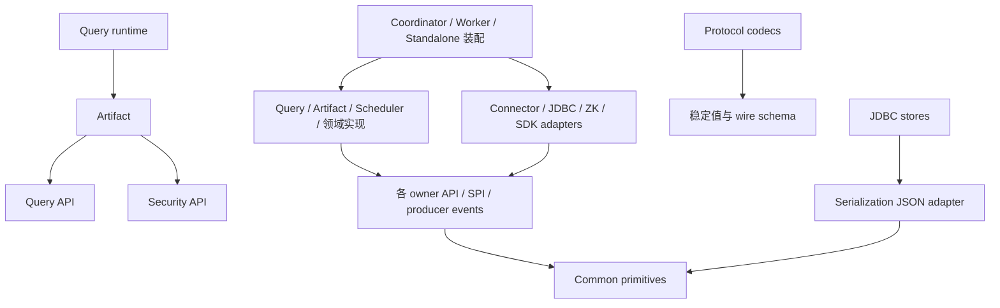

# Pangrova 全项目目录与包重构计划

审查日期：2026-10-31。基线：当前工作区，包括既有暂存和未暂存迁移。本文是后续重构的设计与执行计划，不是已完成重构的声明。既有实施过程保留在 [执行记录](project-restructure-execution-plan.md)，本计划不覆盖其中的历史证据。

**结论：主要领域划分和 Java 协调规划 / C++ 执行的方向合理，但物理模块与实际职责没有完全对应。重构重点应是移交状态和资源的所有权、收窄导出契约、消除包依赖环，并把测试和装配一起迁移。不能以目录数量、包数量或编译通过作为完成标准。**

完整范围包括 64 个 Maven reactor 项目、51 个有 Java 源码的叶子、1 个纯资源 JAR、3,570 个 Java 主源文件、657 个主源包，以及 C++/Rust、协议、数据库迁移、测试、部署和仓库工具目录。主源文件计数包含 `package-info.java`，不包含 `target` 生成代码。生成代码另做制品验证。

实施已推进至 [执行记录第 39 节](project-restructure-execution-plan.md#39-同连接提交与执行校验端口)：第 30–31 节落位 Query 事务 fence、任务 execution route/fence 和通用 JDBC runtime；第 32 节落实 schema-migrations 资源制品和 Table/Materialization owner 测试。当前模块依赖 7 项、包结构 2 项、状态枚举 3 项通过；第 34 节消除 Worker write/catalog 环，全图无环检查仍因剩余 7 组 SCC 失败，没有增加豁免。逐包台账与当前源码集合及文件数完全一致，遗漏、多余、重复均为零。

第 33 节完成 AI 工厂显式 authority 注入、错误归属和 Metadata 依赖拆分；第34节提取协调API并下沉Worker会话/资源端口；第35节完成模型当前权限provider与显式事务消费链。领域发布、Indexing激活耦合、真实非空模型ManagedSource撤权测试及剩余7组包环仍待处理。

初审的 60 个项目、3,542 个主源文件、649 包属于历史快照，保留在审查证据中；本文范围与逐包台账已更新至阶段执行/交换状态存储 SPI 批次。两个新 owner 已通过 61 / 41 项测试，64 项 reactor 清理编译通过；消费者验证另见执行记录。分批验证结果与剩余工作以执行记录为准，已编译或已迁移不等于全项目语义审查完成。

最新设计要求：业务规则、任务编排、存储契约和 PostgreSQL 实现必须可分别演进。当前 `pangrova-data-build` 是用户已否决的过渡名；按用户单词命名要求，最终采用 `pangrova-generation`（生成），存储 SPI 与三制品边界落实后统一迁移。Metadata 不整体改名为 Catalog：先迁出各领域权威与基础设施，再将目录身份/连接器生命周期和技术元数据投影按不同能力迁入 Catalog，最终退役当前混合 Metadata 制品。具体拆分以最新配套设计为准。

配套清单：

- [657 个当前包的目标归属与处理台账](project-structure-refactoring/package-migration-map.md)：每个当前包恰好一行，记录批次、动作、目标和约束；混合职责包需要按本文的类级方案拆分。
- [本次审查证据](project-structure-refactoring/audit-evidence.md)：实际检查结果、模块统计、扫描范围和限制。
- [7 组当前包环及源码边](project-structure-refactoring/package-cycles.txt)：来自本次 AST 架构测试，不是根据包名猜测的依赖。
- [Metadata、Catalog 与存储 SPI 深审设计](project-structure-refactoring/metadata-catalog-storage-design.md)：逐文件归属、持久化契约、PostgreSQL 实现及原子发布的迁移方案。

## 1. 合理性判断和需要解决的问题

### 1.1 应保留的边界

1. **Coordinator / Worker 进程边界**：Coordinator 负责授权、规划、调度、fence 和元数据提交；Worker / Native 负责关系数据执行。不能在重构时把 DML 数据页处理搬回 Coordinator。
2. **Parser / Planner / Protocol**：语法树、编译语义和传输编码有不同生命周期。Calcite 留 Planner，协议只有 wire 事实；不能为了消除 import 环把三者合并。
3. **Connector SPI / Runtime / 各 provider**：插件契约、类加载生命周期、具体格式 SDK 是真实隔离理由。三个 connector 不合并成一个大 SDK 模块。
4. **Table / File / Metadata / Semantic / Governance**：表控制、文件空间、技术对象目录、语义定义、治理事实不同源。共享数据库不等于同一个领域，图结构相似也不意味着应该建立通用 Graph 模块。
5. **Query API / Query、AI API / Control / Worker、Indexing API / Core、Observability API / SDK**：有真实消费者或 classpath 隔离收益，保留。
6. **Artifact / Indexing / Materialization**：通用持久构建、索引发布、物化定义与刷新分别保留。生成列和 Feature View 导出不能成为可选 Indexing 的附属功能。
7. **单个 Native shared library + 内部 OBJECT targets**：当前打包方式合理；内部 include 双向耦合需要治理，但不意味着应该立即拆多份动态库。

### 1.2 关键发现

以下优先级表示重构顺序和影响，不等同于已证明的线上故障。

| 编号 | 现状与源码证据 | 判断与计划 |
|---|---|---|
| F01 P0 | 初审两项失败中的导出包说明问题已修复；当前模块/包结构 9 项通过，无环项失败：657 包存在剩余 7 个 SCC | 保持边界声明检查；按 SCC 解环。当前架构 gate 尚未全绿 |
| F02 P1 | 初审 Coordinator 596 文件 / 99 包，而 Query runtime 24 文件 / 14 包；`QueryManager` 同时依赖 dispatch、租户准入、日志、审计及具体 SDK | Coordinator 仍承担 Query 和领域实现。按状态机、提交协议和调度职责迁移，不能整个 `query` 目录一次性搬走 |
| F03 P1 | Coordinator 主 SCC 涉及 29 包；bootstrap 2 包、HTTP 5 包另成环 | 先抽入口契约和回调，再迁实现；拆掉根包对子包实现的反向调用。HTTP endpoint 不反向读取整份 server context |
| F04 P1 | Planner 有 18 包 SCC；`PlanTable` 被多个阶段复用；`PlannedQuery` 注释声称不暴露 Calcite，但 public `plan()` 返回 `RelNode`，Coordinator 两处调用 | 内部表绑定值、计划结果与编译流程分层；对外暴露 split/lineage/dispatch 所需快照，由 Planner 内部处理 Calcite tree |
| F05 P1 | 初审 CurrentDeferredExecutionContext 在 Metadata 直连 Security JDBC；第 30–31 节已迁入 Artifact，并显式注入 Query fence 与 Security current-role 端口；跨域领域 publication 仍待迁移 | Artifact authority SPI 已存在但迁移未完。拆事实 owner 和同事务端口，保留锁顺序、私有构造约束、实际 anchor 和错误语义 |
| F06 P1 | `QueryMaterializationWiring.createGeneratedValue/createFeatureView` 要求 `IndexingBootstrap != null` | 将 durable build runtime 的能力装配从索引开关中独立出来。显式准入缺失能力，不能以空返回掩盖必需处理器缺失 |
| F07 P1 | Common POM 仍含 provided Jetty/Jackson；`CanonicalJsonMapper` public 方法暴露 Jackson tree/TypeReference | provided 并未实现基础层隔离。HTTP server 实现迁 Transport；共享 Jackson adapter 提取为独立低层制品，领域 canonical codec 仍归各 owner |
| F08 P1 | 第34节已将11个协调契约迁入独立API，ZooKeeper不再依赖coordination-core | 第34节已落位；保持 provider 单向依赖 API，进程选择/关闭 provider；继续审查实现的异常和恢复语义 |
| F09 P1 | 大量 manifest exports 覆盖整棵领域根包；Query 直接导出 core/store/adapter | 模块检查通过也不代表封装合理。逐调用者缩为 api/spi/assembly，真实跨域事务口作为受限 friend export，而非整棵 store |
| F10 P1 | 初审 Table / Materialization JDBC 的 owner 测试在 Metadata；第 32 节迁回 10 个测试类，跨 Metadata Catalog 的集成保留在 Metadata | 属于测试归属错位，不能直接推断零覆盖。迁 owner 测试与数据库 fixture，保留跨域集成测试；先拆 migration 资源依赖，避免 test-scope Maven 环 |
| F11 P1 | Worker `task/state` 引用 `TaskManager.TaskState`；`task/memory` 引用可变 `TaskInfo`；bootstrap、exchange 仍成环；JNI write/catalog 环在第34节已消除 | 抽纯状态与窄资源端口。`TaskInfo` 含 native 创建、释放、清理重试和终态发布，不得伪装成不可变 DTO 或复制资源 owner |
| F12 P2 | Materialization 的 domain/port/usecase、Metadata service、Transport 根包等混合了不同能力；`StateStoreFactory` 在 Config 持有全局可变注册表 | 分能力审查并归位。Config 保留配置定义/加载/校验，store 选择交给实例化装配；不以构造器参数数量为理由制造更大的 Context |
| F13 P2 | Native engine 的 runner/filter/report-state 依赖 indexing/capabilities；OBJECT target 只提供组织边界 | 在已存在的五个通用 seam 上设计 engine-owned port，并保留 capability 专属算子的显式耦合；不虚称现有 include 图无环 |

关键源码入口：[QueryManager](../../pangrova-coordination/pangrova-coordination-core/src/main/java/org/pangrova/coordinator/query/QueryManager.java)、[PlannedQuery](../../pangrova-planner/src/main/java/org/pangrova/planner/PlannedQuery.java)、[JdbcDataBuildExecutionFence](../../pangrova-data-build/src/main/java/org/pangrova/databuild/store/jdbc/execution/JdbcDataBuildExecutionFence.java)、[QueryMaterializationWiring](../../pangrova-coordination/pangrova-coordination-core/src/main/java/org/pangrova/coordinator/bootstrap/QueryMaterializationWiring.java)、[TaskInfo](../../pangrova-worker/pangrova-worker-core/src/main/java/org/pangrova/worker/task/TaskInfo.java)、[StateStoreFactory](../../pangrova-config/src/main/java/org/pangrova/config/StateStoreFactory.java)。

## 2. 目标目录和制品决策

保留目前 `pangrova-*` Maven 目录及已有产品族聚合目录。将全部模块再搬入 `platform/`、`domain/`、`apps/` 会同时影响脚本、Docker、测试 discovery 和源码引用，却不能解决当前耦合；本计划通过包归属和依赖约束表达层次，不进行这类全仓路径改名。

以下为目标目录，`新增` 表示尚未实现；其余目录保留并重构内部。只在已有真实实现或资源迁入时创建新制品。

```text
pangrova/
├── pom.xml                         # 版本/BOM/plugin 管理与 reactor
├── .mvn/ .github/ .pangrova/        # 构建配置、CI、规则/边界清单/可执行 gate
├── bin/ config/ etc/ deploy/        # 运维入口、构建检查配置、运行配置、部署
├── docs/ website/                  # 文档源与站点；不复制架构事实清单
├── pangrova-common/
├── pangrova-config/
├── pangrova-serialization-json/     # 新增：共享 Jackson adapter，非领域 codec
├── pangrova-schema-migrations/      # 第 32 节已建立：统一数据库 migration 资源制品
├── pangrova-function/
├── pangrova-parser/
├── pangrova-planner/
├── pangrova-protocol/
├── pangrova-transport/
├── pangrova-observability/
│   ├── pangrova-observability-api/
│   └── pangrova-observability-sdk/
├── pangrova-query-api/
├── pangrova-query/
├── pangrova-data-build/            # 过渡名；目标拆生成任务 core / 存储 provider，见配套设计
├── pangrova-scheduler/
├── pangrova-coordination/
│   ├── pangrova-coordination-api/   # 第34节已建立：registry、lease、provider 契约
│   ├── pangrova-coordination-jdbc/  # 已拆出：真实 PostgreSQL lease/registry 实现
│   ├── pangrova-coordination-inmemory/ # 已拆出：进程内 lease/registry 实现
│   ├── pangrova-coordination-core/  # 进程装配、入口、集群协调应用
│   └── pangrova-coordination-zookeeper/
├── pangrova-worker/
│   ├── pangrova-worker-core/
│   └── pangrova-worker-native-bridge/
├── pangrova-worker-native/          # CMake + Lance Rust FFI
├── pangrova-native-bundle/          # 平台制品打包
├── pangrova-connector/
│   ├── pangrova-connector-spi/
│   ├── pangrova-connector-runtime/
│   ├── pangrova-connector-iceberg/
│   ├── pangrova-connector-paimon/
│   └── pangrova-connector-lance/
├── pangrova-catalog/               # 新增：目录身份、连接器生命周期及技术元数据能力
│   ├── pangrova-catalog-core/
│   └── pangrova-catalog-store-postgresql/
├── pangrova-metadata/              # 过渡：按 owner 迁空后退役，不整体改名
├── pangrova-table/
├── pangrova-file/
├── pangrova-storage/
├── pangrova-semantic/
├── pangrova-security/
├── pangrova-governance/
├── pangrova-ai/
│   ├── pangrova-ai-api/
│   ├── pangrova-ai-control/
│   └── pangrova-ai-worker/
├── pangrova-indexing/
│   ├── pangrova-indexing-api/
│   └── pangrova-indexing-core/
├── pangrova-materialization/
│   ├── pangrova-materialization-core/
│   └── pangrova-materialization-store-jdbc/
├── pangrova-streaming/
├── pangrova-shuffle/
│   ├── pangrova-shuffle-core/
│   └── pangrova-shuffle-service/
├── pangrova-operations/
├── pangrova-client/
│   ├── pangrova-client-core/
│   ├── pangrova-client-cli/
│   └── pangrova-client-jdbc/
├── pangrova-standalone/
└── pangrova-testing/
    ├── pangrova-testing-kit/
    ├── pangrova-testing-integration-tests/
    ├── pangrova-testing-benchmark/
    └── pangrova-testing-fuzzer/
```

三个新增制品各有具体理由：serialization-json 切断 Common 的第三方实现依赖，同时避免所有数据库 owner 依赖 Protocol；coordination-api 消除 provider 对进程制品的依赖；schema-migrations 让升级资源及 owner 测试不必通过 Metadata 实现获得。最后一个是资源制品，不是空 API/Core 占位模块。暂不进一步拆 Security、Table、File、Artifact 的 API/Core/Store JAR；用精确 exports 和最小 classpath 测试证明隔离，出现独立发布或不可隔离依赖时再拆。

`.idea/`、`.vscode/` 等本机状态不作为目标架构的一部分。`target/`、native build 目录、生成源码和发布二进制不手工整理进源码树。

## 3. 目标依赖和包设计

### 3.1 依赖方向



这是目标层次示意，不是完整 Maven 依赖矩阵；完整允许边仍由 `.pangrova/modules.yaml` 管理。跨域实现的调用由消费方 adapter 通过供给方的窄端口完成，禁止反向依赖应用 bootstrap。需要同一数据库事务的调用传递精确 `Connection` 和能力，不传 DataSource/任意服务注册表绕过事务边界。

### 3.2 内部包规范

通常采用 `owner.api.<能力>`、`owner.core.<能力>`、`owner.spi.<能力>`、`owner.store.jdbc.<能力>`、`owner.adapter.<对方域或技术>`、`owner.assembly`。这是职责规则，不要求每个模块都生成六层目录。Parser AST、Protocol messages、Native engine 保留适合自己的结构。

- 根包只保留稳定入口和包说明。领域聚合、实现、异常、工厂逐个归属；不是所有类都应该塞入 `.core`。
- 接口放在使用它的能力边界或事实 owner；不能“接口统一 api、实现统一 impl”而丢失业务内聚性。
- 导出 `api/spi` 和明确装配入口。JDBC 原子协作接口按用途精确导出；不永久公开所有 store/support/mappings。
- 公开对象不携带 Calcite/Jetty/Jackson/Curator/connector SDK 类型，技术 adapter API 除外且只允许 adapter 消费。
- 可变执行对象、事务校验结果、native handle owner 不能为了搬包改成任意构造的公共 record。
- 同一能力中有几十个 AST/协议类型并不自动要求拆分；每个拆分类必须有不同调用者、生命周期或不变量作为理由。

### 3.3 全部模块的处理决定

下表与逐包台账一起覆盖 48 个 Java 叶子；斜杠列出同产品族的多个独立叶子。批次定义见第 7 节。

| 现有模块 | 决定与内部调整 | 批次 |
|---|---|---|
| Common | 保留并缩小；抽 Jackson 和 Jetty 实现；QueryCheckpoint 契约归 Query；校对双 annotation 家族；通用值/JDK utility 按语义保留 | P1 |
| Config | `api` 配置模型、`validation`、`adapter.yaml`；Worker/Coordinator option 定义分组；全局 StateStoreFactory 迁实例化装配 | P1 |
| Function | 保留 registry/metadata/scalar/aggregate/table/runtime 契约；provider、JNI 回调不能混入 API | P8 |
| Parser | 保留 AST 结构；拆 root 的 lexer/parser/facade，内置函数类型仍属于 AST；不按 statement 数量强拆 | P4 |
| Planner | 编译入口、binding、plan、optimization、cost model、physical traits/operators、Substrait adapter 分层；移除公开 Calcite tree 通道 | P4 |
| Protocol | 保留 canonical proto 与按能力分组的 codec；移除领域状态机，review REST DTO 与 task wire 的重复转换 | P4/P8 |
| Transport | 分 client HTTP、result API、Arrow/Flight adapter、server HTTP；接收 Jetty factory；保留单制品并收窄出口 | P1/P8 |
| Observability API / SDK | 两制品保留；API 保留其无依赖 no-op；SDK provider 不从领域 core 被直接调用 | P1 |
| Query API / Query | API 承接 lifecycle/state/execution/transaction 契约；Query 承接 Coordinator query 状态、终态、journal/recovery 和执行编排 | P3/P5 |
| Artifact | 通用 build/stage/exchange/job publication 完整迁入；Security/Query/领域发布通过事务口接入；不依赖 Metadata 实现 | P3 |
| Scheduler | 承接通用 admission/placement/speculation；Stage DAG 语义属于 Query；Worker 注册属于协调域 | P5 |
| Coordination Core / ZooKeeper | core 瘦身为进程装配及入口；ZK 只依赖新增 coordination-api；HTTP 和 bootstrap 分别解环 | P5 |
| Worker Core / Native Bridge | task 纯状态、内存契约、exchange SPI、bootstrap 资源生命周期分开；JNI write session 与 catalog 分层 | P6 |
| Metadata → Catalog 与各领域 | Catalog接目录/技术解析/版本投影/cache/relation；Security接tenant，Table接managed-source，AI接generated，Indexing接index publication；公共任务及过程装配单独迁出，最终退役混合Metadata | P2/P3/P7 |
| Table | 控制/维护/统计/governance binding 不变；JDBC/memory 按同样能力分包；迁回 owner 测试 | P2/P7 |
| File | volume/stage/upload/directory/copy 权威留 File；Worker 只做执行/读取 adapter；核验 claim 与 publication 事务 | P7 |
| Storage | `api.blob`、`adapter.filesystem`、`adapter.s3`；隔离 S3 SDK，不引入租户/表/AI 权限规则 | P7 |
| Semantic | View API/Core/Store 保留；验证编译与权限入口；本次不引入新 ontology/RDF 产品能力 | P7 |
| Security | api/core/provider/store 分能力，统一 tenant 与角色权威；JDBC 同事务口收窄；OAuth/LDAP/KMS 等 provider 隔离 | P1/P3/P7 |
| Governance | audit/classification/lineage/quality 分能力；provider/executor 归 adapter；同步 gate 和异步 lineage 分开 | P7 |
| AI API / Control / Worker | API 保留运行端口；Control 的 embedding/evaluation/feature 拆契约与实现；Worker 保留 provider 调用与执行资源生命周期 | P3/P7/P8 |
| Indexing API / Core | API 保留索引稳定契约；Core 承接领域 build/publication/GC；通用 Artifact 不归 Indexing；planner adapter 不泄漏 wire DTO | P3/P4/P7 |
| Materialization Core / Store JDBC | 保留物理边界；domain/port/usecase 按 definition/generation/attempt/publication/schedule/pin/GC 拆；测试回归各 owner | P2/P7 |
| Streaming | checkpoint/offset/watermark/CDC/pipeline 保持能力划分；core 不依赖 Coordinator；adapter.coordinator 检查是否仅通过契约 | P7 |
| Shuffle Core / Service | core 为 exchange/spool 能力；service 为远端部署/transport/authority；根包独占、清理记录和恢复 owner 明确 | P6/P8 |
| Connector SPI / Runtime | SPI metadata 按 catalog/table/read/write 可分职责，但稳定扩展点不机械拆；runtime discovery/classloader/lifecycle 保留 | P8 |
| Iceberg / Paimon / Lance connectors | 保留独立制品；根包按 catalog/read/write/handle/schema/maintenance 归位；禁止 SDK 类型穿透 SPI | P8 |
| Operations | 保留 diagnostics/scaling/upgrade/recovery；DDL 执行归 Query，先确认实验性 AsyncDdlExecutor 的注册和实际调用，禁止顺便启用新路径 | P5/P8 |
| Client Core / JDBC / CLI | Core 保留 framework-free API；JDBC connection/statement/result/value，CLI input/command/render；Transport 负责网络 | P8 |
| Standalone | 保留薄 embedding 入口；统一关闭责任，不直接操作领域内部实现 | P8 |
| Testing Kit / Integration / Benchmark / Fuzzer | fixture 专属根；owner 单测回 owner；跨域/跨进程留 Integration；性能与 fuzz 不替代正确性验证 | P0/P2/P9 |
| Native Bundle | 保留无业务代码的资源打包制品；验 source revision、OS/arch、ABI 和 JNI 清单 | P6/P9 |
| Worker Native / Lance FFI | 保留现有七类 target；按第 6 节治理 include seam、资源 owner、ABI 和测试路径 | P6 |

## 4. 关键包和类的重构设计

### 4.1 Common 和装配

| 当前类或包 | 目标 | 操作与约束 |
|---|---|---|
| `common.json.CanonicalJsonMapper`、`common.json.provider.jackson.JsonMapperFactory` | `serialization.json.jackson`，新增 serialization-json | 迁实现和测试，保留序列化配置及字节 golden；调用者显式依赖 adapter。Common 的 `JsonEscaper` 若只使用 JDK 可保留 |
| `common.http.adapter.jetty.EmbeddedHttpServerFactory` | `transport.server.http` | 同批切 Coordinator/Worker/测试调用者，再删 Common Jetty 依赖；JDK HTTP primitives 不强制进入重 Transport 模块 |
| `common.resilience.api.CheckpointStore/QueryCheckpoint`、Metadata `JdbcCheckpointStore` | `query.api.checkpoint`、`query.store.jdbc.checkpoint` | 按实际 Query checkpoint 语义归属，Coordinator memory provider 同迁；不能把 Streaming checkpoint 混用 |
| `common.annotation.Experimental` 与 `common.api.annotation.Experimental` | 统一 `common.api.annotation` | 比较 retention、参数、gate 识别和 classfile 消费者后统一；DeadCode 注解不能作为保留死实现的理由 |
| Config `StateStoreFactory` | 进程 `assembly.persistence` 的实例 registry | 注册归属单个启动实例，类型化工厂，关闭后释放；两次 standalone 启动不能污染彼此；不创建跨领域全局容器 |
| 各种 `*Context` / `*Deps` | 按真实生命周期分组 | `CoordinatorHttpServerContext` 中 endpoint 对象在 HTTP 装配选择；终端资源只接收自己使用的服务，不接收完整容器 |

### 4.2 Planner 的 18 包 SCC

先分离被多阶段引用的低层类型，再迁驱动流程，最后改消费者。目标包不是外部 API 的全部导出面。

1. `PlanTable` → `planner.binding.table`；`PlannerException` 及编译错误 → `planner.api.error`。编译时绑定身份不能退化成执行前重新查询 catalog。
2. `PlanFragment`、exchange trait、distribution/sort convention → `planner.plan.fragment/physical/trait`；cost estimator/config → `planner.cost.model`。trait/physical node 不回调优化管线。
3. `PangrovaPlanner`、`SqlCompiler`、跨 catalog pinning → `planner.compile`。顶层门面委派编译管线，低层 binding/metadata 不引用门面包。
4. `PlannedQuery` 拆内部 plan owner 与外部只读结果；split sources、lineage facts、policy-applied result 分别返回具体值。替换 `IndexAwareSplitFetcher`、`DispatchContextEnricher` 的 `.plan()` 消费后删除公开访问口。
5. `optimization` 负责选择规则，`rule` 只实现变换；统一 operator table/capability 查询放独立 registry/port，避免 validation→exchange→cost→root 回路。
6. Substrait 转换只在 `planner.adapter.substrait` 依赖 Protocol；Indexing planner 扩展返回 owner 值，由这个出口编码。Indexing Core→Protocol 的债务边应消失。Planner 的物理制品仍需依赖 Protocol，但其领域计划类型不再携带 wire DTO：先增加源包级 gate，证明只有指定序列化 adapter 使用 Protocol，再将这一精确技术边写入规则并关闭原 M4 债务，不能仅扩大整个模块的 allowedImports。

验收：同一 SQL 的绑定表、权限应用次数、物化重写、DML surviving rows、fragment/exchange、canonical plan bytes 和 lineage 不变；跨查询不可共享可变 Calcite tree；18 包 SCC 消除且其他 SCC 不增加。

### 4.3 Artifact 和 Metadata

当前 `DataBuildTransactionAuthority` 和 `JdbcDataBuildQueries` 已在 Artifact；本计划以此为起点，不重复创建接口。Metadata 的真实 adapter 继续承担尚未移交的校验。

| 当前对象 | 目标 owner / 包 | 原子性或安全条件 |
|---|---|---|
| `JdbcDataBuildStore*`、stage execution/exchange、output/page/claim/mappings | Artifact `store.jdbc.build/stage/exchange` | 同连接提交与回滚；保留 claim 并发、不完整图拒绝、终态单写者 |
| `DataBuildPublicationJob`、job 状态写入、digest/output validator | Artifact `core.publication` / `store.jdbc.publication` | 领域 adapter 不直接改 `artifact_build_jobs`，通过同事务精确发布口 |
| `artifact_execution_routes` 查写 | Artifact `store.jdbc.execution` | durable tenant/job route 是权威，hash 不能代替实际关联 |
| `execution_anchor` 查锁与 live-owner 校验 | Query `store.jdbc.anchor` + Query 所有事务 SPI | 保留 FOR SHARE、锁取得之后另取数据库时间；stale owner 与存储不可用不能投影成同一种错误 |
| `CurrentDeferredExecutionContext` | Artifact 内部受控解析器 + execution evidence | 不开放任意构造；先 current authority、后真实 fence、再当前 roles；tenant/job 精确匹配 |
| `JdbcIndexGenerationPublicationStore` | Indexing `adapter.artifact` / `store.jdbc.publication` | 同事务更新索引 generation 和通用 build 状态，不分两次 commit |
| generated descriptor/submission/publication | AI Control `api.generated` / `adapter.artifact` / `store.jdbc.generated` | 生成列定义和模型状态归 AI Control；Query DML outbox 通过窄事务接口关联，不令 Metadata 反向依赖 AI Control |
| tabular export publication | Artifact 的通用输出落库；AI Control adapter 维护 Feature association | 通用导出和 Feature View 绑定不是同一事实；关联、build 插入和发布仍原子 |
| `CurrentModelAuthority` / `JdbcCurrentModelAuthority` | 第35节已落位：Security事务端口、AI Control模型当前态provider | Metadata managed-source、Artifact adapter与生成写入均显式接入；保持同连接、当前角色、两个snapshot集合与空值语义 |
| `DataBuildStores` | Artifact assembly + 进程跨域 assembly | Artifact 不能在工厂中 new Metadata provider；组合根显式传入真实 authority，不提供无检查默认构造器 |

**迁移时序**：先补供给方窄事务口和回归，再切当前调用者；移动通用 store 后切 factory；最后迁领域 publication adapter 并关闭旧 SQL writer。每一小批完成清理，不用双写/双发布过渡。

**命名状态（2026-10-31）**：原 `pangrova-artifact` 及内部包已迁为 `pangrova-data-build` /
`org.pangrova.databuild`，但用户认为名称无法解释职责，已否决。现有名称仅是过渡状态。
目标概念是“派生数据生成任务”：管理执行与结果证据，索引、生成列、导出对象的业务定义和可见版本
属于各领域。最终名称确定为 `pangrova-generation`，分为 core、transaction-spi、store-postgresql；源码迁移尚待完成。不把通用任务控制误称为全部 Catalog 或
Dynamic Table/MV Materialization，也不把一个主 SOURCE_SNAPSHOT 标识描述为全部输入均已物理固定。
后续更名仍须同步 reactor、BOM、manifest、消费者、精确检查规则与文档，删除旧路径和兼容壳。
数据库历史 migration、表/列、canonical JSON 字段、protobuf 字段与数值标识保留兼容性，
手写编码器须证明原字节不变。更名不关闭领域 writer、发布原子性与装配整改。

**存储独立演进方案（最新要求）**：每个事实 owner 定义语义存储 SPI，PostgreSQL provider 实现它。
不建立一个容纳 Catalog、任务、模型、索引所有表的通用 CRUD 接口。业务接口不出现
`DataSource`、`Connection`、SQL 或 JDBC 实现类的嵌套类型；特定后端的同事务协作口单独登记，
只允许对应 adapter 与组合根使用。上层不直接 `new` provider，进程显式注入并负责关闭资源。

| 边界 | 契约与业务职责 | PostgreSQL provider 职责 | 本批发现与实施顺序 |
|---|---|---|---|
| 生成任务 | job/page/lease、阶段执行、交换证据、发布完成条件；领域输出规则由 owner 提供 | 条件更新、租约竞争、数据库时间、输出证据持久化、事务和锁 | 已有 `DataBuildStore` / `DataBuildPublicationStore`；先补 stage/exchange SPI，迁出实现嵌套 DTO，再拆 provider |
| Catalog | 目录定义、部署身份/历史、连接器句柄生命周期；与对象库存投影分开 | definition/revision 持久化、并发更新和历史读 | `MetadataStore` 当前混合定义与投影，先拆语义接口与调用者，再移真实实现 |
| 技术元数据 | 名称/Schema 解析、对象与版本观测、缓存失效、技术依赖 | inventory、outbox、invalidation cursor 的持久化 | `service` 按 resolution/lifecycle/cleanup 分包；不拥有模型/索引/生成列状态 |
| 各业务领域 | Indexing 的 generation、AI 的生成值与 Feature 关联、Table 的源对象/写提交 | 各 owner 的行写入和领域约束 | 先给跨域事务定义窄 port，再迁 publication writer 与测试，关闭旧写入口 |
| 共用数据库设施 | 连接与迁移配置，不解释业务表 | 池、驱动、事务生命周期、迁移运行器 | 从 Metadata 基础设施中抽离；历史 SQL 仍只由 schema-migrations 资源制品发布 |

任务存储当前包含 `FOR UPDATE SKIP LOCKED`，完整链还使用 PostgreSQL 的 advisory lock 等语义。
第一份独立实现应明确命名 PostgreSQL provider；使用 JDBC API 不等于已支持其他关系数据库。
未来后端必须通过同一份存储契约测试，证明 CAS、租约、持久恢复、幂等与原子发布语义。
没有实际实现和验证时，不增加宣称支持其他数据库的配置项或空实现。

原子发布保持“授权 gate → execution fence → job/output barrier → 领域版本写入 → job 发布 →
最终 fence → commit”的现有同事务约束。业务层不操作连接；PostgreSQL 组合 adapter 在同一
Connection 内调用双方事务端口，参与者不得自行获取/提交/关闭连接。迁移期间不能拆成两次 commit；
不同物理后端的跨库原子性尚未实现，不通过通用 TransactionContext 或无约束 callback 暗示已解决。
独立 provider 迁移、通用事务发布内核、业务 writer 回归领域是三个连续批次，各自有可验证退出条件。

Metadata `service` 16 类的目标（下列相对包最终归 Catalog；当前仍在 Metadata）：

- `MetadataService`、`ResolvedTable`、`MetadataSessionContext` → `api.resolution`；`DefaultMetadataService`、`MetadataResolutionCacheKey` → `core.resolution`。
- `DefaultConnectorSession` → `adapter.connector.session`；`MetadataColumnDeclarations` → `core.schema`。
- `MetadataTagOperations`、`MetadataColumnTagTarget` → `adapter.governance`；`RegistryTablePolicyAuthority`、`TableControlDeferredPolicy`、`TableControlRowPolicyStore` → `adapter.security`，底层表权威仍在 Table。
- `MetadataCleanupConfig/Scheduler` → `core.cleanup`；`QueryLifecycleReport/MetadataQueryLifecycles` → `api.lifecycle` / `core.lifecycle`，若仅为 Query 事件的消费者则保留 Metadata adapter，不复制 Query 状态机。
- relation 契约、core、memory、JDBC 已有分层；JDBC 从 `store.jdbc.object` 归 `store.jdbc.relation`。生产装配前必须解决 tenant/incarnation 身份、实际 DDL 路径和通知一致性，不因类型已存在自动启用。

### 4.4 Coordinator 的领域迁出和剩余包

| 当前能力 | 目标 | 留在 Coordinator 的内容 |
|---|---|---|
| QueryManager、QueryStateMachine、终态清理/审计协调/reader pin | Query `core.lifecycle/state/audit` | endpoint 到 Query API 的映射、启动关闭 |
| query execution / phase / DAG / stage | Query `core.execution/dispatch/stage` | Planner/connector/Worker 网络的组合 adapter |
| statement / statement.dml | Query `core.statement/transaction` | SQL 入口和领域 DDL handler 的装配；具体 Table/View/Index 操作归各 owner |
| scheduler / speculation / scheduler.ft | Scheduler 对应 core 能力 | 集群资源快照和 worker transport adapter |
| task issuance/report/write | Query `core.task/transaction` 与其 SPI | HTTP report endpoint；不将 Worker 进程内 TaskInfo 引入 Query |
| artifact/runtime/template | Artifact 编排或 Query durable-execution adapter | 真实 runtime 组合、所需 Worker 能力注册 |
| adapter.indexing 的生命周期/build/publication | Indexing Core 对应能力 | 编译器/查询入口组合 adapter；不把全部 adapter 原样搬入 core |
| ai.embedding / feature | AI Control 能力 + Query/Artifact adapter | SQL 绑定入口；不拥有模型或 Feature 持久权威 |
| materialization / dynamictable | Materialization ports 的 Query/Metadata adapter | adapter 装配；kernel 不依赖 Coordinator |
| metadata/nativecontrol/read、file、semantic、governance | 相应 owner API 的入口 adapter | 认证、请求解析和 dispatch |
| coordination.api | 新 coordination-api，包根 `org.pangrova.coordination.api` | leader/coordinator 应用，memory/JDBC provider 与装配 |
| bootstrap / bootstrap.module | `assembly` / `assembly.module`，独立 module SPI | 集中依赖选择；phase 返回 owned resources，不读取可变全局组件袋 |
| http / endpoint | `server.http` / `endpoint.<能力>` / `adapter.http` | server 建立 endpoint，endpoint 只依赖 API/HTTP shared primitives |

**执行次序**：先 lifecycle port，再 Query owner 迁移，再 Stage/DAG 和 Scheduler，最后领域 adapter 和 bootstrap 清理。每步同步修改回调，防止迁出后通过 callback 参数把 Coordinator 类型带回去。不可将 29 包 SCC 整体迁至 Query 后宣称解环。

### 4.5 Worker 包环（原四组，当前剩三组）

| 环 | 改法 | 必须验证 |
|---|---|---|
| task / task.memory / task.state | 将 `TaskManager.TaskState` 抽到 `task.state.TaskState`；纯 transition 无 manager 依赖；memory 接收 task-memory view/操作端口，不接收整个 TaskInfo | 合法迁移、取消与 finish 竞争、内存释放恰一次、terminal report 顺序 |
| exchange / exchange.remote / execution | TaskExecutor 窄执行/egress 口归 execution SPI；CanonicalBatchChunks 归 exchange.codec；remote 实现返回 owned lease，执行层决定关闭 | 背压、半关闭、ticket 续租、失败清理、远程 exchange 恢复 |
| bootstrap / lifecycle / phase | phase 接受具体能力并返回资源；关闭序列消费 lifecycle contract；去掉 phase→整个 WorkerComponentRefs | 部分启动失败逆序关闭、graceful drain、重复 close、native ownership |
| nativebridge.jni.write / write.catalog | TaskConnectorSession 归 `nativebridge.connector.session`；CatalogResourceResolver 归 `nativebridge.connector.spi`；catalog runtime 是实现，write 是消费者 | catalog revision pin、secret、重复绑定释放、JNI upcall 与写提交完整链 |

TaskInfo、TaskNativeCreation、TaskTerminalPublication、TaskCleanupRetry 留在同一个 task lifecycle 所有权体系；它们的跨线程原子关系比包名对称重要。JNI 类的 FQN 一旦改变，必须同步 native symbol、回调字符串和加载验证，不能只更新 Java imports。

### 4.6 其余混合包的拆分规则

- **Materialization**：domain 的 definition/binding/object 与 generation/attempt/publication/schedule/pin 分能力；port 同步按这些能力分组；usecase 对应生命周期、refresh、schedule、GC。`KernelPorts` 不扩为万能容器；`Clock/IdGenerator` 留窄基础 port。JDBC 按仓储能力组织，历史 SQL 资源版本不改。
- **Table**：将 store.jdbc.control 与 store.memory.control 内的 maintenance/statistics/governancebinding 实现归同名能力，control 保留身份/状态；迁测试但不迁移跨域端到端断言。
- **AI Control**：embedding 接口/值归 api.model，ConcurrentMap provider 归 store.memory.model；evaluation 值/port 归 api.evaluation，校验/决策归 core.evaluation；feature port 归 api.feature，JDBC association 仍是 adapter。
- **Indexing**：store 中的契约按 generation/publication/commit/GC 分入 API 或内部 SPI；JDBC 依照相同能力落位；engine provider 与 serializer 不得相互发现/递归注册，assembly 负责一次注册。
- **Security**：tenant、role、authn、authz、mask、secret 的 store 按能力拆；API 不调用 JDBC；provider.* 移到 adapter 时同步依赖 optional/runtime 和真实启动注册。
- **Governance**：JDBC audit/tag/quality 分包；InMemory 实现归相应 store.memory；lineage backend 和 SQL quality executor 归 adapter。`UnconfiguredQualityRuleExecutor` 的可达路径必须明确拒绝需要该能力的请求，不能当作完整 provider。
- **Connector SPI metadata 根包**：先区分 catalog lifecycle、table/column identity、split/read、write/commit、codec；保持一次提交所需契约同一能力。以 connector 的共同调用场景拆接口，不以 12 方法阈值机械拆。
- **Storage / Transport / Client**：SDK 类型集中 adapter，关闭语义留能力 owner。JDBC ResultSet 消费、网络 stream、Arrow buffer 的释放职责分别列清，不能因抽象层增加导致多方 close。
- **Operations**：`AsyncDdlExecutor` 当前检索到的构造调用在测试；迁移前继续检查反射/注册/配置。无生产连接且无承诺保留理由时删除独立实验实现；若有真实需求则通过 Query 正规提交路径接入，不能仅搬包就视作可用。

## 5. 数据、注册和测试必须同步迁移

### 5.1 数据事实的唯一 owner

| 事实 | 唯一权威 owner | 跨域协作 |
|---|---|---|
| query state/journal/anchor/write commit journal | Query | Artifact 使用同事务 fence/acknowledgment 端口 |
| artifact job/stage/page/exchange/route/generic publication | Artifact | Indexing/AI/Feature publication adapter 原子关联领域状态 |
| index definition/generation/commit/GC | Indexing | Query 执行，Artifact 通用 build；不可由 Metadata 任意改状态 |
| model/generated definition/evaluation/feature association | AI Control | Security 当前授权、Artifact build、Query DML outbox |
| technical catalog/object/version/outbox/dependency | Metadata | Table 控制、connector metadata、Governance 投影 |
| table control/policy binding/statistics/maintenance | Table | Security/Governance 提供策略，Metadata 做目录适配 |
| volume/stage/directory/copy claim/publication | File | Storage 发布内容，Worker 执行传输 |
| tenant/role/grant/policy/secret reference | Security | 事务 authority 重查，不能信任持久化旧角色快照 |
| materialization definition/generation/attempt/pin/schedule | Materialization | Query 执行与提交，Connector physical generation |
| CDC offset/checkpoint/watermark | Streaming | 源与 sink 确认边界，不能混入 Query checkpoint |
| semantic view definition | Semantic | Planner 编译，Metadata 仅技术引用 |
| governance lineage/classification/quality/audit | Governance | Query 是执行事实生产者，projection 不反向成为权限权威 |

上述表是目标职责，不表示已经完成所有数据库表的 writer 审计。P2/P3 对每个 SQL 表继续落到具体 `INSERT/UPDATE/DELETE` 方法、调用路径、事务和恢复入口，才可关闭迁移项。

### 5.2 Migration 资源迁移

初审 Metadata 的 `db/migration` 有 93 个 SQL 文件；第 32 节已将它们以原字节、原文件名迁入 schema-migrations，并建立路径、版本、SHA-256 manifest。classpath location 仍为 `db/migration`。保留统一 Flyway 历史和版本序列，不将既有 V 文件重新按领域编号。

先准备资源制品，再在一个原子改动中切换 Metadata、部署和 test fixture 的依赖并删除旧资源副本；最终 classpath 上同一路径只能出现一次。SchemaMigrationRunner 的运行由装配负责，owner 测试通过 Testing Kit fixture 获得迁移能力，不通过 Metadata runtime。验旧库升级、新库初始化、Flyway validate、跨域事务、制品资源唯一性。未实现新 schema 时不要附带改 SQL 内容。

### 5.3 每批同步修改清单

源码与测试 package；POM dependencyManagement / reactor / scope；manifest roots/exports/friendExports/providers；Automatic-Module-Name；ServiceLoader 描述符；反射和配置 FQN；JSON 类型名；JNI FindClass/GetMethodID/导出映射；canonical proto 生成输入；SQL resource location；Docker COPY / classpath；部署及启动脚本；CI changed-path 分类；静态规则路径；docs/website 链接。

源码 import 无旧包还不够：运行真实 ServiceLoader、检查最终 JAR class/resource 清单、最小 classpath 加载和启动关闭。13 个现有主源 ServiceLoader 描述文件应逐个记录 provider、消费者、发现入口和禁用配置下的行为。

## 6. Native 和非 Java 目录

保留 `src/bridge`、`engine`、`capabilities`、`indexing`、`vector`、`udf`、`lance` 以及镜像测试目录。当前 src 文件统计分别为 38、268、52、19、22、4、9；这是目录文件数，不是编译单元或测试数量。

优先审查四个具体入口：`VeloxTaskRunner` 的 index hint pruning、`DynamicFilterConverter` 的 Bloom/file index probe、`TaskExecutor` 与 `PlanExecutionState` 的 artifact report/执行状态。按 engine-owned pruning/report 能力隔离；对 PlanExecutionState 逐字段核对，不假设其对 ArtifactRetrievalPlanner、ArtifactBuildOperator 的引用都只是报告值。UDF→bridge handle registry 是另一条独立审查边，若要反转则通过 runtime handle port 使用同一真实 owner，不能复制 registry。

architecture.md 列出的 capability 专属算子和 Substrait 转换边保留并单独审查，不笼统禁止全部双向 include，也不把记录中的 seam 数量当作删边配额。C++ include SCC、target link graph 和 Java package SCC 是三种不同事实，应分别报告。

Native 子批次必须同时处理 CMake 源集合、include 路径、test 路径、export map、JNI descriptor、Lance FFI 头/符号及打包资源。保持单 shared library 和 Arrow interop ownership；重命名不能改变 buffer lifetime、回调线程或 exception translation。

非 Java 目录处理：

| 目录 | 目标职责与调整 |
|---|---|
| `.pangrova/rules` | 仅架构/开发政策；模块矩阵继续引用 modules.yaml，不维护第二份允许边 |
| `.pangrova/scripts` | 可执行 gate 与事实生成；扫描新叶子、resources-only 制品、generated/shaded packages；测试不吞异常 |
| `.github/workflows` | 修改真实 module paths 和 gate 归属；不靠扩大 skip/exclude 得到通过 |
| `bin` / `deploy` | 用户入口与部署资源；内部构建/gate 脚本留 .pangrova；Docker 分层按新制品和 native 资源验证 |
| `config` / `etc` | 区分 Checkstyle/SpotBugs 等构建配置与运行配置模板；当前被脚本引用的路径先列清，再按职责处理，不盲目合并 |
| `docs` / `website` | architecture 为稳定架构说明，internal 为实施计划/证据，operations 为运行手册；同步链接而不复制 schema/package 清单 |
| `lance-ffi` | Cargo.lock、ABI、构建脚本、SDK tests 一起审查；不手改生成绑定 |

## 7. 分批执行计划

每批应拆为可独立 review 的 PR。以下是依赖顺序和退出条件，不是要求一次修改数千文件。责任人按领域指定实际维护者，未指定时由该批实施者承担，不能以未分配人为省略验收的理由。

| 批次 | 依赖 | 可交付改动 | 完成条件 | 风险 |
|---|---|---|---|---|
| P0 事实和边界声明 | 无 | Artifact 两个导出包说明已补；继续核查其余声明根说明；保存当前依赖/注册/资源事实；建立逐包状态 | 文档/manifest gate 通过；8 SCC 保持真实失败并记录，未扩大豁免 | 低 |
| P1 基础层和装配契约 | P0 | Jackson/Jetty 移出 Common；配置装配归位；annotation、公开出口与最小 classpath | Common 不链接框架；canonical bytes 不变；全部消费者编译 | 中 |
| P2 schema 与测试所有权 | P0 | migrations 资源制品、fixture 依赖、Table/Materialization store 测试迁回 owner | 93 份资源 checksum 不变且无重复；新/旧库迁移和 owner 独立测试通过 | 高 |
| P3 Artifact 与事务边界 | P1/P2 | authority/fence/publication 窄口、通用 store、领域 adapter；去掉 Indexing 对通用功能的启用绑定 | 同事务撤权/并发/fence/原子发布/恢复通过；关闭索引后的基础 SQL 与具备能力的生成/导出路径通过 | 高 |
| P4 Planner 和 wire 出口 | P0；消耗 P1 基础设施 | 低层绑定/plan 类型、编译管线、Calcite 出口、M4 债务清理 | Planner SCC 清零；计划/授权/Java-native golden；无公开 Calcite 泄漏 | 高 |
| P5 Coordinator 和 Query/Scheduler | P3/P4 | 按生命周期→执行→调度迁移；coordination-api；bootstrap/HTTP 解环；DDL 归属 | Coordinator 三组 SCC 消失；Query/Scheduler 不依赖进程实现；单/多节点启动、取消/重试/fence | 高 |
| P6 Worker 和 Native | P0；消费 P3/P5 的稳定执行契约 | 四 SCC 解环、JNI write session、native seam、资源生命周期 | Worker 四 SCC 消失；JNI 对称、native/ASan、remote shuffle、取消关闭完整链 | 高 |
| P7 领域内部包收敛 | P1/P2/P3 | Metadata/Table/File/Security/Governance/AI Control/Indexing/Materialization/Streaming/Semantic 逐包处理 | 每包记录入口、owner、实现/注册、事务、异常、测试；无新增跨域 core/store 导入 | 中至高 |
| P8 provider 与交付边界 | P1/P4/P6；相关领域 P7 | Connector/AI Worker/Shuffle/Transport/Client/Operations/Standalone/Protocol/Function 余项 | provider 独立发现、SDK 隔离、API-only classpath、启动关闭和相关 SQL E2E | 中至高 |
| P9 全项目验收 | P0–P8 | 清除旧路径/重复类型/临时 façade，精确 exports；完整构建与回归；更新长期文档 | 所有包关闭审查、SCC=0、升级和全链测试通过，无未解释 skip | 高 |

第 32 节状态：P2.1/P2.2 已验收，93 份迁移原字节不变、生产/测试 classpath 唯一、新旧库升级、
Table 101 / Materialization JDBC 15 / Metadata 579 / SQL-native 13 项及相关静态检查通过。
这不关闭 P3 的领域事务与装配，也不替代 P7 的逐包语义审查或 P9 总验收；原八组 SCC 仍使无环 gate 失败。

P1/P2/P4 的独立部分可由不同实施人并行，前提是不同时修改同一 POM/manifest/generated 输出；P3/P5/P6 涉及协议和事务的依赖部分按顺序推进。此处为执行组织建议，本次审查没有启动并行实施。

估算仅用于排期：P0 1–2 人日，P1 3–5，P2 3–5，P3 6–10，P4 5–8，P5 8–12，P6 6–10，P7 8–14，P8 5–8，P9 4–7，总计约 49–81 人日；包括相关测试调整，不含新增产品功能。现有迁移完成程度、native 环境和外部消费者兼容要求会影响工期。P0 后按实际类级变更量重新估算，不把人日直接当日历天。

### 7.1 可独立审查的实施单元

以下是批次内部的最小闭环，不要求一个大批次只提交一个 PR。已有 authority SPI、共享查询 helper 和包说明直接复用；不重复抽象。每个单元必须同步调用者、测试、装配及声明，不能先留下无法编译的半条依赖链。

| 单元 | 具体改动及边界 | 前置 / 退出证据 |
|---|---|---|
| P1.1 JSON adapter | 移 CanonicalJsonMapper、JsonMapperFactory 及相关测试，更新所有直接 Jackson 消费者的依赖 | P0；canonical 序列化 golden、Common 最小 classpath、全 reactor |
| P1.2 HTTP 与配置 | 移 EmbeddedHttpServerFactory；StateStoreFactory 改实例化装配；校对 annotation 家族兼容性 | 与 P1.1 分开审查；双实例启动/关闭互不污染、既有调用者通过 |
| P2.1 Migration 资源 | 93 份 SQL 按原字节迁入资源制品，同批删除旧资源副本 | 路径/版本/checksum 清单、新旧库迁移、classpath 无重复 |
| P2.2 测试归属 | Table 和 Materialization JDBC 的 owner 测试迁回；共享 fixture 不依赖 Metadata runtime | P2.1；无 test-scope 制品环；原断言保留，owner 可独立执行 |
| P3.1 Query 事务 fence | Query API 提供接收调用方 Connection 的窄事务能力；Query JDBC 实现 anchor 查锁；迁 Artifact 与 ManagedSource 消费者 | 可先于 P2 做接口设计，整体验收仍遵守 P3 前置；真实 PG、同连接、等待锁后过期、owner incarnation/token 不匹配 |
| P3.2 Artifact route/fence | route 查写迁 Artifact；publication fence 组合 Query 端口；LostOwner 错误契约归 Artifact API；同步所有 catch | P3.1；缺失/损坏 route 与 stale owner 区分；SQL 故障不得按 stale owner 吞掉 |
| P3.3 Current authority evidence | Security current roles、AI model-current 提供同事务能力；迁 CurrentDeferredExecutionContext；构造保持受控 | P3.2；撤权、tenant/job 错配、模型变化后拒绝，不能传旧角色快照冒充当前角色 |
| P3.4 通用 store 与查询 | build/stage/exchange/output/page/claim 归 Artifact；清理跨域 SQL read projection；factory 显式注入 | P3.3；候选分页/排序/claim 冲突语义、重启恢复不变，Metadata 无通用 job writer |
| P3.5 领域发布与装配 | Indexing/AI publication adapter 归各 owner；通用 runtime 不再依赖 IndexingBootstrap 开关 | P3.4；领域指针与通用 job 同事务；禁用 Indexing 的能力矩阵与 SQL E2E |
| P4.1 Planner 低层值 | PlanTable、错误、fragment/trait/cost 类型先分离，消除低层到门面的调用 | 原消费者同批修改；AST SCC 边数减少，绑定身份/类型不变 |
| P4.2 编译和公开结果 | compile 管线、PlannedQuery 内外分离，替换两个 Calcite tree 消费者；Substrait 出口集中 | P4.1；Planner SCC=0、权限/DML/golden/lineage；不缓存跨查询可变树 |
| P5.1 协调契约 | coordination.api 及真实 provider 契约迁新制品，切 ZK 与进程装配 | 独立 provider discovery/租约；ZK 不再依赖 coordination-core |
| P5.2 Query 生命周期 | QueryManager、state、终态/pin/audit 逐能力迁 Query；进程资源以窄端口提供 | P3/P4；取消、失败、成功的清理和审计顺序不变 |
| P5.3 执行与调度 | Stage/DAG/task/statement 归 Query，通用 admission/placement 归 Scheduler；领域 handler 归 owner | P5.2；Coordinator 主 SCC 消失；不把整个环原样搬至 Query |
| P5.4 HTTP/启动 | server 组装 endpoint；phase 返回明确 owned resources；缩小 Context 可见面 | P5.1–P5.3；两个启动/HTTP SCC 消失，部分启动失败逆序释放 |
| P6.1 Worker task | 抽纯 TaskState；memory 使用窄资源操作端口；TaskInfo 保留单一可变 owner | 取消/finish race、native 创建与释放、terminal report；task SCC 消失 |
| P6.2 Exchange/启动 | codec 和执行端口归位；remote lease 关闭归 owner；bootstrap lifecycle 契约下沉 | 背压/半关闭/恢复/重复 close；两组 SCC 消失 |
| P6.3 JNI session | TaskConnectorSession 与 CatalogResourceResolver 归 connector session/SPI，catalog 实现与 write 消费者解耦 | catalog revision pin、真实 JNI 写入链、symbol/callback 校验；bridge SCC 消失 |
| P6.4 Native seam | runner/filter/report 的 engine-owned 端口；逐项核对 handle 和 buffer owner | P6.1–P6.3 稳定后；CMake/include 图、Release/ASan、打包消费者，禁止复制 registry |
| P7.1–P7.11 领域包 | Metadata、Table、File、Security、Governance、AI Control、Indexing、Materialization、Streaming、Semantic、Storage 各一个起始工作单，可按能力再拆 | 第 4.6 节 + 逐包台账；每单落到类清单/唯一 writer/异常/释放责任/测试，不整体机械搬包 |
| P8.1–P8.8 provider/入口 | Connector、AI Worker、Shuffle、Transport、Client、Operations、Standalone、Protocol/Function 各一组闭环 | SDK 不泄漏、真实注册、optional 配置、资源关闭和相应执行链 |
| P9.1–P9.3 总验收 | 结构与制品收口；统一运行时回归；文档与部署交付 | 前两项真实通过后更新完成状态，任何未执行项目保留未验收 |

**P3 需要单独防止的假完成**：`JdbcDataBuildStore.LIVE_PUBLICATION_ANCHOR` 在候选选择及 claim 冲突查询中直接读取 Query anchor。仅迁 `ArtifactExecutionFence` 并不能关闭这条依赖。该读模型应作为明确的跨域查询 adapter 收口，保留数据库内过滤与分页/原子 claim，不以 SQL 字符串 SPI 或先分页再内存过滤替代。ManagedSource 对 Query fence 的直接静态调用已在第 30 节同批切换；不得制造带虚构 acquiredAt/expiresAt 的 ExecutionAnchor 来满足接口签名。

所有 P3 子批次必须保留 `DataBuildExecutionFenceLockIntegrationTest`、`DataBuildPublicationFenceLockIntegrationTest` 的真实 PostgreSQL 锁等待验证。Maven 默认测试筛选可能排除 `*IntegrationTest`，应显式选择并核对实际测试数；默认 owner suite 通过不能替代这两类并发证据。

每个工作单的关闭记录包含：原/新类路径、移除的依赖边、唯一事实/资源 owner、所有生产调用者与注册、兼容性影响、实际验证命令/测试数、残留项。状态按“待设计 → 设计核对 → 实施 → 验证 → 完成”推进；整个批次不因其中一个端口迁移就标记完成。

### 7.2 每个文件内部的审查与修复

逐包台账是范围入口。每个模块的实施工作单还必须列出实际审读的文件、对应源码版本、
发现、修改或保留理由、相关调用者和验证证据；不能因为整模块编译通过就批量标记文件审查完成。
Java、C++/Rust、脚本和配置均纳入各自 owner 的清单，生成文件检查其生成器和制品一致性，
不手工重构生成结果。新增、删除和移动文件都要回填，以防只审查旧路径。

| 文件内部维度 | 检查与实施要求 | 关闭证据 |
|---|---|---|
| 职责和分层 | 分清事实、用例、adapter、装配；拆除同一类中的无关职责，减少向上依赖和万能 Context | 实际入口、消费者、唯一 owner 和依赖边明确 |
| 常量和配置 | 提取重复且语义相同的协议值、状态、单位、边界和 SQL 标识；可调参数交给配置 owner；单次局部字面量按可读性决定是否命名 | 无跨域 Constants 大杂烩；时间/容量单位明确；wire、SQL 和持久化值兼容 |
| 方法结构和可读性 | 用领域名称表达条件和步骤，缩短多重嵌套，去掉无调用重载、重复分支、死代码和过期注释 | 方法职责清楚；没有仅转发的层次、布尔参数堆积或不必要的抽象 |
| 状态和错误 | 核对前置条件、非法状态、空值、边界、错误码及异常传播；禁止把损坏或存储故障转成空成功 | 正常、拒绝和失败路径保持明确；行为修复有最小回归 |
| 事务和资源 | 核对锁顺序、同连接事务、commit/rollback、取消、并发、重试以及 buffer/handle/lease/executor 的关闭责任 | 真实协作者验证回滚与释放；并发路径保留时序与故障证据 |
| 重复实现与测试 | 只提取语义相同且有真实消费者的重复逻辑；测试跟随 owner，跨域测试保留真实装配 | 原断言不削弱，依赖和注册无残留，最近测试与必要下游验证通过 |

每个文件使用“待审读、已定位、待修复、待验证、已闭环”状态。没有问题的文件也须记录保留理由，
不为产生修改而改名或抽常量。逐文件完成与模块验收分别记录：前者证明内容审查覆盖，后者证明
这些文件组合后的运行行为和边界。最终 P9 必须同时满足两者。

## 8. 验证、兼容和回滚

### 8.1 批次验证矩阵

| 变更 | 最近验证 | 扩大验证 |
|---|---|---|
| 纯文档/包说明 | 链接、内容、manifest/package documentation | 相关 tooling gate；不伪称运行时已验收 |
| 纯 Java 搬包 | 原 owner 最近测试、所有迁移调用者 test-compile | owner suite、静态检查、模块/包图；跨制品后全 reactor |
| API/SPI/导出/optional 依赖 | 最小 classpath 编译+链接+加载、真实 provider discovery | 下游模块、制品 duplicate/split package、安装后的消费者 |
| JDBC/authority/publication | 真实 PostgreSQL；同 Connection、commit/rollback、锁与撤权并发 | 迁移升级、重启恢复、跨域 publication/SQL 链 |
| Planner/Protocol | SQL 正反例、绑定/权限、golden、N/N-1 | Java→Protocol→JNI→Native→结果 E2E |
| Worker/Native/JNI/ownership | 资源、状态机、race、symbol/descriptor | Native Release/tests、ASan、重新打包、Java native 消费者 |
| 部署/装配 | provider/feature 开关、启动失败回滚、关闭 | Standalone、独立进程集群、生产 image provenance |

结构命令：

```bash
mvn -B -pl pangrova-testing/pangrova-testing-kit \
  -Dtest=ModuleDependencyPropertyTest,PackageStructurePropertyTest,PackageDependencyAcyclicityPropertyTest test
python3 .pangrova/scripts/generate-module-baseline.py --check
```

实施后的 owner 验证用 `mvn -pl <owner> -am verify -Pstatic-analysis` 并按实际影响选下游。最终按 [build-pipeline](../../.pangrova/rules/build-pipeline.md) 执行 native 构建/测试/ASan/打包、全 reactor install、`full-regression verify`，以及其中列出的四个独立 native-runtime-owner JVM 选择；记录实际测试数、失败和跳过。完整 shared E2E 已执行时不无故再单独重复同套 smoke。

### 8.2 兼容与回滚

- Java FQN 调整：仓内调用者同批更新。外部客户端/connector/provider 如已消费公开 FQN，必须先列消费者、确定兼容版本和迁移窗口；不先删入口再发现无法回滚。
- Wire/JNI：保留字段编号、message 语义、symbol 与 callback descriptor。确需改变时作为独立协议版本变更，按 N/N-1 和两端升级顺序实施。
- 数据库：目录重构不修改历史 migration 内容；新增 schema 用新增版本。默认只做可向后兼容的扩展，未确认旧版本可运行前不做破坏性清理。
- 序列化：保留 enum/string、类型标签、时区、排序、默认值、canonical checksum。Java 包移动不应改变持久化身份。
- 回滚单元：一个“契约 + 实现 + 装配 + 调用者 + 测试 + 资源”闭环；仅回滚 JAR/目录的一半无效。已经写入新格式的数据必须先验证旧版本可读，不用简单 git revert 代替数据回滚。
- 既有工作区：先按已授权范围形成独立变更集，再实施下一批；不 reset、覆盖或夹带无关暂存修改。

### 8.3 总体验收标准

1. 649 个起点包均有去向；新增包补 owner，删除包有调用/注册/配置/资源消失证据。包数变化本身不算改善。
2. Maven 制品图和所有主源包图无环；generated/shaded/plugin runtime 无 split package；所有公开包有说明。
3. Query/Scheduler/领域 core 无 Coordinator/Worker 进程依赖，Common 无第三方实现；manifest 无宽泛 root export 掩盖的内部消费。
4. 每张业务表和每类 native/buffer/lease 资源有唯一权威/释放 owner，关键跨域事务没有被分裂。
5. 所有 production-used SPI 有真实装配；关闭可选模块不破坏无关 SQL；实验性契约不被描述为已上线能力。
6. 全 reactor、owner suites、静态检查、数据库升级、native/ASan、shared 和四个独立 owner E2E 证据齐全。
7. 长期架构文档、module manifest、源码、制品、部署路径一致；没有为消除环引入转发 façade、万能 Context 或放宽 gate。
8. 每个模块的逐文件记录齐全，常量归属、方法结构、错误和资源路径已审查；遗留项全部关闭，不能用包迁移或测试总数替代文件内部的语义验收。

## 9. 初次计划交付的审查边界

本次完成当前结构盘点、重点耦合源码核验、结构测试复跑，以及覆盖所有模块和包的后续迁移设计。交付前最新 10 项结构测试实际结果为 **9 通过、1 失败、0 跳过**；剩余 8 组包环已经纳入 P3–P6。初审的 **8 通过、2 失败** 保留为历史证据。此次复核未执行全项目运行时回归，也不把现有执行记录中的历史测试成绩冒充本次结果。

本计划提供完整范围与可执行迁移单元；649 包的“结构归属已盘点”不等于 3,542 文件的每个方法都经过语义证明。P7/P8 的入口、资源、事务和错误路径审查是实施退出条件，发现行为缺陷时另建最小回归修复，不以搬包掩盖。初次计划交付仅整理计划和审查证据，保留工作区既有迁移。后续目标继续包含实际代码修复、迁移和编译验证，进展与剩余项记录在执行计划第 30 节及以后。
