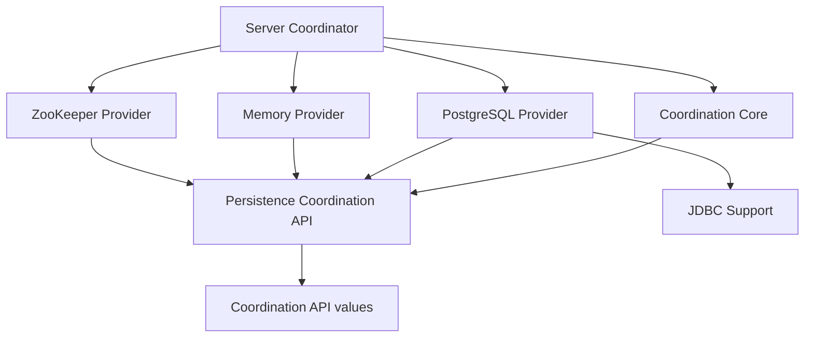

# Coordination Persistence 领域拆分与初始化所有权

本批在上一批 Worker 心跳身份边界的实际工作区上继续 P4，不视为全仓生产验收。
保留此前未提交修改；直接修改调用方，无旧 FQN 转发壳、历史数据转换、双写或新增数据库。

## 模块与类的真实归属

| 制品 | 包与能力 | 生产类 |
| --- | --- | --- |
| persistence-coordination-api | `.api.membership` | WorkerRegistry、CoordinatorRegistry |
| 同一 API 制品 | `.api.lease` / `.api.admission` | DistributedLease、ClusterConcurrencySlots |
| 同一 API 制品 | `.spi.provider` | CoordinationProvider，共享 quorum client 的真实扩展 |
| persistence-coordination-postgresql | `.postgresql.membership` | JdbcWorkerRegistry、JdbcCoordinatorRegistry |
| 同一 PostgreSQL 制品 | `.postgresql.lease` / `.postgresql.admission` / `.postgresql.error` | JdbcDistributedLease、JdbcClusterConcurrencySlots、CoordinationStorageException |
| persistence-coordination-memory | `.memory.membership` / `.memory.lease` | InMemoryWorkerRegistry、InMemoryCoordinatorRegistry、InMemoryDistributedLease |

包共同根为 `org.pangrova.persistence.coordination`。领域快照、Worker 身份、heartbeat 结果、LeaseEntry
继续由 Coordination API 拥有，没有在持久化 API 中复制模型。13 个生产类、16 个相关测试移入新 owner；
测试设施中的 InMemoryClusterConcurrencySlots 只是假实现，没有建立空的生产 Memory admission 包。

API 生产依赖仅 Common 和 Coordination API。Memory 不依赖 PostgreSQL；PostgreSQL 依赖窄契约、
JDBC support 和实际使用的 Jackson/日志。连接驱动、Flyway、容器、Testing Kit 均在测试作用域。
ZooKeeper 从旧通用 Persistence API 切到这个领域契约。依赖、服务源码、测试、manifest、基线和文档同步。

## 行为与资源边界

- WorkerManager 的默认阈值构造器必须接收 WorkerRegistry；Core 不隐式选择 Memory。生产装配已经
  提供真实后端，测试显式选择进程内实现。模块规则同时禁止 Core 生产依赖这两个 Provider。
- CoordinatorRegistry 的 invalidation progress 方法不再有默认空实现。现有 PostgreSQL、Memory、
  ZooKeeper 三个实现均提供方法；API 隔离测试检查其不是 default。移除空默认值不代表已经修好
  ZooKeeper 现有吞错行为，见下方剩余审计。
- PostgreSQL 继续借用 Server DataSource；各操作关闭 Connection/Statement/ResultSet，不关闭连接池。
  quorum Provider 继续唯一拥有共享 client 的关闭。移模块没有引入第二个 shutdown owner。
- Worker 的进程身份 fencing、租约高水位、锁后时钟、配额锁顺序和精确 query release 未重写。
  逐类处置覆盖 40 个变更生产文件；包/导入/FQN 归一化后只有上述 Registry 默认方法、配额初始化、
  WorkerManager 构造器三处可执行结构变化。这个比较是移动证据，不能代替语义或并发测试。

## 唯一空库初始化

V106 在 schema-migrations 定义 `tenant_concurrency_slots` 和 `tenant_concurrency_queries`，包含
计数非负约束、query 唯一性和 tenant 外键；资源登记携带校验摘要。已有 96 个 SQL 初始化资源原字节
保留。版本文件用于新项目空库初始化，没有历史数据迁移程序，也不清空用户环境。

JdbcClusterConcurrencySlots 删除构造器 DDL，保留实际 owner 数量与 counter 的一致性检查。未初始化
必须失败，不能自动创建表；重新创建 Provider 必须保留活跃配额；错误 tenant release 不能释放别人的
query。真实 PostgreSQL 测试覆盖这些路径，并保留已有并发上限、幂等、损坏计数拒绝测试。

CoordinatorRegistry、DistributedLease 的两组后端测试及 Scheduler 的配额测试改为统一
MigratedPostgres 临时隔离 schema，删除测试内平行 CREATE TABLE 和手工 truncate。

## 仍需完成的真实语义工作

这些是后续目标内的必做项，本批没有用移动或类存在证明它们已经完成：

- ZooKeeper Registry 的部分操作吞异常并返回成功/空结果/部分列表，CAS 重试耗尽也可能返回；
  Lease 同样将部分后端错误降为 false/empty。必须区分竞争、明确不存在和实际存储失败。
- Coordinator membership 仍以逻辑 ID 更新/删除，没有 Worker 等价的 incarnation fencing。
  JDBC Coordinator 读取 invalidation 列时仍捕获 SQLException 并回退为 -1，需删除这种旧库兼容与错误混淆。
- Coordinator 的持久化 decommission、readiness、权威执行/输出/reader drain 尚未全部闭环。
- Streaming CdcFencingToken 未找到生产 lease adapter。删除其“Production 已装配”注释与仅由该
  Javadoc 引入的依赖，没有虚构实现或生产支持。
- 通用 Shuffle session/receipt、Local 生产装配、Celeborn 和全仓角色隔离仍未完成。

## 验证与处置证据

近端首轮 154 项全部通过。修正空目录后的全 reactor clean package 249 项中 248 通过，唯一失败是
既有 InMemoryShuffleDataInventory 未接通生产路径的 SPI 门禁。双 Worker Shuffle、SQL 激活、
新初始化测试及架构检查均通过。后续 package 阶段 54 项全部通过，独立 JVM 的真实 Native Worker
启停链路 5 项全部通过。按类取本批最新结果共 254 项：253 通过、1 failure、0 error、0 skip。
这不是完整 full-regression verify 通过，未给既有门禁加豁免。

最终检查 100 个 JAR、100 个唯一模块名、831 个编译包，无旧类/非法引用/split package 违规；825
个源码包无环。三个实际 launcher 检查当前 JAR 摘要与角色依赖；8 项静态检查全部通过。C++、JNI
Bridge、Protocol、Shuffle 与 Client 输入未变，三个已有 Native 制品摘要一致；实际 Java/Native
执行链已运行，不声称本批运行了 ASan、跨平台、性能基线或完整生产回归。
首次全 reactor 验证被迁移遗留的 6 个空包目录拦截；清理对应已搬空目录后重跑，门禁未豁免。
实际 launcher 审计首次沿用上批“所有角色包含 Coordination API”的假设而失败。本批消除了旧通用
Persistence 的传递依赖，Worker 没有直接使用该 API。核对源码后将检查改为 Worker 必须不含
Coordination API 及新增持久化制品，Coordinator/Standalone 必须且仅包含当前制品；未补回无用依赖。
首次审计结果保留在 runtime-classpath-initial.json，不计为产品失败或最终通过。

- [逐类处置](coordination-persistence-fqn-dispositions.tsv)
- [语义与输入比较](coordination-persistence-semantic-evidence.json)
- [调用引用](coordination-persistence-callers.tsv)
- [输入与旧 schema 字节核对](coordination-persistence-input-evidence.json)
- [验证汇总](coordination-persistence-validation-summary.json)
- [逐测试结果](coordination-persistence-tests.tsv)
- [发行制品检查](coordination-persistence-artifacts.json)
- [实际 launcher classpath](coordination-persistence-runtime-classpath.json)
- [文件处置](coordination-persistence-file-dispositions.tsv)
