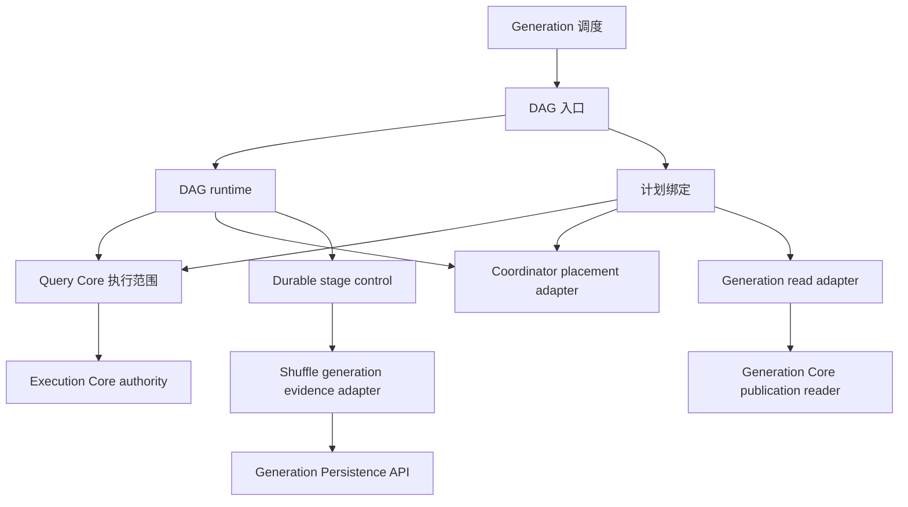

# DAG 与 Generation 的职责依赖收敛

本批基于 8,250 个工作区文本文件，保留此前全部改动。目标是移除真实的反向依赖，
使领域数据、运行状态、控制面适配和入口各有归属，而不是扩大包环豁免。

## 调整后的归属

| 旧结构 | 当前归属与理由 |
| --- | --- |
| DAGQueryContext | Query Core `stage.QueryExecutionScope`：已有不可变查询范围数据，借用 Execution 的 live/durable authority；不拥有调度引擎 |
| RerankIntent / RetrievalGenerationIntent / RetrievalMergeIntent | Query Core `stage.binding`：查询选择的模型、制品和合并意图，无物理对象发现、IO 或状态机 |
| SpillBudget | Scheduler API `resource`：纯数值/字符串预算值，Common/JDK-only；不加载配置、不访问文件系统 |
| CacheAffinityAssigner | Coordinator `scheduler.placement`：共享的 Worker 拓扑亲和路由；Query 分片分配和 Worker 选择器借用同一实例 |
| WorkerSelector / DefaultWorkerSelector | Coordinator `scheduler.placement`：连接当前 Worker inventory、Scheduler、缓存亲和与模型准入的控制面适配，不属于 DAG 入口 |
| DAGCompletionEvaluator | DAG `runtime`：与生命周期所有者共处，负责完成判断、输出选择与等待；不再让下层 runtime 反向依赖入口包 |
| GeneratedValueReadResolver / GeneratedValueGenerationBindingResolver | Coordinator `generation.read`：真实 Catalog 声明与已发布生成值的读取适配，不混入生成任务调度包 |
| DurableStageShuffleEvidence | Coordinator `query.execution.dispatch.shuffle.generation`：位于实际 ShuffleLifecycleEvidence 适配边界，将真实 allocation/finalize 结果交给既有 Generation 持久化端口 |

这里的 Coordinator adapter 仍需随后续 P5/P6/P7 的完整领域拆分继续处理，不能视为
已经完成 Scheduler/Generation/Shuffle 的最终制品隔离。尤其 WorkerSelector 仍使用
Coordinator 的 WorkerInfo；它是当前内部调度适配边界，不伪装成已完成的通用 API 制品。

## 当前依赖方向

图中节点是本批涉及的职责，不代表新增进程或新增制品；完整包图由全仓源码门禁验证。

## 输入与语义

- StageSplitFetcher 只接收 StageNode、真实 QuerySession、快照选择和 write mode。
  queryId 来自同一个 session，避免独立字符串与授权身份不一致；快照集合先作不可变复制。
- OVERWRITE/UPDATE 仍走无索引裁剪的完整枚举，普通读取保留实际 source 的索引过滤。
  无授权、durable replay 误走 Catalog、provider 拒绝/取消/失败均继续抛错，不伪装空结果。
- DAGExecutionState 的计划序列化只接收输出列名，不再接收整个查询范围。
  原有 sink 列名、已分派 producer 计划与精确 exchange binding 保持不变。
- QueryExecutionScope 沿用原有集合复制、live/durable 隔离规则和当前 authority 值。
  不创建第二个状态机，不制造新的权限或 execution fence。
- 生成值读取仍验证准确源快照、SDK 声明、Schema 和已发布 generation，不降级为 current/latest。
- Shuffle evidence 仍执行原有 owner、epoch、producer cohort 和 checksum 验证，再调用同一个持久化 owner。
- Completion helper 仅扩大两个实际跨包调用方法的可见性；完成、超时、取消、sink 选择算法不变。

12 个生产类移动，7 个相关测试移动，36 个生产类受到影响；其中 28 个方法体经 FQN 与
类名映射后 token 完全相同。另 8 个逐项审查，见差异证据。没有新 facade/context 容器，
没有新增后端或进程，也没有数据迁移逻辑。

## 验证与故障记录

首次移动脚本遇到测试资源中的 Java 文件路径差异而中断，部分迁移状态的检查失败保留。
恢复时使用本批基线完成同一映射，并去掉由普通注释文字误判产生的导入；未修改包环门禁。
收敛后 115 个定向用例通过，包括真实生成值读取。收窄输入时漏加 Map import 导致编译失败，
修复后 116 个用例通过；新增测试确认分片 source 无法修改调用者的快照选择。

首次完整 clean verify 执行 5,476 个用例，在 Generation Core 的真实 classpath 隔离测试失败。
原因是迁移工具把负向 Class.forName 断言中的禁止类名误计为依赖，添加了不必要的 Query Core
测试依赖；已删除该依赖，并修正工具识别方式。保留原负向断言，不扩大 Core 的依赖范围。

第二次完整回归继续运行到 Coordinator 后，SchedulerAbstractionLayerTest 发现
DefaultWorkerSelector 移入 placement 后仍反向导入 Query 的 SplitAssignmentManager 和
CacheAffinityAssigner。本轮执行 12,881 个用例，12,880 通过、1 失败、无错误和跳过。已将缓存亲和路由归
placement，让选择器直接借用同一个路由实例，而不依赖分片租约管理器；QueryDispatcher
和 Materialization 装配投影同一引用，未复制路由状态。门禁不增加豁免，定向复核另行记录。

依赖修复后 80 个定向用例全部通过；随后 clean package 定向回归 182 个用例，181 通过，
唯一失败为原有四项 Shuffle 装配缺口：InMemoryShuffleDataInventory、SpoolingExchangeManager、
LocalSpillLifecycleManager、DefaultShuffleByteEgress。真实双 Worker、动态表 DAG、生成代际隔离、
虚拟路由与 Native activation 已执行通过。随后发行物 clean package 的 27 个用例通过；
94 个 JAR、94 个唯一模块名、821 个编译包的扫描没有旧类、split package 或受检契约泄漏。
定向阶段按类取最近结果为 232 个用例（231 通过，1 个既有 SPI 门禁失败）；完整回归单独报告。

源码图覆盖全仓 815 个生产包，当前零包环；对应 PackageDependencyAcyclicityPropertyTest
实际运行通过，而不是只看诊断工具的退出码。完整 clean verify 未通过，失败与修复后的定向结果单独记录，
不能将包环消除等同于全仓功能验收。

- [FQN 处置](dag-ownership-fqn-dispositions.tsv)
- [逐类语义与 SHA](dag-ownership-semantic-evidence.json)
- [生产差异](dag-ownership-production-review.diff)
- [调用与装配](dag-ownership-callers.tsv)
- [命令与结果](dag-ownership-validation.tsv)
- [逐测试证据](dag-ownership-tests.tsv)
- [完整源码包图](dag-ownership-package-graph.txt)
- [保持不变的后端输入](dag-ownership-backend-evidence.json)
- [发行物](dag-ownership-artifacts.json)
- [静态检查](dag-ownership-static-evidence.json)

Native、JNI、Protocol、Schema、Persistence 和 Client 源码未变，SHA 范围明确列于后端证据。
真实运行链路使用匹配源码的 Native 制品；没有借此次重构改变协议、事务或资源关闭边界。
Shuffle 的四项实际装配缺口和计划其他未完成范围仍保留，不增加门禁豁免。

## 后续审查项：Spill 目录所有权

本批复核发现 `SpillBudget.spillDirectory` 仅在 Coordinator 配置和值测试中来回传递，
实际 DefaultWorkerSelector 只读取 maxSpillBytes；WorkerResourceBootstrap 和
NativeRuntimeBootstrap 使用 Worker ResourceConfig 的本地目录。这个旧字段不能证明
远程任务采用了 Coordinator 的路径，也不应长期留在 Scheduler 的字节预算契约中。
后续需删除冗余路径字段、清理 Coordinator 对应配置和测试，保留 Worker 配置与 Native
Spill 开关的真实关系。本批不将现有字段保留视为最终契约收敛完成。

进一步追踪发现 Coordinator Main 的 typed config 转换总是调用默认 QueryConfig，
没有 task spill byte quota 的配置入口，EmbeddedCoordinator/Standalone 复用该入口。
这会让真实配置启动的任务预算始终为零。Native 的
`resolveWorkerLocalSpillPolicy` 明确要求 task grant > 0，同时要求 Worker 启用并配置本地
目录，因此这里的零表示禁用；不能套用 Velox 内部 max_spill_bytes=0 的 unlimited 语义。
后续修复需覆盖 typed config → Server bootstrap → placement → StageResourceGrant，
保留 Worker 本地路径和节点上限交集规则，并验证零预算、负值拒绝和配置正值传递。
