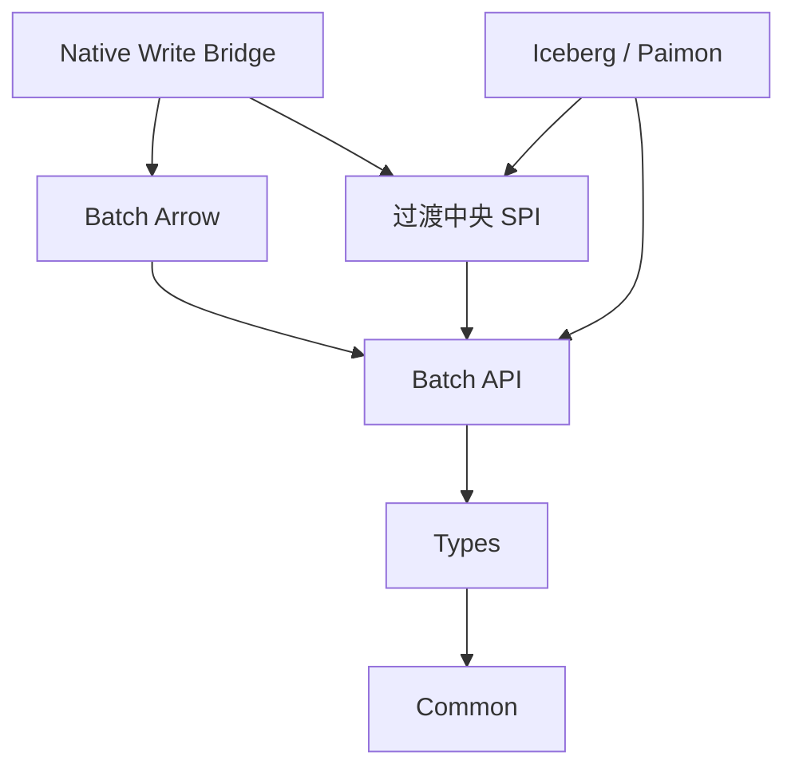

# 领域模块化实施记录

## 最新批次：独立 Index build claim 端口与精确 attempt 所有权

从 MetadataStore 提取 Persistence Indexing API 的 IndexBuildClaimRepository，
PostgreSQL Provider 独立到 build 包，由 Server 显式注入 Core；移除重复 Core 接口、
Coordinator 转发层和 Metadata 私有 claim helper。每次提交使用独立 owner，续租/释放
不能操作替代 attempt；失主或数据库失败停止构建，清理失败不产生成功结果。
完成日志和耗时指标在 claim 清理成功后记录；主异常保留并附加清理异常。

真实 PostgreSQL 先复现两个所有权缺陷，指标测试另复现一次重复计时。修复后边界
53 个实例通过，两个 owner 模块 33 个测试文件都有执行证据。第一轮 clean 消费者
发现 E2E 夹具漏接新依赖；补齐后第二轮 clean 全 reactor 选定 293 个实例全部通过、
无跳过，包含真实 SQL/Native 索引执行、启动和架构约束。112 制品审查、三种启动
classpath 和 Native 哈希通过；五个制品的 891 个 class 与编译输出一致。
直接模块最终静态检查零发现、
零诊断，完整历史错误与既有分析器提示保留。详见 [本批记录](index-claims.md)。

这完成了 claim 记录的精确 owner 操作，尚未完成 mapping/失败转换/发布的一体 fencing、
attempt 文件隔离和安全接管。自动 claim 过期仍未接入运行时；总体模块化、Shuffle、
角色隔离、全量生产回归、跨平台和性能验收继续进行。

## 前一批次：Scalar 构建取消归属到 attempt

修复 pin 中取消、同索引重提交、借用 executor 关闭以及读取后取消仍写文件的真实问题。
每次提交独立维护取消意图和终态选择；Future 回调在锁外执行，CANCELLED 不授权发布。
非空路径以真实 Hash strategy/codec 和临时文件验证阶段取消与正常构建。

最终 Core 128 项测试及静态检查通过；clean 全 reactor 选定 203 项全部通过、无跳过。
保留初始 3 项失败、非空路径 1 项失败和旧模块清单失败，修正后没有降低门禁。
112 个制品、实际角色 classpath、Native 哈希检查通过；Core 54 个 class 与编译输出一致，
19 个 Core 测试文件均有本批记录，八项仓库检查通过。详见 [本批记录](index-cancel.md)。

基线脚本误排了源码 build 包，缺少三个变更类的变更前快照；已经记录缺口，未补造
历史哈希。当前源码、失败复现和验证单独记录，后续完整扫描必须修正目录排除范围。
取消仍为协作式，claim owner fencing、失主后的映射/发布、attempt 文件隔离与回收，
完整 drain 和其余总计划仍未完成。总体目标保持进行中。

## 前一批次：Indexing 固定 SQL 与静态链通过，取消缺陷已复现

PostgreSQL 选择改用固定 SQL/JDBC text array，独立后端私有 array 资源 owner；
保留 generation/snapshot、发布前不可见、1,000 条路径批次与复制事务语义。
删除动态 SQL helper 与重复 array owner，真实数据库验证字面值、批次和异常释放。
完整说明及逐类/逐文件证据见 [本批记录](index-sql.md)。

完整静态依赖链退出 0：67 份 SpotBugs 零发现，Checkstyle 零错误、7 条既有 warning
及分析器提示单独保留。修正沿途既有样式问题，将失效所有权分类收窄到精确签名；
没有新增 SQL 忽略，删除一个失效的整类 SQL 例外。
clean 全 reactor 的 854 项选定测试全部通过、无跳过；本批最新去重正式用例 856 项通过。
112 个 JAR 与三种角色实际 classpath 核对通过，10 个受影响制品的 1,009 个 class 与
编译输出相同，三份 Native 库哈希一致。66 个 Indexing/Parser API 测试文件都有执行证据。

独立确定性探针确认另一个真实缺陷：snapshot pin 中取消 scalar 构建，放行后仍返回
COMPLETED，可能被 DDL 发布入口视为成功。该缺陷尚未修复，不因上述正式回归通过而
宣称支持；下一批先加入正式回归并修复 attempt 生命周期，再处理 claim 端口与失主 fencing。
其余领域、通用 Shuffle、角色分离、无筛选生产回归和性能/跨平台验收仍未完成。
总体目标保持进行中。

## 前一批次：Indexing Persistence 隔离，静态验收尚未通过

将 24 个生产类和 14 个测试迁入独立 Indexing Persistence API/PostgreSQL 制品，
Core 依赖端口，Server 显式装配当前权限 JDBC 参与者。真实发布事务故障测试确认
参与者与发布共用连接、失败一起回滚；SQL、锁顺序与初始化 owner 保持原语义。
详见 [本批记录](index-persistence.md) 与其中的逐类、逐文件和验证证据。

全 reactor clean install 的 702 项选定测试全部通过、无跳过，随后格式修正后的
48 项相关测试全部通过。但完整静态链仍被 Parser API 五处空行错误阻断；本批模块
静态检查也报告三处既有动态 SQL 构造告警，未新增忽略规则，因此不宣称静态验收完成。
最终 112 个 JAR 的包/模块与角色 classpath 审查通过，8 个受影响制品的 948 个 class
与编译输出一致；63 个模块测试文件均有本批执行证据，八项仓库检查通过。
宽 Store 端口与弱默认方法、跨域 workflow、其余领域和 Shuffle 等工作仍未完成。
总体目标继续进行中。

## 前一批次：BTree 多列键契约与真实构建闭环

修复多列 BTree 构建使用 Provider 私有键、通用 codec 无法编码的实际错误。
完整复合键归 Indexing API，编码归 Codec，策略继续归 builtin；旧键类删除，
不新增反向依赖或兼容壳。同时修复空键集合对 NULL 谓词返回错误 SKIP，校验
键形状、页大小、row positions 和损坏 payload 的声明长度。
详细边界与逐类证据见 [本批实施记录](btree-composite.md)。

真实 SQL CREATE INDEX 回归已确认 READY、published mapping 到实际文件内容、
解码复合键及 NULL 行查询结果。正式静态验证 866 项通过；全 reactor clean install
选定 400 项通过，覆盖 Indexing 模块、结构检查、启动及索引 SQL 回归。本批最新
去重测试记录 1,091 项全部通过、无跳过，八项仓库检查通过。没有降低门禁，保留
初始复现失败及样式失败记录。最终 JAR/classpath 审查见本批证据。

Native 当前仍仅对受支持 Bloom 封装执行裁剪，SQL 正确结果不代表 Native BTree
裁剪已实现。Java 评估实际装配、SQL 完整元组/前缀绑定、单列 Comparable 所有权、
Indexing Persistence 拆分、通用 Shuffle 生命周期及总体其余实施和最终生产验收
仍未完成。总体目标保持进行中。

## 前一批次：Local Shuffle 目录与文件资源所有权

修复 Local reader 懒打开路径导致选中数据被目录替换重定向的实际错误：返回前固定全部
选中段的文件 channel。Provider 内部独立路径 owner，验证根与 partition 身份，写入、
发布和清理拒绝已替换目录；固定临时文件前缀。Store 增加统一文件预算，失败释放与
可重试关闭保持单一资源 owner。详见 [本批实施与边界](spool-directory.md) 和
[Provider 使用说明](../../../pangrova-shuffle/pangrova-shuffle-local/README.md)。

此前阻塞 Catalog 静态依赖链的四项 Local 诊断已消除；Local 与完整 Catalog `-am`
静态验证均退出 0，未添加忽略或降低门禁。保留分析器 missing-class 提示及四项既有
Checkstyle warning。最终 clean install 的 91 项选定测试通过，包括真实双 Worker、
八项 SQL 查询回归及三项启动 smoke。本批最新去重记录 482 项全部通过、没有跳过，
八项仓库检查通过；完整证据链接在本批文档中。

本批没有将 Local 装配为生产 Provider；现有 Native 查询通过不等于 Local Native
集成完成。根目录仍要求进程私有、稳定，路径身份检查不冒充针对恶意本地并发改写的
文件系统隔离。通用 Shuffle session/receipt/异步数据面、三后端生产调用、BTree 多列
键及真实 Java 裁剪调用、其余领域/Persistence 拆分和全量性能/生产回归仍未完成。
总体目标保持进行中。

## 前一批次：Indexing 缓冲区所有权与静态依赖门禁

本批在当前工作区继续实现，未覆盖已有改动。修复 Bloom/N-gram/Bitmap、BoundingBox、
RowGroupSkipInfo 与动态过滤 digest 的可写别名；明确 BTree/GIN 嵌套容器赋值。
Builtin 热路径改用只读视图、成员判断或坐标读取，Common SBBF 解码增加长度溢出校验。
没有新增模块或第三方 SDK。详细边界、逐类处置和未完成事项见
[本批所有权审查](index-buffer-ownership.md)。

Indexing API 的原 9 项静态告警已消除，API 及 builtin 的正式静态验证通过。
完整 Catalog 依赖链暴露的既有样式问题已处理，但其正式静态验证仍在 Shuffle Local
的 4 项路径/空值诊断停止；没有新增忽略规则或降低门禁，完整静态验收尚未通过。

全 reactor clean 构建及相关消费者/Native E2E 通过；本批最新去重测试记录 1,282 项
全部通过。最终 clean 补验 167 项、8 项仓库门禁与发行物审查均通过。核对 110 个 JAR、
14 个受影响制品的 1,761 个 class 和三种角色实际 classpath；已退役引用清单、
split package 和服务注册检查通过。未执行全量生产回归或性能对比，不能据此宣称生产级验收完成。

下一步需处理 Shuffle Local 目录所有权/静态诊断，以及 BTree 多列键的公共表示、
编码与真实查询路径；Comparable 值所有权、未装配 Java 裁剪能力、Persistence 进一步
拆分、通用 Shuffle 生命周期与其余总体计划继续保持未完成状态。

目标决定见 [ADR](../../architecture/domain-modularization-adr.md)。

## 基线

- 2026-11-01 从当前工作区开始，已有 119 条 Git 状态记录；保留现有 Table/SPI/
  Persistence 迁移及文档、规则改动，不回退到 HEAD。
- 在修改源码前记录工作区 diff、文件 SHA-256 和 Git HEAD，供本次执行比对；
  本机临时证据不作为可移植仓库配置。
- JDK 17、Maven 3.9.16。
- 基线 `mvn -q -pl pangrova-spi -am test`：退出 0。Common 298、Filesystem API 10、
  SPI 518 个测试，失败/错误/跳过均为 0。

## P1-A：引擎类型独立

范围：31 个生产类型、6 个现有测试从 Connector 数据包移入 `pangrova-types`。
`org.pangrova.types` 拥有逻辑类型、签名、声明和映射；`.value` 拥有 Java 标量与行。
算法、值语义及错误行为保持不变。没有持久化、工厂、后台线程或需关闭的外部资源。

消费者：SPI、Parser、Planner、Protocol、Metadata、Coordinator、Worker、Native Bridge、
Transport、AI Worker、Streaming、Iceberg/Paimon/Lance 连接器及测试设施。
这些消费者显式声明依赖。插件加载器强制与宿主共享 Types，防止相同 FQN 的类身份分裂。

处置明细见 [types-fqn-moves.tsv](types-fqn-moves.tsv)。表中调用文件来自本批实际引用，
它是移动核对证据，不代表全仓每个类已经完成语义审计。

验证：

- `mvn -q -pl pangrova-types -am test`：退出 0（新增隔离测试前的第一次检查）。
- clean 消费者测试首次在 FileApiIsolationTest 失败：隔离 classpath 未包含新 Types
  制品；补全契约依赖后 `mvn -q -pl pangrova-connector/pangrova-connector-runtime -am test`
  退出 0。新增最小 classpath 和插件重复打包 Types 的类身份测试通过。
- `check-module-manifest.sh` 退出 0。
- 架构测试第一次被系统 Python 3.9 拦截；Protocol 生成器要求 Python >= 3.10。
  使用现有 Python 3.12 的 `pangrova.function-contract.python` 参数解决，没有修改生成器。
- ModuleDependencyPropertyTest 的 8 个测试通过。PackageDependencyAcyclicityPropertyTest
  失败：Coordinator/Planner 的 4 个已有循环分量；生成报告与本批开始前保存的
  `package-cycles.txt` 字节完全一致。没有放宽或禁用门禁。

## P1-B：批数据契约与 Arrow 实现隔离

新增 `pangrova-batch` 聚合，包含真实 `batch-api` 与 `batch-arrow` 实现。
API 拥有 Page、NativePage、BatchFormat、Block 值表示及 `ReadableBatch`。
Arrow 实现迁入原 Protocol 的 ColumnarBatch、BatchStreamValidation、BatchValues。
21 个现有生产/测试文件的移动见 [batch-fqn-moves.tsv](batch-fqn-moves.tsv)。

`ReadableBatch` 明确单线程同步借用、值脱离原 buffer、projection 所有权、关闭与
异常契约。ColumnarPageSink 回到 Connector 契约，消费 ReadableBatch；Iceberg/Paimon
生产代码不再依赖具体 ColumnarBatch。Native Write Bridge 负责创建 Arrow 实例、
同步借给 sink、关闭视图与 owner；调用方 allocator 继续由原 owner 管理。

本批不修改二进制布局、JNI 方法、Proto 字段或 C++。现有 RowPageConverter 和
NativePageConverter 暂留中央 SPI，后续 codec 批次处理，不把复杂编码混入 Batch API。
原 Transport 的 BatchSerializer 也尚未迁入；不能因此宣称 Batch 家族已经全部完成。

初次 POM 生成误将负向隔离测试中的类名字符串当成真实依赖，引入 test-scope
Types → SPI 循环；在测试执行前由 Maven 检出并删除该错误边。随后 Batch 模块测试
退出 0。随后运行 Bridge、Iceberg/Paimon 消费者的定向 reactor 测试，包含
`NativeWrite*Test,Write*Test,*Columnar*Test,Batch*Test,TypesClasspathIsolationTest,`
`FileApiIsolationTest,PluginClassLoaderTest,SharedPackagePolicyTest,ModuleDependencyPropertyTest`，
退出 0。新增 API 隔离、Arrow 视图生命周期和失败释放测试通过。
完整 Bridge `-am test` 在 testing-kit 的已有包循环门禁失败，Bridge 因而未执行；
定向检查不替代或豁免该失败。随后全 reactor `mvn -q clean test-compile`
（指定 Python 3.12）退出 0；这证明源码与测试源码可 clean 编译，不是全量测试通过。

当前已落地的基础依赖方向：



## P1-C / P4 前置：JDBC support

新增 `pangrova-persistence-jdbc-support`：

| 原 FQN | 新 FQN | 处置与所有权 |
| --- | --- | --- |
| `org.pangrova.common.jdbc.JdbcSupport` | `org.pangrova.persistence.jdbc.support.JdbcSupport` | 移动；SQL 参数绑定、PostgreSQL 时间精度保持不变；不创建或提交连接 |
| `org.pangrova.metadata.store.jdbc.catalog.EmbeddedDataSource` | `org.pangrova.persistence.jdbc.support.DriverManagerDataSource` | 移动并按实际实现重命名；每次 DriverManager 创建物理连接，由取得连接的调用者关闭 |

8 个直接消费者的 POM/导入已更新。旧 Persistence JDBC 包根收紧到已有六个领域，
避免与新 support 包形成前缀所有权重叠。没有移动或改写 schema migration，
没有新增数据库后端或数据迁移工具。Metadata 的连接池装配尚待后续迁到 Server。

验证：support 模块 Maven test 阶段退出 0（该新模块没有单独测试，不能算作行为证据）；
随后真实消费者 `JdbcSupportPostgresTest`、`JdbcCoordinationClasspathIsolationTest`、
`ModuleDependencyPropertyTest` 定向 reactor 测试退出 0。JDBC 时间规范化、跨时区
读取由既有 PostgreSQL 测试验证，不以 mock 数据库替代。

## 本批验收结果

- Types 的 37 个迁移文件反向替换包名后，SHA-256 与开始实施时的文件完全一致。
- Manifest 再生成后，`check-module-manifest.sh` 退出 0；模块所有权测试 8/8 通过。
- PostgreSQL JDBC support 消费者测试 4/4 通过。
- 插件重复打包 Types 与 Batch API 的加载测试通过，始终返回宿主契约类。
- 已生成的 Common、Types、Batch API、Batch Arrow、SPI、Protocol、JDBC support JAR
  检查通过：新模块名正确，已迁移类型/值/block、Protocol batch 和 Common JDBC 旧类
  不再存在。Metadata 输出中也不存在旧生产 EmbeddedDataSource 类。
- `mvn -q -Pfull-regression verify`（指定 Python 3.12）退出 1：testing-kit 的
  PackageDependencyAcyclicityPropertyTest 失败，118 个测试中 1 个失败。
  4 个循环分量与实施前一致，见 [当前循环证据](domain-modularization-package-cycles.txt)。
  下游跳过的 E2E、Native、客户端或角色验收不能算通过。
- `git diff --check` 通过。与开始时文件哈希相比，Native 源码和 schema migration
  没有修改。没有实施 Native 性能、ASan 或完整发布回归，不提供相应通过结论。

完整计划仍未验收。本批完成的是基础契约及 JDBC support 的可验证拆分，
不是 P0–P10 全部完成。

最终工作区再次运行全 reactor `clean test-compile`（JDK 17、Python 3.12），退出 0，
覆盖 JDBC support 抽取及插件测试依赖更新后的所有生产与测试源码。

## 本批能力状态

| 能力 | 实现与实际调用 | 所有权 | 验证及支持边界 |
| --- | --- | --- | --- |
| 逻辑类型与 Java 值 | Types 值类型；Planner、Protocol、Connector 等直接使用 | 调用方值对象，无外部资源 | 原测试、最小 classpath、clean 消费者编译通过 |
| TypeManager 扩展 | Planner `StandardTypeRegistry` 实现；搜索到的显式实例化仅在测试 | Registry 实例 | 已实现且有测试，尚未证明生产装配；不能因抽取接口宣称已接通 |
| 通用已解码批访问 | Arrow ColumnarBatch → NativeWriteExecutor → Iceberg/Paimon ColumnarPageSink | Bridge 关闭 owner/view，allocator 借用，sink 同步借用 | 生命周期及真实 Connector 定向测试通过；全量 E2E 未完成 |
| 已编码批与 Block | Batch API 值表示；已有 page source/sink 和传输调用 | NativePage 创建者关闭；读取字节为只读借用约定 | 已有测试与 clean 编译；未在本批引入异步 buffer lease |
| JDBC 值绑定 | JdbcSupport → 现有 PostgreSQL store 调用 | 事务/连接仍由各原调用者持有 | PostgreSQL 时区/精度测试通过；不是新事务 workflow |
| DriverManager 数据源 | DriverManagerDataSource；当前构造调用在 E2E fixture | 调用方关闭每个连接；不是连接池 | 不宣称生产连接池或连接追踪能力；生产 Hikari 装配尚在 Metadata |

上表只覆盖本批审查的能力，不替代全仓能力审计。Shuffle/Celeborn、Server 角色隔离、
跨领域 workflow 和其他 Provider 的支持状态不因本批改变。

## 剩余范围

P0 的全仓逐类语义/能力/事务/资源审计尚未完成。P1 的 Batch、Execution 与 Common
清理尚未完成；P2–P10 不因本批类型移动而视为完成。中央 SPI 目前仍为过渡现状，
不再是目标架构。现有 SQL、JNI、协议、持久化与 Shuffle 行为没有在本批重新设计。

## 后续批次：Coordination / Function 契约归属

目标保持全仓重构、功能完整与生产级验收。前一轮属于实质进展，本轮继续消除中央
SPI，不将通过局部检查视为完整目标达成。

本批迁移 18 个生产类和 2 个既有测试，处置明细见
[Coordination / Function FQN 台账](coordination-function-fqn-moves.tsv)。

- `pangrova-coordination-api`：`.api.membership`、`.api.heartbeat`、`.api.lease`
  拥有快照和值；`.spi.leadership` 拥有实际维护主节点回调。API 仅依赖 Common/JDK。
- `pangrova-function-api`：`.api.metadata`、`.api.table` 拥有描述值；`.spi.scalar`、
  `.spi.aggregate`、`.spi.table`、`.spi.registry`、`.spi.runtime` 拥有真实扩展契约。
  API 仅依赖 Common/Types/JDK，不依赖 Native、Protocol、AI Worker 或中央 SPI。
- `FunctionCallbackScope.NONE` 的默认实现移到 Bridge 的 `UnscopedFunctionCallback`，
  接口中不再携带实现。普通函数的既有无 scope 行为保持不变；能力授权语义没有简化。
- 所有直接消费者、三份 AI ServiceLoader 描述符、Docker 打包检查和插件共享包同步。
  插件同时打包 API/SPI 时仍使用宿主类身份；不扩大共享范围到领域实现包。

独立的行为修复：函数工厂 ID 必须非空且唯一。即使两个工厂未提供函数，重复 ID
也会拒绝启动；失败关闭已创建资源，且不发布半初始化 Bridge。相关回归测试覆盖
重复 ID、空 ID、资源释放和未发布 Bridge。没有修改 JNI 方法签名或 native wire 格式。

本批证据：

- Coordination / Function API 模块 test：退出 0。
- Bridge、Persistence API、Connector Runtime 的 Function/Coordination、类加载和模块
  门禁定向测试：退出 0。
- Worker Core / AI Worker 的函数、回调、工厂装配测试：退出 0；新增
  FunctionProviderDiscoveryTest 通过真实服务描述符实例化 AI 工厂、scope 和 projector。
- 单独的 API/SPI 重复打包插件类身份回归：退出 0。
- 新增两个 API 最小 classpath 测试，扫描实际类及公开签名，排除中央 SPI、Worker、
  Coordinator 和第三方实现 SDK；均通过。
- 全 reactor `clean test-compile`（JDK 17、Python 3.12）退出 0。
- SPI 注解门禁通过：160 个已注解公开类型，遗留缺口 0；稳定性门禁通过：24 个
  Stable 类型均有生产实现。两个新 API 制品由 manifest 自动纳入扫描。
- 重新生成事实后，`check-module-manifest.sh` 退出 0；生产代码、服务描述符和构建
  配置没有残留旧 Function/Coordination FQN，`git diff --check` 通过。

能力边界：Scalar/AI 函数有生产工厂与实际调用；TableFunction/TableFunctionFactory
目前只有契约测试，未找到生产实现或注册描述符，不宣称已支持用户自定义表函数。
Function Core 的注册/选择职责及工厂兼容性、角色元信息仍待后续提取；不创建空 Core。
Observability 中的事件分发器和 ServiceLoader 全局单例已识别为后续必须迁出的实现，
不能直接塞进新的 API。全仓包循环与完整回归验收仍未完成。

本批结束时中央 SPI 尚有 381 个主源文件：Connector 171、Security 50、Indexing 41、
AI 26、Observability 26、Generation 24、Table 18、File 13、Query 12。
这些是仍需逐领域完成契约/实现/装配迁移的实际剩余项，不是保留中央 SPI 的例外。

## 后续批次：AI 契约、配置归属与资源端口

本批从中央 SPI 移出全部 26 个 AI 主源文件：23 个契约类型进入
`pangrova-ai-api`；3 个配置解析/校验实现进入 AI Control 的 `config` 包。
10 个现有契约测试随之迁移。API 与 SPI 位于同一个制品中，没有单独 AI SPI JAR。
逐类用途、调用文件、实际装配、资源 owner 与验证见 [AI FQN 台账](ai-fqn-moves.tsv)。

契约按模型、能力、调用、Embedding、错误组织；Inference、Embedding、Reranking
和模型 Catalog 扩展放在对应 `.spi` 能力包。公共签名不依赖配置 parser、Worker、
HTTP 客户端或厂商 SDK。新增最小 classpath 测试实际加载所有 API 类并解析其反射
签名；仅提供本制品、Common 与 JDK。Common 自身的进一步依赖清理仍是剩余工作。

移除 `AiModelCatalog.NONE`：开启函数注册且存在 `models.*` 配置时，没有 Catalog
实现必须失败；发现多个实现也必须失败，不能任意选择第一个。未配置模型可以没有
Catalog；显式关闭函数注册时不枚举 Provider。新增 4 个 Worker 回归覆盖这四条规则。
真实 AI Worker 服务描述符同步为新 FQN，装配测试实例化 `WorkerAiModelCatalog`。
插件必须共享 AI API/SPI 类身份，新增带重复打包契约的加载回归。

进一步将 Worker `AiProviderCallContext` 中的四个嵌套资源端口提取到
`org.pangrova.ai.spi.invocation`，并直接修改全部调用方，没有旧 FQN 转发壳：

| 契约 | 实现/调用 | 所有权与保证 |
| --- | --- | --- |
| `AttemptAdmission` | 现有 invocation admission 方法绑定；Provider batch 线程传播 | 每次物理发送单独准入；不授予未知结果重放权限 |
| `PhysicalAttempt` | `AiPhysicalInvocationAdmission.Attempt`；HTTP body subscriber | 资源额度及响应字节准入；停止交付后释放并发，close 幂等 |
| `ClientExchange` | `AiHttpExchange`；`AiTaskBudget.revoke` | 并发取消，等待真实本地交付结束；不把 Future.cancel 当远端结果证据 |
| `ExchangeRegistration` | `AiTaskBudget.registerExchange` 返回的注册 | 交付最终结束后注销；不能通过注销隐式取消或提交 |

ThreadLocal 绑定、预算计量、锁、取消顺序与 HTTP 行为仍留在原实现中。本批仅抽取
这四个端口，不复制状态机。资源错误、权限撤销和未知 POST 结果分类保持原行为。
提取后执行的 67 个 AI Worker 定向测试全部通过，覆盖资源预算、并发请求、物理
发送次数、取消、HTTP body deadline 和配置 Registry；API 最小 classpath 同批通过。

已完成的验证：

- AI API 全部测试及其上游模块测试退出 0。
- AI Worker、Worker Core、Connector Runtime 的配置/注册/HTTP/能力公告/类加载/
  模块依赖定向 reactor 测试退出 0。
- 提取资源端口前、后全 reactor `clean test-compile` 均退出 0；后一次也删除了
  Worker target 中旧嵌套接口的 class 文件。
- manifest/baseline 门禁通过（57 个代码/资源制品、17 个聚合）；SPI 注解门禁
  164 个公开类型通过、缺口 0；24 个 Stable 类型都有生产实现。
- 首次全量 `-Pfull-regression verify` 在 Persistence `QueryApiClasspathTest`
  失败：上一批抽出的 HeartbeatSnapshot 没有加入该测试的显式隔离 classpath。
  该测试实际扫描整个 Persistence API，Coordination API 是它的真实契约依赖。
  补入该契约制品后，最小重现测试退出 0；没有引入实现库或放宽负向断言。
- 修复后的全量 `-Pfull-regression verify` 在 testing-kit 的包循环门禁失败：
  118 个测试中 1 个失败、0 个错误、0 个跳过。其中四个既有 SCC 的成员未变，
  但当时误比对了历史报告，漏记两组契约迁移新增循环；见后续查询装配批次的更正。
  其后的 reactor 模块未执行，不能把本次运行称为全量通过；循环必须在后续拆分中解决。
- 服务描述符、直接依赖、manifest 和模型 Catalog 的实际调用同步；没有旧 AI
  FQN 的活动源码/构建引用。历史文档和移动台账中的旧名保留用于说明来源。
- 以 `-DskipTests package` 单独生成本批制品（仅打包检查，不作为测试通过证据），
  退出 0。检查 AI API、AI Control、AI Worker、中央 SPI 的实际 JAR：均有
  Automatic-Module-Name，无旧 `org/pangrova/spi/ai` 类；API 只包含 API/SPI 包；
  配置 parser 位于 Control；Worker 只有新 Catalog 服务描述符，且不再打包四个
  旧嵌套资源接口。完整 Docker/角色发行仍未验收。

本批明确未完成的边界：

1. AI Worker 暂时直接依赖 AI Control 的配置解析，Worker Core 的解析测试也有
   test-scope 依赖。这是待消除的装配债务，不是允许最终 Worker 携带控制面实现。
   后续应由 Server 创建已校验模型配置，再以强类型依赖构造 Worker Registry。
2. OpenAI 实现仍在 AI Worker，Registry 仍有方言选择分支；后续必须提取真实
   Provider 工厂和厂商制品。配置中的方言特定校验也要归 Provider。
3. `AiProviderCallContext` 的静态线程绑定尚未从厂商调用侧解耦。仅提取资源端口
   不能证明 Provider 已可独立替换；不建立空 Provider 模块或虚报已完成。
4. 生产启动、完整 Java/native 端到端、全仓包循环、性能和最终发行验收仍未通过。
   定向测试与 clean 编译不能替代这些验收。

本批中央 SPI 减至 355 个主源文件；新增 AI API 包含 27 个主源文件（23 个迁移
契约及 4 个提取端口）。Coordination/Function 台账也补入实际 Java 引用文件，并纠正
TableFunction 的装配栏为“仅契约测试、无生产实现”，不以扫描结果代替语义审计。

## 后续批次：查询启动显式装配与缺失调用修复

本批从包循环的实际反向依赖进入审查：`bootstrap.module.IndexingModule` 反向依赖
上层 IndexingBootstrap/IndexQueryBootstrap。进一步追踪发现这一套模块机制并不加载
插件，只有四个硬编码实现；DefaultModuleContext 保存的 query phase、stage handler、
completion listener 列表没有任何生产读取者。不能仅把类移动到一个包里消除报告。

删除 QueryModuleLoader、CoordinatorModule、CoordinatorModuleContext、DefaultModuleContext
及四个 Module 实现，改为直接构造实际依赖。没有创建新的通用 Context 或按 Class
查找服务的替代容器。逐类处置见 [查询装配台账](query-assembly-dispositions.tsv)。

- QueryBootstrap 明确创建 Planner 的 RuntimeFilterRegistry/SqlCompiler、调度资源和
  indexed-read adapter；QueryExecutionBootstrap 接收具名的强类型参数，不修改注册表。
- QuerySchedulingWiring 只拥有可选 WeightedFairScheduler，TaskScheduler 借用它。
  构造后续失败时关闭已创建的 executor；QueryBootstrap 立即登记 cache 和调度资源的
  shutdown owner。正常关闭与部分启动失败继续经过已有 drain/join/close 顺序。
- Security 的 enforcer、column mask、row filter 从同一个 AccessControl 显式构造，
  原有权限语义不变。
- CacheModule 原先把 listener 写入无人读取的列表；现在 production
  StatementDispatcherContext 真正包含 CacheInvalidationListener。测试写入两个表的
  真实 QueryResultCache 条目，验证 DML 只失效目标表、DDL 失效其余条目。该验证不
  宣称已提供 Worker 结果缓存或跨 Coordinator 的完整缓存一致性。
- Query-only 角色原先只登记 IndexSplitFilter，查询消费的 IndexAwareSplitFetcher
  实际为空。现在 IndexQueryBootstrap 保留已有 store 并创建真实 fetcher；filter
  仍由原 bootstrap 关闭，fetcher 只借用它。PostgreSQL 测试通过生产装配选择分支
  读取实际 descriptor，并验证另一 tenant 不可见。没有启动索引构建/维护组件。

删除两个只验证旧 CoordinatorModule 优先级/可选空模块的属性测试，因为对应协议
及实现已整体退役。原有正常关闭、失败清理、tenant-disabled 生命周期测试保留并
改用真实 QuerySchedulingWiring；原有 StatementDispatcher 及缓存 listener 属性测试
继续执行。新增 QueryAssemblyWiringTest 验证生产装配产生的实际行为，而非复制实现。

已验证：

- Coordinator 及上游 `test-compile` 通过。
- 新增测试最初出现两个测试源码编译错误（调用 startIndexQuery 的参数数量、cache
  close 的受检异常）；逐项修正后执行原选择集，未改变或削弱测试断言。
- 定向测试退出 0：QueryAssemblyWiringTest、QueryBootstrapFairSchedulerShutdownTest、
  PlannerWiringSessionIntegrationTest、IndexingBootstrapStartOrderingTest、
  StatementDispatcher*Test、CacheInvalidationListenerPropertyTest。
- 上述测试含真实 PostgreSQL 空库迁移、Lance metadata/planner session 链、签名认证的
  Coordinator 实例启动与关闭，以及失败启动后的线程回收。
- manifest/baseline 检查通过，活动 Java 源码没有旧模块注册协议的引用。
- Coordinator 及上游 `-DskipTests clean package` 退出 0（只用于干净构建/打包，
  不作为测试证据）。实际 Coordinator JAR 中已无 bootstrap/module 或
  QueryModuleLoader，包含新的 QuerySchedulingWiring；不是只删除源码留下旧 class。

依赖图更正：直接用当前 PackageDependencyGraph 实现重新扫描全部 reactor 主源码，
发现先前记录漏报 AI invocation → inference SPI、HeartbeatSnapshot → membership 的
两组循环（前两批迁移添加的 Javadoc-only import）。删除这两条不应存在的值类型反向
依赖，保留文档语义；没有改扫描器或豁免规则。当前扫描报告为
[query-assembly-package-cycles.txt](query-assembly-package-cycles.txt)，剩余三个 SCC：
Coordinator 查询/调度、HTTP 入口、Planner。bootstrap/module 循环已消除。
随后实际执行的 `mvn -Pfull-regression verify` 也在 testing-kit 输出同样的三个 SCC，
118 个测试中 1 个失败、0 个错误、0 个跳过。完整门禁仍不通过，后续 reactor 被跳过。

Native/smoke 验证的前置条件记录：

- 首次 ActivationSmokeE2ETest 在 NativeLibraryLoader 失败：本地 classifier JAR
  与 Bridge staged 库的 SHA-256 不同。保持冲突拒绝逻辑，以当前 staged 库重新
  `clean install` Native bundle，随后逐字节摘要核对一致。未修改 C++ 或 Native loader。
- 本机没有 `pangrova-worker-native/build`；上述操作是重新打包已有 staged 库，
  不是新源码 Native 构建、CTest 或 sanitizer 验证。
- 再次 smoke 已成功加载 Native，但 fixture 初始化拒绝缺失的
  `pangrova.e2e.ai.image-id`。尚未执行三个 smoke 场景；不能报告通过。
  已启动仓库提供的 prepare-e2e-ai-image.py 准备真实 Ollama 模型镜像，不替换为假服务。

仍未完成：这些装配类还位于旧 Coordination 制品，后续需迁入 Server；巨型
ModuleIntegrationBootstrap 也仍待按领域拆分。这里只退役实际无效的查询模块机制，
不把 Coordinator/Worker 依赖隔离或整个 P2 阶段标记为完成。

### Server Coordinator 与通用 Flight Server 迁移批次

本批把真实装配入口迁到 `pangrova-server/pangrova-server-coordinator`：41 个生产
类型，包括配置、角色、启动/关闭、嵌入入口、HTTP/JDBC Server 与领域装配。83 个
测试/fixture 同步迁移，测试包也归 Server 所有。Standalone、启动/健康检查脚本、
Docker 发行路径和架构扫描的源码入口同步更新。没有保留旧 FQN 转发壳。

HTTP endpoint 依赖的请求组件仍留在现有 Core；HTTP Server 装配不再与这些组件
共享包，因而消除了原 HTTP package SCC。当前主源码扫描剩余两个 SCC：查询编排
及 Planner，尚未通过全仓无环门禁。这里没有把业务算法整体改名成 Server。

Transport 形成两个真实子制品：

- `pangrova-transport-flight` 拥有从 Worker 迁出的 TransportServer、
  BatchStreamProducer、TransportTicketSigner、TicketValidationException。
  真实 allocator/TLS fixture 跟随 owner，测试签名与失败传播断言保持。
- `pangrova-transport-client` 保留现有 REST/HTTP 与 Arrow/Flight 客户端实现，包根
  收敛为 `org.pangrova.transport.client`，CLI/JDBC 与其他调用方直接更新。
- 未使用的 TransportStatusMapper 经生产/测试/注册引用核查后删除。真实 Flight
  错误投影仍由 BatchStreamProducer.wireFailure 拥有，没有替换成通用错误成功返回。

Coordinator Core 与 Server Coordinator 的 Worker Core/JNI 依赖降为测试范围。
当前默认 POM 的 compile/runtime 传递闭包分别包含 38/40 个项目制品，均无 Worker
Core、Native Bridge。新增架构测试沿真实 POM 检查此传递闭包，保留直接 import
门禁，并删除原 coordinator → worker.transport friend 例外。该结果不是完整的
平台发行或全部 profile 审查结论；最终 JAR/classpath 仍需验收。

本批首次失败与修复：

1. 首次增量与 clean 编译成功，但架构测试发现旧测试包归属冲突与过期基线。
   将 21 个尚用旧包名的 Server 测试改为 Server 包，重新生成基线。
2. 测试改包暴露 4 个包内 fixture 遗留在 Core，随真实调用方一并迁移；超时测试
   改用已有 public 构造器，保留到期/未到期断言，未扩大生产类可见性。
3. Transport 拆分后，Client Core 禁依赖列表仍指向原叶子制品名。将其更新为两个
   实际子制品，保留禁依赖语义，未修改门禁扫描器。

已完成验证：

- Server/Transport 迁移后的全 reactor `clean test-compile` 成功。
- 定向测试退出 0：架构门禁 9，Flight Provider 28，Transport Client 69，Server
  Coordinator 29；合计 135，失败/错误/跳过均为 0。
- Server 选择集含实际 PostgreSQL 空库初始化、Planner session、索引读取、signed
  OIDC Coordinator 启停、TLS 失败与 allocator 归还、query scheduler 关闭及超时。
- manifest/baseline 检查成功；dead-stub 静态检查成功。静态检查不等于能力可达性
  或端到端验证。
- 已用官方 fixture 脚本构建真实 Ollama 模型镜像，补齐上一批 smoke 缺失前置条件；
  ActivationSmokeE2ETest 正在重新执行，结果在后续追加。

本批类处置记录见 [server-transport-fqn-dispositions.tsv](server-transport-fqn-dispositions.tsv)。
该表明确区分迁移闭包验证与最终语义复核，不以自动生成的类清单声称全仓审查完成。

仍待后续：Server Bootstrap/Worker 的最终边界、Plugin Runtime、巨型
ModuleIntegrationBootstrap 的领域装配拆分、Transport API 与客户端 codec 的进一步
隔离。BatchStreamProducer 的静态 fill executor 与轮询仍保留原行为，未宣称符合
最终 Shuffle 异步/背压/资源契约。其他领域 API、Persistence 分域、事务、Shuffle、
Native、完整回归与性能证据继续按总计划推进。

端到端补充结果：

- `native-runtime,full-regression` 选择 `ActivationSmokeE2ETest`，真实 Native +
  PostgreSQL +已准备 AI fixture，3 tests，0 failures/errors/skipped，退出 0。
- 随后独立 Maven/JVM 选择 `WorkerBootstrapE2ETest` 并显式包含 owner 组，真实
  Coordinator/Worker 注册、注销、不同 Worker ID、执行引擎与关闭链，5 tests，
  0 failures/errors/skipped，退出 0。该测试不是两个独立 Worker 进程的分布式证明。
- Native 产物仍是之前核对 SHA-256 后重新打包的 staged 库；本批未改 C++。
  尚无本轮 fresh CMake/CTest/ASan 或其他平台结果。

启动脚本补全：旧开发模式只扫描顶层 target，会漏掉家族子模块并混入其他角色。
现在三个角色在 package 阶段生成各自 Maven runtime classpath，开发启动器读取
对应角色的主 JAR 与该依赖清单；缺失依赖或空 classpath 项直接报错。支持已有
共享 lib 发行方式，并优先使用角色专属 lib 目录；本批尚未把共享 Docker 发行物
拆成角色专属依赖集。5 个脚本行为测试通过，覆盖嵌套模块、路径空格、依赖缺失、
空项拒绝、角色 lib 优先级和未构建诊断。shell 语法检查通过。

实际制品与角色依赖验证：

- `native-runtime` profile 下 Standalone、Transport Client 及其上游 `clean package`
  退出 0。此命令使用 `-DskipTests`，只计入构建/发行检查，不重复计为测试通过。
- 从三个实际 `runtime-classpath.txt` 校验全部依赖文件存在。Coordinator 为 240 个
  依赖项，Worker 为 182，Standalone 为 277；Coordinator 无 Worker Core、Native
  Bridge 或 Native bundle，Worker/Standalone 含所需 Bridge 与平台 bundle。
- 使用启动脚本相同 classpath，在独立 Java 17 进程读取实际 Server JAR，加载
  66 个类（含嵌套类型）的字段、构造器和方法签名成功；WorkerBootstrap 与 Native
  loader 类型不可见。该测试不借助 Surefire 的测试范围 Worker 依赖。
- 实际 Core/Server/Worker/Transport 两个 JAR 均无对应迁出旧类；被删除的
  TransportStatusMapper 不在新 Flight JAR；Automatic-Module-Name 与 manifest
  owner 一致。该核查针对本批变更，不代替全仓所有旧类/服务注册最终审查。

本批完整回归结果：重新执行 `native-runtime,full-regression verify`，Testing Kit
119 tests，1 failure，0 errors/skipped，退出 1。唯一失败仍是全仓 package 无环
门禁；实际门禁报告现为两组 SCC，见
[server-transport-package-cycles.txt](server-transport-package-cycles.txt)。后续 reactor
因此未运行，不能把定向测试或此前 smoke 继承为这次完整回归通过。下批继续拆解
查询编排/Planner 依赖与领域 owner，并推进剩余总计划。

### Planner 契约与实现拆分批次

将原 Planner 叶子制品改为真实家族聚合，包含 `pangrova-planner-api` 与
`pangrova-planner-core`。API 现有 24 个生产类型，运行依赖只有 Common：

- `.api.error`：Planner、Statistics、metadata-change 错误。
- `.api.invocation/retrieval/result`：AI 调用、Top-K 意图、结果列模型来源。
- `.api.statistics/lineage/adaptive`：统计/血缘值与 AQE 建议结果。
- `.spi.metadata/statistics/adaptive`：metadata revision 观察、多列统计读取声明、
  stage replan 通知。接口没有 Core/Calcite/Protocol 引用。

Calcite、Substrait、统计采集/缓存/反馈、HLL、CBO、授权后优化与序列化保留在 Core。
原编译入口包迁到 `core.analysis`；原能力子包分别迁到对应 `core.*`，stats 收敛为
`core.statistics`。所有调用方直接更新，没有旧 Planner JAR 或旧 FQN 转发壳。
测试代码、TPC golden 和 SQL 资源、动态源码路径检查一起迁移，golden 内容不变。

Planner SCC 的具体成因及解除：

- 原错误类与编译入口同包，导致 metadata/parse 等底层能力反向依赖编译实现。
  错误现在由 API 拥有。
- 原 PlanTable 位于编译入口包，却被 cost、security、lineage、declaration、rule
  共享。它只是已编译 Calcite table 身份校验，现归 `core.metadata`。
- PangrovaExchangeInput 原先引用 PlanFragment.ResultColumnModel，形成底层节点
  到整个编译入口包的反向依赖。该值提成唯一 API owner，原边界验证保留。
- 公共 AI/检索意图和血缘值提入 API，序列化与分析直接依赖契约。

当前主源码图只剩 Coordinator 查询编排的一组 SCC；没有合并循环中的能力包、
缩小扫描范围或增加循环豁免。完整无环门禁仍待剩余 SCC 处理后通过。

支持状态复核：

- StageReplanCallback 有算法级调用和测试，但生产 DAG 走 AdaptiveQueryEvaluator，
  未装配该 callback 管线。CoordinatorReplanCallback 没有实例化调用且只记录日志，
  本批后续复核后删除。算法级 callback 测试不作为生产 AQE 接通证据。
- MetadataVersionProvider 有 Core 消费及 metadata pinning 测试，但 Server 的
  PlannerWiring 当前显式传 null；不宣称生产已启用，也不把 revision 比较说成
  跨外部 Catalog 的统一快照事务。后续必须结合 Metadata 的权威/快照设计补齐。
- MultiColumnStatisticsProvider 当前没有生产实现/装配/调用；保留内部扩展声明并
  说明未启用，移除无人调用的 none() 实现工厂。已有多列统计算法仍留 Core，不能
  从算法类存在推出 Provider 已接通。
- IndexStatisticsProvider、SqlCompiler、PlannedQuery、StagePlanAccess、含协议值
  的阶段描述等仍在 Core；它们的契约闭包和 Metadata/Connector 适配还需继续拆分。
  不把本批 24 个 API 类型视为 Planner 全部公共边界已经完成。

首次验证失败：

1. clean 编译暴露 StatisticsCollector 的两个 ColumnStatistics 简名冲突。保留
   原 Connector 简名语义，移除自动引入的 Planner 简名，Planner 值仍使用明确 FQN。
2. 全仓消费者编译发现一处跨行 FQN，更新 QueryDispatcher 的 RuntimeFilterGenerator
   引用；没有增加旧包兼容类。
3. Planner 全选择集首次运行 1553 tests，0 failures、1 error、0 skipped：
   RuntimeCapabilityValidationTest 仍按旧目录层级读取真实 Native catalogue。
   改为已有 TestProjectPaths 定位同一个 Protocol fixture，没有复制或替换 fixture。

FQN 台账：[planner-fqn-dispositions.tsv](planner-fqn-dispositions.tsv)。其中明确标记
哪些类只完成迁移闭包验证、哪些契约完成了本批调用/装配审查；最终逐类语义复核
仍属于总计划，不以批量生成台账冒充完成。

本批验证补充：

- 上述 fixture 定位修复增加了 Testing Kit 的直接测试引用，架构门禁正确拒绝过期
  baseline；重新生成后，原测试选择集退出 0。
- Planner Core 全选择集：1553 tests，0 failures/errors/skipped；API：3 tests，
  0 failures/errors/skipped。API 测试在仅 API + Common 的独立类加载器中初始化
  每个契约并解析泛型、注解、record、字段、方法与构造器签名，Calcite、Protocol
  运行实现、Arrow、Jackson、Worker 与 Server 均不在该加载器闭包。
- API 注解门禁、module manifest/baseline、dead-stub 静态检查通过。
- CI/golden 入口政策测试 28 项通过；原有 ValidationStatus 已知枚举归属、
  Checkstyle Calcite 算法路径随 Core 迁移，未新增算法或 API 豁免范围。
- 173 份迁移的 SQL/golden 文件与 HEAD 字节一致。
- 消费者 + Native 选择集退出 0：PlannerWiringSessionIntegrationTest 1、
  QueryAssemblyWiringTest 2、QueryBootstrapFairSchedulerShutdownTest 4、
  RuntimeCapabilityValidationTest 2、ActivationSmokeE2ETest 3，全部无失败/错误/跳过。
  其中 RuntimeCapabilityValidationTest 属于上面的 Planner 集合，不重复累计。
- 该 Native 结果仍基于已核对的 staged 库；没有因此声明 fresh Native 构建、
  sanitizer、其他平台或全部分布式查询链已经通过。

发行与复核补充：

- Standalone 及其上游在 `native-runtime` profile 下 `clean package` 成功；实际
  Planner API JAR 含 30 个 class（含嵌套类型），Core 含 378 个 class，包根互不
  重叠，Automatic-Module-Name 唯一且正确。旧 `pangrova-planner` JAR 不再进入
  Coordinator 的实际运行 classpath，只有 API/Core 两个新制品。
- 使用实际 Coordinator classpath 加载 66 个 Server 类签名成功，Worker/JNI
  仍不可见；不是借用测试依赖得到的结果。
- 完整 `native-runtime,full-regression verify` 本批重跑后仍退出 1：Testing Kit
  119 tests，1 failure、0 errors/skipped；唯一失败为查询编排的一个 SCC。
  Planner SCC 已消除；后续 reactor 未运行，仍不宣称全回归或整体重构完成。
- 最后复核 AQE 选择集时，发现两份旧文件名为 AdaptiveStageHandler*Test，但实际
  类名已经是 AdaptiveQueryEvaluator*Test，按旧文件名选择没有执行测试。现已
  对齐文件名与类名并重新选择真实测试；不会把零执行算成成功。
- 对应复核同时确认 CoordinatorReplanCallback 无实例化调用且只记录日志，已删除。
  上方支持状态与台账已同步修正；算法级 callback 管线仍未装配，不作为生产支持证明。

AQE 最终选择结果：AdaptiveQueryEvaluatorTest 8、
AdaptiveQueryEvaluatorPartitionStatsTest 5，均 0 failures/errors/skipped；连同
Planner API 最小加载与架构门禁的 clean package 退出 0。实际 Core JAR 已无
CoordinatorReplanCallback。最终 manifest/baseline 与 diff whitespace 检查通过。


### Query 契约与 Stage 状态批次

本批将 `pangrova-query` 改为真实聚合：

- `pangrova-query-api`：17 个生产类型，运行依赖只有 Common。包含 QueryId、唯一
  QueryState/StageState、QueryLifecycle、journal 事件、query lineage fact/metadata、
  audit record、execution ownership、quarantine 值，以及 audit/stage/task 回调 SPI。
- `pangrova-query-core`：QueryAuditService、QueryProfileService、StageStateMachine。
  生产代码仅依赖领域契约/持久化端口/Common；Memory 后端只作为测试依赖。
- QueryAuditServices、QueryStateJournalFactory 及其测试迁 Server Coordinator 的
  `bootstrap.query.audit/state`，后端选择不再位于 Query Core。journal 仍由原
  QueryBootstrap 生命周期 owner 关闭；同一审计 store 仍供审计和 profile 共用。
- StateJournalConfig 归现有 Persistence API 的 query.state；它是后端配置值，
  不在 Query API 中声明 JDBC 选择。分域 Persistence 制品仍待后续阶段拆完。

状态与契约语义：

1. QueryStateMachine 的重复 State 枚举删除；所有生产/测试调用方直接使用 Query API
   的 QueryState。补齐真实 SCHEDULING，QueryLifecycle 不再映射成 PLANNING。
2. 查询不存在/已不再保留时，QueryLifecycle 抛 NoSuchElementException；不再编造
   FAILED。真实失败和取消仍保持各自终态。全状态逐项验证包含队列、计划和调度阶段。
3. StageState 抽到 API，StageStateListener 是 SPI，CAS 转换/通知仍只有一个
   Query Core owner。reset 原先允许 FINISHED，和其自身重试契约冲突；现只接受
   FAILED/CANCELLED。成功输出不能重新打开；该修改有独立正/反向测试。
4. TaskRetryCallback 迁 Query SPI；AdaptiveDecision 迁已有 Planner API 的 adaptive
   包。Stage 不再反向依赖调度 handler 或 adaptive 实现包。
5. StagePlanAccess 增加必实现的 frozenCoordinates()；两个真实持久 replay 实现
   返回不可变 StageCoordinates，live plan 显式返回 empty。StageNode 对 durable
   缺失身份、stage/parallelism/taskType 任一不匹配均拒绝。原有 replay 不可自适应
   改写约束保留；移除对 Generation/SerializedStage 实现类的 instanceof 分支。
   零并行度可表示空源 cohort，但 StageNode 仍拒绝将其作为可调度阶段构造。

StageCoordinates 和 AdaptiveDecision 使 Planner API 增至 26 个生产类型。
新的 API 没有 JDBC/Protocol/Calcite/Provider/Core 签名。原中央 SPI query 包已无源码，
QueryState/QueryLineageMetadata 也从 observability SPI 移至事实 owner；没有转发壳。
插件仅新增 Query `.api/.spi` 契约共享，未共享 Query Core 或扩大 SDK 共享范围。

本批验证与首次失败：

- 消费者编译发现测试 Memory 依赖需保留 test scope，以及 Worker 在调用 QueryId
  签名时直接的 test scope 会遮蔽传递 compile 依赖；已分别修正实际依赖作用域。
- 状态统一时修正 Avatica 的同名 QueryState import 及原嵌套 Stage.State 引用。
- 原 Persistence API 最小加载测试用 QueryState 的位置代表中央 SPI；迁移后需分别
  加载仍然实际依赖的旧 SPI 与新 Query API。仍排除 Core、JDBC/数据库驱动等实现，
  没有用全测试 classpath 绕过最小加载。
- 插件共享集合的精确断言同步新 Query 契约；实际打包同名契约的插件加载测试验证
  仍得到宿主唯一 class 身份。
- 专项选择集退出 0：181 tests，0 failures/errors/skipped。包括真实 PostgreSQL
  QueryTerminalJournal/permit、Native terminal ownership、Stage replay/重试、
  状态属性测试、API 最小加载、插件隔离、Server journal factory/装配/关闭。
  选择集详见本目录 query-contract-validation.tsv；不是全仓通过。
- module manifest/baseline、API 注解与 dead-stub 门禁通过。Java 无环门禁未放宽。
  最新主源码图仍只有一个 Coordinator SCC，成员从 29 个包缩到 27 个包；stage 和
  adaptive 实现包已脱离该 SCC。剩余循环必须继续处理。

本批全仓 FQN 处置见 [query-contract-fqn-dispositions.tsv](query-contract-fqn-dispositions.tsv)。
生产处置 26 行（包括两个被合并/提取的嵌套枚举和新增坐标值），另有 8 行测试处置；
嵌套 record 等随其声明 owner 迁移，未额外建立重复事实 owner。
该台账明确区分结构闭包与语义审查，不代表整个 Query 领域迁移完成。

剩余边界与新发现：

- QueryManager、查询状态机实现、Stage 实体/DAG、实际编排、task tracking、statement
  handler 和 Scheduler 的交叉依赖仍在 Coordination Core，需要继续拆迁与职责反转。
- StagePlanAccess 仍在 Planner Core，包含 Protocol/SqlCompiler/PlanFragment；新增
  冻结坐标不能被视为该接口完整的 API 化。Metadata/Connector 编译适配同样待处理。
- QueryLifecycle.createQuery 当前 Common Session 不提供可信认证载体；现有真实实现
  拒绝未认证会话。不能因接口存在宣称此通用入口已支持认证提交；已可用的 HTTP/SQL
  主路径另有可信身份入口。
- QueryProfileService 现有代码将 aggregate audit 数值平均分配到合成 stage/task
  节点，这不是实际算子观测。本批只迁移，不宣称真实 profile 能力完整；后续必须
  改为真实观测或明确表示不可用，并同步客户端展示/测试。
- 全回归、两独立 Worker、全部 Provider、Shuffle 通用化、fresh Native/ASan、
  其他平台和性能对照仍未完成。总计划继续有效。


Query 批次 clean 发行验证：

- 全默认 reactor 在 `native-runtime` profile 下 clean package 退出 0，同时执行
  Query/Planner/Persistence 最小加载、模块依赖和状态唯一性门禁。新增 Query 生产
  闭包测试在本轮运行，ModuleDependencyPropertyTest 为 10 tests，全部通过。
- 第一次 clean package 在 integration-test 编译发现跨行旧状态 FQN；修复后重新
  从 clean 执行成功，没有依赖旧 target 目录掩盖消费者编译错误。
- 实际 Query API JAR 23 个 class、Query Core JAR 8 个 class（均含嵌套类型），
  Automatic-Module-Name 分别为 org.pangrova.query.api/core；包根无重叠。
- 实际 SPI JAR 没有旧 query 包/QueryState/QueryLineageMetadata；Coordinator JAR
  没有旧嵌套 Query State、Stage 状态机/监听契约或 AdaptiveDecision/TaskRetryCallback。
- Coordinator 实际运行 classpath 只含新 Query API/Core，无旧 Query JAR、Worker
  Core 或 Native Bridge；独立 Java 进程加载 68 个 Server 类的字段/方法/构造器
  签名成功，确认没有借助测试作用域依赖。launcher classpath 脚本的 5 项测试通过。


Query 批次真实持久化与 Native 补充：

- `JdbcQueryStateJournalIntegrationTest` 18、`JdbcExecutionTransactionFenceIntegrationTest`
  5、`JdbcQueryLineageOutboxIntegrationTest` 9、`ActivationSmokeE2ETest` 3，合计 35 项，
  全部 0 failures/errors/skipped；与前述 181 项选择集分别执行。
- Native smoke 使用已准备并核对的 immutable AI fixture image，以及当前 staged
  Native dylib。该结果没有替代 fresh C++ 构建、ASan、多平台或多进程分布式验证。
- Maven 使用 JDK 17、Maven 3.9.16 和 Python 3.12 的 function-contract generator。
  主要命令为 `mvn -q -Pnative-runtime clean package`（显式选 API/架构测试），以及
  `mvn -q -Pnative-runtime,full-regression -pl :pangrova-testing-integration-tests -am test`
  （显式选择上述 4 类、提供 AI fixture image-id 与 function-contract Python 参数）。


Query 批次完整回归入口结果：

- 首轮完整回归暴露原 FileApiIsolationTest 扫描整个中央 SPI 时没有加入迁出的
  Query API。随后同时审查 Generation storage/transaction 隔离测试，补齐它们实际
  引用的 ExecutionAnchor 契约位置。只加入新契约制品，仍验证实现/数据库驱动/SDK
  不可见；没有缩小被扫描的契约范围或使用全进程 classpath。
- 修复后再次运行 `mvn -q -Pnative-runtime,full-regression verify`，退出 1。
  前置 SPI/Persistence 契约测试通过；Testing Kit 汇总 120 tests，1 failure、
  0 errors/skipped，唯一失败为剩余 Coordinator 查询编排的 27 包 SCC。
  后续 reactor 因门禁失败未运行，不宣称全量回归完成。
- manifest/baseline、diff whitespace 复查通过；module-manifest 脚本测试 8 项通过。
  本批没有数据迁移代码、历史兼容壳、空 Provider 或 Celeborn 占位模块。


## Dispatch / Transport API 边界批次（2026-11-01）

基线为上一 Query 批次工作区；没有提交、回退无关改动或修改 Native 源码。
本批建立真实 Transport API 模块，迁移共享结果端点，消除远程分发对查询编排包
的反向依赖；不把它宣称为 Transport/Query/Scheduler 全领域完成。

- `ResultEndpoint` 从 Client Core 迁入 `transport.api.result`；公共签名只有 JDK，
  仅 Common 注解依赖。移除 Jackson 注解，JSON 四个字段名不变；入口序列化继续
  由 Client/Protocol 适配层负责。未创建空 SPI 包。
- `DispatchResult` 迁入 Query Core 的 task 包，删除依赖 CoordinatorResultService
  的转换函数；服务直接返回同一个结果值，删除重复嵌套 ControlPlaneDispatchResult。
  该类型仍包含现有 ShuffleEndpointDescriptor，明确为内部结果，尚未形成最终的
  Execution/Shuffle API 边界，后续通用 Shuffle 批次继续处理。
- 五个 Query/Task/Worker owner→Scheduler 适配器迁至 Query adapter 包。Server
  QueryBootstrap 显式构造；删除 SpeculationAdapters 装配 helper。未复制 registry、
  retry 队列、状态机或资源生命周期；取消、Worker identity、fencing 和 drain receipt
  继续由原真实 owner 负责。
- 更新全部直接消费者、POM、模块 manifest 和源码事实基线。架构测试新增断言：
  scheduler 包不得导入 Query 编排或 Task registry owner；没有豁免全局无环门禁。
- 实际 package graph 从 27 包 SCC 缩至 25 包，Scheduler/Task 包退出环。
  剩余 SCC 和逐条源码边见 dispatch-boundary-package-cycles.txt；这仍是失败状态。
- 逐类处置见 dispatch-boundary-fqn-dispositions.tsv，测试明细见
  dispatch-boundary-validation.tsv。适配器仍暂属 Coordination Core，最终 Query/
  Scheduler 制品和更多强类型端口尚待后续闭包迁移。

首轮验证：JDK 17 / Maven 3.9.16，native-runtime profile，选择 Server Coordinator、
CLI、JDBC 及依赖执行 26 类 164 tests，0 failures/errors/skipped。覆盖最小类加载、
JSON round-trip、HTTP/TLS 远程分发/熔断、推测执行、装配与客户端取消/超时。
其中故障测试日志包含预期拒绝，最终 Maven 退出 0；未屏蔽测试或放宽错误判定。
首次命令因 zsh 未引用通配符在 Maven 启动前失败，修正参数引用后完整执行。
后续 clean 发行、真实 Native/独立进程验证结果另记，不继承历史通过状态。


Dispatch 批次 clean 发行证据：

- `mvn -q -Pnative-runtime ... clean install` 成功，显式执行 Transport/Query/
  Persistence Query 最小加载、ModuleDependencyPropertyTest、Protocol DTO round-trip，
  共 32 tests、0 failures/errors/skipped。完整 reactor 生产与测试代码均重新编译。
- 首次 clean install 的架构门禁准确拒绝 Planner/Indexing 的 Protocol 边同时被列为
  允许依赖与历史债务。修正 manifest，保留原债务/里程碑，再从 clean 重跑通过；
  没有删除债务记录或削弱门禁。
- 实际 Transport API JAR 拥有 ResultEndpoint；Client Core 无旧地址类，Query Core
  拥有 DispatchResult；Coordinator 无旧分发结果、嵌套重复 DTO、旧适配器或装配 helper。
  Query API/Core class 数分别为 23/9；Coordinator 实际 runtime classpath 排除
  Worker Core/Native Bridge，独立 JVM 加载 68 个 Server 类的签名通过。
- Native 758 个基线文件摘要均未变化。找到既有 Release 缓存和同摘要动态库后，
  将本次 clean install 的 Java 运行闭包冻结为独立目录，不复用旧 Java 发行 JAR。
  冻结输入为 381 个 JAR（包括一个仅用于独立 CLI 的 exec JAR），manifest SHA-256
  `3c5531c271676e7791863204beaf08e864483b14de0b12957c563f3472e78c2b`；Native SHA-256
  `8343c6cfd4da8d08bad2dd4b27c20aec1a17b87a9f111357bcba4a297984b4f3`。
  这验证本次 Java + 既有 Release Native 组合，不是 fresh CMake/CTest/ASan 证据。


Dispatch 批次真实执行证据：

- IndependentSpeculativeExecutionE2ETest 先独立运行首个 startup 场景，再运行其余
  9 个方法，合计 10/10 通过。测试使用生产 Coordinator Main、两个独立 Worker JVM、
  独立 CLI、真实 PostgreSQL/LDAP/Iceberg、HTTP 控制与 Native Flight 结果。
  覆盖两种获胜顺序、单边/双边失败、跨 Worker 分发、提交断连、写片段隔离、
  canonical drain receipt 和 admission/resource 回收。
- TaskCancelRetrierTest 10/10 与 ActivationSmokeE2ETest 3/3 通过；合计本批新增真实
  Native/独立进程选择集 23 tests，0 failures/errors/skipped。
- 同一个冻结 runtime manifest 在测试前后逐 JAR SHA-256 校验一致。独立进程 fixture
  当前使用角色依赖的联合 classpath；该 E2E 不替代单角色 classpath 隔离验证，后者
  已在上文单独验证。真实 Celeborn、fresh Native、ASan、Linux 以及性能对照仍未完成。
- 首次准备冻结目录因系统 Python 3.9 缺少 file_digest 退出；使用 Python 3.12 在
  新目录重新生成，未复用半成品。一次 Maven 命令漏写生命周期 goal 在测试启动前
  被拒绝；修正后实际两轮测试均退出 0，没有跳过前置检查。
- 日志：/tmp/pangrova-dispatch-independent-smoke.log、
  /tmp/pangrova-dispatch-native-matrix.log。机器临时路径仅为本地证据定位，不是构建
  配置或运行时默认值；可提交的测试选择与计数见 dispatch-boundary-validation.tsv。
- manifest/baseline、SPI 注解、dead-stub gate、launcher classpath 的 5 项脚本测试
  通过。dead-stub gate 仅验证其静态模式，不代表全部能力均已装配和可达。

下一批已定位的边界：FileSpaceAuditEmitter 不应接收整个 StatementExecutionContext；
ReaderPinLifecycle 端口应由 Query 契约拥有，不与依赖 QueryManager 的适配器混放。
需要审查 reader lease 的终态/物理 drain 顺序后再调整，不能靠搬包宣称保证成立。


Dispatch 批次完整回归追加发现：

- 首次完整回归在 Protocol 594 tests 中报告 2 failures：SubmitTaskResponse 的
  resultEndpoint 已迁新包，ProtocolImmutabilityPropertyTest 的旧包扫描/不可变
  根列表尚未更新。生产 JSON round-trip 仍通过，但该测试遗漏不能忽略。
- 同步新增 Transport result 包至发现与类型检查范围，增加 ResultEndpoint 必须
  被审查的断言；发现器同时支持目录和 JAR，按 class 去重，不再静默忽略无法加载
  的类。没有把任意 record、任意模块前缀或 SDK 类型放进允许列表。
- 独立执行 Protocol 模块（依赖从 installed JAR 加载）后，148 checks 全部通过，
  相比此前目录扫描 120 checks 实际扩大覆盖。该验证没有借助 reactor 的上游
  target/classes 目录掩盖 JAR 发现缺口。
- 一次定向命令遗漏 Python 3.12 generator 参数，在生成阶段失败；补齐参数重新
  完整执行成功。未手改生成源码。完整回归再次从根目录运行，结果见后续记录。


Dispatch 批次最终门禁状态：

- 修复 Protocol 审查后，再次执行根 reactor `mvn -q -Pnative-runtime,full-regression
  verify`，使用 JDK 17、Python 3.12、上述冻结 runtime 与 AI fixture image-id。
  Protocol 阶段通过，Testing Kit 为 120 tests / 1 failure / 0 errors/skipped；
  唯一失败为 PackageDependencyAcyclicityPropertyTest 的剩余 25 包 SCC。
  日志 /tmp/pangrova-dispatch-full-regression-final.log。后续 reactor 未执行，
  不将已通过的分批选择集表述为全量回归通过。
- 本批 clean install、真实双 Worker 推测执行、取消重试、SQL smoke 均有当前证据；
  生产源码未在这些行为验证之后再次修改。最后只扩展 Protocol 测试扫描并重跑验证。
- 当前 manifest 为 62 个代码/资源制品、21 个聚合目录，校验通过；diff whitespace
  检查通过。无新数据库、历史迁移工具、旧 FQN 壳或 Celeborn 占位模块。
- 总计划尚未完成；剩余 SCC 是待实现的职责边界，不是环境阻塞或可豁免的门禁。


## Query reader pin 与 File 审计边界批次（2026-11-02）

上一批为有效实现进展，目标仍是完整模块化计划。本批从 25 包 SCC 的实际反向
依赖入手，处理两个边界，并修复审查中确认的物理生命周期问题。

- ReaderPinLifecycle 迁至 Query API 的 `.spi.retention`，删除生产 NOOP 实例和
  魔法默认续租周期；接口明确幂等释放、并发续租/释放、部分失败、借用资源与租期
  保证范围。QueryManager 构造时固定 Optional 端口，删除运行期替换 setter。
  没有物化能力的部署明确缺少此端口，不以空实现宣称租约保护。
- 原续租过滤 `!isTerminal()` 会漏掉已取消/已完成但仍未物理 drain 的查询；现改为
  使用 QueryManager 唯一 registry 的物理活跃视图，直到 physicalCleanupApplied。
  查询终态 journal/effect、物理 drain、pin release、journal purge 的原权威顺序
  没有被重排；cleanup 重试前可驱动一次到期续租。
- 周期逻辑提取至 Query Core ReaderPinRenewal。Server 使用独立有界续租执行器，
  timer 只投递任务；并发 tick 合并为一个排队/在途请求。拒绝、存储异常后可在
  下一周期再试，取消 future 后不开始新的调用。正在进行的 I/O 由 Server 等待
  执行器退出，随后才能关闭 provider/storage；不由 Core 关闭借用对象。
- FileSpaceAuditEmitter 不再接收 StatementExecutionContext。新增 Query API 值
  QueryAuditAttribution 只复制 queryId/principal/tenantId；DDL 入口负责提取，
  审计不能据此授权，也不保留 compiler、QueryStateMachine、session properties
  或凭据。真实 PG/RBAC/DDL 测试确认事件归属和敏感会话值不泄漏。
- 包图剩余 SCC 由 25 缩至 23，query.audit 与 query.lifecycle 退出环；没有合并
  包掩盖环或放宽无环门禁。剩余源码边见 query-retention-audit-package-cycles.txt。
- FQN/职责/资源台账见 query-retention-audit-fqn-dispositions.tsv；测试选择和计数见
  query-retention-audit-validation.tsv。QueryManager、Planner、Materialization、
  Persistence 的整域迁移仍未完成，不把这几个类视为全领域闭环。

当前验证：

1. 首轮 14 类 68 tests 全部通过：契约最小加载、reader pin 核心、实际 issuance
   operation 阻塞终态清理、File/Volume/Stage、真实 PostgreSQL DDL 审计等。
2. 后续 11 类 58 tests 通过，覆盖生产 Coordinator 启停、物化 PostgreSQL 事务、
   journal 与 QueryBootstrap 资源。生产 bootstrap 新断言实际续租线程创建、关闭
   后退出；PostgreSQL 新断言已释放 pin 不会被延迟续租重新创建。
3. 上一条命令只开 native-runtime profile，两个带 native-required 标签的测试类
   被默认过滤，因此当时不能计为 Native 通过。核对报告后补用 full-regression
   profile：QueryTerminalNativeOwnershipIntegrationTest 3、
   QueryTerminalJournalPermitIntegrationTest 1，合计 4/4 真 SQL/HTTP/JNI/PG 通过。
   不是只根据 Maven 退出 0 推断测试执行。
4. 全默认 reactor clean install 退出 0，同时运行 API 最小加载、ReaderPinRenewal
   和 ModuleDependencyPropertyTest，合计 17 tests 通过。实际 Query API/Core JAR
   25/10 classes；旧 reader pin FQN 和匿名 NOOP class 均不存在。
   Coordinator 生产 classpath 仍无 Worker Core/Native Bridge，68 个 Server 类签名
   在独立 JVM 加载通过。

验证限制与待补全能力：

- 本批不改变 Proto/JNI/C++ 输入，使用同一现有 Release Native；没有 fresh
  CMake/CTest、ASan、其他平台或性能对照通过结论。
- 深查发现 SqlE2ETestBase 自行构造 DynamicTableRewriter/MaterializedView catalog，
  未接入生产 PlannerWiring 的 reader pin callback。其 Dynamic Table 测试可证明
  SQL/发布行为，不足以证明生产租约保护。该夹具差异须在后续生产装配复用中消除。
- PlannerWiring 对缺少 readerPins/query authority 的 planning session 仍返回无动作
  pinner；必须区分纯元数据规划与真正执行准入，后续删除执行路径的静默降级。
  本批没有将这些条件下的读取宣称为具有 pin 保护。
- 现有 SpeculativeExecutionIntegrationStatusTest 仍有过时的“NOT INTEGRATED”描述，
  与上一批真实双 Worker 测试结果不一致。其字段归属断言不能当作能力可达性证据，
  Scheduler 家族审查时应改为准确的装配/所有权说明。

### Reader pin 获取与真实 SQL 夹具补全（同批续审）

针对上文发现的缺口继续实施：

- 新增 MaterializationReadPin，生产 PlannerWiring 与 SQL E2E 共用。它在暴露
  published generation 前要求真实 query authority 和租约服务，并持有
  authority.enterOperation() 的 permit 直到数据库获取及本地登记结束。
  取消先关闭 admission，实际获取尚未退出时物理清理不能越过这个 permit。
- 删除 DurableDynamicTableResolver 四参数构造器和
  KernelMaterializedViewRewriteCatalog 五参数工厂中的隐式 no-op pinner。
  所有调用方必须显式提供行为；纯策略测试使用明确的候选观察回调，不冒充租约测试。
  可选 MV 改写在 pin 失败时拒绝候选、保留源表执行；直接 Dynamic Table 读取失败。
- SQL E2E 夹具现在把同一个真实 ReaderPinLeases 接入获取、QueryManager 释放和周期
  续租，使用独立有界执行器。停止续租后等待 worker 退出，才关闭/重建数据库连接。
  夹具尚未完全复用 Server 全部装配；这里只消除了 reader pin 的实际差异。
- 新增真实 PostgreSQL 行锁测试：先锁 published generation，观察生产 pin SQL
  在 pg_stat_activity 中被此锁阻塞；保留实际查询 operation，放行并执行 Native
  SELECT。查询 FINISHED 时验证数据库仍有该 query/principal 的 pin；operation
  退出、物理 drain 后验证 pin 删除。这个测试在旧无 pin 夹具下无法观察到锁等待。
- 7 类 24 tests 首轮通过，其中 23 个契约/真实 PostgreSQL/Planner/权限测试，
  1 个上述 SQL→Native 测试。命令与报告见
  `/tmp/pangrova-materialization-pin-integration.log` 和对应 validation TSV。
  首次两轮 testCompile 分别暴露 AssertJ 不存在的方法及未声明 SQLException，
  已修正后重跑；没有删除断言、过滤失败或把编译失败计为测试通过。
- Manifest 62 个代码/资源制品、21 个聚合模块检查通过；包 SCC 仍为同一个 23 包环，
  本次修复没有扩大循环依赖，也没有解除该未完成门禁。

上文“Planner 无动作 pinner”和“SQL 夹具没有 reader pins”两项缺口已由本节替代；
更广的租约过期/失主 fencing、Server 全部装配复用和目标模块迁移仍待后续批次。

扩大回归完成：`/tmp/pangrova-materialization-pin-regression.log` 退出 0，46 tests
全部通过（0 failures/errors/skips）。包括 Dynamic Table 的 snapshot、refresh、
aggregate、DAG、tenant、DDL 生命周期及上面的真实租约测试，5 个物化视图 SQL 测试，
3 个启动/SQL smoke，4 个 Native terminal/journal 清理，14 个生产 Coordinator
bootstrap 测试。Nested suite 的零计数父报告没有重复计为执行用例；逐类计数已追加
到 query-retention-audit-validation.tsv。本轮仍使用既有匹配源码的 Release Native。

本次续审的执行命令（JDK 17、UTF-8 locale，Python 3.12 通过
`-Dpangrova.function-contract.python` 指定；Native/AI 使用前文已核验产物）：

```bash
mvn -q -Pnative-runtime,full-regression -pl :pangrova-testing-integration-tests -am \
  -Dtest='MaterializationReadPinIntegrationTest,DurableDynamicTableResolverTest,KernelMaterializedViewRewriteCatalogTest,PlannerWiringSessionIntegrationTest,QueryManagerReaderPinsTest,DynamicTableReadAuthorizationTest,DynamicTableMaterializationE2ETest#publishedGenerationRemainsPinnedUntilPhysicalQueryDrain' \
  -Dsurefire.failIfNoSpecifiedTests=false test
mvn -q -Pnative-runtime,full-regression -pl :pangrova-testing-integration-tests -am \
  -Dtest='DynamicTable*E2ETest,MaterializedViewMaterializationE2ETest,QueryTerminalNativeOwnershipIntegrationTest,QueryTerminalJournalPermitIntegrationTest,CoordinatorBootstrapTest,ActivationSmokeE2ETest' \
  -Dsurefire.failIfNoSpecifiedTests=false test
```

两个命令都显式传入前文同一 `pangrova.e2e.ai.image-id`。报告证明所选测试执行；
`failIfNoSpecifiedTests=false` 仅允许依赖模块没有匹配类，不用于忽略测试失败。

本批最终 clean install 已通过（`/tmp/pangrova-materialization-pin-clean-install.log`）：
全默认 reactor 重新编译、打包、安装；显式执行最小契约加载、ReaderPinRenewal 和
ModuleDependencyPropertyTest 共 17 tests，均通过。实际 JAR 检查确认：

- Query API/Core 分别为 25/10 classes；Coordinator 为 805 classes。
- 旧 ReaderPinLifecycle FQN 及匿名 NOOP 类不存在，MaterializationReadPin 实际入包。
- javap 确认 DynamicTable resolver 仅保留显式 pinner 构造器，MV catalog 仅保留
  显式 pinner 工厂；没有旧重载留在增量产物中。
- 68 个 Server Coordinator 类签名在独立 JVM 加载成功，生产运行 classpath
  不包含 Worker Core 或 Native Bridge。
- 中央 SPI 仍有 449 classes，是明确未完成事项，不能将局部旧 FQN 清理视为
  已删除中央 SPI。

与最初工作区源码哈希比较的 758 个 Native 文件均未改变；本次没有新增 Native
构建、ASan、其他平台或性能证据。

最终全量入口：`mvn -q -Pnative-runtime,full-regression verify`（同一 JDK 17 与
Python 3.12 参数）退出 1，日志 `/tmp/pangrova-retention-full-regression-final.log`。
Testing Kit 实际执行 120 tests，1 failure、0 errors/skips，唯一失败是
PackageDependencyAcyclicityPropertyTest，报告同一个 23 包 SCC。没有放宽门禁，
没有将后续未执行 reactor 模块记为通过。当前 source-cycle 明细已同步本批文件。

本批 reader pin/审计能力与制品验证完成；全仓计划、P6 依赖拆分、各领域 Persistence/
Provider、中央 SPI 删除、Shuffle 通用化、Native/发行/性能最终验收仍未完成。
下一批继续解除 Query/DAG/Generation/Indexing 等领域依赖，而非跳过无环约束。

## Generation 编码、发布读取与 Query dispatch 值边界

本批以 `/tmp/pangrova-generation-boundary-before/` 中的实际工作区源码为比较基线，
保留此前修改，不回退到 Git HEAD。逐类处置见
`generation-boundary-fqn-dispositions.tsv`；其中 verification_targets 是验证目标，
实际执行结果单独记录，不能从类名推导支持状态。

已实现：

- 新增有实际生产调用的 `pangrova-generation-codec`。图、stage template、交换证据
  的 canonical JSON 编码从 Core 迁出，保留原大小限制与 golden bytes；原发布读取中
  的严格 source split 解码成为共用 codec，供通用发布读取、generated value 与
  查询 ANN 适用条件使用。Codec 不依赖业务 Core、持久化端口或后端。
- Generation Core 的包根统一为 `.core`。构造工厂归 `core.submission`；通用
  immutable manifest、coverage、task-local binding 校验归 `core.publication.read`，
  从 Coordinator 迁出。原 `PublishedGenerationBindingContract` 拆出 codec 后改为
  包私有 `PublishedGenerationBindingValidator`。路由仍在非导出的 publication 包。
- 移除通用发布读取对 Query retrieval intent 的依赖。Filtered ANN 的适用条件及
  `ResolvedRetrievalGeneration` 留在真实 Query retrieval 调用侧，由它将具体能力
  转为通用 GenerationResolutionIntent；ANN exact fallback 与 BM25 必须有发布物
  的既有区别保留。不改变发布、权限、fencing 或同连接 prepared evidence 的顺序。
- `StageDispatchRecord` 从 DAGDispatchEngine 的嵌套类型提取到 Query Core task；
  `AsyncSubmitConfig` 迁到 Query API submission。所有调用方直接切换，不保留旧壳。
  这两项不复制 Query 状态机，也不移动任务取消或资源关闭 owner。
- JDBC 的编码消费者直接依赖 Codec，删除不再使用的 Generation Core 依赖，并在
  模块策略中禁止重新引入该边。Generation Core 对 Query API 的依赖仅用于测试
  Store fixture；生产类路径仍不包含 Coordinator/Planner/后端。
- 更新父 POM、直接消费者依赖、模块清单/基线、架构规则和 query-execution 文档。
  文档中先前不存在的 generation-store-postgresql / transaction-spi 现状描述已
  修正为实际 Persistence API/JDBC，最终分域目标仍由本轮 ADR 约束。

验证过程与失败处理：

- 首轮编译发现剩余旧 validator 方法引用及多行嵌套 StageDispatchRecord FQN，
  修正真实调用方后重跑。移动测试需要 Query API 的显式 test 依赖，已补齐。
- 模块门禁发现新增 Codec 后基线过期，以及 Core exports 未显式包含于 packageRoots，
  均修正清单，不放宽测试。
- 全默认 reactor 的 clean install 通过，25 个 suite 共 101 tests，0 failures/errors/
  skips。命令显式选择契约、canonical 编码、发布读取、Generation deadline/poll、
  dispatch/retry/cleanup、Query 异步提交与模块依赖测试；不是全量回归通过。
  日志 `/tmp/pangrova-generation-boundary-clean-install.log`，当时报告清单
  `/tmp/pangrova-generation-clean-tests.tsv`。
- 随后删除 JDBC 的多余 Core 依赖时，清单编辑误匹配 friendExports 同名 key，
  导致其他模块被误加禁止项。模块测试立即阻止继续执行；已恢复其他项并使用
  锚定的 artifact key 仅修改 JDBC 条目。该失败未记作通过，后续重新验证。

未完成边界：Generation API 模型仍在中央 SPI；完整分域 Persistence、工作流事务
以及 Coordinator 中剩余提交/运行编排尚待后续批次。当前包图仍有同一个 23 包 SCC，
本批没有宣称消除它。Native 源码、ASan、其他平台和性能本批没有新增构建证据。

扩大验证已完成：14 个 suite、95 tests 全部通过，0 failures/errors/skips，日志
`/tmp/pangrova-generation-boundary-integration.log`。涵盖 23 个 Generation job store、
15 个 stage exchange、9 个当前事务 authority、6 个 migration/fence/barrier、
12 个 Coordinator durable dispatch/report 测试与 10 个模块检查；另外 20 个真实
SQL/Native 用例包括 3 个启动 smoke、2 个 Ollama 生成值、12 个 DiskANN 场景及
3 个独立 Recall/filtered ANN/重复物理行验证。具体 suite 见本批 validation TSV。
这些 SQL 夹具使用实际 Native、PostgreSQL、Iceberg 与固定 Ollama 镜像，但复用进程内
SQL E2E Worker 装配，不能因测试名包含 Distributed 就声称本批完成独立双 Worker
进程故障测试。

执行命令（JDK 17、UTF-8 locale、Python 3.12 参数同上）：

```bash
mvn -q -Pnative-runtime,full-regression -pl :pangrova-testing-integration-tests -am \
  -Dpangrova.e2e.ai.image-id=sha256:3e1f00d6a36dfeb98d124114a79060f0e0441ae1e35dbbbc90e6cc8f42683a8e \
  -Dtest='ModuleDependencyPropertyTest,PostgresGenerationJobStoreTest,PostgresGenerationStageExchangeStoreTest,MetadataGenerationTransactionAuthorityIntegrationTest,GenerationExecutionFenceMigrationTest,GenerationExchangeBarrierMigrationTest,GenerationStageGraphMigrationTest,DurableIndexBuildServiceDagTest,DurableStageExchangeContractsTest,TaskStatusReceiverDurableProducerIntegrationTest,NativeAnnRecallE2ETest,DiskAnnDistributedE2ETest,OllamaAiSqlE2ETest#asyncGeneratedValuesFollowTheRealCommittedWriteLifecycle+nullGeneratedSourcePublishesAndReadsNullWithoutProviderInvocation,ActivationSmokeE2ETest' \
  -Dsurefire.failIfNoSpecifiedTests=false test
```

758 个 Native 基线文件再次哈希核对，均未改变；使用既有 Release macOS aarch64
Native，SHA-256 为
`8343c6cfd4da8d08bad2dd4b27c20aec1a17b87a9f111357bcba4a297984b4f3`，
不将复用产物记作本批新 Native 构建或 ASan 验证。

删除 JDBC 多余依赖后的最终 clean install 再次通过，8 个 suite 共 19 tests，
0 failures/errors/skips。日志 `/tmp/pangrova-generation-boundary-final-install.log`。
真实 JDBC owner 测试类路径中包含 Generation Codec，且不存在 Generation Core。
重新检查最终 JAR：Codec/Core 为 5/10 classes，Query API/Core 为 26/11 classes，
Coordinator 为 797 classes。本批 13 个生产 FQN 移动/提取的新类均已入包，旧类
均不在受影响的五个制品中；不把这项检查外推为全仓旧制品已清空。
68 个 Server Coordinator 类的真实运行签名在独立 JVM 加载通过，无 Worker Core
或 JNI Bridge。中央 SPI 仍有 449 classes，尚未删除。
Manifest 的 63 个代码/资源制品、21 个聚合模块检查通过。源码图现有 712 个包，
仍是一个 23 包 SCC；明细见 generation-boundary-package-cycles.txt。

本批全量入口 `mvn -q -Pnative-runtime,full-regression verify` 退出 1，日志
`/tmp/pangrova-generation-boundary-full-regression.log`。Testing Kit 实际 120 tests，
1 failure、0 errors/skips，唯一失败是 PackageDependencyAcyclicityPropertyTest 的
23 包 SCC。未放宽门禁，也未把 reactor 后续未执行模块记为全量通过。两个混合
JUnit/jqwik 的 suite，其 XML tests 属性只计最后一个引擎；台账按实际 testcase
元素统计，合计 120，与 Surefire 总结一致，未使用属性合计 113 误报执行数。

最终旧 FQN 扫描还修正了 SpotBugs 中 ResolvedRetrievalGeneration 的原嵌套类名；
仅更新 owner，原 ArtifactBinding 字段及 EI_EXPOSE_REP/EI_EXPOSE_REP2 匹配不变。
固定 SpotBugs Filter API 的配置边界验证通过，日志
`/tmp/pangrova-generation-filter-check.log`。生产/测试源码、POM、配置和服务描述符
中本批旧 FQN 残留为 0；历史文档不作为需要删除的兼容代码。

本批能力边界与真实消费者验证已完成，整个计划仍在实施。后续继续处理
Query/DAG/Generation/Indexing 剩余依赖及运行编排 owner，再完成各领域 API、
Persistence/Provider、通用 Shuffle 与最终运行/发行/性能验收。当前状态不能宣称
全部模块化完成或已达到最终生产验收标准。

## Query 读取装配与索引能力边界

上一批属于实际进展：Generation Codec/通用发布读取与 Query dispatch 值已迁移，
专项通过，全量门禁仍因 23 包 SCC 失败。本批从现有工作区继续，比较基线保留在
`/tmp/pangrova-query-read-boundary-before/`，未回退已有修改。

已实现：

- 从 SplitFetcher 提取不可变 QuerySplit 到 Query API，枚举、分配、task binding、
  retry 与测试直接引用契约值；无旧 FQN 壳。最小 API 类路径仍不依赖中央 SPI。
- StageSplitFetcher 归 stage binding 编排，新增真实使用的 StageSplitSource 内部
  契约，由 CatalogStageSplitSource 与 IndexAwareSplitFetcher 实现。删除未使用的
  StageDAG 参数。全表 OVERWRITE/UPDATE 保留 unpruned 路径，provider 错误、取消
  与权限拒绝传播；不因错误切换另一个实现。
- 删除 IndexAwareSplitFetcher 的 GenerationStore 参数、publication reader getter、
  mutable generated-value reader 与后置 bind setter。Server 从实际 GenerationStore
  创建两种 reader，显式传给 Query/DAG，DAG 拒绝半组配置。SQL E2E 夹具同步使用
  相同的真实装配方式。索引裁剪是否启用不再决定生成列读取服务能否装配。
- IndexDescriptorCache、IndexEvalMetrics、BuildMappingPersister 迁 Indexing Core，
  保留原缓存/批写/指标语义；catalog scoped ConnectorAccessorResolver 独立于 DDL 包。
  这消除了基础索引能力对 DDL/调度实现包的反向依赖。
- 修复实际表扫描缺少 CatalogRegistry 时伪造空结果的旧路径：现在明确抛出
  CONNECTOR_SPLIT_FETCH_FAILED；无 source 计划仍可合法返回空 splits。
- 更新直接调用方、真实 SQL 夹具、精确 SpotBugs owner、架构文档与模块基线。
  SpotBugs 字段/type/bug 匹配范围不变，配置边界测试通过。

职责/资源/持久化台账见 query-read-boundary-fqn-dispositions.tsv；验证目标与实际
执行结果分开记录。新内部 source seam 的签名仍依赖 Planner Core 与 session，
尚不能放入最小 Query API；本批只将闭合的 QuerySplit 契约迁入 API。既有
QueryDispatcherContext/DAGDispatchContext 的较大依赖集合与其余运行编排尚待拆分。

首次模块检查发现 FQN 更新脚本为 Planner 的普通指标注释添加了多余 import，
产生 Planner → Indexing Core 禁止边。已删除该 import 后重跑，没有增加 allow-list。
增量专项通过后执行全默认 reactor clean install，21 suites、106 tests 全部通过，
0 failures/errors/skips，避免以旧 target 类或旧测试 FQN 证明迁移。
命令选择契约加载、DAG dispatch/retry/cleanup、stage replay、索引权限与 SDK
read bindings、真实 Server 启动/关闭及新 source 路由测试；不是完整回归通过。
日志 `/tmp/pangrova-query-read-clean-install.log`，逐类结果见本批 validation TSV。

当前源码图 717 packages，一个 SCC 从 23 包缩小为 20 包：query.execution.split、
indexing、indexing.filter 已退出循环。剩余 Query/DAG、Generation、Index DDL、
AI 与 DML 的循环没有被忽略；明细见 query-read-boundary-package-cycles.txt。
Manifest 63 个代码/资源制品、21 个聚合模块通过，无门禁放宽。

clean 后实际 JAR：Query API 27 classes，Indexing Core 140 classes，Coordinator
794 classes。6 个生产 FQN 迁移的新类均入包，旧 owner 已移除；StageSplitSource
与 CatalogStageSplitSource 在当前 runtime 制品中。68 个 Server Coordinator 类
在独立 JVM 加载其真实签名通过，不含 Worker Core/JNI Bridge。中央 SPI 仍有
449 classes，不能宣称中央 SPI 清理已完成。本批旧 FQN 在生产/测试源码、POM、
配置及服务描述符中残留为 0（历史文档和 build output 不参与此源码判定）。

真实 SQL→Native 扩大验证通过：先执行 20 tests（12 DiskANN 场景、3 独立 Recall/
filtered ANN/重复物理行、2 真实 Ollama generated-value lifecycle、3 activation
smoke）。首次选择命令未包含嵌套测试的实际 class 匹配，因此没有把未执行的
OVERWRITE/UPDATE 用例记作通过。随后用 `InsertOverwriteTest*,UpdateDeletePathTest*`
单独执行，13 tests 全部通过；两个零计数父 suite 不重复计数。
本批 SQL/Native 合计 33 tests，0 failures/errors/skips，逐类证据见 validation TSV。

实际命令（同一 JDK 17、UTF-8、Python 3.12；两条 Native 命令均传入前文已验证的
固定 `pangrova.e2e.ai.image-id`）：

```bash
mvn -q -Pnative-runtime,full-regression \
  -Dtest='ModuleDependencyPropertyTest,QueryApiClasspathTest,StageSplitFetcherTest,AuthorizedStageReplayTest,DAGDispatchEngine*Test,DAGCompletionCallbackTest,IndexAwareFileStatisticsIntegrationTest,ConnectorAccessorResolverDataFileInfoTest,IndexEvaluationAuthorityIntegrationTest,DispatchContextEnricherTest,QueryAssemblyWiringTest,CoordinatorBootstrapTest,PlanningReadBindingsIntegrationTest,PaimonReadBindingIntegrationTest,TimeTravelReadBindingIntegrationTest' \
  -Dsurefire.failIfNoSpecifiedTests=false clean install
mvn -q -Pnative-runtime,full-regression -pl :pangrova-testing-integration-tests -am \
  -Dtest='NativeAnnRecallE2ETest,DiskAnnDistributedE2ETest,OllamaAiSqlE2ETest#asyncGeneratedValuesFollowTheRealCommittedWriteLifecycle+nullGeneratedSourcePublishesAndReadsNullWithoutProviderInvocation,ActivationSmokeE2ETest,InsertOverwriteTest,UpdateDeletePathTest' \
  -Dsurefire.failIfNoSpecifiedTests=false test
mvn -q -Pnative-runtime,full-regression -pl :pangrova-testing-integration-tests \
  -Dtest='InsertOverwriteTest*,UpdateDeletePathTest*' test
```

后两条日志分别为 `/tmp/pangrova-query-read-native-integration.log`、
`/tmp/pangrova-query-read-write-integration.log`。最后一条使用本批 clean install 的
制品，不关闭“未匹配测试”的失败检查。SQL 夹具仍是进程内真实 Worker/Native；
这些结果不是独立双 Worker 进程或新平台的证明。日志中的 terminal cleanup pending
保留了既有“逻辑完成先于 operation 退出”的重试保护；未把它改为提前释放资源。

758 个 Native 源文件再次核对均与初始基线一致；复用匹配源码的 macOS aarch64
Release Native，SHA-256 仍为
`8343c6cfd4da8d08bad2dd4b27c20aec1a17b87a9f111357bcba4a297984b4f3`。
没有本批新的 CMake/ASan/其他平台或性能验证结果。

本批最终全量入口 `mvn -q -Pnative-runtime,full-regression verify` 退出 1，日志
`/tmp/pangrova-query-read-full-regression.log`。Testing Kit 实际 120 tests，1 failure、
0 errors/skips；唯一失败是 PackageDependencyAcyclicityPropertyTest，确认剩余
20 包 SCC。台账按实际 testcase 元素计数，涵盖混合 JUnit/jqwik 引擎；未将
后续未执行 reactor 模块记为本次全量通过。

继续审查的具体事项：

- Query/DAG 共享 authority、session、stage/retrieval 值与运行编排仍有反向引用。
- TableResolver 同时承担名称补全、Connector 查找及 CALL 参数解释，影响 Clustering/
  Index DDL 对 Query statement 的依赖；需按实际职责拆开。
- AuthorizedRelation 是编译产物却仍由 Coordinator Query execution 包拥有，导致
  Generation/AI 的源编译消费反向引用 Query 运行实现。
- IndexDescriptorCache 的既有 ConcurrentHashMap 没有容量上限；本批保留缓存语义，
  不宣称已达到最终有界缓存目标。后续 Cache/Indexing 能力闭包需要处理淘汰与失效。
- 中央 SPI、各领域完整 API/Core/Provider/Persistence、通用 Shuffle、剩余 Server/
  Native/发行与性能验收均未完成。

本批已实际解除三组循环包并完成源码、配置、制品与真实消费者验证，目标继续保持
全仓重构和最终生产验收；不会将该局部结果作为目标完成。

## Table qualification / Connector lookup responsibility split

Removed the mixed `query.statement.TableResolver` owner. Its exact existing
qualification and rename semantics now live in Metadata's
`core.resolution.QualifiedTableNames`; Connector lookup and insert-column
selection live in `ConnectorTableLookup`. `SessionTableNames` adapts explicit
query defaults, while callers invoke the existing trusted
`SessionContextConverter.toConnectorSession` directly. CALL literal parsing is
owned by `ProcedureTableArguments`, shared by admission and execution.

All callers were changed directly, including Server StreamingBootstrap,
Clustering/Index/Branch DDL, ordinary DDL, DML planning, file-space rename, views,
incremental reads and Native CTAS schema preparation. No old FQN forwarding
class remains. No authority checks, SQL, locking, transactions, or close ownership
were changed. `resolveInsertColumns` still selects explicit or connector columns;
this extraction does not claim new column validation. Metadata remains a mixed
artifact pending its separate family-level split; query session adaptation also
remains in Coordinator pending its contract closure.

The first focused check caught a stale package baseline after adding Metadata's
resolution package. Regenerated the baseline without changing import allowlists
or weakening checks; the corrected focused run passed. The subsequent complete
reactor clean install ran 140 selected testcases across 15 suites, with zero
failures, errors or skips. This includes real DDL ownership, authorization,
maintenance, index authorization, session binding, and module dependency checks.
The property suite counts actual testcase elements, not just the first engine's
suite attributes. The old session test was renamed `QualifiedTableSessionTest`;
its target-identity and spoofed-tenant assertions were preserved.

Command (JDK 17, UTF-8, Python 3.12):

```bash
mvn -q -Pnative-runtime,full-regression \
  -Dpangrova.function-contract.python=/Users/sunxiaojian/.local/bin/python3.12 \
  -Dtest='QualifiedTableSessionTest,SessionContextConverterTest,TableWarmupExecutorTest,CallProcedureWarmupDispatchTest,TableNameExtractorPropertyTest,PermissionCheckerAuthorizationTest,DdlExecutor*Test,AnalyzeExecutorTest,ControlledTableMaintenance*Test,IndexDdlReadAuthorizationTest,ClusteringSchedulerTest,ModuleDependencyPropertyTest' \
  -Dsurefire.failIfNoSpecifiedTests=false clean install
```

Log: `/tmp/pangrova-table-resolution-clean-install.log`. Fresh Metadata and
Coordinator JARs contain all four new classes and no `TableResolver.class`.
Coordinator has 795 classes; 68 Server Coordinator signatures load in an
independent JVM without Worker Core/JNI Bridge. This is a role classpath check,
not an independent multi-Worker execution test.

Current source graph has 718 packages and one remaining SCC containing 19
packages. Clustering is no longer cyclic; Index DDL still participates through
its durable build service's Generation dependency. Details and the 31 reviewed
FQN dispositions are in `table-resolution-package-cycles.txt` and
`table-resolution-fqn-dispositions.tsv`. No directory-only claim of complete
modularization is made.

SQL/Native validation for this extraction: 47 testcases across 14 nonempty
suites, zero failures/errors/skips. Coverage is 13 Branch/Tag, 6 View DDL,
5 FileSpace DDL, 13 OVERWRITE/UPDATE/DELETE and 10 Dynamic Table materialization
cases (including generation pin lifetime). The first invocation omitted the
mandatory real AI image selector and failed shared infrastructure startup with
6 suite errors before SQL execution; it is recorded separately, not counted as
behavioral coverage. Corrected invocation used the existing fixed real-model
image and unchanged tests:

```bash
mvn -q -Pnative-runtime,full-regression \
  -Dpangrova.function-contract.python=/Users/sunxiaojian/.local/bin/python3.12 \
  -Dpangrova.e2e.ai.image-id=sha256:3e1f00d6a36dfeb98d124114a79060f0e0441ae1e35dbbbc90e6cc8f42683a8e \
  -pl :pangrova-testing-integration-tests \
  -Dtest='BranchTagE2ETest*,ViewDdlE2ETest*,FileSpaceDdlE2ETest,InsertOverwriteTest*,UpdateDeletePathTest*,DynamicTableMaterializationE2ETest' test
```

Log: `/tmp/pangrova-table-resolution-native-corrected.log`. Nested suite
selectors are intentional; zero-test parent suites are not double counted.
This invocation uses the current clean-installed reactor artifacts and does not
disable missing-test failures. Native source/ABI did not change; the matching
existing macOS aarch64 Native bundle was reused. No new CMake/ASan/platform,
performance or independent multi-Worker result is claimed.

Final full-regression entry for this batch (`mvn -q -Pnative-runtime,full-regression
verify`, same JDK/Python and fixed AI image) exited 1. Testing Kit executed 120
actual testcases with one failure, zero errors/skips: the unchanged package-cycle
gate rejects the remaining 19-package SCC. Log:
`/tmp/pangrova-table-resolution-full-regression.log`. Later reactor modules were
not executed by this failed full run; the 140 focused and 47 SQL/Native results
above are separate evidence. The module manifest and whitespace checks passed.
All phases and the initial environment error are preserved in
`table-resolution-validation.tsv`.

The full project goal remains active. Central SPI removal, remaining domain
API/Core/Provider/Persistence boundaries, Query/DAG ownership, generic Shuffle,
Worker/Native lifecycle and final distribution/performance acceptance remain
unfinished. This batch removes a concrete responsibility coupling without
claiming final production readiness.

## Planner compiled-product ownership

Moved `AuthorizedRelation` from Coordinator Query execution to
`planner.core.analysis`, moved/renamed `AuthorizedRelationSchemas` to
`planner.core.substrait.CompiledScanSchemas`, and moved
`SerializedPlanFragment` from Planner Core to `planner.api.fragment`. The latter
is a pure defensive-copy value containing bytes and existing Planner API
AI/retrieval hints; it adds no dependency to the API artifact. Moved the two
owner-local test classes with their implementations and updated all consumers
without old-FQN forwarding classes.

The authenticated compilation pipeline, Feature/AI compilers, Generation schema
verification, write-policy capture, ordinary DAG and durable replay consume the
new owners directly. Authorization, snapshot validation, canonical plan bytes,
current-policy checks, publication/fencing, and resource ownership are unchanged.
The relation's documentation explicitly distinguishes compiler policy observations
from current authority. Schema extraction is structural and does not grant access.
The relation stays in Core because its graph, source descriptors and policy
snapshot closure are not pure API types. `StagePlanAccess` still exposes live
compiler capabilities; this batch does not claim that execution contract debt
has been removed.

Initial compilation caught erroneous imports caused by Protocol's unrelated
nested `TaskRequestDtoConverter.SerializedPlanFragment` name. Removed those imports
from production and its test, preserving Protocol's own type and dependencies.
The next module check caught the stale import baseline; regenerated it rather
than changing allowed dependencies. Logs: `/tmp/pangrova-compiled-relation-test.log`,
`/tmp/pangrova-compiled-relation-clean-install.log`, and
`/tmp/pangrova-compiled-relation-clean-install-corrected.log`. These failed
invocations are not counted as successful validation.

Final clean reactor install passed 124 actual testcases, zero failures/errors/skips,
including minimal Planner API classpath loading, immutable relation/schema
contracts, canonical stage graph/exchange binding, actual PostgreSQL protected
compilation, observed write policies, current authority rejection, durable
Generated Value construction/publication, Feature SQL, and AI/retrieval bindings.

Command (JDK 17, UTF-8):

```bash
mvn -q -Pnative-runtime,full-regression \
  -Dpangrova.function-contract.python=/Users/sunxiaojian/.local/bin/python3.12 \
  -Dtest='PlannerApiClasspathTest,AuthorizedRelationTest,CompiledScanSchemasTest,AuthorizedStage*Test,ProtectedRelationCompilationIntegrationTest,FeatureViewSqlIntegrationTest,Generated*Test,DurableGeneration*Test,DurableGeneratedValueBuildServiceTest,WritePolicyObservationTest,ModuleDependencyPropertyTest,TypedCapabilityPlanBindingTest,DAGStageExchangeBindingTest,DAGDispatchEngineAiBindingTest,DAGDispatchEngineRetrievalBindingTest' \
  -Dsurefire.failIfNoSpecifiedTests=false clean install
```

Log: `/tmp/pangrova-compiled-relation-clean-install-final.log`. Fresh JAR audit
confirms all three new production FQNs are packaged in their intended artifacts
and the old owners are absent. Planner API has 33 compiled classes (including
nested types), Planner Core 379, Coordinator 793. Its minimal-classpath test
inspects actual public signatures using only API + Common; 68 Server Coordinator
signatures also load without Worker Core/JNI. Neither check is a multi-Worker
execution proof. Manifest remains 63 code/resource artifacts and 21 aggregators,
without new dependency allowlists. See `compiled-relation-fqn-dispositions.tsv`
(39 reviewed rows), `compiled-relation-validation.tsv` and the current cycle report.

The source graph still has one 19-package SCC: removing the compiled-product
backreferences does not remove the remaining Query/DAG, Generation runtime,
Index DDL and AI authority dependencies. The central SPI and remaining full-plan
requirements remain unfinished.

The 39 disposition rows cover the moved production/test types and their affected
call sites; they do not claim the unrelated responsibilities of every caller
have completed the final whole-class audit. Unchanged-owner caller bodies were
also checked for exact equality after the intended type/import substitutions.

SQL-to-Native validation passed 27 testcases in 6 nonempty suites: 2 real Ollama
Generated Value lifecycle cases, 2 Lance Feature export/native-write cases,
12 DiskANN cases, 8 UPDATE/DELETE cases, and 3 activation smoke cases. The Lance
export exercises current-policy recompilation and exact historical source
selection through real Worker/JNI output and persisted publication. No failures,
errors, skips, or disabled assertions. Command uses this batch's clean-installed
artifacts and preserves missing-test failure checking:

```bash
mvn -q -Pnative-runtime,full-regression \
  -Dpangrova.function-contract.python=/Users/sunxiaojian/.local/bin/python3.12 \
  -Dpangrova.e2e.ai.image-id=sha256:3e1f00d6a36dfeb98d124114a79060f0e0441ae1e35dbbbc90e6cc8f42683a8e \
  -pl :pangrova-testing-integration-tests \
  -Dtest='DiskAnnDistributedE2ETest,LanceFeatureViewExportE2ETest,OllamaAiSqlE2ETest#asyncGeneratedValuesFollowTheRealCommittedWriteLifecycle+nullGeneratedSourcePublishesAndReadsNullWithoutProviderInvocation,UpdateDeletePathTest*,ActivationSmokeE2ETest' test
```

Log: `/tmp/pangrova-compiled-relation-native.log`. The matching existing macOS
Native bundle is reused; this Java-only ownership change supplies no fresh
CMake/ASan, other-platform, independent multi-Worker or performance evidence.

Final full-regression invocation (`mvn -q -Pnative-runtime,full-regression verify`,
same JDK/Python and fixed AI image) exited 1. Testing Kit ran 120 actual testcases,
with the sole failure in `PackageDependencyAcyclicityPropertyTest`, zero errors
and skips. The remaining SCC still contains 19 packages. Log:
`/tmp/pangrova-compiled-relation-full-regression.log`. Later reactor suites were
not reached by this full run; the clean-install 124 and SQL/Native 27 results
remain explicitly separate. The source scan found no old moved production FQNs
in Java/POM/configuration; history and build output were excluded from that
source-only check. JAR ownership was verified separately. No gate was weakened.

Full-goal status remains active and incomplete: these verified compiler ownership
changes do not satisfy the remaining central SPI, Execution, domain Persistence,
Provider, generic Shuffle, role/lifecycle, distribution and performance requirements.


## Observability contract ownership and explicit unavailable behavior (2026-11-02)

The central SPI no longer owns observability. Added three real artifacts:
`pangrova-observability-api` (25 production types), `-core` (7), and `-noop` (10).
The API owns `.api` caller values and `.spi` extension contracts in one artifact;
its production dependency closure is Common + Query API, without SDK, central SPI,
Core, Worker or JNI. Minimal-classpath reflection verifies all actual API signatures.
Core owns local event dispatch, profiling delegation, and MDC logging helpers.
The SDK retains OTel implementations and integration adapters pending further split;
this is not a declaration that the entire Observability family is finished.

Moved every old observability caller directly. Removed the unused global
`TaskWrappingLoader`, nested Context factory and service descriptor; task wrapping
is explicit. The OTel/MDC integration test remains in SDK, so Core does not gain an
SDK test dependency. MDC wrappers now restore the executing thread's previous
context after success or failure, including nested inline execution. Executor
wrappers do not create pools; shutdown delegates to the wrapped executor, so their
caller must own that executor's lifecycle.

Three instrument defaults now reject nonempty attributes before recording rather
than silently dropping dimensions. Real OTel implementations already preserve
attributes; disabled Noop implementations explicitly discard the whole observation.
HTTP test instruments now retain dimensioned observations, and the added status
isolation test checks distinct counts and latencies. `Span.makeCurrent()` is an
explicit implementation obligation; only the disabled span returns the empty scope.

Profiling contracts are independent of Native handles. The old fake-success native
profiler became `UnavailableProfiler`: start, stop and result retrieval reject with
`ProfilingUnavailableException`. Coordinator HTTP converts this to 501 with
`UNSUPPORTED_CAPABILITY`; absence of a profile from an actual configured profiler
still has the existing 404 meaning. JSON query profiles are unchanged. No native
profiler implementation is claimed. Query events are explicitly local observations,
not durable audit or exactly-once/replay guarantees; delivery may be synchronous.
The query domain and its repositories retain lifecycle and persistent authority.

Evidence: `observability-boundary-fqn-dispositions.tsv` contains 53 reviewed owner,
contract, test and behavior rows. `observability-boundary-consumers.tsv` separately
records 152 affected unchanged-owner callers, distinguishing reference-only body
substitutions from behavior/test changes. These lists do not claim the unrelated
responsibilities of every caller completed the whole-repository class review.

Final selected clean reactor install passed **422 actual testcases** across 80
nonempty report suites, zero failures/errors/skips. Of these, 36 are cases in the integration module, including actual installed-runtime
native writes, vector/index queries and HTTP requests. Selection also covers 184 SDK cases, actual OTel attribute
export and span activation/continuity, 26 Core cases, 16 Server Coordinator cases,
50 Worker Core cases, and 20 Native Bridge cases. API has 2 and Noop has 8 cases.
Counts use actual XML testcase elements, not jqwik/JUnit aggregate suite attributes.

Command (JDK 17, UTF-8, Maven 3.9.16):

```bash
mvn -q -Pnative-runtime,full-regression \
  -Dpangrova.function-contract.python=/Users/sunxiaojian/.local/bin/python3.12 \
  -Dpangrova.e2e.ai.image-id=sha256:3e1f00d6a36dfeb98d124114a79060f0e0441ae1e35dbbbc90e6cc8f42683a8e \
  -Dtest='*Observability*,*NoOp*,*Mdc*,*LogContext*,*StructuredLogger*,EventListenerSpiTest,*Metric*,*Tracing*,*Trace*,*Telemetry*,*Span*,*Logging*,ModuleDependencyPropertyTest' \
  -Dsurefire.failIfNoSpecifiedTests=false clean install
```

Log: `/tmp/pangrova-observability-clean-install-verified.log`; individual results are
in `observability-boundary-validation.tsv`. The matching existing macOS Native bundle
was reused. There is no fresh Native build/ASan, other-platform or performance result.
The existing `ObservabilityE2ETest` and `TracePropagationE2ETest` mainly assert SQL/HTTP
results; their names/comments do not establish exported metrics or end-to-end trace
identity. Actual SDK metric/span assertions provide narrower provider evidence.
Independent multi-Worker trace export remains to be validated.

Fresh reactor JAR inspection checked 70 available packaged artifacts: all moved
production types have their new owner; no old central observability classes or
TaskWrapping service descriptor remain. API/Core/Noop/SDK contain 25/7/10/60 compiled
classes respectively; their Automatic-Module-Name values are unique. Central SPI
still has 422 compiled classes and is not retired. 68 Server Coordinator signatures
load without Worker Core or JNI Bridge. Manifest is 66 code/resource artifacts and
21 aggregators. Module manifest, exact SpotBugs-filter regression checks, and diff
whitespace checks passed. The current source graph still contains a 19-package SCC.

First failures and corrections (not counted as passing invocations):

- `/tmp/pangrova-observability-extract-test.log`: misplaced OTel-dependent MDC test;
  moved back to SDK, preserving Core isolation.
- `/tmp/pangrova-observability-clean-install.log`: shared E2E fixture lacked the
  required actual AI image argument; corrected the invocation, not tests.
- `/tmp/pangrova-observability-clean-install-final.log`: 12 SDK test errors exposed
  dimension-dropping test instruments after contract strengthening; replaced their
  recording logic and added dimension isolation assertions. Local contract rerun
  passed (`/tmp/pangrova-observability-contract-tests.log`).
- `/tmp/pangrova-observability-full-regression.log`: Filesystem API classpath test
  caught an unintended Noop test dependency. Dependency discovery had treated
  forbidden-class strings as imports in both Filesystem API and central SPI tests.
  Removed both dependencies; no isolation assertion was removed. Filesystem API's
  full local tests passed (`/tmp/pangrova-observability-filesystem-isolation.log`).

Remaining Observability work includes SDK/OTel/transport/native adapter separation,
strongly typed provider factories and Server assembly, event publisher dependency
inversion, gauge registration release, truthful unavailable statistics instead of
zero placeholders, and query profile accounting. These are not silently counted as
completed. The full-plan goal remains active, with central SPI retirement, remaining
domain Persistence/Provider boundaries, generic Shuffle and final production
acceptance still outstanding.

The corrected full-regression attempt reached Testing Kit and found two failures:
the existing 19-package cycle plus the migrated `StatusCode` still registered under
central SPI in the enum inventory. Updated only its exact owner to Observability API;
the enum itself and all inventory/uniqueness assertions are unchanged. Log:
`/tmp/pangrova-observability-full-regression-corrected.log` (120 Testing Kit cases,
2 failures, no errors/skips). A subsequent run provides the final gate result below.


The final full-regression invocation (`mvn -q -Pnative-runtime,full-regression verify`,
same JDK/Python and actual AI image) exited 1. Testing Kit ran 120 actual testcases:
**one failure**, zero errors/skips, solely `PackageDependencyAcyclicityPropertyTest`
for the remaining 19-package SCC. The state inventory and preceding API isolation
tests now pass. Log: `/tmp/pangrova-observability-full-regression-verified.log`.
Later reactor suites were not reached by this invocation; the 422-case clean
selection remains a separate result. No cycle exception or test exclusion was added.

Final API artifact refresh: `mvn -q -pl :pangrova-filesystem-api,:pangrova-spi,:pangrova-observability-api -am clean install` (same JDK/Python) passed 752 actual cases, zero failures/errors/skips. This installs the corrected dependency POMs and rebuilt API JARs. Log: `/tmp/pangrova-observability-api-final-install.log`; results are separately tagged in the validation TSV.


## Gauge registration lifecycle and process ownership (2026-11-02)

The previous turn changed authoritative code and completed validation; it was progress.
Current inspection confirmed that `ObservableDoubleGauge` was a marker and that both
OTel wrappers and several callers retained no close path. This batch makes the public
registration contract closeable and supplies an actual runtime owner, without changing
JNI ABI, C++ code, persistent facts, execution authority, or transaction semantics.

`ObservableDoubleGauge.close()` is mandatory, thread-safe and idempotent after success.
The OTel implementation unregisters its exact callback; the explicitly disabled Noop
has no callback to release. Closing a gauge does not close the shared backend. An
already running callback may finish after unregister; suppliers must read safe Java
snapshots and must not dereference released Native handles.

New `observability-core.metrics.MetricsScope` implements MetricsProvider around a
borrowed provider. It owns registrations, including handles discarded by collectors,
and serializes creation with close. Closed scopes reject new instruments. Individual
handles may release early. Scope cleanup runs in reverse registration order, attempts
all releases, preserves the primary exception with suppressed failures, and retains
failed registrations for retry. A child scope never shuts down its parent provider or
SDK. Existing counters/histograms retain the backend lifetime; the scope owns no thread.

Coordinator ObservabilityBootstrap and WorkerObservabilitySetup now create the root
scope. Coordinator closes it before its SDK. Worker passes the scope and SDK separately
through the existing WorkerResourceShutdown record, preserving the existing sampler,
Native and shared-resource shutdown ordering without a lifecycle-to-bootstrap package
backreference. Failed startup uses the same cleanup path. Remaining gauges capture safe
Java state; NativeMetricsPublisher uses a child scope and unregisters its four gauges
on stop after Worker sampler drain. Partial publisher construction rolls back the
registrations already created, preserving cleanup failures on the primary exception.

Tests demonstrate real OTel callback removal, survival of unrelated registrations on
the same SDK, release of discarded handles, constructor rollback, Native publisher
stop, individual/child release, failure aggregation/retry, and concurrent register/close.
Two role-specific tests verify the actual Coordinator/Worker shutdown path closes the
borrowed scope even for explicitly disabled telemetry. Capturing test fixtures now
explicitly release any supplier they retain; name-only fixtures have no callback.

The 25-class disposition ledger is `gauge-lifecycle-fqn-dispositions.tsv`; no old FQN
forwarders or new modules were added. Core gains one production class (two compiled
classes including its private registration handle). Current API/Core/Noop/SDK JARs
contain 25/9/10/60 compiled classes; API remains free of implementation classes.
Manifest remains 66 artifacts and 21 aggregators. Fresh Coordinator signature loading
still verifies 68 classes without Worker Core or JNI Bridge. Module manifest,
SpotBugs exact-filter checks and diff whitespace checks pass.

Selected clean reactor install passed **311 actual testcases** in 58 nonempty suites,
with zero failures/errors/skips. This includes 121 SDK cases, 3 scope contract cases,
29 Server Coordinator cases, 37 Worker Core cases, 13 Native Bridge cases, and 26
integration-module cases. Actual JVM/Native role bootstraps, native writes and queries
run with the existing matching macOS Native bundle; no new native build, ASan, other
platform, multi-Worker trace export or performance result is claimed.

Command (JDK 17, UTF-8, Maven 3.9.16):

```bash
mvn -q -Pnative-runtime,full-regression \
  -Dpangrova.function-contract.python=/Users/sunxiaojian/.local/bin/python3.12 \
  -Dpangrova.e2e.ai.image-id=sha256:3e1f00d6a36dfeb98d124114a79060f0e0441ae1e35dbbbc90e6cc8f42683a8e \
  -Dtest='MetricsScopeTest,GaugeLifecycleTest,*Metrics*,*Observability*,*NoOp*,*BootstrapCleanup*,*Deregistration*,*Shutdown*,ObservabilityApiClasspathTest,ModuleDependencyPropertyTest' \
  -Dsurefire.failIfNoSpecifiedTests=false clean install
```

Log: `/tmp/pangrova-gauge-clean-install.log`; per-suite results are in
`gauge-lifecycle-validation.tsv`. First new-test compilation failed because the test
supplied a lambda where the existing NativeMetricsPuller concrete wrapper was required
(`/tmp/pangrova-gauge-contract-test.log`). Corrected the fixture to construct that real
wrapper; subsequent local contract tests and clean install passed. The failed attempt
is not counted as evidence. No assertion was removed or gate weakened.

Source package inspection (`gauge-lifecycle-package-cycles.txt`) still reports the one
19-package SCC; no new cycle was introduced. The complete plan remains unfinished.
This change supplies callback release and runtime ownership, not bounded metric
cardinality, complete per-component metric accounting, strong provider factories,
SDK/adapter separation or the remaining domain/Shuffle/production acceptance work.


Full-regression command (`mvn -q -Pnative-runtime,full-regression verify`, same
JDK/Python and actual AI image) exited 1. Testing Kit ran 120 cases with one failure,
zero errors/skips: the existing 19-package SCC in PackageDependencyAcyclicityPropertyTest.
Log: `/tmp/pangrova-gauge-full-regression.log`. Later reactor suites were not reached
by the full run; the 311-case clean selection above remains separate evidence. No gate
was disabled or exception added. The full goal remains active and incomplete.


## Scheduler API/Core ownership and exact placement constraints (2026-11-02)

The prior goal turn completed Gauge resource ownership changes and validation; it was
progress. Current source inspection found two selection-contract gaps: the default binding
selection could ignore requirements, and exclusion could return the excluded Worker
when it was the sole candidate. Capability matching also chose between output and input
formats, so an output binding hid incompatible input artifacts.

Converted `pangrova-scheduler` to a real aggregator with `pangrova-scheduler-api` and
`pangrova-scheduler-core`. API has 22 production types, Core 26. Caller-facing values,
placement resource views and four scheduling error types live in `.api`; strategy,
admission, control-loop and Native-health extension contracts live in `.spi` within the
same API artifact. API production dependencies are Common/JDK only. Native crash policy
handling and the explicit inert control-loop implementation moved out of API into Core.
No binary forwarding classes or old code-artifact dependency were retained.

`PlacementWorker` no longer exposes generated Proto capability inventory. Core's exact
matcher accepts the canonical inventory explicitly; TaskScheduler's binding selection
accepts a typed extractor for its candidate type. Coordinator passes
`WorkerInfo::capabilityInventory` at Generation and durable-stage dispatch. This preserves
canonical identity and immutable Proto data while removing wire/library dependencies
from the public resource view; there is no downcast, generic Object configuration or
second authority for capabilities.

`WorkerSelector` defaults validate the selected candidate against requested bindings
and exclusions. `DefaultWorkerSelector` filters excluded IDs even for a one-node cluster;
it never falls back to that node when alternatives cannot meet the memory floor. The
matcher now checks the capability, every input artifact, optional output format and
exact model identity together. No production caller of `selectExcluding` was found;
its implementation/contract tests do not prove a newly wired retry path. Tests include
unsupported input with supported output,
sole excluded node, excluded fitting node with an undersized alternative, valid
alternative, and default selector constraint rejection.

Concurrency reservation ownership moved as one existing implementation closure:

- `persistence.api.coordination.admission.ClusterConcurrencySlots` owns the port.
- `persistence.jdbc.coordination.admission.JdbcClusterConcurrencySlots` owns the same
  PostgreSQL statements, locking, query identity ownership and transaction boundaries.
- `persistence.memory.coordination.admission.InMemoryClusterConcurrencySlots` retains
  only its explicit process-local atomic semantics.
- Server SecurityBootstrap still constructs the configured JDBC authority; Scheduler
  Core receives the port and has no production dependency on either backend.

SQL was deliberately not rewritten during this move. The JDBC constructor's existing
parallel DDL initialization remains debt for the schema-migrations consolidation; the
broader Persistence artifacts still await their planned per-domain split. No historical
data migration, compatibility shell or automatic Memory fallback was introduced.

`67` moved production/test owners are recorded in `scheduler-boundary-fqn-dispositions.tsv`;
`119` affected existing callers are separately recorded in `scheduler-boundary-consumers.tsv`.
Reference-only rows distinguish exact FQN substitutions from binding-extractor and
semantic/test changes. These records do not claim full semantic review of every unrelated
responsibility in those callers. The new minimal API classpath test inspects public
signatures and excludes Core, Protocol/Protobuf, persistence providers, Worker and JNI.

Remaining Scheduler work is explicit: builtin strategy Provider and strong factory
separation, speculation ports that still carry execution/wire types, extraction of the
Coordinator-bound WorkerSelector adapter, and complete admission scope/capability
reporting. The current NativeCrashHandler and inert control-loop tests are not evidence
of live Native crash recovery or autoscaling wiring. Core/API artifact separation alone
does not complete the full Scheduler domain plan or remove the pre-existing 19-package SCC.

First selected clean-install attempt found one stale package-name assertion in
SchedulerAbstractionLayerTest (`/tmp/pangrova-scheduler-clean-install.log`); updated its
exact expected owner, preserving the architecture assertion. Review placed the four
errors in API rather than Core. Source analysis also caught two new package cycles caused
by Javadoc-only imports from API values back into SPI; removed those imports and kept
qualified Javadoc links. Scheduler now has zero main-source package cycles; the full source
graph retains only the pre-existing 19-package SCC. No cycle exception was added.


Corrected selected clean reactor install passed **613 actual testcases** in 88 nonempty
suites, zero failures/errors/skips. Scheduler API has 44 cases including isolated
signature loading; Core has 82 including real PostgreSQL concurrency reservation,
idempotent ownership and recovery tests. Coordinator contributes 237 cases, Worker
Core 41, Native Bridge 7, Server Coordinator 19, and integration module 20, including
actual activation and Native execution. Per-suite evidence is recorded in
`scheduler-boundary-validation.tsv` before the full run overwrites reports.

Command (JDK 17, UTF-8, Maven 3.9.16):

```bash
mvn -q -Pnative-runtime,full-regression \
  -Dpangrova.function-contract.python=/Users/sunxiaojian/.local/bin/python3.12 \
  -Dpangrova.e2e.ai.image-id=sha256:3e1f00d6a36dfeb98d124114a79060f0e0441ae1e35dbbbc90e6cc8f42683a8e \
  -Dtest='*Scheduler*,*WorkerSelect*,WorkerCapabilityMatcherTest,GenerationWorkerMemorySelectionTest,*Admission*,*ConcurrencySlots*,*ControlLoop*,*NativeCrash*,*RetryBudget*,*FaultTolerance*,*ClusterSnapshot*,ModuleDependencyPropertyTest,ActivationSmokeE2ETest,DurableGeneration*' \
  -Dsurefire.failIfNoSpecifiedTests=false clean install
```

Log: `/tmp/pangrova-scheduler-clean-install-corrected.log`. The existing matching
macOS Native bundle is reused; there is no new Native/CMake/ASan, other-platform,
performance or independent multi-Worker regression evidence in this batch.

Fresh JAR checks verify all 51 production owners in their intended artifacts and the
absence of obsolete moved FQNs. Scheduler API/Core contain 25/36 compiled classes;
the old Scheduler code JAR is absent from the reactor and Coordinator runtime path.
The Coordinator still loads 68 signatures without Worker Core or JNI Bridge.
Manifest is 67 artifacts and 22 aggregators; manifest, exact SpotBugs-filter regression
and whitespace checks pass. Removing package/import declarations leaves the moved
concurrency port, JDBC and Memory implementation bodies byte-for-byte identical.


Full-regression invocation (`mvn -q -Pnative-runtime,full-regression verify`, same
JDK/Python and actual AI image) exited 1. Testing Kit ran 120 cases with one failure,
zero errors/skips: PackageDependencyAcyclicityPropertyTest still finds the existing
19-package SCC. Log: `/tmp/pangrova-scheduler-full-regression.log`. The updated enum-owner
inventory and coverage-agent leaf checks passed. Later reactor suites were not reached
by this full invocation; the 613-case clean selection is separate evidence. The complete
modularization/production goal remains active and incomplete; no test gate was relaxed.

## Scheduler builtin Provider and tenant placement scope (2026-11-02)

This batch completes the live **placement-ranking** boundary, not the entire
Scheduler family or full repository refactor. The family now has API, Core and
`pangrova-scheduler-strategies-builtin`. Core has no production dependency on the
builtin artifact; the builtin artifact depends only on Scheduler API. Server
constructs the typed factory explicitly. There is no new ServiceLoader registration,
plugin hot replacement, empty provider module or compatibility constructor.

### Actual selection path and ownership

The old `TaskScheduler.createStrategy` was unused by production callers. Both old
strategies retained the constructor's candidate list, and the fair-share variant
multiplied every score by the same share. Those classes did not establish runtime
pluggability or tenant fairness. The active scoring/tie-rotation algorithm is now in
`LoadBalancedStrategy`; `WorkerPerformanceScorer` moved with its body unchanged.
The unused `FairShareStrategy`, Core factory method and common-factor scoring branch
were removed. Existing `WeightedFairScheduler` queue execution and lifecycle tests
remain; its presence is not claimed as distributed query CPU fairness.

`TaskScheduler` enforces health, memory, pool, locality and capability constraints
before delegating ranking. `WorkerSelectionRequest` owns an immutable current list
of `WorkerSelectionCandidate` values, rejects duplicate identities and validates
finite resource ratios. The strategy returns an identity; Core rejects identities
outside the eligible request. A strategy exception propagates without switching to
another backend. The builtin owns its concurrent equal-score cursor per scheduler,
retains no requests and has no external resources. The factory specifies API version,
identity, Coordinator scope and resource-free creation; Server validates before
creation and preserves startup failure while cleaning acquired resources.

The first end-to-end run exposed a real caller error: `DefaultWorkerSelector` passed
a tenant ID as a pool ID. Tightening the pool constraint made public SQL fail with
`No available worker`. The fix introduces `TenantPlacementResolver` instead of
restoring cross-pool fallback. Server adapts the existing configured TenantStore:
unknown/inactive tenants and read failures are rejected; an active tenant without a
pool explicitly uses shared workers. A deployment without tenant management also
explicitly chooses shared placement. Shared placement admits only workers without a
dedicated pool assignment. A configured pool must match exactly, including when no
worker in that pool is available. Constructor callers must supply placement policy;
there is no default permissive resolver in Core.

Ordinary, cache-affinity, exact-binding and exclusion paths use tenant-scoped
eligibility. Durable single-task and relational-stage generation also resolve the
lease/job tenant before ranking. Existing admission, permission checks, generation
transactions and fences remain their original owners; placement is not authorization
or resource reservation. The resolver borrows the existing authority and does not
create or close a backend.

Important limit: production Worker registration currently supplies no dedicated
pool assignment, and its registry snapshot does not establish a complete dedicated
pool provisioning/recovery path. Dedicated pool configuration is **not** claimed as
implemented. The negative selection guarantees and tenant-to-pool resolution are
implemented and tested; arbitrary non-null tenant IDs are no longer treated as pools.
Other Scheduler algorithms/control-loop wiring, Worker provisioning, canonical Tenant
ownership, generic plugin discovery and the remaining domain boundaries are pending.

### Evidence and failures

- `scheduler-strategy-fqn-dispositions.tsv`: 26 explicit contract/implementation/
  adapter/test dispositions. `scheduler-strategy-consumers.tsv` records the affected
  existing sources; reference/assembly review is not a whole-class semantic audit.
- Initial local selection failed `ModuleDependencyPropertyTest.baselineIsCurrent`
  because the new Core test introduced a Common test import after the first baseline
  generation. Regenerated facts; the corrected local selection passed. No rule changed.
- First selected clean reactor run: 658 actual testcases, 11 failures, 8 errors,
  zero skips. Integration failures exposed the tenant-ID/pool-ID confusion described
  above. Log: `/tmp/pangrova-strategy-clean-install.log`.
- The tenant-scope follow-up initially failed Java compilation because
  `PreparedExecution` has no `tenantId()` method. The durable stage now uses its
  existing validated `GenerationJobKey.tenantId()`. Log:
  `/tmp/pangrova-strategy-clean-install-corrected.log`.
- Corrected clean reactor install: **663 actual testcases**, zero failures/errors/
  skips. Includes API 47, Core 91, builtin 3, Coordinator 262, Server Coordinator 24,
  Worker 43, Native Bridge 7 and integration 23. Counts are actual XML `testcase`
  elements, including mixed jqwik/JUnit suites. Log:
  `/tmp/pangrova-strategy-clean-install-final.log`.
- Separate `PhysicalTwoWorkerShuffleE2ETest`: **one test**, zero failures/errors/
  skips. It starts a second Worker JVM, executes a multi-stage three-table join with
  aggregation/global Top-K, verifies all ten result rows and execution on both actual
  workers, and waits for all issued tasks to drain. Log:
  `/tmp/pangrova-strategy-two-worker.log`. This is not fault-injection, Celeborn or
  performance evidence.
- Current JAR audit: API/Core/builtin contain 28/32/4 compiled classes. All 68 fresh
  main JARs exclude obsolete Scheduler scoring/strategy owners. Coordinator has one
  builtin artifact and no Worker Core/JNI Bridge/old Scheduler code artifact; 68
  Coordinator signatures load on that actual runtime path. Manifest is 68 artifacts
  and 22 aggregators. Manifest, isolated API signatures, exact SpotBugs filter checks
  (JDK 17) and whitespace checks pass.

Commands use JDK 17, Maven 3.9.16, UTF-8, the installed matching Native bundle and
actual AI fixture image:

```bash
mvn -q -Pnative-runtime,full-regression \
  -Dpangrova.function-contract.python=/Users/sunxiaojian/.local/bin/python3.12 \
  -Dpangrova.e2e.ai.image-id=sha256:3e1f00d6a36dfeb98d124114a79060f0e0441ae1e35dbbbc90e6cc8f42683a8e \
  -Dtest='*Scheduler*,*Scheduling*,*WorkerSelect*,WorkerCapabilityMatcherTest,LoadBalancedStrategyTest,GenerationWorkerMemorySelectionTest,*Admission*,*ConcurrencySlots*,*ControlLoop*,*NativeCrash*,*RetryBudget*,*FaultTolerance*,*ClusterSnapshot*,ModuleDependencyPropertyTest,ActivationSmokeE2ETest,DurableGeneration*' \
  -Dsurefire.failIfNoSpecifiedTests=false clean install
```

The separate two-Worker command uses the same properties, selects
`:pangrova-testing-integration-tests`, and runs
`-Dtest=PhysicalTwoWorkerShuffleE2ETest test` against this fresh installed reactor.
No Native sources, JNI declarations, wire schema or SQL schema changed. The existing
matching macOS bundle was reused; there is no new CMake/CTest/ASan, other-platform or
performance result. The new authority lookup adds work to placement decisions;
latency/allocation comparisons remain unmeasured, with no performance-improvement claim.


Full-regression verification with the same environment/properties exited 1 in
Testing Kit: **120 cases, one failure, zero errors/skips**. Only
`PackageDependencyAcyclicityPropertyTest` fails on the pre-existing 19-package SCC;
no new package cycle or policy exception was introduced. Later reactor modules were
not reached by this full invocation. Per-suite results are retained separately in
`scheduler-strategy-validation.tsv`, so the 663-case clean selection and one real
two-Worker case are not misrepresented as a passing full regression. Log:
`/tmp/pangrova-strategy-full-regression.log`. The full modularization and production
readiness goal remains active and incomplete.

## Generation frozen execution ownership and protocol version boundary (2026-11-02)

The current package graph identified an inversion: durable frozen templates and
partition binding imported Coordinator runtime packages, and their wire-version
validation imported Planner. This batch moves a complete computation closure:

- `FrozenStageBindings` → `generation.core.execution.template`.
- `GenerationPartitionBindings` and `GenerationPartitionResources` →
  `generation.core.execution.binding`.
- `GenerationDispatchProtocolValidator` → `generation.core.execution.validation`.
- `SubstraitProtocolVersion` and `SubstraitVersionMismatchException` →
  `protocol.substrait`.

The four Generation algorithms and two relocated behavioral test bodies are unchanged
after package/import/FQN normalization. The protocol exception now extends the common
`PangrovaException` directly, preserving `SUBSTRAIT_TYPE_MAPPING_FAILURE`; it no longer
requires Planner's conversion exception. Repository consumers were checked for catches
of that old conversion parent; no Coordinator/Worker/Server/Common handler depended on
it. New protocol tests verify actual protobuf round-trip, absent version/producer,
major mismatch, structured error classification and the existing minor/patch policy.
No compatibility class, duplicate owner, new provider or empty module was introduced.

The persistence callback remains the owner of current authority, lease, publication
reads and the claim connection. Generation Core consumes prepared evidence and binds
exact output identity, fencing, deadlines, dependency objects and partition resources.
It does not borrow another connection, discover a current model, commit, close a
provider or create a runtime. `PersistedStagePlan` remains a Coordinator adapter to
Planner's stage-access contract; moving it blindly into Generation Core would create
an unwanted Planner dependency. General generated-value catalog/read resolution and
DAG orchestration remain pending separate boundaries.

The protocol class previously claimed Native applied the same version check and cited
a nonexistent `NativePlanConverter.cpp`. Inspection of the current Native converter
and source references did not substantiate that claim. Its documentation now states
the actual Java producer/replay scope. At the end of that batch, Native entry-point version enforcement remained
a specific completion gap; movement and valid-plan execution alone did not prove
malformed-version rejection. The following Native enforcement batch addresses it.

### Verification

- Closest Generation/Protocol selection passed; module ownership checks also passed
  in the clean reactor selection.
- Full selected **clean reactor install passed 80 actual testcases**, zero failures,
  errors or skips: Generation Core 12, Protocol 4, Planner 37, Coordinator 13,
  Testing Kit 10, integration 4. Integration includes activation and one real
  two-Worker JVM join/aggregation/Top-K/drain scenario. The PostgreSQL publication
  case verifies same-connection prepared evidence with a pool limited to one connection.
- Additional `LanceFeatureViewExportE2ETest`: **2 cases passed**, zero failures/errors/
  skips, exercising consecutive actual Native writes and policy-aware historical
  feature-view materialization/export. These are execution results, not performance
  or arbitrary backend compatibility claims.
- All 68 fresh main JARs exclude the six old production FQNs and contain the six new
  owners. A filtered runtime classloader links all **17 Generation Core classes** and
  their reflected signatures without Coordinator, Planner or Native Bridge. The
  actual Coordinator runtime still links 68 signatures without Worker/JNI artifacts.
- Module count stays at 68 artifacts and 22 aggregators. Ownership baseline and
  whitespace checks pass. Existing forbidden Core → Planner/Coordinator/provider
  edges remain forbidden; only the actual Generation execution package exports were added.
- The cyclic component shrank from **19 to 18 packages**: Coordinator's generation
  template adapter package is no longer in the SCC. No cycle exception was introduced.

Evidence: `generation-binding-fqn-dispositions.tsv` (six production owners, two moved
tests, one new test), `generation-binding-consumers.tsv` (21 existing consumers),
`generation-binding-validation.tsv` and `generation-binding-package-cycles.txt`.
Consumer reference updates do not claim a whole-class semantic review of each consumer.

Commands (JDK 17, Maven 3.9.16, UTF-8, installed matching Native bundle):

```bash
mvn -q -Pnative-runtime,full-regression \
  -Dpangrova.function-contract.python=/Users/sunxiaojian/.local/bin/python3.12 \
  -Dpangrova.e2e.ai.image-id=sha256:3e1f00d6a36dfeb98d124114a79060f0e0441ae1e35dbbbc90e6cc8f42683a8e \
  -Dtest='FrozenStageBindingsTest,GenerationPartitionResourcesTest,SubstraitProtocolVersionTest,*GenerationPlanBuilderTest,SubstraitRoundTripTest,PhysicalRowLocatorPlanAugmenterTest,GenerationDispatch*Test,GeneratedValuePublicationIntegrationTest,DurableGeneration*Test,DurableStage*Test,ModuleDependencyPropertyTest,ActivationSmokeE2ETest,PhysicalTwoWorkerShuffleE2ETest' \
  -Dsurefire.failIfNoSpecifiedTests=false clean install
```

Log: `/tmp/pangrova-generation-binding-clean-install.log`. The extra integration run
uses the same properties with `-pl :pangrova-testing-integration-tests
-Dtest=LanceFeatureViewExportE2ETest test`; log:
`/tmp/pangrova-generation-binding-lance-export.log`.

No protocol IDL, generated protocol source, JNI declaration, Native source or schema
migration changed. The same matching macOS Native artifact was reused. This batch has
no new CMake/CTest/ASan, other-platform or performance comparison evidence.


The full-regression command (`verify`, same environment/properties) exited 1 in
Testing Kit: **120 cases, one failure, zero errors/skips**. The sole failure is the
remaining **18-package SCC** in `PackageDependencyAcyclicityPropertyTest`; later
reactor modules were not reached by this full invocation. Log:
`/tmp/pangrova-generation-binding-full-regression.log`. The separate passing clean
selection and Lance execution evidence do not constitute a passing full regression.
The full project modularization/production-readiness objective remains active.


## Native Substrait version enforcement (2026-11-02)

This batch addresses the specific Native gap identified immediately above. A single
`engine/plan/SubstraitProtocolVersion.h` validator is called by both actual Native
plan consumers: `ArtifactRetrievalPlanner::prepare` checks before inspecting retrieval
relations or reading external artifacts, and `VeloxPlanConverter::convert` checks
before operator conversion. The policy matches Java Protocol: require the Version
message and a nonempty producer; reject a different major version; accept minor/patch
differences without promising support for new relations or functions. SQL/Generation
production plan builders already stamp the version. No IDL, generated source, JNI
signature, schema, transaction or resource-owner transition changed.

Failures use the existing execution failure/cleanup path and task report. The new
packaged JNI test submits actual checksummed plans directly, without Java version
prevalidation, and requires diagnostic failures for all three invalid cases and
successful execution for current/compatible versions. Each executor is released in
`finally`. C++ tests independently cover the direct converter and retrieval boundary.
Real Native/Worker/remote-shuffle test builders now stamp version metadata; malformed
version tests bypass the valid-plan builder explicitly. Existing negative nullability,
namespace, write failure and cancellation assertions are retained.

The original Release build directory was absent. Its cached runtime distribution
contained a copied CMakeCache, which cannot be used as a build directory. Lance FFI
was rebuilt/verified, five dependency source archives were restored at the exact
versions already selected by CMake, and Release+OTel+tests was freshly configured with
the existing hermetic Clang/Velox/Protobuf cohort. The resulting shared library and
complete test executable built without compiler errors or warnings. This is a macOS
AArch64 development Release build, not evidence of the final hardened production
image or other platforms.

Initial failures are retained as evidence:

- Attempting to build the copied runtime cache failed before compilation; corrected
  by configuring the actual source build directory.
- The first Native fixture attempt lacked the standalone Java Docker API setting;
  stopped before CTest, then reran with the current Docker context, socket override
  and `JAVA_TOOL_OPTIONS=-Dapi.version=1.44`.
- The first real focused CTest run executed 87 cases with 8 failures: the legacy
  `SerializeToArray` execution-plan builders omitted versions. Their valid inputs
  were corrected; no behavior assertion was weakened.
- The expanded run exposed the fixture namespace byte-equality test needing an
  already-versioned input. Its original whole-plan equality assertion is preserved.
- The first selected Java clean install reached 82 cases with 23 Worker errors:
  the bridge resource had the new library while the installed platform classifier
  still contained the previous library. The loader correctly rejected the two
  different payloads. The classifier was rebuilt from the staged library and all
  three hashes were compared; no loader conflict check was relaxed. The explicit
  classifier installation prerequisite is now documented in `build-pipeline.md`.

The full Native run completed **4,340 cases with one fixture failure**; the fixed
fixture and all directly affected suites were rebuilt and rerun: **109 cases passed**.
The retained full output contains no skipped tests. These are a full-run result plus
focused corrective verification, not a claim that the original full invocation was
all green. The production library is unchanged by the final test-only correction.

Built library, staged bridge resource and installed `osx-aarch_64` classifier entry:
322,851,109 bytes; SHA-256
`345564f6283b57e90fd605ff42a71233ed34707d8e4f80ebcc7229c1ff75bfec`.
Packaging also verified linked Lance FFI symbols.

Final selected clean reactor install: **95 actual testcases passed**, zero failures,
errors or skips (Protocol/Generation/Planner 48, module dependency checks 10, Worker 24,
integration 13). Integration includes the four new packaged JNI version cases, three
metadata-read-budget cases, actual two-independent-Worker execution, activation and
Lance feature-view export. These prove rejection and real execution on the new library,
not merely class loading. A subsequent isolated JVM run of
`NativeExchangeTransportExternalIntegrationTest` passed **3 cases**, covering the real
remote Shuffle service → Native exchange → Flight path with the updated fixture.

Module manifest/baseline passed (68 artifacts, 22 aggregators). The read-only source
graph still has one 18-package cyclic component. The full Java regression (`mvn -q -Pnative-runtime,full-regression verify`, same
properties/environment) exited 1 in Testing Kit: **120 cases, one failure, zero
errors/skips**. Its only failing test is `PackageDependencyAcyclicityPropertyTest`
with the existing **18-package SCC**. Later modules were not reached by that full
invocation; the passing selected install does not make full regression green.
Log: `/tmp/pangrova-native-version-full-regression.log`.

Source dispositions: `native-version-dispositions.tsv`. Logs use the
`/tmp/pangrova-native-version-*` prefix. Native fixture runners retain their own
per-invocation CTest logs under `pangrova-worker-native/build/Testing/LanceFixture/`.
No new sanitizer, other-platform, production-image or performance comparison result
is claimed. This batch changes protocol validation, not Native memory/concurrency or
JNI signatures; the final project release gates remain outstanding.

Commands (JDK 17, Maven 3.9.16, UTF-8, current Docker context and API 1.44):

```bash
./pangrova-worker-native/bin/build-lance-ffi.sh
cmake --preset dev-release -S pangrova-worker-native
cmake --build pangrova-worker-native/build --parallel 6
python3.12 pangrova-worker-native/bin/run-native-tests.py
# After the test-only correction, rebuild and run the affected suites:
python3.12 pangrova-worker-native/bin/run-native-tests.py -- -R '^(VeloxPlanConverterTest|ArtifactRetrievalPlannerTest|LancePhysicalBatchWriterTest|PlanExecutionConfigurationTest|TaskExecutorStartTest|CanonicalTestPlanTest|PlanExecutionDriverCancelTest|ShuffleOutputTest|PlanExecutionWriteFailureTest)\.'
./pangrova-worker-native/bin/package-native-lib.sh pangrova-worker-native/build/libpangrova_native.dylib
# Install the matching classifier using build-pipeline.md before Java tests.
mvn -q -Pnative-runtime,full-regression \
  -Dtest='SubstraitProtocolVersionTest,*GenerationPlanBuilderTest,SubstraitRoundTripTest,FrozenStageBindingsTest,GenerationPartitionResourcesTest,ModuleDependencyPropertyTest,WorkerExecutionChainTest,NativeTaskExecutorConcurrentCloseTest,TaskCancellationResourceCleanupTest,NativeShuffleTransportTest,NativeExchangeTransportTest,NativeSubstraitVersionE2ETest,NativeMetadataReadBudgetE2ETest,ActivationSmokeE2ETest,PhysicalTwoWorkerShuffleE2ETest,LanceFeatureViewExportE2ETest' \
  -Dsurefire.failIfNoSpecifiedTests=false clean install
mvn -q -Pnative-runtime,full-regression -pl :pangrova-testing-integration-tests \
  -Dpangrova.e2e.excludedGroups=none -Dtest=NativeExchangeTransportExternalIntegrationTest test
```

Local invocations additionally set the required Python 3.12 executable and existing
qualified E2E AI image ID; exact command output/log paths are in
`native-version-validation.tsv`. The full modularization/production-readiness goal
remains active.


## 2026-11-02：Connector API/SPI 提取、Query Persistence 契约与真实调用链验证

本批完成一个 Connector 契约迁移闭包，推进 P1/P3/P4；不代表全仓计划完成。
新增四个实际制品：`pangrova-connector-api`、`pangrova-persistence-query-api`、
`pangrova-persistence-jdbc-api`、`pangrova-indexing-codec`。当前为 72 个代码/资源制品、
22 个聚合模块。保留 Core 名称，没有新增数据库产品、历史迁移、旧 FQN 转发壳或空 Provider。

### 所有权与实现变更

- 中央 SPI 原 Connector 目录的 171 个生产文件全部迁出。另迁出原聚合 Persistence
  API 的 8 个 Query 端口/配置文件，共 179 个生产文件；32 个已有测试文件随 owner 迁移。
  `ManagedSourceCatalog` 的 4 个嵌套值类型拆为独立 API 类型，因此处置台账有 183 项。
- Connector API 有 164 个生产源文件，实际 JAR 含 222 个类。`.api` 拥有调用值、句柄、
  会话、提交证明等；`.spi` 拥有 Provider、Metadata、读写、索引、物化和生命周期扩展。
  只依赖 Common、Types、Batch API。最小 classpath 测试检查类、构造器、方法、泛型、
  注解、字段及 record 组件，SDK、Runtime、中央 SPI、后端不可加载。
- `SourceCatalogDeployment`、`SourceTableKey`、`SourceTableState`、`SourceSnapshot`
  从 `ManagedSourceCatalog` 嵌套类型拆出，原值校验、防御复制和调用语义保留。
  `ConnectorMetadataScope` 是实际 metadata lifetime 的实现扩展，归 `.spi.metadata`。
  这消除了提取过程中暴露的 API/SPI 包循环；没有通过放宽无环测试隐藏循环。
- Query Persistence API 独占 12 个生产源文件：原 7 个 Query 非 JDBC 端口/配置，以及
  `WriteCommitJournal`、`WriteCommitOutbox`、`WriteCommitEntry`、`WriteCommitFingerprint`、
  `JournalWriteException`。它拥有 Query 持久化事实和端口，不拥有连接/SQL 实现。
  Fingerprint 留在不可变 intent 值契约中，因为构造器必须核验内容身份；不是后端 SQL codec。
- `ExecutionTransactionFence` 进入 JDBC API。它仍使用调用者持有的同一 `Connection`，
  不提交、回滚或关闭连接；失主判断、锁顺序、锁后数据库时间和当前权限检查没有改变。
  实际 PostgreSQL/Memory 类仍在聚合后端模块，按领域拆后端和最终 workflow 尚未完成。
- Connector Runtime 接收 `FixedSplitSource`、`PartitionDiscoveryCache`、
  `ConnectorExceptionTranslator` 和改名后的 `ConnectorBinaryPageCodec`，并移除对中央 SPI
  的 Maven 依赖。Iceberg/Paimon 显式依赖 Runtime 使用真实分页/编码实现。
  Cache/异常翻译 helper 当前无生产调用，不能据其存在宣称已装配能力。
- `RowPageConverter` 归 Batch API：它是纯内存的批值表示转换，不加载 SDK、不序列化、
  不持有外部生命周期，与 Block 的本地值操作放在一起。复杂 CUSTOM_BINARY 编码不放入
  Batch API 或 Arrow 模块；没有为了一个不涉及 Arrow 的实现创建虚假的 Arrow 依赖。
- `IndexPredicateCodec` 迁 indexing-codec。它保留原有文本编码实现，当前没有生产传输调用；
  这次只证明其独立编译和所有权，不能算索引传输或全部 predicate 的端到端实现证明。

三个行为修复有独立用例，未与其余迁移混称为纯移动：

1. `FixedSplitSource` 原实现忽略 `maxSize` 且借用可变输入 List；现在复制输入、拒绝非正
   批次上限、按顺序返回有界批次，幂等关闭，并串行化 close 与批次取得。
2. `ConnectorBinaryPageCodec` 的 CUSTOM_BINARY v1 仅支持 null/string/int/long/double/boolean。
   不支持的值显式拒绝，删除 `toString()` 静默降级。解码校验格式、已知维度、版本、长度、
   计数、截断、重复列、UTF-8、布尔标记和尾随字节，按有效载荷约束分配；不取得借入页的关闭权。
   这不是 Arrow、Native 全类型编码或新的通用 codec SPI。
3. `RowPageConverter` 不再把任意二进制值装入无法区分 bytes/string 的 SliceBlock 后解成字符串；
   二进制及混合类型保留在 ArrayBlock。新增包含非法 UTF-8 字节的类型保真回归。

与本批文件快照比较、去除注释/import 并归一化 FQN 后，179 个迁移生产文件中有 175 个
执行体不变。四个差异文件正是以上三个实现及拆出嵌套值的 `ManagedSourceCatalog`。
这个比较证明移动范围，不替代逐方法契约审阅或功能支持证明。

### 装配、类加载与发行

- 全仓调用、POM、工厂服务描述符、反射引用、静态分析签名和状态枚举 owner 同步修改。
  三个 Provider 仅注册新 `org.pangrova.connector.spi.plugin.ConnectorFactory`。
- PluginClassLoader 共享 Connector 的 `.api/.spi`，不扩大到 Runtime。测试实际把契约制品
  放进插件 URL 中，确认仍使用 host 的契约类身份。
- 新增集成测试通过真实 ServiceLoader 发现 Iceberg/Paimon/Lance 工厂并校验 ID 唯一。
  它证明实际服务描述符和工厂可达，不等于插件版本/角色协商已经实现。
- Dockerfile 的工厂检查改为新服务名，新增契约/Runtime JAR 纳入明确的发行复制清单。
  本批未重新构建 Linux 生产镜像，不以本机 JAR 检查冒充生产镜像验证。
- clean 后逐个检查 72 个主 JAR：72 个 Automatic-Module-Name 唯一，760 个 Pangrova 包
  无 split package，三份 Connector 服务注册正确，无旧 Connector、Query Persistence
  字节码引用或旧 ManagedSourceCatalog 嵌套模型。中央 SPI 的类数从本批前 422 降为 183。
- SPI 门禁补齐前批遗漏的七个 `@Experimental` 声明，并将原有 Scope/TextMapSetter
  精确例外路径更新到 Observability API；未新增宽泛例外，也未降低稳定性检查。
  注解门禁 181 个公共类型、稳定性门禁 24 个 Stable 契约通过。

### 验证与失败处理

环境为 JDK 17、Maven 3.9.16、Python 3.12、现有 Docker 临时测试容器，以及与源码匹配的
现有 osx/aarch64 Native bundle。没有修改 C++/Proto/JNI 方法签名，没有触发 Native 重建；
本批重新执行 Java/真实 JNI/SDK/查询链，而不是继承上批通过结果。未执行新的 ASan、跨平台
验证、性能对比或生产镜像构建。

- 完整 reactor 的生产与测试源码编译通过；编译阶段的 `-DskipTests` 不计作测试成功。
- 随后 `clean package` 运行本批选定闭包，实际 JUnit **1,382** 个 case，
  **0 failure / 0 error / 0 skipped**，用时约 480 秒。
  精确选择项在 `connector-contract-selected-tests.txt`，不是全量回归。
- 其中 Connector API 152、Runtime 37、Iceberg 486、Paimon 396、Lance 48；
  Metadata 49、JDBC 25、Memory 25、Coordinator Core 64；其余为契约、装配和集成检查。
  集成 13 个 case 包含真实服务发现、Iceberg MERGE、Paimon Native 物理写、Lance SQL 发布、
  Lance feature-view export、Native metadata budget 和两个独立 Worker 的 Shuffle 查询。
- 稳定性声明和文档/元数据修正后，再运行最近契约/类加载/模块检查并 package，
  实际 **52** 个 case，0 失败/错误/跳过。
- 模块 manifest 检查、SPI 注解/稳定性检查、2 个 SPI 门禁用例、8 个 module-manifest 用例、
  SpotBugs filter 正负边界测试、`git diff --check` 通过。
- 最终重新运行 `mvn -q -Pnative-runtime,full-regression verify`：Testing Kit **120** 个 case，
  **1 个失败**，是原有 `PackageDependencyAcyclicityPropertyTest` 的 18 包 Coordinator
  循环。其他 119 个通过；该次执行在 Testing Kit 停止，不能宣称后续模块已全量回归。
  本批选定闭包和该次全量回归是两份不同证据。

本批暴露并修正的失败包括：迁移脚本把隔离测试中的“不可加载类”字符串误算成 Maven
依赖而引入 Types 测试依赖环；旧 File/Table/Generation 隔离加载器缺少新契约闭包；
Runtime 的 Types 依赖仍为 test scope；Security 的隐式 API 返回类型缺少编译依赖；
名为 `build` 的 Java 能力包被误当产物目录而遗漏；导入整理误删一处真实测试引用；
服务发现测试放入未声明的测试包；以及完整回归的三个状态枚举台账仍使用旧制品名。
均修正源代码、明确依赖或精确 owner，未删除/跳过用例或扩大架构白名单。

### 证据与剩余工作

- `connector-contract-fqn-dispositions.tsv`：183 项生产类型处置，含职责、事实、资源与支持状态。
- `connector-contract-consumers.tsv`：1,828 条显式/同包源码引用证据；不把引用扫描当语义完成证明。
- `connector-contract-validation.tsv`、`connector-contract-selected-tests.txt`：验证范围与复现选择项。
- `connector-contract-artifacts.tsv`：72 个主制品的实际类数及工厂注册。
- `connector-contract-package-cycles.txt`：剩余 18 包循环及源码边。

中央 SPI 仍包含 Security、Generation、Table、File、Indexing 等契约；整个 P3 未完成。
Provider 工厂版本/角色/能力协商、通用 Plugin Runtime、Persistence 后端分域及 workflow、
Metadata/Coordinator/Query 职责拆分、Shuffle 通用化与后续 Celeborn 扩展边界等仍需继续实施。
原有可选 SPI 默认行为未因这次移动就获得“生产完整支持”结论。
当前全量回归、最终发行、性能和逐能力复核仍未全部通过，**不能将本批标记为全仓重构完成**。

### P3 / Security 契约、Provider 与持久化端口归属（2026-11-02）

本批继续完整模块化目标，不表示 P3、Security 领域或全仓已完成。工作区基线保留在
`/tmp/pangrova-security-extraction-before/`：7,790 个文本文件、逐文件 SHA-256 和当时 Git 状态。
没有重置用户工作区，没有提交，也没有新增历史数据迁移。

**实际变更**

- `pangrova-security` 改为聚合 POM；真实子模块为 API、Core、auth-builtin、auth-ldap、
  auth-oauth2、policy-builtin、secret-env、secret-file、kms-aws。没有空 Provider 占位模块。
- API 的 51 个生产源文件同时拥有 `.api` 与 `.spi`。身份、租户、策略、审计、Secret 和
  envelope 值归 API；Authenticator、AccessControl、SecretProvider、KeyManager 等扩展归 SPI。
  生产依赖仅 Common 与 Connector API；OAuth2/JJWT/Jackson/Caffeine、AWS KMS 均在实现侧。
- `KeyManager` 与 `EncryptedData` 从旧 Security 运行模块移入契约，AWS 专用
  `KmsConfiguration` 留在 KMS Provider。`SqlIdentifierValidator` 是值构造用词法校验，
  保留 API，不宣称 SQL 解析或授权能力。
- `SecretTemplates` 移入 Core；重复或空 Secret 前缀拒绝，不能静默替换权威 Provider。
  新增同前缀并发注册验证：只能有一个赢家，失败注册不会改变解析来源。
- `SecurityPolicyEventPublisher` 原先实际包含监听器列表与日志，最小 classpath 检查发现后，
  拆成 API 发布接口与 Core `LocalSecurityPolicyEventBus`。原同步通知/监听器异常隔离语义保留；
  不提供持久化、outbox 或事务保证。
- Role/Grant/Audit/Mask/RowPolicy/Tenant 持久化端口进入 `persistence-security-api`。
  CurrentDirectRoleReader、CurrentGrantReader、CurrentPolicyReader、CurrentModelAuthority
  进入已有 `persistence-jdbc-api`，保持借用同一 Connection、不 commit/rollback/close 的边界。
- AuditWriterFactory/AuditWriterConfig 与其测试移入 Server；删除无调用方的空继承别名
  `DefaultAccessControl`，不保留旧 FQN 壳。
- Server、Planner、Query、AI、Metadata、Governance、Connector、Worker 等消费者、POM、
  插件宿主共享包、服务类引用、Docker 制品清单、状态枚举台账、SpotBugs 精确过滤同步。
  Core 不依赖新认证/Secret/KMS/RBAC Provider 的生产制品；旧 JDBC 工作流依赖仍明确未解决。

**审查证据与边界**

- [逐类处置](security-contract-fqn-dispositions.tsv)：121 条记录，覆盖旧 FQN、目标制品、
  职责、引用、装配、事实与资源边界；[调用证据](security-contract-consumers.tsv) 有 2,325 条
  显式/同包源码引用。静态引用不是逐方法语义审查或运行可达性的替代。
- 120 个迁移生产类中，118 个在去除包名、导入、注释和稳定性注解后主体相同；两项主体变化是
  事件发布契约/总线拆分和 Secret 注册拒绝覆盖。没有改变 SQL、权限锁序或 fencing 算法。
- [能力台账](security-contract-capabilities.tsv) 区分声明、实现、装配、测试和限制。
  KMS 没有生产构造调用证据；Core SecurityStatementHandler/本地策略总线也只有测试直接装配，
  均不能作为完整生产 SQL/加密能力交付证明。
- 全仓现在为 81 个代码/资源制品、23 个聚合模块；[包图](security-contract-package-cycles.txt)
  记录 767 个包，仍只有先前 18 包 Coordinator 强连通分量，没有新增 Security 包环。

**首次失败与修复**

1. POM 转换发现聚合 parent 被旧依赖替换误伤，修复真实父子关系；OAuth2 补显式 Caffeine，
   Core 补被公开返回类型使用的 Connector API 编译依赖。跨 Provider/JDBC 的测试移出 API，
   不用测试依赖环或加 SDK 来隐藏契约泄漏。
2. Security API 最小 classpath 首次失败于事件总线静态日志初始化，拆出真实实现后通过。
3. 隔离测试补 Security API 的实际契约闭包，保留对 Core/Provider/SDK 的拒绝；修正原按数组下标
   选择制品的测试 URL 顺序与笼统拒绝 `pangrova-security` 的旧断言。
4. 架构门禁发现移动后的空包目录，删除空目录；TenantStatus、AuthenticatorHealthStatus 的
   唯一 owner 台账更新到 Security API，没有放宽唯一性检查。
5. 扩大到全部启动测试后，QueryBootstrapWorkerRegistryWiringTest 与
   NativeDatasetControlBootstrapTest 共四个用例失败于 null Catalog runtime。该 requireNonNull
   在本批基线中已经存在。补真实 PostgreSQL MetadataBootstrap、Connector runtime 与逆序关闭
   的测试 fixture；保留生产 fail-closed 检查及全部原断言。专项 15 个 testcase 全部通过。
6. 一次最近模块命令遗漏 Python 3.12 属性，Protocol 生成器按预期拒绝默认 Python；补回环境参数，
   没有跳过生成器。后续命令均显式 JDK 17、Python 3.12、Docker socket 和指定 SDK/Native。

**验证**

最终命令、结果、失败修复与发行审计以
[验证台账](security-contract-validation.tsv)、[制品台账](security-contract-artifacts.tsv)
和 [选择的测试](security-contract-selected-tests.txt) 为准，不沿用上一批通过结论。

- 最终相关 `clean package` 执行 **1,405 testcase：1,404 通过、1 个既有 BootstrapReachability
  失败、0 errors、0 skips**，耗时 962.8 秒。Security 家族 321、Server Coordinator 205、
  Coordination Core 183 testcase 全通过；Integration 235 中 234 通过，失败即历史 Worker orphan。
  Signed OIDC 启动、NativeDatasetControl 两个真实 PG/SDK用例、Native metadata read budget 三个
  用例及两个独立 Worker Shuffle 均通过。没有把类存在或单测假冒为端到端支持。
- 额外 `-DskipTests package` 仅补齐所有实际 JAR 供检查，不是测试通过证明。
  **81 JAR / 81 唯一模块名 / 772 编译包** 无 split package、旧迁移字节码引用、重复 Connector
  注册；Security API 63、Core 55、Persistence Security API 8、JDBC API 5 个编译类。
  中央 SPI 从 183 降为 121 个编译类，尚未删除。
- 未过滤 `-Pnative-runtime,full-regression verify` 执行到 Testing Kit，**2,163 testcase 中
  1 项失败**，仍是原有 18 包 Coordinator 环；Testing Kit 自身为 120/1。后续模块没有执行，
  不能报告全量通过，也不把此失败归因于本批 Security 迁移。
- 模块门禁通过；184 个契约类型注解无缺口；24 个 Stable 类型有生产实现；门禁 fixture
  2+8 tests、SpotBugs 精确过滤正反例和 `git diff --check` 均通过。

Native 源码/JNI 本批未改，使用当前源码对应的 osx/aarch64 单共享库；构建库与 Bridge 资源库
SHA-256 均为 `345564f6283b57e90fd605ff42a71233ed34707d8e4f80ebcc7229c1ff75bfec`。
本批不宣称新的 Native 构建、ASan、跨平台、性能或最终生产容器镜像验证。

**继续执行的工作**

- 后续需继续清除消费者对旧 Security 实现制品继承下来的冗余依赖：Worker Core/Native Bridge、
  AI Control/Worker、Indexing 无直接生产 Core 引用；Planner/Scheduler/Governance 仅测试引用。
  必须以真实编译和运行链验证后降 scope/删除，不能仅靠源码扫描推断所有泛型返回类型闭包。
- Security Memory 实现仍在 Core；只服务测试的 Empty*Store 仍需移入测试基础设施，不能包装成
  新生产能力。PostgreSQL 实现仍在旧聚合 JDBC 模块，属于 P4 后续。
- DeferredAuthorization/DeferredPolicyReader 仍引用 JDBC 实现；P5 必须建立强类型原子工作流，
  保留当前权限、锁序、fence、发布确认与连接所有权，不能仅以换包名宣称 Core 已脱离后端。
- 通用 Provider Factory、兼容信息、角色/能力验证和 Plugin Runtime 仍待完成。
  AWS KMS 客户端关闭、逻辑 envelope 版本与物理轮换能力也未完成。
- 扩大回归确认历史 Worker `ResultExpirationScheduler` 仅由测试引用，生产清理 owner 是
  `TaskCleanupScheduler`。BootstrapReachabilityTest 仍失败；原执行记录早已记载此断点。
  P9 需退休旧实现及失效测试表述，并以真实 task/result 清理链验证，不能新增可达性豁免。
- 中央 SPI 尚有 Generation、Table、File、Indexing 等契约；Coordinator 包环、完整 Shuffle
  抽象、后续 Celeborn 边界及其余 P0–P10 验收仍继续执行。全仓目标保持 active。

## Security Persistence：后端隔离、测试替身归位与借用事务（2026-11-02）

本批是 P4/P5 的增量实现，不代表 Persistence、Server 或全仓生产验收完成。
本节替代上一节“Security Core 仍直接创建 JDBC、Memory 尚在 Core”的现状描述；
上一节的测试结果保留为当时的历史证据，不自动继承为本批通过。
实施前保存当前工作区 7,817 个文本文件、哈希和状态于
`/tmp/pangrova-security-persistence-before`，没有回退此前工作区变更。

### 已落地边界

- 新建真实 `pangrova-persistence-security-postgresql`：迁入 13 个现有 SQL
  Reader/Store、授权事务 gate、编码类及对应 schema 资源和测试。
  namespace 为 `org.pangrova.persistence.security.postgresql`；没有添加数据库产品。
- 新建 `pangrova-persistence-security-memory`，仅包含已有生产装配的
  `InMemoryTenantStore`。当前角色、静态权限、内存掩码三种实现只有测试调用，
  迁入 Testing Kit 的 `security.policy/mask`，同步迁移其局部测试和全部消费者。
  它们不再出现在生产 Core 或生产 SPI 可达性豁免列表中。
- Security Core 的 `DeferredAuthorization` 构造器接收 publication lock、
  current-role reader、current-grant reader；`DeferredPolicyReader` 接收
  current-policy reader。删除 Core 对实际 PostgreSQL/旧 Persistence JDBC 的生产依赖。
  Core 测试可显式使用 Provider；生产闭包由新增架构测试约束。
- `persistence-jdbc-api` 增加 `AuthorizationPublicationLock`，规定必须在调用方
  显式事务中获得授权发布锁，不得提交、回滚、关闭或替换连接，也不能 no-op。
  现有 Metadata 事务适配器显式传入 PostgreSQL gate/reader，锁、权限、策略顺序不变。
- Worker Core/Native Bridge、AI Control/Worker、Indexing、Lance 移除不需要的
  Security Core 依赖；Planner/Governance 收窄为测试依赖；Scheduler 改为仅在测试
  选择 Tenant Memory，不再依赖 Security Core。
- 更新 POM/BOM、模块 manifest、Docker 发行列表和精确调用/FQN；没有旧 FQN 转发壳。
  移除 `AccessDeniedException` 未使用的 SPI 导入，消除错误 API→授权 SPI 包循环。

### 语义与所有权证据

17 个移动的生产声明（其中 3 个转为共享测试替身）和 1 个 schema 资源，
归一化包名、导入、注释及资源路径后执行内容保持一致。该比较只证明本批没有
同时重写这些实现，不能代替逐方法正确性审查或生产能力证明。
授权 Core 的实际改动单独验证：

1. publication lock → 当前直接角色 → 当前权限 → 对应策略；所有参与者接收同一连接。
2. 锁失败原样传播，不继续读取权限；权限已撤销时不执行策略投影。
3. 缺少真实 principal 时不获取锁、不访问数据库。
4. 行策略依赖不可重建身份上下文时拒绝，不继续读取列掩码。
5. Core 不提交、回滚、关闭或自行操作借用连接。
6. 保留真实 PostgreSQL 的 group-role applicability、raw/transformed replay 拒绝行为。

明细见 `security-persistence-fqn-dispositions.tsv`（21 条处置，含两个 Core 类、
新增 JDBC 协作接口和错误类型导入清理）、`security-persistence-consumers.tsv`
（276 条源码引用证据）及 `security-persistence-capabilities.tsv`。
源码引用不是完整可达性证明；具体测试和发行检查在本节验证记录中单列。

### 尚未完成的边界

- PostgreSQL schema 资源和 Audit/Tenant Store 仍存在自建 schema 路径，尚未全部
  收敛到 Schema Migrations；本批刻意将 SQL 搬迁与初始化语义变更分开验证。
- 实际生产 Tenant 使用 Metadata 中的 `tenants/tenant_user_memberships`；新迁入
  PostgreSQL 制品的 normalized `tenant/tenant_quota/tenant_property/tenant_membership`
  实现只有测试装配。这是待消除的平行模型，不能宣称 canonical Tenant 已完成。
- Memory Tenant 保留已有进程内行为，未获得持久化、分布式和跨进程一致性能力。
  显式后端配置、Factory/能力选择和 Tenant 语义一致性仍须补齐。
- Metadata 静态事务适配器仍选择实际 PostgreSQL 协作者；通用 Core 已不选择后端，
  但跨领域 workflow 与 Server-only 装配仍未完成。
- 源码包图当前 769 个包，仍有 Coordinator 的 18 包循环组件；本批没有降低无环门禁。
- 未修改 Native/JNI 输入，未追加 ASan、性能比较或其它平台验收。

### 本批验证结果

- 最近模块：**108 个用例通过，0 failure/error/skip**，包含真实 PostgreSQL。
- 全 reactor `clean package` + 本批受影响选择器：**1,076 个用例全部通过，0 跳过**，
  用时 801.6 秒。Security Core 218、PostgreSQL Provider 75、Metadata 53、
  Coordination Core 154、Server Coordinator 101、Integration 226。
  真实 Native MetadataReadBudget 3、Native DatasetControl 2、两个独立 Worker Shuffle 1
  均通过。完整用例名保存在 `security-persistence-selected-tests.txt`。
- 实际 JAR：**83 个 JAR、83 个唯一 Automatic-Module-Name、774 个已编译包**；
  无 split package、本批/上一批退休 FQN 或重复 Connector 服务注册。
  JDBC API 6 class、Security Persistence API 8、Memory 2、PostgreSQL 16、
  Security API 63、Security Core 50；中央 SPI 仍有 121 class，尚未删除。
- 注解门禁 185 个公开类型、0 缺口；稳定性门禁 24 个类型通过；manifest 当前。
  门禁 fixture 2+8 例和 SpotBugs 精确正反向检查通过，`git diff --check` 通过。
- 单独架构可达性检查：**17 个用例，15 通过、2 失败**。
  SPI 可达性指出 `InMemoryClusterConcurrencySlots`、normalized `JdbcTenantStore`、
  `LocalSecurityPolicyEventBus`、`EmptyRowPolicyStore` 没有生产可达入口；
  bootstrap 可达性指出 `ResultExpirationScheduler` 仍为孤立类。
  没有增加豁免或把测试引用包装为生产装配。
- 不过滤用例的 `-Pnative-runtime,full-regression verify`：**2,128 个用例，
  2,127 通过、1 失败**，74.5 秒后在 Testing Kit 的 Coordinator 18 包循环门禁停止。
  后续模块没有执行，不能据此宣称全量通过；本次数量受 reactor 顺序影响，不能
  直接与上批截断执行的用例总数比较。
- Native 三份实际产物 SHA256 一致，仍为
  `345564f6283b57e90fd605ff42a71233ed34707d8e4f80ebcc7229c1ff75bfec`；
  本批复用匹配输入的产物执行集成验证，没有新的 C++/JNI 修改或性能结论。

首轮 scope/baseline 错误和 codec 测试资源遗漏均已修复并重跑；增量 test-compile
曾出现 Protocol 类路径缺失，随后 full clean package 完成全仓编译和所选回归。
所有失败与后续结果均保存在 `security-persistence-validation.tsv`，没有删除失败记录。

下一批优先处理 canonical Tenant 与统一初始化；对只用于测试的空策略、事件总线、
内存并发槽逐一审查真实调用，转为 fixture 或补齐明确授权的生产能力。
Worker 结果过期路径必须按实际 Task cleanup owner 处理，不能为了可达性检测
增加一个与现有生命周期竞争的调度器。Coordinator 包循环继续按查询/生成职责拆解。

## Canonical Tenant：单一存储事实、初始化与后端语义（2026-11-02）

本批继续 P4/P5，替代上一节“Tenant 双模型尚存”的现状说明；其它领域持久化、
Security policy/audit 自建 schema、Factory 装配和最终生产验收仍未完成。
实施基线保存在 `/tmp/pangrova-tenant-canonical-before`：7,828 个当前工作区文本文件
及其哈希、git 状态，保留全部此前改动。

### 实现与处置

- 唯一 PostgreSQL Tenant owner 为
  `org.pangrova.persistence.security.postgresql.tenant.JdbcTenantStore`，使用生产模型
  `tenants/tenant_user_memberships`。删除 Metadata 原类；原 normalized 实现被合并，
  不保留旧 FQN 外壳，也不建立第二份事实。
- 删除 policy schema 资源内的 `tenant/tenant_quota/tenant_property/tenant_membership`
  初始化语句和旧表触发器名单。其行为测试保留并适配到 canonical 数据模型；
  故障注入仍验证 tenant、quota、properties 全部回滚和主异常/rollback suppressed 异常。
- Tenant Store 不再有 `initSchema()` 或建表 DDL。原 Metadata 测试迁入 Provider，
  两套 Store 测试都使用 Testing Kit `MigratedPostgres` 初始化完整生产版本序列。
  其它已有初始化调用方使用其实际已有的统一迁移入口，不能依靠 Store 偷建表。
- 新增 V103：在 canonical `tenants` 增加 `quota_present`，区分未配置 quota 与
  显式全零 quota；对两个 canonical 表安装 authority mutation gate。93 个历史 SQL
  文件逐一校验字节未变；版本清单只追加 V103 的版本、SHA256 和资源路径。
  没有历史表映射、数据复制、双写、自动清空用户环境或兼容工具。
- Tenant 完整记录通过单一 SQL upsert 在显式事务内写入；在行锁/写入前获取
  authority mutation exclusive gate，SQL/runtime/error 失败均 rollback 并保留原异常。
  连接由 Store 获取并关闭，DataSource 由进程所有；静态 deferred 校验仍借用调用方事务。
- 成员关系与匹配 Tenant 通过一个 JOIN 语句读取，避免原来的两个连接/两个快照。
  `requireDeferredTenant` 权限检查方法与搬迁前逐字一致，未改变租户状态、namespace
  和 engine-owned resource 豁免的既有语义。
- Memory 修复 ACTIVE 过滤、旧租户删除误删已转移 membership，以及 upsert 覆盖创建
  元信息的问题；同一实例 monitor 保护 tenant/membership 快照，不宣称分布式保证。
- `TenantStore` 契约明确原生产路径的 atomic upsert、创建元信息、quota presence、
  membership snapshot、conditional removal；新增领域契约 `TenantPersistenceException`
  代替 Metadata runtime 异常依赖，保留原 outward error code 和原始 cause。
  commit 异常不等于已拒绝；本批不宣称整个 Persistence 的 outcome/CAS/workflow 改造完成。

处置和真实生产引用分别记录在 `tenant-canonical-dispositions.tsv` 与
`tenant-canonical-callers.tsv`。没有因只在测试中引用而宣称生产可达。

### 行为验证重点

- 保留两个旧测试集的 Tenant CRUD、quota、properties、namespace、membership 行为；
  同时保留 12 个 SQL/runtime/error × rollback 成功/失败的原子性故障组合。
- 新增 absent vs explicit-zero quota、过期租户删除不能删除新 membership、
  canonical 初始化不创建平行表、Store 不得自行建表、初始化后立即具备 authority fencing。
- Memory 对 ACTIVE、membership 转移、创建元信息、quota presence 和缺失 Tenant
  进行确定性验证，调度/配额属性测试覆盖实际消费者。
- COPY authority revision 的直接 SQL 变更测试移除退休表，改为覆盖 canonical Tenant
  的 quota、namespace、properties 变更；截断保护继续覆盖 canonical membership。

### 本批实际验证结果

- 全 reactor `clean package` 与本批选择器：**389 个用例通过，0 failure/error/skip**，
  451.1 秒。包含 PostgreSQL Tenant 27、迁入的原 Metadata Tenant 契约 11、Memory 5、
  COPY authority 20；真实 Native Metadata budget 3、dataset control 2、双独立 Worker
  Shuffle 1 均通过。完整用例名见 `tenant-canonical-selected-tests.txt`。
- 实际发行检查：**83 个 JAR、83 个唯一 Automatic-Module-Name、773 个已编译包**，
  无 split package、退休 FQN 或 Connector 服务描述符问题；旧 Metadata Tenant 类已消失。
- 源码图为 768 个包，仍有 Coordinator 18 包循环。独立架构可达性检查 17 例中
  15 通过、2 失败：Tenant JDBC 已不再未装配；剩余 SPI 为内存并发槽、LocalSecurityPolicyEventBus、
  EmptyRowPolicyStore，另有 Worker ResultExpirationScheduler 孤立类。没有添加豁免。
- 未过滤用例的 `-Pnative-runtime,full-regression verify`：**2,128 个用例，
  2,127 通过、1 失败，0 error/skip**，74.9 秒后在 Testing Kit 的 Coordinator
  18 包循环门禁停止；后续模块未执行，不能宣称全量回归通过。
- Manifest 当前（83 个代码/资源制品、23 个聚合）；注解门禁 185 个类型、零缺口，
  稳定性门禁 24 个类型通过；`git diff --check` 通过。
- 首次最近模块验证遗漏 Python 3.12 参数、第二次遗漏 V103 版本清单，分别修正命令和
  资源清单后重跑通过。所有首次失败与后续结果保留在 `tenant-canonical-validation.tsv`。
- 本批没有 Native/JNI 输入修改，复用已核验的匹配产物；没有新的 ASan、性能或其它平台结论。

Tenant 已收敛为 canonical 模型；Security policy/audit 初始化仍须统一到 Schema Migrations，
其它领域的 Persistence/workflow、Coordinator 循环、Worker 生命周期和完整计划继续实施。

### 下一批 Worker 生命周期审查结果（尚未修改）

- `ResultExpirationScheduler` 的构造调用仅在测试中；旧 bootstrap 测试只验证 Worker
  启动或单独构造该 helper，不能证明它已接入生产。
- 生产入口为 `WorkerTaskBootstrap.configureTaskManager → TaskManager.startPeriodicCleanup
  → TaskDrainExecutor → TaskCleanupScheduler`。该 owner 已按终态时间、原始结果授权截止、
  Native drain evidence 和资源释放结果决定清理，并在释放失败时保留原 Task 供重试。
- `worker.task.result-retention-seconds` 已解析并进入 WorkerBootstrapConfig，但当前入口
  仍固定传入 15 分钟 retention；文档默认 300 秒并未实际生效。这是需要行为修复的
  装配缺口，不能仅删除 helper 后宣称结果保留能力完成。
- 后续应在既有 Task cleanup owner 中接入配置，验证终态时间与原始授权截止的区别，
  并将退休 helper 测试替换为实际 owner 的隔离、失败重试和 bootstrap 配置测试。
  不再增加第二套每 query 定时器；真实 Native result owner 与跨 Worker 链路仍须验证。

## Worker 终态保留配置与孤立调度器退役（2026-11-02）

本批继续 P2/P9 的装配与资源 owner 收敛，基线为 `/tmp/pangrova-worker-retention-before`
的 7,836 个文本文件、哈希及 git 状态。没有覆盖此前用户工作或提交代码。

### 实现

- 生产 `WorkerTaskBootstrap` 将 `resultRetentionSeconds` 传入既有 TaskManager cleanup，
  代替固定 15 分钟。扫除间隔为 `min(60, retentionSeconds)` 秒；配置默认仍为 300 秒。
- 保留时长从终态时间计算，不从提交/开始时间计算；实际消费释放、原始结果授权截止
  和已释放资源仍由现有 TaskCleanupScheduler 决定。该配置不延长授权，不给运行中任务
  新增一个过期状态机，也不保证在 retention 边界立刻删除。
- 定时器仍由 WorkerTaskOwnership 在调度前接管，成功关闭及部分启动失败均使用现有
  逆序资源关闭流程。TaskCleanupScheduler、TaskDrainExecutor、TaskResourceReleaser、
  TaskResourceDrainProbe、TaskStatusCollector 的生产文件逐字未变。
- 删除仅被测试构造的 ResultExpirationScheduler、它的 Checkstyle 例外和 helper 专属
  测试。保留独立 buffer registry 隔离属性测试，移除其中“production path”的错误说明，
  改为同步验证实际 registry removal，并在 finally 关闭本测试全部 buffer。
- 原 bootstrap 测试并未验证生产配置；替换为实际 bootstrap cleanup 函数、真实
  TaskManager registry、真实受管理 timer 的短/长配置与关闭测试。state-only fixture
  明确不代表 Native 资源释放证据；Native 链路使用既有真实执行测试独立验证。
- 给实际 cleanup owner 增加终态与运行态隔离、幂等扫除、单任务释放失败不阻止其它任务、
  同 key 被新 attempt 替换后 compare-remove 不误删的用例。
- 配置参考与 REST 排障文档纠正保留期含义，不再将 Worker 参数描述为延长 Query
  存在期或结果授权的开关。完整处置见 `worker-retention-dispositions.tsv`。

### 本批验证结果

- 最近模块：**82 个用例通过，0 failure/error/skip**，31.7 秒。
- 全 reactor `clean package`，选择 Worker 全部 `*Test.java`（包括 property、integration、
  native-required，full-regression profile 取消既有排除）与受影响集成测试：
  **1,276 个用例全部通过，0 跳过**，701.7 秒。其中 Worker **1,232**、Integration 10、
  Server Coordinator 2。没有测试类落在 Worker 选择器之外。
- 实际 Native 输出资源释放 9、Native Metadata budget 3、Native dataset control bootstrap 2、
  两独立 Worker Shuffle 1、启动/SQL 冒烟 3 均通过；真实 5 GiB 文件上传下载和跨 4 GiB
  range 用例通过。完整用例名见 `worker-retention-selected-tests.txt`。
- **BootstrapReachabilityTest 3 个用例通过**，上一批的 Worker 孤立调度器失败已消除。
  未增加生产假调用、扫描豁免或 baseline 例外。其余三个 SPI 可达性问题本批未修改，
  上一批失败证据继续有效；不将本批 bootstrap 成功扩展成全部 SPI 装配成功。
- 实际 JAR 检查：**83 个 JAR、83 个唯一 Automatic-Module-Name、773 个编译包**；
  无 split package、退休类引用或重复 Connector 注册。Worker 主 JAR 349 class；中央
  SPI 仍有 121 class，尚未删除。见 `worker-retention-artifacts.tsv`。
- 未过滤的 `-Pnative-runtime,full-regression verify`：**2,128 例，2,127 通过、1 失败，
  0 error/skip**，74.2 秒后在 Testing Kit 的 Coordinator 18 包循环门禁停止，后续模块未执行。
  当前源代码图 768 个包、一个循环组件；未弱化无环门禁。
- Manifest 当前（83 个代码/资源制品、23 个聚合），Checkstyle suppression XML 可解析，
  `git diff --check` 通过。新建 fixture 均在 test 源码，不进入 Worker 生产 JAR。
- 三份 Native 产物哈希一致，仍为
  `345564f6283b57e90fd605ff42a71233ed34707d8e4f80ebcc7229c1ff75bfec`。
  本批仅 Java 装配与测试变化，未重建未变化的 C++/JNI 输入；无新增 ASan、性能或其它平台结论。

能力范围见 `worker-retention-capabilities.tsv`；命令、结果、失败及限制见
`worker-retention-validation.tsv`。本批没有取得整体生产级验收：中央 SPI、领域拆分、
统一 Security policy/audit 初始化、Provider 装配和 Coordinator 包循环仍继续处理。

## Security Policy/Audit 统一 Schema 初始化（2026-11-02）

本批继续 P4/P5，基线 `/tmp/pangrova-security-schema-before` 保留 7,841 个文本文件、
哈希与 git 状态；本节替代此前 Security policy/audit 初始化仍待收敛的现状说明。
其它领域的 Store 自建 schema 与整体 Persistence 拆分仍不属于已完成状态。

### 实现与所有权

- V104 成为六个 Security policy 表和 audit_logs 的初始化 owner，连同原来的五个
  PostgreSQL 函数、十二个 authority mutation trigger 和角色/Storage Profile/文件空间
  授权联动触发器一起进入 `pangrova-schema-migrations`。五个函数体逐字保留，94 个
  历史 SQL 文件字节未变；版本/校验清单仅追加 V104。
- `JdbcPolicyStoreSupport` 删除 initSchema、SQL 资源解析、重复建表错误吞并路径及
  Provider 内 schema 资源，只保留 DataSource、rollback 与角色编码帮助方法。
- `AuthorizationTransactionGate` 删除初始化与 DDL，只保留原共享/排他 advisory lock
  操作和执行帮助方法。锁 key、调用方事务要求和现有 mutation/publication 顺序未变。
- 移除 72 处 Policy Store initSchema 调用（生产 SecurityBootstrap 1、测试 71），
  另移除 Governance Store 与 FileSpace fixture 的两个 gate initialize 调用。
  Governance 自身表初始化仍待独立收敛，不能再重新定义 Security 权限函数。
- Audit Writer 不再建表；构造时只读检查 audit_logs 可用性。未初始化或不可用时失败，
  不返回空结果或切换日志/内存后端。DataSource 仍由进程拥有。
- 原 standalone policy/audit 测试改为显式使用 canonical migrated datasource；
  全局 SharedPostgres 的空 schema 行为保持不变。已有迁移测试使用最小局部历史 DDL
  夹具保留原 assertions，未建设历史数据迁移、双写、旧库兼容或数据清空工具。
- Coordinator 仍在 metadata 启动阶段应用完整 schema bundle，之后才装配 Security。
  SQL、权限检查、事务提交及业务调用端口均保留；没有为了重构新增微服务或后端。

### 当前验证

最近 Provider/Schema 模块 **49 个用例通过，零 failure/error/skip**（74.0 秒）。
新增真实 PostgreSQL 验证覆盖：未构造 Store 前全部 authority gate 已存在、直接角色
删除清理绑定/授权、Storage Profile 精确授权拒绝不存在目标、TRUNCATE 拒绝、空 schema
不能由 Store 偷建表、共享 publication 锁阻止另一连接直接变更直到调用方结束事务。
首轮全 reactor `clean package` 选择性验证执行 1,283 例后在 Server Coordinator 停止：
1,282 通过、1 error、0 failure/skip。QueryBootstrapAuditWriterWiringTest 的数据库写入用例
仍用空 schema，隐式依赖已退休的 Audit Writer 建表行为。夹具已改为 MigratedPostgres，
日志和 JDBC 写入断言未改；其两个用例在补跑中通过。
失败模块及下游、额外 Quality Store 调用链补跑完成：全 reactor package 选择性验证
**470 例通过、零 failure/error/skip**（818.5 秒），客户端补跑 **4 例通过**（13.8 秒）。
首轮与补跑按 testcase identity 合并后共 **1,571 个唯一用例，最新状态全部通过**；
首轮失败记录独立保留，不能将首轮 clean package 记为成功。

未过滤 full-regression verify 执行 **2,128 例，2,127 通过、1 failure、零 error/skip**
（75.5 秒），仍在 Testing Kit 的 PackageDependencyAcyclicityPropertyTest 被现有
Coordinator 18-package SCC 阻断。未执行到的后续模块不继承全量通过状态。

实际 JAR 审计：**83 个制品、83 个唯一 Automatic-Module-Name、773 个编译包，零违反项**。
旧 policy schema 资源已从全部 JAR 删除，Security PostgreSQL class 不包含建表/建函数 DDL，
V104 存在于唯一 Schema Migrations 制品。模块 manifest 检查及 git diff --check 通过；
94 个历史 SQL、5 个函数体与原 DML/事务锁语义保持记录中的不变范围。

本批未改变 Native/JNI 输入；构建库、Bridge 资源、已安装 classifier 三份 SHA-256 一致，
见 security-schema-validation.tsv。未新增 ASan、性能或其它平台证据。逐类处置、调用方、
能力、选择性测试最新状态、发行物分别见 security-schema-{fqn-dispositions,callers,
capabilities,selected-tests,artifacts}.tsv；这不是整体重构或生产级最终验收。


## Generation API 与 wire 格式校验归属（2026-11-02）

本批继续 P1/P3，基线 `/tmp/pangrova-generation-api-before` 记录 7,850 个文本文件、
哈希和 git 状态。在中央 SPI 中逐类检查 Generation 值、校验、调用、持久化及编码边界后，
将 23 个顶层值类迁入 `pangrova-generation-api`，另从原格式注册类拆出两个不可变描述。
最终 API 能力包为 `dependency/execution/identity/job/page/graph/graph.template/exchange/
output/publication`；没有空 SPI 包或旧 FQN 转发类。

原 `GenerationOutputFormatContracts` 的六种 wire 格式选择进入 Generation Codec 的
`format.BuiltInGenerationOutputFormats`；嵌套 FormatContract/RoleContract 分别成为
API 的 GenerationOutputFormat/GenerationOutputRole。首次将选择器置于 Core 时，
架构门禁准确拒绝 PostgreSQL → Generation Core 依赖，现已按共享 wire 校验职责迁至
Codec，保留 Provider 禁止依赖 Core 的原规则；没有扩大例外或复制格式表。

Generation API 直接依赖 Common、Query API 的现有 ExecutionAnchor、Security API
的不可变授权观察。Core/Codec 删除中央 SPI 直接依赖，十个消费者按实际 main/test
引用增加 API 依赖。完整 Execution 家族和 Persistence 分域尚待后续完成。

语义对照：26 个迁移/拆分类的执行 token 在 FQN/类型名映射后相同，四个已有 Codec
的编码实现相同；95 个 SQL 与迁移资源清单（合计 96 项）及 744 个 Native 输入文件
字节未变。最小 API classpath 检查由三个样例扩为遍历所有编译类、nested records、
泛型签名、构造器和字段。

最近模块验证 57 例通过。首次测试有一处新增反射测试笔误，修正后暴露原 storage
隔离夹具保留的旧扫描路径；已更新路径，保留隔离与实际实例构造断言。首次 clean
package 在架构门禁发现上述 Provider → Core 问题（51 例、1 failure），修复后的
完整调用链验证继续执行。第二次 clean package 发现 Metadata 仍将 Codec 声明为 test
作用域且缺少生产 allow-list 项；已按真实的 wire 校验调用升级为直接 compile 依赖并
声明精确模块边。失败日志与补跑结果分别记录，不继承其它批次结果。

逐类和调用方记录见 generation-api-fqn-dispositions.tsv / generation-api-callers.tsv；
能力与未完成边界见 generation-api-capabilities.tsv。当前 exchange evidence 仍表达
自研远端服务分配信息，不能将本批 API 抽取视为 Shuffle 通用化或 Celeborn 支持。

### Generation 本批调用链与发行验证

修复后的全 reactor **clean package 通过：687 个用例、零 failure/error/skip**
（632.8 秒）。其中 Generation 名称相关用例 210、Integration 59；这些是重叠分类，
不能相加。真实链路包含两个独立 Worker 的 Shuffle 1 例、Native metadata budget
3 例、Native Dataset 控制 5 例、启动 smoke 3 例；ModuleDependency 11 例及
BootstrapReachability 3 例通过。随后仅加强 API 测试对中央 SPI/runtime JAR 的实际
classpath/resource 缺席断言，最近模块补跑 1 例通过（3.2 秒）。

实际发行物审计：**84 个 JAR、84 个唯一 Automatic-Module-Name、778 个编译包，
零 split package、旧 Generation FQN、重复 Connector 注册或缺失 manifest**。中央
SPI 编译类数从 121 降至 84，仍有 File/Table/Indexing 契约，不能宣称中央 SPI 已删除。
Generation API 的 class 字节不含 Core、Codec、Persistence、Protocol、Jackson、
Arrow、Calcite 或旧中央 SPI 依赖。新契约、原 Codec、调用方及 Native 三份库的对照
见 generation-api-validation.tsv。未过滤 full-regression verify 执行 **2,122 例：
2,121 通过、1 failure、零 error/skip**（75.0 秒），唯一失败仍是 Testing Kit 的
PackageDependencyAcyclicityPropertyTest；后续未执行模块不计为全量通过。六个旧
Generation 测试从 SPI 迁到后置 Generation 模块，因此早期失败前用例数比上一批少六例，
并非删除测试；它们已在本批 clean package 中通过。

本批 manifest 和 git diff --check 通过，包图仍只有原 Coordinator 18-package SCC。
相关初步职责分析记录于 `/tmp/pangrova-coordinator-scc-next.md`，它不代表已实施或
通过门禁。全计划仍待中央 SPI 剩余领域、角色/生命周期解耦、Persistence 分域、
通用 Shuffle/Provider 和最终全量验收继续落实；不标记整体或生产级完成。

## Table API/Core 制品与默认策略归属（2026-11-02）

本批以 7,861 个当前文本文件为基线，将原 Table JAR 改为聚合目录，建立真实的
Table API 与 Table Core 子制品。中央 SPI 的 18 个 Table 契约分别归入 identity、
ownership、observation、rename、policybinding、maintenance、statistics 能力包；
五个已有服务/配置类及其测试迁入 Core。维护默认策略的四个方法从不可变 API
值类移入 Core 的 TableMaintenanceDefaults，方法体和默认值不变。

API 依赖 Common 与 Connector API 的不可变统计值，不依赖 Security、持久化端口、
Core 或后端。新增全部编译类最小 classpath 加载验证，并添加 Table API/Core 的
生产依赖闭包门禁，禁止后端、测试工具和进程装配依赖。未创建空 SPI 包，也未改变
现有 CAS、observation、rename、权限绑定或维护语义。

源码语义对照：24 个迁移/拆分生产类与 38 个调用方在 FQN/default-selector 映射
后的执行 token 相同；96 项 schema 初始化资源和 744 项 Native 输入字节未变。
最近模块验证 81 例通过。第一次 clean package 执行 40 例（39 通过、1 failure），
发现状态枚举台账仍把 TableControlState、MaintenanceRunState 归入中央 SPI；
已删除旧归属，并把两者加入契约状态唯一性检查，未删除检查。第二次执行
563 例全部通过后，在 Server Coordinator 编译失败：构造器方法引用使用
CatalogDeploymentIdentity，而 Table API 被直接声明为 test 依赖。已改为 compile
并增加精确模块声明，启动、存储与权限代码未变。第三次完整调用链验证通过，
详见下方结果。

逐类与调用方证据见 table-api-fqn-dispositions.tsv、table-api-callers.tsv；
能力边界见 table-api-capabilities.tsv。TableControlService 仍有 ownership、
registration、observation、rename 等待拆分职责；Table Persistence 家族、legacy
准入设置与 Metadata 可变装配入口仍待后续处理。本批只完成契约/制品边界，
不将目录迁移视为 P5、全计划或生产级完成。

### Table 本批调用链与发行验证

修复后的全 reactor **clean package 通过：631 个用例、零 failure/error/skip**
（409.3 秒）。Table 名称相关用例 176，Maintenance 118，Ownership 149，
Integration 54；这些分类存在重叠，不能相加。真实链路包含两个独立 Worker
的 Shuffle 1 例、Native metadata budget 3 例、Native Dataset 控制 5 例、
启动 smoke 3 例。ModuleDependency 12 例、BootstrapReachability 3 例通过。

实际发行物审计：**85 个 JAR、85 个唯一 Automatic-Module-Name、782 个编译包，
零 split package、旧 Table/Generation FQN、重复 Connector 注册或缺失 manifest**。
原单体 Table JAR 已从 clean reactor 产物中消失；中央 SPI 编译类从 84 降至 65，
剩余 File/Indexing 契约仍待提取。Table API 字节码没有 Core、Persistence、Protocol、
Jackson、Arrow、Calcite 或中央 SPI 引用。Coordinator 运行 classpath 同时包含
Table API/Core，未携带旧 Table JAR、Worker Core 或 Native Bridge。

Native 构建库、Bridge 资源与已安装 classifier 的三份 SHA-256 仍相同：
`345564f6283b57e90fd605ff42a71233ed34707d8e4f80ebcc7229c1ff75bfec`。
本批未改 Native/JNI 输入，不新增 ASan、性能或其它平台验证结论。manifest 与
git diff --check 通过；源包图仍为 777 个包、原 Coordinator 18-package SCC。
该图生成器的零退出码不代表无环门禁通过。未过滤 full-regression verify 执行
**2,123 例：2,122 通过、1 failure、零 error/skip**（74.8 秒）；唯一失败仍为
Testing Kit 的 PackageDependencyAcyclicityPropertyTest。未执行的后续模块不能
计为全量通过，也未调整该门禁或排除 Coordinator 包。新增的 Table 生产依赖闭包
检查使本次早期回归用例数比上一批增加一例。

逐例结果、发行物、命令及首次失败分别见 table-api-selected-tests.tsv、
table-api-artifacts.tsv、table-api-validation.tsv。下一批 File 边界及 Table 服务职责
的只读调查记录在 `/tmp/pangrova-file-boundary-next.md` 和
`/tmp/pangrova-table-responsibility-next.md`，不计为已实施能力。全计划继续保持未完成：
中央 SPI 剩余契约、Coordinator/Query 职责循环、Persistence/workflow 分域、通用
Shuffle 及最终 Native/发行/性能验收仍需推进。

## File API/Core/Worker Adapter 与权限范围归属（2026-11-02）

本批以 7,873 个当前文本文件为基线。原 File JAR 改为聚合目录，建立 File API、
File Core、File Worker Adapter 三个真实制品；中央 SPI 的 13 个 File 类型及 Common
的 FileSpaceType 统一归 File API。调用值位于 `.api`，实际委托读写、当前权限边界、
审计扩展端口位于同一制品的 `.spi`。三个业务服务进入 Core，WorkerFileClient 及其
七个 HTTP 测试进入 Worker Adapter。Server 显式选择适配器，Core 不依赖适配器，
适配器不依赖 Worker Core 或持久化。

FileSpaceLayout 与 CopySourceEndpointPolicy 保留为共享的纯路径/来源校验语义，
两侧使用相同实现；未把路径约束移入某一个后端，也未改变 loopback 测试开关、
HTTPS 来源、版本条件删除、租户读门禁、目录 publish/abort 或签名有效期。
File Core 的 access 与 URL 类仍共享私有授权 receipt，暂同属 core.access；本批
不通过扩大该 receipt 的可见性来伪装完成全部包职责拆分。

第一次最近模块构建在执行测试前发现 Security API → File API → Security API 循环。
原因是 PrivilegeGrant 值类包含 File 专用权限范围算法。已将该算法抽到现有 Security
Policy Builtin 的 FileSpaceGrantMatcher，Security API 删除 File 依赖，保留通用
权限值以及表/列访问对 File grant 的隔离拒绝。新建四个范围测试，并把迁移前源码
与新源码独立编译，对 491,520 组 object kind、通配符、null、大小写、精确/错误
作用域及表/列检查进行对照，零差异。该对照不替代真实权限集成验证。

第二次最近模块验证执行 10 例（3 通过、7 error）：独立 HTTP 测试发现原先由上层
补齐的 jackson-datatype-jsr310 缺失。已在使用 JsonMapperFactory 的 Core 与 Adapter
中显式声明运行依赖；API 保持无 Jackson。第三次最近模块验证 14 例通过，零跳过。
File API 隔离测试加强为全部编译类型、泛型、record、sealed 类型与实际 classpath
检查；中央 SPI 剩余 Indexing 类型仍有独立隔离测试，未因迁移丢失原有覆盖。

源码对照显示 18 个迁移生产类及 23 个生产调用方在映射后执行 token 相同；通用
PrivilegeGrant 剩余方法保持原语义。96 项 schema 初始化资源与 744 项 Native 输入
字节未变，三份 Native 库摘要一致。manifest 为 87 个代码/资源制品、25 个聚合目录；
源包图 779 个包，仅保留原 Coordinator 18-package SCC。第一次完整 clean package
执行 518 例（517 通过、1 error、零 skip），真实 5 GiB Worker 传输通过（200.1 秒）。
唯一错误来自 JdbcCopyFrozenInputLineageTest 的 V64 fixture：它在历史 schema 上
调用当前 Tenant Store，缺少 V103 的 quota_present；它还依赖此前 Store 自建的
RBAC 表。该问题由本批扩大 COPY 测试范围发现，不能归因于 File FQN 移动。

已在该历史测试内部显式准备 V64 租户数据与当时的四张 RBAC 表，复用其余相同
COPY fixture；正常当前版本 fixture 继续调用真实 Tenant Store。迁移前新增断言
确认 quota_present 尚不存在，旧 root proof、派生输入和 identity_groups 的原有
迁移后断言保留。生产 Store 不增加旧列探测、自动 DDL 或兼容路径；这是保留既有
迁移脚本测试的夹具修正，不是新增历史数据迁移产品。最近 COPY 两组真实 PostgreSQL
测试 25 例通过（85.4 秒），随后重新执行完整 clean 调用链。

第二次 clean package 执行 619 例（618 通过、1 error、零 skip，613.7 秒）。5 GiB
传输再次通过（199.4 秒），V64 夹具错误已消失。唯一错误是 GovernedFileSqlE2ETest
在 BeforeAll 检测到必需的 PANGROVA_E2E_FILE_CAPABILITY_KEY 未配置；它按约定
失败而非跳过，其六个方法尚未执行。随后为测试进程生成一次性 32 字节随机密钥，
仅通过环境传入，真实 FILE SQL/Native/HTTPS-SSE-S3 与 smoke 补跑通过，完成了
全 reactor package。密钥不写入源码、配置、命令元数据或日志；这次运行独立记录，
不把前两次失败的 clean 声称为成功。

逐类、调用方及能力记录见 file-api-fqn-dispositions.tsv、file-api-callers.tsv、
file-api-capabilities.tsv。File persistence 分域、Common 剩余 COPY/签名 helper 的
codec 归属、Worker 文件面拆分、进程资源生命周期及通用 Shuffle 仍是后续工作，
不以本批三个制品替代全计划的生产级验收。

### File 本批调用链与发行验证

最后一轮全 reactor package 的 **9 例通过、零 failure/error/skip**（202.0 秒）：
真实 governed FILE SQL 6 例、启动 smoke 3 例。它补齐了上一轮 BeforeAll 失败而未
执行的六个方法，未修改测试或跳过功能要求。按每个测试类的最新实际运行汇总，
本批 **624 个选定用例均已有通过结果**；见 file-api-latest-selected-tests.tsv。
这是分次、不同显式 FILE 部署配置下的验证，不能称为一次 clean 全量回归通过。
原 619 例结果及其配置错误保留在 file-api-selected-tests.tsv，补跑另有独立台账。

第二次 clean 范围内 ModuleDependency 13 例、BootstrapReachability 3 例、两个
独立 Worker Shuffle 1 例、Native metadata budget 3 例、Native Dataset 控制 5 例
全部通过。真实 5 GiB Worker 传输本批两次通过。四个 File 权限范围测试和 11 个
RbacAccessControl 用例通过；这些是上述用例的分类，不重复相加。

实际发行物审计：**87 个 JAR、87 个唯一 Automatic-Module-Name、784 个编译包，
零 split package、旧 File/Table FQN、旧 Common FileSpaceType 或重复 Connector
服务注册**。旧单体 File JAR 已从 reactor 产物中消失，File API 字节码不引用 Core、
Adapter、Persistence、Protocol、Jackson、Arrow、Calcite 或 JDK HTTP 客户端。
中央 SPI 编译类由 65 降至 46，剩余 41 个 Indexing 源文件，尚未删除中央 SPI。
Coordinator 运行 classpath 使用三个 File 叶子，无旧 File JAR 或 Worker 执行实现。

契约注解门禁通过（185 个公开接口/抽象类型，零 baseline 缺口）；Stable 静态实现
证据检查通过 24 项。后者仅是源码诊断，不替代装配与运行验证。未过滤的
full-regression verify 执行 **2,122 例：2,121 通过、1 failure、零 error/skip**
（74.6 秒），唯一失败仍为 Testing Kit 的 PackageDependencyAcyclicityPropertyTest。
后续未执行模块不计为全量通过。两个 COPY 来源校验用例移到后置 File API，新增
一个 File 生产依赖闭包用例，因此早期门禁失败前的用例总数比上一批少一例，
并非删除覆盖；这些迁移后的用例已在本批选定测试中通过。

命令、首次失败、补跑、逐类结果与 JAR 审计见 file-api-validation.tsv、
file-api-selected-tests.tsv、file-api-file-e2e-package-tests.tsv、
file-api-latest-selected-tests.tsv、file-api-artifacts.tsv。manifest、注解门禁和
git diff --check 通过。本批未提交代码，保留既有工作区改动。

下一步 Indexing 的只读边界核对见 `/tmp/pangrova-indexing-boundary-next.md`：
除了剩余中央契约，还存在 Core 中的九个策略实现、13 个 JDBC 类、Calcite 适配，
以及 IndexCache 对 Bloom 实现包装的直接依赖。后续必须解开真实实现耦合，不能
只移动 engine 包后让 builtin 反向依赖 Core。该调查不计为已完成的重构；中央 SPI、
Coordinator/Query、Persistence/workflow、Shuffle 与最终全量生产验收仍需继续。

## Indexing API 与中央 SPI 退役（2026-11-02）

本批基线为 `/tmp/pangrova-indexing-api-before`，捕获 7,890 个文本文件及工作区状态。
新增 `pangrova-indexing-api`，迁入中央 SPI 最后的 41 个生产源文件，调用 API 与
实际扩展 SPI 分别进入 `.api`、`.spi` 能力包。中央 SPI 源码、POM、reactor 项和
本地产物目录已删除，无旧 FQN 转发壳。30 处旧 POM 依赖/管理记录移除，按实际
Java AST 引用为八个消费者声明 Indexing API 依赖，另为 Connector Runtime 的
类型身份测试增加 test 依赖；其他模块不保留无关依赖。

API 的生产依赖为 Common 与 Connector API。原 IndexDescriptor 的状态转换表、
两个 withState 实现迁入 Core 的 IndexDescriptorTransitions；原状态校验在构造
新值前执行，状态转换并不代表持久化发布授权。三处生产调用与测试改用该 owner，
原有 SQL、权限、CAS、generation/fencing 路径未修改。RecallEstimationHint 只留
估算端口，原默认公式与常数迁入 Core planner 的 EmpiricalRecallEstimator。
这个实现后续仍须随 Calcite 逻辑迁 Planner Adapter，本批不建立空模块。

IndexData 的说明改为准确的实现所有权契约：Bloom 数组访问器是借用视图，不能
因构造器复制过输入就宣称深度不可变。没有增加运行时复制，也没有改写缓存计费。
最小 descriptor 评估重载的说明纠正为“默认明确拒绝”，与原有异常行为一致。
九个策略及一个 evaluator factory 的服务文件已使用领域 SPI 名称；Core 的注册
逻辑未改写。Connector 类加载共享范围删除中央命名空间，加入明确的 Indexing
API/SPI 包根，未扩大为共享全部 Indexing 实现。

九个既有中央测试文件随真实 owner 迁移：Descriptor 回归测试在 Core，纯
FileColumnStatistics 测试回 Connector API，其余在 Indexing API。隔离测试检查
全部编译契约类型及泛型签名，显式排除 Core、Codec、数据库、Calcite、Caffeine
和 bitmap SDK。新增 Indexing API 生产依赖闭包、中央制品退役检查；IndexState
加入唯一权威契约枚举清单。Core 的 packageRoots 收窄至实际能力根，不能再认领
兄弟 API/SPI 包；原 property/crosslang 测试根单独声明，不导出为生产包。

首轮针对性测试 **142 例通过、零 skip**（25.9 秒）。第一次 clean 执行 275 例，
274 通过、1 failure：manifest 的 forbiddenImports 仍引用已删除的中央制品。
删除失效禁止条目后，第二次 clean 同样 275 例中一项失败，暴露 Core 旧 property
测试根未独立声明。补全真实测试根后，最近架构测试 **21 例通过**（18.0 秒）。
这两次失败均保留独立结果，未修改门禁实现来接受无归属的包或失效制品。

源码对照确认 41 个迁移契约的剩余执行体、91 个生产调用方映射一致；状态转换表、
转换顺序与返回字段、召回公式均有单独对照。96 项 schema 与 744 项 Native 输入
字节不变。本批未新增迁移脚本、数据库兼容路径、Native 功能或性能保证。
manifest 仍为 87 个制品、25 个聚合目录（一个 API 替代一个中央 SPI）；源包图为
782 个包，仍仅有原 Coordinator 的 18-package SCC。全量完成状态保持未完成。

52 项源码处置（41 生产迁移、9 测试迁移、2 实现提取）、400 处源引用及能力状态
记录见 indexing-api-fqn-dispositions.tsv、indexing-api-callers.tsv 和
indexing-api-capabilities.tsv。源引用只证明依赖位置，不单独证明运行时可达性。
最终调用链、发行物和 full-regression 结果见本节后续记录。

后续实际调用复核补充：Worker 的生产提示处理为 NativeIndexHintConsumer 与
Native 路径；IndexEvalSplitFilter.tryCreate 只有测试调用。旧 evaluator factory
有描述符，但不能据此声称 Worker Java 评估已装配。能力台账已区分这两条路径；
下一批策略拆分须处理旧路径和其初始化异常吞掉行为，不能将 orphan 工厂机械
迁为新的生产 Provider。缓存包装的原 estimatedSizeInBytes 仅委托序列化记录，
解析后结构的额外内存是否计入还需核查；本批仅保持旧行为，不宣称已完成内存审计。

### Indexing 本批调用链验证与失败处置

第三次 clean package 执行 **1,322 例：1,321 通过、1 error、零 skip**（1,495.9 秒）。
Indexing API/Core 326 例、跨语言 codec golden 2 例、Descriptor 33 例、架构依赖
15 例、BootstrapReachability 3 例均通过；这些分类存在包含关系，不重复相加。
两个真实独立 Worker Shuffle 1 例、Native metadata budget 3 例、Native Dataset
控制 5 例及 smoke 3 例通过。索引 SQL 集成类别 264 例中 263 通过，以下一项失败。

IndexSchemaEvolutionE2ETest 的 DROP COLUMN 用例在 CREATE INDEX 返回后立刻
执行 DDL，异步 IndexBuildCoordinator 此时正在通过 IcebergSnapshotPinProvider
提交快照 tag。日志明确显示 pin 写入 v3.metadata.json 与 SchemaUpdate.commit
交错，DDL 因同一个 v3 文件已存在而返回 CommitFailedException。涉及的生产
提交、pin、DDL 实现与本批基线一致，未通过重试、更换后端或等待固定时长掩盖冲突。

该用例的目标是检查 Schema 变化对已建索引的影响，原先却可在索引始终 BUILDING
时满足“没有 READY 索引”的最终断言。已为 DROP COLUMN、RENAME COLUMN、
DROP TABLE 三个场景补充真实 READY 前置条件，保留原 SQL 与最终断言。使用
有界条件等待，遇到 STALE/DROPPED 即失败，不重试 DDL，不增加生产兼容或重试
逻辑。随后三次独立进程运行各 **3 例通过**（97.5、90.1、91.6 秒），其中第一轮
完成全 reactor package。本批不宣称生产并发 DDL 与 pin 的乐观提交冲突已被消除；
更完整的冲突错误分类与协调语义仍须在 Connector/Metadata 生命周期工作中审查。

类加载与插件生命周期 **26 例通过**（3.6 秒）：既有插件内捆绑契约的身份测试新增
IndexDescriptor 和 IndexStrategyProvider，验证新 API/SPI 仍由宿主加载。仅增加
Connector Runtime 的 test 依赖，不引入运行时 Core 或 Provider 依赖。按每个测试
用例最新实际执行去重，本批 **1,339 个选定用例均有通过结果**；这来自分次运行，
不是首次 clean 或未过滤全量回归通过。原始整轮失败及后续独立运行均有台账。

实际 JAR 审计：**87 个 JAR、87 个唯一 Automatic-Module-Name、787 个编译包**；
零 split package、旧中央 SPI 字节码引用、旧服务描述符及重复注册。九个策略和
旧 evaluator factory 的注册 owner 均准确，后者仍不代表 Worker 生产可达。Indexing
API 不包含 Core、后端、Protocol、Calcite、Arrow、Jackson、Caffeine、RoaringBitmap
实现依赖。Coordinator 实际 runtime classpath 为 Indexing API/Core，无 Worker Core
或 Native Bridge；Worker 为 Indexing API，无 Indexing Core、Planner 或 Coordinator。
Docker JAR 拷贝清单 35 项均为现存叶子模块，这是路径静态验证，不是 Linux 镜像构建。

注解门禁 185 项、Stable 静态实现证据 24 项、stub 模式检查、两个契约发现脚本测试、
SpotBugs 精确规则边界测试、manifest 与 git diff --check 均通过。Native 三份库均为
322,851,109 字节，SHA-256 为 345564f6283b57e90fd605ff42a71233ed34707d8e4f80ebcc7229c1ff75bfec。
未重复构建未变的 Native 输入，也未宣称新增 ASan、多平台或性能前后对比证据。

逐次命令与结果见 indexing-api-validation.tsv，各轮测试列表及最终去重列表见
indexing-api-*-tests.tsv，发行物见 indexing-api-artifacts.tsv。未过滤 full-regression
verify 执行 **2,091 例：2,090 通过、1 failure、零 error/skip**（101.8 秒），唯一
失败仍为 PackageDependencyAcyclicityPropertyTest 的 Coordinator 18-package SCC。
原 Descriptor 的 33 个测试移到 Testing Kit 之后的 Indexing Core，早期门禁增加
两个实际检查，因此门禁失败前的数量比上一批少 31；33 例均已在本批调用链测试
通过，未删除覆盖。门禁失败后的模块不能计为全量通过。

下一步只读调查在 `/tmp/pangrova-indexing-strategies-next.md`，包括真实 cache/provider
耦合、TypeSerializer 契约和 codec 归属、旧 Java Worker filter/factory 的退役判断。
这些事项尚未实施；Persistence 分域/workflow、Coordinator/Query、Shuffle、Native
内部边界与最终生产验证仍未完成。本批不提交代码，保留已有工作区改动。

### Indexing builtin/Codec 拆分：实现与选定 clean 验证完成，全仓目标未完成

本批开始前保存 `/tmp/pangrova-indexing-builtin-before`，覆盖 7,910 个文本文件及
工作区状态；保留此前所有改动，无提交。新增真实 `pangrova-indexing-strategies-builtin`，
当前为 88 个 code/resource 制品、25 个聚合器。API 新增 TypeSerializer SPI 与
可选 prepareForEvaluation 契约；公共 envelope/CRC/serializer registry 迁 Codec；
九种策略、payload serializers、normalization 与 Bloom 预解析表示迁 builtin。
Server 显式选择 builtin serializers，策略服务描述符由 builtin 唯一拥有。
Core 的 builtin 依赖仅用于测试，不再生产依赖 RoaringBitmap。

缓存不再识别 Bloom；Java 评估服务先做 provider preparation，再将同一对象用于
首次评估和缓存。校验 descriptor/payload/prepared 类型，不接纳 null preparation。
损坏数据返回 UNKNOWN 且不缓存；取消继续传播。Bloom 保留内存估算包含序列化
数组、单独分配的解析数组及 160 字节对象开销估计；不是 JVM 实测布局或性能结论。
该行为修改与纯移动分开记录。29 个生产类的实现 token 在 FQN 映射后不变，
4 个保留原路径的调用类也仅修改引用；744 个 Native、96 个 schema 输入未变化。

纠正上一批可达性结论：NativeIndexHintConsumer 同样没有生产调用，并非真实
Worker 消费入口。IndexEvalSplitFilter、该日志 helper、IndexFileEvaluator API、
factory SPI、默认实现及自装配工厂共 6 个生产类退役，移除 factory 服务描述符。
两组旧 helper 测试随退役删除；3 项随机多 hint 聚合属性迁到 Core 评估服务，仍保留
200/200/100 次随机检查。实际提示链为 IndexSplitFilter → SplitFetcher /
IndexEvalHintProtoCodec → Proto → NativeTaskExecutor JNI → VeloxTaskRunner /
IndexHintFilter。Java IndexEvaluationService 虽被 Server 构造但无业务调用，明确
标记为未接通，不能把单元测试当作生产支持证据。

逐类处置见 indexing-builtin-fqn-dispositions.tsv（57 条），source references 见
indexing-builtin-callers.tsv（不是业务可达性证明）；能力状态见
indexing-builtin-capabilities.tsv。未完成项包括完整 Provider factory/role/config
模型、Java 评估能力取舍、Indexing Persistence 与 Planner Adapter。

验证状态（待本批结束补充，不作为最终验收）：

- 首次 focused 运行在 Core 测试编译失败：迁移的属性 fixture 使用了错误的
  IndexDescriptor 参数顺序；156 个前置用例通过，已修正 fixture。
- 第二次增量运行发现 target 中残留旧 provider class 与服务描述符，主动停止该
  无效验收运行（exit 143，407.6 秒，已输出 283 个通过用例）。不计为验收通过。
- clean-gates：22 个用例全部通过（46.0 秒），包含新增实现依赖隔离检查。
- Native IndexHintFilterTest：21 项全部通过，11.32 秒；Native 源码和库未重建。
- 模块 manifest/baseline 检查通过。当前源码图 781 个 package，仍有原有
  Coordinator 18-package SCC；图诊断不是 acyclicity 门禁通过。
- 全仓 selected clean/package 在会话中断时没有存活进程且未生成结果，确认后
  重启。新运行日志 `/tmp/pangrova-indexing-builtin-clean.log`；须取得最终结果，
  再检查真实 JAR、执行 full-regression 并更新本节。尚未宣称本批完成或生产就绪。

后续审查已确认 IndexMetadataStore 的 CAS 默认实现降为无条件 update、state+
generation 重载降为弱 CAS；唯一生产实现 JdbcIndexMetadataStore 已覆盖这些方法，
但契约默认值仍违反本计划。应在后续批次逐项核查生产调用和测试替身后移除弱默认，
不能以本次模块迁移替代一致性修复。该问题尚未修改。

本批验证续记：确认 live clean 会话后继续等待，未重复启动 Maven。新增检查结果：
API 注解检查通过（184 个已标注 public type、0 baseline gap），稳定性检查通过
（24 个 @Stable 类型；这是实现存在性检查，不证明实际可达调用）。重新读取本地
Native 构建库、Bridge 内资源和安装的 osx-aarch_64 bundle，三者均为 322,851,109
字节，SHA-256 345564f6283b57e90fd605ff42a71233ed34707d8e4f80ebcc7229c1ff75bfec。
证据位于 `/tmp/pangrova-indexing-builtin-native-artifacts.json`。clean 的最终退出状态
与完整报告仍待收集；过程中产生的通过数不替代最终验收。

弱 Store 默认值的实现审查进一步确认：JdbcIndexMetadataStore 覆盖了 timestamp CAS、
state/generation/reason CAS、generation failure、snapshot buildability、分页、build
claim、cache event、breaker state 和 generation mapping 删除等方法。生产调用中
StuckBuildRecovery 使用 timestamp CAS，IndexCommitHandler 与 IndexConsistencyChecker
使用 state/generation/reason CAS。后续契约修复须分别保留这些保证，不能将所有
重载统一降为一个弱方法。已记录 `/tmp/pangrova-indexing-persistence-next.md`。

本批 clean/package 最终结果：1,330 例，1,329 通过、1 failure、零 error/skip，
耗时 1,819.4 秒。唯一失败为新增纳入选定范围的 SpiWiringVerificationTest：
InMemoryClusterConcurrencySlots、LocalSecurityPolicyEventBus、EmptyRowPolicyStore
均无生产调用。继续核查发现 EmptyColumnMaskStore 同样只有测试调用，但被旧
baseline 豁免。没有新增豁免或改弱检查：将四类完整移入 Testing Kit，更新所有
调用测试，删除旧 EmptyColumnMaskStore baseline 项；原实现 token 不变。
保留全部相关测试。该修复前保存 35 个受影响文件到
`/tmp/pangrova-indexing-builtin-fixture-before`。四类归属见
indexing-builtin-test-fixtures.tsv。

Testing Kit 显式依赖对应 Persistence API，Scheduler 移除仅为该替身引入的
Persistence Memory 测试依赖。POM 生产依赖闭包审查不包含 Testing Kit，当前
Coordinator/Worker/Standalone 分别为 68/32/77 个制品（此为静态 POM 证据，非
实际打包 classpath）。Worker 入口当前仍由 worker-core 承担；未虚构尚未创建的
server-worker 模块。Core/Codec/builtin 反向实现依赖检查通过。

fixture-clean 正在 clean 重跑所有改动测试与可达性/架构检查，同时重新打包全
reactor；新结果须单独记录。之前通过的 1,329 例不等价于第一次 clean 成功，
也不能据此跳过修复后的验证与 JAR 审查。全仓目标仍未完成。

本批修复后验收结果：fixture-clean 全 reactor clean/package 成功，417 个选定用例
全部通过，零 failure/error/skip（528.4 秒）。包括全部受影响 fixture 消费者、
权限/配额/查询测试、真实 SQL/Native 安全链、API 隔离、preparation、golden codec、
架构检查和 SpiWiringVerificationTest。首次选定 clean 的失败已被实际修复；
以各用例最新执行去重，当前 1,628 个选定用例全部通过。此数字来自分次执行，
不是单次完整回归通过数。

发行物审查：88 个 JAR，88 个唯一 Automatic-Module-Name，786 个编译 package，
零 retired FQN、split package、重复索引 service owner 问题。九个策略注册唯一
属于 builtin，旧 evaluator factory 描述符已退出发行物。逐制品数量见
indexing-builtin-artifacts.tsv；实际 classpath 见
`/tmp/pangrova-indexing-builtin-runtime-classpaths.json`：Coordinator 包含 Indexing
API/Core/Codec/builtin；Worker 只包含 Indexing API。两个运行角色均无 Testing Kit，
Coordinator 无 Worker Core/Native Bridge，Worker 无 Coordinator/Planner/Indexing Core。
最终源码图仍为 781 package、一个 Coordinator 18-package SCC；不得将选定检查
通过宣称为全 reactor 无环。full-regression 已按顺序启动，待最终结果补充。

本批未过滤 full-regression verify 最终结果：2,107 例，2,106 通过、1 failure、
零 error/skip，149.7 秒。唯一失败为 PackageDependencyAcyclicityPropertyTest 的
Coordinator 18-package SCC。完整回归未通过，失败之后的模块不能计为完整回归
覆盖；本批 selected clean 与 fixture-clean 的独立证据仍按各自范围有效。

本批代码、装配与选定验证完成，不等于全仓模块化目标完成。下批优先事项仍包括
强一致性 Store 端口/已有 PostgreSQL 拆分、Coordinator 业务与 Server 装配隔离、
剩余领域 API/Core/Provider、通用 Shuffle、Native 内部边界及最终生产验收。
不新增数据库、Celeborn 空模块或数据迁移工具，不提交代码，不还原无关工作区改动。

### Indexing 状态更新契约：消除默认 CAS 降级（本批完成）

本批基线 `/tmp/pangrova-indexing-state-contract-before` 包含 7,916 个文本文件及
工作区状态。审查调用链与唯一生产实现后，修复 IndexMetadataStore 四个默认
入口：reason-preserving update、timestamp CAS、state/generation CAS，以及
reason + state/generation CAS。缺少保证时在任何写入前抛出显式不支持异常，
不再掉落到无条件更新、较弱 CAS 或丢弃 stale reason。同步纠正原 Javadoc 中
“Store 验证 IndexDescriptor.withState”的错误描述；生命周期状态转换规则属于
领域 owner，本批未伪造数据库已经实现额外状态机校验。

新增 IndexStateUpdateContractTest 使用只支持弱操作的测试后端，验证四种请求均
拒绝且没有调用弱写入；新增 JdbcIndexStateFencingTest 使用统一空库初始化，
验证 timestamp/state/generation 分别不匹配时记录不变、原因字段原子持久化和
清除、两个独立 Store/连接并发竞争时只有一个胜者，覆盖 timestamp-only 和
完整 state/generation CAS 两条现有 SQL 路径。同步执行已有时区/精度测试。
focused 验证 12 个用例全部通过，零 failure/error/skip，45.0 秒。

13 个 JDBC 生产源文件逐字节未变化，未改 SQL、权限门、锁或事务边界。
证据 `/tmp/pangrova-indexing-state-backend-evidence.json`。生产调用方及最近测试的
扩大验证正在执行，结果未完成前不能宣称本批验收完成。其他 claim/cache/breaker
no-op 默认值、持久化分域与跨域原子工作流仍在后续范围内；本批只消除状态更新
契约的具体语义漏洞，不缩减原计划目标。

本批调用方验证 consumers：63 例全部通过，95.4 秒；现有测试替身不需要新增
伪造成功的 override。全 reactor final-package 完成：27 例全部通过，142.1 秒，
包含契约/数据库 fencing 及模块/包结构检查。已检查新生成 Core JAR 中的
IndexMetadataStore.class，四个显式拒绝路径均已进入发行物。选定用例最新去重
统计与逐次结果见 indexing-state-validation.tsv、indexing-state-*-tests.tsv。
完整回归正在执行，不将选定测试通过替换为全量通过。

本批完整回归最终结果：2,107 例，2,106 通过、1 failure、零 error/skip，142.4 秒。
唯一失败仍为 Coordinator 18-package SCC，未新增 CAS/状态更新相关失败。新增
Core 数据库/契约测试位于该早期门禁之后，已在 focused、consumers 与 final-package
中单独执行，不把它们计入失败后的全量覆盖。本批选定用例最新去重为 86 例全部
通过。状态更新契约修复和本批验证完成；全仓目标保持未完成。


### Coordinator 嵌入模型 SQL 装配归属（2026-11-02）

本批以当前工作区 7,924 份文本文件为独立基线，将 `EmbeddingModelTaskRegistration`
从 Coordination Core 的 `coordinator.ai.embedding` 迁至 Server Coordinator 的
`server.coordinator.bootstrap`。生产调用 `QueryExecutionBootstrap` 与端到端 fixture
`SqlE2ETestBase` 同步更新；不保留旧 FQN 转发类。类的注册方法和校验逐字保持不变，
CREATE/ALTER 仍由当次活跃 Worker inventory 解析准确模型部署，DROP/SHOW 仍调用原 Registry。
该类不拥有持久化事实或可关闭资源，借用的 Registry/WorkerManager 生命周期未改变。

验证结果：

- 定向模型 task/准入：17/17；全 reactor clean package：58/58，263.30 秒。
- 补充真实 Worker selector 模型解析：4/4；以上按用例去重为 **62/62 通过**。
- clean package 包含真实 Ollama AI SQL 13 项、Activation smoke 3 项，及 Bootstrap/SPI 可达性检查；
  使用既有匹配 Native 产物。744 份 Native 源码和 98 份 Schema 模块文本与本批基线一致，
  本批不声称重新执行 Native 全量、ASan 或性能比较。
- 88 个正式 JAR、88 个唯一 Automatic-Module-Name、786 个编译包检查通过；没有旧注册类引用、
  split package 或重复 Indexing/Connector 注册。新注册类确认位于 Server Coordinator JAR。
- module manifest 通过，实际门禁源包图为 781 包、一个 16 包 Coordinator 强连通分量（从 18 包缩小，见下方诊断校正）。
  `PackageDependencyAcyclicityPropertyTest` 单独执行 **1 项失败**，未修改或豁免该门禁。
  本批没有重新执行完整 full-regression，不把定向 clean package 写成全量回归通过。

这一步去除了业务包向 SQL 装配工厂/Task 的两条反向依赖，但尚未完成 Coordinator/Query
领域解耦。继续处理查询状态机、执行上下文、生成任务与 DAG 的实际职责边界。
另已确认 QueryManager 的空 journal Memory 回退与仅供测试的最小装配工厂仍需清理。

证据：[FQN 台账](embedding-registration-fqn-dispositions.tsv)、
[验证命令和结果](embedding-registration-validation.tsv)、
[去重测试](embedding-registration-latest-selected-tests.tsv)、
[JAR 审核](embedding-registration-artifacts.json)、[当前包循环](embedding-registration-package-cycles.txt)。


### Query journal 显式注入与测试装配隔离（2026-11-02）

本批基线为当前工作区 7,933 份文本文件。生产源码实际变更只有
`QueryManager`、`QueryManagerContext`、`QueryRuntimeWiring` 三个类：

- `QueryManagerContext` 要求显式提供 journal，`QueryManager` 只使用该实例，删除空值时
  自建 `InMemoryQueryStateJournal` 的路径。Server 保留明确的 PostgreSQL/进程内部署选择。
- 仅供测试的 `minimal/minimalAsync` 移至 `QueryManagerTestContexts`；两个工厂的 Context
  参数和每次创建独立 Memory 实例的语义逐字保持一致。34 个既有测试源码文件更新了调用或装配。
- Server 在分配 async executor 前检查 journal；Context 构造也纳入失败清理范围，关闭异常
  作为 suppressed exception 附到主异常上。journal 仍由进程 owner 在查询 drain 后关闭。
- 跨模块测试通过 `query-fixtures` classifier 复用一个实际 fixture 类，在 `test-compile`
  阶段生成，模块名为 `org.pangrova.testing.queryfixture`。不向生产 JAR 添加测试工具，
  不引入 Testing Kit 反向依赖 Coordinator 的循环。

四个原有生命周期/权威实现 `QueryStateMachine`、`QueryConnectorAuthority`、
`QueryJournalLifecycle`、`QueryTerminalCleanup` 与本批基线完全一致；201 份 Persistence、
98 份 Schema 模块文本、744 份 Native 源码也完全一致。没有修改 SQL、fencing、锁顺序、
ReaderPin 判定、取消/终态判断或持久化提交语义。此处仅消除这条隐式后端选择路径，
不代表所有 Core 的 Provider 依赖或巨型 Context 职责已清理完毕。

验证及失败处置：

1. 定向 21/21 通过，包括真实 PostgreSQL journal 的提交失败、失主和终态写入验证。
2. 初次 clean package 执行 307 项：296 通过、11 error。两个测试通过
   `QueryTerminalControlFixture` 间接传入 null journal，现均显式构造 Memory 实例；
   没有在生产或 fixture 中恢复回退。修正后 11 项通过，Server 另有 43 项通过。
3. 下游首次编译发现缺少共享测试 fixture 的依赖。加入完整 test-jar 后，SPI 门禁准确指出
   两个无关测试实现被带入集成 classpath：`FixtureOutputHandleCodec`、`StatementConnectorSession`。
   随后改成只包含 `QueryManagerTestContexts.class` 的专用 classifier，门禁没有改动或扩充豁免。
4. 修正测试 classpath 后，集成/架构 **66/66** 通过，包含启动 smoke、两个独立 Worker
   的 Shuffle 查询、虚拟路由、journal recovery/failover、Bootstrap/SPI 可达性。
   直接 `-pl :pangrova-testing-integration-tests -am test` 的 25/25 通过，确认无需先手工 package。
5. 最终打包曾因暂停被终止（exit -9，118.84 秒），保留中断记录，不计作成功。
   单模块 `jar:jar` 因新 reactor 快照尚未 install 而无法解析依赖，改用完整 reactor 打包。
   恢复后的最终 package **19/19 通过，95.07 秒**。Core POM 元数据重打包前后 785 个 class
   哈希一致；当前正式 JAR 含最新 POM。
6. 按 class/test 名去重并以修正后的最新结果覆盖，**369/369 项选定用例通过**。
   这包含失败批次中未受影响的通过证据，不能表述为一次全量回归通过。
7. 当前 `-Pnative-runtime,full-regression verify` 实际执行 **2,107 项：2,106 通过、1 失败，
   82.21 秒**。唯一失败为 `PackageDependencyAcyclicityPropertyTest` 的剩余 Coordinator 包循环；
   reactor 因此提前停止，后续模块的独立验证不算作本次 full-regression 中已执行。
8. 88 个正式 JAR、88 个唯一 Automatic-Module-Name、786 个编译包审核通过；无 split package、
   退役类引用或被审计服务注册问题。QueryManager/Context 的 bytecode 不再引用 Memory 后端，
   正式 JAR 不含测试装配类。专用 fixture JAR 只有一个类，没有 Native/TLS/ServiceLoader 资源；
   实际 Integration classpath 包含专用 classifier，不包含完整 Coordinator `tests` classifier。
   module manifest/baseline 检查通过。
9. Native build、Bridge 资源和已安装 classifier 中的共享库均为 322,851,109 bytes，SHA-256
   `345564f6283b57e90fd605ff42a71233ed34707d8e4f80ebcc7229c1ff75bfec`。本批没有重建 Native，
   不声称新增 ASan、全 Native 回归、其他平台或性能证据。

诊断校正：旧临时诊断目录内的 `PackageDependencyGraph.class` 早于当前门禁实现，导致先前
辅助报告仍显示 18 包。核对历史真实门禁日志确认：Indexing state 批次为 18 包，嵌入模型装配
迁移后的真实门禁已是 **16 包**。本次从当前源代码重新编译辅助诊断，其完整输出与实际门禁
报告逐字一致：781 个源包、一个 16 包强连通分量。此前辅助报告保留为历史诊断，不作为当前
验收依据；以 [当前真实包循环](query-journal-injection-package-cycles.txt) 为准。所有门禁均未削弱。

完整目标仍未完成。Query 生命周期/执行边界、剩余领域 Provider/Persistence 拆分、通用 Shuffle、
Worker/Native 与发行清理仍按总计划推进；本批不宣称生产级最终验收通过。

证据：[类/方法处置](query-journal-injection-fqn-dispositions.tsv)、
[调用方](query-journal-injection-callers.tsv)、[所有验证命令与结果](query-journal-injection-validation.tsv)、
[去重测试](query-journal-injection-latest-selected-tests.tsv)、
[正式制品审核](query-journal-injection-artifacts.json)、
[测试制品隔离](query-journal-injection-fixture-artifact.json)、
[Native 制品](query-journal-injection-native-artifacts.json)、
[未改动后端范围](query-journal-injection-unchanged-backends.json)。命令表中的
`${PANGROVA_FUNCTION_CONTRACT_PYTHON}` 表示本机 Python 3.12 可执行文件；实际命令原始记录单独保留。


### Query 操作契约与审计归属边界（2026-11-02）

本批基线为当前工作区 7,954 份文本文件。Query API 新增 `QueryOperation`，明确操作必须
持有最初准入的权威作用域，直到实际操作和异步回调退出；取消、超时和逻辑终态均不允许提前释放。
重复或并发 close 最多释放一次，通知失败不重开操作，也不允许按 query ID 查找替代作用域。

实际实现仍是 Task owner 内的 `QueryIssuanceOperation`，现在为包私有类，同时实现 Query 与
Connector 各自的操作契约。它不是兼容转发壳，其字段、构造器及 close 方法逐字保持一致。
Tracker 和 Dispatcher 返回 Query 契约；Manager、状态机与 DAG 完成回调直接更新调用。
TaskIdentityRegistry、Connector authority、journal、terminal cleanup 和 async submission 未改变。
没有复制准入/释放状态，也没有修改物理 drain 与锁顺序。

QueryStateMachine 不再依赖 CoordinatorSessionContext：提交 owner 提取原有审计 principal，
状态机保存该值。无 session/identity 时仍为 anonymous；已有 identity 的 null principal 保持
原值，新增用例防止重构改变审计语义。完整 Query 生命周期尚未迁入 Query Core。

验证：

- 最近范围 **32/32**；全 reactor clean package 的选定范围 **287/287**，271.21 秒。
  覆盖实际 Tracker 的并发 close、独立操作、通知失败后的释放，以及既有终态、journal、
  启动、Java/Native 所有权、双 Worker Shuffle 和恢复链路。按 class/test 去重为 **287/287**。
- 当前完整回归入口执行 **2,107 项：2,106 通过、1 失败，78.58 秒**。唯一失败仍为实际
  `PackageDependencyAcyclicityPropertyTest`；当前源图 781 包、一个 16 包 Coordinator SCC。
  reactor 因此提前停止，定向通过不能替代剩余全量回归。
- 88 个正式 JAR、88 个唯一模块名、786 个编译包审核通过；Query API 无 Coordinator、
  Connector、Persistence、Worker、Server 或 Observability SDK 引用。Task 包外 bytecode
  不再引用具体操作类，javap 确认该实现为包私有。无本次审计发现的 split package 或服务注册错误。
- module manifest、API 注解/稳定性静态检查通过；这些检查不等同于运行时或 ABI 兼容证明。
- 744 份 Native、98 份 Schema、201 份 Persistence 文本与本批基线一致；本批没有重建 Native，
  不新增 ASan、性能或跨平台结论。

证据：[类处置](query-operation-contract-fqn-dispositions.tsv)、
[调用方](query-operation-contract-callers.tsv)、[验证](query-operation-contract-validation.tsv)、
[去重用例](query-operation-contract-latest-selected-tests.tsv)、
[制品审核](query-operation-contract-artifacts.json)、[保持原语义的源码对照](query-operation-contract-semantic-evidence.json)、
[未改动后端](query-operation-contract-unchanged-backends.json)、[包循环](query-operation-contract-package-cycles.txt)。


### Query 超时调度与终态 owner 分离（2026-11-02）

本批基线为当前工作区 7,967 份文本文件。原 `QueryTimeoutEnforcer` 同时负责定时检查、
构造客户端错误和直接修改状态机；其未设置 callback 时的备用路径绕过 QueryManager 的
journal、审计与物理清理。现拆为实际运行的完整闭环：

```text
Server QueryBootstrap
  → Query Core / QueryTimeoutScheduler
  → Query API 制品 / spi.lifecycle.QueryTimeoutHandler
  → QueryManager.timeoutQueriesCreatedBy
  → 原状态机竞争与 QueryTerminalCleanup
```

- Scheduler 只持有 deadline 策略、时钟和真实 executor。Handler 必须显式提供，启动后不能
  替换；没有直接修改状态机的备用路径。Server 创建、启动并关闭 scheduler；关闭仍等待
  正在执行的 callback 实际退出，不把 future.cancel 当作 drain。
- QueryManager 读取原查询状态实例，以创建时间判断超时，包含精确截止边界，排队时间仍计入。
  仅赢得 FAILED 转换的一方调用既有终态路径；并发完成/取消获胜时不会发布超时错误。
  不按 query ID 再次解析一个可能替换的生命周期。错误 code/type/message 格式保持原路径语义。
- 原状态机、Connector authority、journal lifecycle、terminal cleanup、async submission
  与本批基线逐字一致。没有复制 owner，没有改动权限、fencing、锁顺序或物理释放顺序。
  744 份 Native、98 份 Schema、201 份 Persistence 文本亦完全一致。
- 原 FQN 与 setter/直接状态备用路径删除，所有生产调用与测试直接更新。Query Core 新增
  lifecycle 包，Query API 同制品新增 spi.lifecycle 包；没有新增空模块、服务描述符或 SDK 依赖。

测试与故障处置：

1. 新增实际 owner 验证：精确 deadline、终态错误保持、活跃 operation 阻止物理清理、重复扫描、
   同 ID 新生命周期、并发取消获胜。调度器验证真实 callback 参数、异常后后续扫描、不可替换
   handler、关闭等待 callback 退出。生成状态测试保留原三项性质并增加 FINISHING。
2. 初次定向 **31 项，30 通过、1 失败**：旧构造器数量断言要求 QueryManager 只能有一个参数，
   但本批基线已含显式 ReaderPinLifecycle 双参数构造器。本批未改任何构造器；断言改为准确
   限定两个允许的公共泛型签名，不把依赖塞回大 Context，不放宽为任意类型。
3. 第二次定向 **32 项，31 通过、1 失败**：新增 FINISHING 生成样本在 fixture 关闭时不能直接
   CANCELLED，符合既有状态机规则。无真实提交在途的 fixture 通过实际 timeout owner 结束
   剩余状态，生产转换规则不变。修正后定向 **32/32，通过 47.87 秒**。
4. 全 reactor clean package 的选定范围 **284 项，283 通过、1 error，210.72 秒**。
   Server 的“未超时”用例结束时仍保留活跃查询，正常停机正确拒绝。测试在完成 RUNNING
   断言后显式取消并等待真实 drain，不修改关闭屏障。修正后的 package **69/69，通过
   172.85 秒**，覆盖该 Server 用例、启动、真实 Worker/Shuffle 查询、journal recovery/failover
   与 Bootstrap/SPI/模块边界检查。修正后 Server 超时四项自身为 4/4。
5. 以当前有效 class/test 名去重并用最新结果覆盖，**312/312 项选定测试通过**。
   已被精确签名断言替代的旧参数数量断言不再计入当前用例集合；首次失败保留在原命令与用例表，
   详见 test-dispositions。这些数据包含前一失败批次中未受影响的通过项，并非一次全量回归。
6. 当前完整回归入口 **2,107 项：2,106 通过、1 失败，77.20 秒**。
   唯一失败仍为 PackageDependencyAcyclicityPropertyTest 的 Coordinator 包循环；当前源图
   783 包，一个 16 包 SCC，辅助诊断与真实门禁输出逐字一致。reactor 在门禁处停止，不宣称
   后续模块均在本次完整回归中执行。
7. 88 个正式 JAR、88 个唯一 Automatic-Module-Name、788 个编译包审核通过；旧超时类及引用
   不在正式制品中。Query Core 调度器无 Coordinator、Client、Persistence、Server 引用。
   Query API 契约闭包、split package、已审计服务注册、module manifest、SPI 注解/稳定性和
   dead-stub 静态检查通过；静态检查不替代运行时可达性。没有改动 POM 依赖或增加豁免。
8. 复用此前验证匹配的 Native 产物；本批未改变 Native 输入，不声称新增 Native 全量、ASan、
   性能比较或其他平台结果。未执行的范围继续保留为待验收项。

整体重构仍未完成：Query 状态/提交/session/执行编排继续留有 Coordinator 实现依赖；其余
Provider/Persistence、通用 Shuffle、Worker/Native 与最终发行清理仍需推进。完整回归的包循环
必须实质消除，不能以本批定向通过替代最终验收。

证据：[类处置](query-timeout-owner-fqn-dispositions.tsv)、[调用方](query-timeout-owner-callers.tsv)、
[验证命令和首次失败](query-timeout-owner-validation.tsv)、[当前去重用例](query-timeout-owner-latest-selected-tests.tsv)、
[旧断言处置](query-timeout-owner-test-dispositions.tsv)、[正式制品](query-timeout-owner-artifacts.json)、
[原 owner 源码保持](query-timeout-owner-semantic-evidence.json)、[未改动后端](query-timeout-owner-unchanged-backends.json)、
[实际包循环](query-timeout-owner-package-cycles.txt)。


### Indexing 规划适配与裁剪契约归属（2026-11-02）

本批以当前工作区 7,984 份文本文件为基线，新增实际使用的
`pangrova-indexing-planner-adapter`，将 Indexing Core 的 Calcite/Planner 规划依赖移出。

- `VectorSearchRewriter`、`VectorSearchNode` 和包私有 `EmpiricalRecallEstimator` 迁至
  `org.pangrova.indexing.adapter.planner.vector`。真实入口仍为
  `DispatchContextEnricher`，保留 tenant-scoped index lookup、源 snapshot 和索引 generation
  绑定；节点仍带 Native capability 描述，所以没有放进最小 API。
- `IndexHint` 进入 Indexing API 的 `api.pruning`；`IndexPredicateAnalyzer` 进入
  Indexing Core 的 `core.pruning`。五个生产类除包、导入、FQN 与 API 稳定性注解外，类体一致。
  识别、metric、召回估计、过滤 DiskANN 资格、search budget 和防御性复制语义未改变。
- Core 删除直接 Planner Core、Protocol 依赖；生产依赖闭包禁止 Planner 与适配模块，
  新适配模块禁止 Indexing Core、Coordinator、Worker 和 JDBC 后端。Core 的其他领域依赖
  仍可能间接引入 Protocol，不宣称其整个 classpath 不含 Protocol。所有入口直接更新，
  没有旧 FQN 转发壳，新增模块拥有唯一 Automatic-Module-Name。
- 删除无生产调用方的旧 `QueryPlan`、`VectorTopKRecognizer`、`VectorTopKCandidate`、
  `VectorIndexRoutingRule`、`VectorHybridSearchPlanner`。其仅测试自身的 router 测试与
  retired candidate 的一项所有权测试一并删除；实际 `VectorSearchNode` 所有权测试保留。
  此处没有关闭真实 SQL 能力；不以这些旧类宣称 `NO_VECTOR_INDEX` 或另一套 hybrid policy 可用。
- 本批不新增数据库、executor、registry 或可关闭资源。744 份 Native、98 份 Schema、
  201 份 Persistence 和 13 份 Index JDBC 文本逐字保持基线。

验证与首次失败：

1. 首次定向执行有 20 项上游用例通过，但 adapter 测试编译失败，原因是迁入的旧所有权测试
   仍引用已退役 `VectorTopKCandidate`。删除这一仅验证退役值类型的测试后，定向 23/23 通过。
   原始失败保留，不将编译失败批次计为成功。
2. 含 Native 的全 reactor 选定范围 `clean package`：**656/656
   通过，1174.40 秒**。包含索引/向量、检索/rerank、快照绑定、过期索引、
   Schema evolution、增量、跨 Connector、启动/SPI 与真实双 Worker Shuffle 相关测试。
   合并定向结果按 class/test 名去重，当前 **656/656 项通过**。
3. SQL 结果通过不等同于 ANN artifact 实际被使用，部分查询允许正常 scan fallback。
   本批以原算法保持、真实调用方、binding 测试与执行链测试分别记录证据；不新增未证明的
   ANN 支持声明，也不将测试运行时长当作性能对比。
4. 正式 **89 JAR、89 个唯一模块名、
   788 个编译包**审核通过。旧 `indexing.planner` 类及字节码引用、中央 SPI、
   已审计旧类、重复服务描述符与 split package 未检出；Indexing Core 字节码不引用
   Planner Core、Calcite 或新适配实现。module manifest、SPI 注解 186 项、Stable 24 项存在性
   与 dead-stub 检查通过。SPI 注解脚本不覆盖所有 record，本批 IndexHint 已显式标注。
5. 完整回归入口 **2,107 项：2,106 通过、1 失败，77.84 秒**。
   失败仍为 Coordinator 包循环：源图 783 包，一个 16 包 SCC；辅助图与真实门禁输出一致。
   reactor 在该门禁停止，不宣称后续模块在这次完整回归内全部执行。
6. 复用匹配源码的已验证 Native 产物。无 Native 输入修改，没有新增 ASan、其他平台或
   重构前后性能对比证据。Integration 的 native-runtime-owner 组未因此自动启用。

本批完成 Indexing→Planner 的实现依赖分离；Coordinator 中 retrieval collector、DAG 绑定、
Query 生命周期，Index Persistence/服务职责和其余目标模块仍待推进，整体计划尚未完成。

证据：[类处置](indexing-planner-adapter-fqn-dispositions.tsv)、[调用方](indexing-planner-adapter-callers.tsv)、
[命令与首次失败](indexing-planner-adapter-validation.tsv)、[去重用例](indexing-planner-adapter-latest-selected-tests.tsv)、
[正式制品](indexing-planner-adapter-artifacts.json)、[算法保持](indexing-planner-adapter-semantic-evidence.json)、
[未改后端](indexing-planner-adapter-unchanged-backends.json)、[包循环](indexing-planner-adapter-package-cycles.txt)。


### Query 执行清理契约与物理释放边界（2026-11-02）

本批基线为当前工作区 7,992 份文本文件。Query API 同一制品新增
`spi.lifecycle.QueryExecutionCleanup`，由现有真实 `QueryDispatcher` 直接实现，
`QueryTerminalCleanup` 改为只依赖该端口。QueryManager 仍传入原实例；没有代理状态机、
额外 registry、默认 Provider、可空备用路径或新的 Context。端口明确三种操作：

- `cancelDispatchedTasks` 关闭 dispatch admission 并请求取消已下发任务；返回不表示 drain。
- `cleanupQuery` 在实际 operation/task drain 后清理 Connector、必要的 Shuffle 与执行权，
  未完成时抛错并由原 lifecycle owner 保留 pending cleanup。
- `cleanupUnadmittedQuery` 只清理本地创建 scope，不释放或取消其他 execution owner。

实现保持原有 journal → observability → cancellation/cleanup → physical release 顺序，
原 pending ticket、退避和单 query 串行重试逻辑不变。drain/operation-exit 回调仍只调度重试，
不在任务退出线程上执行数据库或清理 I/O。新增显式非空依赖校验；没有关闭借用的执行 peer。
QueryManager、状态机、Connector authority、journal、async submission、QueryOwnershipTracker
逐字未变，Dispatcher 方法体仅增加 implements/Override。Native 744、Schema 98、Persistence
201 份文本也逐字未变。

验证：

1. 定向 **27/27 通过**。新增四项实际终态 owner 测试覆盖失败顺序、FINISHED 不取消、拒绝执行权
   后仅本地清理、drain 未完成保留资源且通知不内联清理。测试 peer 只模拟执行结果，真实执行
   所有权另由现有 Dispatcher/TaskTracker/HA 和 Native fixture 验证。
2. 实际 Dispatcher 通过新端口调用；新增两项证明取消后活跃 operation 仍阻止清理、
   未获执行权的本地清理不释放 foreign owner。原释放测试改用不同 successor 获取执行权，
   避免“同 owner 幂等重获”被误认为已释放。现有 Native SELECT/失败清理链继续执行。
3. 全 reactor 选定范围 clean package **321/321 通过，
   272.81 秒**，覆盖 Query 生命周期/取消/drain/状态/权限、journal 恢复、
   Server bootstrap、真实双 Worker Shuffle 与 activation smoke。加上定向按 class/test 去重，
   当前 **321/321 项通过**；命令、逐用例报告分开保存。
4. Query API 最小 classpath 加载通过；正式 89 JAR、
   89 唯一模块名、788 编译包审核通过。
   终态清理类字节码不再引用具体 QueryDispatcher；API 不引入 Coordinator/Provider/SDK。
   已有旧 FQN、服务注册、split package 检查继续通过。module manifest、187 项 SPI 注解、
   24 项 Stable 实现存在性和 dead-stub 检查通过，无新增豁免。
5. 完整回归入口 **2,107 项，2,106 通过、1 包循环失败，
   77.10 秒**；源图仍为 783 包、一个 16 包 Coordinator SCC，辅助图与门禁一致。
   此端口只解除终态清理对具体 dispatcher 的依赖，没有宣称整个 Query 根包依赖环已消除。
   reactor 在该门禁停止，后续模块的执行证据来自上面的选定范围。
6. 没有 Native 输入或 ABI 改动；复用已验证的匹配 Native 产物，不新增 ASan、跨平台或
   性能对比结论。没有新增数据迁移或 schema 初始化路径。

Query 提交/session、状态 owner、诊断和执行编排仍需按闭包迁移，不能通过公开所有 package-private
方法来搬状态机；其余 Persistence/Provider/Shuffle/Worker 与完整发行验收仍未完成。

证据：[契约与实现处置](query-cleanup-port-fqn-dispositions.tsv)、[验证命令](query-cleanup-port-validation.tsv)、
[去重用例](query-cleanup-port-latest-selected-tests.tsv)、[原 owner/顺序保持](query-cleanup-port-semantic-evidence.json)、
[后端保持](query-cleanup-port-unchanged-backends.json)、[正式制品](query-cleanup-port-artifacts.json)、
[实际包循环](query-cleanup-port-package-cycles.txt)。


### Query 领域结果、错误契约与旧 FTE 模拟路径退役（2026-11-02）

本批基线为当前工作区 8,004 份文本文件。拆除了 Query 生命周期对 Client HTTP DTO 的直接
依赖，并沿真实入口、状态、审计、任务报告和返回路径更新调用。

```text
validated TaskStatusReport → TaskReportQueryAdapter → QueryFailure
  → Stage / QueryStateMachine / QueryManager / audit and terminal events
QueryManager / QueryAsyncSubmission → QuerySubmissionResult
  → HTTP QueryResponseMapper → original SubmitQueryResponse / ErrorDetail
```

契约和装配：

- Query API 新增 `api.error.QueryFailure`，保留 errorCode/errorType/message/stackTrace
  四个原始诊断字段与缺失值语义；不把它当成 retryability、授权或状态转换决策。错误胜出者
  仍由原状态机保存，缺失 failure 与字段全缺失的 failure 继续区分。
- 同制品新增 `api.submission.QuerySubmissionResult`，使用 `QueryState` 枚举、不可变列名和
  可缺省结果地址。返回只是提交时的状态观察，不证明执行完成或物理 drain；不转移结果流、
  buffer 或查询 lifetime 所有权。Query ID/state 不允许 null；既有实际生产路径已提供这两项。
- 结果地址复用已有 SDK-free Transport API 的 `ResultEndpoint`，不复制协议地址模型。
  Query API 明确增加对 `transport-api` 的值依赖，仍不依赖 Client、Protocol、Core、Provider
  或序列化 SDK。最小 loader 使用 Query API + Common + Transport API，并验证 Client DTO
  和 Jackson/Calcite/Arrow 等不可加载。新的 Client/Transport 实现依赖明确列为禁止。
- 普通、推测任务报告及 query completion 共用显式报告转换。转换不接受报告、不修改原始
  report、canonical bytes、序号或时间；原验证、fencing、publication 与 write commit 顺序不变。
- HTTP 出口显式将枚举转成原状态字符串，并通过原 DTO 保留 JSON 字段名/null omission。
  幂等重复提交分支原有 `SUBMITTED` wire 状态保留在 HTTP 入口，没有伪造对应领域状态。
  Client wire DTO 是真实边界制品而非旧 FQN 转发壳，继续用于客户端和任务协议。
- 同步/异步提交、Query/Stage 状态、审计/lineage、终态错误、恢复、Materialization 失败入口和
  Server 关闭入口均更新为领域错误。没有复制状态机或改变完成/取消竞争和资源释放 owner。
  QueryManager/session 与具体执行编排仍待后续迁移，不宣称 Query Core 已完成。

扩大验证暴露的旧架构问题及处置：

- 旧 `ShuffleFaultRecoveryIntegrationTest` 期望 FINISHED 上游回到 PLANNED，但实际状态 owner
  已明确禁止重开成功输出；旧 `TaskFaultHandler` 忽略 reset=false，清空旧 attempt 跟踪后仍返回
  “恢复成功”。该矛盾在本批基线中已存在，领域错误替换没有改变判断和状态分支。
- 核查生产入口和资源注册：`QueryDispatcher.buildStageHandlers` 实际装配 Shuffle、Adaptive、
  `RetryStageHandler`、RuntimeFilter；未装配 `FteStageHandler` / `FteAwareTaskFaultHandler`，
  也无 ServiceLoader 或反射/configuration 注册。旧模型仅被自身测试构造。
- 退役上述两个未装配 handler 及 `TaskFaultHandler` 的旧模拟路径。真实
  `TaskTerminalRegistry` 原来只使用其 EXCHANGE-0004 日志分类与永远未填充的 map 清理，现
  将完全相同的分类直接留在真实路由处。原 Task/Stage failure 路由顺序不变，未放宽 FINISHED。
- 删除仅覆盖退役实现的三个测试类（22 项），保留原失败报告和处置理由。新增三个真实
  TaskTerminalRegistry 测试验证完成输出保持封闭、Shuffle 错误完整传递、early terminal 重放及
  取消分类。已有实际 StageRetryOwnership/Native/双 Worker 测试保留。此举不将旧 helper 测试
  替换成“恢复已实现”的证明；generation-aware 上游输出重建仍未实现，设计文档明确标为 proposal。
  同时删除过时 SpotBugs 排除项，无新增豁免。

验证过程和实际结果：

1. 初次定向：4 项上游用例通过，随后 testCompile 失败，漏改了一处推测执行测试的 callback
   错误参数。按新的 StageCompletionCallback 契约更新，不改变测试行为。
2. 修复后定向 79 项：78 通过、1 失败；一条带 `.as(...)` 的旧异步提交断言仍把枚举和字符串
   比较。改成相同三个允许状态的枚举后，受影响异步提交及新增职责边界检查 **26/26 通过**。
   显式签名门禁拒绝 QueryManager/StateMachine/AsyncSubmission/Stage/Stage callback 再暴露 Client DTO。
3. 首次扩大 clean package **426 项，425 通过、1 失败，155.92 秒**，暴露上述旧重算模拟路径。
   核查和退役后，实际路由/重试/推测装配与状态 owner 定向 **70/70 通过**。
4. 删除旧实现后的第二次 clean package **476 项，475 通过、1 失败，212.28 秒**。
   失败是 Server 中一项旧包名断言仍期待 `scheduler.speculation`，当前基线已迁到
   `scheduler.core.speculation`。修正三个精确包名断言，不放宽条件；同时纠正该测试把
   “Dispatcher 无直接字段”描述为“功能未集成”的误导文字。实际 Server 已创建独立
   SpeculativeExecutionScheduler，组件存在性和字段检查不能证明或否定执行支持。
5. 修复后完成全 reactor package **113/113 通过，
   182.47 秒**。结合前述 clean 构建与未受影响的通过项，覆盖 Query/Stage/DAG/重试/推测/恢复、HTTP 状态与 JSON 往返、
   Server 生命周期、真实 Worker 取消/报告、真实双 Worker Shuffle、activation 与 QueryLifecycle E2E。
   按 class/test 名去重、仅保留当前源码中的用例，**498/498 项通过**。
   退役用例仍保留在原阶段报告，不计入当前集合；没有隐藏第一次失败。
6. 正式 **89 JAR / 89 唯一模块名 /
   789 编译包**审核通过。旧 FTE 三类及字节码引用不在正式制品中；Query
   生命周期不引用 Client 错误/提交 DTO；Query API 不含 Client/Jackson 引用。既有 split package、
   旧中央 SPI、服务描述符、模块 manifest 检查继续通过。
7. 全量回归入口 **2,109 项，2,108 通过、1 失败，77.18 秒**。
   唯一失败仍是 Coordinator 的 16 包循环，当前源图 784 包，辅助诊断与实际门禁逐字一致。
   reactor 在门禁处停止，后续模块结果来自上面的选定范围，不将其写成全量回归通过。
8. Native 744、Schema 98、Persistence 201、Protocol 268、Client 81 份文本逐字保持基线。
   复用匹配源码的 Native 产物；没有 Native/ABI 修改，不新增 ASan、跨平台或性能对比证据。

证据：[类处置](query-result-contract-fqn-dispositions.tsv)、[调用方](query-result-contract-callers.tsv)、
[命令与首次失败](query-result-contract-validation.tsv)、[当前用例](query-result-contract-latest-selected-tests.tsv)、
[退役测试处置](query-result-contract-test-dispositions.tsv)、[真实装配与退役依据](query-result-contract-retirement-evidence.json)、
[语义保持](query-result-contract-semantic-evidence.json)、[未改后端](query-result-contract-unchanged-backends.json)、
[正式制品](query-result-contract-artifacts.json)、[真实包循环](query-result-contract-package-cycles.txt)。


### Query 事件契约与分发 owner 收敛（2026-11-02）

基线为当前工作区 8,024 份文本文件。移除 Observability API/Core 对 Query 的反向依赖，
避免后续 Query Session 引用通用 tracing 契约时形成制品环。仅解决事件归属，不将 Session
或整个 Observability SDK 分离声明为完成。

- `QueryCreatedEvent`、`QueryCompletedEvent`、`SplitCompletedEvent`、`QueryStatistics`
  迁至 Query API 的 `org.pangrova.query.api.event`；`QueryEventListener` 进入同制品
  `org.pangrova.query.spi.event`。查询状态与 lineage 值继续由 Query API 唯一拥有。
- `QueryEventDispatcher` 迁至 Query Core 的 `core.event`，对应测试同迁。它在发布线程
  同步调用 listener，按原规则隔离 RuntimeException；没有新增队列、线程、事务或重放逻辑。
  可选 listener callback 默认不处理事件属于观察者订阅选择，不承担 CAS/持久化提交保证。
- QueryAuditDispatcher/QueryManagerContext、Governance Lineage adapter、JDBC event
  listener 与消费者测试全部更新。6 个生产迁移类、1 个迁移测试及 4 个生产消费者的正文
  在精确替换包/导入后逐字相同，没有旧 FQN 转发壳。SQL、状态转换与关闭顺序未改。
- Observability API 的生产依赖收敛为 Common；Observability Core 移除 Query API。
  manifest 明确禁止二者依赖 Query API/Core。两组最小 classpath 检查分别拒绝对方运行时，
  Query API 仍只需 Common 与 SDK-free Transport API 值。JDBC/Governance 的 dispatcher
  测试依赖改为 Query Core，未给生产制品新增 Core 依赖。
- 实际 QueryAuditDispatcher 发布创建/终态观察，同时直接记录原 lineage facts。
  `LineageQueryEventListener` 和 `JdbcQueryEventListener` 有真实后端测试，但当前没有自动
  生产注册；SplitCompletedEvent 没有生产发布入口。更新架构文档纠正旧“已接通”描述。
  类存在、手动构造和 listener 测试不能证明该执行入口已支持。查询 journal、lineage
  提交与 publication 的权威 owner 不变，观察回调不替代这些持久化保证。

验证：

1. 迁移能力和两组最小 loader 定向 **8/8 通过，19.00 秒**。
2. 全 reactor `clean package` 选定范围 **246/246 通过，
   327.88 秒**，覆盖 listener、PostgreSQL 事件读写、真实 OpenLineage SDK /
   Marquez HTTP journal、Query 生命周期与审计、HTTP、Server、Activation 和独立双 Worker。
   当前两阶段按 class/name 去重 **246/246 项通过**。
3. **89 正式 JAR / 89 唯一模块名 /
   789 编译包**检查通过；旧 Observability event 包/字节码引用清除，六类
   进入指定 Query 制品，无 split package。Observability API/Core 字节码没有 Query 依赖。
4. 模块 manifest、187 个 SPI 注解、24 个 Stable 类型实现和 dead-stub 静态门禁通过。
5. 全量入口 **2,104 项：2,103 通过、1 失败，
   76.42 秒**。唯一失败仍是 Coordinator 16 包 SCC；784 包源图与实际门禁
   输出逐字一致。该门禁后未运行模块的验证来自选定 clean package，不计作全量回归通过。
6. Native 744、Schema 98、Protocol 268、Client 81 份文本保持逐字一致；JDBC listener 仅改
   领域 imports，SQL/连接资源管理未变。复用匹配源码 Native 产物，没有新增 ASan、性能或
   跨平台结论。

证据：[逐类处置](query-event-owner-fqn-dispositions.tsv)、[调用方](query-event-owner-callers.tsv)、
[命令与结果](query-event-owner-validation.tsv)、[当前用例](query-event-owner-latest-selected-tests.tsv)、
[正文保持](query-event-owner-semantic-evidence.json)、[后端保持](query-event-owner-unchanged-backends.json)、
[正式制品](query-event-owner-artifacts.json)、[实际包环](query-event-owner-package-cycles.txt)。


### Query Session 与 execution tracing 契约（2026-11-02）

基线为当前工作区 **8,035** 份文本文件。本批提取跨领域会话值，消除它对 tracing SDK 的
直接依赖，并在真实调用路径补齐显式工厂装配。不是整个 Query/Observability 家族完成。

- `CoordinatorSessionContext` → Query API `api.session.QuerySession`。原 9 个字段、不可变
  Map、snapshot/range 互斥、query ID/authority 校验及同一已发行 lifetime 约束保留。
  删除会隐式选择 SDK 的构造器，调用方必须提供 trace snapshot。Session 借用 authority，
  不持有关闭权，不以 client properties 建立可信身份、选择器或内部执行标记。
- Observability API 同制品新增 `api.tracing.ExecutionTraceContext` 与
  `spi.tracing.ExecutionTraceContextFactory`。契约明确当前 parent、有效 unsampled root、
  flags/vendor state、跨线程快照及调用线程 LIFO scope 恢复，不承担 exporter 或查询资源 owner。
  原 SDK 实现变为 package-private `otel.OtelExecutionTraceContext`；精确替换声明后正文
  逐字一致。公开的 stateless 工厂由 Server 选择，不使用全局可变 registry。
- QueryResource、SPI session 转换、QueryLifecycle、维护、Materialization、generated source、
  Generation request 和 Durable runtime 全部显式接收工厂。QueryManager 在原 submit span
  内捕获；异步线程激活原 snapshot；TaskRequest/JNI 的 trace 字段与 schema 未变。Server
  当前仍选择 SDK 制品内的 OTEL 实现，最终 Observability Provider 模块拆分尚未完成。
- Query API 的显式契约闭包为 Common、Transport/Connector/Security/Observability API。
  最小 loader 遍历公开签名、泛型、字段和 annotations，并拒绝 SDK/Core/Server/Client DTO。
  Observability API 保持 Common-only，未重新引入对 Query 的依赖。
- 修复 `QueryManager.enrichWithTenant` 用 6 参数重建会话时丢弃可信 selectors/marker 的缺陷：
  `withTenantId` 保留全部字段。新增真实 QueryManager → admission → Dispatcher → Worker
  路径测试，验证实际发行 authority、actor、租户和全部可信字段。不是仅验证 copy helper，
  也不把该回归说成已证实的现网物化丢字段事件；当前 NativeCtas 在后续阶段才设置 selectors。
- 91 条生产类处置中，63 个消费者在精确替换 FQN/导入及空白归一化后正文一致；其余逐项
  记录工厂注入、装配、tenant 行为修复和 Worker 生命周期修复。引用数仅作为源码索引，不作为全仓语义审查完成证明；精确索引以本批 callers 台账为准。

扩大验证发现并修复的运行问题：

- DistributedScenario 的真实提交收到 HTTP 404。日志中 Worker 绑定 `0.0.0.0:50071`；
  OS 检查发现长期运行的本机 Clash 在 `127.0.0.1:50071` 监听。Worker HTTP config 现在区分
  listen `bindHost` 与 advertised `workerHost`；既有装配保留 wildcard，相关 Native fixture
  显式绑定回环地址并使用实际端口。不停止用户进程，不把 404 改成成功或虚构 drain。
- 新增端口占用测试进一步暴露部分启动失败后的 Jetty graceful drain 对 STOPPED Context
  抛错。启动失败现在清理已取得资源、保留主异常及 suppressed close 异常；未启动 Context
  直接 stop。没有删除失败测试或增加等待时间来掩盖问题。
- 修正原 TracePropagationE2ETest 过度宣称：NoOp fixture 的 HTTP 200 不是跨全链路 trace
  传播证据。新增实际 canonical TaskRequest 检查与 Native 结果消费，证明禁用导出时查询仍有
  有效且不同的 unsampled root；SDK parent/flags/state/线程恢复和 JNI 边界分别由现有专项验证。

实际验证顺序（首败保留）：

1. 首次定向：7 项上游通过，随后 Coordinator testCompile 漏传工厂失败；修复后
   **62/62 通过，63.12 秒**。
2. 首次全 reactor clean package 选定范围：**278 项，277 通过、1 error，191.41 秒**。
   失败为上述实际 Worker HTTP 404；后续 Integration 模块未执行，不计为通过。
3. Listener 修复定向：**13 项，12 通过、1 error，34.63 秒**，暴露 STOPPED cleanup。
   修复后 Worker 启动/真实 SourceFree/DistributedScenario **30/30 通过，84.62 秒**。
4. 扩大 package 首次：**90 项通过，108.26 秒**，随后 E2E base testCompile 漏传 durable
   factory；更新该真实装配调用。修复后全 reactor package 选定范围 **151/151 通过，
   289.14 秒**。包含物化视图、动态表、AI SQL、Ollama、实际独立双 Worker
   Shuffle、Native trace、QueryLifecycle、Server 与插件装配。嵌套用例用 `Class*` 选择。
5. 各阶段按 class/name 保留最新结果，当前 **361/361 项通过**；首次失败
   留在各阶段报告，不计为未运行模块的通过证据。无测试删减或断言放宽。
6. **89 正式 JAR / 89 唯一模块名 / 790 编译包**审核通过。
   旧 Session、旧 SDK trace class/引用无残留；无 split package；契约和实现 owner 正确。
   manifest、189 个 SPI 注解、24 个 Stable 类型、dead-stub 与 whitespace 检查通过。
7. 全量回归入口 **2,108 项：2,107 通过、1 失败，78.74 秒**。
   唯一失败仍为 Coordinator 16 包循环；785 个 source package 的诊断与实际门禁逐字一致。
   全量入口在该门禁停止，后续模块结果来自上述选定 package，不宣称全量通过。
8. Native 744、Schema 98、Persistence 201、Protocol 268、Client 81 份文本保持基线。
   本地 Native 库、Bridge 资源、已安装 bundle 三处 SHA-256 一致；未改 C++/JNI/Proto，
   未新增 ASan、跨平台或性能改善结论。

证据：[逐类处置](query-session-fqn-dispositions.tsv)、[调用索引](query-session-callers.tsv)、
[所有权与限制](query-session-ownership-evidence.json)、[命令和首败](query-session-validation.tsv)、
[当前测试](query-session-latest-selected-tests.tsv)、[正文与语义复核](query-session-semantic-evidence.json)、
[后端保持](query-session-unchanged-backends.json)、[正式制品](query-session-artifacts.json)、
[Native 一致性](query-session-native-artifacts.json)、[门禁](query-session-static-evidence.json)、
[未解决包环](query-session-package-cycles.txt)。

## Parser 契约拆分与 SQL 权限闭环（2026-11-02）

本批继续 P1/P3/P5/P6 的能力闭包；不代表这些阶段或全仓已完成。
以 `parser-split-before` 中 **8,058 份当前工作区文本**为基线，保留此前和用户改动。

1. `pangrova-parser` 变为聚合模块，API 有 **179** 个手写生产 Java 文件，Core 有 **25** 个，
   API/Core 测试分别为 **2/53** 个源码文件。AST、诊断与 parser 契约进入 API；
   ANTLR、缓存、可变位置注册表、printer/builder 与类型字符串解析属于 Core。
   API 不泄漏 ANTLR tree；Core 保留显式详细恢复视图。原 registry 的多步更新改为完整
   不可变 snapshot 的一次发布，消费者不会观察到替换过程中的临时空集合。
2. Planner/Coordinator/Streaming 等实际调用同步改到新 FQN 与契约依赖；原单体 Parser JAR
   删除。生成源码位于 Core 的 `build.antlr`，没有手改生成文件或用空类绕过包 owner 检查。
3. 门禁暴露的 GRANT/REVOKE 孤立 AST 没有停留在删除方案。用户要求核实真实需求后，
   重构为多权限、多角色的真实 SQL；补齐语法、builder/printer、Server 注册、当前授权、
   PostgreSQL 原子持久化、RESTRICT/CASCADE、grant option、独立来源与持久化回执。
   未授权的旧 `SecurityStatementHandler` 删除，旧测试由更强的真实数据库/SQL 测试替代。
4. `SHOW PRIVILEGE MUTATION '<UUID>'` 确认原提交者自己的结果；撤权后仍能查看自己的回执。
   `UNCONFIRMED` 不代表回滚，存储读取失败不会伪装成空结果。SQL query UUID 是幂等 ID；
   提交确认丢失保留 ID，禁止更换 ID 盲重试。权限 API 没有 JDBC、Parser 或 SDK 签名泄漏。
5. V105 与对应 SHA-256 清单由 Schema Migrations 唯一拥有。已有 migration SQL 字节未改。
   没有历史数据转换、双写、兼容壳或生产 Memory 替身。AFTER STATEMENT 的授权链检查
   保留协调重命名后的合法委派，清理失去范围/权限依据的后代；原有授权 gate/revision 继续权威。
6. `SqlPrivilegeAuthorityE2ETest` 通过真实 HTTP、SQL、PostgreSQL、Iceberg/Native 验证：
   删除宽泛 fixture 权限后，SQL 授权放行真实读取；SQL 撤权拒绝同一查询；匿名提交被拒；
   回执确认和未确认结果通过实际结果传输。该测试使用显式 bearer fixture；OAuth2/LDAP
   真正实现由另外的认证集成测试验证，不把不同测试说成同一次外部 IdP 部署证明。

首败和修复均保留在台账：

- Parser Core 初次编译暴露 identifier helper 可见性；按实际调用边界修复。
- 生成 ANTLR 包 ownership 与一个漏改消费者导入分别触发门禁；修正真实包归属和调用方，未豁免门禁。
- 孤立 privilege AST 触发支持链门禁；临时退役已被真实实现替代，旧 rejection 测试不计入当前通过数。
- 新 Server 测试导入未刷新模块事实基线；重新生成事实清单，未修改 allowedImports 放宽规则。
- 回执 UUID 的 AST 校验先暴露异常类型，再暴露恢复模式漏捕获；现在返回带位置的语法诊断，
  保留 tree，资源限制仍抛出，原断言没有降低。
- 全量回归发现 V105 未加入资源 SHA-256 清单，3 项失败；追加唯一新资源项后全部修复，原断言保留。
- 新增真实数据库重命名测试先复现 BEFORE ROW 清理导致的 PostgreSQL tuple-update 错误；
  改为语句完成后的范围检查后，**19/19** 个持久化契约测试通过。

验证结果：

- 最终 Parser 全套：**1,049/1,049**；恢复专项：**34/34**。
- 首轮跨模块 clean package：**507/507**，含真实双 Worker、认证组件及 Native 查询。
- 回执加入后的 clean package：**98/98**；首次真实授权 HTTP/Native 链路批次 **33/33**。
- 修复后的最终相关 package：**71/71**，含 Schema bundle、授权事务、File Space/Storage Profile、
  Server SQL、真实 HTTP/Native 授权与支持链门禁。
- 跨上述 Parser/Privilege 阶段，按 class/name 保留最新全类运行且排除退役测试后：
  **1,438 项，全部通过**。首败仍单独保留，不冒充未运行模块的通过。
- 正式制品：**90 JAR / 90 唯一模块名 / 803 编译包**；无 split package、旧 Parser FQN、
  旧单体 JAR、旧 helper 或重复 Connector/Indexing service owner。
- manifest、**194** 个 SPI 注解、**24** 个 Stable 类型、dead-stub、whitespace 检查通过。
- 最终 full-regression：**2,108 项，2,107 通过，1 失败，81.69 秒**。
  唯一失败为原有 Coordinator **16 包 SCC**；实际门禁统计 **797** 个 source package。
  Reactor 在该门禁停止，不能宣称全量通过。
- Native **744**、Protocol **268**、Client **81** 份基线文本未改；三处 Native 产物 SHA-256
  一致。本轮无 C++/JNI/Proto 变更，不新增 ASan、跨平台或性能改善结论。

剩余工作仍包括 Coordinator/Query 包环和职责解耦、其余 Persistence/workflow 迁移、
Worker/Server Worker、通用 Shuffle、Plugin Runtime、余下领域 Provider 与最终全量发行验收。
列级授权语法、角色成员 SQL DDL、role inheritance 未在本批宣称支持；OWNER 仍归 ownership 操作。

证据：[逐类处置](parser-split-fqn-dispositions.tsv)、[调用索引](parser-privilege-callers.tsv)、
[所有权与限制](parser-privilege-ownership.md)、[命令/首败](parser-privilege-validation.tsv)、
[当前测试](parser-privilege-latest-selected-tests.tsv)、[验证汇总](parser-privilege-validation-summary.json)、
[语义与哈希复核](parser-privilege-semantic-evidence.json)、[后端变更](parser-privilege-backend-evidence.json)、
[正式制品](parser-privilege-artifacts.json)、[Native 一致性](parser-privilege-native-artifacts.json)、
[门禁](parser-privilege-static-evidence.json)、[剩余包环](parser-privilege-package-cycles.txt)。


## Query 状态、终态清理与保留的领域拆分（2026-11-02）

本批沿 P6 继续拆除 Coordinator 业务依赖；以当前工作区 **8,126 份文本**为基线，
不表示 P6 或全仓方案已经完成。

- `QueryStateMachine`、`QueryConnectorAuthority`、`QueryTerminalCleanup` 迁入
  Query Core 的 lifecycle 包；`QueryCleanupScheduler` 迁入 retention 并改名
  `QueryRetentionScheduler`。四个旧类均删除，没有转发壳、双 owner 或新增 SPI 制品。
- Query Core 只新增 Connector API 的生产依赖，负责真实 issued query scope；
  对内部跨模块协作者明确开放生命周期控制方法并说明前置条件。状态、journal、
  fencing、metadata begin/cleanup、terminal retry 和资源关闭的原有 owner/顺序不变。
- 首次编译暴露旧类隐式依赖的 JSR 锁注解；改用现有 Common 锁注解，未引入额外 SDK。
- 两项新测试先复现外部完成/取消内部 readiness Future 的缺陷，再改为 observer copy。
  真实 endpoint/write dispatch 仍由唯一状态 owner 发布，查询取消与取消等待保持区别。
- 六份原有 lifecycle/property 测试迁到 Query Core；新增 readiness 和隔离加载测试。
  真实 tracker、Frontend、PostgreSQL journal 与 Native 组合测试保留在组合模块。
  原结构测试更新实际域 owner、禁止 Coordinator 重复类，并让缺失目录/读取失败显式失败。
- 隔离测试新增的两个测试依赖遗漏曾触发 manifest 门禁；补上显式 test scope 后通过。
  生产 allowedImports 没有放宽到 SDK 或 Coordinator。
- 全部 **22 个生产类处置**中，**19** 个在 FQN/类型名替换后 token body 相同；
  其余三类分别记录内部可见性、Common annotation、命名和 readiness copy 变化。
  逐类语义差异与 **400 条**调用引用单独保存；未以词法扫描冒充语义复核。

验证：

- 迁移后最近 Core 修复批：**20/20**；readiness 首次 **30 项 / 2 失败**，修复后 **30/30**。
- Coordinator 与 Core、journal、权限作用域、Native 终态资源测试：**210/210**。
- 全 reactor clean package 的选定测试：**223/223**，包含实际双 Worker Shuffle、
  Query Lifecycle、HTTP/SQL 授权 Native 查询、物理清理重试与结构/装配门禁。
  当前选定测试按最新全类结果去重仍为 **223 项全部通过**。
- 正式制品：**90 JAR / 90 唯一模块名 / 803 编译包**；无旧状态/清理类、
  split package 或旧服务注册。Query Core 无 Coordinator/Worker/Server/Planner Core/
  Connector Runtime/持久化 Provider 字节码引用。
- manifest、**194** 个 SPI 注解、**24** 个 Stable 类型、dead-stub、whitespace 检查通过。
- full-regression：**2,108 项，2,107 通过，1 失败，78.99 秒**。
  唯一失败仍为包无环门禁；源包数 **797**，Coordinator SCC 已从 **16** 包降至 **15** 包。
  Query 根包退出环；剩余 AI/Generation/DAG/statement/phase 依赖仍需真正拆分。
  Reactor 在 Testing Kit 门禁停止，不宣称未执行模块或全量回归通过。
- Native **744**、Schema **99**、Persistence **208**、Protocol **268**、Client **81**
  份基线文本未改。源码构建产物、Bridge resource 与已安装 Native bundle 三处 SHA-256
  一致。没有 C++/JNI/协议变更；不新增 ASan、跨平台或性能改善结论。

剩余整体工作仍包括 QueryManager/dispatch 与 DAG 解耦、其余 Persistence/workflow、
Worker/Server Worker、通用 Shuffle、Plugin Runtime、领域 Provider 和最终生产级全量验收。
本批也没有把现有历史保留到期依据、listener 语义或 executor 生命周期借重命名一起改写。

证据：[所有权与边界](query-lifecycle-ownership.md)、[逐类处置](query-lifecycle-fqn-dispositions.tsv)、
[实际调用](query-lifecycle-callers.tsv)、[语义差异](query-lifecycle-production-review.diff)、
[哈希复核](query-lifecycle-semantic-evidence.json)、[后端未改](query-lifecycle-backend-evidence.json)、
[命令与首败](query-lifecycle-validation.tsv)、[当前测试](query-lifecycle-latest-selected-tests.tsv)、
[验证汇总](query-lifecycle-validation-summary.json)、[制品](query-lifecycle-artifacts.json)、
[Native](query-lifecycle-native-artifacts.json)、[静态门禁](query-lifecycle-static-evidence.json)、
[剩余环](query-lifecycle-package-cycles.txt)。

## Query 语句分类、精确目标绑定与租户 SQL 补全（2026-11-03）

以当前工作区 **8,142 份文本**为基线继续 P6/P5；本批不是全仓完成或生产发行验收。

- `StatementCategory` 迁 Query API，保持纯枚举；`StatementClassifier`、
  `StatementTableTargets`（原 TableNameExtractor）、`SessionTableNames` 归 Query Core。
  Core 仅新增 Parser API 的生产依赖；无 Parser Core、Metadata Core 或 Coordinator 依赖。
- 分类改为穷尽内建 StatementType，补齐 Storage Profile、VIEW、Embedding Model 等元数据
  变更和 SHOW 类型。分类不是支持声明；没有实际执行实现的类型不再默认为 QUERY。
- 统一 table target map、session 默认值和 CALL binding；名称保留大小写、字面点号与组件边界。
  standalone BRANCH/TAG 前门权限检查补上 ALTER，仍保留原 executor 的权威检查。
  Warmup 的权限/执行使用同一 typed target，拒绝第三个参数等歧义输入；删除重复参数 parser。
- VIEW 新增 Security API 内的 ViewAccessControl，检查 CREATE_VIEW/ALTER/DROP 并拒绝缺失
  identity/provider。Connector API 的 ViewCreateMode 区分原子创建、存在则保留与替换；
  Iceberg 不再无条件覆盖。现有视图仍明确为 catalog 实例内存能力，不宣称外部 catalog 持久视图。
- 可达性门禁暴露两个孤立 Tenant AST 后，追查并补齐真实能力：语法、AST/打印、生产注册、
  当前授权、canonical membership 写入及 HTTP 验证。删除旧的未装配任务，以及把 principal
  写进 allowedSchemas 的错误 lifecycle 方法，未删除需求或放宽门禁。
- TenantStore 的原子 mutation 在 PostgreSQL 现有 authority gate 下检查当前 ACTIVE tenant
  OWNER/ADMIN；Memory 使用原实例 monitor。GRANT/REVOKE 只改变 MEMBER，拒绝跨租户转移
  和移除特权成员；namespace、quota、properties 不变。未知提交结果单独表达。
  Server 统一 security-enabled、非 NOOP 和数据库要求，没有隐式 Memory 降级。
- 枚举门禁同步真实所有权：StatementCategory 从旧 Coordinator 内部项转为 Query API 的
  唯一权威契约，不保留旧 owner 豁免。旧 nullable bootstrap 属性测试增加 Tenant 管理拒绝断言。
- **104 个生产类处置**中 **49** 个 FQN/类型替换后 token body 相同，其余按职责与语义逐项
  记录；保留 **606 条**调用引用和 **1,685 行**归一化语义 diff。ANTLR grammar 由构建生成，
  没有手改 generated sources。

验证及首败：

- 原目标绑定/leader 回归 **42 项 / 3 失败**；修复后后续定向集通过。
  VIEW 新回归 **44 项 / 2 失败**，修复后 **44/44**；扩展定向集 **212/212**。
- 首次 package 暴露 CREATE_VIEW 测试作用域错误和 Tenant 真正未接入的问题；两者都处理。
  租户验证中保留 manifest 基线遗漏、测试 SQLException 声明遗漏和三项旧 nullable 期望首败。
  修复后的 SQL/当前权限/并发/回滚/未知提交定向集 **51/51**。
- clean package 执行 **388 项全部通过**后，因新 E2E 夹具遗漏 connectorConfigs 而编译中断。
  补跑 **53 项，52 通过、1 夹具错误**：ACTIVE tenant 缺少实际运行所需 quota。
  最终改为调用真实 onboarding，租户 HTTP E2E 通过，全 reactor package 完成。
  中间对 package-private 默认值的误引用也保留为编译首败，未扩大生产可见性迁就测试。
- 当前定向结果按最新全类执行去重为 **444/444**，没有跳过项。包含真实 SQL GRANT/REVOKE、
  VIEW 创建/替换/删除、租户 SQL、branch/tag、Query Lifecycle、独立双 Worker Shuffle、
  Native 结果链和实际装配/可达性门禁。
- 正式制品 **90 JAR / 90 唯一模块名 / 808 编译包**；本批旧 FQN、旧 Tenant 任务与旧 bootstrap
  类已清除，无 split package 或旧服务注册。Query API 不带 Parser/Core，Query Core 不带
  Parser Core、Metadata、Coordinator、Worker、Server 或持久化实现字节码引用。
- manifest、**195** 个 SPI 注解、**24** 个 Stable 类型、dead-stub、whitespace 检查通过。
  dead-stub 扫描只说明没有未批准的模式，不代表所有能力已支持。
- 首次 full-regression **2,110 项 / 2 失败**（剩余包环与枚举 owner inventory）；修正所有权后
  最近门禁 **3/3**，再次 full-regression **2,110 项，2,109 通过，1 失败，77.74 秒**。
  唯一剩余失败为包无环门禁：**802 源包**，Coordinator SCC 从 **15** 包降到 **14** 包，
  statement 根包退出环。Reactor 在 Testing Kit 停止，未执行的后续模块不计为通过。
- Native **744**、Schema **99**、Protocol **268**、Client **81** 份基线文本未改。
  Persistence **208** 份基线中仅三个 TenantStore 契约/实现变化，新增两份成员测试。
  不新增 schema migration 或平行初始化；空库仍使用 canonical migrations。
  构建 Native、Bridge resource、安装 bundle 三处哈希一致，未新增 ASan/跨平台/性能结论。

剩余工作：继续拆 QueryManager/dispatch、AI/Generation/DAG 环及其余 Persistence/workflow；
完成 Worker/Server Worker、通用 Shuffle、Plugin Runtime、领域 Provider 和最终发行验收。
本批进一步确认 SET SESSION no-op、USE BRANCH/BACKFILL 执行缺口需要在 P6 补全；
它们不能因已有 AST、分类或文档被算作可用能力。

证据：[所有权与限制](query-statement-ownership.md)、[文件处置](query-statement-file-dispositions.tsv)、
[逐类处置](query-statement-fqn-dispositions.tsv)、
[实际调用](query-statement-callers.tsv)、[语义 diff](query-statement-production-review.diff)、
[哈希复核](query-statement-semantic-evidence.json)、[后端变更](query-statement-backend-evidence.json)、
[验证命令与首败](query-statement-validation.tsv)、[当前定向结果](query-statement-latest-selected-tests.tsv)、
[验证汇总](query-statement-validation-summary.json)、[正式制品](query-statement-artifacts.json)、
[Native](query-statement-native-artifacts.json)、[静态门禁](query-statement-static-evidence.json)、
[剩余依赖环](query-statement-package-cycles.txt)。

## P3/P6：查询写授权契约、固定装配与生成列 codec（2026-11-03）

本批以当前 8,169 个文本文件建立独立基线。19 个生产类型处置、182 处实际引用；
其中 14 个生产文件在明确 FQN/type 映射后 token body 完全一致。保留首次失败和后续修复证据。
详细归属见 [写授权能力闭环](write-authority-ownership.md)。

- 原 Coordinator 的 GeneratedWriteAuthoritySupplier 拆为 Query API 的
  `.api.write.WriteAuthorityRequest` 与同制品 `.spi.write.WriteAuthorityResolver`。
  普通写入和生成列写入共用当前权限契约；没有增加独立 SPI 制品或旧 FQN 壳。
- WriteAuthorityAdmission 迁 Query Core，保留分配前声明、生成列数量存在性、内容摘要匹配；
  缺少 resolver、回执为空、权限撤销、声明变化均拒绝 allocation。
- QueryDispatcher / QuerySchedulingEngine 改为构造注入固定 resolver，移除可在运行中替换的
  volatile 字段/setter。Server 与真实 E2E 都使用新装配；只读构造缺少授权时不能写入。
- GeneratedColumnMetadataCodec 及原测试从 Protocol 迁 Generation Codec；已有版本、大小、
  定义验证及编码算法不变。Planner、Iceberg/Paimon、Coordinator、Query 与测试消费者同步更新。
  Protocol 继续拥有 Proto，不反向依赖 codec；旧 metadata 空包已删除。
- 新 API 请求测试覆盖不可变读观察/写动作、借用 Session、原始读证据拒绝；实际 PostgreSQL
  权限和并发 reservation 测试继续使用真实后端，不以纯单元回执代替当前授权验证。

本批最新验证：

| 验证 | 结果 |
| --- | --- |
| 最小契约/codec/admission 定向 | 17/17 PASS |
| 消费者、真实当前权限及并发写分配 | 修复导入后 65/65 PASS |
| clean 全 reactor package + 定向 owner/E2E | 294/294 PASS，退出 0 |
| 真实普通事务/CTAS/UPDATE/DELETE/MERGE/overwrite | WriteDmlTransaction 16、DmlCopyOnWritePolicy 6 PASS |
| 真实 ASYNC 生成列发布/NULL 源 | OllamaAiSql 2 PASS |
| Paimon/Lance Native 写入、Activation smoke | 2 + 3 PASS |
| `-Pnative-runtime,full-regression verify` | 2,109 实际 testcase，2,108 PASS，1 包环失败；退出 1，停止于 Testing Kit |
| JAR / Automatic-Module-Name / split package | 90 个制品、90 个唯一模块名、810 个 compiled packages；0 违规 |
| manifest / SPI annotation / Stable implementation / dead-stub / whitespace | PASS；196 annotated types，24 Stable types |
| Native 源码与三份运行库 | 744 个基线文本未改；同一 SHA-256 `345564f6283b57e90fd605ff42a71233ed34707d8e4f80ebcc7229c1ff75bfec` |
| Persistence / schema / Client | 210 / 99 / 81 个基线文本未改；无新增迁移 |

失败记录：消费者首次编译时三个 import 被误插入许可证注释，修正实际 import；新请求测试
首次使用不合法的空 SELECT columns/policy fixture，修正为合法的具体列观察，生产约束不变；
模块门禁发现 codec 移动后两个空目录，删除空目录。每次结果分别保留，不覆盖首次失败。

包图目前 804 个生产源码包：原 14 包 SCC 拆为 9 包 DAG/Generation/AI SCC 与
2 包 execution/retrieval SCC，仍未通过无环验收。真实门禁未禁用、未加循环豁免。
全量回归尚未完成，不能将本批 clean package / E2E 的成功称为全仓生产级完成。
后续继续拆 RetrievalIntentCollector 对 DispatchQueryContext 的反向依赖，以及 DAG 的
WorkerSelector、生成值读取、持久化阶段与具体 AI admission 边界；当前权限实现迁 Persistence
workflow、剩余领域模块和既有 SET SESSION 无效执行等需求也仍在总计划中。

## P6/P8：检索输入边界、共享模型解析与 AI 部署校验（2026-11-03）

本批基线为当前工作区 8,185 个文本文件，保留前序全部改动。14 个生产类型处置、75 处实际
引用；其中 5 个生产文件在明确 FQN/等价 identity helper 映射后 token body 不变。
新增 Protocol matcher 与原 Scheduler helper 的方法体另有逐 token 等价证据。
详见 [检索绑定归属和验证](retrieval-binding-ownership.md)。

- RetrievalIntentCollector 只接收实际 vector/reranker plan 与 tenant，移除对完整
  DispatchQueryContext 的依赖；RetrievalGenerationResolver 只接收实际 artifact/merge intent、
  fragment 和 splits，移除对 DAGQueryContext 的依赖。没有新增巨型 Context 或空 SPI。
- ExactModelResolver 从 Coordinator AI 移入 Scheduler Core，输入为已确认活跃的库存快照，
  不再使用 Coordinator WorkerInfo。Replica 只能在整个模型 envelope 一致时去重，模型版本、
  signature、限制或实现不唯一必须拒绝。
- Cross-Encoder 库存绑定委托同一 resolver，删除重复扫描并使用完整 serving envelope 校验；
  失败保留 planner 错误和原始 cause，不能自动选另一个版本。
- EmbeddingModelExecutionAdmission 回到 AI Control `.model`；当前 Catalog 权限、descriptor
  配置 digest、部署 fence、维度和 batch 限制不变。Server CREATE/ALTER 及调度使用真实调用链。
- CapabilityIdentities 在 Protocol 拥有纯 wire identity 比较；原 Scheduler 比较方法删除，
  全部调用方同步迁移。Protocol 不承担模型发现或权限/调度策略。
- 对照测试补齐：新的库存输入边界不可替代真实活跃性确认、完整模型 envelope、缺失/冲突版本拒绝、
  BM25 不伪装精确回退、重复或未消费 source 拒绝。精排绑定测试覆盖真实 WorkerManager
  库存到 RerankIntent；不把它宣称为真实模型 Provider 的精排 E2E。

最新验证结果：

| 范围 | 结果 |
| --- | --- |
| 修复后的定向模型/embedding/检索测试 | 30/30 PASS |
| clean 全 reactor package + owner / E2E | 900/900 PASS，退出 0 |
| 新精排库存绑定 | 2/2 PASS，最新定向合计 902/902 |
| 真实 Native VectorHybrid / VectorIndexResilience | 3 + 12 PASS |
| 真实 Ollama AI SQL / Activation smoke | 13 + 3 PASS |
| `-Pnative-runtime,full-regression verify` | 2,110 实际 testcase：2,109 PASS，1 包环失败；停止于 Testing Kit |
| JAR / module name / split package | 90 个制品、90 个唯一模块名、810 个 compiled packages，0 违规 |
| manifest / SPI annotations / Stable implementations / dead-stub / whitespace | PASS |
| Native / Persistence / schema / Client | 744 / 210 / 99 / 81 基线文本未改 |
| 三份 Native 库 | 同一 SHA-256 `345564f6283b57e90fd605ff42a71233ed34707d8e4f80ebcc7229c1ff75bfec` |

首次失败均保留：迁移脚本过宽修改三个 Worker placement 输入，已恢复实际 WorkerInfo；
新增测试后 manifest fact baseline 过期，已重新生成；精排测试误写不存在的 Proto builder
字段，已改用现有 canonical inventory fixture。没有削弱类型、库存验证或门禁。

生产包数 804。原两个 SCC（9 包和 2 包）已收敛为一个 7 包 SCC；AI embedding 与两个检索
绑定包均退出循环。剩余集中在 Generation runtime、DAG、binding、control、handler、runtime。
当前仍不能通过整仓无环和全量回归验收；继续处理实际端口与生命周期依赖，以及总计划中的
其他模块和 SET SESSION 等不完整功能，不将本批成功重定义为全仓完成。

## P1/P3/P6：Shuffle 契约、授权 codec 与 Execution 绑定独立

本批基线 8,205 个文本文件；在现有工作区上继续，不回退此前改动。
新增 `shuffle-api`、`security-codec`、`execution-api`、`execution-core` 四个真实制品。

- Shuffle 原 Core 中 25 个 API 类型迁入唯一契约制品；Planner/Operations 不再直接依赖 Shuffle Core。
  这不代表通用 Provider/session/receipt 已完成。
- DeferredAuthorizationScopeCodec 从 PostgreSQL Provider 迁入 Security Codec。
  规范字节、固定 SHA、严格解析与 receipt 行为不变；Security API 不引入 Jackson。
- TaskRequestFactory、选项/split 绑定、精确 authority/lease identity 进入 Execution Core。
  TaskStage/TaskPurpose/deadline 值进入 Execution API，任务输入不再依赖 Planner StageNode。
  持久化分区绑定、当前权限、attempt/fence、资源预算与原有 deadline 算法保持。
- 没有新增数据迁移、数据库、Native/Proto 修改或兼容转发类。
  已修正规则中中央 SPI 过渡描述与旧目标文档链接。

逐文件处置覆盖 54 个生产类型，44 个在 FQN 规范化后 token body 相同；
7 个既有类型的职责/契约标注修改与 3 个新类型分别记录人工审查。
Native 744、Schema 99、Protocol 268、Client 81 个基线文本文件无变化。
授权 codec 全体方法与 lease deadline 提取方法另有等价检查。

### 本批验证

| 检查 | 实际结果 |
| --- | --- |
| 最近 Shuffle/codec 模块 | 132/132 PASS |
| Execution 及直接调用方 | 36/36 PASS |
| 扩大后的 PostgreSQL、Generation、Shuffle、Native、客户端与结构定向检查 | 1,530 cases，1,529 PASS、1 SPI 接线门禁 FAIL |
| 独立 clean 制品构建的契约/结构检查 | 27/27 PASS；仅用于构建和审查发行物，不替代上述失败 |
| `-Pnative-runtime,full-regression verify` | 2,127 cases，2,126 PASS、1 包依赖环 FAIL；在 Testing Kit 停止，不宣称完整 reactor 通过 |
| 实际 JAR 审查 | 94 JAR、94 唯一 module name、817 compiled packages；无旧迁移类、split package、重复服务或新边界依赖泄漏 |

本批实际通过的集成用例包括 PhysicalTwoWorkerShuffle 1、RemoteShuffleByteEgress 18、
RemoteShuffleChannelAdmission 3、RemoteShuffleClientLifecycle 7、RemoteShuffleReadRenewal 1、
NativeShuffle 17、ShuffleHashCrossLanguage 6、ShuffleBufferSpill 2、ShuffleFaultTolerance 8、
Generation isolation/fencing/rollback 10、JDBC Client 6、ActivationSmoke 3、QueryOnlyWriteAuthority 2。
这不等同于 Celeborn 集成或 P7 通用契约完成。

### 尚未通过的验收

源码包环由 7 包缩小为 6 包，handler 已退出；Generation 与 DAG control/runtime/binding
仍存在循环，不新增豁免。

Shuffle API 自动加入 SPI 扫描后，发现五个之前未被该门禁覆盖的孤立实现：
InMemoryShuffleDataInventory、SpoolingExchangeManager、MedianSkewDetector、
LocalSpillLifecycleManager、DefaultShuffleByteEgress。源码核查确认实际缺口；旧 spooling
stage commit 是 no-op，旧 egress 与当前 JNI 回调不匹配。没有为通过门禁进行虚假接线、
新增 baseline violation 或给孤立实现增加 Experimental 注解。下一批必须按真实能力闭合这些边界，
然后继续消除包环及完成其余计划；不能将此次基础模块独立标记为最终验收完成。

证据入口：
[职责与验证](contract-foundations-ownership.md)、
[Shuffle 接线审查](contract-foundations-shuffle-wiring-audit.md)、
[FQN 台账](contract-foundations-fqn-dispositions.tsv)、
[逐类语义与 SHA](contract-foundations-semantic-evidence.json)、
[实际命令与结果](contract-foundations-validation.tsv)、
[逐测试结果](contract-foundations-tests.tsv)、
[发行物](contract-foundations-artifacts.json)、
[静态门禁](contract-foundations-static-evidence.json)、
[文件处置](contract-foundations-file-dispositions.tsv)。


本批收尾补充：三个新迁入契约目录的既有接口显式标为 Experimental，仅说明契约
演进状态，不给孤立实现加注解。接线门禁重跑仍报告同样五项缺口；标注后重新 clean
构建的 27 项检查通过，重新完整回归仍为 2,127 cases / 2,126 PASS / 1 包环 FAIL。
SPI 注解门禁覆盖 204 个公共类型、无未标注基线；其他静态与 Native 制品证据见链接文件。


## AQE 倾斜检测真实接入批次（2026-11-03）

### 实现闭环

- MedianSkewDetector 及已有测试迁入 Shuffle Core 的 core.skew；Planner Core 只保留
  SkewJoinHandler 契约适配，不重复检测算法，生产依赖仍只指向 Shuffle API。
- Server 显式选择实例，经过 QueryDispatcherContext 和实际 AdaptiveQueryEvaluator
  消费 Worker 报告，结果进入 Stage 的 AdaptiveDecision；缺失依赖在构造时拒绝。
- 保留 bytes/rows 与最小大小判断，修复偶数中位数溢出，拒绝非有限及 <=1 阈值，
  有界整数 split 建议至少为 2。建议不是已执行的 range split。
- 现有并行度启发式算法不变，日志准确标识 heuristic，不宣称完整倾斜处理。
- 10 个生产类逐类记录；本批 Native 744、Native Bridge 60、Schema 99、Persistence 206、
  Protocol 268、Client 81 个基线文本文件未改变。无新状态机或持久化 owner。

### 验证与未完成

| 范围 | 实际结果 |
| --- | --- |
| 最近范围 | 86 PASS |
| owning reactor 首次运行 | 2,120 cases / 2,119 PASS / 1 既有包环 FAIL，在上游 Testing Kit 停止 |
| 三个目标模块全部测试源 | 1,687 PASS：Shuffle API 86、Shuffle Core 51、Planner 1,550，无漏跑测试类 |
| 串行 clean 集成 | 183 cases / 182 PASS / 1 SPI 接线 FAIL |
| 串行发行 clean package | 27 PASS |
| 全仓 full-regression verify | 2,141 cases / 2,140 PASS / 1 FAIL，失败仍为 Generation/DAG 包环 |
| 真实集成 | 两个独立 Worker Shuffle 查询 1 PASS，ActivationSmoke 3 PASS，启动可达性 3 PASS |
| JAR 检查 | 94 制品、94 唯一模块名、818 编译包，0 违规；旧 Median 类不存在，Planner 不携带实现引用 |

SPI 门禁从五个缺口减至四个，MedianSkewDetector 已有真实生产调用。
InMemoryShuffleDataInventory、SpoolingExchangeManager、LocalSpillLifecycleManager、
DefaultShuffleByteEgress 仍失败，没有增加豁免。完整 P7 和全仓重构继续进行，不能据此
宣称达到生产验收。Generation/DAG 六包环仍在，完整回归尚未通过。

首次 integration/artifact 验证曾短暂重叠，后启动的 artifact 立即终止，两个运行均排除
出验收集合并保留记录；之后加进程锁串行重跑。集成后的七个文件仅换行格式化，token
包括字面量与注释完全相同，最终重新 clean 编译打包。

[职责与边界](skew-wiring-ownership.md)、[FQN 台账](skew-wiring-fqn-dispositions.tsv)、
[逐类审查](skew-wiring-semantic-evidence.json)、[实际命令](skew-wiring-validation.tsv)、
[逐测试证据](skew-wiring-tests.tsv)、[模块测试源覆盖](skew-wiring-owner-suite-coverage.json)、
[剩余 SPI 缺口](skew-wiring-orphan-evidence.json)、[发行物](skew-wiring-artifacts.json)、
[静态检查](skew-wiring-static-evidence.json)、[文件处置](skew-wiring-file-dispositions.tsv)。


## DAG 与 Generation 职责收敛批次（2026-11-03）

已落地 Query Core 执行范围/检索意图、Scheduler API spill budget，以及 Coordinator 内
placement、生成值读取、Shuffle generation evidence 和 DAG completion 的职责归属。
分片获取仅接收真实 session、快照选择和写模式；计划序列化只接收输出列名。
缓存亲和路由归 placement，选择器直接借用同一拓扑实例，不再反向依赖 Query 分片租约管理。
36 个生产类逐类审查，28 个映射后的方法体 token 一致；12 个生产类和 7 个测试移动。

当前全仓 815 个生产源码包无循环，实际包环门禁通过。定向验证先后 115、116 个用例通过。
首次完整 clean verify 在 5,476 个用例后，被 Generation Core classpath 隔离测试拦截：
迁移工具误把负向类名字符串当成真实依赖。移除误加依赖后隔离测试通过。
第二次完整 clean verify 为 12,881 个用例：12,880 通过，1 个 Scheduler 反向依赖门禁失败。
修复真实依赖后 80 个定向用例全部通过；未修改门禁或增加豁免。

跨角色/Native 定向 clean package：182 个用例，181 通过，唯一失败为原有四项 Shuffle
装配缺口。真实双 Worker、动态表 DAG、生成代际隔离、虚拟路由及 Native activation 通过。
发行物 clean package：27 个用例通过，94 个 JAR、94 个模块名、821 个编译包扫描无违规。
全部定向阶段按类取最近执行结果为 232 个用例：231 通过、1 个 SPI 装配门禁失败。
完整回归没有通过，不能用定向结果替代全仓验收。Native、Protocol、Persistence、Schema、
Client 等本批输入 SHA 保持不变；Native 三处制品一致。

四项 Shuffle 装配缺口继续保留。另确认旧 SpillBudget 的目录字段未被实际调度消费，
Coordinator typed config 缺少任务预算入口，导致生产启动默认零配额；需要按 Worker 本地
目录所有权收敛预算契约并补齐配置到实际授权的链路。该项作为下一批真实能力修复。
全仓 Provider/Persistence/运行角色等其他未完成范围仍按计划推进，本批不代表全目标完成。

[职责与范围](dag-ownership-ownership.md)、[FQN 台账](dag-ownership-fqn-dispositions.tsv)、
[逐类审查](dag-ownership-semantic-evidence.json)、[源码包图](dag-ownership-package-graph.txt)、
[调用证据](dag-ownership-callers.tsv)、[后端输入](dag-ownership-backend-evidence.json)、
[命令与结果](dag-ownership-validation.tsv)、[逐测试证据](dag-ownership-tests.tsv)、
[发行物](dag-ownership-artifacts.json)、[静态门禁](dag-ownership-static-evidence.json)、
[Native 制品](dag-ownership-native-artifacts.json)、[逐文件处置](dag-ownership-file-dispositions.tsv)。

## Spill 预算契约与配置链路闭环（2026-11-03）

继上批发现的实际配置缺口，统一 `SpillBudget(long maxSpillBytes)`，删除无效的 Coordinator
目录字段与重复 SpillConfig。新增 `coordinator.task.spill.max-bytes`，由真实进程配置工厂
传入 Query/Materialization 的任务授权；EmbeddedCoordinator/Standalone 复用同一入口。
Worker 本地目录、Native 节点/任务交集规则和零预算禁用行为保留。旧缺口已修复，未增加
数据迁移或兼容转发壳。实际执行测试夹具也改为从生产配置工厂取得预算。

5 个生产类语义审查、6 条 FQN/嵌套类型处置；定向 77、Config/Scheduler API 模块 213、
Native 策略/runner 7 个用例通过。跨角色 clean package 58 个用例中 57 通过，唯一失败
仍为四项既有 Shuffle 装配缺口；真实双 Worker、SQL/Native、动态 DAG 和生成代际隔离通过。
在该 clean 编译结果上继续发行物 package：28 个选定用例通过。94 个 JAR、94 个模块名、
821 个编译包扫描无违规，旧 SpillConfig 与预算路径访问器均不再存在。

本批按类取最近结果为 331 个 Java 用例：330 通过、1 个 SPI 装配门禁失败；Native 7 个单列。
没有把上一批完整回归结果当成本批通过，也没有把查询结果正确当作高压落盘或性能验收。
Worker/Native/Protocol/Persistence/Schema/Client 输入保持不变。完整 P7、其他领域拆分与
全仓最终回归仍未完成；后续继续处理真实 Shuffle 契约、装配和资源生命周期。

[职责与验证边界](spill-budget-ownership.md)、[FQN 处置](spill-budget-fqn-dispositions.tsv)、
[逐类审查](spill-budget-semantic-evidence.json)、[实际调用](spill-budget-callers.tsv)、
[命令与结果](spill-budget-validation.tsv)、[逐测试结果](spill-budget-tests.tsv)、
[Native 策略测试](spill-budget-native-tests.json)、[发行物](spill-budget-artifacts.json)、
[后端输入](spill-budget-backend-evidence.json)、[静态门禁](spill-budget-static-evidence.json)、
[Native 制品](spill-budget-native-artifacts.json)、[逐文件处置](spill-budget-file-dispositions.tsv)。

## Native Shuffle 服务绑定模块化（2026-11-03）

新增真实 `pangrova-shuffle-native-adapter`，迁入 NativeShuffleTransport，删除通用 API 中
泄漏 executor handle 的 Native-only ShuffleTransport。适配器借用 `executor::executeCommand`，
保留原有 handle 校验和 lease；任务仍拥有 server stop 与 executor release。无资源的 no-op close
已删除，Direct 数据仍留在 C++。11 项生产处置中 7 项映射后 token 一致、3 项人工审查、1 项删除。

定向 63 个用例通过；跨角色 clean package 为 116 个用例，115 通过、1 个既有 SPI 装配门禁失败。
真实 JNI、双 Worker、18 个 Remote egress 用例与启动/关闭失败清理通过。后续 package 的 22 个
选定门禁通过；95 个 JAR、95 个模块名、822 个编译包无违规，816 个源码包无循环。
首次测试旧 close 调用、IntegrationTests 缺少直接依赖和旧 JAR 正向断言均已修正并保留失败记录。
没有弱化门禁。四项 Shuffle 装配缺口仍需实际能力实现；通用 Provider、Local spool、Java egress、
其他领域拆分和全量回归均未完成。Celeborn 尚未实现，本批不新增占位模块。

[职责与验证边界](shuffle-native-adapter-ownership.md)、
[FQN 台账](shuffle-native-adapter-fqn-dispositions.tsv)、
[逐类审查](shuffle-native-adapter-semantic-evidence.json)、
[命令与结果](shuffle-native-adapter-validation.tsv)、
[发行物](shuffle-native-adapter-artifacts.json)、
[静态门禁](shuffle-native-adapter-static-evidence.json)、
[Native 制品](shuffle-native-adapter-native-artifacts.json)、
[逐文件处置](shuffle-native-adapter-file-dispositions.tsv)。

## Shuffle 实际批交付契约与 Native 回调闭环（2026-11-03）

将错误的 onPartitionCommitted 原型替换为统一 API 制品内 `.spi.worker.ShuffleByteEgress`，
按生产实际定义批数据交付、producer 完成和中止。RemoteShuffleByteEgress 接入该契约，方法体
保持不变；删除未装配、与 JNI ABI 不匹配的 DefaultShuffleByteEgress 及其专用异常/原型测试。
保留真实后端测试并新增 buffer 复用、绑定权限、迟到调用和输入边界，以及真实 C++ producer →
持久化服务 → C++ consumer → Flight 链路。Local/Celeborn 未实现状态明确，不借用原型宣称支持。

五项生产处置逐类记录。最近模块 22 项通过；共享 clean package 的 85 项有 83 通过、2 失败。
一项新增测试把批交付误当成即时持久化，纠正为完成前无 producer commit、完成后完整校验数据，
22 个真实服务用例与 8 个选择门禁通过。另一项 SPI 门禁仍保留三处未装配能力，未加豁免。
独立 JVM 出站 1、入站 3、配额 1、AI 注册 1 项通过。新 Native 测试和既有漏选的 AI 注册测试
加入 CI 隔离清单，增加源码 owner 清点检查。没有把共享阶段排除的测试计为该阶段通过。

最终 package 的 30 项门禁通过；95 个 JAR、95 个模块名、823 个编译包在当前审计范围无违规，
817 个源码包无循环。按类取最近结果共 99 项：98 通过、1 项 SPI 门禁失败（包含六项独立 Native）。
文档门禁发现旧类名和历史引用歧义，按源码修正文档后 303 个引用通过；脚本及排除项未放宽。
Native、JNI Bridge、Protocol、Persistence、Schema、Client 输入不变。没有新增 ASan、性能或
全量回归通过结论。本批剩余 InMemoryShuffleDataInventory、SpoolingExchangeManager、
LocalSpillLifecycleManager 三处装配缺口；通用 Provider/session/receipt 与 Local 生命周期仍须实现。

[职责与验证范围](shuffle-egress-contract-ownership.md)、
[FQN 台账](shuffle-egress-contract-fqn-dispositions.tsv)、
[逐类审查](shuffle-egress-contract-semantic-evidence.json)、
[验证汇总](shuffle-egress-contract-validation-summary.json)、
[逐测试结果](shuffle-egress-contract-tests.tsv)、
[发行物](shuffle-egress-contract-artifacts.json)、
[静态门禁](shuffle-egress-contract-static-evidence.json)、
[Native 制品](shuffle-egress-contract-native-artifacts.json)、
[文件处置](shuffle-egress-contract-file-dispositions.tsv)。

## Pangrova 远端 Shuffle Provider 提取（2026-11-03）

新增真实 `pangrova-shuffle-pangrova`，将 Worker 的远端客户端、egress、consumer、连接池、
channel admission 与 TLS 生命周期完整迁出。RemoteShuffleClient 改名为 PangrovaShuffleClient。
canonical batch chunk codec 归 Protocol；17 个 Provider 类加 1 个 codec、7 个测试迁移，
29 个受影响生产类在映射后方法体 token 全部一致，逐类职责和 169 条调用另列。未扩大可见性，
没有旧 FQN 转发壳。模块不依赖 Worker/JNI/Coordinator/Planner；Worker 仍依赖具体 Provider、
Provider 仍借用 Shuffle Core 的 exchange 模型/manifest codec，后续必须继续消除这些依赖。

Provider 定向 30 项、Worker 定向 52 项通过；首次 clean package 发现遗留空目录和 exports
包根不匹配，按实际移动范围修正后，跨模块 115 项为 114 通过、1 项既有 SPI 门禁失败。
独立 JVM 的 Native 出站 1、入站 3、任务接纳 1 项通过。最终 package 的 63 项通过。
按类取最近结果共 128 项：127 通过、1 项 SPI 门禁失败；未把筛选执行当作全量回归。
96 个 JAR、96 个模块名、823 个编译包无审计违规，817 个源码包无循环。
Worker/Standalone 实际启动 classpath 各包含一份本批 Provider，SHA 与 reactor 制品相同。
Docker 依赖收集路径已核对，本批没有容器镜像构建或部署结论。

三项未装配能力仍为 InMemoryShuffleDataInventory、SpoolingExchangeManager、
LocalSpillLifecycleManager。另已确认旧能力声明错误地从落盘等级推导 retry/缩容保证，
仍需实际修正；不能用空 inventory、EMPTY commit 或最新 attempt 读取绕过能力缺口。
Native/Proto schema/JNI Bridge/Persistence/Schema/Client 输入不变；Protocol Java codec 迁移
单列。本批不继承旧 ASan、性能或完整回归结论，也未宣称 Local/Celeborn 或全仓重构完成。

[职责与验证边界](shuffle-pangrova-ownership.md)、
[FQN 台账](shuffle-pangrova-fqn-dispositions.tsv)、
[逐类审查](shuffle-pangrova-semantic-evidence.json)、
[验证汇总](shuffle-pangrova-validation-summary.json)、
[逐测试结果](shuffle-pangrova-tests.tsv)、
[发行物](shuffle-pangrova-artifacts.json)、
[启动 classpath](shuffle-pangrova-runtime-classpath.json)、
[静态门禁](shuffle-pangrova-static-evidence.json)、
[Native 制品](shuffle-pangrova-native-artifacts.json)、
[逐文件处置](shuffle-pangrova-file-dispositions.tsv)。

## Shuffle 保证独立声明与错误推导清理（2026-11-03）

以统一 API 制品中的 ShuffleCapability/ShuffleCapabilityDescriptor 替换旧的隐含能力接口，
分别表达 consumer/producer retry、推测 attempt 隔离、compute/storage/session 故障、读取与
retention/cleanup。集合不可变，交集只能收缩保证；存储介质及 PUSH/PULL 不再推导容错或缩容。
全部现有消费者切换新契约，旧 FQN 删除。13 项生产处置，6 项方法体 token 不变；183 条引用单列。

调用审查确认 FTE helper 与 retry validator 尚未进入生产 DAG。其入口现明确只评估 consumer
重试，不能授权 producer 输出重放；真正的 Stage/RetryStageHandler owner 未被复制或替换。
SpoolingExchangeManager 不再接受外部注入容错声明，真实 LocalFs 工厂也不产生未验证保证。
修正旧实施台账把 loader 存在等同于 wired 的错误；真实 Local 生命周期仍须完成。

API clean test 35 项、最近模块 84 项通过。全 reactor 定向 clean package 135 项为 134 通过、
1 项既有 SPI 装配门禁失败，仍指向三项 Shuffle 缺口。双 Worker、启动 smoke、实际 Stage retry
和结构门禁通过。最终 package 选定 39 项通过；按类取最近结果仍为 135/134/1。
发行审计首次旧类正向断言过时，更新为新类存在并加强旧引用不存在检查，保留首次失败。
96 个 JAR、96 个唯一模块名、824 个编译包无审计违规，818 个源码包无循环。
三种角色的实际启动 classpath 均只有一份本批 API JAR，SHA 与 reactor 相同。8 项静态检查通过。

本批没有 Proto、JNI、Native、Worker、Server 装配、Pangrova Provider、Persistence、Schema、
Client 输入变化，不新增 ASan/性能/全量回归结论。通用 session/receipt、真实 dispatch admission、
Local 和 inventory owner 仍未完成，Celeborn 不声明支持。能力值类型测试不等于 Provider 集成测试。

[职责与范围](shuffle-capabilities-ownership.md)、
[FQN 台账](shuffle-capabilities-fqn-dispositions.tsv)、
[逐类审查](shuffle-capabilities-semantic-evidence.json)、
[验证汇总](shuffle-capabilities-validation-summary.json)、
[逐测试结果](shuffle-capabilities-tests.tsv)、
[发行物](shuffle-capabilities-artifacts.json)、
[首次发行审计](shuffle-capabilities-artifacts-first.json)、
[静态门禁](shuffle-capabilities-static-evidence.json)、
[Native 制品](shuffle-capabilities-native-artifacts.json)、
[文件处置](shuffle-capabilities-file-dispositions.tsv)。

## Local spool 后端与数据完整性（2026-11-03）

新增实际 pangrova-shuffle-local 制品，把文件实现与唯一服务注册从 Core 分离；五项 backend
契约进入统一 API 的 .spi.spool。新 SpoolReadSelection 精确指定 producer→long attempt，
不再读“最新”attempt、不截断 ID。14 项生产处置逐类记录，两项为规范化 token 不变的移动。

真实存储现在保留批边界、校验版本/长度/SHA-256/trailer，严格区分空 segment 与缺文件；
完成文件不可覆盖，writer 使用独立临时文件。OS 目录锁阻止跨进程双 owner，活跃 reader/writer
保护 cleanup；关闭、删除和读取失败传播，不变成 EOF 或空成功。Java exchange adapter 同步修复
abort/finish、失败记忆、close 与懒创建竞态。Local storage 仍是同步后端，不宣称异步 Provider。

26 项 Local Store、隔离/选择/API、8 项真实 Java exchange、12 项上层 lifecycle 测试通过。
首次测试编译受检异常遗漏、首次结构门禁的 test scope Common 依赖与基线错误均已修正，首次结果
保留。旧八项 SQL 用例的 Local/attempt/背压标签失实，保留查询与断言并改为准确名称。
跨模块选定 90 项为 89 通过、1 项既有 SPI 装配门禁失败；双 Worker、启动 smoke、八项 SQL 与
结构检查通过。最终 package 70 项通过。97 个 JAR、97 个唯一模块名、826 个编译包无审计违规，
820 个源码包无循环。三种实际启动 classpath 各有一份新 API，没有误装配 Local Provider。

Local Native 接入、完整 exchange 身份、session/receipt、异步背压及 inventory/缩容权威仍未完成。
SpoolingExchangeManager、LocalSpillLifecycleManager 的 EMPTY commit 仍是缺口，不以目录迁移或
测试通过假称已交付。Native/Worker/Protocol/Server/Persistence/Schema/Client 和自研远端 Provider
输入不变；无历史数据迁移、Celeborn 实现、ASan/性能或全量回归完成结论。

[职责与范围](shuffle-local-store-ownership.md)、
[FQN 台账](shuffle-local-store-fqn-dispositions.tsv)、
[逐类审查](shuffle-local-store-semantic-evidence.json)、
[验证汇总](shuffle-local-store-validation-summary.json)、
[逐测试结果](shuffle-local-store-tests.tsv)、
[发行物](shuffle-local-store-artifacts.json)、
[启动 classpath](shuffle-local-store-runtime-classpath.json)、
[静态门禁](shuffle-local-store-static-evidence.json)、
[Native 制品](shuffle-local-store-native-artifacts.json)、
[文件处置](shuffle-local-store-file-dispositions.tsv)。

## Shuffle Provider / Service 去除 Core 依赖（2026-11-03）

把实际 ExchangeTaskAttempt/ExchangeAttemptFence/ExchangeChannelContext 迁入统一 API 的
.api.identity，把共享 producer-set/partition-manifest 摘要迁入 Protocol .shuffle.codec。
字段、校验、canonical 字节编码、fencing 和服务端 SQL/状态机不变。25 项生产处置中 21 项规范化
代码 token 完全相同；其余 4 项的读取请求、适配和资源移交变化逐类说明，228 条调用引用单列。

远端 reader 接收 PangrovaPartitionRead 与独立 read access，由 Worker 适配当前 Native 输入。
新参数不含 endpoint、commit address、凭据或 Native handle，不冒充通用 receipt/wire descriptor。
Provider 和 Shuffle Service 的生产 POM 均不再依赖 Core。补上 reader 早期构造校验失败时归还真实
channel lease 的遗漏，真实连接池测试验证失败后 lease 已归还且池可完整关闭。

Provider 定向 38 项、Worker 上游定向 60 项通过；跨模块选定 141 项为 140 通过、1 项已有 SPI 装配
门禁失败，仍是那三个 Shuffle 生命周期/inventory 缺口。独立 JVM 的 Native 入站 3、出站 1、接纳
1 项通过。新增持久架构门禁检查 API/Provider/Service 的完整生产依赖闭包；最终 package 的 22 项
检查通过。按类取本批最近结果 148 项：147 通过、1 项失败，没有把筛选执行当作全量回归。

97 个 JAR、97 个唯一模块名、827 个编译包无审计违规，821 个源码包无循环。实际 Shuffle 服务
可执行 JAR 已不含 Core 类；三种角色 API 与 Worker/Standalone Provider SHA 匹配本批产物。
Native/JNI/Proto schema、Persistence、Schema、Client、Server 装配和 Local/Native Adapter 输入不变。
旧 sealed Native 输入与 Native handle 契约、通用 session/receipt、Local 生产接入、安全 inventory
及三项 SPI 装配缺口仍需完成。没有 Celeborn、ASan、性能或全仓生产就绪完成结论。

[职责与范围](shuffle-provider-boundary-ownership.md)、
[FQN 台账](shuffle-provider-boundary-fqn-dispositions.tsv)、
[逐类审查](shuffle-provider-boundary-semantic-evidence.json)、
[验证汇总](shuffle-provider-boundary-validation-summary.json)、
[逐测试结果](shuffle-provider-boundary-tests.tsv)、
[发行物](shuffle-provider-boundary-artifacts.json)、
[启动 classpath](shuffle-provider-boundary-runtime-classpath.json)、
[静态门禁](shuffle-provider-boundary-static-evidence.json)、
[Native 制品](shuffle-provider-boundary-native-artifacts.json)、
[文件处置](shuffle-provider-boundary-file-dispositions.tsv)。


## Shuffle 生命周期与缩容保证纠偏（2026-11-03）

逐一审查上一批三项 SPI 门禁报告。LocalSpillLifecycleManager 和 SpoolingExchangeManager 无生产
调用且返回空提交，已删除旧包装；真实 Local Provider、工厂发现、完整性/attempt 读取和资源
lease 保留并直接测试。DAG 默认绑定改为 Coordinator 内 UnavailableExternalShuffleLifecycle，
没有外部服务时 register/commit 明确拒绝；Direct Native 资源所有权不变。删除 LOCAL 空端点哨兵。

删除 ShuffleDataInventory 根据空清单或 retention 推导安全下线的默认实现，新增 UNKNOWN。
InMemoryShuffleDataInventory 仍是未装配诊断清单，全部 assessment 返回 UNKNOWN；未强行装配或
新增门禁豁免。WorkerManager 当前仍以运行任务数为零判断下线完成，尚未拥有完整输出/活跃读取者
证据，生产安全缩容仍需实现，不能以本批契约纠偏代替。

API 38 项、修正 fixture 绑定后定向 125 项通过；跨模块 189 项为 188 通过、1 项 SPI 门禁失败，
仅剩 InMemoryShuffleDataInventory。首次 Maven 参数错误及首次 gRPC 收到 SSH 协议头的失败均保留；
后者最小复现未重现，fixture 改为绑定客户端使用的 IPv4 loopback，未宣称确定网络异常根因。
真实双 Worker、启动、远端提交和独立 JVM Native 出站通过。最终 package 21 项通过；按类取最新
结果 190 项：189 通过、1 项上述门禁失败。不是无筛选全量回归通过。

12 项生产处置、215 条引用；820 个源码包无环。97 个 JAR、97 个唯一模块名、826 个编译包无审计
违规。三种角色的 API 与 Worker/Standalone Provider SHA 匹配本批产物；Native 三处 SHA 一致。
Local 生产接入、通用 session/receipt、完整 exchange 身份、异步背压和安全缩容继续实施。

[职责与范围](shuffle-lifecycle-truth-ownership.md)、
[FQN 台账](shuffle-lifecycle-truth-fqn-dispositions.tsv)、
[逐类语义](shuffle-lifecycle-truth-semantic-evidence.json)、
[验证汇总](shuffle-lifecycle-truth-validation-summary.json)、
[逐测试](shuffle-lifecycle-truth-tests.tsv)、
[发行物](shuffle-lifecycle-truth-artifacts.json)、
[运行 classpath](shuffle-lifecycle-truth-runtime-classpath.json)、
[静态门禁](shuffle-lifecycle-truth-static-evidence.json)、
[Native 制品](shuffle-lifecycle-truth-native-artifacts.json)、
[文件处置](shuffle-lifecycle-truth-file-dispositions.tsv)。


## Worker 注册身份与条件注销（2026-11-03）

从安全缩容审查继续追踪真实成员链，修复逻辑 ID 注销误删新 incarnation 的路径。Coordination API
新增 WorkerRegistrationIdentity，Persistence WorkerRegistry 改为强类型原子条件注销；Memory 和
PostgreSQL 实现都检查 logical ID、admission domain、incarnation，删除无条件 String 契约。

Worker 注册客户端保留原注册尝试身份，实际 DELETE 携带身份正文，Coordinator 验证内部认证后做
条件撤销；缺少正文拒绝。旧进程延迟关闭和重放不会删除同名替代进程，空本地缓存的 Coordinator
仍能撤销对应持久化身份。健康检查在回调后只移除原观察，注册/心跳变化令旧观察失效；同一进程的
心跳、健康评估和重复注册保持 DECOMMISSIONING 及最新计数。持久化失败不先擦除本地注册。

新增 PostgreSQL 行锁竞争、真实 HTTP 及完整 Worker 客户端→Coordinator→PostgreSQL 集成验证。
保留首次测试编译错误、事实基线遗漏和测试公布地址被生产校验拒绝的证据；分别修正后，定向 113 项、
最终 package 22 项、独立 JVM 真实 Worker 启停 5 项通过。最新按类结果 181 项：180 通过、1 项既有
Shuffle inventory 装配门禁失败。真实双 Worker 与启动 SQL/Native 链也通过，未宣称全量回归通过。

9 项生产处置、280 条引用，820 个源码包无环；97 个 JAR、97 个唯一模块名、826 个编译包无审计违规。
三种角色加载当前身份 API，Native 三处 SHA 相同。没有新增数据库、历史数据迁移或 API 兼容壳。

仍需完整实现 incarnation 心跳、持久化 decommission/接纳屏障、精确任务/输出/reader 排空，以及
incarnation 级故障回调。本批是注册撤销的真实闭环，不代表安全缩容、通用 Shuffle 或整个模块化计划
已达到生产验收；原完整目标继续执行。

[实现与范围](worker-membership-fence-ownership.md)、
[FQN 台账](worker-membership-fence-fqn-dispositions.tsv)、
[逐类语义](worker-membership-fence-semantic-evidence.json)、
[验证汇总](worker-membership-fence-validation-summary.json)、
[逐测试](worker-membership-fence-tests.tsv)、
[发行物](worker-membership-fence-artifacts.json)、
[运行 classpath](worker-membership-fence-runtime-classpath.json)、
[静态检查](worker-membership-fence-static-evidence.json)、
[Native 制品](worker-membership-fence-native-artifacts.json)、
[文件处置](worker-membership-fence-file-dispositions.tsv)。

### Worker 心跳与自动修复身份闭环（2026-11-03）

本批完成实际 Worker 心跳的 incarnation 传递、Memory/PostgreSQL 原子条件更新、Core 本地状态与
持久化发布顺序，以及旧进程自动重新注册的条件修复。Wire 身份 mandatory；不保留按逻辑 ID
推测发送者的旧入口。首次请求后的重试统一使用 `/workers/refresh`，不能覆盖替代进程；真实
HTTP 测试覆盖提交后确认失败、缺失修复、替换后拒绝与生产心跳 callback。

明确被替换的 Worker 通过实际 TaskAdmissionRegistry 永久封闭新 reservation/publication，Sender
停止自动恢复；已存在任务与结果的清理 owner 保留。真实 SQL/Native 延迟任务被拒绝，取消仍获得
精确未创建 Native owner 的回执。准入关闭不被当作物理排空或安全停机证据。

近端首轮 200 项通过；扩大 clean package 275 项首次有新增测试容器 JSON 配置问题和既有 SPI
装配失败。修正测试容器、schema 测试 import 遗漏和错误消息的身份信息后，最终 package 75 项
全部通过。独立 JVM 新准入隔离测试 1 项、既有真实取消竞态 5 项全部通过。最新按类选择结果
286 项：285 通过、1 项 `InMemoryShuffleDataInventory` 既有装配门禁失败，0 error、0 skip。
首次失败与后续通过均单独保留，未宣称全量回归成功。

15 项生产类处置、416 条引用；820 个源码包无环。97 个 JAR、97 个唯一模块名、826 个编译包
无审计违规。三个角色 classpath 均验证当前身份/结果 API、Protocol 与各角色实现 JAR。两个原
Registry JDBC 测试删除平行手写 schema，使用唯一空库初始化资源；不新增历史数据迁移。

完整计划继续实施。仍需首次注册的持久化接纳顺序、持久化 decommission、readiness/admission
整合、incarnation 级故障回调与权威执行/output/reader 库存；通用 Shuffle session/receipt、Local
生产装配与其它领域的模块拆分未因本批验证而视作完成。

[实现与限制](worker-heartbeat-identity-ownership.md)、
[FQN 台账](worker-heartbeat-identity-fqn-dispositions.tsv)、
[逐类审查](worker-heartbeat-identity-semantic-evidence.json)、
[验证汇总](worker-heartbeat-identity-validation-summary.json)、
[逐测试](worker-heartbeat-identity-tests.tsv)、
[发行物](worker-heartbeat-identity-artifacts.json)、
[实际 classpath](worker-heartbeat-identity-runtime-classpath.json)、
[静态检查](worker-heartbeat-identity-static-evidence.json)、
[Native 制品](worker-heartbeat-identity-native-artifacts.json)、
[文件处置](worker-heartbeat-identity-file-dispositions.tsv)。


### Coordination Persistence 领域后端拆分（2026-11-03）

新增真实 `persistence-coordination-api`、`persistence-coordination-postgresql`、
`persistence-coordination-memory` 三个制品；13 个生产类、16 个测试迁入按 membership/lease/admission
划分的包。调用 API 与真实 quorum SPI 统一在同一个 API 制品；快照、进程身份和 LeaseEntry 继续归
Coordination API。Core 不再隐式创建 Memory WorkerRegistry，Server 负责选择和资源生命周期。

CoordinatorRegistry 的 invalidation progress 取消默认 no-op，已有三种实现必须显式实现。配额
Provider 构造器不再建表，唯一 schema 资源 V106 定义实际并发计数/精确 query owner；已有 96 个 SQL
初始化文件原字节保持。两个 Registry/Lease 测试及 Scheduler 配额测试统一使用隔离 PostgreSQL 的
canonical 初始化；没有数据转换、双写或旧库兼容工具，没有新增生产 Memory admission 假模块。

近端 154 项通过。首轮全 reactor 被 6 个搬空目录拦截；清理后 249 项中 248 通过，唯一失败仍为
InMemoryShuffleDataInventory 的既有生产装配门禁。后续 package 54 项和独立 JVM Native Bootstrap
5 项全部通过。按类取本批最新结果 254 项：253 通过、1 failure、0 error、0 skip；没有宣称全量回归。

40 个生产类处置、936 条调用引用；825 个源码包无环。最终 100 个 JAR / 100 个唯一模块名 / 831 个
编译包无审计违规，8 项静态检查通过。Coordinator/Standalone 使用当前窄契约及两个真实后端，
Worker 的实际 classpath 已不含不再需要的 Coordination API/Coordination Persistence 制品。
初次 classpath 审计沿用上批全角色都有该 API 的假设，核对实际源码后改成验证 Worker 中不存在，
未补回无用依赖。Native 输入与三个制品摘要保持一致，真实 Native 执行/启停已验证。

完整计划继续：ZooKeeper 错误不得伪装为空/成功，Coordinator 自身 incarnation fencing、旧库列
读取错误回退、Streaming lease adapter、通用 Shuffle 生产库存/session/receipt、其它领域拆分和
最终全量生产验证仍需完成。本批对这些缺口做了明确记录，没有通过移动包名宣称已经闭环。

[实现与限制](coordination-persistence-ownership.md)、
[FQN 台账](coordination-persistence-fqn-dispositions.tsv)、
[逐类审查](coordination-persistence-semantic-evidence.json)、
[验证汇总](coordination-persistence-validation-summary.json)、
[逐测试](coordination-persistence-tests.tsv)、
[发行物](coordination-persistence-artifacts.json)、
[实际 classpath](coordination-persistence-runtime-classpath.json)、
[静态检查](coordination-persistence-static-evidence.json)、
[Native 制品](coordination-persistence-native-artifacts.json)、
[文件处置](coordination-persistence-file-dispositions.tsv)。


### Coordination 失败语义与生命周期（2026-11-03）

共享 CoordinationStorageException 迁入领域 API，保留现有错误码。ZooKeeper 后端失败、损坏记录、
CAS 耗尽不再伪装为空或成功，缺失 clock 不再误判为无 lease；中断状态保留。JDBC Coordinator
删除缺失 progress 列的旧库兼容回退，真实 schema 错误明确传播，初始化资源未修改。

配置的 Registry 错误贯穿到 HA 生命周期：启动失败回滚，已知 grant 激活失败时清理，stepDown
先撤销本地领导状态，异常不跳过远程清理；关闭逐项清理并保留主/附加异常。续租失败的 demotion
只执行一次，callback 出错仍尝试发布 STANDBY 和继续 standby 检测。独立 Maintenance 关闭同时
发生 callback/release 错误时保留两者，不把两个租约的业务事实合并。

真实 ZooKeeper 的提交后确认丢失、客户端关闭、缺失时钟、损坏数据、CAS 耗尽、中断，以及真实
PostgreSQL 缺失列场景均有验证。HA 测试覆盖启动回滚、未知 grant、失败 activation、降级和关闭
多失败。首轮 testCompile 的新 AssertJ 类型错误已修正；近端 118 项通过，后续行为补充独立验证。

全 reactor clean package 212 项中 211 通过，唯一失败为 InMemoryShuffleDataInventory 的既有
SPI 装配门禁。最终 package 191 项、独立 Native Bootstrap 5 项全部通过。按类取最新结果 218 项：
217 通过、1 failure、0 error、0 skip。保留失败证据，不以定向通过替代全量回归。

12 个生产类处置、715 条引用；825 个源码包无环。100 个 JAR / 100 个唯一模块名 / 831 个编译包
无违规，三个角色 classpath 和 8 项静态检查通过。没有 Native、Protocol、Schema、Shuffle 或
Client 输入改变，三个 Native 制品摘要一致；没有宣称 ASan、跨平台或性能验证完成。

后续继续 Coordinator incarnation/路径与编码、真实 quorum/SDK 重试下的未知提交、Query
Persistence 实现与 Core 默认 Memory 构造隔离，以及全仓其它领域、Shuffle 和发行验收。

[实现与限制](coordination-failures-ownership.md)、
[FQN 台账](coordination-failures-fqn-dispositions.tsv)、
[逐类审查](coordination-failures-semantic-evidence.json)、
[验证汇总](coordination-failures-validation-summary.json)、
[逐测试](coordination-failures-tests.tsv)、
[发行物](coordination-failures-artifacts.json)、
[实际 classpath](coordination-failures-runtime-classpath.json)、
[静态检查](coordination-failures-static-evidence.json)、
[Native 制品](coordination-failures-native-artifacts.json)、
[文件处置](coordination-failures-file-dispositions.tsv)。


### Query Persistence 后端与显式执行权威（2026-11-03）

本批落实 P4 的 Query 后端闭包：17 个生产类、10 个现有测试迁入
`pangrova-persistence-query-postgresql` / `pangrova-persistence-query-memory`，统一沿用
`pangrova-persistence-query-api`。旧 FQN/通用后端内 Query 包删除，无兼容壳。
Core 的隐式 Memory anchor/journal 创建和 backend setter 已移除；Server 显式选择，
process authority 必须绑定构造时同一实例。Coordination Core 的通用 Memory 依赖收紧为 test。
PostgreSQL write journal 不再自行建表；只探测统一 schema 的必需列。既有 SQL/锁/事务语义
除构造校验外保持，未新增历史迁移。剩余 Metadata workflow 仍需后续抽离。

首轮 focused 261 PASS；初次全 reactor 因 POM scope 改变后基线未刷新失败，修正后 clean
消费者测试 349 / 348 PASS / 1 既有 SPI FAIL。最终 artifact package 317 PASS；恢复消费者
26 PASS，数据发布/清理 2 PASS，Native COPY 4 PASS，Worker bootstrap 5 PASS。
COPY 首次真实执行暴露既有 fixture 缺失 Substrait Version；已统一版本、增加预算错误原因
断言与终态失败检查后重跑整个测试类通过，未削弱 Native 校验或延长等待。

按类最新选择范围 386 / 385 PASS / 1 FAIL / 0 ERROR / 0 SKIP；
失败仍为 `InMemoryShuffleDataInventory` 未接线，不宣称全量通过。真实双 Worker、Native
smoke、COPY 以及 role lifecycle 已执行。102 个实际 JAR、102 个模块名、831 个编译包
检查通过；源码 825 个包零循环；Coordinator/Standalone 的新 Query 制品与本批 SHA 相符，
Worker 无 Query Persistence。8 项静态检查通过，三处 Native SHA 一致。

本批结束后仍按原目标继续实施；Provider factory/能力声明、Metadata/workflow、其余领域
Persistence 和完整通用 Shuffle 等工作未完成。未提交 Git commit。

证据：[所有权与边界](query-persistence-ownership.md)、
[FQN 台账](query-persistence-fqn-dispositions.tsv)、[逐类证据](query-persistence-semantic-evidence.json)、
[调用引用](query-persistence-callers.tsv)、[验证汇总](query-persistence-validation-summary.json)、
[逐测试](query-persistence-tests.tsv)、[COPY fixture 修正](query-persistence-copy-fixture-evidence.json)、
[实际 JAR](query-persistence-artifacts.json)、[角色 classpath](query-persistence-runtime-classpath.json)、
[静态检查](query-persistence-static-evidence.json)、[Native 制品](query-persistence-native-artifacts.json)、
[文件处置](query-persistence-file-dispositions.tsv)。


### Table Persistence 拆分与保存回执一致性（2026-11-03）

从当前工作区的 8,496 个文本文件建立本批基线。13 个生产类型、8 个既有测试迁入
`pangrova-persistence-table-api` / `-postgresql` / `-memory`；原通用 Memory 模块已删除。
Table Core 依赖独立端口，Docker 收集路径、POM、manifest、所有消费者和旧包引用同步更新。
Metadata/Server 的既有后端选择保持；表控制 revision、名称预留、outbox 和观察的原子事务
未拆开；schema 未改。Security PostgreSQL 的 mutation gate 依赖仍显式保留，待 workflow 抽离。

先验证纯迁移（前后各 108 PASS），再通过 4 个后端失败和 1 个 Core 失败复现保存回执问题。
PostgreSQL 现在在原事务中 RETURNING 并提交后返回真实记录；Memory 原子保留首次创建元信息；
Binder 使用该回执。修复后 113 PASS，两个独立 PostgreSQL Store 实例的并发用例通过。

消费者 clean 验证 230 / 229 PASS / 1 既有 SPI FAIL，包含真实 Table 生命周期、Native 读写、
Paimon rename、权限/标签/行策略、catalog/name reuse、双 Worker 和 Native smoke。
最终 artifact package 198 PASS，独立 Worker bootstrap 5 PASS。

按新 FQN 归一化后的最新选择范围为 235 / 234 PASS / 1 FAIL / 0 ERROR / 0 SKIP。
当前失败仍为未接线的 `InMemoryShuffleDataInventory`；未添加豁免。
104 个 JAR、104 个唯一模块名、831 个编译包检查通过；源码 825 个包零循环；
Coordinator/Standalone 的新 Table 制品为本批产物，Worker 无 Table Persistence，旧通用 Memory
在发行路径中已消失。8 项静态检查和三处 Native SHA 校验通过。

紧接着处理的实际一致性差异：PostgreSQL 版本观察按 observation_id、Memory 按 observedAt
倒序；治理绑定 delete/deleteAll 尚沿用原失败处理。其余 Metadata/workflow、Provider factory、
通用 Shuffle 与完整生产回归继续按目标推进。本批没有提交 Git commit。

证据：[边界与限制](table-persistence-ownership.md)、[FQN 台账](table-persistence-fqn-dispositions.tsv)、
[逐类证据](table-persistence-semantic-evidence.json)、[调用引用](table-persistence-callers.tsv)、
[验证汇总](table-persistence-validation-summary.json)、[逐测试](table-persistence-tests.tsv)、
[实际 JAR](table-persistence-artifacts.json)、[角色 classpath](table-persistence-runtime-classpath.json)、
[静态检查](table-persistence-static-evidence.json)、[Native 制品](table-persistence-native-artifacts.json)、
[文件处置](table-persistence-file-dispositions.tsv)。

### Table 观察顺序与治理绑定事务清理（2026-11-03）

延续前批已确认的两个语义问题，修复三个生产类。TableControlStore 明确按同一表成功接受
revision 的倒序返回历史，Memory 改为受原 monitor 保护的逆序快照，PostgreSQL SQL 不变。
治理绑定 delete/deleteAll 补上显式 rollback，与 save 一样保留 SQL/RuntimeException/Error
主异常和 suppressed 清理失败；调用方事务内的静态 list 保持不提交、不回滚、不关闭连接。

新增测试先复现 37 项中的 7 处失败；修复后近端 clean 128 PASS。
全 reactor clean 消费者验证 245 / 244 PASS / 1 既有 Shuffle SPI FAIL；最终 package 的
21 项架构测试通过。最新选择范围 245 / 244 PASS / 1 FAIL / 0 ERROR / 0 SKIP。
8 项静态检查及 Native 哈希核验通过；完整全仓重构、Provider factory、通用 Shuffle 与
全生产回归仍未完成，未将本批通过扩大为总体完成。

证据：[语义与验证](table-consistency-ownership.md)、[逐类处置](table-consistency-fqn-dispositions.tsv)、
[验证汇总](table-consistency-validation-summary.json)、[逐文件处置](table-consistency-file-dispositions.tsv)。

### File Persistence 域拆分与测试设施隔离（2026-11-03）

新增真实 File Persistence API/PostgreSQL 两个制品，迁入 6 个契约类型、6 个 PostgreSQL
实现和 4 个既有测试；测试专用 Memory registry 从 Coordinator 生产源码迁 Testing Kit，
不新增生产 Memory 模块，并删除其旧 SPI 豁免。17 个迁移源码包名归一化后与基线完全一致。
File Core 改依赖窄 File Persistence API；通用 API/JDBC 现在只余 Generation。
SQL、权限锁、执行 fence、事务和 canonical schema 未改变。

基线 176 PASS（包括 5 GiB 传输），迁移后近端 clean 87 PASS。首次全 reactor 门禁发现
旧空目录，29 项中 1 FAIL；只删除迁移后确认为空的目录，重跑消费者 233 / 232 PASS /
1 既有 Shuffle SPI FAIL。COPY 事务/调用者 27 PASS、独立 HTTP/Native COPY 4 PASS，
最终 package 的 21 项架构测试通过。最新选择范围 264 / 263 PASS / 1 FAIL / 0 ERROR /
0 SKIP，未豁免现存 Shuffle 问题。825 个源码包零循环，8 项静态检查及 Native 哈希通过。
三个运行角色无 Testing Kit；Worker 无 File PostgreSQL，仅保留现有 resolver 所用 File API。

COPY admission 公共嵌套值仍耦合两个 Coordinator 调用者，下一批继续抽为强类型 API 并
收紧后端依赖。Profile 最长前缀歧义、异常清理、旧 Worker resolver 以及 claim 未接线状态
均在台账明确记录，不能以本批模块迁移宣称所有能力已达生产级。

证据：[模块/能力/限制](file-persistence-ownership.md)、[FQN 处置](file-persistence-fqn-dispositions.tsv)、
[验证汇总](file-persistence-validation-summary.json)、[JAR 审核](file-persistence-artifacts.json)、
[角色 classpath](file-persistence-runtime-classpath.json)、[文件处置](file-persistence-file-dispositions.tsv)。

### COPY source admission 调用端口与后端解耦（2026-11-03）

File Persistence API 新增 CopySourceReadAdmissions，迁入六个不可变输入/结果 record 和
原本地值校验；Coordinator 的 resource/binder 只依赖 API，File PostgreSQL 降为 Core 的
测试依赖。Server 仍明确构造真实后端，原 SQL、权限 gate、execution fence、nonce 生成、
事务与 digest 编码不变，没有旧 FQN 转发类。新增闭包门禁阻止 File 后端进入相关 Core。

近端 clean 29 PASS；全 reactor clean 消费者验证 61 / 60 PASS / 1 既有 Shuffle SPI FAIL；
独立真实 HTTP/Native COPY 4 PASS；最终 package 的 22 项架构测试通过。
最新选择范围 65 / 64 PASS / 1 FAIL / 0 ERROR / 0 SKIP。8 项静态检查、826 个源码包零循环、
三个运行角色 classpath 与 Native 哈希通过。当前失败仍为 InMemoryShuffleDataInventory，
未增加豁免；整个重构和生产级验收仍未完成。

接着处理已识别的 File profile 最长前缀歧义和事务失败清理，不以类型迁移替代行为完整性。
通用 Generation 后端、完整 Provider 工厂、workflow、旧 Worker resolver、未接线 claim、
通用 Shuffle 和最终回归继续按原目标推进。

证据：[所有权与验证](copy-admission-ownership.md)、[FQN/record 台账](copy-admission-fqn-dispositions.tsv)、
[抽取等价证明](copy-admission-extraction-proof.json)、[测试汇总](copy-admission-validation-summary.json)、
[JAR](copy-admission-artifacts.json)、[角色 classpath](copy-admission-runtime-classpath.json)、
[文件处置](copy-admission-file-dispositions.tsv)。

### Storage Profile 最长前缀选择（2026-11-03）

真实 PostgreSQL 与测试 registry 统一为完整遍历后判定最长前缀歧义，修复较短前缀重复导致
提前拒绝和 fixture 任意选择两个问题。契约说明顺序无关及使用时授权；没有新增生产路由。
修改前两组回归各复现 1 FAIL；修复后近端 14 PASS，全 reactor package 选择范围 58 PASS。
8 项静态检查、826 个源码包零循环、106 JAR/106 模块名/832 编译包和角色 classpath 审核通过。
未改变 Native 输入。整个计划与已知 Shuffle 接线问题仍未完成，继续 File 事务失败清理。

证据：[职责/限制](file-profile-selection-ownership.md)、[验证](file-profile-selection-validation-summary.json)、
[文件处置](file-profile-selection-file-dispositions.tsv)。

### File PostgreSQL 事务失败清理（2026-11-03）

六个 Provider 补齐 SQL/unchecked/Error 的事务清理，Profile/Space 授权 gate 纳入保护范围；
回滚异常作为 suppressed 保留，防止覆盖原错误或 self-suppression。连接仍由每次操作关闭，
pool 和 TenantStore 保持借用。SQL、权限、fencing、提交顺序与 nonce 清零未变。

修复前真实 PostgreSQL 故障回归分别 91 / 43 FAIL 和 28 / 12 FAIL；修复后近端 131 PASS，
全 reactor clean package 选择范围 345 PASS，独立 HTTP/Native COPY 4 PASS。
最新选择范围 349 PASS / 0 FAIL/ERROR/SKIP。8 项静态检查、826 个源码包零循环、
106 JAR/106 模块名/832 编译包与角色 classpath 审核通过；两个修改制品 62 个 class
与最终编译输出字节一致。测试覆盖提交前失败，不宣称提交确认丢失恢复、性能或全平台通过。

既有 Shuffle 未接线门禁本批没有重跑，也没有豁免；整个重构仍未完成。下一批清理没有
生产调用者的 Worker FileSpaceObjectStore，把路径约束测试保留在实际 layout/descriptor
链路，并移除 Worker 对 File Persistence API 的无用依赖；之后继续剩余领域与装配重构。

证据：[职责/限制](file-transaction-ownership.md)、[语义不变量](file-transaction-success-path-invariants.json)、
[验证](file-transaction-validation-summary.json)、[制品](file-transaction-artifacts.json)、
[角色](file-transaction-runtime-classpath.json)、[文件处置](file-transaction-file-dispositions.tsv)。

### Worker File 控制面依赖清理（2026-11-03）

删除只有测试调用的旧 Worker FileSpaceObjectStore，不保留转发壳；其五项测试能力迁至
真实 File layout、descriptor 签发和 Provider 选择路径。五个现有运行 owner 源码完全未变。
Worker 删除 File Persistence API 依赖，manifest 和递归依赖门禁阻止恢复；修正 File 架构
文档中残留的旧通用 Persistence 模块及包路径。

基线 24 PASS；新增门禁先复现 1 FAIL；清理后近端 27 PASS；全 reactor clean package
选择范围 127 PASS，0 FAIL/ERROR/SKIP，包含真实 HTTP/S3 multipart、File SQL、Native smoke。
8 项静态检查、826 个源码包零循环、106 JAR/106 模块名/832 编译包及角色 classpath 通过。
Worker classpath 187→186 项，File Persistence API/PG 均已移除，旧 class 在 JAR 中不存在。
未重跑完整生产回归或豁免既有 Shuffle 接线问题。继续拆分剩余 Generation 契约和后端，
再推进跨域 workflow、运行角色与通用 Shuffle；整个目标仍未完成。

证据：[职责/限制](worker-file-boundary-ownership.md)、[测试覆盖映射](worker-file-boundary-test-coverage-map.tsv)、
[验证](worker-file-boundary-validation-summary.json)、[角色](worker-file-boundary-runtime-classpath.json)、
[文件处置](worker-file-boundary-file-dispositions.tsv)。

### Generation Persistence 分域（2026-11-03）

删除通用 Persistence API/JDBC 制品，建立 Generation API/PostgreSQL；五个同连接协作
端口进入 JDBC API。34 个 Java 文件迁移，其中 29 个生产类保持原 SQL/状态机/事务顺序；
66 个生产文件的变更均符合已记录的 FQN/共享包白名单替换。21 项依赖删除或退为测试范围。
Metadata 的 GenerationStores 装配和跨域 authority/publication 尚未迁到最终 Workflow/Server。

近端基线 9 PASS；首次全 reactor 因 JDBC 隔离测试遗漏 Generation API 得到 1 ERROR，
补齐契约 classpath 后 10 PASS。消费者 246 个用例，245 PASS / 1 FAIL（既有 Shuffle
未接线实现，没有豁免）。插件类加载/架构 package 47 PASS。最新选择范围 268 个用例：
267 PASS / 1 FAIL / 0 ERROR/SKIP，包含 Native smoke、两个独立 Worker 和 Generation E2E。
这不是全量生产回归通过。

8 项静态检查、826 个源码包零循环、106 JAR/106 模块名/832 编译包审核通过。
三个 launcher 均使用当前制品；Worker 不再携带
Generation Persistence，classpath 186→183；Coordinator/Standalone 为 258/321。
Native/Proto/schema 输入未变。后续单独修复两处回滚异常覆盖问题，再继续 Metadata、
Workflow、角色装配与通用 Shuffle。整个重构目标仍未完成。

证据：[职责与剩余项](generation-persistence-ownership.md)、[逐类处置](generation-persistence-fqn-dispositions.tsv)、
[验证](generation-persistence-validation-summary.json)、[制品](generation-persistence-artifacts.json)、
[角色](generation-persistence-runtime-classpath.json)、[文件处置](generation-persistence-file-dispositions.tsv)。

### Generation 事务清理与 HTTP 监听所有权（2026-11-03）

两处 Generation PostgreSQL 事务 helper 保留 SQL/runtime/Error 主异常，回滚异常附加为
suppressed 并防止 self-suppression。SQL、权限、锁顺序、fencing 和正常提交逻辑未变。
真实 PostgreSQL 的 job 插入、partition claim、exchange 注册/确认 28 个故障场景，
修复前 8 FAIL，修复后全部通过；失败前后比较所有 artifact 表并验证正常重试。

消费者验证另外暴露 HTTP 404：macOS 上通配地址 SO_REUSEADDR 监听与其他进程的
回环监听重叠，请求进入错误进程。新增真实 socket 冲突回归及 Coordinator 部分启动
资源释放回归，均先复现失败。最终 HTTP factory 对通配/未解析地址禁止复用，明确接口
允许复用 TCP 状态但不允许相同地址重复监听；Coordinator 启动失败自行停止已获取的
Jetty 资源并保留原异常。E2E Coordinator/Worker 绑定实际使用的明确接口。

中间全部失败均保留：第一轮消费者 268 / 2 FAIL / 11 ERROR（404），首次全禁用复用
方案 HTTP 检查 66 / 10 ERROR（Worker 固定端点重启及连带 dispatch）；未增加等待、
重试、豁免或关闭外部进程。最终近端端口/生命周期 11 PASS，HTTP/Native/Generation/
双 Worker/Worker 中断恢复选择范围 73 PASS，独立 COPY Native 4 PASS。
最新选择范围 **309 PASS / 0 FAIL/ERROR/SKIP**。嵌套测试容器的新零用例成功报告替代
先前 BeforeAll 错误，子用例独立计数；原始失败仍在逐轮证据中。

8 项静态检查、826 个源码包零循环、106 JAR/106 模块名/832 编译包通过；修改的三个
制品共 190 个 class 与最终 target/classes 一致。Coordinator/Worker/Standalone 的
258/183/321 项 launcher classpath 均指向当前制品。Native/Proto/schema 输入未变。
本批没有重跑或豁免既有 Shuffle 未接线门禁，也没有完成全量生产回归、全平台或性能
验收。整体目标继续，下一步推进 Metadata/Catalog 契约与 Persistence/Workflow 装配。

证据：[职责与故障诊断](generation-transaction-ownership.md)、[验证](generation-transaction-validation-summary.json)、
[语义处置](generation-transaction-fqn-dispositions.tsv)、[制品](generation-transaction-artifacts.json)、
[字节一致性](generation-transaction-class-parity.json)、[角色](generation-transaction-runtime-classpath.json)、
[文件处置](generation-transaction-file-dispositions.tsv)。


### Metadata 契约与 Catalog 投影 Provider（2026-11-03）

以 8,652 个当前工作区文本文件建立基线；原 Metadata 目录成为聚合 POM，52 个原契约/值/错误
进入统一 metadata-api，两个真实共享编码实现进入 metadata-codec。现有业务留在 metadata-core，
Catalog 投影/部署 SQL 与失效消费者迁入 persistence-catalog-postgresql，存储端口归 catalog-api。
本批覆盖 221 个路径移动、130 个原生产类型的处置；122 个类型在 FQN/import/契约注解归一化后相同，
其余 8 个明确记录契约、类型依赖或文档调整。四个 SQL/codec 实现的全部字符串字面量保持不变。

CatalogRegistry 现在只消费 CatalogDeploymentRepository；历史查询必须显式实现，不再默认返回缺失。
MetadataCleanupScheduler 借用 InvalidationLogMaintenance，不再生产依赖 Catalog PostgreSQL。
Provider 自身测试和无业务状态的 cache fixture 随实现迁入 Provider，使用真实 MigratedPostgres。
索引重复错误归回 Indexing API，但当前表/tag 授权的同连接事务依赖保留，等待完整 workflow 提取。
Semantic 直接依赖空库 schema bundle，并补齐被大模块测试依赖掩盖的 JavaTimeModule 运行时依赖。

验证保留全部中间失败：基线 191 PASS；第一次抽取依赖环、codec 缺依赖及历史方法缺实现的编译失败；
首次全仓门禁 78 / 4 FAIL（测试归属/空包），修正门禁和 PostgreSQL 范围 70 PASS；索引授权范围 13 PASS。
第一次扩大消费者 359 / 2 ERROR（Semantic 运行时依赖），修正近端 5 PASS。
最终 clean 全 reactor 构建与下游选择范围 234 PASS，另一个 Maven/JVM 的 COPY Native 4 PASS。
最新去重选择范围 **565 PASS / 0 FAIL/ERROR/SKIP**：此前同一最终源码的 327 项上游通过结果仍有效，
后续 234 项覆盖修正及下游，另有 COPY 4 项；不是完整生产回归的测试数。

8 项静态检查通过；842 个主源码包零循环；110 JAR、110 模块名、848 编译包无旧类型引用、
split package 或错误服务注册。首次 JAR 扫描的 MetadataEvent/MetadataEventDispatcher 前缀误匹配
已按完整类型符号边界修正，初始报告保留。六个相关制品共 228 个 class 与 target/classes 一致。
Coordinator/Worker/Standalone launcher 分别为 262/183/325 项，引用当前制品，Worker 无 Metadata/Catalog
控制面制品。1,177 个 Protocol/schema/Native/JNI 文本输入与三个 Native 二进制 SHA 均未变化。

仍未完成：MetadataStore 的投影/Schema/sync 端口与原子 workflow；对象依赖图后端及共享遍历；
CatalogRegistry 的 Table 默认后端；治理 tag 方法/事件；Generation/managed-source 跨域 JDBC 事务；
Connector/Federation 独立适配制品；其余 Core 能力包整理。既有 Shuffle 未接线问题未被豁免或宣称修复，
全量生产回归、全平台、性能与最终 P10 验收仍未完成。下一批继续这些真实边界。

证据：[职责与失败修正](metadata-contract-ownership.md)、[验证](metadata-contract-validation-summary.json)、
[类型处置](metadata-contract-fqn-dispositions.tsv)、[移动证明](metadata-contract-move-proof.json)、
[语义记录](metadata-contract-semantic-evidence.json)、[制品](metadata-contract-artifacts.json)、
[字节一致性](metadata-contract-class-parity.json)、[运行角色](metadata-contract-runtime-classpath.json)、
[文件台账](metadata-contract-file-dispositions.tsv)。

## Metadata 同步进度与诊断持久化（2026-11-03）

本批已完成一个实际能力闭包：来源批次契约 → Metadata 同步服务 → 独立 Catalog Persistence 同步端口 → PostgreSQL 原子完成与回执 → Server 显式装配 → 周期 Federation handle 调用 → 真实数据库和执行链验证。全仓重构仍在实施中。

- 基线：当前工作区 8,682 个文本文件，保留此前全部改动；先在原 PostgreSQL 实现复现两个真实失败（诊断污染进度、显式进度更新为空操作）。
- 移除组合 Store 及所有调用/测试替身的 `getLastSyncTime`、`updateSyncTime`、`recordSyncHistory`；新增独立 `MetadataSyncRepository` 和 PostgreSQL Provider。没有兼容转发壳或 Production Memory 占位实现。
- `MetadataChangeBatch` 显式表达可选的来源完整覆盖边界。无来源保证不推进，完整枚举也不虚构增量边界；具有完整覆盖证明的空批次可以推进，部分失败则重放原范围。
- 进度按 incarnation/revision 隔离，expected checkpoint 比较、run 记录与进度推进同事务；纳秒精度保留。相同 run 幂等重放、不同内容拒绝；COMMIT 不明先查原回执，不能确认则本次调用不重试。
- 周期任务从实际 Federation handle 传递 descriptor；Server 使用既有 metadata DataSource 装配投影和同步 Provider。Connector-only 单测明确拒绝意外同步，真实数据库 fixture 共享其原有 DataSource。
- 原投影、部署、失效日志的 13 个保留方法体与本批基线完全一致。新表只进入唯一 schema 初始化制品 V107，没有双写、历史数据回填、数据迁移工具或自动清库。
- 复核修正了部分失败异常的 Catalog 信息；未把错误说明当作 Catalog 名称。

验证结果：

| 范围 | 本批实际结果 |
|---|---|
| 修改前 PostgreSQL 回归 | 2 个预期失败，原始证据保留；行为断言迁入新 owner |
| 首次 Provider 验证 | 测试 fixture 漏声明 SQLException 导致编译失败，已修正并保留记录 |
| Provider 修正后 | 14 通过 |
| 同步服务第一轮 | 59 通过 |
| 全 reactor clean package 与选定调用链 | 121 通过，含装配、架构、最小 classpath、Metadata E2E、Native activation |
| 所属模块未覆盖测试及新增部分失败用例 | 508 通过 |
| 最终错误链修正后的直接测试及全 reactor clean package | 38 通过 |
| 去重并以本批最新报告覆盖后的选定用例 | **612 通过，0 failure/error/skip**；不继承以前批次结果，不把 jqwik trials 当成用例 |
| 所属模块源码测试覆盖 | Metadata Core 与 Catalog PostgreSQL 共 77 个 `*Test.java` 均有本批执行报告 |
| 最终 JAR | 110 制品、110 唯一模块名、850 编译包，0 制品违规 |
| 生产包图 | 844 包，0 环 |
| 编译输出与 JAR | 6 个相关制品共 236 个 class 字节一致 |
| 运行角色 | Coordinator 262、Worker 183、Standalone 325 项；Worker 无 Metadata 控制面依赖；Coordinator/Standalone 的 schema bundle 含当前 V107 且 manifest SHA 一致 |
| 静态检查 | module manifest、SPI 注解/稳定性、dead stub、E2E truthfulness、文档类引用、CI YAML、diff whitespace 均通过 |
| Native/JNI/Proto | 本批输入未变，3 份 Native 产物 SHA 一致；未宣称新增 Native 能力或性能结果 |

证据：

- [能力所有权、事务保证与未完成边界](metadata-sync-ownership.md)
- [验证命令、首次失败及最新汇总](metadata-sync-validation-summary.json)
- [逐次用例记录](metadata-sync-tests.tsv)、[最新选定用例](metadata-sync-latest-selected-tests.tsv)、[所属模块执行覆盖](metadata-sync-owner-coverage.json)
- [类处置与资源所有权](metadata-sync-fqn-dispositions.json)、[源码引用候选](metadata-sync-callers.json)、[逐文件 SHA 台账](metadata-sync-file-dispositions.tsv)
- [保留投影方法体证明](metadata-sync-retained-projection-proof.json)、[旧接口在真实 JAR 中的删除检查](metadata-sync-retired-methods.json)
- [制品检查](metadata-sync-artifacts.json)、[角色 classpath](metadata-sync-runtime-classpath.json)、[class 字节核对](metadata-sync-class-parity.json)、[包依赖图](metadata-sync-package-graph.txt)
- [静态检查](metadata-sync-static-evidence.json)、[未变的执行输入](metadata-sync-unchanged-execution-inputs.json)、[Native 产物](metadata-sync-native-artifacts.json)

下一批继续处理部署、表投影、schema 投影的组合 Store 和 `MetadataProjectionTransactions`。本批的部署锁/CAS 只保护完成记录与进度事务，**不代表扫描中配置变化、逐表投影覆盖、多 Coordinator 同步、来源版本条件写和删除盘点已经解决**。Federation SPI 迁出 Core、统一同步生命周期/租约与历史保留仍待实施。全量生产回归、全仓其他阶段及通用 Shuffle 现有未完成项没有因此被标记为完成。

## Catalog 部署、表投影与 Schema 投影拆分（2026-11-03）

本批移除组合 MetadataStore/PostgresMetadataStore，部署、表投影、Schema 投影和此前独立的同步进度分别通过明确端口装配。Server 在已有 DataSource 上创建独立 PostgreSQL Provider；CatalogRegistry 只依赖部署，MetadataSyncService 显式借用三个领域端口和同步端口。没有兼容转发壳、生产 Memory 占位或新的大 Context。

基线为本批工作区的 8,711 个文本文件，保留全部此前改动。41 个部署专用测试替身收窄，删除 205 个无关投影方法；实际同步 fixture 继续显式实现所需端口。两个集成测试按当前职责重命名；验证汇总归一化测试身份，不继承上一批通过结果。

33 个原 PostgreSQL 方法已逐项处置：28 个方法体完全相同，2 个方法只将固定 SQL 声明为编译期常量，另外为构造器拆分、删除无调用 auto-commit helper、修复 rollback 清理异常替换主异常。后者通过真实 PostgreSQL outbox 拒绝和公开 JDBC 代理复现：两项修复前失败、修复后通过，并检查主异常、suppressed、连接关闭和三张表均未提交。没有修改 SQL 内容、绑定值、schema 初始化资源或数据库事实。

验证与首次失败：

- 基线 89 通过；首次调用方验证有一处机械替换误改 import，修复后 89 通过。
- 首次 reactor 验证准确拒绝“导出能力包不是已声明包根”；manifest 改为五个真实根，仅导出四个消费能力，内部 transaction 不导出。
- 调用方全 reactor clean package 149 通过；剩余 owner/改动消费方 815 通过；固定 SQL 声明调整后 PostgreSQL 专项 60 通过。
- 本批最新、去重后的选定用例为 **964 通过，0 failure/error/skip**；Metadata Core 和 Catalog PostgreSQL 的 78 个 `*Test.java` 均有本批报告。
- 六条借用 DI 身份分类迁移至当前精确类、构造器、字段和类型；每条通过真实 SpotBugs Filter API 检查并拒绝九类边界变体。没有包级或宽泛方法豁免。
- Metadata Core 与 Catalog PostgreSQL 的当前 SpotBugs 报告均为零 finding。依赖闭包的正式 static-analysis verify 仍在 Types 的 BytesValue 数组所有权缺陷失败；该源码与本批基线相同，不能把 owner 报告当作全量门禁通过。诊断过程的 reactor 未安装依赖及 Python 版本失败保留，后续采用同 reactor package 和项目要求的 Python。
- 文档门禁最初发现退役/未来类名引用，已改为准确的历史说明；311 个类引用检查通过。退役源码扫描首次只命中架构规则的退役说明，排除 Markdown 后活跃代码、配置、工具均无两个旧类型引用。

最终 clean 打包独立通过（该发行步骤不重复执行已完成的测试）。重新核对 110 个 JAR、110 个唯一模块名、852 个编译包，无旧类型引用、split package 或错误服务注册；846 个生产源码包无环。六个相关制品共 240 个 class 与编译输出逐字节一致。Coordinator/Worker/Standalone 的实际 launcher classpath 分别为 262/183/325 项，均引用当前制品；Worker 未携带 Metadata/Catalog 控制面制品。Native/JNI/Proto/schema 输入相对此批基线未改动，三个 Native 产物 SHA 相同。上述是本地当前发行物检查，不代表镜像发布、全平台、完整角色隔离或性能验收已完成。

剩余工作仍有明确边界：逐操作 projection + outbox 原子性不等于扫描级事务；部署更换、多 Coordinator 同步、来源版本条件写、删除盘点、同步 lease/取消/保留尚未实现。MetadataProjectionTransactions、Federation/Graph Provider、Coordinator 装配迁移，以及 Types 数组所有权缺陷将继续处理。通用 Shuffle、全量生产回归、性能与全平台验收没有被本批结果代替。

证据：[职责与所有权](metadata-projection-ownership.md)、[逐类处置](metadata-projection-fqn-dispositions.json)、
[方法体审查](metadata-projection-method-proof.json)、[测试替身收窄](metadata-projection-fixture-narrowing.json)、
[验证汇总](metadata-projection-validation-summary.json)、[所属模块覆盖](metadata-projection-owner-coverage.json)、
[静态分析首次发现](metadata-projection-analysis-initial-findings.json)、[owner 报告](metadata-projection-analysis-owner-results.json)、
[精确规则边界验证](metadata-projection-filter-evidence.json)、[逐文件台账](metadata-projection-file-dispositions.tsv)。

发行证据：[JAR 审查](metadata-projection-artifacts.json)、[class 字节一致性](metadata-projection-class-parity.json)、[实际角色 classpath](metadata-projection-runtime-classpath.json)、[包依赖图](metadata-projection-package-graph.txt)、[未变的执行输入](metadata-projection-unchanged-execution-inputs.json)。

## Binary 值与编码批次所有权闭环（2026-11-03）

本批解决上一轮 static-analysis 在 Types 发现的真实数组所有权缺陷，并继续检查到 Batch API 的同类问题。基线为当前工作区 8,748 个文本文件；没有重置或覆盖此前无关改动。

- BytesValue 构造复制输入，value/toRaw 返回调用方独立副本；SQL NULL 仍由 NullValue 表达，空二进制合法。TypedRow、ArrayBlock 和 Page/region 不再因修改输入/返回数组而污染同一值；ArrayBlock 删除多余的第二次 clone。
- NativePage 明确是编码堆数组快照，不是 Native/JNI handle。payload 读取返回副本；close 幂等，拒绝之后的新读取，已返回副本与元信息仍有效。新增不复制数据的编码长度查询，预热计数改用该接口。
- 审查真实消费方：Transport 反序列化、Connector codec、Shuffle spool、表预热、FILE_FROM_BYTES、Arrow 结果序列化。源码和配置扫描确认 CoordinatorResultWriter 的 NativePage 透传 helper 无调用方，删除冗余方法、导入和不实路径说明，无兼容转发壳；同时去掉原有无证据的零复制/零开销描述。
- AI 默认工厂的四个既有装配测试原先传入 test:// 引用，真实 env:// resolver 正确拒绝，尚未到达 Local/OSS 路径。本批修复测试装配：每个隔离子 JVM 拥有临时环境密钥，真实 Local 落盘、checksum、OSS SDK 生命周期和配置拒绝断言均保留，并增加外部修改输入不污染实际文件内容的检查。不放宽生产 scheme、不依赖开发者的环境密钥。

验证结果：

| 范围 | 实际结果 |
|---|---|
| Types 修复前回归 | 4 个预期 failure；输入、输出、TypedRow raw 和 null 表达问题均被复现 |
| 基础模块首轮验证 | 435 通过 |
| NativePage 新属性回归 | 修复前 1 failure/1 pass，补齐原有只覆盖输入数组的缺口 |
| 静态验证 | 先发现并清理 RowPageConverter 的同包导入、多余空行，再发现并修复 NativePage 返回内部数组；最终 Common/Types/Batch API 的 verify -Pstatic-analysis 通过，零 Checkstyle error、零 SpotBugs finding，无新增豁免 |
| 首次消费方选择集 | 613 用例中 3 failure/1 error，均为上述 AI 装配 fixture；原始记录保留 |
| AI 装配修复后直接验证 | 20 通过，包含真实本地文件与真实 OSS SDK 初始化/关闭 |
| 修复后全 reactor clean package 与消费方 | 712 通过，含 Arrow、Paimon、Iceberg、spool、预热、Transport、最小 classpath、包边界和 Native activation |
| 冗余方法删除后最终 clean package | 34 通过，包含结果序列化、NativePage、模块边界、Native activation |
| 本批最新去重用例 | **1,014 通过，0 failure/error/skip**；仅按实际 JUnit/jqwik testcase，不计属性 trials，不继承之前批次结果 |
| 所属模块覆盖 | Types 与 Batch API 的 18 个测试文件均有本批执行报告 |
| 最终制品 | 110 JAR、110 唯一模块名、852 编译包，无旧类型/split package/服务注册违规；三个变更制品 802 个 class 与编译输出一致 |
| 实际运行 classpath | Coordinator/Worker/Standalone 为 262/183/325 项；特别核对当前 Types 和 Batch API JAR，非仅检查声明依赖 |

Native/JNI/Proto/schema 文本输入相对此批基线未变；复用同源 Native 库执行 activation，不把 Java 堆快照修复宣称为 Native buffer lease 或零复制实现。每次 payload 读取产生复制，其成本仍需最终完整性能验证。复杂 Array/Map/Row 嵌套元素所有权、数组值结构相等语义、Metadata 原子投影、通用 Shuffle 以及全仓最终验收仍待继续完成。

证据：[行为与资源所有权](binary-value-ownership.md)、[类处置](binary-value-fqn-dispositions.json)、
[验证命令与失败历史](binary-value-validation-summary.json)、[逐次测试](binary-value-tests.tsv)、[所属模块覆盖](binary-value-owner-coverage.json)、
[正式静态验证](binary-value-static-results.json)、[退役方法原始引用](binary-value-retired-helper-before.json)、[源码与 JAR 删除确认](binary-value-retired-helper-after.json)、
[JAR 核查](binary-value-artifacts.json)、[字节一致性](binary-value-class-parity.json)、[实际角色](binary-value-runtime-classpath.json)、
[未变的执行输入](binary-value-unchanged-execution-inputs.json)、[Native 产物](binary-value-native-artifacts.json)、[逐文件台账](binary-value-file-dispositions.tsv)。

## Metadata 逐操作投影 fencing 与原子回执（2026-11-03）

本批以当前工作区 8,767 个文本文件为基线，继续推进 P5。原始三项回归均先失败：旧部署的增量/全量同步在最终完成检查前已经写入投影，且来源可提交指向其他 Catalog 的删除。

本轮实际落地：

- Metadata API 拥有完整 `CatalogDeploymentIdentity`，删除 Persistence 中的旧 MetadataSyncScope FQN，无转发壳；Table 现有两字段 observation 模型未冒充该完整身份。
- Table/Schema Projection Repository 收敛为只读。强类型 `MetadataProjectionTransactions` 统一承担写入、回执确认，SDK/SQL/Connection 不进入 API。
- PostgreSQL 使用 READ COMMITTED 和 Catalog 行锁验证原部署，原子读取前值与 tenant impact、更新投影、写失效 outbox 和回执。原 ID 同内容重放、内容冲突、跨 Catalog ID 竞争、提交未知与提交后关闭失败都有明确处理。
- 锁等待期间若原请求已提交、Catalog 又被替换，重试先再次确认历史回执，既不错误拒绝已提交结果，也不重新获得旧部署写权限。
- Core 增量、全量、drift 和显式 push 回调传递原始 scope；不通过读取 current descriptor 给旧 handle 重新授权。DELETE push 不再尝试读取已删除源表。前值/tenant 来自同事务 receipt。
- Server 在既有 metadata DataSource 上创建 Provider；测试准备统一调用真实原子端口，未保留旧的任意写方法，也未新增生产 Memory Provider。
- V108 及 checksum 只进入唯一初始化 bundle，使用隔离 PostgreSQL 空库验证；不建设历史数据迁移或双写。

实际验证：

| 范围 | 结果 |
|---|---|
| 原始缺陷回归 | 修复前 3 个预期失败，修复后通过 |
| 聚焦测试 | 84 通过，无 failure/error/skip |
| 所属模块与消费者 clean reactor package | 664 通过，含 Metadata、PostgreSQL、Coordinator、Connector/Native activation 与架构边界 |
| 新增竞态/隔离/初始化及提交未知测试 | 53 通过；原操作回执在替换竞态下稳定，非默认连接隔离级别也得到显式校验 |
| Catalog API 及依赖链正式静态验证 | `verify -Pstatic-analysis` 通过；Metadata/Catalog API Checkstyle 与 SpotBugs 零发现，3 项契约测试通过 |
| Provider/Core 静态诊断 | PostgreSQL Provider 与 Metadata Core 的 SpotBugs 报告零发现；这不是完整 reactor static verify 通过声明 |
| 最终 clean package | 77 通过，重新覆盖原子事务、API、V108、包依赖、Native activation |
| 本批最新去重测试 | **673 通过、0 failure/error/skip**；83 个所属模块测试文件都有本批报告，未继承以前批次通过结果 |
| 当前发行物 | 110 JAR、110 唯一模块名、853 编译包，未发现旧类型、split package 或服务注册违规；7 个相关制品的 1,059 个 class 与编译输出逐字节一致 |
| 实际 launcher classpath | Coordinator/Worker/Standalone 为 262/183/325 项，均核对当前制品；控制面角色携带 V108 和匹配 checksum，Worker 无 Metadata/Catalog 控制面制品 |
| 其他门禁 | manifest、SPI、死桩、E2E truthfulness、文档引用、精确 SpotBugs 规则边界与 diff 检查均通过 |

静态验证期间还修复了实际阻断依赖链的少量格式、冗余 import、既有长度常量命名与异常文档问题，无契约语义变化，也未降低门禁。首次失败、误报甄别、实际命令与后续结果均保留。Schema observation 改用显式不可变集合收尾，并通过可变输入/返回值/tenant 快照测试验证，不新增豁免。

**未完成项保持明确：**

1. Server 周期任务在下一轮重新调用同步，尚无跨轮次/重启的 durable pending-operation barrier。单次调用停止重试和按原 ID 确认，不能替代整个恢复工作流。必须继续实现原操作身份持久化与恢复前确认。
2. 同部署并发扫描、source-version 条件更新、完整删除盘点、scan lease/取消、receipt retention、事件身份/顺序与 Federation push 生产生命周期仍未完成。本批没有把逐操作事务当成完整同步系统。
3. 完整 `verify -Pstatic-analysis` 停在 Indexing API 的 9 个发现上，未标通过。源码复核区分了嵌套不可变集合的分析器限制与真实数组/BitSet 暴露；后续必须结合真实热路径和回归处理，不能一律加 clone 或扩大过滤。
4. 通用 Shuffle、其余领域拆分、完整生产回归、性能与全平台验收继续推进。新增 Catalog 行锁与回执的性能成本尚未做同环境对比，未宣称无开销。

Native/JNI/Proto 源码未改；三个 Native 产物 SHA 相同。当前验证是本地 macOS 运行与发行检查，未宣称其他平台、镜像发布或全量生产级验收完成。

证据：[职责与未完成边界](projection-fence-ownership.md)、[类级处置](projection-fence-fqn-dispositions.json)、
[命令及最新结果](projection-fence-validation-summary.json)、[首次失败分析](projection-fence-failure-review.json)、
[所属测试覆盖](projection-fence-owner-coverage.json)、[契约正式静态验证](projection-fence-api-static-results.json)、
[Provider/Core 诊断](projection-fence-owner-analysis-initial.json)、[Indexing 发现及源码甄别](projection-fence-upstream-static-findings.json)、
[JAR 核查](projection-fence-artifacts.json)、[class 一致性](projection-fence-class-parity.json)、
[运行 classpath 与 V108](projection-fence-runtime-classpath.json)、[最终门禁](projection-fence-final-checks.json)、
[逐文件台账](projection-fence-file-dispositions.tsv)。

## 2026-11-03：Metadata 逐操作持久化恢复闭环

本批解决上一批“下一轮/进程重启丢失原 operation/run ID”的逐操作恢复缺口，未将其扩大宣称为整轮扫描的一致性保证。基于当前工作区 8,804 个文本文件实施，保留此前改动。

- Catalog Persistence API 增加明确的 pending 恢复与错误语义；PostgreSQL 在执行前持久化不可变请求，新 ID 不能绕过未完成请求。恢复使用原 ID/原内容，部署替换在当前行锁下拒绝旧请求。
- 投影、父 Schema 观察、失效事件、回执与终态同事务；同步 checkpoint、run receipt 与终态同事务。SQL 参与者不取得事务提交或连接关闭权。
- Metadata Core 在 checkpoint/源读取之前恢复两类请求；Pending/Unknown 均停止本轮，不触发全量 fallback。Server 保留原 Throwable 及附加错误，便于诊断。
- 新 Schema 下首次出现的表可以原子投影，不依赖先跑全量扫描。Provider 接受前只校验后端无法表达的标识，保留领域原有命名语义。
- V109/V110 进入唯一空库初始化制品和 checksum manifest；没有数据转换、双写、旧库兼容工具、用户环境清理或新增数据库产品。

| 验证 | 本批实际结果 |
|---|---|
| 定向恢复与故障验证 | 原提交确认丢失、intent 确认丢失、并发恢复、旧部署拒绝、不同内容/新 ID 拒绝、恢复失败阻止源读取、缓存失效与 SQL 回滚证据均覆盖 |
| 全 reactor 所选消费者 `clean install` | 714 通过，0 failure/error/skip；包含真实启动、Native activation 和相关 E2E |
| 最终全 reactor `clean package` | 107 通过，0 failure/error/skip，重新生成全部当前制品 |
| 最新去重报告 | 714 通过；84 个所属测试文件均有本批报告，未继承上一批结果 |
| 静态门禁 | API 依赖闭包正式 verify 通过；Provider 使用当前本地 reactor 制品的正式 verify 通过（56 项测试）。全依赖闭包仍被 Indexing API 的九个发现阻断，未标通过 |
| SQL 静态发现 | 两处内部枚举拼接表名改为编译期 SQL 常量，实际 Provider 门禁通过；未新增过滤豁免 |
| 制品与角色 | 110 JAR、110 唯一模块名、853 编译包；无审计发现的旧类、split package 或失效注册。7 个相关制品的 1,068 个 class 与编译输出一致 |
| 启动 classpath | Coordinator/Worker/Standalone 为 262/183/325 项，核对当前制品与 V109/V110 checksum；Worker 无 Catalog 控制面持久化 |
| Native | Native/JNI/Proto 输入未改，三份 Native 产物指纹一致；未宣称 ASan、其他平台或全量生产回归完成 |

首次失败和修复均保留，包括故障注入点随接受事务拆分而调整、旧 fixture 分配新 ID、测试修改范围错误、格式与 SQL 静态告警。一次证据脚本错误地假定 XML 会保留在 clean 之后；已记录该错误，以实际终态结果及源文件指纹保留验证，并重新生成最终制品的静态报告，没有借用旧批次的通过数据。

**仍须继续完成：**整轮 scan lease/取消/source-version/完整删除盘点、持久化业务事件身份与恢复、pending 的诊断和显式取消/拒绝权限、intent/receipt retention、同环境性能对比，以及通用 Shuffle、其他领域拆分和最终生产验收。已接受但持续失败的请求会阻止同类后续操作，不能以丢弃 pending 恢复可用性。Provider 重新创建测试不是整个 Coordinator kill/restart 的端到端证明。

Indexing API 的九个实际发现继续保留。已跟踪 Bloom/Bitmap/RTree 的实际读取和序列化调用点：后续需同时解决可变数据暴露与热路径复制成本，不能用全量 getter clone 或扩大静态豁免代替契约设计。

证据：[职责、调用链与边界](projection-recovery-ownership.md)、[类级处置](projection-recovery-fqn-dispositions.json)、
[命令与最新结果](projection-recovery-validation-summary.json)、[失败复核](projection-recovery-failure-review.json)、
[所属测试覆盖](projection-recovery-owner-coverage.json)、[正式静态结果与报告限制](projection-recovery-formal-static-results.json)、
[实际契约 JAR](projection-recovery-packaged-contracts.json)、[JAR 审计](projection-recovery-artifacts.json)、
[class 一致性](projection-recovery-class-parity.json)、[运行 classpath](projection-recovery-runtime-classpath.json)、
[最终门禁](projection-recovery-final-checks.json)、[逐文件台账](projection-recovery-file-dispositions.tsv)。
