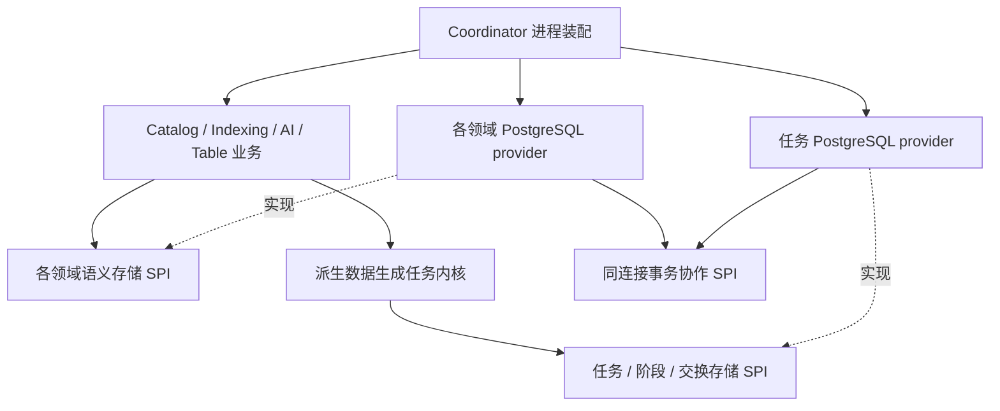

# Metadata、Catalog 与生成任务存储边界设计

> 状态：2026-10-31 源码审查形成的目标设计，模块拆分尚未完成。审查基线为 `pangrova-metadata` 的 132 个主源 Java 文件及 `pangrova-data-build` 的 69 个主源 Java 文件，均包含 `package-info.java`，不含生成源码和 `target`。后续阶段执行/交换及同连接提交/fence SPI 已实际落位，累计新增7个主源，任务模块现为76个主源；详见[执行记录第40节](../project-restructure-execution-plan.md#40-同连接输入读取与-catalog-同步缺陷审计)。本文原逐文件表保留审查基线，以下实施状态明确区分当前与目标。
>
> `pangrova-data-build` 是已经落地但用户未接受的过渡名称。按用户的单词命名要求，目标名称采用 `pangrova-generation`，表达索引、生成列值和导出结果的“生成”；当前源码尚未完成最终迁移。现有 SQL 表名、协议枚举、canonical JSON 字段、缓存路径和历史迁移均保持原值。

## 1. 结论与设计方式

采用“**领域拥有业务权威，公共内核拥有生成任务，存储 provider 实现端口，进程组合根负责装配**”的方式。模块边界按数据的唯一写入责任和事务语义确定，不按所有类都包含“metadata”或“artifact”的字面相似度确定。

1. **应新建真实 Catalog 制品。** Catalog 拥有 catalog 定义及 incarnation/revision 历史、连接器绑定与句柄生命周期、技术名称解析、Schema/表库存投影、观测缓存与失效。现有 `CatalogRegistry`、descriptor SQL writer、connector/federation handle、技术元数据解析是可迁入的真实实现，不需要先制造一个空 facade。
2. **Metadata 不能整体改名为 Catalog。** 当前还包含 Security tenant writer、Table managed-source writer、AI generated-value 定义与版本、Indexing 发布、公共任务输出验证、Query redo acknowledgement、数据库启动和跨领域装配。这些逐项归还后，没有证据表明仍需一个独立的“所有元数据”业务 owner。目标是逐批归零并退役当前 `pangrova-metadata`；技术元数据功能作为 Catalog 内部能力继续存在。过渡期保留模块仅用于尚未迁出的真实代码，不新增泛化接口或永久转发层。
3. **公共任务内核不拥有 Index/AI 定义及 active generation。** 它拥有任务、阶段、页、租约、fencing、依赖、恢复、immutable output 和完成证据；Indexing/AI 拥有领域定义、领域版本与当前可见版本选择。公共任务仍受源身份、授权及实际执行 owner 约束，不能扩大成任意 workflow 平台。
4. **独立演进需要编译边界。** 业务调用方只依赖无 SQL 的 Store SPI；PostgreSQL provider 与业务制品分开。跨领域原子发布通过单独、明确的 JDBC 事务协作端口保留，不能用多个各自提交的 Store 调用替代。
5. **后端能力必须真实。** 当前完整持久化链以 PostgreSQL 为基准；`Jdbc` 命名不构成任意数据库兼容承诺。Memory provider 只有实现并验证同一语义后才能提供相同能力，不能作为未配置 PostgreSQL 时的静默回退。

下面箭头表示依赖，虚线表示实现契约。组合根选择后端，业务代码不反向依赖后端实现。



图中业务对任务内核的调用仅适用于需要生成任务的能力，不要求 Catalog 普通目录操作依赖任务系统。
事务协作 SPI 保持独立的技术边界，领域应用使用上面的语义接口。

## 2. 当前 Metadata 的事实与 owner 边界

### 2.1 全部包的职责目标

下表是现有包的完整分区；迁移粒度以附录逐文件表为准。`service`、`databuild.jdbc`、`store.jdbc.catalog` 三处必须先拆混合职责，不能整包机械搬移。

| 当前包（`org.pangrova.metadata` 下） | 现状职责 | 目标责任 |
|---|---|---|
| 根包说明 | 模块边界文档 | 随真实 owner 重写，最终删除旧模块说明 |
| `api.catalog` | descriptor、handle、状态及混合 MetadataStore | Catalog API；Store 拆定义/历史和库存/同步 |
| `core.catalog.registry` | 注册、注销、对账、健康检查、部署身份解析 | Catalog core；Table 服务必须显式注入 |
| `core.catalog.handle.connector` | ConnectorFactory→Connector/CatalogHandle 绑定 | Catalog connector adapter |
| `core.catalog.handle.federation` | FederatedCatalog→CatalogHandle | Catalog federation adapter |
| `core.catalog.handle.internal` | Internal catalog handle | Catalog core |
| `adapter` | 联邦 schema/table 枚举、句柄转换、缓存 | Catalog federation adapter |
| `api.object` | 表/列/资产技术视图 | Catalog read model；领域定义不能由这些 DTO 另建写入权威 |
| `core.object`、`core.schema` | 技术 Schema 序列化、演进规则与校验 | Catalog core；物理表提交仍由 Table/Connector owner |
| `api.relation`、`core.relation` | 技术对象依赖、排序、级联机制 | Catalog dependency core/SPI；领域实际删除通过 owner adapter |
| `provider.memory.relation`、`store.jdbc.object` | 依赖图 Memory/PostgreSQL 实现 | Catalog 各 provider；共享契约测试 |
| `api.cache`、`core.cache` | 多层缓存、进度与失效接口 | Catalog cache SPI/core；Memory/disabled 实现明确配置 |
| `core.event` | Catalog、表、同步与外部观测统一事件 | Catalog 技术事件；不能成为领域提交权威 |
| `core.outbox` | 联邦同步、drift/版本观测与 metrics | Catalog observation；其名称不代表可靠通用 outbox |
| `store.jdbc.cache` | 失效日志轮询与清理 | Catalog PostgreSQL provider |
| `store.jdbc.catalog` | 定义/历史、库存、同步、JSON、连接池、Flyway | 拆 Catalog provider、owner codec、进程启动/testinfra |
| `service` | 名称解析、查询 begin/cleanup、DDL/cache 与策略适配 | Catalog application service 与显式跨领域 adapter 分离 |
| `adapter.security`、`assembly.security` | 名称→stable Table identity→列掩码 wiring | adapter 保留依赖方向；实例构造移进程组合根 |
| `adapter.governance` | 名称→stable Table identity→质量规则 wiring | 同上；规则真值在 Governance/Table |
| `tenant` | tenant 与 membership SQL、当前租户约束 | Security PostgreSQL provider |
| `source.jdbc` | managed source head/schema/publication/object/cleanup 状态 | Table managed-source provider；先解决 Query/Catalog 同事务端口 |
| `databuild` | generated-value descriptor、submission、generation reference | AI Control 领域 API/SPI |
| `databuild.jdbc` | 通用输出校验 + Index/AI/关系导出发布 | 拆公共内核 provider、Indexing provider、AI provider、关系导出 adapter |
| `databuild.jdbc.submission` | generated-value 提交与 committed write redo acknowledgement | AI 提交流程 + Query journal 同事务 adapter |
| `adapter.databuild` | tenant/table/model 授权组合、Query publication-owner 投影 | PostgreSQL 跨 owner 事务 adapter；进程组合根注入 |
| `assembly.databuild` | 同时创建 Query/Security/任务/Index/AI provider | Coordinator 组合根；不属于任何存储 owner |
| `checkpoint` | Common CheckpointStore 的 JDBC 实现 | Coordinator resilience provider；先核实真实接线 |
| `exception`、`exception.catalog` | Catalog 错误混有 Index 错误/通用存储错误 | 分别归 Catalog/Indexing/各存储 owner |

### 2.2 真实 writer 与事务范围

SQL writer 证据来自主源字符串扫描，并人工补全字符串拼接与跨 helper 的写入；下列“事务连带写入”不能从单个类的 SQL 行数推断不存在。

| 当前实际 writer | 直接写入的表/状态 | 目标与必须保留的事务边界 |
|---|---|---|
| `JdbcMetadataStore` | `catalog_definitions`、`catalog_descriptor_revisions`、`table_metadata`、`schema_metadata`、`sync_history`、`invalidation_log` | Catalog provider 拆三个 port；每次定义变更的 current+history+invalidation、每次库存变更+invalidation 必须原子提交 |
| `JdbcInvalidationPoller` | `invalidation_log` 清理 | Catalog provider；消费进度/清理语义不得变成内存猜测 |
| `JdbcObjectDependencyStore` | `pangrova_object_dependencies` | Catalog dependency provider；不意味着它拥有各领域对象删除 |
| `JdbcTenantStore` | `tenants`、`tenant_user_memberships` | Security；current tenant/membership 检查继续接受调用者事务 |
| `JdbcManagedSourceCatalog` | `managed_source_heads`、`managed_source_publications`、`managed_source_schemas` | Table；通过 helper 连带对象/准备状态和 Query write journal，不能分库分连接提交 |
| `JdbcSourceObjectRegistration` | `managed_source_objects`、`managed_source_object_pages`、`managed_source_publications` | Table；页回执、成员集合与封存使用同一 candidate 事务 |
| `JdbcSourceObjectCleanup` | `managed_source_cleanup_batches`、`managed_source_objects` | Table；只能回收符合原候选/接受状态约束的对象 |
| `JdbcSourcePreparationInvocations` | `managed_source_prepare_invocations` | Table；幂等与恢复证据 |
| `JdbcGeneratedValueDescriptorStore` | `generated_value_artifacts` | AI Control；和任务提交的共同事务保留 |
| `JdbcGeneratedValuePublicationStore` | `generated_value_generation_manifests`、`artifact_build_jobs` | AI 领域版本写入 + 公共任务终态同事务 |
| `JdbcIndexGenerationPublicationStore` | `index_descriptors`、`index_generation_builds`、`index_generation_manifests`、`artifact_build_jobs` | Indexing；旧代 retirement、指针切换与任务终态同事务 |
| `JdbcTabularExportPublicationStore` | `tabular_export_generations`、`artifact_build_jobs` | 通用关系导出 adapter；不能因 Feature 的一个调用点自动归 AI |
| `JdbcGeneratedValueBuildSubmissionStore` | `write_commit_journal`；调用 helper 写任务/依赖/页/dispatch 和 generated descriptor | AI submission + Query redo ack + 公共任务事务 bridge；全部提交或全部回滚 |
| `JdbcCheckpointStore` | `checkpoints` | Coordinator；目前未找到生产构造点，存在类不是实际 durable wiring |

### 2.3 Catalog 的职责不能吞并 Table、AI 或 Indexing

- [CatalogRegistry](../../../pangrova-metadata/src/main/java/org/pangrova/metadata/core/catalog/registry/CatalogRegistry.java) 当前真实管理 descriptor、句柄、注册竞争与补偿、健康和对账。其内置默认 `InMemoryTableControlStore`、statistics/governance store 再由 setter 替换的方式使生产能力取决于装配顺序；应由进程明确选择并完整注入，不能随 Catalog 搬迁永久保留默认 fallback。
- Catalog deployment resolver 比较 descriptor 的 incarnation/revision 与本地 handle；目录删后重建不是同一个部署。它是 `CatalogRegistry` 的内部类，不能把计划写成迁移不存在的独立源文件。注册失败的 handle 清理和 descriptor 补偿、注销 shutdown 顺序必须保留，外部 handle 生命周期不是可由数据库 rollback 自动撤销的操作。
- [MetadataStore](../../../pangrova-metadata/src/main/java/org/pangrova/metadata/api/catalog/MetadataStore.java) 同时提供定义/历史、表投影、schema 和同步记录；`findCatalogDescriptorRevision` 的默认 `Optional.empty()` 把“不支持”与“未找到”混淆。拆成真实能力 port 后，各 provider 必须明确实现或在装配时拒绝所需能力。
- [DefaultMetadataService](../../../pangrova-metadata/src/main/java/org/pangrova/metadata/service/DefaultMetadataService.java) 的技术名称解析、version-aware cache 和查询级 ConnectorMetadata 生命周期归 Catalog。begin/cleanup 必须使用同一个已认证 connector 实例，失败清理不能丢失原引用；受控表命中缓存仍须验证当前 Table identity，不能只依赖 TTL。
- `TableControlDeferredPolicy` 同连接读取 `table_control_registry`/name reservation 并与 `catalog_definitions` 的 active incarnation/revision 关联，再验证策略。拆 Catalog 与 Table 后须通过 borrowed-connection port 保留这次精确校验；“先查名称再开新事务”会引入删后重建竞态。
- `ModelAsset`、`FunctionAsset`、`MaterializedViewAsset`、`VolumeAsset` 等目前只是技术库存 DTO。扫描仅发现对应 sealed `Asset` 声明和测试级引用，不能据此为 Catalog 新增 model/MV/function/file 生命周期 writer。真正的业务定义与有效版本仍由各 owner 提供只读投影。
- `ObjectDependencyService` 的机制不等同于跨领域删除事务。当前未找到其生产构造点；迁移只能声明保留技术依赖图，不能把未接线的维护 hook 宣称为完整领域级联删除能力。

## 3. 当前 69 个生成任务文件的分区

| 当前目录 | 文件数（含包说明） | 保留的职责 | 必须处理的混合点 |
|---|---:|---|---|
| `api` | 9 | 依赖、execution kind、输出 scope/page kind、存储错误 | `DataBuildOutputTypeIds` 的四类业务 ID 应由领域提供；字符串值不变 |
| `api/build` | 11 | job/page/lease/output/split、主 Store port | `markPublished` 是绕过领域发布的独立入口；移除前迁移测试，不保留假兼容 |
| `api/execution` | 6 | 实际 execution owner、stage graph、exchange DTO | 不引入 JDBC；具体 store 的 DTO 补归此处 |
| `api/execution/template` | 2 | immutable stage template | domain-specific plan builder 继续归领域 |
| `api/format` | 2 | 格式契约接口/模型 | 当前六个格式的角色、ordinal、scope、empty 规则硬编码应改为领域注册扩展 |
| `api/manifest` | 2 | immutable generation completion evidence | 不拥有 active/latest 选择；不得读到 staging outputs |
| `api/publication` | 2 | 原子发布的语义 port | domain pointer mutation 由领域 provider 实现 |
| `assembly` | 4 | 纯 dispatch/graph/manifest 构造入口 | 无连接池与 provider 选择，可以在业务制品保留 |
| `core/publication` | 2 | 按类型路由到发布 port | 进程注册已实现的领域 handler；未知类型 fail closed |
| `protocol` | 4 | canonical JSON 与 exchange/graph codec | wire/JSON 字节兼容属于合同，拆包不改格式 |
| `spi/jdbc` | 3 | 2 个同连接协作接口及包说明 | 是技术事务 bridge，不是后端无关 Store |
| `store/jdbc/build` | 14 | 13 个实现/helper：admission、claim、completion、read、stage execution 等 | admission 含 TABULAR_EXPORT 特例；StageExecution 缺上层 SPI |
| `store/jdbc/exchange` | 2 | exchange provider 与包说明 | 缺 StageExchangeStore port，public static helpers 泄漏实现 |
| `store/jdbc/execution` | 4 | 3 个 authority/fence/route 类 | `CurrentDeferredExecutionContext` 混合无 SQL 证据与 JDBC resolve |
| `store/jdbc/query` | 2 | 当前 SQL read helpers | 被跨领域直接调用，应收进 provider 并用事务 port 暴露所需语义 |
| **合计** | **69** | | |

上述内核边界基本成立，但不能称当前边界已经完成：

- `DataBuildOutputFormatContracts` 持有六种格式规则，`DataBuildOutputTypeIds` 持有 VECTOR_INDEX/TEXT_INDEX/GENERATED_COLUMN_VALUES/TABULAR_EXPORT；`JdbcDataBuildAdmission` 直接按 TABULAR_EXPORT 分支。目标是领域贡献不可变的类型/格式 contract，组合根注入完整 registry；schema、output role、empty-output、row-count 规则不靠任意字符串绕过。
- [DataBuildJob](../../../pangrova-data-build/src/main/java/org/pangrova/databuild/api/build/DataBuildJob.java) 与 dependency set 保留主 source identity/snapshot 的精确绑定。该约束不证明所有实际读取输入都已物理 pin；连接器/source snapshot 的获取和有效性权威在 Catalog/Table/Connector，查询编译与 split planner 负责把真实来源编入任务。不能删除这个约束，也不能把它解释为任务模块拥有源数据真值。
- generic manifest 是可被发布代读取的不可变证据。Indexing/AI 的 active generation 指针仍归领域；读取必须按 tenant、generation、snapshot 和允许的 source-object 集合绑定，不能退化成扫描完整 manifest 再过滤。
- `DataBuildStore.markPublished` 当前检索到 9 个测试调用、0 个生产调用。该入口可单独把 job 标成 PUBLISHED，不要求领域版本同时提交。目标应删除这个公共入口，内部任务终态更新只能由同事务 publication bridge 完成；第一轮存储拆制品不应悄悄改它，另立行为批次迁移原测试。

## 4. Store SPI 与 PostgreSQL provider 的可实施分层

实施更新：阶段执行、交换及其8个record已移到`databuild.spi.storage`，上层消费接口；
JDBC上下文实现三getter只读view，原private构造/同事务resolver保留。新增源码为
CurrentExecutionAuthority、DataBuildStageExecutionStore、DataBuildStageExchangeStore和package-info。
第39节进一步分离 DataBuildJobSubmissionTransactions 与 DataBuildExecutionTransactionFence，真实 JDBC provider 实现接口；AI 的关联提交与 Metadata 的生成值提交仍使用原 Connection。
下面的表保留初审缺口；Stage/Exchange 缺口已由第38节关闭，submission/fence 由第39节关闭；S3 已分离 DataBuildTransactionInputs，真实 reader 直接实现，保留普通 auto-commit 读取；跨 owner 具体 reader 引用仅留 assembly。物理 provider 拆分仍待实施。

### 4.1 初审缺口与接口实施状态

| 类型/调用方式 | 初审判断 | 当前状态与剩余动作 |
|---|---|---|
| `DataBuildStore` | 无 Connection 的任务语义 port；包含持久租约/幂等契约 | 作为业务 SPI 保留；另批收紧独立 markPublished |
| `DataBuildPublicationStore` | 无 Connection 的原子发布语义 port | 保留调用契约；按领域实现并注册 |
| `MetadataStore` | 无 Connection，但跨了定义权威/库存投影/同步记录 | 拆 descriptor、inventory、sync-progress 能力；同步端口须先完成 B0，不能搬移旧 no-op |
| `ObjectDependencyStore` | 已有 Memory/PostgreSQL 的真实依赖图 port | 移 Catalog SPI，并让两个 provider 共用契约测试 |
| `GeneratedValueBuildMetadataStore`、`GeneratedValueBuildSubmissionStore` | 已有无 SQL 的 AI 语义 port | 连同值对象归 AI；实际 PG provider 另制品 |
| Connector SPI 的 `ManagedSourceCatalog` | 已有 source publication 能力 port | 实现归 Table/source owner；不因名字含 Catalog 归目录元数据 |
| `JdbcDataBuildStageExecutionStore` | 具体类就是上层 API，多个 public nested DTO 也在实现包 | S1 已完成 StageExecutionStore SPI 及7个record迁移，物理制品待拆 |
| `JdbcDataBuildStageExchangeStore` | 具体类被 runtime 使用，ExchangeEvidence 在 provider 类内 | S1 已完成 StageExchangeStore SPI 与 ExchangeEvidence 迁移；SQL helpers 留 provider |
| `CurrentDeferredExecutionContext` | 证据 accessor 无 SQL，`resolve` 需要 Connection、roles、execution fence | S1 已以 CurrentExecutionAuthority 分离只读证据；private resolver保留，不能作为授权输入 |
| `DataBuildTransactionAuthority`、`DataBuildPublicationCandidates` | 明确传 Connection 的内部技术 SPI | 保留借用连接且不管理事务契约；依赖方向与业务 Store SPI 分开 |
| `JdbcDataBuildStore.createJobWithinTransaction`、`JdbcDataBuildQueries.*` | 调用方依赖具体类/static SQL helper | S2 已迁提交端口，S3 已迁读取端口；公共 publication SQL 端口仍待实施 |
| `JdbcDataBuildExecutionFence` | 公共任务路由校验 + Query ExecutionTransactionFence 组合 | S2 已由 DataBuildExecutionTransactionFence 暴露，真实 Query/任务 SQL 保留原归属 |

`DataBuildDispatchRequestFactory`、`DurableDataBuildDispatcher`、`DurableStageRuntime`、`DurableStageShuffleEvidence`、`DurableDataBuildWorkReportSink`、`PublishedGenerationBindingResolver`、`DataBuildPartitionBindings`、`StageExchangeAccessValidator`、`StageExecutionContext`、`DurablePartitionRequest` 在初审时均直接引用至少一种上述 JDBC 类型或 nested DTO，S1 已将这些运行时消费者迁至语义 SPI/证据类型。`DataBuildStores` 是实际构造点，必须迁入组合根而非成为 Metadata 的永久 provider 工厂。

### 4.2 目标目录与依赖（未实施）

下面的树表达真正需要的编译隔离；不要求为每个包制造一个空 Maven 模块。首批可把 API、普通 SPI 和 core 放同一 `-core` 制品；仅当存在独立消费者或依赖冲突时再拆 API 制品。技术 `spi.jdbc` 若被多个 owner 的 provider 引用，应放独立的轻量 transaction-SPI 制品，使业务 core 不依赖 PostgreSQL provider 或其 SQL API。

```text
pangrova-catalog/                         # 新建的真实领域 family
  pangrova-catalog-core/
    org.pangrova.catalog.api/             # descriptor、deployment identity、技术 read model
    org.pangrova.catalog.spi/             # definition/history、inventory、sync、dependency ports
    org.pangrova.catalog.core/            # registry、resolve、cache、schema、query lifecycle
    org.pangrova.catalog.adapter/         # connector/federation 适配，避免反向引用 Metadata
  pangrova-catalog-store-postgresql/
    org.pangrova.catalog.store.postgresql/# 实际 SQL、row mapper、invalidation writer/poller
  # memory dependency provider 按实际能力归位；不假造完整 durable Catalog 后端

pangrova-generation/                       # 派生数据生成任务；已确定目标名，源码待迁移
  pangrova-generation-core/
    api/                                 # job、page、lease、stage、output、manifest、evidence
    spi/                                 # TaskStore、StageExecutionStore、StageExchangeStore、PublicationStore
    core/                                # 任务/格式校验与发布路由；无 PG SQL
    protocol/                            # canonical 合同与稳定编码
  pangrova-generation-transaction-spi/     # 必要的窄 JDBC borrowed-transaction bridge
    spi.jdbc/                            # authority、job insert/read/finalize、publication fence
  pangrova-generation-store-postgresql/
    store.postgresql/                    # 当前真实存储实现与 PG 集成测试

pangrova-{security,table,indexing,ai}/
  ...-core 或现有 domain artifact/       # 领域 API/SPI、定义/状态机；不得导入 provider
  ...-store-postgresql/                   # 各领域表 writer，实现自己的 semantic/transaction ports

pangrova-coordination/.../
  bootstrap/                             # 显式选择所有真实 provider、连接池与 migrations
  adapter/.../postgresql/                 # 同数据库事务组合；只编排 ports，不复制领域 SQL
```

依赖方向：业务调用方 → core/API/SPI；PostgreSQL provider → 本 owner SPI + 必需的跨 owner transaction SPI；组合根 → 所有被选择的真实 provider。不得 core → provider，不得 Catalog → Metadata，也不得 AI → Metadata → AI。进程可以引用多种 provider 制品；领域代码不依赖进程装配。

驱动、数据库连接池和 Flyway 选择由 provider/进程职责决定，不能塞进 Common 来掩盖依赖。现有 `schema-migrations` 是 canonical migration resource owner，首批保持其资源位置和版本；它不成为承载 JDBC Java 代码的新杂物模块。

### 4.3 同事务原子发布不是可选优化

公共任务完成和领域可见版本必须保持全有或全无，现状主要是：

```text
单一 PostgreSQL 连接，autoCommit=false
  → 当前授权 gate / tenant / table policy / model snapshots
  → 实际 Query execution fence
  → 精确任务 publication claim（job 行锁、lease token）
  → 校验 immutable pages/outputs/dependencies
  → 领域 descriptor/generation 锁与原子变更
  → 公共任务 PUBLISHED / manifest evidence
  → 再验证执行所有权和期限
  → 一次 commit
```

各流程的现有锁序须按代码和并发测试保留，不能仅凭上图统一重排：Index/AI publication 先 authority、execution、job，再领域行；generated committed-write submission 先 authorization gate、锁 exact COMMITTED write journal，再验证所有请求 authority，插入所有任务/descriptor 并确认 redo ack；managed-source publication 先 gate/执行 fence/write intent，再当前 receipt 与 source/head 状态。`DataBuildPublicationCandidates` 的 hasLiveOwner 在 job 锁后只能读，不得追加 execution anchor 行锁造成逆序。

实现方式是提供**语义 Store 和事务协作端口两个层次**：

- 上层调用 `PublicationStore.publishClaimed` 等无 Connection API。PostgreSQL 的 publication unit-of-work 借一个连接，调用公共任务 provider 的 lock/validate/finalize transaction port，以及领域 provider 的 validate/publish transaction port。所有 participant 只使用传入连接，不能 commit、rollback、close、替换连接或切换 autoCommit。
- SQL 仍由唯一 owner provider 写。组合事务只决定调用次序和一次提交，不能把各领域表名集中到新的“大 PostgreSQL store”中。
- `preparePartition`/`prepareLeasedPartition` 的 callback 当前在授权/owner/page 锁持有期间构造本地不可变派发元数据；callback 不得做网络 I/O，失败回滚 claim。抽 SPI 不能把 callback 移到 commit 后，也不能让它第二次取连接。
- 多种后端可以独立实现语义 SPI，但一个原子操作涉及的 participants 必须共享同一受支持的事务能力。不能把 PostgreSQL job 和独立 Memory/远端领域 store 拼接后宣称等价。装配时对不支持的组合显式失败；跨数据库方案如需 saga/outbox 属于另一次行为设计与测试，不是此次机械分层的默认替代。
- 全链当前依赖 PostgreSQL 并发与授权 gate 语义。DataBuild SQL 有 `FOR UPDATE SKIP LOCKED`，授权链使用 PostgreSQL gate；某类旧 Javadoc 声称 PostgreSQL/H2 不等于已证明完整后端兼容。真实 PG 集成测试不能被 H2 或 mock Connection 替代。

## 5. Maven/生产接线的实际阻碍

1. Metadata 当前生产依赖 `data-build`、`query-api`、`query` runtime、`observability-api`、`connector-spi`、`indexing-api`、Common、Table、Security、Governance，以及 Iceberg/Jackson/Caffeine/Hikari/Flyway；这是混合职责的结果，不能把整个依赖表照搬到 Catalog core。
2. 直接消费 Metadata 的现有 POM 有 Coordination core、Integration tests、Indexing core，以及仅测试使用的 Connector Lance、Semantic；其中 Coordination/Integration/Indexing/Lance 还使用 Metadata test-jar。迁移测试 fixture 到 testing-kit 或本 owner 后，必须删除反向 test-jar 依赖，不能让新 Catalog/AI provider 的测试再依赖旧 Metadata 来“通过”。
3. Indexing core 已依赖 Metadata 中的 `IndexAlreadyExistsException`、`MetastoreException`、`MetadataJsonMapper`、`JdbcTenantStore`。如果 Metadata `DataBuildStores` 再直接构造迁回 Indexing 的 publisher，会形成 Maven 环。先移动进程工厂并用 owner port 注入，再迁实现；Indexing 错误/codec/Security tenant port 一起解除旧依赖。
4. AI Control 当前无需依赖 Metadata。GeneratedValue 的 5 个合同/DTO 加 3 个 JDBC 类迁回时，不能顺手把 Metadata exception、DataBuildStores 或整个 MetadataStore 引入 AI。
5. `CatalogRegistry` 生产类型引用见 73 个文件、测试类型引用见 59 个文件；`MetadataStore` 为 5/46，`JdbcMetadataStore` 为 1/32。它们是静态引用文件数，非运行时调用次数。`JdbcMetadataStore` 的唯一生产构造来源为 `CoordinatorBootstrap`，所以第一批可以从这个明确的生产接线点迁真实 descriptor writer。
6. `MetadataEvent` 是 Catalog/表/同步混合 sealed union。只迁 Registry 而让 Catalog 继续引用 MetadataEvent，会与 Metadata→Catalog 形成环；先抽窄 lifecycle event port 或将技术事件 DTO 与 Catalog read model 同批迁移，进程用 adapter 接其余事件。
7. `PooledDataSourceFactory`、`SchemaMigrationRunner` 的生产调用都在 CoordinatorBootstrap；`EmbeddedDataSource` 当前只有测试引用。这些不应成为 Catalog domain API。把生产启动归组合根，测试数据源归测试基础设施。

## 6. 分批实施与验收

每批都要包含真实调用点/构造点迁移、owner 测试归属和禁止反向依赖的可执行检查；只新增接口而继续使用旧 concrete class 不算完成。

### 批次 A：生成任务存储的最小完整独立化

**范围**：新增两个缺失的 StageExecution/StageExchange semantic SPI；迁出其业务 DTO 和 current-authority evidence；把现有 `store.jdbc` 的 22 个文件（18 个非包说明类 + 4 个包说明）中的实际 SQL/resolver 实现移到 PostgreSQL provider 制品。由于 DTO/resolve 拆分，最终 provider 文件数不再固定为 22。当前 2 个 store 近端单测随 provider 迁移，8 个 API/protocol 测试留 core。Metadata 的 `JdbcDataBuildStoreTest`、`JdbcDataBuildStageExchangeStoreTest` 中纯 provider 行为测试迁 owner；涉及真实 tenant/model/Query 的部分保留跨 owner 集成测试。

**业务语义不改**：SQL、事务边界、lease、callback 持锁范围、错误/回滚、canonical bytes、source snapshots 均不改；不在这批顺手重排格式规则或移除 markPublished。同连接端口完成后，按已经确定的 generation 名称迁移三制品和包名。

**闭环**：非组合根只依赖 SPI，具体类/nested DTO 不再穿到 Coordinator runtime。组合根显式创建真实 PG 实例；core 的 POM 不依赖 provider。跨领域尚未替换的 static SQL helpers 临时只能被 infrastructure adapters 引用，列为下一批待移，不能声称完全解耦。

**验收**：core contract/encoding tests；PG page claim 竞争、过期回收、attempt/epoch fencing、producer原始字节、stage exchange producer winner/finalize、published input 精确范围、callback 失败回滚；真实 root assembly 测试；provider 不可用时启动拒绝而非 Memory fallback。按开发规则运行 owner full-regression/static 和受影响 protocol/Java-native 执行链；只验证类存在或 mock 接口调用不能证明生产接线。

### 批次 B0：先修复 Catalog 同步续读语义

源码审计确认 `JdbcMetadataStore.getLastSyncTime` 直接取 `MAX(sync_history.sync_time)`，
`updateSyncTime` 为 no-op；`MetadataSyncService.finishSync` 对空批、部分失败和全部失败也
写入结束时间。逐条异常只进入 SyncResult.errors，syncWithRetry 接到结果即返回。因此真实PG
可能跳过未成功应用的变化；现有watermark单测只检查fake的boolean，未验证真实持久化行为。

仅过滤成功历史或把结束时间换为开始时间不足以修复：源事务可能在扫描前生成timestamp，
扫描后才提交；历史按catalog name关联也无法区分同名重建。历史记录是审计，不能作为续读权威。

实施边界：外部FederatedCatalog provider显式返回完整change batch及源确认的opaque cursor；
无增量能力的provider明确声明只支持full inventory，不添加将旧List包装为next=now的默认实现。
Catalog core负责应用/重试，PG进度provider按catalog incarnation、revision/source scope保存
独立checkpoint，以expected version执行CAS；同步历史与成功checkpoint在同一事务完成。
部分或全部失败不得推进，完整空批仅按源确认边界推进；full scan没有一致snapshot边界时只更新
库存与历史，不自行创造增量cursor。新增迁移不编辑历史SQL，也不从旧MAX值回填可信checkpoint。

最近回归先用两个真实PG库复现：sink缺schema导致部分FK失败，补schema后第二次仍须读取失败项；
source事务在空扫描后提交，其变化不得被跳过。再验证同名重建、checkpoint/history提交失败、CAS
竞争和源确认的完整空批。错误必须进入实际retry路径，不能只检查fake方法是否被调用。
该修复不自动解决异步schema事件可靠投递，后者另列outbox批次。

生产maintenance-leader调度链存在，但仓库尚无具体FederatedCatalogFactory provider注册；
PostgresFederationInventory是测试component adapter，不能当作生产CDC实现。外部SPI破坏性变更
需明确能力要求，不能声称已覆盖不存在的发行包provider。本节为已确认缺陷与待实施设计，尚未
运行上述新增回归。先完成B0，再以真实descriptor、inventory、sync-progress能力抽接口，
不保留旧no-op，也不为目录对称建立三组纯转发writer。

### 批次 B：Catalog 定义权威的首个安全迁移

**范围**：新建实际 Catalog core/store-postgresql；迁 `CatalogDescriptor`、state/type/identity 合同；从 MetadataStore 拆出 descriptor current/history/CAS port，迁 `JdbcMetadataStore` 中真实定义 SQL/row mapping。current + immutable history + durable invalidation 必须仍在一个事务；为旧库存 writer 提供 Catalog-owned invalidation transaction writer 或 provider内部共享组件，不能先提交定义再异步补日志。

**生产接线**：CoordinatorBootstrap 创建新 Catalog provider；Registry 和历史消费者改注入窄 port。Registry 本轮可暂留旧模块，但不得再通过旧 MetadataStore 读写 descriptor；MetadataStore 留下真实库存/同步功能，删除已迁的定义方法与默认 history-empty 行为。不建立 Catalog→Metadata 反向依赖。

**测试归属**：从 `JdbcMetadataStoreIntegrationTest`、`CatalogDescriptorRevisionMigrationTest` 分出 Catalog provider 测试；保留 `TableControlCatalogDeploymentIntegrationTest` 的真实跨域验证。验证 CAS 同 revision 竞争、drop/recreate incarnation、当前/历史匹配、失效日志失败导致全事务回滚、commit acknowledgement 不确定性、授权路径看见实际新 provider。数据库 migration 历史文件保持原样。

### 批次 C：Catalog 生命周期、技术解析与其他 owner 归位

Registry/handles/health、技术 object/schema、cache/event/observation、dependency core 和 service 分别迁到对应 Catalog 包。先去掉 Registry 内部默认构造 Table providers，将 TableControl/statistics/governance 显式注入；connector/federation factories 已返回 CatalogHandle，利用现有接口，不新增无行为 facade。策略适配器继续只做名称到 stable identity 的转换。

`JdbcTenantStore` 归 Security；checkpoint provider 归 Coordinator 并解决生产未接线事实；连接池/迁移归组合根。ManagedSource 的 5 文件要先补 Query journal 与 Catalog current-deployment 的 borrowed-connection port，再迁 Table provider，不能让 Table 引入 Query runtime/Metadata。

验收 Registry 构造注入、event dispatch、reconcile、注册补偿、stale handle 和 query begin/cleanup；缓存受控身份重验证；Memory/PG dependency contract；Source 同连接、授权撤销、删后重建、分页面回执/封存/恢复/cleanup；Security tenant inactive/membership撤销。没有真实生产调用的能力明确保留为未接线或删除冗余，不以类加载测试替代 wiring。

### 批次 D：领域 publication 和 submission 与 SQL owner 对齐

先将通用 output validator 的真实 SQL 移到任务 PG provider，通过同连接校验端口消费；再提取 job lock/finalize 的事务能力。digest 按实际领域算法和历史字节归属，不能整体机械搬入公共内核：当前 ManifestDigest 依赖 Index publisher 的 JobRow，Index/Generated 和 Tabular 的字段及行数聚合规则也不同。Index publication 归 Indexing；GeneratedValue 5 个合同与 descriptor/publication/submission 三个实现归 AI；关系导出 adapter 保持公共关系导出责任。进程用领域 handler registry 组成完整 publication 路由。

S2/S3 已通过 transaction bridge 替代跨 owner `JdbcDataBuildQueries` 和 `createJobWithinTransaction` 静态调用；公共发布 SQL 的迁移仍需后续批次。每个 writer 只写本 owner 表；领域指针与 job finalization 的共同提交由 PostgreSQL unit-of-work 编排。移除公共 `markPublished` 绕行，现有 9 个测试改用真实 publication fixture 或限定的测试数据装载，不能为通过测试暴露生产绕行接口。

验收 Index/AI 指针与 job 状态原子性、publish failure/rollback、旧 owner/过期 token 拒绝、after-blocking-write owner 再验证、撤权与 model incarnation/config/deployment/signature 变化、query-only 生成写入、committed-write redo acknowledgement 与全部派生任务原子提交。digest 现状有领域差异：Index/Generated 包含 encryption-key reference，而 Tabular 当前不包含；scope 的 source-row 汇总也不同。迁移先保持字节语义，不能以“统一 helper”静默改变历史 manifest 校验。

### 批次 E：格式扩展、全模块 provider 一致性与退役

把业务类型/格式规则转为领域贡献的只读 contract，保留既有 type ID/format ID、版本、canonical bytes；未知/重复类型在启动或提交时拒绝。所有 owner 的 PostgreSQL provider 跑真实数据库契约套件；Memory 只声明确实实现的能力，明确 durability/restart/recovery限制，不能吞掉持久化失败。

全项目复用以下检查：业务是否导入 `.store.jdbc/.store.postgresql`；构造器或 setter 是否偷偷创建 Memory/default fallback；Store接口是否默认 no-op/empty 掩盖不支持；provider是否有真实进程构造点；事务参与者是否另取连接/提前提交；测试是否只加载类而没验证生产路由。provider切换在进程启动时完成，不能在一次请求失败后改变语义。

清除 Metadata 最后 imports、POM/test-jar、装配引用后删除旧模块；按最终职责确认任务 family 名称并一次精确迁移。所有受影响 owner/reactor clean 后验证 JAR 无旧身份，canonical 协议/JSON/SQL/缓存兼容证据不变。只 clean 新模块不足以移除其他模块的旧 `.class`。

## 7. Metadata 132 文件逐项 owner 清单

下表每行对应一个当前主源文件。表中的“生产/测试引用”是去除注释与字符串后的类型引用文件数，包括同包和显式导入，不代表动态调用次数；“调用方示例”最多列出三个真实生产类型引用文件，完整范围应以迁移时 `rg` 和编译结果复核。无引用不自动代表可删除，reflection/loader 和装配另行核对。SQL 列是本文件直接写入，跨 helper 的共同事务见第 2.2 节。

| 当前文件 | 目标 owner | 直接 SQL writes | 生产/测试引用 | 调用方示例 |
|---|---|---|---:|---|
| [adapter/CachingFederatedCatalog.java](../../../pangrova-metadata/src/main/java/org/pangrova/metadata/adapter/CachingFederatedCatalog.java) | Catalog 联邦连接器适配 | — | 0/1 | — |
| [adapter/ChangeListener.java](../../../pangrova-metadata/src/main/java/org/pangrova/metadata/adapter/ChangeListener.java) | Catalog 联邦连接器适配 | — | 2/0 | FederatedCatalog, CachingFederatedCatalog |
| [adapter/FederatedCatalog.java](../../../pangrova-metadata/src/main/java/org/pangrova/metadata/adapter/FederatedCatalog.java) | Catalog 联邦连接器适配 | — | 7/7 | ModuleIntegrationBootstrap, PluginFederationHandleFactory, MetadataSyncService |
| [adapter/FederatedCatalogFactory.java](../../../pangrova-metadata/src/main/java/org/pangrova/metadata/adapter/FederatedCatalogFactory.java) | Catalog 联邦连接器适配 | — | 1/0 | PluginFederationHandleFactory |
| [adapter/FederationColumnHandle.java](../../../pangrova-metadata/src/main/java/org/pangrova/metadata/adapter/FederationColumnHandle.java) | Catalog 联邦连接器适配 | — | 1/0 | FederationConnectorMetadata |
| [adapter/FederationConnectorMetadata.java](../../../pangrova-metadata/src/main/java/org/pangrova/metadata/adapter/FederationConnectorMetadata.java) | Catalog 联邦连接器适配 | — | 1/2 | FederationCatalogHandle |
| [adapter/FederationTableHandle.java](../../../pangrova-metadata/src/main/java/org/pangrova/metadata/adapter/FederationTableHandle.java) | Catalog 联邦连接器适配 | — | 1/0 | FederationConnectorMetadata |
| [adapter/databuild/MetadataDataBuildPublicationCandidates.java](../../../pangrova-metadata/src/main/java/org/pangrova/metadata/adapter/databuild/MetadataDataBuildPublicationCandidates.java) | 进程 PostgreSQL 跨 owner 事务适配 | — | 1/0 | DataBuildStores |
| [adapter/databuild/MetadataDataBuildTransactionAuthority.java](../../../pangrova-metadata/src/main/java/org/pangrova/metadata/adapter/databuild/MetadataDataBuildTransactionAuthority.java) | 进程 PostgreSQL 跨 owner 事务适配 | — | 1/0 | DataBuildStores |
| [adapter/governance/QualityRuleStoreWiring.java](../../../pangrova-metadata/src/main/java/org/pangrova/metadata/adapter/governance/QualityRuleStoreWiring.java) | Catalog→Governance/Table 适配；进程组合根装配 | — | 1/0 | ModuleIntegrationBootstrap |
| [adapter/governance/TableControlQualityRuleStore.java](../../../pangrova-metadata/src/main/java/org/pangrova/metadata/adapter/governance/TableControlQualityRuleStore.java) | Catalog→Governance/Table 适配；进程组合根装配 | — | 1/2 | QualityRuleStoreWiring |
| [adapter/security/TableControlColumnMaskStore.java](../../../pangrova-metadata/src/main/java/org/pangrova/metadata/adapter/security/TableControlColumnMaskStore.java) | Catalog→Table/Security 适配；进程组合根装配 | — | 2/8 | ColumnMaskStoreWiring, TableControlDeferredPolicy |
| [api/cache/CacheStats.java](../../../pangrova-metadata/src/main/java/org/pangrova/metadata/api/cache/CacheStats.java) | Catalog 观测、缓存与失效 | — | 2/7 | TieredMetadataCache, MetadataCache |
| [api/cache/InvalidationEntry.java](../../../pangrova-metadata/src/main/java/org/pangrova/metadata/api/cache/InvalidationEntry.java) | Catalog 观测、缓存与失效 | — | 3/3 | ResultCacheCoordinator, JdbcInvalidationPoller, JdbcMetadataStore |
| [api/cache/InvalidationProgressRegistry.java](../../../pangrova-metadata/src/main/java/org/pangrova/metadata/api/cache/InvalidationProgressRegistry.java) | Catalog 观测、缓存与失效 | — | 2/1 | InvalidationProgressRegistryAdapter, JdbcInvalidationPoller |
| [api/cache/L2CacheStore.java](../../../pangrova-metadata/src/main/java/org/pangrova/metadata/api/cache/L2CacheStore.java) | Catalog 观测、缓存与失效 | — | 3/2 | TieredMetadataCache, InMemoryL2CacheStore, DisabledL2CacheStore |
| [api/cache/MetadataCache.java](../../../pangrova-metadata/src/main/java/org/pangrova/metadata/api/cache/MetadataCache.java) | Catalog 观测、缓存与失效 | — | 5/6 | MetadataSyncService, TieredMetadataCache, CachingFederatedCatalog |
| [api/cache/TableInvalidationListener.java](../../../pangrova-metadata/src/main/java/org/pangrova/metadata/api/cache/TableInvalidationListener.java) | Catalog 观测、缓存与失效 | — | 0/0 | — |
| [api/catalog/CatalogDescriptor.java](../../../pangrova-metadata/src/main/java/org/pangrova/metadata/api/catalog/CatalogDescriptor.java) | Catalog 定义、生命周期与连接器绑定 | — | 23/90 | NativeDatasetControlBootstrap, CatalogDeploymentResource, DdlExecutor |
| [api/catalog/CatalogHandle.java](../../../pangrova-metadata/src/main/java/org/pangrova/metadata/api/catalog/CatalogHandle.java) | Catalog 定义、生命周期与连接器绑定 | — | 34/15 | ModuleIntegrationBootstrap, StreamingBootstrap, ClusteringDdlExecutor |
| [api/catalog/CatalogHealthStatus.java](../../../pangrova-metadata/src/main/java/org/pangrova/metadata/api/catalog/CatalogHealthStatus.java) | Catalog 定义、生命周期与连接器绑定 | — | 5/0 | InternalCatalogHandle, FederationCatalogHandle, ConnectorCatalogHandle |
| [api/catalog/CatalogState.java](../../../pangrova-metadata/src/main/java/org/pangrova/metadata/api/catalog/CatalogState.java) | Catalog 定义、生命周期与连接器绑定 | — | 12/77 | DdlExecutor, NativeReadSplitBinding, TestCatalogRegistrar |
| [api/catalog/CatalogType.java](../../../pangrova-metadata/src/main/java/org/pangrova/metadata/api/catalog/CatalogType.java) | Catalog 定义、生命周期与连接器绑定 | — | 4/78 | DdlExecutor, TestCatalogRegistrar, CatalogDescriptor |
| [api/catalog/MetadataChange.java](../../../pangrova-metadata/src/main/java/org/pangrova/metadata/api/catalog/MetadataChange.java) | Catalog 定义、生命周期与连接器绑定 | — | 5/8 | MetadataSyncService, MetadataEvent, FederatedCatalog |
| [api/catalog/MetadataStore.java](../../../pangrova-metadata/src/main/java/org/pangrova/metadata/api/catalog/MetadataStore.java) | 拆 Catalog 定义/历史 port 与技术库存/同步 port | — | 5/46 | CoordinatorBootstrap, MetadataBootstrap, MetadataSyncService |
| [api/catalog/SyncResult.java](../../../pangrova-metadata/src/main/java/org/pangrova/metadata/api/catalog/SyncResult.java) | Catalog 定义、生命周期与连接器绑定 | — | 3/45 | MetadataSyncService, MetadataStore, JdbcMetadataStore |
| [api/object/Asset.java](../../../pangrova-metadata/src/main/java/org/pangrova/metadata/api/object/Asset.java) | Catalog 技术库存只读视图；核实实际用途 | — | 6/1 | VolumeAsset, ViewAsset, FunctionAsset |
| [api/object/AssetType.java](../../../pangrova-metadata/src/main/java/org/pangrova/metadata/api/object/AssetType.java) | Catalog 技术库存只读视图；核实实际用途 | — | 7/1 | Asset, VolumeAsset, ViewAsset |
| [api/object/ColumnMetadata.java](../../../pangrova-metadata/src/main/java/org/pangrova/metadata/api/object/ColumnMetadata.java) | Catalog 技术库存只读视图；核实实际用途 | — | 11/15 | CatalogRestOperations, MetadataSyncService, SchemaEvolutionValidator |
| [api/object/ColumnType.java](../../../pangrova-metadata/src/main/java/org/pangrova/metadata/api/object/ColumnType.java) | Catalog 技术库存只读视图；核实实际用途 | — | 7/16 | CatalogRestOperations, SchemaChange, SchemaEvolutionValidator |
| [api/object/FunctionAsset.java](../../../pangrova-metadata/src/main/java/org/pangrova/metadata/api/object/FunctionAsset.java) | Catalog 技术库存只读视图；核实实际用途 | — | 1/1 | Asset |
| [api/object/MaterializedViewAsset.java](../../../pangrova-metadata/src/main/java/org/pangrova/metadata/api/object/MaterializedViewAsset.java) | Catalog 技术库存只读视图；核实实际用途 | — | 1/1 | Asset |
| [api/object/ModelAsset.java](../../../pangrova-metadata/src/main/java/org/pangrova/metadata/api/object/ModelAsset.java) | Catalog 技术库存只读视图；核实实际用途 | — | 1/1 | Asset |
| [api/object/QualifiedTableRef.java](../../../pangrova-metadata/src/main/java/org/pangrova/metadata/api/object/QualifiedTableRef.java) | Catalog 技术库存只读视图；核实实际用途 | — | 18/61 | CatalogRestOperations, TableControlDdlOperations, DdlExecutor |
| [api/object/TableAsset.java](../../../pangrova-metadata/src/main/java/org/pangrova/metadata/api/object/TableAsset.java) | Catalog 技术库存只读视图；核实实际用途 | — | 1/1 | Asset |
| [api/object/TableMetadata.java](../../../pangrova-metadata/src/main/java/org/pangrova/metadata/api/object/TableMetadata.java) | Catalog 技术库存只读视图；核实实际用途 | — | 16/68 | CatalogRestOperations, MetadataSyncService, TieredMetadataCache |
| [api/object/ViewAsset.java](../../../pangrova-metadata/src/main/java/org/pangrova/metadata/api/object/ViewAsset.java) | Catalog 技术库存只读视图；核实实际用途 | — | 1/1 | Asset |
| [api/object/VolumeAsset.java](../../../pangrova-metadata/src/main/java/org/pangrova/metadata/api/object/VolumeAsset.java) | Catalog 技术库存只读视图；核实实际用途 | — | 1/1 | Asset |
| [api/relation/CascadePolicy.java](../../../pangrova-metadata/src/main/java/org/pangrova/metadata/api/relation/CascadePolicy.java) | Catalog 技术对象依赖图 | — | 1/2 | ObjectDependencyService |
| [api/relation/DependencyViolationException.java](../../../pangrova-metadata/src/main/java/org/pangrova/metadata/api/relation/DependencyViolationException.java) | Catalog 技术对象依赖图 | — | 1/1 | ObjectDependencyService |
| [api/relation/MetadataMaintenanceHook.java](../../../pangrova-metadata/src/main/java/org/pangrova/metadata/api/relation/MetadataMaintenanceHook.java) | Catalog 技术对象依赖图 | — | 2/3 | LineageBridgeMaintenanceHook, ObjectDependencyService |
| [api/relation/ObjectDependency.java](../../../pangrova-metadata/src/main/java/org/pangrova/metadata/api/relation/ObjectDependency.java) | Catalog 技术对象依赖图 | — | 3/3 | ObjectDependencyService, InMemoryObjectDependencyStore, JdbcObjectDependencyStore |
| [api/relation/ObjectDependencyStore.java](../../../pangrova-metadata/src/main/java/org/pangrova/metadata/api/relation/ObjectDependencyStore.java) | Catalog 技术对象依赖图 | — | 3/3 | ObjectDependencyService, InMemoryObjectDependencyStore, JdbcObjectDependencyStore |
| [api/relation/ObjectKind.java](../../../pangrova-metadata/src/main/java/org/pangrova/metadata/api/relation/ObjectKind.java) | Catalog 技术对象依赖图 | — | 2/5 | ObjectRef, JdbcObjectDependencyStore |
| [api/relation/ObjectRef.java](../../../pangrova-metadata/src/main/java/org/pangrova/metadata/api/relation/ObjectRef.java) | Catalog 技术对象依赖图 | — | 10/5 | LineageBridgeMaintenanceHook, ObjectDependencyService, ObjectDependencyKey |
| [assembly/databuild/DataBuildStores.java](../../../pangrova-metadata/src/main/java/org/pangrova/metadata/assembly/databuild/DataBuildStores.java) | Coordinator 进程组合根 | — | 4/6 | QueryMaterializationWiring, HighAvailabilityBootstrap, CoordinatorBootstrap |
| [assembly/security/ColumnMaskStoreWiring.java](../../../pangrova-metadata/src/main/java/org/pangrova/metadata/assembly/security/ColumnMaskStoreWiring.java) | Catalog→Table/Security 适配；进程组合根装配 | — | 2/0 | CoordinatorBootstrap, QueryExecutionBootstrap |
| [assembly/security/package-info.java](../../../pangrova-metadata/src/main/java/org/pangrova/metadata/assembly/security/package-info.java) | Catalog→Table/Security 适配；进程组合根装配 | — | 0/0 | — |
| [checkpoint/JdbcCheckpointStore.java](../../../pangrova-metadata/src/main/java/org/pangrova/metadata/checkpoint/JdbcCheckpointStore.java) | Coordinator 恢复/checkpoint provider（当前未接生产） | `checkpoints` | 0/0 | — |
| [core/cache/DisabledL2CacheStore.java](../../../pangrova-metadata/src/main/java/org/pangrova/metadata/core/cache/DisabledL2CacheStore.java) | Catalog 观测、缓存与失效 | — | 1/1 | TieredMetadataCache |
| [core/cache/InMemoryL2CacheStore.java](../../../pangrova-metadata/src/main/java/org/pangrova/metadata/core/cache/InMemoryL2CacheStore.java) | Catalog 观测、缓存与失效 | — | 0/1 | — |
| [core/cache/InvalidationMetrics.java](../../../pangrova-metadata/src/main/java/org/pangrova/metadata/core/cache/InvalidationMetrics.java) | Catalog 观测、缓存与失效 | — | 0/0 | — |
| [core/cache/TieredMetadataCache.java](../../../pangrova-metadata/src/main/java/org/pangrova/metadata/core/cache/TieredMetadataCache.java) | Catalog 观测、缓存与失效 | — | 1/20 | MetadataBootstrap |
| [core/catalog/handle/connector/ConnectorCatalogHandle.java](../../../pangrova-metadata/src/main/java/org/pangrova/metadata/core/catalog/handle/connector/ConnectorCatalogHandle.java) | Catalog 定义、生命周期与连接器绑定 | — | 6/47 | WriteCommitWiring, ConnectorWriteBindingFactory, NativeTaskWriteCompletion |
| [core/catalog/handle/connector/ConnectorHandleFactory.java](../../../pangrova-metadata/src/main/java/org/pangrova/metadata/core/catalog/handle/connector/ConnectorHandleFactory.java) | Catalog 定义、生命周期与连接器绑定 | — | 4/27 | MetadataBootstrap, PluginConnectorHandleFactory, TestConnectorHandleFactory |
| [core/catalog/handle/federation/FederationCatalogHandle.java](../../../pangrova-metadata/src/main/java/org/pangrova/metadata/core/catalog/handle/federation/FederationCatalogHandle.java) | Catalog 定义、生命周期与连接器绑定 | — | 1/3 | PluginFederationHandleFactory |
| [core/catalog/handle/federation/FederationHandleFactory.java](../../../pangrova-metadata/src/main/java/org/pangrova/metadata/core/catalog/handle/federation/FederationHandleFactory.java) | Catalog 定义、生命周期与连接器绑定 | — | 3/0 | MetadataBootstrap, PluginFederationHandleFactory, CatalogRegistry |
| [core/catalog/handle/internal/InternalCatalogHandle.java](../../../pangrova-metadata/src/main/java/org/pangrova/metadata/core/catalog/handle/internal/InternalCatalogHandle.java) | Catalog 定义、生命周期与连接器绑定 | — | 1/2 | CatalogRegistry |
| [core/catalog/registry/CatalogHealthMonitor.java](../../../pangrova-metadata/src/main/java/org/pangrova/metadata/core/catalog/registry/CatalogHealthMonitor.java) | Catalog 定义、生命周期与连接器绑定 | — | 1/1 | CatalogRegistry |
| [core/catalog/registry/CatalogRegistry.java](../../../pangrova-metadata/src/main/java/org/pangrova/metadata/core/catalog/registry/CatalogRegistry.java) | Catalog 定义、生命周期与连接器绑定 | — | 73/59 | QueryMaterializationWiring, IndexingBootstrap, ModuleIntegrationBootstrap |
| [core/event/MetadataEvent.java](../../../pangrova-metadata/src/main/java/org/pangrova/metadata/core/event/MetadataEvent.java) | Catalog 观测、缓存与失效 | — | 10/22 | IndexCommitHandler, TableControlAuditEmitter, MetadataBootstrap |
| [core/event/MetadataEventDispatcher.java](../../../pangrova-metadata/src/main/java/org/pangrova/metadata/core/event/MetadataEventDispatcher.java) | Catalog 观测、缓存与失效 | — | 5/19 | MetadataBootstrap, MetadataSyncService, TableVersionObserver |
| [core/event/MetadataEventListener.java](../../../pangrova-metadata/src/main/java/org/pangrova/metadata/core/event/MetadataEventListener.java) | Catalog 观测、缓存与失效 | — | 5/3 | IndexCommitHandler, TableControlAuditEmitter, MetadataBootstrap |
| [core/object/TableMetadataSerializer.java](../../../pangrova-metadata/src/main/java/org/pangrova/metadata/core/object/TableMetadataSerializer.java) | Catalog 技术 Schema 投影/校验 | — | 2/2 | TieredMetadataCache, JdbcMetadataStore |
| [core/outbox/MetadataSyncMetrics.java](../../../pangrova-metadata/src/main/java/org/pangrova/metadata/core/outbox/MetadataSyncMetrics.java) | Catalog 观测、缓存与失效 | — | 0/0 | — |
| [core/outbox/MetadataSyncService.java](../../../pangrova-metadata/src/main/java/org/pangrova/metadata/core/outbox/MetadataSyncService.java) | Catalog 观测、缓存与失效 | — | 2/8 | ModuleIntegrationBootstrap, MetadataBootstrap |
| [core/outbox/TableVersionObservationReport.java](../../../pangrova-metadata/src/main/java/org/pangrova/metadata/core/outbox/TableVersionObservationReport.java) | Catalog 观测、缓存与失效 | — | 2/1 | ModuleIntegrationBootstrap, TableVersionObserver |
| [core/outbox/TableVersionObserver.java](../../../pangrova-metadata/src/main/java/org/pangrova/metadata/core/outbox/TableVersionObserver.java) | Catalog 观测、缓存与失效 | — | 2/1 | ModuleIntegrationBootstrap, MetadataBootstrap |
| [core/relation/ObjectDependencyKey.java](../../../pangrova-metadata/src/main/java/org/pangrova/metadata/core/relation/ObjectDependencyKey.java) | Catalog 技术对象依赖图 | — | 3/0 | ObjectDependencyOrder, InMemoryObjectDependencyStore, JdbcObjectDependencyStore |
| [core/relation/ObjectDependencyOrder.java](../../../pangrova-metadata/src/main/java/org/pangrova/metadata/core/relation/ObjectDependencyOrder.java) | Catalog 技术对象依赖图 | — | 2/0 | InMemoryObjectDependencyStore, JdbcObjectDependencyStore |
| [core/relation/ObjectDependencyService.java](../../../pangrova-metadata/src/main/java/org/pangrova/metadata/core/relation/ObjectDependencyService.java) | Catalog 技术对象依赖图 | — | 0/3 | — |
| [core/schema/SchemaChange.java](../../../pangrova-metadata/src/main/java/org/pangrova/metadata/core/schema/SchemaChange.java) | Catalog 技术 Schema 投影/校验 | — | 6/8 | IndexCommitHandler, MetadataSyncService, SchemaEvolutionValidator |
| [core/schema/SchemaEvolutionValidator.java](../../../pangrova-metadata/src/main/java/org/pangrova/metadata/core/schema/SchemaEvolutionValidator.java) | Catalog 技术 Schema 投影/校验 | — | 3/12 | MetadataBootstrap, MetadataSyncService, DefaultMetadataService |
| [core/schema/SchemaValidationResult.java](../../../pangrova-metadata/src/main/java/org/pangrova/metadata/core/schema/SchemaValidationResult.java) | Catalog 技术 Schema 投影/校验 | — | 3/1 | MetadataSyncService, SchemaEvolutionValidator, DefaultMetadataService |
| [core/schema/StrictnessLevel.java](../../../pangrova-metadata/src/main/java/org/pangrova/metadata/core/schema/StrictnessLevel.java) | Catalog 技术 Schema 投影/校验 | — | 1/0 | SchemaEvolutionValidator |
| [databuild/GeneratedValueBuildDescriptor.java](../../../pangrova-metadata/src/main/java/org/pangrova/metadata/databuild/GeneratedValueBuildDescriptor.java) | AI Control 生成值定义/提交/版本 | — | 5/2 | DurableGeneratedValueBuildService, GeneratedValueBuildSubmission, GeneratedValueBuildMetadataStore |
| [databuild/GeneratedValueBuildMetadataStore.java](../../../pangrova-metadata/src/main/java/org/pangrova/metadata/databuild/GeneratedValueBuildMetadataStore.java) | AI Control 生成值定义/提交/版本 | — | 3/0 | GeneratedValueGenerationBindingResolver, GeneratedValueReadResolver, JdbcGeneratedValuePublicationStore |
| [databuild/GeneratedValueBuildSubmission.java](../../../pangrova-metadata/src/main/java/org/pangrova/metadata/databuild/GeneratedValueBuildSubmission.java) | AI Control 生成值定义/提交/版本 | — | 3/1 | DurableGeneratedValueBuildService, GeneratedValueBuildSubmissionStore, JdbcGeneratedValueBuildSubmissionStore |
| [databuild/GeneratedValueBuildSubmissionStore.java](../../../pangrova-metadata/src/main/java/org/pangrova/metadata/databuild/GeneratedValueBuildSubmissionStore.java) | AI Control 生成值定义/提交/版本 | — | 2/1 | DurableGeneratedValueBuildService, JdbcGeneratedValueBuildSubmissionStore |
| [databuild/GeneratedValueGenerationReference.java](../../../pangrova-metadata/src/main/java/org/pangrova/metadata/databuild/GeneratedValueGenerationReference.java) | AI Control 生成值定义/提交/版本 | — | 3/0 | GeneratedValueGenerationBindingResolver, GeneratedValueBuildMetadataStore, JdbcGeneratedValuePublicationStore |
| [databuild/jdbc/DataBuildPublicationJob.java](../../../pangrova-metadata/src/main/java/org/pangrova/metadata/databuild/jdbc/DataBuildPublicationJob.java) | 公共生成任务内核及其 PostgreSQL provider | — | 5/0 | JdbcGeneratedValuePublicationStore, JdbcGeneratedValueDescriptorStore, JdbcIndexGenerationPublicationStore |
| [databuild/jdbc/DataBuildPublicationManifestDigest.java](../../../pangrova-metadata/src/main/java/org/pangrova/metadata/databuild/jdbc/DataBuildPublicationManifestDigest.java) | Indexing 发布 digest；现为 Index JobRow 专用，保留领域字节 | — | 1/0 | JdbcIndexGenerationPublicationStore |
| [databuild/jdbc/DataBuildPublicationOutputValidator.java](../../../pangrova-metadata/src/main/java/org/pangrova/metadata/databuild/jdbc/DataBuildPublicationOutputValidator.java) | 公共生成任务内核及其 PostgreSQL provider | — | 3/0 | JdbcGeneratedValuePublicationStore, JdbcIndexGenerationPublicationStore, JdbcTabularExportPublicationStore |
| [databuild/jdbc/JdbcGeneratedValueDescriptorStore.java](../../../pangrova-metadata/src/main/java/org/pangrova/metadata/databuild/jdbc/JdbcGeneratedValueDescriptorStore.java) | AI Control 生成值定义/提交/版本 | `generated_value_artifacts` | 2/0 | JdbcGeneratedValuePublicationStore, JdbcGeneratedValueBuildSubmissionStore |
| [databuild/jdbc/JdbcGeneratedValuePublicationStore.java](../../../pangrova-metadata/src/main/java/org/pangrova/metadata/databuild/jdbc/JdbcGeneratedValuePublicationStore.java) | AI Control 生成值定义/提交/版本 | `artifact_build_jobs`, `generated_value_generation_manifests` | 1/2 | DataBuildStores |
| [databuild/jdbc/JdbcIndexGenerationPublicationStore.java](../../../pangrova-metadata/src/main/java/org/pangrova/metadata/databuild/jdbc/JdbcIndexGenerationPublicationStore.java) | Indexing 领域发布 provider | `artifact_build_jobs`, `index_descriptors`, `index_generation_builds`, `index_generation_manifests` | 2/1 | DataBuildStores, DataBuildPublicationManifestDigest |
| [databuild/jdbc/JdbcTabularExportPublicationStore.java](../../../pangrova-metadata/src/main/java/org/pangrova/metadata/databuild/jdbc/JdbcTabularExportPublicationStore.java) | 通用关系导出发布适配；不自动归 AI | `artifact_build_jobs`, `tabular_export_generations` | 1/2 | DataBuildStores |
| [databuild/jdbc/submission/JdbcGeneratedValueBuildSubmissionStore.java](../../../pangrova-metadata/src/main/java/org/pangrova/metadata/databuild/jdbc/submission/JdbcGeneratedValueBuildSubmissionStore.java) | AI Control 生成值定义/提交/版本 | `write_commit_journal` | 1/0 | DataBuildStores |
| [exception/IndexAlreadyExistsException.java](../../../pangrova-metadata/src/main/java/org/pangrova/metadata/exception/IndexAlreadyExistsException.java) | Indexing API 错误 | — | 3/1 | IndexDdlExecutor, IndexMetadataStore, JdbcIndexDescriptorStore |
| [exception/MetadataException.java](../../../pangrova-metadata/src/main/java/org/pangrova/metadata/exception/MetadataException.java) | Catalog 错误 | — | 14/2 | DependencyViolationException, DefaultMetadataService, IndexAlreadyExistsException |
| [exception/MetadataResolutionException.java](../../../pangrova-metadata/src/main/java/org/pangrova/metadata/exception/MetadataResolutionException.java) | Catalog 错误 | — | 3/4 | PlanningReadBindings, LazyMetadataSchema, DefaultMetadataService |
| [exception/MetadataSerializationException.java](../../../pangrova-metadata/src/main/java/org/pangrova/metadata/exception/MetadataSerializationException.java) | Catalog 错误 | — | 1/1 | TableMetadataSerializer |
| [exception/MetadataSyncException.java](../../../pangrova-metadata/src/main/java/org/pangrova/metadata/exception/MetadataSyncException.java) | Catalog 错误 | — | 1/1 | MetadataSyncService |
| [exception/MetastoreException.java](../../../pangrova-metadata/src/main/java/org/pangrova/metadata/exception/MetastoreException.java) | 按真实 owner 拆存储异常 | — | 18/9 | JdbcTenantStore, JdbcCheckpointStore, JdbcGeneratedValuePublicationStore |
| [exception/TableNotFoundException.java](../../../pangrova-metadata/src/main/java/org/pangrova/metadata/exception/TableNotFoundException.java) | Catalog 错误 | — | 0/0 | — |
| [exception/catalog/CatalogAccessDeniedException.java](../../../pangrova-metadata/src/main/java/org/pangrova/metadata/exception/catalog/CatalogAccessDeniedException.java) | Catalog 定义、生命周期与连接器绑定 | — | 0/0 | — |
| [exception/catalog/CatalogAlreadyExistsException.java](../../../pangrova-metadata/src/main/java/org/pangrova/metadata/exception/catalog/CatalogAlreadyExistsException.java) | Catalog 定义、生命周期与连接器绑定 | — | 0/0 | — |
| [exception/catalog/CatalogBackendException.java](../../../pangrova-metadata/src/main/java/org/pangrova/metadata/exception/catalog/CatalogBackendException.java) | Catalog 定义、生命周期与连接器绑定 | — | 0/0 | — |
| [exception/catalog/CatalogNotFoundException.java](../../../pangrova-metadata/src/main/java/org/pangrova/metadata/exception/catalog/CatalogNotFoundException.java) | Catalog 定义、生命周期与连接器绑定 | — | 1/1 | CatalogRegistry |
| [exception/catalog/CatalogProviderNotFoundException.java](../../../pangrova-metadata/src/main/java/org/pangrova/metadata/exception/catalog/CatalogProviderNotFoundException.java) | Catalog 定义、生命周期与连接器绑定 | — | 3/2 | PluginFederationHandleFactory, PluginConnectorHandleFactory, CatalogRegistry |
| [exception/catalog/CatalogSuspendedException.java](../../../pangrova-metadata/src/main/java/org/pangrova/metadata/exception/catalog/CatalogSuspendedException.java) | Catalog 定义、生命周期与连接器绑定 | — | 1/0 | CatalogRegistry |
| [package-info.java](../../../pangrova-metadata/src/main/java/org/pangrova/metadata/package-info.java) | 随最终 owner 重写说明 | — | 0/0 | — |
| [provider/memory/relation/InMemoryObjectDependencyStore.java](../../../pangrova-metadata/src/main/java/org/pangrova/metadata/provider/memory/relation/InMemoryObjectDependencyStore.java) | Catalog 技术对象依赖图 | — | 0/2 | — |
| [service/DefaultConnectorSession.java](../../../pangrova-metadata/src/main/java/org/pangrova/metadata/service/DefaultConnectorSession.java) | Catalog 技术对象解析与查询生命周期 | — | 5/2 | TableVersionObserver, MetadataResolutionCacheKey, MetadataColumnTagTarget |
| [service/DefaultMetadataService.java](../../../pangrova-metadata/src/main/java/org/pangrova/metadata/service/DefaultMetadataService.java) | Catalog 技术对象解析与查询生命周期 | — | 2/13 | CoordinatorBootstrap, MetadataBootstrap |
| [service/MetadataCleanupConfig.java](../../../pangrova-metadata/src/main/java/org/pangrova/metadata/service/MetadataCleanupConfig.java) | Catalog 技术对象解析与查询生命周期 | — | 1/1 | MetadataCleanupScheduler |
| [service/MetadataCleanupScheduler.java](../../../pangrova-metadata/src/main/java/org/pangrova/metadata/service/MetadataCleanupScheduler.java) | Catalog 技术对象解析与查询生命周期 | — | 0/1 | — |
| [service/MetadataColumnDeclarations.java](../../../pangrova-metadata/src/main/java/org/pangrova/metadata/service/MetadataColumnDeclarations.java) | Catalog 技术对象解析与查询生命周期 | — | 1/1 | DefaultMetadataService |
| [service/MetadataColumnTagTarget.java](../../../pangrova-metadata/src/main/java/org/pangrova/metadata/service/MetadataColumnTagTarget.java) | Catalog 名称→Table/Security/Governance 适配 | — | 1/0 | DefaultMetadataService |
| [service/MetadataQueryLifecycles.java](../../../pangrova-metadata/src/main/java/org/pangrova/metadata/service/MetadataQueryLifecycles.java) | Catalog 技术对象解析与查询生命周期 | — | 1/0 | DefaultMetadataService |
| [service/MetadataResolutionCacheKey.java](../../../pangrova-metadata/src/main/java/org/pangrova/metadata/service/MetadataResolutionCacheKey.java) | Catalog 技术对象解析与查询生命周期 | — | 1/1 | DefaultMetadataService |
| [service/MetadataService.java](../../../pangrova-metadata/src/main/java/org/pangrova/metadata/service/MetadataService.java) | Catalog 技术对象解析与查询生命周期 | — | 9/5 | HttpBootstrap, CoordinatorHttpServerContext, CatalogDeploymentResource |
| [service/MetadataSessionContext.java](../../../pangrova-metadata/src/main/java/org/pangrova/metadata/service/MetadataSessionContext.java) | Catalog 技术对象解析与查询生命周期 | — | 10/17 | CatalogRestOperations, SessionContextConverter, MetadataSchemaBuilder |
| [service/MetadataTagOperations.java](../../../pangrova-metadata/src/main/java/org/pangrova/metadata/service/MetadataTagOperations.java) | Catalog 名称→Table/Security/Governance 适配 | — | 1/1 | DefaultMetadataService |
| [service/QueryLifecycleReport.java](../../../pangrova-metadata/src/main/java/org/pangrova/metadata/service/QueryLifecycleReport.java) | Catalog 技术对象解析与查询生命周期 | — | 2/0 | MetadataQueryLifecycles, DefaultMetadataService |
| [service/RegistryTablePolicyAuthority.java](../../../pangrova-metadata/src/main/java/org/pangrova/metadata/service/RegistryTablePolicyAuthority.java) | Catalog 名称→Table/Security/Governance 适配 | — | 3/11 | CoordinatorBootstrap, ColumnMaskStoreWiring, QualityRuleStoreWiring |
| [service/ResolvedTable.java](../../../pangrova-metadata/src/main/java/org/pangrova/metadata/service/ResolvedTable.java) | Catalog 技术对象解析与查询生命周期 | — | 2/7 | MetadataService, DefaultMetadataService |
| [service/TableControlDeferredPolicy.java](../../../pangrova-metadata/src/main/java/org/pangrova/metadata/service/TableControlDeferredPolicy.java) | Catalog 名称→Table/Security/Governance 适配 | — | 4/2 | GeneratedWriteAuthorityResolver, JdbcManagedSourceCatalog, MetadataDataBuildTransactionAuthority |
| [service/TableControlRowPolicyStore.java](../../../pangrova-metadata/src/main/java/org/pangrova/metadata/service/TableControlRowPolicyStore.java) | Catalog 名称→Table/Security/Governance 适配 | — | 2/7 | CoordinatorBootstrap, TableControlDeferredPolicy |
| [source/jdbc/JdbcManagedSourceCatalog.java](../../../pangrova-metadata/src/main/java/org/pangrova/metadata/source/jdbc/JdbcManagedSourceCatalog.java) | Table managed-source provider；先抽同事务端口 | `managed_source_heads`, `managed_source_publications`, `managed_source_schemas` | 1/4 | NativeDatasetControlBootstrap |
| [source/jdbc/JdbcSourceNamespace.java](../../../pangrova-metadata/src/main/java/org/pangrova/metadata/source/jdbc/JdbcSourceNamespace.java) | Table managed-source provider；先抽同事务端口 | — | 1/0 | JdbcManagedSourceCatalog |
| [source/jdbc/JdbcSourceObjectCleanup.java](../../../pangrova-metadata/src/main/java/org/pangrova/metadata/source/jdbc/JdbcSourceObjectCleanup.java) | Table managed-source provider；先抽同事务端口 | `managed_source_cleanup_batches`, `managed_source_objects` | 1/0 | JdbcManagedSourceCatalog |
| [source/jdbc/JdbcSourceObjectRegistration.java](../../../pangrova-metadata/src/main/java/org/pangrova/metadata/source/jdbc/JdbcSourceObjectRegistration.java) | Table managed-source provider；先抽同事务端口 | `managed_source_object_pages`, `managed_source_objects`, `managed_source_publications` | 1/0 | JdbcManagedSourceCatalog |
| [source/jdbc/JdbcSourcePreparationInvocations.java](../../../pangrova-metadata/src/main/java/org/pangrova/metadata/source/jdbc/JdbcSourcePreparationInvocations.java) | Table managed-source provider；先抽同事务端口 | `managed_source_prepare_invocations` | 1/0 | JdbcManagedSourceCatalog |
| [store/jdbc/cache/JdbcInvalidationPoller.java](../../../pangrova-metadata/src/main/java/org/pangrova/metadata/store/jdbc/cache/JdbcInvalidationPoller.java) | Catalog 观测、缓存与失效 | `invalidation_log` | 6/5 | ModuleIntegrationBootstrap, CoordinatorBootstrap, ResultCacheCoordinator |
| [store/jdbc/catalog/EmbeddedDataSource.java](../../../pangrova-metadata/src/main/java/org/pangrova/metadata/store/jdbc/catalog/EmbeddedDataSource.java) | 进程数据库启动/迁移；测试工具另归 testing | — | 0/3 | — |
| [store/jdbc/catalog/JdbcMetadataStore.java](../../../pangrova-metadata/src/main/java/org/pangrova/metadata/store/jdbc/catalog/JdbcMetadataStore.java) | 拆 Catalog PostgreSQL 定义/库存/同步 provider | `catalog_definitions`, `catalog_descriptor_revisions`, `invalidation_log`, `schema_metadata`, `sync_history`, `table_metadata` | 1/32 | CoordinatorBootstrap |
| [store/jdbc/catalog/MetadataJsonMapper.java](../../../pangrova-metadata/src/main/java/org/pangrova/metadata/store/jdbc/catalog/MetadataJsonMapper.java) | 各 owner 序列化；解除共享 mapper 反向依赖 | — | 4/2 | FeatureViewStatementService, FeatureViewDefinitionValidator, JdbcMetadataStore |
| [store/jdbc/catalog/PooledDataSourceFactory.java](../../../pangrova-metadata/src/main/java/org/pangrova/metadata/store/jdbc/catalog/PooledDataSourceFactory.java) | 进程数据库启动/迁移；测试工具另归 testing | — | 1/4 | CoordinatorBootstrap |
| [store/jdbc/catalog/SchemaMigrationRunner.java](../../../pangrova-metadata/src/main/java/org/pangrova/metadata/store/jdbc/catalog/SchemaMigrationRunner.java) | 进程数据库启动/迁移；测试工具另归 testing | — | 1/14 | CoordinatorBootstrap |
| [store/jdbc/object/JdbcObjectDependencyStore.java](../../../pangrova-metadata/src/main/java/org/pangrova/metadata/store/jdbc/object/JdbcObjectDependencyStore.java) | Catalog 技术对象依赖图 | `pangrova_object_dependencies` | 0/1 | — |
| [tenant/JdbcTenantStore.java](../../../pangrova-metadata/src/main/java/org/pangrova/metadata/tenant/JdbcTenantStore.java) | Security 租户 PostgreSQL provider | `tenant_user_memberships`, `tenants` | 7/21 | ModuleIntegrationBootstrap, CoordinatorBootstrap, QueryExecutionBootstrap |

## 8. 生成任务 69 文件逐项分区

本表记录当前身份；目标最终前缀待确认，不执行新一轮改名。包说明随对应实现层更新。

| 当前文件 | 目标层/处理 |
|---|---|
| [api/DataBuildDependency.java](../../../pangrova-data-build/src/main/java/org/pangrova/databuild/api/DataBuildDependency.java) | core API/SPI 值对象与约束；不依赖 SQL |
| [api/DataBuildDependencySet.java](../../../pangrova-data-build/src/main/java/org/pangrova/databuild/api/DataBuildDependencySet.java) | core API/SPI 值对象与约束；不依赖 SQL |
| [api/DataBuildEmptyPartitionPolicy.java](../../../pangrova-data-build/src/main/java/org/pangrova/databuild/api/DataBuildEmptyPartitionPolicy.java) | core API/SPI 值对象与约束；不依赖 SQL |
| [api/DataBuildExecutionKind.java](../../../pangrova-data-build/src/main/java/org/pangrova/databuild/api/DataBuildExecutionKind.java) | core API/SPI 值对象与约束；不依赖 SQL |
| [api/DataBuildOutputScope.java](../../../pangrova-data-build/src/main/java/org/pangrova/databuild/api/DataBuildOutputScope.java) | core API/SPI 值对象与约束；不依赖 SQL |
| [api/DataBuildOutputTypeIds.java](../../../pangrova-data-build/src/main/java/org/pangrova/databuild/api/DataBuildOutputTypeIds.java) | 领域 type ID 扩展；既有字符串值不变 |
| [api/DataBuildPageKind.java](../../../pangrova-data-build/src/main/java/org/pangrova/databuild/api/DataBuildPageKind.java) | core API/SPI 值对象与约束；不依赖 SQL |
| [api/DataBuildStorageException.java](../../../pangrova-data-build/src/main/java/org/pangrova/databuild/api/DataBuildStorageException.java) | core API/SPI 值对象与约束；不依赖 SQL |
| [api/build/DataBuildDispatchSpec.java](../../../pangrova-data-build/src/main/java/org/pangrova/databuild/api/build/DataBuildDispatchSpec.java) | core API/SPI 值对象与约束；不依赖 SQL |
| [api/build/DataBuildJob.java](../../../pangrova-data-build/src/main/java/org/pangrova/databuild/api/build/DataBuildJob.java) | core API/SPI 值对象与约束；不依赖 SQL |
| [api/build/DataBuildJobKey.java](../../../pangrova-data-build/src/main/java/org/pangrova/databuild/api/build/DataBuildJobKey.java) | core API/SPI 值对象与约束；不依赖 SQL |
| [api/build/DataBuildJobState.java](../../../pangrova-data-build/src/main/java/org/pangrova/databuild/api/build/DataBuildJobState.java) | core API/SPI 值对象与约束；不依赖 SQL |
| [api/build/DataBuildLease.java](../../../pangrova-data-build/src/main/java/org/pangrova/databuild/api/build/DataBuildLease.java) | core API/SPI 值对象与约束；不依赖 SQL |
| [api/build/DataBuildOutput.java](../../../pangrova-data-build/src/main/java/org/pangrova/databuild/api/build/DataBuildOutput.java) | core API/SPI 值对象与约束；不依赖 SQL |
| [api/build/DataBuildPage.java](../../../pangrova-data-build/src/main/java/org/pangrova/databuild/api/build/DataBuildPage.java) | core API/SPI 值对象与约束；不依赖 SQL |
| [api/build/DataBuildPageCompletion.java](../../../pangrova-data-build/src/main/java/org/pangrova/databuild/api/build/DataBuildPageCompletion.java) | core API/SPI 值对象与约束；不依赖 SQL |
| [api/build/DataBuildSplit.java](../../../pangrova-data-build/src/main/java/org/pangrova/databuild/api/build/DataBuildSplit.java) | core API/SPI 值对象与约束；不依赖 SQL |
| [api/build/DataBuildStore.java](../../../pangrova-data-build/src/main/java/org/pangrova/databuild/api/build/DataBuildStore.java) | 业务 Store SPI；独立 markPublished 另批移除 |
| [api/build/package-info.java](../../../pangrova-data-build/src/main/java/org/pangrova/databuild/api/build/package-info.java) | core API/SPI 值对象与约束；不依赖 SQL |
| [api/execution/DataBuildExchangeFinalization.java](../../../pangrova-data-build/src/main/java/org/pangrova/databuild/api/execution/DataBuildExchangeFinalization.java) | core API/SPI 值对象与约束；不依赖 SQL |
| [api/execution/DataBuildExchangeRegistration.java](../../../pangrova-data-build/src/main/java/org/pangrova/databuild/api/execution/DataBuildExchangeRegistration.java) | core API/SPI 值对象与约束；不依赖 SQL |
| [api/execution/DataBuildExecutionOwner.java](../../../pangrova-data-build/src/main/java/org/pangrova/databuild/api/execution/DataBuildExecutionOwner.java) | core API/SPI 值对象与约束；不依赖 SQL |
| [api/execution/DataBuildExecutionOwnerLostException.java](../../../pangrova-data-build/src/main/java/org/pangrova/databuild/api/execution/DataBuildExecutionOwnerLostException.java) | core API/SPI 值对象与约束；不依赖 SQL |
| [api/execution/DataBuildStageGraph.java](../../../pangrova-data-build/src/main/java/org/pangrova/databuild/api/execution/DataBuildStageGraph.java) | core API/SPI 值对象与约束；不依赖 SQL |
| [api/execution/package-info.java](../../../pangrova-data-build/src/main/java/org/pangrova/databuild/api/execution/package-info.java) | core API/SPI 值对象与约束；不依赖 SQL |
| [api/execution/template/DataBuildStageTemplate.java](../../../pangrova-data-build/src/main/java/org/pangrova/databuild/api/execution/template/DataBuildStageTemplate.java) | core API/SPI 值对象与约束；不依赖 SQL |
| [api/execution/template/package-info.java](../../../pangrova-data-build/src/main/java/org/pangrova/databuild/api/execution/template/package-info.java) | core API/SPI 值对象与约束；不依赖 SQL |
| [api/format/DataBuildOutputFormatContracts.java](../../../pangrova-data-build/src/main/java/org/pangrova/databuild/api/format/DataBuildOutputFormatContracts.java) | 拆通用 contract 与领域注册规则；既有格式/字节不变 |
| [api/format/package-info.java](../../../pangrova-data-build/src/main/java/org/pangrova/databuild/api/format/package-info.java) | core API/SPI 值对象与约束；不依赖 SQL |
| [api/manifest/DataBuildGenerationManifest.java](../../../pangrova-data-build/src/main/java/org/pangrova/databuild/api/manifest/DataBuildGenerationManifest.java) | 公共 immutable completion evidence；非 active/latest 权威 |
| [api/manifest/package-info.java](../../../pangrova-data-build/src/main/java/org/pangrova/databuild/api/manifest/package-info.java) | 公共 immutable completion evidence；非 active/latest 权威 |
| [api/package-info.java](../../../pangrova-data-build/src/main/java/org/pangrova/databuild/api/package-info.java) | core API/SPI 值对象与约束；不依赖 SQL |
| [api/publication/DataBuildPublicationStore.java](../../../pangrova-data-build/src/main/java/org/pangrova/databuild/api/publication/DataBuildPublicationStore.java) | 业务 publication port；领域 current-pointer 归 owner |
| [api/publication/package-info.java](../../../pangrova-data-build/src/main/java/org/pangrova/databuild/api/publication/package-info.java) | 业务 publication port；领域 current-pointer 归 owner |
| [assembly/DataBuildDispatchSpecFactory.java](../../../pangrova-data-build/src/main/java/org/pangrova/databuild/assembly/DataBuildDispatchSpecFactory.java) | core 纯值对象构造；不做 provider 装配 |
| [assembly/DataBuildPublicationFactory.java](../../../pangrova-data-build/src/main/java/org/pangrova/databuild/assembly/DataBuildPublicationFactory.java) | core 纯值对象构造；不做 provider 装配 |
| [assembly/DataBuildStageGraphFactory.java](../../../pangrova-data-build/src/main/java/org/pangrova/databuild/assembly/DataBuildStageGraphFactory.java) | core 纯值对象构造；不做 provider 装配 |
| [assembly/package-info.java](../../../pangrova-data-build/src/main/java/org/pangrova/databuild/assembly/package-info.java) | core 纯值对象构造；不做 provider 装配 |
| [core/publication/DataBuildPublicationRouter.java](../../../pangrova-data-build/src/main/java/org/pangrova/databuild/core/publication/DataBuildPublicationRouter.java) | core 发布路由；领域 handler 显式注入 |
| [core/publication/package-info.java](../../../pangrova-data-build/src/main/java/org/pangrova/databuild/core/publication/package-info.java) | core 发布路由；领域 handler 显式注入 |
| [protocol/DataBuildCanonicalJson.java](../../../pangrova-data-build/src/main/java/org/pangrova/databuild/protocol/DataBuildCanonicalJson.java) | core 协议编码；canonical bytes 不变 |
| [protocol/DataBuildExchangeEvidenceCodec.java](../../../pangrova-data-build/src/main/java/org/pangrova/databuild/protocol/DataBuildExchangeEvidenceCodec.java) | core 协议编码；canonical bytes 不变 |
| [protocol/DataBuildStageGraphCodec.java](../../../pangrova-data-build/src/main/java/org/pangrova/databuild/protocol/DataBuildStageGraphCodec.java) | core 协议编码；canonical bytes 不变 |
| [protocol/package-info.java](../../../pangrova-data-build/src/main/java/org/pangrova/databuild/protocol/package-info.java) | core 协议编码；canonical bytes 不变 |
| [spi/jdbc/DataBuildPublicationCandidates.java](../../../pangrova-data-build/src/main/java/org/pangrova/databuild/spi/jdbc/DataBuildPublicationCandidates.java) | JDBC transaction bridge；与普通 Store SPI 分开 |
| [spi/jdbc/DataBuildTransactionAuthority.java](../../../pangrova-data-build/src/main/java/org/pangrova/databuild/spi/jdbc/DataBuildTransactionAuthority.java) | JDBC transaction bridge；与普通 Store SPI 分开 |
| [spi/jdbc/package-info.java](../../../pangrova-data-build/src/main/java/org/pangrova/databuild/spi/jdbc/package-info.java) | JDBC transaction bridge；与普通 Store SPI 分开 |
| [store/jdbc/build/DataBuildRevocation.java](../../../pangrova-data-build/src/main/java/org/pangrova/databuild/store/jdbc/build/DataBuildRevocation.java) | PostgreSQL provider；保留原 SQL/事务 |
| [store/jdbc/build/JdbcDataBuildAdmission.java](../../../pangrova-data-build/src/main/java/org/pangrova/databuild/store/jdbc/build/JdbcDataBuildAdmission.java) | provider admission；业务格式特例另批迁领域 contract |
| [store/jdbc/build/JdbcDataBuildCompletion.java](../../../pangrova-data-build/src/main/java/org/pangrova/databuild/store/jdbc/build/JdbcDataBuildCompletion.java) | PostgreSQL provider；保留原 SQL/事务 |
| [store/jdbc/build/JdbcDataBuildJobInsertion.java](../../../pangrova-data-build/src/main/java/org/pangrova/databuild/store/jdbc/build/JdbcDataBuildJobInsertion.java) | PostgreSQL provider；保留原 SQL/事务 |
| [store/jdbc/build/JdbcDataBuildOutputQueries.java](../../../pangrova-data-build/src/main/java/org/pangrova/databuild/store/jdbc/build/JdbcDataBuildOutputQueries.java) | PostgreSQL provider；保留原 SQL/事务 |
| [store/jdbc/build/JdbcDataBuildPageClaim.java](../../../pangrova-data-build/src/main/java/org/pangrova/databuild/store/jdbc/build/JdbcDataBuildPageClaim.java) | PostgreSQL provider；保留原 SQL/事务 |
| [store/jdbc/build/JdbcDataBuildPageSelection.java](../../../pangrova-data-build/src/main/java/org/pangrova/databuild/store/jdbc/build/JdbcDataBuildPageSelection.java) | PostgreSQL provider；保留原 SQL/事务 |
| [store/jdbc/build/JdbcDataBuildPublishedInputs.java](../../../pangrova-data-build/src/main/java/org/pangrova/databuild/store/jdbc/build/JdbcDataBuildPublishedInputs.java) | PostgreSQL provider；保留原 SQL/事务 |
| [store/jdbc/build/JdbcDataBuildReader.java](../../../pangrova-data-build/src/main/java/org/pangrova/databuild/store/jdbc/build/JdbcDataBuildReader.java) | PostgreSQL provider；保留原 SQL/事务 |
| [store/jdbc/build/JdbcDataBuildStageExecutionStore.java](../../../pangrova-data-build/src/main/java/org/pangrova/databuild/store/jdbc/build/JdbcDataBuildStageExecutionStore.java) | 抽 StageExecutionStore/DTO 到 SPI；实现留 PostgreSQL provider |
| [store/jdbc/build/JdbcDataBuildStore.java](../../../pangrova-data-build/src/main/java/org/pangrova/databuild/store/jdbc/build/JdbcDataBuildStore.java) | PostgreSQL provider；保留原 SQL/事务 |
| [store/jdbc/build/JdbcDataBuildStoreMappings.java](../../../pangrova-data-build/src/main/java/org/pangrova/databuild/store/jdbc/build/JdbcDataBuildStoreMappings.java) | PostgreSQL provider；保留原 SQL/事务 |
| [store/jdbc/build/JdbcDataBuildStoreSupport.java](../../../pangrova-data-build/src/main/java/org/pangrova/databuild/store/jdbc/build/JdbcDataBuildStoreSupport.java) | PostgreSQL provider；保留原 SQL/事务 |
| [store/jdbc/build/package-info.java](../../../pangrova-data-build/src/main/java/org/pangrova/databuild/store/jdbc/build/package-info.java) | PostgreSQL provider；保留原 SQL/事务 |
| [store/jdbc/exchange/JdbcDataBuildStageExchangeStore.java](../../../pangrova-data-build/src/main/java/org/pangrova/databuild/store/jdbc/exchange/JdbcDataBuildStageExchangeStore.java) | 抽 StageExchangeStore/ExchangeEvidence 到 SPI；实现留 PostgreSQL provider |
| [store/jdbc/exchange/package-info.java](../../../pangrova-data-build/src/main/java/org/pangrova/databuild/store/jdbc/exchange/package-info.java) | PostgreSQL provider；保留原 SQL/事务 |
| [store/jdbc/execution/CurrentDeferredExecutionContext.java](../../../pangrova-data-build/src/main/java/org/pangrova/databuild/store/jdbc/execution/CurrentDeferredExecutionContext.java) | 拆无 SQL evidence 与 provider resolver |
| [store/jdbc/execution/JdbcDataBuildExecutionFence.java](../../../pangrova-data-build/src/main/java/org/pangrova/databuild/store/jdbc/execution/JdbcDataBuildExecutionFence.java) | PostgreSQL provider；保留原 SQL/事务 |
| [store/jdbc/execution/JdbcDataBuildExecutionRoutes.java](../../../pangrova-data-build/src/main/java/org/pangrova/databuild/store/jdbc/execution/JdbcDataBuildExecutionRoutes.java) | PostgreSQL provider；保留原 SQL/事务 |
| [store/jdbc/execution/package-info.java](../../../pangrova-data-build/src/main/java/org/pangrova/databuild/store/jdbc/execution/package-info.java) | PostgreSQL provider；保留原 SQL/事务 |
| [store/jdbc/query/JdbcDataBuildQueries.java](../../../pangrova-data-build/src/main/java/org/pangrova/databuild/store/jdbc/query/JdbcDataBuildQueries.java) | provider SQL read；跨域调用改窄 transaction port |
| [store/jdbc/query/package-info.java](../../../pangrova-data-build/src/main/java/org/pangrova/databuild/store/jdbc/query/package-info.java) | PostgreSQL provider；保留原 SQL/事务 |

## 9. 本次证据范围与实施限制

本次只读检查主源、真实构造点、Maven dependencies 和最近测试，并写本文；没有在本次设计审查中修改代码、运行 Maven、承诺新后端已实现。当前规模包括包说明，不等于 public API 数。上文候选端口/目录是待实施设计，与当前源码路径明确区分。

迁移以现有领域授权和事务行为为约束：观察到的 policy/model snapshot 不能被重新读取的值悄悄替换；当前 direct roles、真实 Query execution anchor 与授权 gate 必须使用实际 provider。历史 SQL、generated proto、wire enum、持久 JSON 字段与 golden bytes 无机械替换。最终名称不能代替边界验收。
