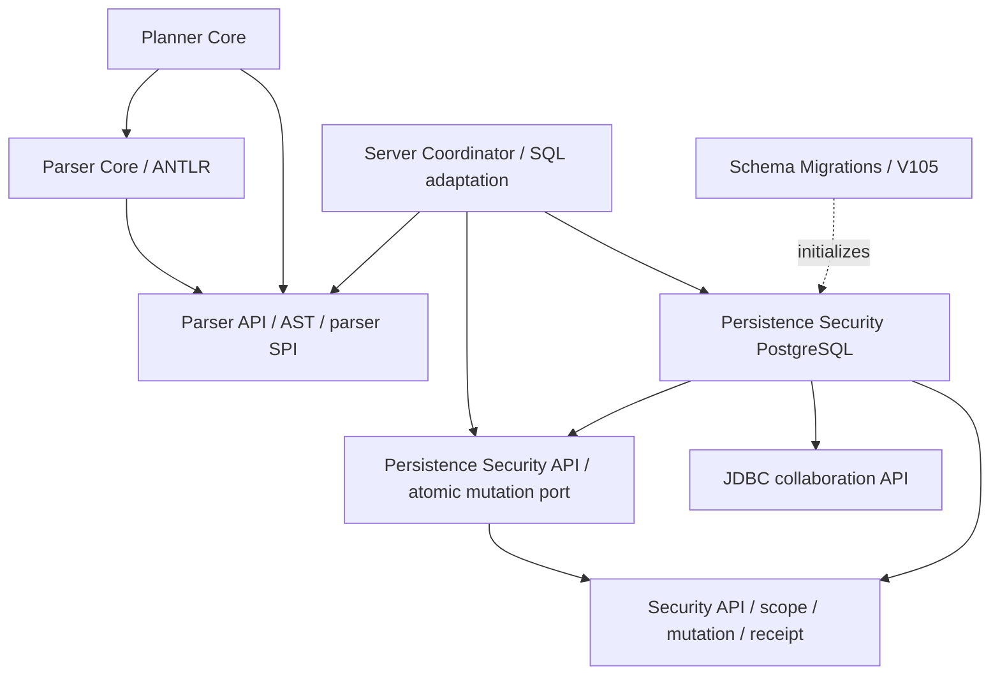

# Parser 契约与 SQL 权限闭环的所有权审查

基线：`parser-split-before` 的 8,058 份工作区文本；这是此前已完成批次之上的增量，
不是 clean Git checkout。保留已有工作区改动。旧的“删除孤立 GRANT/REVOKE AST”仅是
中间状态，已由真实需求实现替代，历史测试记录不作为最终不支持结论。

## 编译与装配边界

Server 根据启用的认证和 PostgreSQL authority 装配 Provider。SQL 适配器只依赖端口，
不创建连接或构造默认后端。NOOP/bypass 与未启用安全的配置显式拒绝权限 SQL。
角色与初始 OWNER 权限通过可信管理入口配置，不根据 `admin` 等名称推导权限。

## 类与能力的闭环

| 能力 | 入口与调用 | 实现、装配 | 状态与资源 owner | 当前支持和证据 |
|---|---|---|---|---|
| 严格解析 | `SqlParser.parse` → `AntlrSqlParser` → family builders | Planner 显式选择 builtin；API 构造器允许注入 | Core 拥有缓存；AST 是不可变值 | 全 Parser 测试、API 最小 classpath |
| 恢复诊断 | API `ParseResult`；Core `parseWithDetails` | ANTLR tree 仅在 Core `RecoveryParseDetails` | tree/位置注册表每次调用独有 | 语法错误、AST literal 错误、位置、限制与恢复测试 |
| 扩展解析 | `StatementParser` SPI → registry | 显式注册/发现，生产未宣称已有第三方 parser | registry 发布完整不可变 snapshot | 优先级、替换和并发发布测试；非热卸载承诺 |
| SQL GRANT | Parser → StatementDispatcher → `PrivilegeStatementTasks` | `PrivilegeAdministrationBootstrap` 注入 JDBC 原子端口 | 领域记录在 PostgreSQL；一条语句一个事务 | 多权限/角色、当前授权、真实 HTTP/Native 读取 |
| SQL REVOKE | 同一控制面路线 | 精确范围 + 支持授权链 + RESTRICT/CASCADE | 单一事务持有已有授权 gate，关闭自己创建的连接 | 独立来源不互相删除；option-only、并发撤权、rename |
| 提交确认 | `SHOW PRIVILEGE MUTATION '<UUID>'` → `findReceipt` | 同一 Server task 与 PostgreSQL port | receipt 与原操作同事务持久化 | 仅原 principal 可见；撤权后可查询；未知不等于回滚 |

`GrantPrivilegeStatement` / `RevokePrivilegeStatement` 已从孤立标量声明重构为真实语法使用的
多权限、多角色值类型。`SecurityStatementHandler` 的未授权 Store 写入路径已删除；
没有保留旧 FQN 壳、第二个权限变更 owner 或假的 Memory 实现。

## 权限变更的一致性

1. 验证请求结构与 actor，借用 Server 的 DataSource 创建连接。
2. 明确事务与 READ COMMITTED；设置事务内锁等待、语句超时。
3. 在任何角色/授权读取之前取得现有 exclusive authorization gate。
4. 同 ID、同 principal、同 payload 的重放返回已有回执；不同内容拒绝。
5. 从当前角色目录读取直接角色和显式 group 映射，选择实际支持的 OWNER/GRANT OPTION。
6. 校验全部角色，再执行整个多权限/多角色变更。
7. 同事务写入 revision 对应的持久化回执与审计信息，提交。
8. 提交确认丢失报告 outcome unknown；不换 ID 盲目重试，不降级到 Memory。

取消或调用超时不证明事务回滚。使用原请求 ID 查询提交回执；`UNCONFIRMED` 不是失败证明，
也不将存储不可用伪装成未提交。已提交回执不会因为当前授权随后被撤销而消失。

跨 Coordinator 的权限检查读取当前数据库授权。缓存不保存旧的允许决定；编译阶段在优化前
重新应用权限。已进入执行的查询不会仅因这条权限 SQL 自动取消，不能宣称即时撤销在途结果。

## 委派与命名空间

- 每个 SQL 授权绑定一个实际 supporting grant；父 ID 必须更小，数据库拒绝循环。
- 独立 grantor 和独立 supporting grant 保留独立记录，不用“最新授权”替代确定来源。
- 非 OWNER 只撤销自己发出的记录；OWNER 可撤销匹配范围的非 OWNER 授权。
- scope 的 null 是精确 namespace 边界，不是删除所有子表的 wildcard。
- 用户退出发行角色不会自动撤销已作为该角色发出的授权；删除角色或 supporting grant 则级联清理。
- 同一更新语句协调重命名父/子授权后，AFTER STATEMENT 触发器按最终范围检查。
  合法的新范围委派保留；仅父范围变化导致失去覆盖、grant option 被移除或父身份改变时撤销后代。
- 这保证已有 File Space/Storage Profile 的权威更新不会遗留旧权限，也不会因 BEFORE ROW
  清理正在更新的子行而破坏原子重命名。

## 资源与初始化

| 资源 | 创建者 | 使用者 | 关闭/回收 |
|---|---|---|---|
| DataSource | Server 既有数据库生命周期 | PostgreSQL Provider 借用 | Server 关闭一次 |
| 事务/Connection | `JdbcPrivilegeMutationRepository` | authority/row/ledger helper 借用 | 同一个 repository 提交或回滚、关闭 |
| Statement/ResultSet/SQL Array | 各 JDBC helper | 当前操作 | 局部 try/finally；不关闭上游 Connection |
| supporting-grant 链 | SQL 原子操作 | 授权/撤权流程 | 数据库 FK 级联及最终状态 guard |
| mutation receipt | 原子提交 owner | 重放与原 principal 查询 | 当前不删除幂等键；未建设历史数据迁移工具 |
| Native/JNI/Proto 资源 | 原有 owner | 本批复用 | C++/JNI/协议源码未改；不新增零拷贝、ASan 或性能结论 |

V105 及其 SHA-256 清单仅由 `pangrova-schema-migrations` 持有；既有 SQL migration 字节保持不变。
本轮没有历史数据库转换、双写、旧库兼容或自动清空环境。测试使用临时 PostgreSQL schema。

## 验证解释与剩余工作

`SqlPrivilegeAuthorityE2ETest` 经 HTTP 认证过滤器、真实 SQL 路由、PostgreSQL 和 Native/Iceberg
验证授权放行及撤权拒绝。其 bearer authenticator 是显式测试身份 fixture；OAuth2/LDAP 的真实
实现由另外的认证集成测试验证，不把两组证据误称为同一次外部 IdP 部署测试。

列级授权语法、角色成员 SQL DDL、role inheritance 不在当前语法支持内，不用孤立 AST 或空实现宣称支持。
OWNER 的变更仍归 ownership 操作。本轮不是全仓生产验收：Coordinator 16 包依赖环、余下领域拆分、
Shuffle 通用化及最终全量回归仍需继续。所有首败和当前结果见相邻验证台账。
