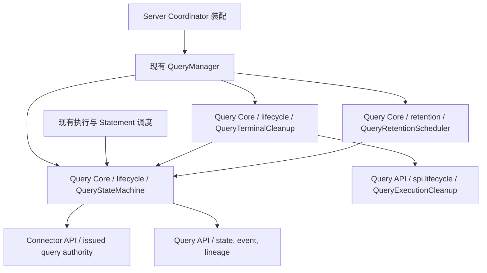

# Query 状态、终态清理与历史保留的领域所有权

本批属于全仓方案 P6 的一个能力闭包，不代表 QueryManager、整个 Query 编排、
Coordinator 包环或最终发行验收已经完成。基线为当前工作区 8,126 份文本，
保留用户和前序批次改动；目标 ADR 仍是唯一设计决策。

## 模块与调用方向

- `QueryStateMachine` 是唯一内存状态转换 owner，不是 PostgreSQL journal 的替代品。
  它保留既有状态集合、transition reservation、journal/fence 前置记录、状态发布和通知顺序。
  阻塞 I/O 在状态 monitor 外进行；Connector admission 与终态预约共享同一关闭边界。
- `QueryConnectorAuthority` 与状态机一起进入 Core，保持 package-private。绑定的是实际
  issued authority 对象，不能用 query ID 再查一个对象代替。metadata begin/cleanup 和操作
  permit 的原有生命周期保持；重试保留失败 catalog 的 cleanup 责任。
- `QueryTerminalCleanup` 通过已有 Query API cleanup 端口调用实际执行 owner，不依赖
  `QueryDispatcher` 实现。journal → 逻辑通知 → cancel/drain/cleanup → 物理 bookkeeping
  顺序不变；失败保留 pending owner 和有界 backoff。退出线程仅排队，不同步跑数据库 I/O。
- `QueryRetentionScheduler` 是原 `QueryCleanupScheduler` 的明确命名。它只在逻辑通知已完成、
  物理清理已完成且无 pending completion 时移除保留记录。现有周期、并发上限和到期依据
  不变；本轮没有把到期时钟或历史保留语义一起改写。

Query Core 新增的生产依赖只有 Connector API；并发锁注解直接使用现有 Common，
不引入传递 SDK。Security/Observability API 的新增显式测试依赖只服务隔离加载验证。
原同包协作者跨模块后调用的内部 lifecycle 控制方法显式公开并注明 owner 前置条件；
这些实现类标记 `@Internal`，不新增一个与 API 并列的 SPI 制品，不虚构多实现状态机。
Core 不反向依赖 Coordinator、Worker、Planner、Server 或持久化 Provider。

## 就绪观察的行为修复

两个原返回值 `resultEndpointReady()`、`writeDispatchReady()` 曾暴露 owner 持有的
`CompletableFuture`。调用方可自行完成或取消它，伪造派发完成，或污染其他观察者。
新增两项测试先在原行为复现失败，再将这两个返回值改为 `copy()`：

- 返回的 wait 属于观察者；complete/cancel 只改变该观察者自己的等待。
- 实际 endpoint 与 write-dispatch readiness 仍由状态机及执行 owner 发布。
- 设置 endpoint 不绕过 RUNNING/FINISHING/FINISHED 状态检查。
- 提前 `markWriteDispatchReady()` 不构成派发完成。
- Native 写完成、控制面发布完成、逻辑终态与物理释放仍为不同事实。
- QueryAsyncSubmission 的实际监听调用已同步验证，没有引入轮询或额外调度线程。

## 资源与事实台账

| 事实/资源 | 创建/修改 owner | 使用者 | 结束/释放 owner |
| --- | --- | --- | --- |
| query state 与 retained journal fact | QueryStateMachine；journal collaborator 提交实际记录 | QueryManager、dispatch、stage callbacks | 终态不可再转换；Retention 在物理完成后移除记录 |
| issued Connector authority | 既有执行 owner 创建，QueryStateMachine 绑定一次 | Metadata/Connector 操作 | 执行 owner 关闭 admission/drain，QueryConnectorAuthority 重试 metadata cleanup |
| readiness future | QueryStateMachine | 每个观察者持有 copy | 只有实际状态 owner 完成原 future；取消 copy 不取消任务 |
| terminal pending completion/backoff | QueryTerminalCleanup | 退出通知和调度工作线程 | 实际 cleanup + physical release 成功后移除 |
| admission reservation | 既有 admission owner | 查询与尚未 drain 的执行 | 原串行 cleanup owner 释放；失败保留 release obligation |
| registry | 现有 QueryManager | 状态查询与 retention | QueryRetentionScheduler 按原 eligibility 移除 |
| timer/cleanup executor | Server/进程装配 | cleanup/retention 借用 | 原进程 owner 关闭；本批类只停止自己的调度 |
| QueryStateJournal/数据库连接 | 现有 Persistence Provider / workflow | lifecycle 的原 journal collaborator | 原 Provider/事务 owner；本批不新增连接或提交权 |

## 验证边界

既有状态、listener、stage view、终态 cleanup 与 retention 测试迁入 Query Core；
真实 tracker、Frontend operation、PostgreSQL journal 和 Native 资源测试留在实际组合模块。
`QueryLifecycleIsolationTest` 在只包含 Core 与必需 API/Common/SLF4J 的隔离 loader 中
加载这四个 owner、反射实际签名并完成状态转换，且拒绝 Coordinator/Worker/SDK 类。
这不是整个 Query Core 所有业务的最小 classpath 宣称。

结构测试保留原存在性和上限检查，并改为检查 Query 的真实域 owner 及 Coordinator 中
无重复类；源码目录缺失或读取失败不再伪装通过。生产算法没有因为结构门禁而被删除。
逐类证据分别记录纯 FQN/类型名替换与实际行为/可见性调整，不能把词法扫描当作语义审查。

命令、首败、修复、当前测试、制品和剩余包环见同目录 `query-lifecycle-*` 证据及总实施记录。
未完成的 QueryManager/dispatch、Generation/AI/DAG 相互依赖仍须继续拆分，不能将本批
退出一个循环节点说成全量回归或生产级验收已通过。
