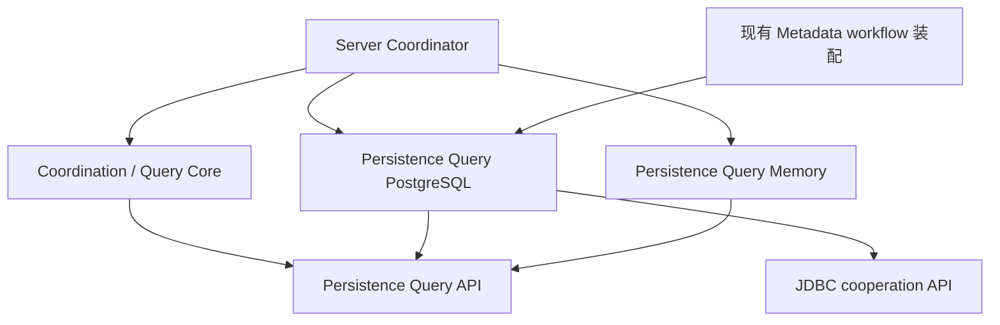

# Query Persistence 后端拆分与显式装配

本批承接 P4：拆出已有 Query 后端，不新增数据库、不建设历史迁移，不宣称整个重构完成。
基线为本批开始时 8,476 个文本文件的实际工作区；已有改动全部保留。

## 制品和包所有权

| 制品 | 包根 / 内容 |
| --- | --- |
| `pangrova-persistence-query-api` | 既有 Query audit、state journal、anchor、write intent、quarantine、lineage 端口；没有新增单独 SPI 制品 |
| `pangrova-persistence-query-postgresql` | `org.pangrova.persistence.query.postgresql`；coordination、state、transaction、lineage、event，12 个现有生产类 |
| `pangrova-persistence-query-memory` | `org.pangrova.persistence.query.memory`；coordination、state、transaction、audit，5 个现有生产类 |

同时迁移 10 个既有测试。原通用 JDBC/Memory 模块删除 Query 包；无旧 FQN 转发壳。
PostgreSQL 实现仅依赖契约、JDBC 协作端口、Security Codec 和其技术依赖；没有 Metadata、
Query Core 或通用后端的生产依赖。原有事件集成测试对 Query Core 的依赖限定在 test scope。

图中的 Metadata 实现依赖是仍需迁出的现有协作入口，不是最终目标；manifest 仍只允许其
使用 coordination/transaction 两个具体子包。没有通过开放全包掩盖跨域事务边界。

## 行为与资源

- HA 构造器必须得到明确的 `ExecutionAnchorStore`。缓存内 backend 为 final，删除 setter。
  后续绑定 process authority 必须是同一个 backend 实例且在启动前；不能替换为另一个权威。
  Server 的 durable 路径先要求实际 process authority；无 DataSource 的显式非持久模式选 Memory。
- Task status completion 必须得到明确的 write journal。构造上下文拒绝 null；删除 Core 内
  自动创建 Memory journal 的逻辑。无推测执行的工厂也必须显式传入 journal。
- `JdbcWriteCommitJournal` 不再执行 `CREATE TABLE IF NOT EXISTS`。构造时用零结果查询
  验证 canonical 必需字段；缺失 schema/字段直接失败且未接收写入，错误归为
  `REJECTED_BEFORE_TRANSFER`。该探测不是完整 schema 校验的替代，空库初始化仍由 migration owner 执行。
- 既有 schema 序列未修改。新增 PostgreSQL 测试验证未初始化时不偷偷建表、统一空库初始化后
  可用，以及缺少必需列时拒绝启动。仅在测试隔离 schema 内删除列，无用户环境清空操作。
- 其他 16 个迁出生产类经包名前缀规范化后代码完全一致；SQL、事务、锁顺序、fencing 和
  资源关闭行为保持。执行 fence 继续在 share lock 后读取 database clock；不替调用方提交事务。
- Journal pending/flush/entered-SQL 的所有权不变；不把关闭超时当作已释放，不增加取消 Future 后
  丢弃 admitted writes 的路径。DataSource/pool 仍由外部装配者管理。
- Memory 仍仅提供 JVM 内保证；COPY 明确拒绝，不能冒充 durable downstream publication。
  事件监听器仍是带 `audit_event_lost` 日志的 best-effort 历史记录，不能宣称零丢失审计。

## 验证和边界

验证记录按本批实际执行生成，不继承上一批通过结果。首次全 reactor 在 POM scope 变化后因
模块 baseline 尚未刷新而失败；修复为重新生成真实基线，没有放宽门禁。

额外 Native COPY 验证发现既有测试 fixture 的 `readPlan` 未设置 Substrait Version（本批开始前
的快照亦如此），真实 TaskManager 执行因而失败，等待 handle 的断言最终超时。已改用统一
`SubstraitProtocolVersion.build()`，并让等待期间的 FAILED/CANCELLED 状态立即暴露。
预算不足场景同时断言具体的 object-store requested-read grant exhausted 错误，防止把
无关的计划失败当作预算校验成功。没有修改 Native 验证器、延长等待或放宽结果/资源断言。
修正后同一完整 COPY 测试类的 4 个测试通过；第一次失败仍保留在验证记录中。

- [逐次命令与结果](query-persistence-validation.tsv)
- [最新选择范围汇总](query-persistence-validation-summary.json)
- [逐测试结果](query-persistence-tests.tsv)
- [FQN 与资源所有权台账](query-persistence-fqn-dispositions.tsv)
- [逐类变更证明](query-persistence-semantic-evidence.json)
- [真实调用引用](query-persistence-callers.tsv)
- [未改动输入证明](query-persistence-input-evidence.json)
- [包依赖图](query-persistence-package-graph.txt)
- [实际 JAR 检查](query-persistence-artifacts.json)
- [角色 classpath](query-persistence-runtime-classpath.json)
- [静态检查](query-persistence-static-evidence.json)
- [Native 制品校验](query-persistence-native-artifacts.json)
- [本批文件处置](query-persistence-file-dispositions.tsv)

本批最终记录：首轮 focused 261 个测试通过；修正基线后的 clean 消费者验证 349 个测试中
348 个通过、1 个既有 SPI 可达性失败；最终 artifact package 317 个测试通过。
恢复消费者 26、数据发布/清理 2、修正后的 Native COPY 4、Worker bootstrap 5 个测试全部通过。
按测试类取最新完整执行，合计 386 个，385 个通过、1 个失败、0 个错误、0 个跳过。
唯一当前失败为 `InMemoryShuffleDataInventory` 未接线；未修改门禁、添加豁免或伪装接线。

实际检查 102 个 JAR、102 个唯一模块名、831 个编译包：无 split package、旧 Query 后端引用、
新 Query provider 在 Core 中的反向依赖或 provider 平行建表语句。源码包图为 825 个包、零循环。
Coordinator/Standalone 使用本批新 Query API/PostgreSQL/Memory JAR；Worker 不包含 Query Persistence。
三个 Native 制品 SHA-256 一致。验证平台为本机 macOS arm64、JDK 17、Maven 3.9.16 和 Docker，
不是 Linux/全部平台、完整生产回归或性能验证结论。

仍需继续完成 Provider 强类型 factory/能力描述、Metadata/workflow 的实际事务拆分、剩余
Persistence 领域，以及通用 Shuffle 的完整生产装配。该批没有给既有 best-effort 审计或 Memory
增加耐久性保证，也不证明全量生产回归、性能基线或所有并发时序已经完成。
