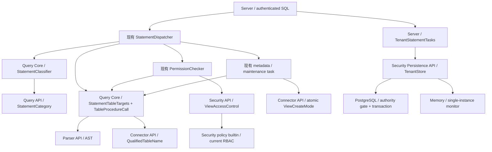

# Query 语句分类、精确绑定与 SQL 权限闭环

本批继续实施 P6/P5，基线为当前工作区 8,142 份文本。没有覆盖既有工作区，也不代表
全仓方案或 Query 编排已经完成。`domain-modularization-adr.md` 仍是唯一目标 ADR。

## 领域边界

- `StatementCategory` 移入 Query API，仅有枚举值；不引入 Parser、Core 或 Provider。
- `StatementClassifier`、`StatementTableTargets`、`SessionTableNames` 归 Query Core。
  生产依赖只新增 Parser API；Parser Core 只用于测试。Core 不依赖 Metadata Core、
  Coordinator、Server、数据库或 Connector 实现。
- 内建语句按 `StatementType` 穷尽分类，不再让遗漏类型默认为 QUERY。分类不等于注册或
  支持；明确没有执行实现的 ALTER/DESCRIBE CATALOG、BACKFILL/CANCEL、USE BRANCH
  不被归入查询。已有分类家族的 leader 策略保留，新增 VIEW、Embedding Model、Storage
  Profile 元数据变更进入 DDL；REMOVE stage 的完成分类与 MAINTENANCE 对齐。
- 统一 AST target registry；`AlterTableStatement` 通过族接口取目标。权限入口与任务完成
  事件使用同一份精确 component binding。Connector API 的值类型支持显式默认 catalog/schema，
  不再为了字符串限定引用 Metadata Core。Metadata 保留实际跨 catalog rename 校验。
- 删除旧分类/target/session FQN 和 `ProcedureTableArguments`，不保留转发类。
  `StatementDispatcherPropertyTest` 仍测试真实 Dispatcher，未因为迁包改成仅测试纯分类。

## CALL 与维护

`TableProcedureCall` 是 Core 内部不可变绑定值，不是 Provider 工厂。绑定不做 I/O、权限
检查或支持探测，不拥有连接、线程或 buffer。支持 `catalog[.namespace].procedure`，
目标始终绑定到明确 catalog；connector 参数的既有 literal 转换保留。

Warmup 只接受一个 `schema.table` 或两个独立 schema/table 字符串。两个参数保留字面点号、
大小写与边界；空值、非 literal、额外参数和无 catalog 的调用在执行前拒绝。权限检查
和实际读取不能各自把相同参数解析成不同目标。Warmup 检查 SELECT，其余已建模 maintenance
保留 ALTER、ownership、maintenance policy 与 lease 检查；未知 connector procedure 不因
绑定成功而变成可执行。

`TableWarmupExecutor` 只接收已绑定目标，保留原 split/source/batch 的关闭责任。
`CacheWarmupService` 向同一 executor 传 typed target，不引入新缓存 owner。其历史 FQN
pin/调度语义未在本批重写。四类 maintenance 的返回目标显示改为精确 session-qualified 名称。

## VIEW

Security API 同制品增加 `ViewAccessControl`，由实际 DynamicRbacAccessControl 实现：
CREATE_VIEW；替换还需 ALTER；DROP/IF EXISTS 均需 DROP。无 identity/provider 时拒绝。
CREATE_VIEW 的 SQL 授权作用域是 SCHEMA/CATALOG，不能写成 GRANT CREATE_VIEW ON TABLE。
当前关系匹配仍遵循既有 schema/catalog grant 下的精确 target 检查。

Connector API 定义三种原子创建模式。Iceberg Store 的 CREATE/IF_NOT_EXISTS 使用
`putIfAbsent`；只有 CREATE_OR_REPLACE 覆盖。DROP 根据同一次 remove 的结果处理缺失。
任务不再用 get-then-write 模拟原子模式，OR REPLACE + IF NOT EXISTS 显式拒绝。

现有 view definitions 的事实 owner 仍是 Iceberg catalog 实例内的内存 store；本批没有
把它宣称为外部 Iceberg Catalog 的持久视图。Paimon/Lance 创建不支持，继续显式拒绝。
这是已知能力限制，生产持久视图需要单独实现真实 catalog 能力，不能靠目录重命名完成。

## 租户成员：门禁暴露的问题及实际修复

移除 `instanceof` 分类引用后，可达性门禁指出 GRANT/REVOKE TENANT 两个 AST。逐链核查
发现语法未接入、任务未注册，旧 TenantLifecycleManager 还把 principal 写进 allowedSchemas。
没有给门禁加豁免、删掉需求或重新加入无意义引用。

实际链路为：ANTLR grammar → 现有 AST → print/parse → Server registration →
authenticated actor → `TenantStore.mutateMembership` → canonical `tenant_user_memberships`。
原错误任务和 lifecycle membership 方法删除；生命周期类仍负责真正的 tenant onboarding/status。

- 输入使用 exact tenant ID 和单个 principal，两个名字可带引号保留点号；无 suffix 截断。
- 当前 ACTIVE tenant 的 OWNER/ADMIN 才能授予/撤销 MEMBER。身份组名和旧 session role
  不构成授权。每次幂等调用仍重新检查当前授权。
- 同租户 GRANT 保留已有角色；REVOKE 拒绝 OWNER/ADMIN。不能跨租户转移 principal。
  不修改 allowedSchemas、allowedCatalogs、quota、tenant properties。
- PostgreSQL 在 READ COMMITTED 下先取现有 authorization mutation gate，再读当前 tenant
  和 membership；同事务写入、提交。所有相关表已有 canonical schema 的 gate trigger，
  不新增 schema、平行初始化或数据迁移。
- 事务 owner 独占连接、commit/rollback/close。失败保留主异常；确认丢失以专门的 unknown
  异常报告。当前 membership 可查，但不是历史请求回执，不能声称 exactly-once receipt。
- Memory 在原实例 monitor 内完成同样的逻辑检查与写入，不宣称持久性或分布式保证。
- 原 `addUserToTenant/removeUserFromTenant` 明确是可信 provisioning 接口。SQL 不调用它们
  绕过授权。生产装配要求 security enabled、非 NOOP authenticator 和数据库；否则 SQL
  明确不可用，不隐式选择 Memory。
- `SecurityAdministrationBootstrap` 统一这一配置边界；它替代原只注册 privilege 的命名。

## 证据与剩余范围

逐类台账和语义 diff 覆盖当前全部生产变更，不用包扫描冒充语义审查。词法等价只排除
package/import/comment/空白并进行已记录 FQN 替换，保留 literal。其余逐项记录行为变化。
测试证据保留首败、编译遗漏、契约期望更新及修复后的实际结果。

本批没有拆除其余 Coordinator AI/Generation/DAG 环，没有完成 QueryManager、Worker、
Persistence 全家族、Shuffle 或最终发行。现存 SET SESSION no-op、USE BRANCH/BACKFILL
执行缺口继续列入 P6 能力补全，不能因存在 AST、文档或分类就宣称已支持。
性能、ASan 和其他平台未在 Java-only 本批新增结论。
