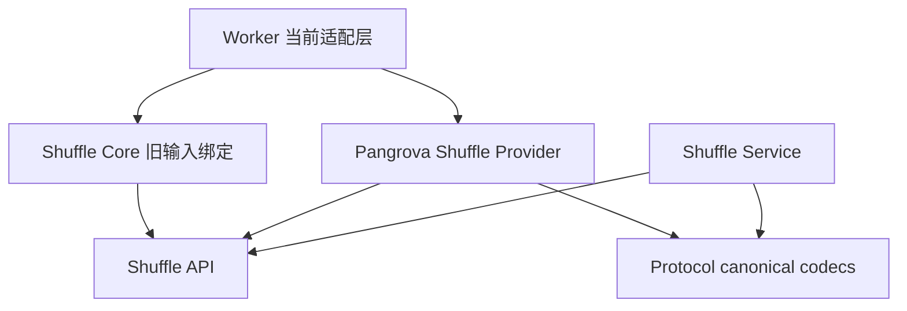

# 自研 Shuffle Provider 的 Core 依赖清理（2026-11-03）

本批以当时工作区 8,368 个文本文件建立基线，继续落实“Provider 面向契约、公共编码有唯一 owner”。
没有新增空模块，也没有通过扩大通用 API 引入固定服务端模型。

## 实际边界

- `ExchangeTaskAttempt`、`ExchangeAttemptFence`、`ExchangeChannelContext` 从 Core 迁入统一 API 的
  `.api.identity`。字段、当前 fencing 校验、Worker incarnation 和 deadline 不变；没有旧 FQN 壳。
- `ShufflePartitionManifestChecksum`、`ShuffleProducerSetChecksum` 从 Core 迁入 Protocol 的
  `.shuffle.codec`，与现有 CanonicalBatchChunks 同属共享 wire 编码。域分隔、字节序、排序、空分区、
  sequence 和 digest 行为不变，客户端、服务端、Coordinator 改用唯一实现。
- Provider 新增自身的 `PangrovaPartitionRead` 进程内参数：shuffle ID、选定 channel、generation epoch、
  producer count 和 producer-set checksum。复制数组并按内容比较，拒绝不完整参数；无凭据、SDK、
  endpoint、commit address、Native handle 或资源所有权。
- Worker 的 ExchangeProtocolMapper 将当前旧 Native 输入绑定转换为这些参数，RemoteShuffleExchangeSource
  独立接收当前 read access 与真实 channel lease。Native 输入转换和命令字节内容不变。
- Provider 与 Shuffle Service 的 POM 均移除 Shuffle Core 依赖。Provider 最小 Maven classpath 测试
  明确拒绝 Core 类，同时解析自身全部公开/私有类签名；API 最小 classpath 只包含 Common/JDK。

PangrovaPartitionRead 只携带用于实际服务端 terminal 校验的预期证据，不是通用 receipt 或 wire descriptor，
不增加查询发布权限。当前 ExternalShuffleTransport、sealed Native 输入类型和 Native handle 接口仍在
旧 Core/Worker 路径，后续通用 session/Native adapter 重构需要继续完成，不能称本批已交付通用 Provider。
现有身份也不等价于最终完整的 application incarnation/exchange generation 模型。

## 资源和行为修正

原 reader 在把借用 lease 放入受保护的构造路径之前就校验 binding 并创建上下文；参数错误可能让
实际借出的连接无人归还。现在非空 lease 在构造入口移交给 reader，所有后续构造失败都会尝试归还，
保留主异常及附加关闭异常；成功后由 reader.close 归还。实际 RPC、取消、续期、分区完整性和终态
验证仍由原 owner 实现，没有新的并行状态机。

新增真实服务/连接池用例分别让 request 和 access 校验失败，验证 lease 不可再次使用且 pool 可完整
关闭。它不是通过 mock 证明释放。既有空分区 terminal、续期、并发关闭、读取消和连接淘汰测试保留。

## 审查与验证范围

25 项生产类处置，21 项规范化 token（保留字符串字面量）完全相同；4 项明确记录读取请求及适配/关闭
变化。228 条当前引用单列。Native、JNI Bridge、Proto schema、Persistence、Schema、Client、Server
装配、Local Provider 和 Native Adapter 文本输入与基线一致。

初次 Provider 定向 38 项通过，Worker 与上游定向 60 项通过。批量迁移时 Local 隔离测试中的一个旧类
负向字符串被跟随替换，输入证据核验识别该错误，已恢复为旧类必须不存在的原断言。最终选择包含该
隔离测试；没有放宽约束。

跨模块选定 141 项，140 通过、1 项已有 SPI 装配门禁失败，仍为 InMemoryShuffleDataInventory、
SpoolingExchangeManager、LocalSpillLifecycleManager。真实 Durable Shuffle 11 项、权限续期 6 项、
连接生命周期 8 项（含新增构造失败资源回收）、双 Worker、启动与既有出站等测试通过。
独立 JVM 的 Native 入站 3 项、出站 1 项、接纳 1 项全部通过。

新增长期架构测试检查 API/Local/Pangrova Provider/Shuffle Service 的 reactor 生产运行依赖闭包，禁止
Core、Worker、Native Bridge、Coordinator、Server、Planner 实现及测试工具进入这些闭包。
沿 compile/runtime scope 遍历，测试依赖不计入生产运行闭包；发现违规时报告完整依赖路径。
最终 package 的该项及相关结构/Local 隔离共
22 项通过；按类取本批最近结果共 148 项，147 通过、1 项 SPI 门禁失败，没有继承旧批次通过结果。

97 个 JAR、97 个唯一模块名、827 个编译包无审计违规；821 个源码包无循环。实际 Shuffle Service
可执行 JAR 含当前 API/codec，且不含 Core 的 exchange/spool/算法类。三种角色各加载一份当前 API，
Worker/Standalone 各加载一份当前 Provider，SHA 与 reactor 产物一致。本批没有容器部署结论。
上述选择执行并不是无筛选的 full-regression verify；既有三项 SPI 缺口未豁免，完整计划仍继续实施。

本批 Java 值类型/适配变化没有修改 JNI、Native 内存所有权、协议字段或算法；仍使用与源码匹配的
Native 制品运行真实边界链路。没有新的 ASan、性能、Celeborn、Local 生产接入或全量完成结论。

## 证据

[FQN 处置](shuffle-provider-boundary-fqn-dispositions.tsv)、
[逐类语义](shuffle-provider-boundary-semantic-evidence.json)、
[当前调用](shuffle-provider-boundary-callers.tsv)、
[输入校验](shuffle-provider-boundary-backend-evidence.json)、
[包依赖图](shuffle-provider-boundary-package-graph.txt)、
[验证命令](shuffle-provider-boundary-validation.tsv)、
[逐测试](shuffle-provider-boundary-tests.tsv)、
[验证汇总](shuffle-provider-boundary-validation-summary.json)、
[发行物](shuffle-provider-boundary-artifacts.json)、
[启动 classpath](shuffle-provider-boundary-runtime-classpath.json)、
[静态门禁](shuffle-provider-boundary-static-evidence.json)、
[Native 制品](shuffle-provider-boundary-native-artifacts.json)、
[文件处置](shuffle-provider-boundary-file-dispositions.tsv)。
