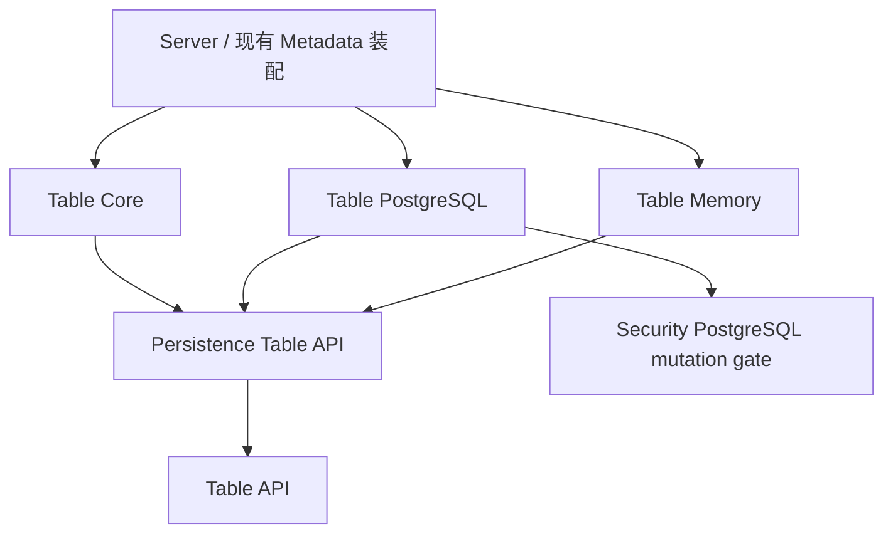

# Table Persistence 领域拆分与治理绑定保存回执

本批从 8,496 个文本文件的当前工作区继续 P4，不回退已有改动。13 个生产类型、8 个既有
测试迁入三个实际制品；原通用 Memory 模块的最后四个 Table 实现迁出后，删除旧模块。

| 制品 | 内容与依赖 |
| --- | --- |
| `pangrova-persistence-table-api` | control、maintenance、statistics、governancebinding 四个端口及 TableControlException；只依赖 Common/Table API |
| `pangrova-persistence-table-postgresql` | 四个既有 PostgreSQL Store；JSON/JDBC support 和真实 Security PostgreSQL mutation gate 依赖显式保留 |
| `pangrova-persistence-table-memory` | 四个既有进程内 Store；无 Core、Metadata、JDBC 或数据库 SDK 依赖 |

包根统一为 `org.pangrova.persistence.table.api/postgresql/memory`。没有创建空 SPI、Provider、
contract-tests 模块或旧 FQN 转发壳。Table Core 移除通用 Persistence API 依赖，面向独立端口。
所有旧 Memory POM 依赖、Docker 收集路径、manifest 和实际调用已调整；测试负向守卫继续拒绝
旧制品，同时加入新 PostgreSQL/Memory 后端，未削弱 Core 隔离检查。

Metadata 的既有默认存储、装配和同连接 workflow 尚未全部迁入最终 Server/workflow 位置。
本批保留事实与事务 owner，不把新的目录当作 Metadata 重构已经完成。Metadata 对同连接治理
读取的 friendExports 仅迁到新制品，没有扩大允许包。

## 原子边界与实际缺陷修复

纯迁移阶段的 13 个生产类经前缀规范化后与基线完全一致；迁移前后各 108 个定向测试通过。
表控制 Store 的 revision guard、名称预留、失效事件和版本观察仍由一个事务负责；没有
将 saveWithObservation 拆成两次写入，也没有改写 schema、锁顺序或初始化序列。

随后补充治理绑定保存回执测试，确认三处同一问题：

1. PostgreSQL upsert 原本保留数据库中的 bindingId/createdBy/createdAt，却返回传入对象。
2. Memory 原本直接替换整条记录，覆盖首次创建身份。
3. TableControlPolicyBinder 忽略 Store 返回值，返回保存前的候选对象。

后端回归先出现 4 个失败，Core 单独回归再出现 1 个失败。修复明确了统一契约：按
`(tableId, bindingType, bindingRef)` 原子 upsert，更新只替换 config/updatedAt；首次胜出插入
的 ID、创建者和创建时间保留，返回值必须是本次操作建立的记录，不能另做一次可能被其他
writer 改变的读取。PostgreSQL 使用 RETURNING，在原权限 mutation 锁保护的事务提交后返回；
save 失败显式尝试 rollback 并保留主异常。Memory 用 compute 原子保留身份；Core 返回保存回执。

修复后的 113 个定向测试通过。并发 PostgreSQL 测试进一步使用两个独立 Store 实例；Memory
测试只验证一个实例内的并发保证。Memory 不声明跨实例、跨进程或重启耐久性。

静态 caller-connection list 继续只读调用方事务，不 commit/rollback/close。DataSource 属于
外部装配者；本批没有增加连接池、数据库产品、历史数据迁移或自动清库。

## 证据与范围

- [FQN 处置与资源 owner](table-persistence-fqn-dispositions.tsv)
- [逐类变更证据](table-persistence-semantic-evidence.json)
- [调用引用](table-persistence-callers.tsv)
- [未改动 Native/协议/schema 等输入](table-persistence-input-evidence.json)
- [逐次命令与结果](table-persistence-validation.tsv)
- [验证汇总](table-persistence-validation-summary.json)
- [逐测试](table-persistence-tests.tsv)
- [源码包图](table-persistence-package-graph.txt)
- [实际 JAR](table-persistence-artifacts.json)
- [角色 classpath](table-persistence-runtime-classpath.json)
- [静态检查](table-persistence-static-evidence.json)
- [Native 制品](table-persistence-native-artifacts.json)
- [文件处置](table-persistence-file-dispositions.tsv)

本批最终验证：baseline 108 PASS、纯迁移 focused 108 PASS；后端回执回归 9 个测试中
4 FAIL、Core 回归 8 个测试中 1 FAIL（新增测试先复现，失败记录保留）；修复后 clean focused
113 PASS；clean 消费者验证 230 / 229 PASS / 1 既有 SPI FAIL；最终 artifact package
198 PASS；独立 Worker bootstrap 5 PASS。按迁移后的 FQN 归一化并取每类最新执行，共
235 个测试，234 PASS、1 FAIL、0 ERROR、0 SKIP。
唯一当前失败仍为 `InMemoryShuffleDataInventory` 未接线；没有改门禁或加入豁免。

104 个实际 JAR/唯一模块名、831 个编译包检查通过；无旧 Table FQN、旧通用 Memory JAR、
split package、Table Core 后端依赖或 Provider 平行 DDL。源码 825 个包零循环。
Coordinator/Standalone 使用本批新 Table API/PG/Memory 制品，Worker 不包含 Table Persistence。
8 项静态检查通过，三处 Native 二进制 SHA 一致。验证基于 macOS arm64、JDK 17、Maven 3.9.16
和 Docker；未构建 Linux 镜像或完成全平台/性能/完整生产回归，不将选择范围结果扩称为全量通过。

本批不代表 Table 各项持久化语义已经全面等价。已核实的后续项包括：版本观察在 PostgreSQL
按 observation_id 倒序、Memory 按 observedAt 倒序，需在后续契约一致性批次明确并统一；
Metadata 的默认后端与跨域 workflow 仍需抽离；治理绑定 delete/deleteAll 的事务失败处理
本批未改动。完整 Provider factory/能力声明、通用 Shuffle 和全生产回归仍在原计划内。
