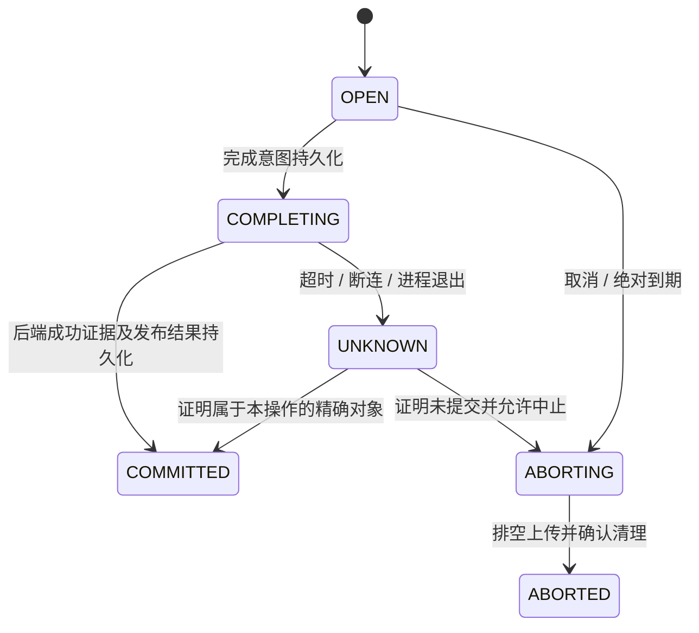

# Table / File Plane 架构对齐与规模设计审查

日期：2026-10-25（Asia/Shanghai）。Status: Target architecture / Review — 设计裁决与源码审查，不是生产资格证明。

审查基线：`7c50471b`；实现状态见[合并台账](table-and-file-plane-readiness-2026-10-25.md)。
本文细化[多模态存储设计](multimodal-storage-management-design.md)，保留既有模块边界及唯一 canonical v2 执行路径。
厂商公开行为、当前源码事实、Pangrova 设计选择分别陈述，不推测厂商私有实现。

按用户本次要求，100 GiB 传输、亿级目录、PB 数据面及 Linux 生产环境资格留待专用测试环境。
当前先完成架构对齐、容量推导和有界的正确性验证；不在开发机创建这类规模的数据，也不因此关闭发布门槛。

## 1. 审查结论

保留 Volume / Stage 命名与治理、FILE 引用、目录投影、存储版本、表快照五层分离。
保留 PostgreSQL 作为初期控制状态权威、Worker 传输内容、Native 执行关系查询的方向。
独立对象仍是通用存储基线，Paimon / Lance 聚合只作为经过能力验证的工作负载选项。

Native DIRECTORY 接入之前，需要先把以下设计约束落到协议与状态机：

1. 目录查询固定不可变 generation / Manifest，避免每个查询把 Worker 和控制数据库的长事务绑定。
2. 分离短期授权、长任务所有权和存储版本；授权续期不能重新解析另一条路径或另一代对象。
3. 上传恢复依赖持久会话、幂等结果及 UNKNOWN 协调，客户端持有签名 token 不等于服务端具有恢复日志。
4. 治理、保留与回收使用稳定身份；目录完整性、表提交成功和字节保留分别证明。

这些选择来自下述公开语义与源码约束。它们尚未全部实现，不能把本次设计审查改写为功能完成。

## 2. 官方资料重新核查

下列页面均于 2026-10-25 访问；产品的云、版本、Preview / Beta 范围按来源保留。

| 官方事实 | 对 Pangrova 的影响 |
|---|---|
| Databricks Volume 管非表格文件；external volume 删除不移除云端原件。managed 与 external 的生命周期不同。[Volumes](https://docs.databricks.com/aws/en/volumes/) | 名称、访问权限与物理删除权分开；注册外部路径不自动取得生命周期所有权。 |
| Databricks FILE 仍标为 Beta；元数据与内容权限分开，managed FILE 自动 GC 在 Beta 中尚不支持。[FILE](https://docs.databricks.com/aws/en/unstructured/file) | 参考 FILE / FileSpace 分层，但自行证明快照根、跨表引用和 GC，不能借用厂商名义宣布自动回收正确。 |
| Snowflake FILE 保存引用；源文件变动不会自动改写 FILE，删除 FILE 行也不删除源文件。[FILE 类型](https://docs.snowflake.com/en/sql-reference/data-types-unstructured) | 表时间旅行不等于字节时间旅行。版本固定与保留保证需要独立能力。 |
| Snowflake 手工刷新需要 LIST，大 Stage 可慢且昂贵；推荐选择性 SUBPATH。内部 Stage 自动刷新当前为 AWS Open Preview。[手工刷新](https://docs.snowflake.com/en/user-guide/data-load-dirtables-manage)、[自动刷新](https://docs.snowflake.com/en/user-guide/data-load-dirtables-auto) | 查询不能触发全桶枚举；刷新按范围维护，并明确失败、进度、coverage 与 freshness。 |
| Databricks file events 共享事件设施与缓存；首次、位置失效等情形仍做枚举，并补充周期盘点。[File events](https://docs.databricks.com/aws/en/ingestion/cloud-object-storage/auto-loader/file-events-explained) | 一个来源维护共享发现日志和消费者水位，加入受预算约束的补齐机制；不能为每个查询独立监听或回扫。 |
| S3 对单 key 的更新原子，成功写入后的 GET / LIST 强一致；不提供跨 key 原子更新。[一致性](https://docs.aws.amazon.com/AmazonS3/latest/userguide/Welcome.html) | “对象强一致”不能推出多页 LIST 是某一时刻的全桶快照，也不能代替 Catalog 与对象的发布协议。此项是基于官方保证范围的设计推论。 |
| S3 通知按至少一次设计，可能重复、乱序。[通知语义](https://docs.aws.amazon.com/AmazonS3/latest/userguide/notification-how-to-event-types-and-destinations.html) | 去重和版本比较按来源 / 对象执行；不要用跨 key 的事件到达顺序建立全局版本。 |
| S3 multipart 本身不会自动到期；分段需显式完成或中止。最终 ETag 不必是 MD5。[Multipart](https://docs.aws.amazon.com/AmazonS3/latest/userguide/mpuoverview.html) | 绝对会话期限必须由 Pangrova 持久维护，独立清理；ETag、版本身份和内容摘要分别记录。 |
| Databricks Range 恢复要求携原 ETag 做 If-Match，变化时返回 412。[Range](https://docs.databricks.com/aws/en/volumes/files-api/range-requests) | 同一次下载不能按新 HEAD 自动换读新对象；版本变化必须失败并由调用者重新开始。 |
| S3 预签名 URL 是持有者能力；到期检查在请求开始时，已开始的下载可能继续。[预签名 URL](https://docs.aws.amazon.com/AmazonS3/latest/userguide/using-presigned-url.html) | URL 到期不是活动流撤权，也不是传输结束证明。严格撤权需要代理控制活动流；直读对外说明其实际边界。 |

公开资料没有证明两家厂商使用了本项目提议的 PostgreSQL 分片、Manifest 格式或 GC 协议。
下文是 Pangrova 的设计选择。厂商 API 限额也不能直接作为 Pangrova 的产品限额。

## 3. 当前源码与目标之间的差距

下表保留原审查基线的差距；2026-10-26/27 的稳定行策略、质量规则身份、文件授权与读取修复见合并台账。
列身份契约的后续裁决见 §6.4，不能把表 UUID 的完成等同于列身份完成。

| 当前代码证据 | 结论与需要落实的改造 |
|---|---|
| [目录刷新](../../pangrova-coordinator/src/main/java/org/pangrova/coordinator/file/StageDirectoryRefreshService.java)逐页处理、完成后发布；扫描开始只签发一次 list grant，后续只重新检查权限。 | 内存有界是已有基础。grant 到期会安全失败，但没有同根续期与进程恢复；大目录需要持久 checkpoint、owner epoch 和受限续期。不能通过无限延长授权解决。 |
| [目录索引](../../pangrova-metadata/src/main/java/org/pangrova/metadata/file/JdbcFileDirectoryIndex.java)先积累 pending，再在事务中 DELETE 当前范围、INSERT 完整新范围。 | 原子可见性与部分刷新不误删已具备基础；发布写入量随范围大小增长，并非 O(1) 指针切换。亿级范围不应直接沿用这一发布方式。 |
| [Worker 页读取器](../../pangrova-worker/src/main/java/org/pangrova/worker/file/JdbcFileDirectoryPageSource.java)直连 PostgreSQL，用一个 repeatable-read 事务保持分页快照；当前无生产 SQL 调用点。 | 它是组件基础，不是 Native DIRECTORY。若直接接入查询，将引入数据库连接、旧行版本保留和故障域耦合，且偏离既有“Worker 不直接访问控制数据库”的目标设计。 |
| [目录引用](../../pangrova-spi/src/main/java/org/pangrova/spi/storage/file/FileDirectoryReference.java)只有 space ID 与定义修订时间。 | Stage 定义身份不能同时表示目录数据 generation。需要另外固定目录 generation、Manifest 摘要、范围与读保护。不能把时间戳当作单调 fencing epoch。 |
| [Multipart 端点](../../pangrova-worker/src/main/java/org/pangrova/worker/file/FileSpaceFileResource.java)支持带绝对期限、绑定存储范围的签名 token；清理所有权留在内存 map，过期清理由新 begin 触发。 | token 可跨 Worker 恢复 provider ID，但不能列出重启前所有待清理会话、提供持久完成结果或保证无人再次上传时也会清理。LOCAL 迁移还依赖实际共享存储。 |
| [稳定 Stage URL](../../pangrova-coordinator/src/main/java/org/pangrova/coordinator/file/StageFileUrlService.java)每次访问重查权限后换取 Worker ticket；[文件端点](../../pangrova-worker/src/main/java/org/pangrova/worker/file/FileSpaceFileResource.java)校验期限后打开内容流。 | 本轮已把 provider URL 的请求 TTL 限制在原 grant 剩余整秒内，读取流在每次 read 前后检查原交付期限，过期关闭并报错，不把读取中到期当 EOF。当前权限变化仍没有主动撤销已签发 ticket / provider URL；阻塞存储调用依赖其独立超时，也不承诺到期瞬间中断已在途网络字节。 |
| [稳定治理绑定](../../pangrova-metadata/src/main/java/org/pangrova/metadata/control/TableControlPolicyBinder.java)和标签已统一为 table ID 权威；前台与后台掩码直接从该权威读取，手工列掩码携 table ID。重命名持久预留两个名称。 | 本轮已推进分类和列掩码的实际读取路径；手工行策略、质量规则、进程级重启与自动重命名协调仍需独立完成，不能据此关闭全部治理门槛。 |

PostgreSQL repeatable-read 能固定数据库快照，不能固定外部对象；长快照还会扩大旧版本回收的约束。
这是根据 [事务隔离](https://www.postgresql.org/docs/17/transaction-iso.html#XACT-REPEATABLE-READ)
与 [MVCC 回收](https://www.postgresql.org/docs/17/routine-vacuuming.html)作出的工程判断，不是当前吞吐或数据库膨胀的实测结论。

## 4. 目录：不可变发布与 Native 执行

### 4.1 明确三种身份

- 命名身份：tenant、catalog deployment、space ID、definition revision、storage profile identity / revision。
- 数据身份：directory generation、不可变根 Manifest 摘要、分区清单、发现水位与观察时间范围。
- 任务身份：现有 canonical v2 的 query / task / attempt、owner epoch、Worker execution identity 与资源 grant。

Stage 重命名可以保留 space ID，但不能让旧任务重新按名字绑定；替换 Stage 或 storage profile 必须拒绝旧绑定。
授权和任务所有权使用当前有效状态，数据使用已固定 generation。三者不能共用一个时间戳或 token。

### 4.2 目标读写链

图是目标职责，不要求新增独立微服务。发现任务可以使用 provider 的 metadata API，但不读取文件内容来构造目录。
Worker 接收受限 Manifest 读取描述，不取得 PostgreSQL 登录信息。
Coordinator 保存权威指针、权限和任务元数据，不为 DIRECTORY 构造关系结果或逐行响应查询。

分区按稳定 space ID 和可裁剪路径范围组织；按需保留虚拟分片编号，物理拆库由实际容量与热点决定。
一次 SUBPATH 刷新只重建与其相交的分区，复用其他不可变分区，最终只切换一个发布指针。
发布 CAS 必须校验 base generation；并发发布失败不能把旧扫描覆盖新观察，必须重新协调或重新构建受影响范围。

每个根记录 schema / format version、分区 URI 与 checksum、行数、路径范围、发现来源、水位、coverage 和观察起止时间。
缺页、checksum 错误或不完整扫描不能解释为 EOF，也不能据此删除目录成员。
失败 generation 私有且不可查询；读取者持有旧 generation 的有界读保护，GC 在保护释放后回收旧目录文件。

### 4.3 对查询公开的语义

一个查询及其重试必须读取同一 generation；谓词、投影、JOIN 和六列构造在 Native 完成。
六列为 `RELATIVE_PATH`、`SIZE`、`LAST_MODIFIED`、`MD5`、`ETAG`、`FILE_URL`；字段 nullability、时间单位和 URL 语义在接入前冻结。
MD5 只有后端确有证据时填写。FILE_URL 是重新鉴权的稳定地址，不把临时 bearer URL 固化进目录文件。

generation 固定的是目录观察结果，不承诺其成员来自外部存储同一个全局时间点。
实际内容读取另带 provider version 或条件校验；外部版本被删除时明确失败，不能自动换成最新内容。
目录 freshness 与 coverage 应通过诊断接口报告，不向既定六列擅自加入内部状态列。
普通目录 SQL 只读目录元数据文件，不对每条记录 HEAD / GET 原文件；这里的“payload GET=0”不排除读取 Manifest 本身。

现有 JDBC 组件保留作正确性对照和迁移来源；在 Manifest 路径完成前，Native DIRECTORY 能力保持未公开。
不增加 JDBC 与 Manifest 两套可自动降级的生产 SQL 执行路径。

## 5. 上传：持久会话与不明结果协调

会话至少持久化 tenant / subject、session ID、幂等键、space 与 profile 身份、目标不可变 key、provider upload ID、
期限、大小 / part 上限、配额预留、owner epoch、已确认 part 凭据、完成结果及清理进度。
provider secret 留在 Worker 的凭据边界，控制记录只保存可解析的配置引用。

这是目标协议。UNKNOWN 未证明前既不能当失败重复发布，也不能解除内容准备保护。
仅 HEAD 到“某路径存在”或 provider 返回 NoSuchUpload 不足以证明本次完成；必须核对操作身份、不可变 key、版本及已记录的完整性证据。
[S3 CompleteMultipartUpload](https://docs.aws.amazon.com/AmazonS3/latest/API/API_CompleteMultipartUpload.html)的 NoSuchUpload 同时可能表示已中止或已完成。
结果回执丢失后的重试返回原结果，不通过新 upload 重写原路径来掩盖不明结果。

跨 Worker 续传须同时满足存储可达、session 当前有效和新 write grant 授权。
独占 LOCAL 磁盘不能仅凭 token 宣称可跨节点恢复；需要节点亲和与恢复范围，或明确要求共享后端。
part 重传不重复预留配额；完成与中止竞争采用持久 CAS，迟到请求不能复活终态。
清理由独立、可接管的维护 owner 执行，覆盖 begin 成功但响应丢失、重启、无人继续上传和后端 abort 暂时失败。
S3 生命周期清理可以兜底，但不能替代 Pangrova 会话结算与审计；回收前还需处理已在途的 part。

## 6. 授权、恢复与保留

### 6.1 四个时钟分别处理

| 时钟 | 目标规则 |
|---|---|
| admission grant | 短期准入；当前权限、租户与操作范围决定是否签发。 |
| operation ownership | 长任务有独立 deadline、持久 owner epoch 与续租；旧 owner 不得提交。 |
| active stream | 需要严格撤权时，代理按约定窗口检查并中止活动流；只检查请求开始时间时必须如此描述。 |
| content / generation retention | 按读取、快照、未决提交和备份保护决定，不以 URL 到期推断已无人读取。 |

现有默认 file grant 为 5 分钟；provider URL 的请求 TTL 不再超过该 grant 剩余整秒，代理读取在原期限前后检查交付。原设计的代理 60 秒、DIRECT 5 分钟和活动流动态撤权窗口仍是待实现/资格验证的目标值。
新范围授权绑定对象精确版本、范围、subject / tenant、操作、issuer / key ID、有效期和相关 epoch。
沿用 canonical v2 的身份与能力约束，不能为 DIRECTORY 再建 feature-specific task 协议或隐式降级。

refresh 的续期重查权限并严格核对原 space / profile / storage root。
同一根上的新授权允许继续原 checkpoint；撤权或定义变化则终止，保留已发布 generation。
恢复不能先用最新名字或最新 storage profile 重构一个“看起来相同”的描述。

### 6.2 表与文件共享的身份规则

table ID、catalog incarnation / revision、format UUID / location 与物理版本承担不同职责。
同 UUID 的 catalog 替换仍需拒绝旧 authority；同名的新表不继承旧标签、掩码、质量规则或统计。
治理的持久源和实际读取投影都需要带 table ID / binding revision，异步事件带同样身份；旧事件不能修改新表的策略。
重命名需要 durable intent 记录旧名、新名、稳定 ID、原身份和步骤；RENAMING 期间保持拒绝访问，恢复逐步证明后完成。
当前 fail-closed 状态值得保留，但不等于自动恢复已实现。

### 6.3 字节保留与物理删除

继续采用 MANAGED / EXTERNAL / FORMAT_OWNED 所有权及 RETAINED / PINNED / OBSERVED 保证分级。
版本 ID 只固定身份；外部主体仍能删除时不能宣称 RETAINED。
格式持有的内容通过对应格式的快照 / tag 保护，需证明所有受支持写入与维护者遵守；私有 PostgreSQL pin 不能约束任意外部 compactor。

GC 从完整根集合、未决发布与读保护推导候选，使用 CAS 进入 DELETING 后禁止新引用。
删除针对精确物理 generation；迁移、重传或同内容重新上传使用新 generation，旧删除令牌不得命中新对象。
恢复阶段先协调 UNKNOWN 并验证根与内容，再开放读写，最后单独开放 GC。
共享 pack 的回收、旧表快照和备份覆盖缺一项都不能报告严格物理擦除完成。

### 6.4 列治理：把策略绑定到实际读取声明

补充审查日期：2026-10-27。以下是契约设计与源码核对，尚未实现完整的列身份链。
表 UUID、格式表 UUID 和字段身份是不同证据。查询内缓存已增加控制所有者校验，但名称变化与列演进仍需单独处理。

官方资料与本仓库的证据分别是：

| 证据 | 设计含义 |
|---|---|
| Iceberg 的 schema 带唯一 schema ID，演进分配新字段 ID；读文件按字段 ID 映射。[规范](https://iceberg.apache.org/spec/#schema-evolution) | 策略不能只持有列名；历史读取要使用选定 schema 的字段映射。仍需验证本仓库实际 SDK 和 Native 传播链。 |
| Paimon schema 文件带 schema ID、字段 ID，旧快照引用旧 schema。[1.4 文档](https://paimon.apache.org/docs/1.4/concepts/spec/schema/)；本仓库锁定 1.4.1，类型映射转发 `DataField.id()`。文档页面当前标为 1.4.2。 | 文档支持设计方向，不代替对锁定 1.4.1 的新增、删除、重命名和时间旅行验收。不要拿最新补丁文档当作本机产物资格。 |
| Lance 的字段 ID 在数据集和分支内解释；旧模式允许复用删除字段的 ID，只有相应高水位与 writer flag 生效后才有不复用保证。[字段规范](https://lance.org/format/table/schema/#field-ids)、[版本能力](https://lance.org/format/table/versioning/) | “字段 ID 非空”不足以证明跨版本身份。分支、能力与历史范围必须一起固定。最新规范不能自动赋予旧 SDK 该能力。 |
| 本仓库 Lance 依赖锁定 0.20.0；其 owned SDK 的 schema 演进测试明确覆盖删除后再次分配同一最大 ID。当前 `LanceColumn.metadata()` 返回空字段 ID。 | 当前没有可发布的跨版本列身份能力；不得填入 ordinal 冒充它，也不得默认最新规范中的不复用能力已实现。 |

上述源码证据可在 [Paimon 映射](../../pangrova-connector/pangrova-connector-paimon/src/main/java/org/pangrova/connector/paimon/type/PaimonTypeMapper.java)、
[Lance 列声明](../../pangrova-connector/pangrova-connector-lance/src/main/java/org/pangrova/connector/lance/LanceColumn.java)
和 [锁定依赖](../../pangrova-worker-native/lance-ffi/Cargo.toml)复核。下载目录的 SDK 源码仅作本地证据，不作为仓库持久链接。

对锁定 Paimon 1.4.1 的源码和有界 SDK 用例还确认：`SchemaManager.rollbackTo` 在没有快照/tag/changelog
引用冲突时删除后续 schema，随后新字段可以取得被删除 schema 用过的 ID。
因此当前读取证据只声明 `SELECTED_SOURCE`，不声明跨回滚的不复用保证。
这种证据必须与完整读取绑定及源身份一起使用；长期策略要么取得额外的演进/保留证明，要么拒绝不确定的跨源复用。

Pangrova 的目标契约如下，不通过在策略读取器里临时拼造会话或重新查一份最新 schema 实现：

1. Connector 在一次 `bindRead` 中返回不可变的实际源、选定快照、精确声明和类型化 schema/字段证据。
   字段证据注明格式、数据集/分支范围、schema generation 及可证明的不复用能力；缺失就是未知。
   单独调用 `getTableIdentity` 后再把另一份声明拼在一起，不能声称得到原子的同源证据。
2. Metadata 把控制表 UUID、Catalog deployment 和该读取证据组合成查询内策略上下文。
   缓存复用继续校验捕获的所有者；普通数据版本前进不重新绑定策略或快照。
3. 策略发布使用真实认证会话和同一份读取声明，持久化表与列证据及策略修订。
   列名必须解析成声明里的规范名称，正确处理引用、大小写、点号和嵌套路径；PII 类型还须匹配 Native 可执行的类型约束。
   标签、手工掩码、行策略表达式依赖和质量规则不能分别采用互不相容的字段识别方式。
4. 读取策略按捕获的 UUID 和字段证据查询，名称仅用于诊断及生成精确引用的 Native 表达式。
   Planner、物化策略指纹、索引原始读取校验及后台授权全部迁移；不能只修 SELECT 或标签事件监听器。
   需要新增的绑定策略能力应显式接线并迁移所有 caller，不能通过旧的按名称读取接口静默降级。
5. 有稳定字段证明时，重命名保留同一字段策略，删除后新建字段不继承旧策略。
   未证明不复用的来源先按已验证的 schema generation 拒绝不确定变化；仅对名称和类型做 hash 不能识别同名同类型替换。
   旧快照按自己的字段命名空间校验，不能强行套用最新 schema；无法证明时明确拒绝。
6. 后台作用域持久化同样的所有者、字段/schema 证据和实际策略内容，在发布事务内重验。
   缺少认证组上下文不能证明某角色策略不适用；当前实现采用保守拒绝，不能以空组恢复来移除限制。
   读取保护继续覆盖物理排空和 UNKNOWN，不以授权到期代替字节保留。
7. 历史上只有列名的记录保持未证明状态，需显式核验并重新绑定。
   普通读取、重启或迁移脚本不能把当前位置的字段 ID 回填为历史所有权；也不能删除旧限制来让测试通过。

验收须覆盖真实 SDK 的列重命名、删除/同名重建、字段 ID 复用、分支和历史 schema，
并通过 HTTP SQL → Planner → canonical v2 → Worker/JNI → Native → 结果验证掩码与行约束。
还需证明后台索引/物化、策略变更、缺失证据和普通追加数据不会走另一条授权路径。
这些是有界正确性用例，不需要亿级目录或 100 GiB 数据。

质量检查随后复用这份绑定读取上下文，但仍要增加实际写入候选的读取能力和持久验证回执。
回执固定候选源、base、提交片段摘要、策略内容和执行主体；不能把未接受的准备结果冒充已接受快照，
也不能用已提交旧表的通过结果批准新写入。默认执行器的假通过已移除，完整候选验证及恢复仍未完成。

### 6.5 Iceberg 改名的格式身份连续性

Iceberg 的表 UUID 是创建时确定的身份，刷新后不一致必须拒绝，见[格式规范](https://iceberg.apache.org/spec/#table-metadata-fields)。
对仓库锁定的 `1.11.0-pangrova-schema-candidate4` 进行了独立 PostgreSQL/JDBC SDK 探针，
并加入真实 JDBC 组件回归：跨 namespace 改名保留相同 UUID 和精确 metadata 指针。
因此控制面不能把 Iceberg 改名后出现的新 UUID 当成正常身份刷新；现在拒绝该完成，保留
`RENAMING` 和两端名称预留，等待协调。缺失版本证据仍清除旧版本，不清除物理身份要求。

这只收紧 Iceberg 已有格式约定。Paimon 名称相关 UUID 的连续性证明、其他格式的正向改名
证明，以及 crash/UNKNOWN 的自动协调仍未实现，不能用同格式名称或时间戳替代它们。

## 7. 无需重型数据即可完成的容量与故障推导

以下是计算和设计约束，不是吞吐、延迟、稳定性或成本实测：

| 推导 | 设计要求 |
|---|---|
| 100 GiB / 64 MiB = 1,600 parts；S3 每 upload 上限 10,000 parts，非末段至少 5 MiB。[规格](https://docs.aws.amazon.com/AmazonS3/latest/userguide/qfacts.html) | 64 MiB 推荐值不等于内存 buffer 大小。未知最终长度也必须有总大小 / part 上限、溢出检查与失败清理；更大对象需要在 begin 时选择合法策略，不能无限增加 part。 |
| 并发上传 U、每会话在途段 C、每段 buffer B，缓冲预算至少考虑 U×C×B，另计 SDK、队列与回执。 | part 流式传输、队列有界，grant 同时约束 bytes、并发和暂存；不能只限制单个 InputStream。 |
| 一亿对象、每 LIST 页 1,000 条至少需要 100,000 页。假设 200 页/秒也要 500 秒；这是示例假设而非测试速度。 | 一次 5 分钟 grant 不足以覆盖这个示例。需要 checkpoint 与受限续期，不能用“大页上限”代替长任务协议。 |
| 一亿条记录按 1 KiB 原始描述约 95.4 GiB，索引、历史、WAL、副本与 pending 另算。 | SQL 扫描与完整成员描述放不可变目录分区；控制 DB 保留指针与事务状态，热路径不能全范围 DELETE / INSERT。 |
| 全量修复、pack 重写和 GC 与前台查询竞争请求和带宽。 | 每来源、租户、Volume 和维护池设独立预算，保留清理与恢复所需余量，报告积压和预计完成时间。 |

Manifest 分区大小、并行度、缓存额度、是否需要物理拆库及对象打包阈值目前不设无证据的生产默认。
先固定可配置上界、路由和统计，再由专用环境测量选择参数。

## 8. 后续实施与验证顺序

| 阶段 | 开发机可以完成 | 专用环境保留的门槛 |
|---|---|---|
| A：契约冻结 | 目录 generation / capability、上传终态、稳定治理投影、版本保证及错误语义；检查所有 caller / wiring。 | 设计评审不产生性能或生产资格。 |
| B：小规模正确性 | 真实 PostgreSQL / 对象 SDK 的崩溃边界、重复 / 乱序事件、token 过期、撤权、CAS、UNKNOWN、取消、精确版本与 64 位边界。 | 小数据故障注入不能冒充 100 GiB 或一亿记录。 |
| C：最小执行闭环 | 先不可变目录源，再 planner → v2 → Worker / JNI → Native 六列、谓词 / JOIN，再 COPY / FILE MANAGED publication。 | 外部 Spark / Flink 与双真实 Coordinator 的独立资格。 |
| D：容量与部署 | 准备可复用场景、数据生成说明、观测指标及来源 / 产物记录；本次不创建重型数据。 | 100 GiB 多后端、亿级目录、混合负载 / 长期运行、Linux 同源镜像与 ASan / LSan、恢复和容量成本。 |

每个运行时步骤独立提交并 push，最近测试通过后再跑受影响链。
本轮原已启动的完整组件测试正常收尾；后续不为架构调研启动重型容量或生产环境测试。
Release mTLS 的现存间歇失败仍单独调查，ASan 全绿不替代它；没有关闭任何未完成门槛。
