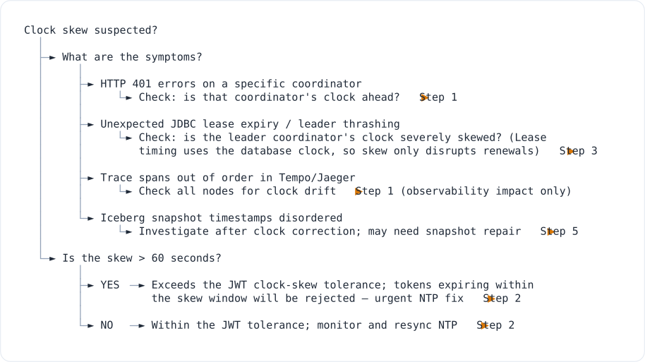

# Runbook: Clock Skew (GD-006)

**Use this runbook when:** One or more nodes have significant clock drift, causing JWT authentication failures, JDBC lease anomalies, or distributed timestamp ordering violations.

| Field | Value |
|-------|-------|
| Scenario | [GD-006: Clock Skew](../scenarios/gd-006-clock-skew.md) |
| Severity | Medium |
| Primary risk | JWT tokens rejected on skewed nodes (auth failures); premature JDBC lease expiry |
| Expected resolution | NTP resync; automatic — no Pangrova process restart needed for ≤ 10 min skew |

---

## Decision Tree



---

## Step 1: Measure Clock Drift Across All Nodes

```bash
# Compare timestamps across all nodes
echo "Node clock comparison ($(date -u +%Y-%m-%dT%H:%M:%SZ) local):"
for node in coordinator-1 coordinator-2 coordinator-3 worker-0 worker-1; do
  TS=$(ssh "${node}" "date -u +%Y-%m-%dT%H:%M:%S.%3NZ" 2>/dev/null || echo "UNREACHABLE")
  echo "  ${node}: ${TS}"
done

# Check chrony status on each coordinator
for node in coordinator-1 coordinator-2 coordinator-3; do
  echo "=== ${node} chrony tracking ==="
  ssh "${node}" "chronyc tracking 2>/dev/null | grep -E 'System time|Stratum|Reference'" || \
    echo "  chronyc not available"
done

# Identify the skewed node
echo ""
echo "If one node's timestamp differs by > 100ms, it has clock drift."
echo "If > 60 seconds, tokens whose exp claim falls within the skew window will be"
echo "rejected on that node (the JWT clock-skew tolerance is 60 seconds)."
```

---

## Step 2: Restore NTP Synchronization

Apply this on every node where drift was detected.

```bash
SKEWED_NODE="<node-with-drift>"  # e.g., coordinator-2

ssh "${SKEWED_NODE}" "
  echo '=== Current NTP status ==='
  timedatectl status

  echo ''
  echo '=== Re-enabling NTP ==='
  sudo timedatectl set-ntp true

  # Wait for NTP to sync (up to 60s for initial sync)
  for i in \$(seq 1 12); do
    sleep 5
    DRIFT=\$(chronyc tracking 2>/dev/null | grep 'System time' | awk '{print \$4, \$5}' || echo 'unknown')
    echo \"  [${i}] Drift: \${DRIFT}\"
    # Consider synced when drift < 100ms
    DRIFT_SEC=\$(chronyc tracking 2>/dev/null | grep 'System time' | awk '{print \$4}' || echo '999')
    python3 -c \"exit(0 if float('\${DRIFT_SEC}') < 0.1 else 1)\" 2>/dev/null && \
      echo '  NTP sync achieved' && break
  done

  echo ''
  echo '=== Final clock status ==='
  timedatectl status
  chronyc tracking
"
```

If NTP sync does not converge in 60s, force a manual step:

```bash
ssh "${SKEWED_NODE}" "
  sudo chronyc makestep   # Force immediate clock step (not gradual slew)
  sleep 3
  chronyc tracking | grep 'System time'
"
```

---

## Step 3: Assess JWT Authentication Impact

After correcting the clock, verify that authentication is working on the previously-skewed node:

```bash
SKEWED_NODE="coordinator-2"

# Test JWT validation — should return 200 now
STATUS=$(curl -s -o /dev/null -w "%{http_code}" \
  -H "Authorization: Bearer ${PANGROVA_TOKEN}" \
  -H "Content-Type: application/json" \
  -X POST "http://${SKEWED_NODE}:8080/v1/query/submit" \
  -d '{"query": "SELECT 1"}')
echo "Auth test on ${SKEWED_NODE}: HTTP ${STATUS}"

if [[ "${STATUS}" == "401" ]]; then
  echo "WARN: Still returning 401. Possible causes:"
  echo "  1. Clock not yet synced — wait another 30s and retry"
  echo "  2. Token itself is expired — obtain a fresh token from the IdP"
  echo "  3. Cached token-validation state — restart the coordinator process if the issue persists"

  # Retry with fresh token
  # FRESH_TOKEN=$(obtain-fresh-token)
  # curl -H "Authorization: Bearer ${FRESH_TOKEN}" ...
fi
```

---

## Step 4: Verify JDBC Lease Stability

Large clock skew can cause the JDBC lease holder to think its lease expired prematurely, triggering an unnecessary leadership change.

```bash
# Check for unexpected leadership changes in logs
for coord in coordinator-1 coordinator-2 coordinator-3; do
  echo "=== ${coord} lease/role events (last 30 min) ==="
  ssh "${coord}" "
    grep -E 'lease.*(expired|lost)|demoted|event=ha_started|STANDBY.*LEADER' \
      /var/log/pangrova/coordinator.log | tail -10
  " 2>/dev/null
done

# Verify current cluster state is stable (exactly one active lease holder)
ACTIVE_LEASES=$(psql -h "${PANGROVA_DB_HOST}" -p 5432 -U pangrova -d pangrova_meta -At \
  -c "SELECT COUNT(*) FROM distributed_lease WHERE expires_at >= CURRENT_TIMESTAMP;")
echo "Leaders: ${ACTIVE_LEASES}"
if [[ "${ACTIVE_LEASES}" -eq 1 ]]; then
  echo "PASS: Cluster stable"
else
  echo "FAIL: Unexpected leader count — investigate"
fi
```

---

## Step 5: Check for Timestamp Ordering Issues in Iceberg/Paimon

If clock skew occurred during write operations, Iceberg snapshot timestamps may be disordered. This does not cause data loss but can affect time-travel queries. Pangrova has no built-in snapshot system table — inspect the table metadata through the Iceberg REST catalog API (the `loadTable` response includes the snapshot list):

```bash
# Inspect recent snapshots of a table through the REST catalog API
NAMESPACE="<namespace>"
TABLE="<table>"
curl -s "http://coordinator-1:8080/v1/namespaces/${NAMESPACE}/tables/${TABLE}" | \
  python3 -c "
import json, sys, datetime
data = json.load(sys.stdin)
metadata = data.get('metadata', data)
snapshots = metadata.get('snapshots', [])
now_ms = datetime.datetime.now(datetime.timezone.utc).timestamp() * 1000
future = [s for s in snapshots if s.get('timestamp-ms', 0) > now_ms]
print(f'Snapshots: {len(snapshots)}, future-timestamped: {len(future)}')
for s in sorted(snapshots, key=lambda x: x.get('timestamp-ms', 0), reverse=True)[:20]:
    ts = datetime.datetime.fromtimestamp(s.get('timestamp-ms', 0) / 1000, datetime.timezone.utc)
    print(f'  snapshot {s.get(\"snapshot-id\")}: committed {ts.isoformat()}')
"
```

If future-timestamped snapshots are found, escalate to the Data Platform team for snapshot metadata repair. Do not attempt to repair snapshot timestamps without guidance — incorrect repair can break Iceberg time travel.

---

## Step 6: Prevent Recurrence

```bash
# Verify NTP is active and configured on all nodes
for node in coordinator-1 coordinator-2 coordinator-3 worker-0 worker-1; do
  NTP_ACTIVE=$(ssh "${node}" "systemctl is-active chronyd 2>/dev/null || systemctl is-active ntpd 2>/dev/null || echo inactive")
  DRIFT=$(ssh "${node}" "chronyc tracking 2>/dev/null | grep 'System time' | awk '{print \$4, \$5}'" || echo "unknown")
  echo "${node}: NTP=${NTP_ACTIVE}  drift=${DRIFT}"
done

# Ensure alert exists for clock drift > 500ms
# Prometheus rule example:
# - alert: NodeClockSkew
#   expr: abs(node_timex_offset_seconds) > 0.5
#   for: 5m
#   labels:
#     severity: warning
#   annotations:
#     summary: "Node {{ $labels.instance }} clock skew > 500ms"
#     description: "Clock offset: {{ $value }}s — NTP may be misconfigured"

echo ""
echo "Verify the NodeClockSkew alert rule exists in Prometheus:"
curl -s "http://alertmanager:9093/api/v2/alerts" | \
  python3 -c "
import json, sys
alerts = json.load(sys.stdin)
clock_alerts = [a for a in alerts if 'ClockSkew' in a.get('labels', {}).get('alertname', '')]
print(f'Clock skew alert rules found: {len(clock_alerts)}')
for a in clock_alerts:
    print(f'  {a[\"labels\"][\"alertname\"]}: {a[\"status\"][\"state\"]}')
" 2>/dev/null || echo "  (unable to query alertmanager)"
```

---

## Escalation Criteria

| Condition | Action |
|-----------|--------|
| Clock skew > 30 minutes | Escalate to infra team; NTP server may be unreachable or misconfigured |
| JDBC lease corruption suspected (multiple leader elections in < 1 hour) | Stop all writes; escalate to data platform lead |
| Future-timestamped Iceberg snapshots found | Escalate to data platform lead; do not attempt manual repair |
| Clock correction causes GC pause > 5s on coordinator | Monitor heap; trigger GC if coordinator becomes unresponsive |
| NTP refuses to step (large adjustment disabled) | SSH to node, run `sudo chronyc makestep` to allow a one-time step |
