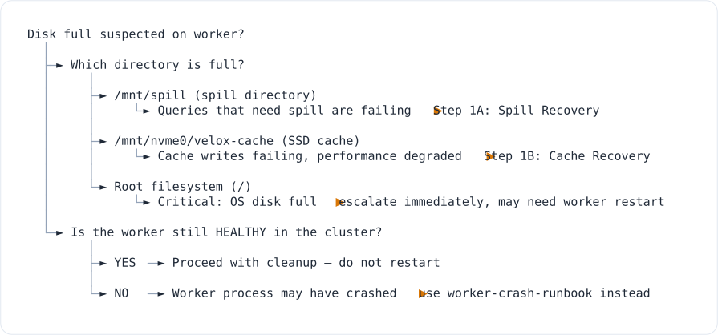

# Runbook: Disk Full on Worker (GD-005)

**Use this runbook when:** A worker node's spill directory or native SSD cache is full, causing query failures or cache degradation.

| Field | Value |
|-------|-------|
| Scenario | [GD-005: Disk Full on Worker](../scenarios/gd-005-disk-full-worker.md) |
| Severity | Medium |
| Primary risk | Query spill failures; native cache write failures causing performance regression |
| Expected resolution | Manual disk cleanup; worker process stays up throughout |

---

## Decision Tree



---

## Step 1: Identify Disk Usage

```bash
TARGET_WORKER="<worker-node>"  # e.g., worker-0

# Check disk usage on all relevant mounts
ssh "${TARGET_WORKER}" "
  echo '=== Disk usage ==='
  df -h /mnt/spill /mnt/nvme0/velox-cache / 2>/dev/null || df -h

  echo ''
  echo '=== Spill directory contents ==='
  ls -lhS /mnt/spill/ | head -20

  echo ''
  echo '=== Velox cache directory ==='
  ls -lhS /mnt/nvme0/velox-cache/ | head -20
"

# Verify worker health (from the coordinator's worker list)
curl -s http://coordinator:8080/api/workers | \
  python3 -c "
import json, sys
workers = json.load(sys.stdin)
for w in workers:
    if '${TARGET_WORKER}' in w['host']:
        print(f'Worker {w[\"host\"]}: {w[\"healthState\"]} (runningTasks={w[\"runningTaskCount\"]})')
"
```

---

## Step 1A: Spill Directory Recovery

The spill directory holds temporary files owned by the Worker's task and
shuffle-lifecycle code. Do not delete spill files by hand while the Worker runs:
file age does not prove that an owner has drained, and manual deletion can corrupt
in-flight tasks. Prefer the application-owned cleanup below.

```bash
# Inspect disk usage and the configured quota; do not delete files here.
ssh "${TARGET_WORKER}" "
  echo '=== Spill files older than 1 hour (inspection only) ==='
  find /mnt/spill -type f -mmin +60 | head -20
  df -h /mnt/spill
"

# Application-owned cleanup: let the Worker and Coordinator drain the exact
# attempts, then restart the Worker if its spill state must be reset. There is no
# admin API for deleting another attempt's spill files.
ssh "${TARGET_WORKER}" "df -h /mnt/spill"
curl -s "http://coordinator:8080/api/queries" | \
  python3 -c "
import json, sys
queries = json.load(sys.stdin)
active = [q['queryId'] for q in queries if q['status'] in ('SUBMITTED', 'RUNNING')]
print(f'Active queries: {len(active)}')
"
```

If the spill directory is full because of a game day filler file:

```bash
# Remove game day filler file (if present)
ssh "${TARGET_WORKER}" "
  ls /mnt/spill/gd-*.dat 2>/dev/null && rm -f /mnt/spill/gd-*.dat && echo 'Filler removed' || echo 'No filler file'
  df -h /mnt/spill
"
```

---

## Step 1B: Native SSD Cache Recovery

The native SSD cache (`worker.native.cache.ssd-path`) stores remote data cached locally for faster repeat access. There is no runtime cache-eviction API and no Prometheus-style `/metrics` endpoint — cache size is bounded by `worker.native.cache.ssd-bytes` and managed internally. Do **not** delete cache files manually while the worker is running; instead:

```bash
# If disk is critically full, the safe options are:

# 1. Remove game day filler file if present (safe — not a cache file)
ssh "${TARGET_WORKER}" "
  ls /mnt/nvme0/velox-cache/gd-*.dat 2>/dev/null && \
    rm -f /mnt/nvme0/velox-cache/gd-*.dat && echo 'Filler removed' || echo 'No filler file'
  df -h /mnt/nvme0/velox-cache
"

# 2. Shrink the configured cache size and restart the worker:
#    edit worker.yml → worker.native.cache.ssd-bytes (e.g. halve it), then
#    systemctl restart pangrova-worker
```

**Warning:** Deleting native cache files directly while the worker holds them open is destructive. Only delete game-day filler files (named `gd-*.dat`) by hand; bound cache growth with `worker.native.cache.ssd-bytes` instead.

---

## Step 2: Verify Disk Space Restored

```bash
ssh "${TARGET_WORKER}" "
  echo '=== Disk usage after cleanup ==='
  df -h /mnt/spill /mnt/nvme0/velox-cache /
  echo ''
  echo '=== Free space check ==='
  SPILL_FREE=\$(df --output=avail /mnt/spill | tail -1)
  CACHE_FREE=\$(df --output=avail /mnt/nvme0/velox-cache | tail -1)
  echo \"Spill free: \${SPILL_FREE}K\"
  echo \"Cache free: \${CACHE_FREE}K\"
  [[ \${SPILL_FREE} -gt 102400 ]] && echo 'Spill: OK (>100 MB free)' || echo 'WARN: Spill still low'
  [[ \${CACHE_FREE} -gt 1048576 ]] && echo 'Cache: OK (>1 GB free)' || echo 'WARN: Cache still low'
"
```

---

## Step 3: Verify Worker Recovery

```bash
# Verify worker health
curl -s http://coordinator:8080/api/workers | \
  python3 -c "
import json, sys
workers = json.load(sys.stdin)
for w in workers:
    if '${TARGET_WORKER}' in w['host']:
        print(f'healthState: {w[\"healthState\"]}  runningTasks={w[\"runningTaskCount\"]}  memoryPressure={w[\"memoryPressure\"]}')
"

# Verify a spill-capable query succeeds (submit and poll its state)
QUERY_ID=$(curl -s \
  -H "Content-Type: application/json" \
  -X POST "http://coordinator:8080/v1/query/submit" \
  -d '{"query": "SELECT l_orderkey, SUM(l_extendedprice) FROM benchmark.lineitem GROUP BY l_orderkey LIMIT 100"}' | \
  python3 -c "import json,sys; print(json.load(sys.stdin)['queryId'])")
echo "Submitted ${QUERY_ID}"
curl -s "http://coordinator:8080/v1/query/${QUERY_ID}/state"

# Verify repeated scans improve in latency as the native cache re-warms (if enabled)
```

---

## Step 4: Root Cause Investigation

```bash
# Check worker logs for disk error messages
ssh "${TARGET_WORKER}" "
  echo '=== Spill errors ==='
  grep -E 'spill|SPILL|no space|disk full|ENOSPC' \
    /var/log/pangrova/worker.log | tail -30

  echo ''
  echo '=== Velox cache write failures ==='
  grep -E 'velox.*cache.*write|cache.*failed|SSD.*full' \
    /var/log/pangrova/worker.log | tail -20

  echo ''
  echo '=== Recent error log entries ==='
  tail -50 /var/log/pangrova/worker-error.log
"

# Check if disk growth is expected (large join spills, data ingestion) or unexpected
ssh "${TARGET_WORKER}" "
  echo '=== Disk usage trend (du on spill dir) ==='
  du -sh /mnt/spill/
  echo ''
  echo '=== Oldest spill file age ==='
  find /mnt/spill -type f | xargs ls -lt 2>/dev/null | tail -5
"
```

---

## Step 5: Preventive Actions

Based on findings, take one or more of the following preventive steps:

```bash
# Option A: Increase spill directory size (coordinate with infra team)
# Requires resize of the underlying volume and filesystem

# Option B: Lower the spill threshold to trigger earlier (before disk is full)
# Edit /etc/pangrova/worker.yml:
# worker:
#   shuffle:
#     spill-threshold: 0.65   # Spill earlier (default 0.8)
# Config is read at startup: systemctl restart pangrova-worker

# Option C: Reduce query memory budget to reduce spill frequency
# Edit /etc/pangrova/worker.yml:
# worker:
#   memory:
#     budget-bytes: 12884901888   # Reduce from 16 GiB (bytes)
# Restart the worker for the change to take effect.

# Option D: Set up disk usage alerts at 80% threshold
# Add to Prometheus alerting rules:
# - alert: WorkerSpillDiskHigh
#   expr: (1 - node_filesystem_avail_bytes{mountpoint="/mnt/spill"} /
#              node_filesystem_size_bytes{mountpoint="/mnt/spill"}) > 0.80
#   for: 5m
```

---

## Escalation Criteria

Escalate to on-call lead if any of the following are true:

| Condition | Action |
|-----------|--------|
| Worker process crashed (not just query failure) | Use worker-crash-runbook; escalate if restart loop |
| Root filesystem (`/`) is full | Escalate immediately — OS stability at risk |
| Multiple workers simultaneously disk-full | Possible widespread data ingestion spike; alert Data Platform lead |
| Cache directory full and shrink-and-restart did not help | Worker may be in a hung state; escalate for graceful restart |
| Spill files for active queries cannot be identified | Risk of corrupting in-flight queries; escalate before deleting |
