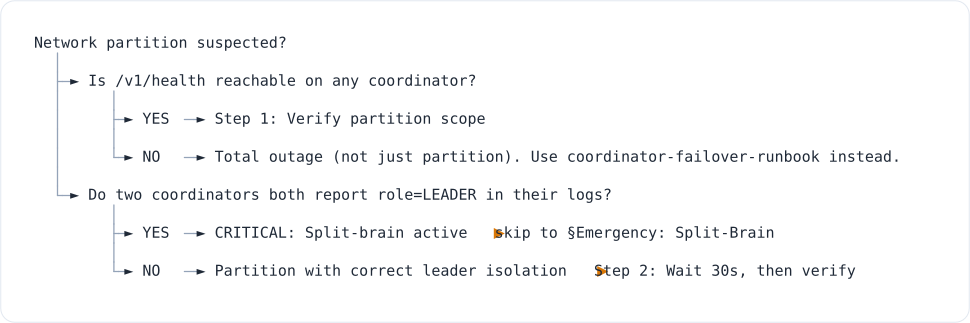

# Runbook: Network Partition (GD-004)

**Use this runbook when:** A network partition has split the Coordinator cluster, or when two Coordinator nodes both claim to be LEADER (split-brain).

| Field | Value |
|-------|-------|
| Scenario | [GD-004: Network Partition (Split Brain)](../scenarios/gd-004-network-partition.md) |
| Severity | Critical |
| Primary risk | Dual-leader split-brain → potential dual-write and metadata corruption |
| Expected resolution | Automatic (minority surrenders within 30s); manual intervention only if automatic fails |

> **Endpoint note:** There is no cluster-status REST API today
> (`GET /v1/cluster/status` is not yet implemented — `bin/pangrova-cluster-status.sh`
> prints a notice and will fail until it is). HA role is therefore determined from
> coordinator logs (`event=ha_started ... role=LEADER|STANDBY`), worker health from
> `GET /api/workers`, and the JDBC lease state from the `distributed_lease` table.

---

## Decision Tree



---

## Step 1: Confirm the Partition

```bash
# Check reachability and last observed HA role of each coordinator
for coord in coordinator-1 coordinator-2 coordinator-3; do
  echo "=== ${coord} ==="
  HTTP=$(curl -s -o /dev/null -w "%{http_code}" --max-time 3 \
    "http://${coord}:8080/v1/health" 2>/dev/null || echo "000")
  ROLE=$(ssh "${coord}" "grep 'event=ha_started' /var/log/pangrova/coordinator.log 2>/dev/null | tail -1" \
    | grep -o 'role=[A-Z]*' | cut -d= -f2 || true)
  echo "  health=HTTP ${HTTP} lastRole=${ROLE:-UNKNOWN}"
done
```

**Interpret results:**

| Pattern | Interpretation |
|---------|---------------|
| Some coordinators reachable, others not | Classic partition — investigate which side holds the leader |
| All coordinators reachable with 1 LEADER | No partition — investigate other causes |
| Two coordinators report `role=LEADER` after the partition | Potential split-brain — escalate immediately |

---

## Step 2: Wait for Automatic Recovery (0–30s)

The JDBC lease mechanism should automatically resolve the partition:
- The isolated minority coordinator will fail to renew its lease within the lease
  timeout (default 30s, heartbeat every 10s)
- It will step down to `STANDBY`
- The majority side will elect a new LEADER if needed

**Do not intervene during this window.** Watch roles converge:

```bash
# Live watch: poll each coordinator's latest HA role every 3 seconds for 60 seconds
END_TIME=$(( $(date +%s) + 60 ))
while [[ $(date +%s) -lt $END_TIME ]]; do
  echo "=== $(date -u +%H:%M:%S) ==="
  for coord in coordinator-1 coordinator-2 coordinator-3; do
    ROLE=$(ssh "${coord}" "grep 'event=ha_started' /var/log/pangrova/coordinator.log 2>/dev/null | tail -1" \
      | grep -o 'role=[A-Z]*' | cut -d= -f2 || echo "ERR")
    echo "  ${coord}: ${ROLE:-ERR}"
  done
  sleep 3
done
```

**Expected resolution:** Within 30s, the cluster converges to exactly 1 LEADER and 2 STANDBY nodes.

---

## Step 3: Verify Single Leader

```bash
# Count leaders by inspecting the authoritative JDBC lease table
LEADERS=$(psql -h "${PANGROVA_DB_HOST}" -p 5432 -U pangrova -d pangrova_meta -At \
  -c "SELECT holder_id FROM distributed_lease WHERE expires_at >= CURRENT_TIMESTAMP;" | wc -l)

echo "Active lease holders: ${LEADERS}"

if [[ "${LEADERS}" -eq 1 ]]; then
  echo "PASS: Exactly 1 lease holder. Cluster is healthy."
elif [[ "${LEADERS}" -eq 0 ]]; then
  echo "WARN: No active lease. May need to force election — see Step 5."
else
  echo "CRITICAL: Split-brain detected! ${LEADERS} lease holders — see §Emergency."
fi
```

---

## Step 4: Verify Query Service Restored

```bash
# Find the active leader from the lease table and verify queries succeed
LEADER_HOST=$(psql -h "${PANGROVA_DB_HOST}" -p 5432 -U pangrova -d pangrova_meta -At \
  -c "SELECT holder_id FROM distributed_lease WHERE expires_at >= CURRENT_TIMESTAMP LIMIT 1;")

echo "Active leader: ${LEADER_HOST}"

if [[ -n "${LEADER_HOST}" ]]; then
  STATUS=$(curl -s -o /dev/null -w "%{http_code}" \
    -H "Content-Type: application/json" \
    -X POST "http://${LEADER_HOST}:8080/v1/query/submit" \
    -d '{"query": "SELECT 1"}')
  echo "Query to leader: HTTP ${STATUS}"
fi
```

---

## Step 5: Force Leader Election (If No Leader After 60s)

Use only if the cluster has no LEADER 60 seconds after the partition healed, and automatic election has not occurred.

There is no force-election REST API. Election is lease-driven, so force it by
restarting the coordinator whose lease state is freshest (or restart standbys
one at a time until one acquires the lease):

```bash
for coord in coordinator-1 coordinator-2 coordinator-3; do
  echo "Attempting election via restart on ${coord}..."
  ssh "${coord}" "sudo systemctl restart pangrova-coordinator"
  sleep 20
  LEADER=$(ssh "${coord}" "grep 'event=ha_started' /var/log/pangrova/coordinator.log | tail -1")
  echo "  Latest HA event: ${LEADER}"
  if echo "${LEADER}" | grep -q "role=LEADER"; then
    echo "  ${coord} acquired leadership"
    break
  fi
done

# Wait and verify a lease holder exists
sleep 15
psql -h "${PANGROVA_DB_HOST}" -p 5432 -U pangrova -d pangrova_meta \
  -c "SELECT lease_key, holder_id, epoch, acquired_at, expires_at FROM distributed_lease;"
```

---

## Step 6: Verify Workers Re-Registered

After a partition, workers on the minority side may have lost their coordinator connection. Verify all workers are ACTIVE:

```bash
curl -s http://coordinator-1:8080/api/workers | \
  python3 -c "
import json, sys
workers = json.load(sys.stdin)
healthy   = [w for w in workers if w['healthState'] == 'ACTIVE']
unhealthy = [w for w in workers if w['healthState'] != 'ACTIVE']
print(f'ACTIVE: {len(healthy)}/{len(workers)}')
for w in unhealthy:
    print(f'  NOT ACTIVE: {w[\"host\"]} healthState={w[\"healthState\"]}')
"

# If workers are missing or unhealthy, they re-register automatically; wait up to 60s
echo "Waiting for worker re-registration (up to 60s)..."
sleep 60
curl -s http://coordinator-1:8080/api/workers | python3 -m json.tool
```

---

## Step 7: Root Cause Investigation

After the cluster is stable, investigate the partition cause:

```bash
# Check for iptables rules that may have caused the partition
for coord in coordinator-1 coordinator-2 coordinator-3; do
  echo "=== ${coord} iptables ==="
  ssh "${coord}" "sudo iptables -L OUTPUT -n --line-numbers | grep DROP || echo 'no DROP rules'"
  ssh "${coord}" "sudo iptables -L INPUT -n --line-numbers | grep DROP || echo 'no DROP rules'"
done

# Check network interface status
for coord in coordinator-1 coordinator-2 coordinator-3; do
  echo "=== ${coord} network ==="
  ssh "${coord}" "ip link show | grep -E 'state|mtu'"
done

# Check coordinator logs for partition detection messages
for coord in coordinator-1 coordinator-2 coordinator-3; do
  echo "=== ${coord} partition-related log entries ==="
  ssh "${coord}" "
    grep -E 'lease.*(expired|lost)|demoted|STANDBY|partition|heartbeat.*failed' \
      /var/log/pangrova/coordinator.log | tail -20
  "
done
```

---

## Step 8: Restore Redundancy

After confirming the isolated coordinator has rejoined as STANDBY and all workers are ACTIVE, verify the cluster is back to full redundancy:

```bash
# Confirm all 3 coordinators are healthy and exactly one holds the lease
for coord in coordinator-1 coordinator-2 coordinator-3; do
  HTTP=$(curl -s -o /dev/null -w "%{http_code}" --max-time 3 "http://${coord}:8080/v1/health")
  echo "${coord}: HTTP ${HTTP}"
done

psql -h "${PANGROVA_DB_HOST}" -p 5432 -U pangrova -d pangrova_meta -At \
  -c "SELECT COUNT(*) FROM distributed_lease WHERE expires_at >= CURRENT_TIMESTAMP;" \
  | xargs -I{} echo "Active lease holders: {} (expect 1 → full redundancy restored)"
```

---

## Emergency: Split-Brain Detected

**Condition:** Two coordinators simultaneously report `role=LEADER` in their logs.

This is a critical defect that must not be resolved by simply restarting one coordinator — doing so could cause data loss if both sides accepted DDL commits.

**Immediate actions:**

```bash
# 1. FREEZE all DDL operations — alert the team immediately
echo "SPLIT-BRAIN DETECTED: Escalating to on-call lead"

# 2. Capture the HA role state of every coordinator at this instant
for coord in coordinator-1 coordinator-2 coordinator-3; do
  echo "=== ${coord} HA events at $(date -u) ==="
  ssh "${coord}" "grep 'event=ha_started' /var/log/pangrova/coordinator.log | tail -5"
done > /tmp/split-brain-state-$(date +%Y%m%d-%H%M%S).txt

# 3. Capture the JDBC lease table directly
psql -h "${PANGROVA_DB_HOST}" -p 5432 -U pangrova -d pangrova_meta \
  -c "SELECT lease_key, holder_id, epoch, acquired_at, expires_at, version
      FROM distributed_lease ORDER BY acquired_at;" | \
  tee /tmp/split-brain-lease-state.txt

# 4. Stop the newer "leader" (whichever acquired the lease more recently)
# DO NOT restart — stop only, to prevent further state divergence
# ssh <newer-leader> "sudo systemctl stop pangrova-coordinator"

# 5. Escalate — do not attempt automated recovery
echo "Manual investigation required. Do not restart any coordinator."
echo "See post-mortem template for investigation checklist."
```

**Escalation path:** On-call lead → Data Platform lead → Pangrova core team
