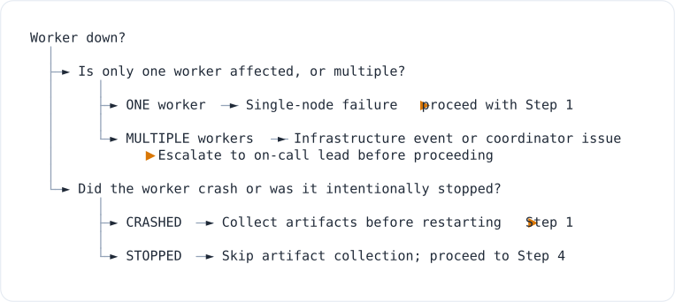

# Runbook: Worker Crash Recovery

**Use this runbook when:** A Worker has exceeded the configured heartbeat timeout
(30 seconds by default), its process has exited, or the Coordinator reports it
unavailable. Detection also depends on the monitoring sweep; 15 seconds is not
the default failure threshold.

| Field | Value |
|-------|-------|
| Scenario | [GD-002: Worker Crash During Shuffle](../scenarios/gd-002-worker-crash-shuffle.md) |
| Severity | High |
| Primary risk | Queries with active tasks on the crashed worker fail; in-flight shuffle data lost |
| Expected resolution | Worker restart + automatic re-registration within 60s |

---

## Decision Tree



---

## Step 1: Confirm Worker Down

```bash
# Check the coordinator's view of all worker statuses
curl -s http://coordinator:8080/api/workers | \
  python3 -c "
import json, sys
workers = json.load(sys.stdin)
for w in workers:
    status_flag = '⚠' if w['healthState'] != 'ACTIVE' else ' '
    print(f\"{status_flag} {w['host']}:{w['httpPort']}: {w['healthState']}  tasks={w['runningTaskCount']}  lastHeartbeat={w['lastHeartbeat']}\")
"

# Confirm from the worker node directly
TARGET_WORKER="worker-N"  # replace with actual worker hostname

ssh "${TARGET_WORKER}" "
  systemctl status pangrova-worker
  echo '---'
  ps aux | grep pangrova-worker | grep -v grep || echo 'Process: NOT RUNNING'
"

# Check for crash evidence
ssh "${TARGET_WORKER}" "
  ls /var/log/pangrova/heapdump-worker*.hprof 2>/dev/null && echo 'Heap dump found (OOM)' || echo 'No heap dump'
  ls /tmp/hs_err_pid*.log 2>/dev/null && echo 'JVM crash log found' || echo 'No JVM crash log'
  dmesg | grep -i 'oom\|killed process.*pangrova' | tail -5
"
```

---

## Step 2: Assess Query Impact

```bash
# Identify failed queries from the coordinator's query list
# (there is no admin query API — /api/queries returns summaries for active queries)
curl -s "http://coordinator:8080/api/queries" | \
  python3 -c "
import json, sys
queries = json.load(sys.stdin)
failed = [q for q in queries if q['status'] == 'FAILED']
running = [q for q in queries if q['status'] in ('SUBMITTED', 'RUNNING')]
print(f'Failed queries: {len(failed)}; still running: {len(running)}')
for q in failed[:10]:
    print(f'  queryId={q[\"queryId\"]}  error={q.get(\"error\")}')
"

# Inform affected users if query failures are detected
echo "If non-retryable query failures are detected, notify affected clients."
```

---

## Step 3: Clean Up Orphaned Shuffle Resources

When a worker crashes mid-shuffle, it may leave orphaned shuffle partitions on surviving workers. These consume disk space. There is no shuffle-cleanup admin API — shuffle data tied to failed queries is released as those queries are cleaned up, so verify and remove stale files manually:

```bash
# Verify orphaned shuffle files on surviving workers
for worker in worker-1 worker-2 worker-3; do
  [[ "${worker}" == "${TARGET_WORKER}" ]] && continue
  echo "=== ${worker} shuffle directory ==="
  ssh "${worker}" "
    SHUFFLE_DIR=/mnt/spill/pangrova/shuffle  # or configured spill path
    find \"\${SHUFFLE_DIR}\" -name \"*${TARGET_WORKER}*\" 2>/dev/null | wc -l | \
      xargs -I{} echo 'Orphan files from crashed worker: {}'
    du -sh \"\${SHUFFLE_DIR}\" 2>/dev/null
  "
done

# Remove stale orphan files (older than 1 hour; in-flight query files are newer)
for worker in worker-1 worker-2 worker-3; do
  [[ "${worker}" == "${TARGET_WORKER}" ]] && continue
  ssh "${worker}" "find /mnt/spill/pangrova/shuffle -name '*${TARGET_WORKER}*' -mmin +60 -delete 2>/dev/null || true"
done
```

---

## Step 4: Restart Worker

```bash
# Collect logs and crash artifacts BEFORE restarting (they may be overwritten)
ssh "${TARGET_WORKER}" "
  TIMESTAMP=\$(date +%Y%m%d-%H%M%S)
  ARCHIVE=/tmp/worker-crash-\${TIMESTAMP}.tar.gz
  tar czf \"\${ARCHIVE}\" \
    /var/log/pangrova/pangrova-worker*.log \
    /var/log/pangrova/gc-worker.log \
    /var/log/pangrova/heapdump-worker*.hprof 2>/dev/null \
    /tmp/hs_err_pid*.log 2>/dev/null || true
  echo \"Artifacts archived: \${ARCHIVE}\"
"

# Identify root cause before restarting
ssh "${TARGET_WORKER}" "
  echo '=== OOM evidence ==='
  dmesg | grep -i 'out of memory\|killed process.*java' | tail -5

  echo '=== JVM error log ==='
  cat /tmp/hs_err_pid*.log 2>/dev/null | head -30 || echo 'No JVM error log'

  echo '=== Worker error log ==='
  tail -30 /var/log/pangrova/worker-error.log 2>/dev/null
"

# Restart the worker process
ssh "${TARGET_WORKER}" "systemctl start pangrova-worker"

# Tail the log to confirm startup
ssh "${TARGET_WORKER}" "journalctl -u pangrova-worker -f --no-pager &" &
TAIL_PID=$!
sleep 20
kill $TAIL_PID 2>/dev/null
```

---

## Step 5: Verify Recovery

```bash
# Wait for the worker to complete registration (up to 60s)
echo "Waiting for worker registration..."
for i in $(seq 1 12); do
  STATUS=$(curl -s http://coordinator:8080/api/workers | \
    python3 -c "
import json, sys
workers = json.load(sys.stdin)
for w in workers:
    if '${TARGET_WORKER}' in w['host']:
        print(w['healthState'])
")
  echo "  [${i}] ${TARGET_WORKER} status: ${STATUS}"
  [[ "${STATUS}" == "ACTIVE" ]] && echo "RECOVERED" && break
  sleep 5
done

# Verify the restarted worker carries no stale tasks (runningTaskCount should be 0 initially)
curl -s http://coordinator:8080/api/workers | \
  python3 -c "
import json, sys
for w in json.load(sys.stdin):
    if '${TARGET_WORKER}' in w['host']:
        print(f'runningTasks: {w[\"runningTaskCount\"]}')
"

# Run a test query to confirm the worker accepts new work
STATUS=$(curl -s -o /dev/null -w "%{http_code}" \
  -H "Content-Type: application/json" \
  -X POST "http://coordinator:8080/v1/query/submit" \
  -d '{"query": "SELECT count(*) FROM benchmark.lineitem"}')
echo "Test query result: HTTP ${STATUS}"  # Expected: 200

# Verify overall cluster health
curl -s http://coordinator:8080/api/workers | \
  python3 -c "
import json, sys
workers = json.load(sys.stdin)
healthy = sum(1 for w in workers if w['healthState'] == 'ACTIVE')
print(f'Cluster health: {healthy}/{len(workers)} workers ACTIVE')
"
```

---

## Recovery Verification Checklist

- [ ] Worker registered with coordinator as ACTIVE
- [ ] Worker accepting new query tasks
- [ ] No orphaned shuffle files remaining on any surviving worker
- [ ] Previously-failed queries retried (or clients notified for non-retryable failures)
- [ ] Worker memory metrics back to normal baseline
- [ ] No crash loop (no restart within 10 minutes of Step 4)
- [ ] Monitoring alerts cleared in Grafana/Alertmanager

---

## Escalation Criteria

| Condition | Action |
|-----------|--------|
| Worker crash loop (≥ 3 restarts in 10 min) | Page on-call SRE lead; do not keep restarting |
| Multiple workers crashed simultaneously | Page engineering lead; may be infrastructure event |
| Heap dump present but worker OOM config correct | Page data platform lead to investigate query workload |
| Shuffle orphan files remain after cleanup | Page on-call SRE lead |
| Worker starts but fails to register after 60s | Check coordinator logs; may be an internal-auth-secret mismatch or network issue |

---

## Post-Incident

1. Review GC logs for heap pressure patterns before the crash
2. Check if query workload had unusual memory consumption (large sorts, joins, aggregations)
3. Verify `worker.memory.budget-bytes` in `worker.yml` is appropriate for the node's total RAM
4. Consider adding a worker heap-usage alert at 80% threshold
5. Scale worker capacity (Kubernetes autoscaling or additional nodes) if capacity was insufficient during recovery period
